# [CTF] CTFHub_历年真题★★★普通难度misc部分writeup

- 原帖: https://www.52pojie.cn/forum.php?mod=viewthread&tid=1993113
- 抓取时间: 2026-11-01T22:17:39

## 蛛丝马迹
题目描述：
> 
干完活一定要记得擦干净屁股哟~，flag格式为Flag-xxx
2016-第五届山东省网络安全竞赛-Misc-蛛丝马迹
得到这一堆东西
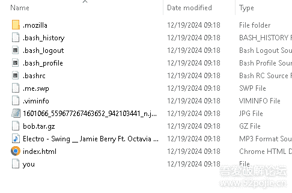
1.png (18.37 KB, 下载次数: 1)
[href="forum.php?mod=attachment&aid=Mjc0NTE2NXxhMTY5MWE5N3wxNzkzNTcxNDU2fDE2ODA4NnwxOTkzMTEz&nothumb=yes" target="_blank"](https://www.52pojie.cn/forum.php?mod=attachment&aid=Mjc0NTE2NXxhMTY5MWE5N3wxNzkzNTcxNDU2fDE2ODA4NnwxOTkzMTEz&nothumb=yes)
2024-12-20 19:48 上传
每个文件翻一翻，在`.me.swp`里找到flag
```
Flag-1s4g76jk89f
```

## 回转十三位
题目描述：
> 
根据密文获得明文，flag格式为flag{xxx}
2016-第五届山东省网络安全竞赛-Crypto-回转十三位
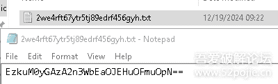
2.png (9.72 KB, 下载次数: 2)
[href="forum.php?mod=attachment&aid=Mjc0NTE2NnwzOTcyYjcyN3wxNzkzNTcxNDU2fDE2ODA4NnwxOTkzMTEz&nothumb=yes" target="_blank"](https://www.52pojie.cn/forum.php?mod=attachment&aid=Mjc0NTE2NnwzOTcyYjcyN3wxNzkzNTcxNDU2fDE2ODA4NnwxOTkzMTEz&nothumb=yes)
2024-12-20 19:48 上传
得到密文，放到`CyberChef`用`magic`解出flag
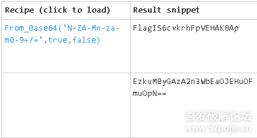
3.png (8.86 KB, 下载次数: 1)
[href="forum.php?mod=attachment&aid=Mjc0NTE2N3xlMDRiNzQzMXwxNzkzNTcxNDU2fDE2ODA4NnwxOTkzMTEz&nothumb=yes" target="_blank"](https://www.52pojie.cn/forum.php?mod=attachment&aid=Mjc0NTE2N3xlMDRiNzQzMXwxNzkzNTcxNDU2fDE2ODA4NnwxOTkzMTEz&nothumb=yes)
2024-12-20 19:48 上传
Flag{6cvkrhFpVEHAK8Ap}

## 滴答滴答
题目描述：
> 
滴答滴答滴答。请将结果转换为大写，flag格式为flag{xxx}
2016-第五届山东省网络安全竞赛-Crypto-滴答滴答
下载附件得到这张图片
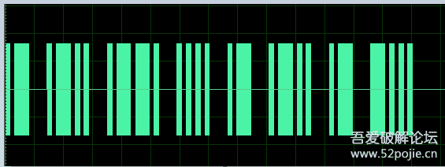
7.png (7.87 KB, 下载次数: 0)
[href="forum.php?mod=attachment&aid=Mjc0NTE2OHwyNTFmMzBjMnwxNzkzNTcxNDU2fDE2ODA4NnwxOTkzMTEz&nothumb=yes" target="_blank"](https://www.52pojie.cn/forum.php?mod=attachment&aid=Mjc0NTE2OHwyNTFmMzBjMnwxNzkzNTcxNDU2fDE2ODA4NnwxOTkzMTEz&nothumb=yes)
2024-12-20 19:49 上传
是以看图片的摩斯电码，得的flag
> 
图片解释：
- 短条对应  .
- 长条对应 -
- 大间隔表示 间隔
根据上面的的规则得到
```
.- .-.. .--. .... .- .-.. .- -...
```
用工具翻译一下
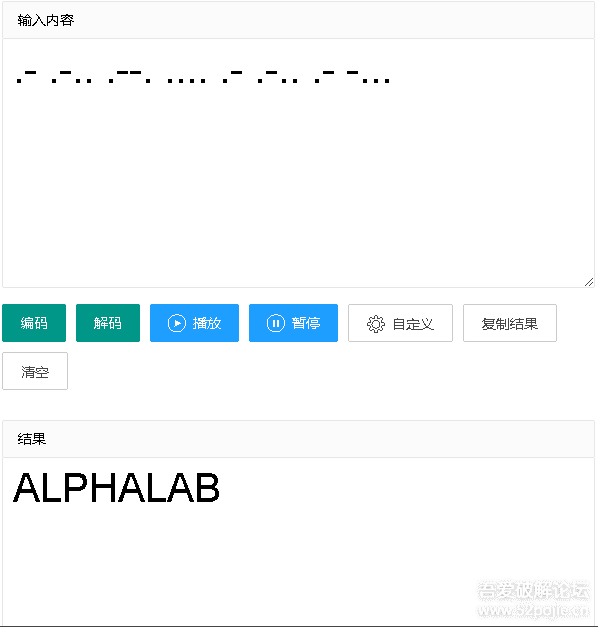
8.png (12.42 KB, 下载次数: 0)
[href="forum.php?mod=attachment&aid=Mjc0NTE2OXxjYmNlNjZlY3wxNzkzNTcxNDU2fDE2ODA4NnwxOTkzMTEz&nothumb=yes" target="_blank"](https://www.52pojie.cn/forum.php?mod=attachment&aid=Mjc0NTE2OXxjYmNlNjZlY3wxNzkzNTcxNDU2fDE2ODA4NnwxOTkzMTEz&nothumb=yes)
2024-12-20 19:49 上传
得出flag
```
flag{ALPHALAB}
```
但应该还有第二种解题方法，
就是通过图片的`zlib`压缩包来解题，还在研究中...

## 栅栏解救
题目描述：
> 
flag被栅栏围起来了，赶紧把它解救出来吧，flag格式为flag{xxx}
2016-第五届山东省网络安全竞赛-Crypto-栅栏解救
得到这一串密文
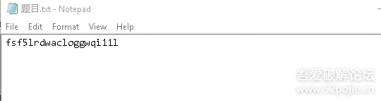
4.png (7.99 KB, 下载次数: 1)
[href="forum.php?mod=attachment&aid=Mjc0NTE3MHw5NTE4OGY2YnwxNzkzNTcxNDU2fDE2ODA4NnwxOTkzMTEz&nothumb=yes" target="_blank"](https://www.52pojie.cn/forum.php?mod=attachment&aid=Mjc0NTE3MHw5NTE4OGY2YnwxNzkzNTcxNDU2fDE2ODA4NnwxOTkzMTEz&nothumb=yes)
2024-12-20 19:49 上传
仔细观察，f l a g这四个字母每个之间都隔了3字母
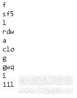
5.png (5.97 KB, 下载次数: 1)
[href="forum.php?mod=attachment&aid=Mjc0NTE3MXxhZmZlM2Q3YnwxNzkzNTcxNDU2fDE2ODA4NnwxOTkzMTEz&nothumb=yes" target="_blank"](https://www.52pojie.cn/forum.php?mod=attachment&aid=Mjc0NTE3MXxhZmZlM2Q3YnwxNzkzNTcxNDU2fDE2ODA4NnwxOTkzMTEz&nothumb=yes)
2024-12-20 19:50 上传
根据题目得知flag被栅栏围住了，数一数是5个栅栏
用栅栏解密工具选择栏数为5
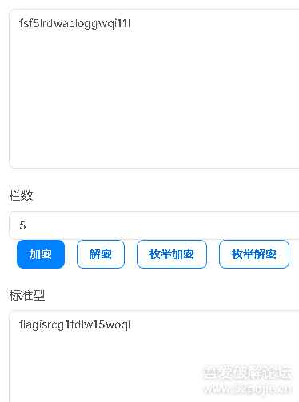
6.png (11 KB, 下载次数: 2)
[href="forum.php?mod=attachment&aid=Mjc0NTE3Mnw1MzlmNDU5YXwxNzkzNTcxNDU2fDE2ODA4NnwxOTkzMTEz&nothumb=yes" target="_blank"](https://www.52pojie.cn/forum.php?mod=attachment&aid=Mjc0NTE3Mnw1MzlmNDU5YXwxNzkzNTcxNDU2fDE2ODA4NnwxOTkzMTEz&nothumb=yes)
2024-12-20 19:50 上传
得flag
```
flag{rcg1fdlw15woql}
```

## hidden
题目描述：
> 
张三有一个特别的图片，你能发现其中隐藏的秘密吗？
2020-网鼎杯-白虎组-Misc-hidden
得到一张图片
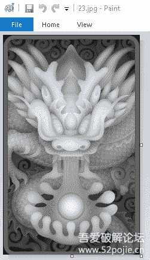
9.png (90.13 KB, 下载次数: 2)
[href="forum.php?mod=attachment&aid=Mjc0NTE3M3wxNWZkYzJiNnwxNzkzNTcxNDU2fDE2ODA4NnwxOTkzMTEz&nothumb=yes" target="_blank"](https://www.52pojie.cn/forum.php?mod=attachment&aid=Mjc0NTE3M3wxNWZkYzJiNnwxNzkzNTcxNDU2fDE2ODA4NnwxOTkzMTEz&nothumb=yes)
2024-12-20 19:50 上传
这里说一下做图片题的基本思路
- 记事本打开搜索一下关键词（"flag"，"ctf"，"{",等等）
- `Stegsolve`看一下有没有隐写
- `binwalk`看一下
> 
以上步骤不分先后顺序
我前两步都试了，没线索,就`binwalk`一下
```
binwalk 23.jpg
```
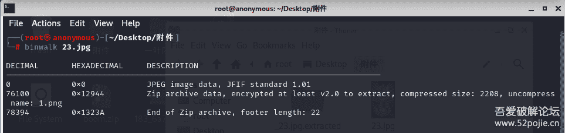
10.png (61.36 KB, 下载次数: 0)
[href="forum.php?mod=attachment&aid=Mjc0NTE3NHw5Y2NiMTIxZnwxNzkzNTcxNDU2fDE2ODA4NnwxOTkzMTEz&nothumb=yes" target="_blank"](https://www.52pojie.cn/forum.php?mod=attachment&aid=Mjc0NTE3NHw5Y2NiMTIxZnwxNzkzNTcxNDU2fDE2ODA4NnwxOTkzMTEz&nothumb=yes)
2024-12-20 19:50 上传
有zip压缩包
提取出来
```
binwalk -e --run-as=root 23.jpg
```
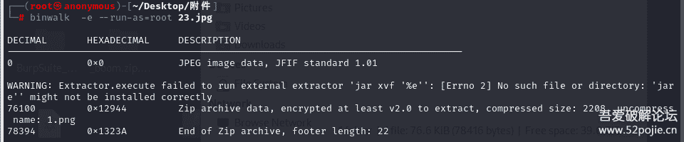
11.png (56.21 KB, 下载次数: 1)
[href="forum.php?mod=attachment&aid=Mjc0NTE3NXwyYzUyMTQ1OHwxNzkzNTcxNDU2fDE2ODA4NnwxOTkzMTEz&nothumb=yes" target="_blank"](https://www.52pojie.cn/forum.php?mod=attachment&aid=Mjc0NTE3NXwyYzUyMTQ1OHwxNzkzNTcxNDU2fDE2ODA4NnwxOTkzMTEz&nothumb=yes)
2024-12-20 19:50 上传
得到一个zip，发现有密码
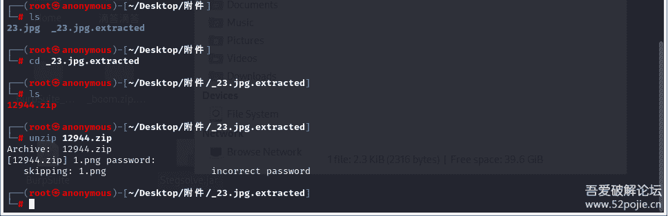
12.png (77.6 KB, 下载次数: 1)
[href="forum.php?mod=attachment&aid=Mjc0NTE3NnwwOGIwNzJhNnwxNzkzNTcxNDU2fDE2ODA4NnwxOTkzMTEz&nothumb=yes" target="_blank"](https://www.52pojie.cn/forum.php?mod=attachment&aid=Mjc0NTE3NnwwOGIwNzJhNnwxNzkzNTcxNDU2fDE2ODA4NnwxOTkzMTEz&nothumb=yes)
2024-12-20 19:50 上传
用`ARCHPR`爆破一下，得到密码
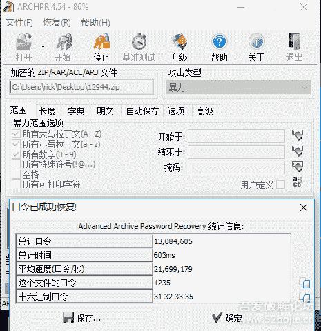
13.png (44.84 KB, 下载次数: 1)
[href="forum.php?mod=attachment&aid=Mjc0NTE3N3xiNGIxYzhiZnwxNzkzNTcxNDU2fDE2ODA4NnwxOTkzMTEz&nothumb=yes" target="_blank"](https://www.52pojie.cn/forum.php?mod=attachment&aid=Mjc0NTE3N3xiNGIxYzhiZnwxNzkzNTcxNDU2fDE2ODA4NnwxOTkzMTEz&nothumb=yes)
2024-12-20 19:51 上传
解压得到`1.png`

14.png (9.49 KB, 下载次数: 1)
[href="forum.php?mod=attachment&aid=Mjc0NTE3OHw1ZjdlYjMxNnwxNzkzNTcxNDU2fDE2ODA4NnwxOTkzMTEz&nothumb=yes" target="_blank"](https://www.52pojie.cn/forum.php?mod=attachment&aid=Mjc0NTE3OHw1ZjdlYjMxNnwxNzkzNTcxNDU2fDE2ODA4NnwxOTkzMTEz&nothumb=yes)
2024-12-20 19:51 上传
在kali中无法查看，在windows查看一下

15.png (12.32 KB, 下载次数: 3)
[href="forum.php?mod=attachment&aid=Mjc0NTE3OXxmNjBlOTE5ZHwxNzkzNTcxNDU2fDE2ODA4NnwxOTkzMTEz&nothumb=yes" target="_blank"](https://www.52pojie.cn/forum.php?mod=attachment&aid=Mjc0NTE3OXxmNjBlOTE5ZHwxNzkzNTcxNDU2fDE2ODA4NnwxOTkzMTEz&nothumb=yes)
2024-12-20 19:51 上传
很明显，高度被修改过
我们用过`winhex`打开修改一下高度
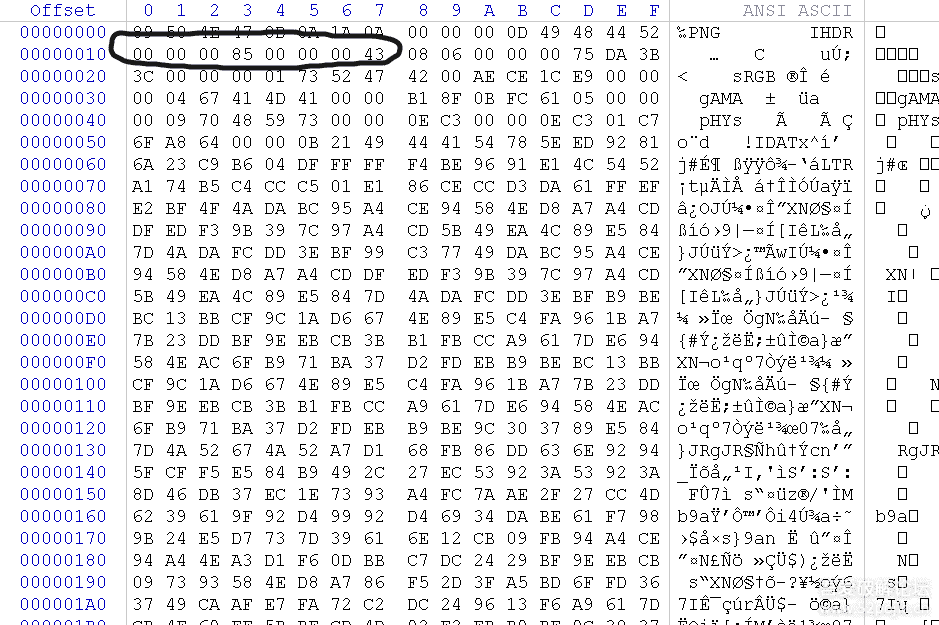
16.png (51.74 KB, 下载次数: 1)
[href="forum.php?mod=attachment&aid=Mjc0NTE4MHxmNzMwOWVjMXwxNzkzNTcxNDU2fDE2ODA4NnwxOTkzMTEz&nothumb=yes" target="_blank"](https://www.52pojie.cn/forum.php?mod=attachment&aid=Mjc0NTE4MHxmNzMwOWVjMXwxNzkzNTcxNDU2fDE2ODA4NnwxOTkzMTEz&nothumb=yes)
2024-12-20 19:51 上传
第二行的前八位，是图片的宽和高，前四位是宽，后四位是高
把43改为FF
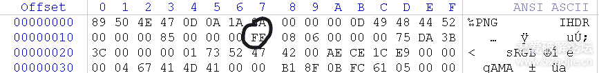
17.png (13.62 KB, 下载次数: 2)
[href="forum.php?mod=attachment&aid=Mjc0NTE4MXxiZjdjNjllOHwxNzkzNTcxNDU2fDE2ODA4NnwxOTkzMTEz&nothumb=yes" target="_blank"](https://www.52pojie.cn/forum.php?mod=attachment&aid=Mjc0NTE4MXxiZjdjNjllOHwxNzkzNTcxNDU2fDE2ODA4NnwxOTkzMTEz&nothumb=yes)
2024-12-20 19:51 上传
再打开图片
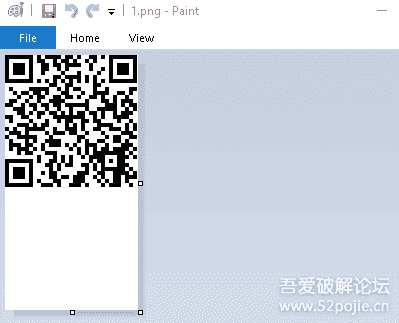
18.png (13.39 KB, 下载次数: 1)
[href="forum.php?mod=attachment&aid=Mjc0NTE4MnxjZGUwOGM3N3wxNzkzNTcxNDU2fDE2ODA4NnwxOTkzMTEz&nothumb=yes" target="_blank"](https://www.52pojie.cn/forum.php?mod=attachment&aid=Mjc0NTE4MnxjZGUwOGM3N3wxNzkzNTcxNDU2fDE2ODA4NnwxOTkzMTEz&nothumb=yes)
2024-12-20 19:51 上传
扫码得flag
```


`flag{04255185-de22-4ac6-a1ae-da4f187ddb8c}`

# 3> boom

## 题目描述

Boom there have a game.

2020-网鼎杯-青龙组-Crypto-boom

下载得一个`exe`


19.png (6.81 KB, 下载次数: 1)

[href="forum.php?mod=attachment&aid=Mjc0NTE4M3w5YmM3ZmMxOHwxNzkzNTcxNDU2fDE2ODA4NnwxOTkzMTEz&nothumb=yes" target="_blank"](https://www.52pojie.cn/forum.php?mod=attachment&aid=Mjc0NTE4M3w5YmM3ZmMxOHwxNzkzNTcxNDU2fDE2ODA4NnwxOTkzMTEz&nothumb=yes)

2024-12-20 19:52 上传

放到虚拟机运行一下

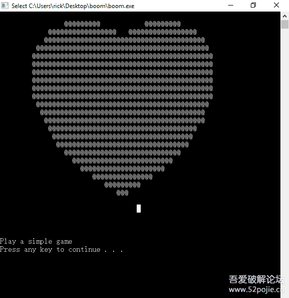

20.png (14.01 KB, 下载次数: 1)

[href="forum.php?mod=attachment&aid=Mjc0NTE4NHw2NDdmMGNkN3wxNzkzNTcxNDU2fDE2ODA4NnwxOTkzMTEz&nothumb=yes" target="_blank"](https://www.52pojie.cn/forum.php?mod=attachment&aid=Mjc0NTE4NHw2NDdmMGNkN3wxNzkzNTcxNDU2fDE2ODA4NnwxOTkzMTEz&nothumb=yes)

2024-12-20 19:52 上传

按任意键继续

## 解题过程

### 1.


21.png (8.74 KB, 下载次数: 1)

[href="forum.php?mod=attachment&aid=Mjc0NTE4NXxkMWEwN2NkMHwxNzkzNTcxNDU2fDE2ODA4NnwxOTkzMTEz&nothumb=yes" target="_blank"](https://www.52pojie.cn/forum.php?mod=attachment&aid=Mjc0NTE4NXxkMWEwN2NkMHwxNzkzNTcxNDU2fDE2ODA4NnwxOTkzMTEz&nothumb=yes)

2024-12-20 19:52 上传

让我们解密MD5

解出为`en5oy`

### 2.

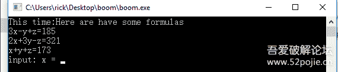

22.png (9.86 KB, 下载次数: 1)

[href="forum.php?mod=attachment&aid=Mjc0NTE4NnxkYmQ2MGRkMHwxNzkzNTcxNDU2fDE2ODA4NnwxOTkzMTEz&nothumb=yes" target="_blank"](https://www.52pojie.cn/forum.php?mod=attachment&aid=Mjc0NTE4NnxkYmQ2MGRkMHwxNzkzNTcxNDU2fDE2ODA4NnwxOTkzMTEz&nothumb=yes)

2024-12-20 19:52 上传

第二题让解数学题，咱也不会，就交给chatgpt算一下

得出

`x=74,    y=68,   z=31`

### 3.

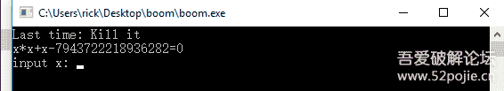

23.png (8.82 KB, 下载次数: 1)

[href="forum.php?mod=attachment&aid=Mjc0NTE4N3w0ZjQyMTBlMXwxNzkzNTcxNDU2fDE2ODA4NnwxOTkzMTEz&nothumb=yes" target="_blank"](https://www.52pojie.cn/forum.php?mod=attachment&aid=Mjc0NTE4N3w0ZjQyMTBlMXwxNzkzNTcxNDU2fDE2ODA4NnwxOTkzMTEz&nothumb=yes)

2024-12-20 19:52 上传

解出`x`为`±89127561`

输入`89127561`，结果直接关闭窗口了，换一下答案加上`+`号和`-`号各试一次，也是直接关闭窗口

然后我`binwalk`了一下附件`boom.zip`

然后分离一下

```
binwalk boom.zip
binwalk -e --run-as=root boom.zip
ls
cd _boom.zip.extracted
ls
unzip 0.zip
vim 12
```

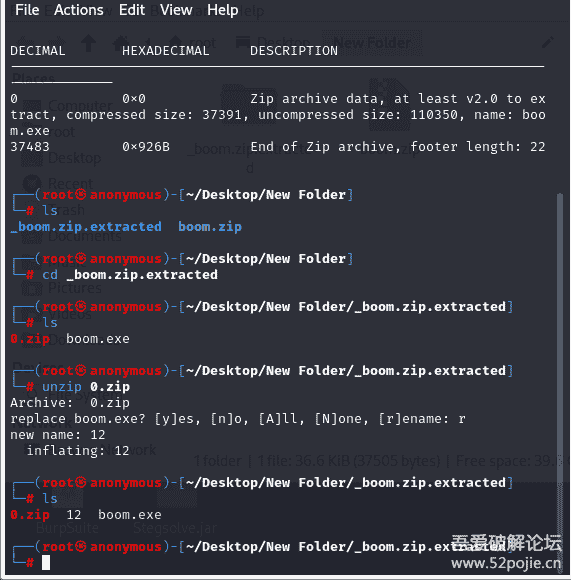

24.png (108.44 KB, 下载次数: 1)

[href="forum.php?mod=attachment&aid=Mjc0NTE4OHxmYzAxYTIyMnwxNzkzNTcxNDU2fDE2ODA4NnwxOTkzMTEz&nothumb=yes" target="_blank"](https://www.52pojie.cn/forum.php?mod=attachment&aid=Mjc0NTE4OHxmYzAxYTIyMnwxNzkzNTcxNDU2fDE2ODA4NnwxOTkzMTEz&nothumb=yes)

2024-12-20 19:52 上传

我`vim`查看的时候发现了这个，我以为是`flag`

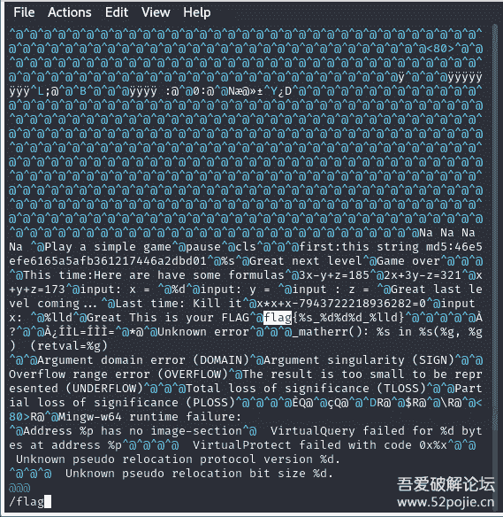

25.png (130.36 KB, 下载次数: 1)

[href="forum.php?mod=attachment&aid=Mjc0NTE4OXwzMTM3ZTY3OHwxNzkzNTcxNDU2fDE2ODA4NnwxOTkzMTEz&nothumb=yes" target="_blank"](https://www.52pojie.cn/forum.php?mod=attachment&aid=Mjc0NTE4OXwzMTM3ZTY3OHwxNzkzNTcxNDU2fDE2ODA4NnwxOTkzMTEz&nothumb=yes)

2024-12-20 19:52 上传

我提交`flag`却不对

然后我仔细一看原来我上面那一串命令都白敲，`exe`可以直接用记事本查看

## 分析一下这段

> ```
> Na Na Na Na  Play a simple game pause cls   first:this string md5:46e5efe6165a5afb361217446a2dbd01 %s Great next level Game over    This time:Here are have some formulas 3x-y+z=185 2x+3y-z=321 x+y+z=173 input: x =  %d input: y =  input : z =  Great last level coming... Last time: Kill it x*x+x-7943722218936282=0 input x:  %lld Great This is your FLAG flag{%s%d%d%d%lld}
> ```

`%s`、`%d`、`%lld` 这三个是三个变量

- `%s` 是第一题的答案
- `%d` 是第二题的答案
- `%lld` 是第三题的答案

得到`flag`

`flag{en5oy_746831_89127561}`
