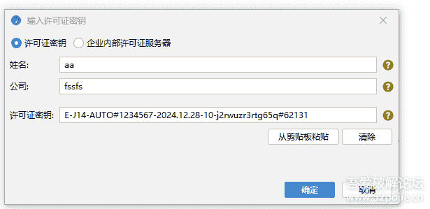
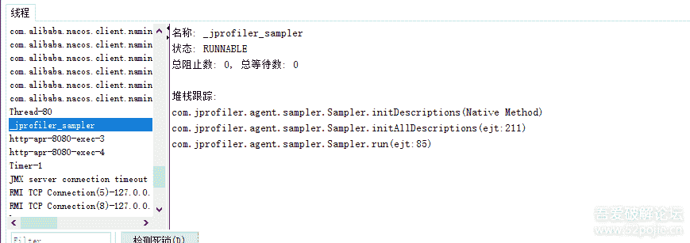
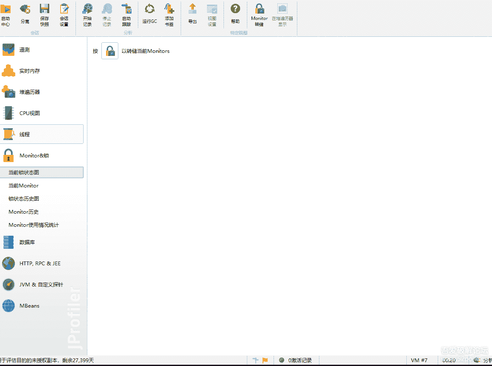

# [原创] jprofiler最新版逆向分析

- 原帖: https://www.52pojie.cn/forum.php?mod=viewthread&tid=1993300
- 抓取时间: 2026-11-01T22:17:37

## 定位密钥校验逻辑

根据 Jprofiler 安装目录有 Jvm 相关的 dll 知道了界面逻辑都是 java 写的，那么 java 相关的工具也是可以使用的。

基于 awt 的 gui 应用组件的监听回调都会继承 `ActionListener`，这里直接 hook 这个接口的 `actionPerformed` 方法。

通过 `arthas` 去 hook 到按钮点击后的回调方法

```
watch java.awt.event.ActionListener actionPerformed "{params,target}" -x 3 -m 600
```



1.png (23.58 KB, 下载次数: 1)

[href="forum.php?mod=attachment&aid=Mjc0NTQ3N3wyZDcyMDllMXwxNzkzNTcxNDU1fDE2ODA4NnwxOTkzMzAw&nothumb=yes" target="_blank"](https://www.52pojie.cn/forum.php?mod=attachment&aid=Mjc0NTQ3N3wyZDcyMDllMXwxNzkzNTcxNDU1fDE2ODA4NnwxOTkzMzAw&nothumb=yes)

2024-12-22 14:54 上传

然后输入许可证点击确定

```
Affect(class count: 480 , method count: 288) cost in 409 ms, listenerId: 9

method=com.ejt.framework.f.c.actionPerformed location=AtExit

ts=2024-12-21 16:02:05.678; [cost=21.1043ms] result=@ArrayList[

    @Object[][

        @ActionEvent[
```

可以确定 `com.ejt.framework.f.c.actionPerformed` 是点击后的校验逻辑，代码逻辑在 `jprofiler.jar` 文件中

```
  public void actionPerformed(ActionEvent actionEvent) {
        Object source = actionEvent.getSource();//获取事件来源 一个是确定按钮的一个是取消按钮的
        if (source == this.f17255d) { 
            m27227o();
        } else if (source == this.f17256e) {
            m27234f();
        }
    }
```

## 注册逻辑分析

确定按钮的逻辑在 `com.ejt.framework.f.c.o`

```
/* renamed from: o */

    private void m27227o() {

        this.f17257f = false;

        if (this.f17252a.validateAndSave()) {

            mo12243i();

            setVisible(false);

            this.f17252a.getLicenseInfo().m27276p();

        }

    }
```

`validateAndSave` 实际就是校验和保存密钥的逻辑

由于静态分析太费时间了并且 java 类都是被混淆处理过的，先动静结合分析下，jprofiler 启动时会从 `bin/options/` 中读取 jvm 参数，我这里在 `/bin/options/base.options` 中添加

```
-agentlib:jdwp=transport=dt_socket,server=y,suspend=n,address=*:5005
```

然后把 jar 复制到 idea 断点调试，断点来到 `com.ejt.framework.f.d#a` 这里，不关键的代码我先去掉了，这里会根据 `var7` 的值判断错误类型，所有 `var7` 的值决定了这个 `key` 能否使用，继续单步进入 `var6.a` 方法

```
 private boolean a(String var1, String var2, String var3, boolean var4, b var5) {

        com.ejt.framework.f.b var6 = this.getLicenseInfo();

        int var7;

        if ((var5 != d.b.b || var6.B() != null && !var6.r()) && !com.ejt.framework.f.b.f(var3)) {

            com.ejt.framework.f.a.g();

            var7 = var6.a(var3, var1, var2, this.d());

        } else {

        }

        if (var4) {

            this.acceptLicense(var1, var2, var3);

            return true;

        } else {

            switch (var7) {

                case -18:

                    this.showWarningMessage(com.ejt.framework.f.q.a("license.server.ssl.error", new Object[]{"https://license.ej-technologies.net/license/v2/"}));

                    this.c();

                    return false;

                case -17:

                    this.showWarningMessage(com.ejt.framework.f.q.a("license.server.not.encrypted", new Object[0]));

                    this.c();

                    return false;

                case -16:

                    this.showWarningMessage(com.ejt.framework.f.q.a("license.server.not.authenticated", new Object[0]));

                    this.c();
```

继续看 `var6.a`，这个方法用来校验 `key` 并返回还有多少天可用(实际是通过当前时间减去 `key` 中的时间)，所以这里只要返回的是一个正数就算成功，这里只需要满足 `a(var5, var2.a() + var4, 83, 52, 3)` 返回的是 true 就能返回 `var2.e()` 也就是剩余多少天

```
    public int d(String var1) {
        if (var1.startsWith("F-")) {
            return -11;
        } else {
            o var2 = new o(var1);
            int var3 = var2.e();//剩余多少天
            if (var3 != -3 && var3 != -2) {
                String var4 = var2.f();
                String var5 = var2.g();
                if (var4 != null && var5 != null) {//a(var2)是校验key中的版本
                    return !a(var2) && (a(var5, var2.a() + var4, 83, 52, 3) || a(var5, var2.a() + var4, 36, 86, 26)) ? var2.e() : this.c(var1);
                } else {
                    return -3;
                }
            } else {
                return var3;
            }
        }
    }
var1 = "E-J14-AUTO#123456-2024.12.28-10-y763ch33fxm45q#12345"
var2 (slot_2) = {o@12914} 
 a = "E-J14-AUTO#123456-2024.12.28-10-y763ch33fxm45q#12345"
 b = "E-J14-AUTO#123456-2024.12.28-10-"
 c = "y763ch33fxm45q#12345"
 e = 6
var3 (slot_3) = 6
var4 (slot_4) = "y763ch33fxm45q"
var5 (slot_5) = "12345"
```

`a(var5, var2.a() + var4, 83, 52, 3)`，这里面的逻辑很简单，通过 `#` 符号把 `key` 分割成两部分，然后把第一部分计算后的结果和第二部分对比是不是一样的

```
    protected static boolean a(String var0, String var1, int var2, int var3, int var4) {

        if (var1 == null) {

            return false;

        } else {

            char[] var5 = var1.toCharArray();

            int var6 = 0;

            char[] var7 = var5;

            int var8 = var5.length;

            for(int var9 = 0; var9 
```

试用结束的时间是写在 `key` 里面的，这里是不是把 `key` 的时间改成 2099 年就可以无限使用了，把校验计算的逻辑复制出来试试看

```
    public static String encode(String var1){
        int var2 = 83;
        int var3 = 52;
        int var4 = 3;
        char[] var5 = var1.toCharArray();
        int var6 = 0;
        char[] var7 = var5;
        int var8 = var5.length;
        for(int var9 = 0; var9 
```

得到 `E-J14-AUTO#123456-2099.12.28-10-y763ch33fxm45q#4572`，然后输入注册码成功，但是在使用的过程中发现事情没这么简单，当我使用 jprofiler 去 `attach` 到我要分析的 java 程序的过程中把我的程序强制关闭了。

看控制台打印可以知道应该是在 `attach` 完成后重新校验了 `key`

```
JProfiler> Time measurement: elapsed time

JProfiler> CPU profiling enabled

JProfiler> Initializing configuration.

JProfiler> Retransforming 119 class files.

JProfiler> Configuration updated.

JProfiler> ERROR: Invalid license key. Aborting. 

JProfiler> Killing process
```

在 `jadx` 中搜索了 `Aborting` 相关的字符串也是一无所获，转变思路想查下 `attach` 后加载了哪个 agent 然后去搜索 `VirtualMachine.attach` 字符串也是一无所获。通过观察 `attach` 后多了一个 jprofiler 的线程，找到了加载的类



2.png (27.02 KB, 下载次数: 1)

[href="forum.php?mod=attachment&aid=Mjc0NTQ3Nnw1ZjhiZDMzMXwxNzkzNTcxNDU1fDE2ODA4NnwxOTkzMzAw&nothumb=yes" target="_blank"](https://www.52pojie.cn/forum.php?mod=attachment&aid=Mjc0NTQ3Nnw1ZjhiZDMzMXwxNzkzNTcxNDU1fDE2ODA4NnwxOTkzMzAw&nothumb=yes)

2024-12-22 14:54 上传

## native校验

可以看到 `initDescriptions` 是一个 `jni` 的 native 方法，搜索了一下加载的 dll 定位到 `jprofiler.dll`，在 dll 中查到字符串 `Aborting`，`sub_7FF84D145B50` 应该就是校验函数了

```
.text:00007FF84D127176                                         ; DATA XREF: sub_7FF84D1270A0:jpt_7FF84D127174↓o
.text:00007FF84D127176                 mov     rdx, [rdi+28h]  ; jumptable 00007FF84D127174 case 1
.text:00007FF84D12717A                 lea     r8, [rdi+40h]
.text:00007FF84D12717E                 mov     rcx, [rdi+38h]
.text:00007FF84D127182                 call    sub_7FF84D145B50
.text:00007FF84D127187                 test    al, al
.text:00007FF84D127189                 jnz     short loc_7FF84D12719D
.text:00007FF84D12718B                 lea     rcx, aErrorInvalidLi ; "ERROR: Invalid license key. Aborting."
.text:00007FF84D127192                 call    sub_7FF84D151470
.text:00007FF84D127197                 mov     word ptr [rdi+8], 101h
```

接下来会调用到 `sub_7FF84D115770`，这里会校验 `key` 是不是合法的，

```
.text:00007FF84D115538                 mov     rcx, rdi  //rcx就是我们的key
.text:00007FF84D11553B                 lea     rdx, aLjavaLangStrin ; "(Ljava/lang/String;)V"
.text:00007FF84D115542                 call    sub_7FF84D115770
```

`key` 计算完成后得到的值会在 `7FF84D115AA8` 处调用 `strncmp` 进行比较，直接在这里进程断点，通过 `ida` 附加在 java 进程上，然后 jprofiler 也去 `attach` 到那个 java 进程

```
.text:00007FF84D115A97                 inc     r8              ; 比较的字符数量数量
.text:00007FF84D115A9A                 cmp     [rax+r8], sil
.text:00007FF84D115A9E                 jnz     short loc_7FF84D115A97
.text:00007FF84D115AA0                 lea     rdx, [rbp+57h+Str2] ; Str2
.text:00007FF84D115AA4                 lea     rcx, [r13+1]    ; Str1
.text:00007FF84D115AA8                 call    strncmp
```

用 `ida` 打印下字符串

```
Python>print(idaapi.get_bytes(ida_dbg.get_reg_val("rcx"), 100))
b'y763ch33fxm45q#4572\x00\x00\x00\x00\x00x\xa0\x1c[\x00\x9a\x01\x91nacos-grpc-client-executor-192.168.254.253-279\x00\x00\x00\x00\x00\x00\x00\x00\x00\x00D\xa0\x18[\x00\x9b\x01\x88\x00\x00\x00\x00'
```


```
Python>print(idaapi.get_bytes(ida_dbg.get_reg_val("rdx"), 100))

b'3hk2zxe3e5qmbq\x00\x00\x01\x01\x9cB\x00\x00\x00\x00\x00`\x9cB\x00\x00\x00\x00qbmq5e3\x00\xd0s\x9bB\x00\x00\x00\x00\xd0s\x9bB\x00\x00\x00\x00\x00\x00\x81\x00\x00\x00\x00\x00\xc8\xec\x06\x1c\x8dG\x00\x00\xca\xfe\x18M\xf8\x7f\x00\x00\x00\x00\x00\x00\x00\x00\x00\x00\x00\x00\x00\x00\x00\x00\x00\x00 \x1f\xa5\x00'
```

`rdx`中正确的计算的值，我们直接替换上得到E-J14-AUTO#123456-2099.12.28-10-3hk2zxe3e5qmbq#4572

这样直接使用是不行的还得考虑到`java`层的校验，通过上面的`encode`代码计算下#号后面的值得到3791

替换上面的4572

最后完美收工



3.png (72.42 KB, 下载次数: 1)

[href="forum.php?mod=attachment&aid=Mjc0NTQ3OHxjMjk0ZjBkZXwxNzkzNTcxNDU1fDE2ODA4NnwxOTkzMzAw&nothumb=yes" target="_blank"](https://www.52pojie.cn/forum.php?mod=attachment&aid=Mjc0NTQ3OHxjMjk0ZjBkZXwxNzkzNTcxNDU1fDE2ODA4NnwxOTkzMzAw&nothumb=yes)

2024-12-22 14:54 上传

2> 注：该贴仅学习探讨用
