# [原创] 模拟执行去除花指令

- 原帖：`https://www.52pojie.cn/forum.php?mod=viewthread&tid=1994657`
- 抓取时间：`2026-11-01T22:17:29`

### idaemu插件

[github.com/zengfr/idaemu](https://github.com/zengfr/idaemu)

插件提供了一些易于在ida使用的unicorn engine模拟执行函数的封装，可以指定模拟执行开始和结束的地址、设置跳过指令、hook函数、hook指令等，便于在ida中调用。

### 模拟执行去花指令

#### 显示执行路径和有效指令

模拟执行可以轻量化的执行可执行文件中的指令，而花指令会混淆IDA对于指令的识别，那是否可以通过模拟执行记录下来执行的每个指令的地址，然后再告诉IDA哪些指令才是真正需要识别的呢？

插件自带打印执行路径的功能：

```
a = Emu(UC_ARCH_X86, UC_MODE_32)
a.setTrace(TRACE_CODE|TRACE_INTR)
a.eBlock(start,end)
a.showTrace()
```

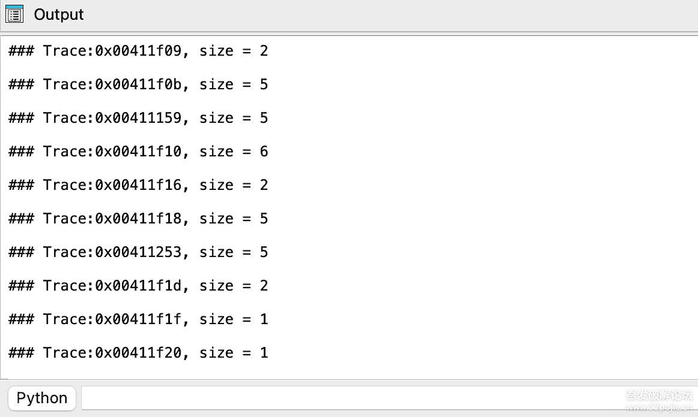

`trace.jpg`（75.28 KB，下载次数：2）

[附件链接](https://www.52pojie.cn/forum.php?mod=attachment&aid=Mjc0NjIzOXxlMGY2OTgwNnwxNzkzNTcxNDQ3fDE2ODA4NnwxOTk0NjU3&nothumb=yes)

2024-12-26 12:54 上传

实现方式呢是在模拟开始之前添加了一个 `UC_HOOK_CODE`：

```
....

def _hook_code(self, uc, address, size, user_data):
        ....
        self._addTrace("### Trace:0x%08x, size = %u" % (address, size))
        ....
....

uc.hook_add(UC_HOOK_INTR, self.hook_interrupt)

....
```

新加一个 `list` 来记录每次执行的指令地址和指令的 `size`，模拟执行结束之后调用ida的api来重新将模拟执行过的指令地址识别一遍：

```
....
self.traceIns  = []
self.traceInsLen = []
def _hook_code(self, uc, address, size, user_data):
        ....
        self._addTrace("### Trace:0x%08x, size = %u" % (address, size))
        self.traceIns.append(address)
        self.traceInsLen.append(size)
        ....
....
uc.hook_add(UC_HOOK_INTR, self.hook_interrupt)
....
def dBlock(self, codeStart=None, codeEnd=None,timeout=None):
        ....
        self.traceIns  = []
        self.traceInsLen = []
        ....
        length = len(self.traceIns)
        for i in range(length):
            addr = self.traceIns[i]
            size = self.traceInsLen[i]
            ida_bytes.del_items(addr,nbytes=size)
            idc.create_insn(addr)
        del self.traceIns
        del self.traceInsLen
```

#### 4> 如何只执行必要的指令

模拟执行过程中可能会执行到一下导入函数里，导致模拟时间过长或者报错，如何只模拟执行必要的指令？

##### 5> 跳到代码段外执行的函数跳过

在elf文件中unicorn执行`call func@plt`的时候会跳转到plt段去执行指令，在`hook_code`中做个判断，判断代码执行是否还在代码段即可，如果不在就跳过当前函数直接返回，这样我们需要一个 `list` 变量来记录每次`call`的返回地址。

```
...

def dBlock(self, codeStart=None, codeEnd=None,timeout=None):
        self.rangeStart = idc.get_segm_start(codeStart)
        self.rangeEnd = idc.get_segm_end(codeStart)
        ...
...
self.cap = Cs(CS_ARCH_X86,CS_MODE_16)
...

def _hook_code(self, uc, address, size, user_data):
    if self.traceOption & TRACE_CODE:
        #lib function
        if (address > self.rangeEnd or address 
```

##### 5> 库函数跳过

可以通过ida的API识别导入的库函数，直接hook成空函数：

```
...
def dBlock(self, codeStart=None, codeEnd=None,timeout=None):
        ...
        THUNK_LIST = []
        for func in idautils.Functions():
            flags = idc.get_func_attr(func,idc.FUNCATTR_FLAGS)
            if flags & idc.FUNC_THUNK :
                THUNK_LIST.append(func)

        for func in idautils.Functions():
            flags = idc.get_func_attr(func,idc.FUNCATTR_FLAGS)
            if flags & idc.FUNC_LIB :
                self.alt(func,nullfunc,2)
                # print(hex(func))
                xrefs = list(idautils.XrefsTo(func))
                for xref in xrefs:
                    if xref.frm in THUNK_LIST:
                        self.alt(xref.frm,nullfunc,2)
        ...
```

##### 5> 无效指令跳过

有些指令识别不了，比如`rdrand`。

在`hook_code`里加个识别行了：

```
            if size == 0xf1f1f1f1:
                cs_gen = self.cap.disasm(uc.mem_read(address, 16), address)
                try:
                    cs_instr = cs_gen.__next__()
                except:
                    cs_instr = None
                if cs_instr and cs_instr.mnemonic == "rdrand":
                    uc.reg_write(self.REG_PC, address + cs_instr.size)
                    return
```

#### 4> 修改返回地址的函数

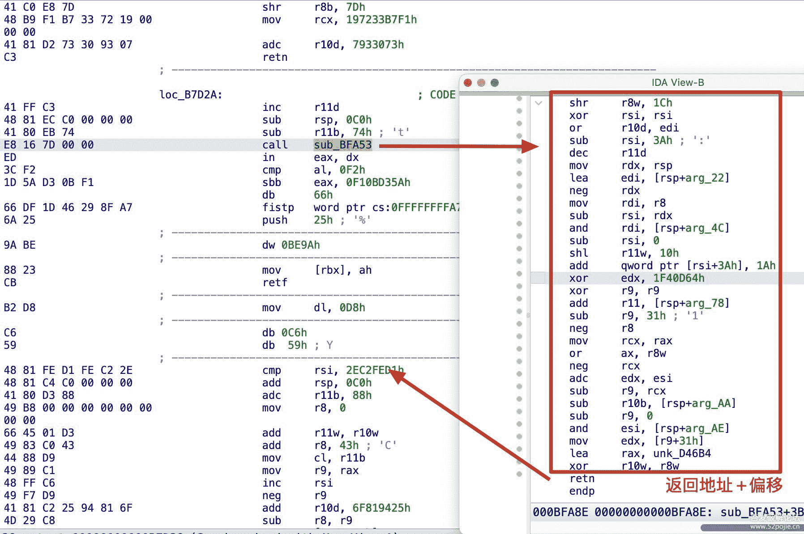

`修改返回地址的函数调用.jpg`（315.31 KB，下载次数：1）

[附件链接](https://www.52pojie.cn/forum.php?mod=attachment&aid=Mjc0NjI0MXxmZmMwZDY2OHwxNzkzNTcxNDQ3fDE2ODA4NnwxOTk0NjU3&nothumb=yes)

2024-12-26 12:54 上传

花指令的一种，既然前面我们已经记录下来了每个`call`的返回地址，在`hook_code`函数中检测到执行`ret`指令的时候检查一下当前的返回地址1与记录的返回地址0是否吻合即可，不吻合的话直接把从`call`指令到返回地址1之间的所有指令全都`nop`掉。

```
            if cs_instr and cs_instr.mnemonic == "call":
                try:
                    calladdr = int(cs_instr.op_str,16)
                except:
                    calladdr = 0
                if calladdr not in self.altFunc.keys():
                    self.retaddrs.append(address + cs_instr.size)
            elif cs_instr and cs_instr.mnemonic == "ret":
                if len(self.retaddrs) != 0:
                    sp = uc.reg_read(self.REG_SP)
                    retaddr = unpack(self.pack_fmt,uc.mem_read(sp,self.step))[0]
                    if retaddr != self.retaddrs[-1]:
                        orange = self.retaddrs[-1]
                        now = retaddr
                        if now > orange:
                            triggerLog(1,address,orange,now)
                            for i in range(orange-5,now):
                                ida_bytes.patch_byte(i,0x90)
                    self.retaddrs = self.retaddrs[:-1]
```

#### 4> 原地tp的jmp

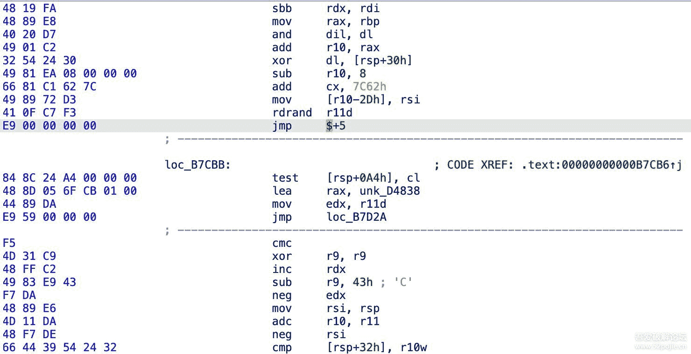

`无用jmp.jpg`（131.53 KB，下载次数：2）

[附件链接](https://www.52pojie.cn/forum.php?mod=attachment&aid=Mjc0NjI0MHwzNTU2Y2NlOHwxNzkzNTcxNDQ3fDE2ODA4NnwxOTk0NjU3&nothumb=yes)

2024-12-26 12:54 上传

执行到`jmp`的时候检查一下：

```
            elif cs_instr and cs_instr.mnemonic == "jmp":
                try:
                    targetaddr = int(cs_instr.op_str,16)
                except:
                    targetaddr = 0
                if targetaddr - address == 5:
                    triggerLog(2,address,address,address+5)
                    for i in range(address,address+5):
                        ida_bytes.patch_byte(i,0x90)
```

#### 4> 永远为真的跳转

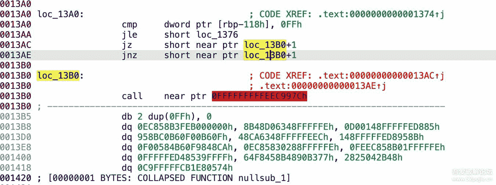

`永真跳转.jpg`（141.97 KB，下载次数：1）

[附件链接](https://www.52pojie.cn/forum.php?mod=attachment&aid=Mjc0NjI0MnwzMmIyNjg0YnwxNzkzNTcxNDQ3fDE2ODA4NnwxOTk0NjU3&nothumb=yes)

2024-12-26 12:54 上传

执行到`je`或者`jne`指令的时候检查下一句是不是对应的`jne`或者`je`，再检查一下跳转的地方是不是同一个，是的话直接把中间所有指令`nop`掉。


```python
            elif cs_instr and cs_instr.mnemonic == "jne":
                cs_gen_1 = self.cap.disasm(uc.mem_read(address+size, size), address+size)
                try:
                    cs_instr_1 = cs_gen_1.__next__()
                except:
                    cs_instr_1 = None
                if cs_instr_1 and cs_instr_1.mnemonic == "je":
                    try:
                        targetaddr0 = int(cs_instr.op_str,16)
                        targetaddr1 = int(cs_instr_1.op_str,16)
                    except:
                        targetaddr0 = 0
                        targetaddr1 = 0
                    if targetaddr0 == targetaddr1:
                        triggerLog(4,address,address,targetaddr0)
                        for i in range(address,targetaddr0):
                            ida_bytes.patch_byte(i,0x90)
            elif cs_instr and cs_instr.mnemonic == "je":
                cs_gen_1 = self.cap.disasm(uc.mem_read(address+size, size), address+size)
                try:
                    cs_instr_1 = cs_gen_1.__next__()
                except:
                    cs_instr_1 = None
                if cs_instr_1 and cs_instr_1.mnemonic == "jne":
                    try:
                        targetaddr0 = int(cs_instr.op_str,16)
                        targetaddr1 = int(cs_instr_1.op_str,16)
                    except:
                        targetaddr0 = 0
                        targetaddr1 = 0
                    if targetaddr0 == targetaddr1:
                        triggerLog(3,address,address,targetaddr0)
                        for i in range(address,targetaddr0):
                            ida_bytes.patch_byte(i,0x90)
```

## 永远用不着的跳转

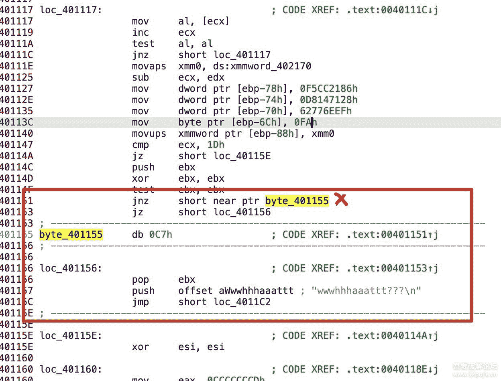

`永远用不着的jmp.jpg`（211.24 KB，下载次数: 2）

[附件下载](https://www.52pojie.cn/forum.php?mod=attachment&aid=Mjc0NjI0M3w5NTgxOTljN3wxNzkzNTcxNDQ3fDE2ODA4NnwxOTk0NjU3&nothumb=yes)

2024-12-26 12:54 上传

改进一下上面的检查，跳转地址如果不一致，就检查跳转到的两个地址中有没有无效指令，如果有的话做个标记，执行完跳转指令之后将没有跳转到的那个地址与没有执行的 `j` 指令一起 `nop` 掉。

```python
#jz jnz

elif cs_instr and cs_instr.mnemonic == "je":
    cs_gen_1 = self.cap.disasm(uc.mem_read(address+size, size), address+size)
    try:
        cs_instr_1 = cs_gen_1.__next__()
    except:
        cs_instr_1 = None
    if cs_instr_1 and cs_instr_1.mnemonic == "jne":
        try:
            targetaddr0 = int(cs_instr.op_str,16)
            targetaddr1 = int(cs_instr_1.op_str,16)
        except:
            targetaddr0 = 0
            targetaddr1 = 0
        if targetaddr0 == targetaddr1:
            triggerLog(3,address,address,targetaddr0)
            for i in range(address,targetaddr0):
                ida_bytes.patch_byte(i,0x90)
        else:
            tmpmax = targetaddr0
            if targetaddr1 > tmpmax:
                tmpmax = targetaddr1
                tmpmin = targetaddr0
            else:
                tmpmin = targetaddr1
            tmpminbak = tmpmin
            while tmpmin  tmpmax:
                tmpmax = targetaddr1
                tmpmin = targetaddr0
            else:
                tmpmin = targetaddr1
            while tmpmin
```

## 效果评测

使用方法很简单，找到花指令函数开头的地址，然后使用 `dBlock` 模拟执行就行了。

```python
from idaemu import *
from unicorn import *
from unicorn.x86_const import *
from unicorn.arm_const import *
from unicorn.arm64_const import *
a = Emu(UC_ARCH_X86, UC_MODE_32)
a.setTrace(TRACE_CODE|TRACE_INTR)
target_addr = 0x4010E0
a.dBlock(target_addr,0,timeout=5000000)
```

确实能用，放几个前后对比：

前

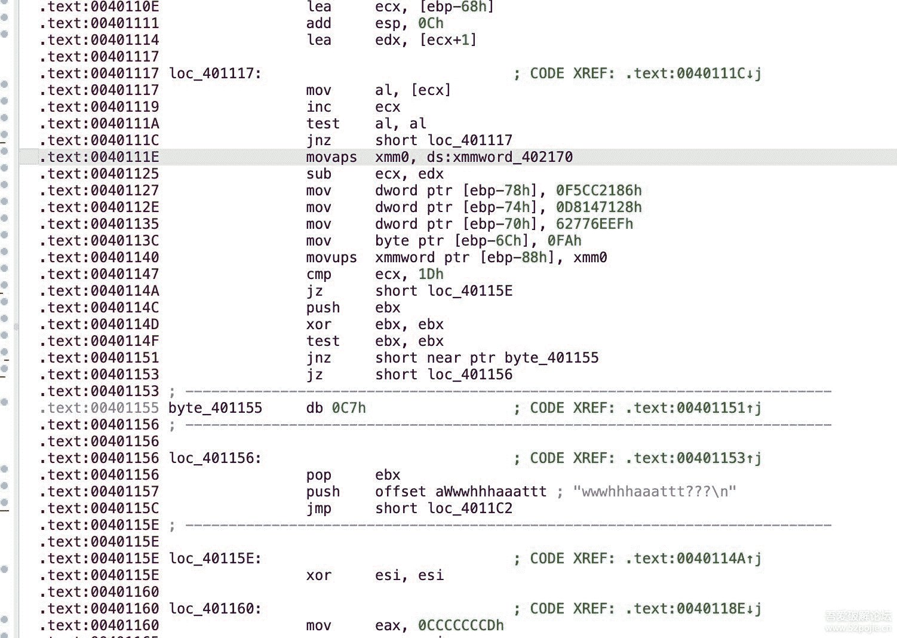

`前1.jpg`（279.12 KB，下载次数: 1）

[附件下载](https://www.52pojie.cn/forum.php?mod=attachment&aid=Mjc0NjI0NHwxNmRlMmI0OXwxNzkzNTcxNDQ3fDE2ODA4NnwxOTk0NjU3&nothumb=yes)

q1

2024-12-26 13:02 上传

后

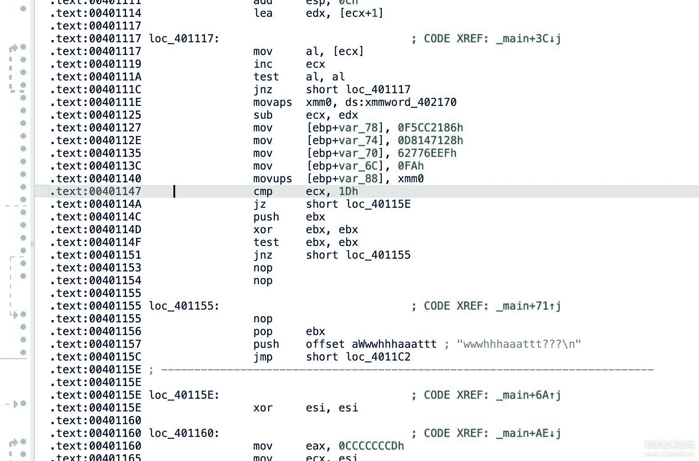

`后1.jpg`（243.11 KB，下载次数: 2）

[附件下载](https://www.52pojie.cn/forum.php?mod=attachment&aid=Mjc0NjI0NXw1ZGEzMGYxYXwxNzkzNTcxNDQ3fDE2ODA4NnwxOTk0NjU3&nothumb=yes)

h1

2024-12-26 13:03 上传

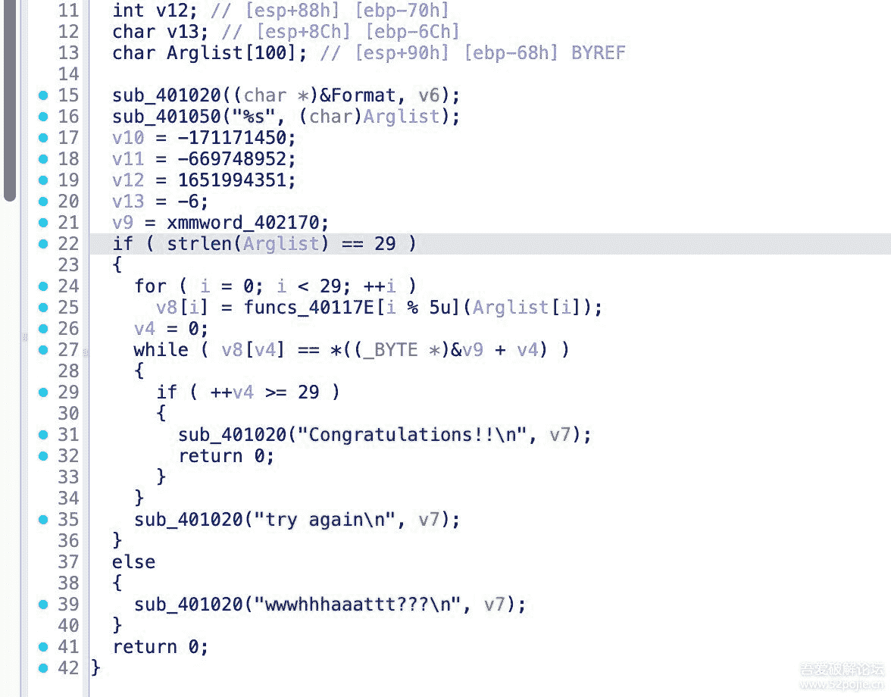

`后1_1.jpg`（124.93 KB，下载次数: 2）

[附件下载](https://www.52pojie.cn/forum.php?mod=attachment&aid=Mjc0NjI0N3xhZTg1N2RlNHwxNzkzNTcxNDQ3fDE2ODA4NnwxOTk0NjU3&nothumb=yes)

h11

2024-12-26 13:03 上传

前

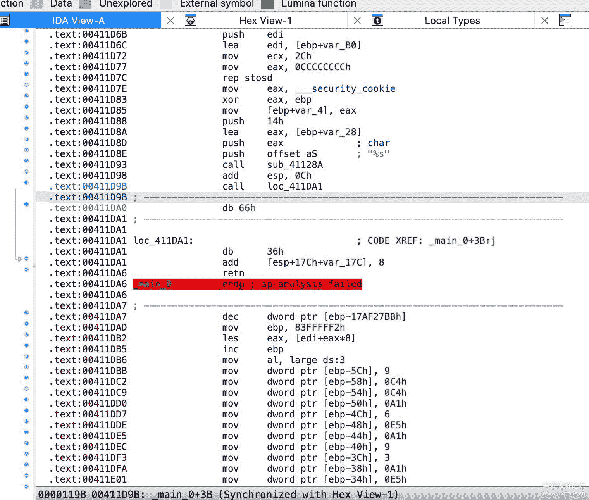

`前2.jpg`（337.04 KB，下载次数: 2）

[附件下载](https://www.52pojie.cn/forum.php?mod=attachment&aid=Mjc0NjI0OHwyYzY2YzFjZXwxNzkzNTcxNDQ3fDE2ODA4NnwxOTk0NjU3&nothumb=yes)

q2

2024-12-26 13:03 上传

后

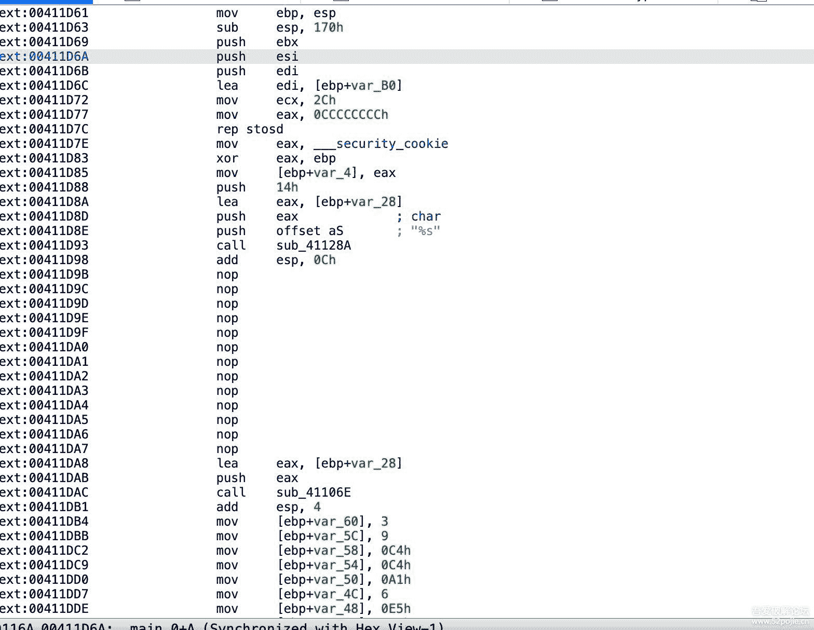

`后2.jpg`（239.73 KB，下载次数: 2）

[附件下载](https://www.52pojie.cn/forum.php?mod=attachment&aid=Mjc0NjI0OXw0YTZkMjM3ZHwxNzkzNTcxNDQ3fDE2ODA4NnwxOTk0NjU3&nothumb=yes)

h2

2024-12-26 13:03 上传

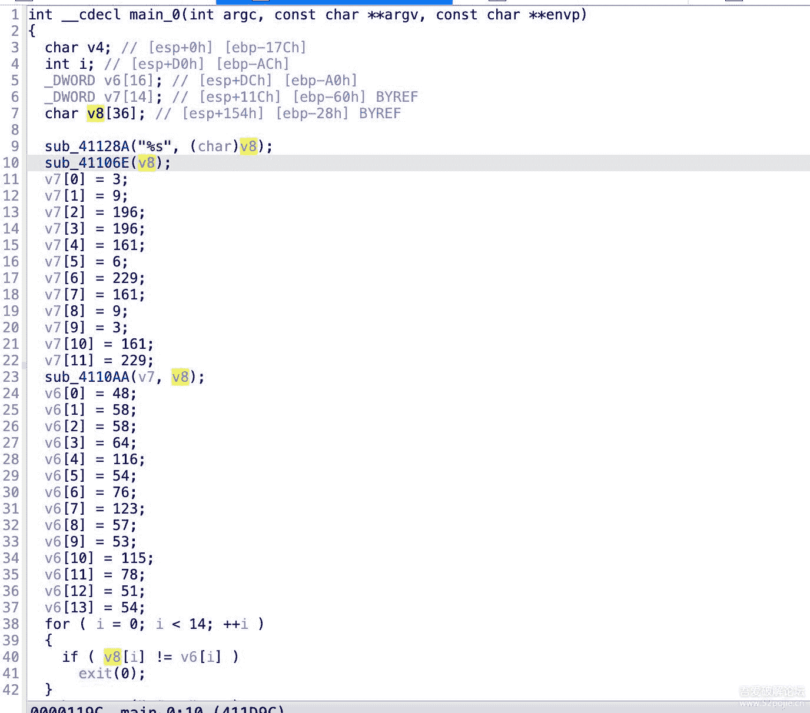

`后2_1.jpg`（158.65 KB，下载次数: 2）

[附件下载](https://www.52pojie.cn/forum.php?mod=attachment&aid=Mjc0NjI1MHxkZjQwMzczMnwxNzkzNTcxNDQ3fDE2ODA4NnwxOTk0NjU3&nothumb=yes)

h21

2024-12-26 13:04 上传

## 总结

写的很烂，已知问题有：

1. 不能自动把所有分支走完，遇到那种有多个分支的函数，还得把没执行过的分支手动执行地址执行一遍
2. 导入函数不确定能不能全部排除掉
3. 去除“修改返回地址的函数“相关逻辑有不少 bug（比如遇到被调用者清理堆栈的情况，又正好把被调用的函数跳过了，就会 `nop` 一大片）

但是也算是整理了一下相关思路并验证了可行性

相关脚本和样本见附件
