# [Web逆向] 雷池WAF滑块版本逆向分析

- 原帖: https://www.52pojie.cn/forum.php?mod=viewthread&tid=1995970
- 抓取时间: 2026-11-01T22:17:21

## 前言

项目中的网站防护突然更新了。

原先是无感检测，现在加了个滑块。

上一版的算法看的这位佬的文章写出来的。[//www.52pojie.cn/thread-1930242-1-1.html" target="_blank" rel="noopener noreferrer nofollow"](https://www.52pojie.cn/forum.php?mod=attachment&aid=Mjc0NzA2OHxhOGQ4NjBkMnwxNzkzNTcxNDM5fDE2ODA4NnwxOTk1OTcw&nothumb=yes)

网上先找了一圈没有相关的分析文章，只能自己顶了。

## 目标网站

aHR0cHM6Ly93d3cuY2hhbmdhbmp5enguY29tLw==

## DevTool控制台检测

滑动滑块后被检测到

1.png (18.12 KB, 下载次数: 5)

[href="forum.php?mod=attachment&aid=Mjc0NzA2OHxhOGQ4NjBkMnwxNzkzNTcxNDM5fDE2ODA4NnwxOTk1OTcw&nothumb=yes" target="_blank"](https://www.52pojie.cn/forum.php?mod=attachment&aid=Mjc0NzA2OHxhOGQ4NjBkMnwxNzkzNTcxNDM5fDE2ODA4NnwxOTk1OTcw&nothumb=yes)

2024-12-30 17:02 上传

看下控制台发包数据，只有一个js文件`challenge.js`，看来就是它了。

先过一眼代码，不多，五千多行，没有混淆。

既然是滑块滑动完后触发检测，那我们先加个`mouseup`的鼠标监听断点。

滑动鼠标到位置后松开，看下断点位置。定位到了函数`j`的位置，向下继续走，能看到先拿到了轨迹去判断，`too-fast`检测滑动太快，`too-slow`滑动太慢。中间一系列计算检测是否正确滑动到尾端位置。 直接到最后的`w`函数。

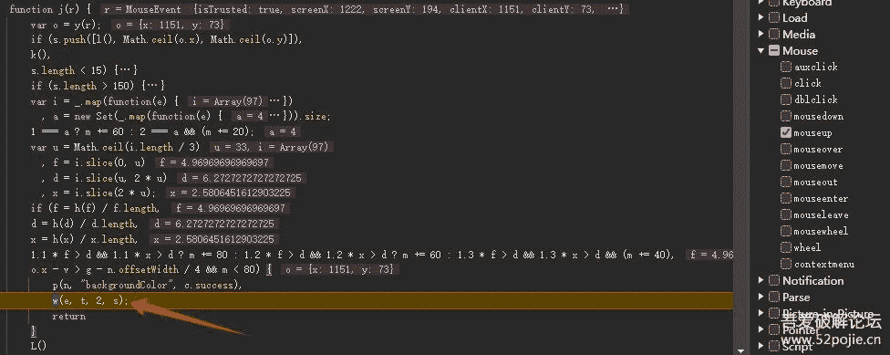

2.png (70 KB, 下载次数: 5)

[href="forum.php?mod=attachment&aid=Mjc0NzIwMHwwYjMyODlhY3wxNzkzNTcxNDM5fDE2ODA4NnwxOTk1OTcw&nothumb=yes" target="_blank"](https://www.52pojie.cn/forum.php?mod=attachment&aid=Mjc0NzIwMHwwYjMyODlhY3wxNzkzNTcxNDM5fDE2ODA4NnwxOTk1OTcw&nothumb=yes)

2024-12-31 14:11 上传

看下入参

`e`：固定域名

`t`：6205cd33ef8541dfaf16eabb6329dcda_61 访问首页时响应内容里的，每次值都不一样，先标记为`client id`后续会用到。

`s`：轨迹

进入`w`函数往下走两步，触发了当前环境正在被检测，ok找到了。

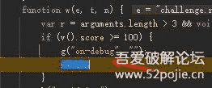

3.png (10.47 KB, 下载次数: 5)

[href="forum.php?mod=attachment&aid=Mjc0NzIwMXwxODQwMDc5OXwxNzkzNTcxNDM5fDE2ODA4NnwxOTk1OTcw&nothumb=yes" target="_blank"](https://www.52pojie.cn/forum.php?mod=attachment&aid=Mjc0NzIwMXwxODQwMDc5OXwxNzkzNTcxNDM5fDE2ODA4NnwxOTk1OTcw&nothumb=yes)

2024-12-31 14:11 上传

看看`v`函数，有个43位数组，遍历执行每个数组的`fun`函数，再进`fun`代码看看。

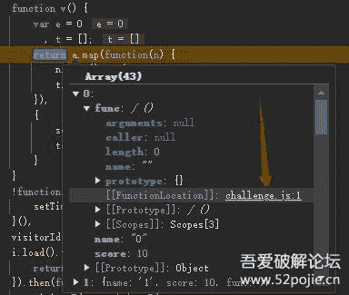

4.png (27.35 KB, 下载次数: 5)

[href="forum.php?mod=attachment&aid=Mjc0NzIwMnwwNjU2N2RhMXwxNzkzNTcxNDM5fDE2ODA4NnwxOTk1OTcw&nothumb=yes" target="_blank"](https://www.52pojie.cn/forum.php?mod=attachment&aid=Mjc0NzIwMnwwNjU2N2RhMXwxNzkzNTcxNDM5fDE2ODA4NnwxOTk1OTcw&nothumb=yes)

2024-12-31 14:11 上传

好家伙，原来是43个检测点。

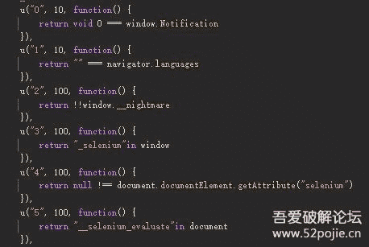

5.png (23.9 KB, 下载次数: 5)

[href="forum.php?mod=attachment&aid=Mjc0NzIwM3wzNWNiZWM3Y3wxNzkzNTcxNDM5fDE2ODA4NnwxOTk1OTcw&nothumb=yes" target="_blank"](https://www.52pojie.cn/forum.php?mod=attachment&aid=Mjc0NzIwM3wzNWNiZWM3Y3wxNzkzNTcxNDM5fDE2ODA4NnwxOTk1OTcw&nothumb=yes)

2024-12-31 14:11 上传

那就懂了，初始分数为0，每检测到一个点，增加相应分数，分数大于等于100则触发被检测到。

这里不管那么多，直接从源头注释掉完事了。

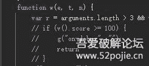

6.png (8.79 KB, 下载次数: 5)

[href="forum.php?mod=attachment&aid=Mjc0NzIwNHxiZTM4ZjZjNHwxNzkzNTcxNDM5fDE2ODA4NnwxOTk1OTcw&nothumb=yes" target="_blank"](https://www.52pojie.cn/forum.php?mod=attachment&aid=Mjc0NzIwNHxiZTM4ZjZjNHwxNzkzNTcxNDM5fDE2ODA4NnwxOTk1OTcw&nothumb=yes)

2024-12-31 14:11 上传

## 流程梳理

检测相关代码去掉后。重新刷新网页滑动滑块，正确进入网站。

再分析发包数据，可知整体流程如下。

1、请求首页获取`client id`和cookie `sl-session`

2、请求获取`challenge.js`文件先进行环境检测

3、携带`client_id`请求`issue`接口获取一个数组和`issue_id`

4、请求获取`calc.js`文件，在里面操作`wasm`

4、将请求`issue`获取的数组在`wasm`中进行相关计算获得一个新的数组

5、携带新的数组和一些固定参数请求`verify`接口获取`jwt`也就是最终的cookie `sl-challenge-jwt`

拿到cookie `sl-session`和`sl-challenge-jwt`就能获取到网页信息。

## wasm AI分析

开始看到有`wasm`文件我也很蛋疼，虽说也不是没解决过，但就很无力。

不过还好，看了下也就不到四百行，那就不用手写WebAssembly了，可以用 AI 刚一下。

回到上回断点处继续往下走，看到`fetch`要获取`calc.js`文件，直接跳到`then`。

`new Blob`它创建一个`Blob`对象，`i` 是`calc.js`的代码内容，

`URL.createObjectURL` 为 `Blob` 创建一个唯一的 URL，这个 URL 可以被用来引用 `Blob` 中的内容，

`new Worker` 创建一个新的 Web Worker，使用上面创建的 URL 作为 Worker 的脚本来源。

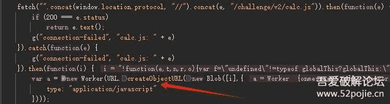

7.png (27.93 KB, 下载次数: 5)

[href="forum.php?mod=attachment&aid=Mjc0NzIwNXw1ZmNjZTNhMHwxNzkzNTcxNDM5fDE2ODA4NnwxOTk1OTcw&nothumb=yes" target="_blank"](https://www.52pojie.cn/forum.php?mod=attachment&aid=Mjc0NzIwNXw1ZmNjZTNhMHwxNzkzNTcxNDM5fDE2ODA4NnwxOTk1OTcw&nothumb=yes)

2024-12-31 14:11 上传

这样你会看到多了这么一个文件，里面其实就是`calc.js`的内容。

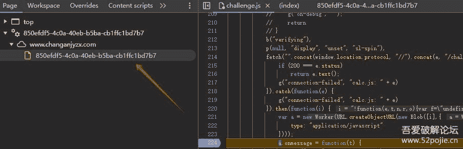

8.png (50.34 KB, 下载次数: 5)

[href="forum.php?mod=attachment&aid=Mjc0NzIwNnwzM2IxOTNlOHwxNzkzNTcxNDM5fDE2ODA4NnwxOTk1OTcw&nothumb=yes" target="_blank"](https://www.52pojie.cn/forum.php?mod=attachment&aid=Mjc0NzIwNnwzM2IxOTNlOHwxNzkzNTcxNDM5fDE2ODA4NnwxOTk1OTcw&nothumb=yes)

2024-12-31 14:12 上传

进入文件搜索 `WebAssembly` 定位到调用`wasm`的位置。可以看到它整体被赋值给了 `onmessage`（玩过5s盾的应该都被这个虐过），

那直接搜索 `postMessage` 可定位到它的发送位置。

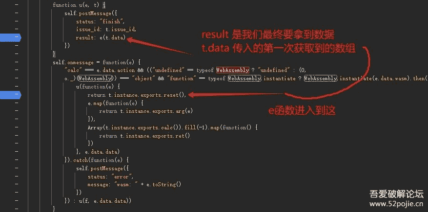

9.png (55.16 KB, 下载次数: 4)

[href="forum.php?mod=attachment&aid=Mjc0NzIwN3xiYWY5YzEyN3wxNzkzNTcxNDM5fDE2ODA4NnwxOTk1OTcw&nothumb=yes" target="_blank"](https://www.52pojie.cn/forum.php?mod=attachment&aid=Mjc0NzIwN3xiYWY5YzEyN3wxNzkzNTcxNDM5fDE2ODA4NnwxOTk1OTcw&nothumb=yes)

2024-12-31 14:12 上传

断点继续往下走，就会进入`wasm`了。

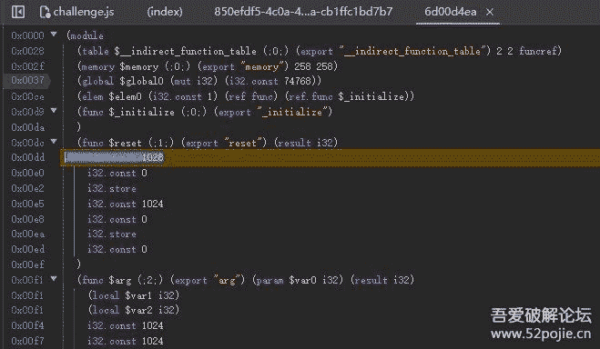

10.png (48.21 KB, 下载次数: 4)

[href="forum.php?mod=attachment&aid=Mjc0NzIwOHxmNjA5NmRjZXwxNzkzNTcxNDM5fDE2ODA4NnwxOTk1OTcw&nothumb=yes" target="_blank"](https://www.52pojie.cn/forum.php?mod=attachment&aid=Mjc0NzIwOHxmNjA5NmRjZXwxNzkzNTcxNDM5fDE2ODA4NnwxOTk1OTcw&nothumb=yes)

2024-12-31 14:12 上传

先分析流程

`reset` > `arg` > `calc` > `ret`

这是调用`wasm`中方法的顺序。

下面交给AI

我是先分段丢给它，每个方法都让AI分析出具体的解释。

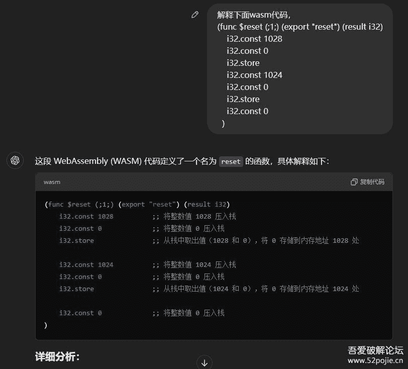

11.png (62.99 KB, 下载次数: 5)

[href="forum.php?mod=attachment&aid=Mjc0NzIwOXw3ZTJhMWU4N3wxNzkzNTcxNDM5fDE2ODA4NnwxOTk1OTcw&nothumb=yes" target="_blank"](https://www.52pojie.cn/forum.php?mod=attachment&aid=Mjc0NzIwOXw3ZTJhMWU4N3wxNzkzNTcxNDM5fDE2ODA4NnwxOTk1OTcw&nothumb=yes)

2024-12-31 14:12 上传

每一段都分析完后再让它结合起来复现算法。

这一块费时较多，我先用的`chatGPT 4o`模型，每次调教后给的代码执行的结果都是乱七八糟的格式完全对不上。

于是我换了`Claude3.5 Sonnet`模型，这回给的代码执行结果的格式对上了，但是结果是不准确的，和浏览器调试不一致，

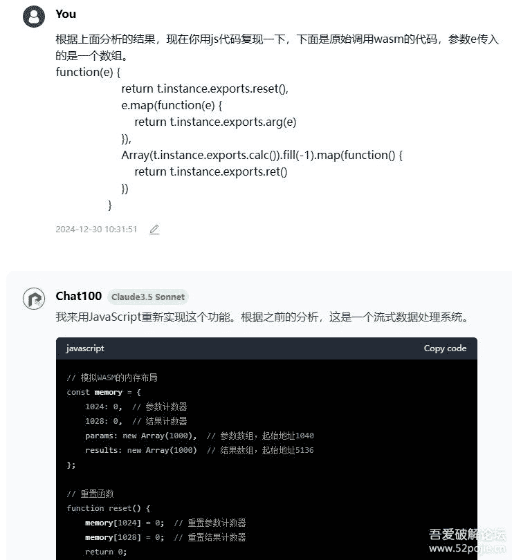

12.png (65.93 KB, 下载次数: 3)

[href="forum.php?mod=attachment&aid=Mjc0NzIxMHw2YTMyZGY4OXwxNzkzNTcxNDM5fDE2ODA4NnwxOTk1OTcw&nothumb=yes" target="_blank"](https://www.52pojie.cn/forum.php?mod=attachment&aid=Mjc0NzIxMHw2YTMyZGY4OXwxNzkzNTcxNDM5fDE2ODA4NnwxOTk1OTcw&nothumb=yes)

2024-12-31 14:12 上传

那剩下的就是对比下`wasm`的执行流，抠抠细节，多调教会正确代码就出来了。

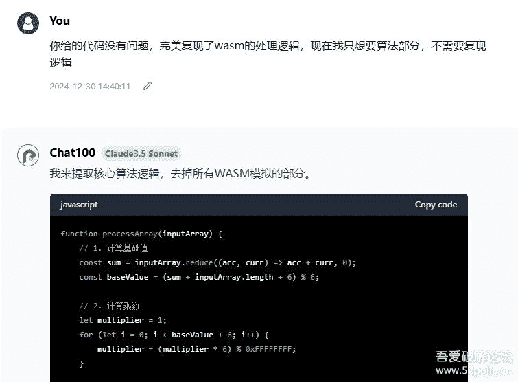

13.png (46.57 KB, 下载次数: 4)

[href="forum.php?mod=attachment&aid=Mjc0NzIxMXxlNzYxZmQ2OHwxNzkzNTcxNDM5fDE2ODA4NnwxOTk1OTcw&nothumb=yes" target="_blank"](https://www.52pojie.cn/forum.php?mod=attachment&aid=Mjc0NzIxMXxlNzYxZmQ2OHwxNzkzNTcxNDM5fDE2ODA4NnwxOTk1OTcw&nothumb=yes)

2024-12-31 14:12 上传

最终请求`verify`接口是带上新生成的`result`数组，其他参数写死即可，没错轨迹也可以写死没有校验。

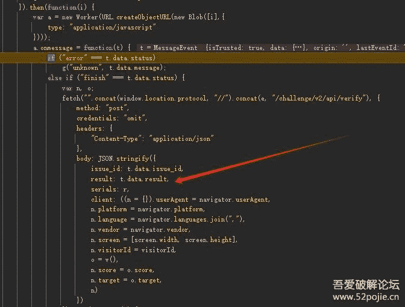

14.png (54.88 KB, 下载次数: 3)

[href="forum.php?mod=attachment&aid=Mjc0NzIxMnxhNmRlN2JhZXwxNzkzNTcxNDM5fDE2ODA4NnwxOTk1OTcw&nothumb=yes" target="_blank"](https://www.52pojie.cn/forum.php?mod=attachment&aid=Mjc0NzIxMnxhNmRlN2JhZXwxNzkzNTcxNDM5fDE2ODA4NnwxOTk1OTcw&nothumb=yes)

2024-12-31 14:12 上传

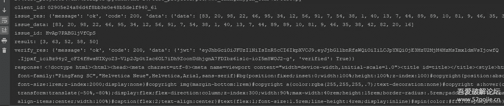

15.png (92.63 KB, 下载次数: 3)

[href="forum.php?mod=attachment&aid=Mjc0NzIxM3xkZDExNzA1Y3wxNzkzNTcxNDM5fDE2ODA4NnwxOTk1OTcw&nothumb=yes" target="_blank"](https://www.52pojie.cn/forum.php?mod=attachment&aid=Mjc0NzIxM3xkZDExNzA1Y3wxNzkzNTcxNDM5fDE2ODA4NnwxOTk1OTcw&nothumb=yes)

2024-12-31 14:12 上传

## 总结

总的来说不是那么难，在调试的时候需要有目的的去定位关键位置，代码里有很多`setTimeout`和`Promise`，单步调试会很困难。

有了AI帮助后，分析代码也轻松了很多。

这是在2024年的最后一天编写的文章，也祝大家新年快乐。
