# [原创] VMProtect 本地授权锁的分析与破解（基于 Q 量子网络验证例子）

- 原帖: https://www.52pojie.cn/forum.php?mod=viewthread&tid=1996252
- 抓取时间: 2026-11-01T22:17:17

注: Q*量子网络验证并不是自己写的加密壳, 而是使用的 `VMProtect`。本文也不会对 Q*量子网络验证的验证部分进行分析与破解。

注: Q量子网络验证并不是自己写的加密壳, 而是使用的 `VMProtect`。本文也不会对 Q量子网络验证的验证部分进行分析与破解。

## 前言

`VMProtect` 的本地授权锁，自带 `VMProtect` 的虚拟机保护，只需要将被保护的代码设置锁定到序列号，也可以根据需要添加一些到期时间或者运行时间的限制，就有一定的防破解效果。首先被保护的代码无论如何都需要一组能正常运行的序列号进行解密，如果对这些被保护的代码进行 patch，也可以通过增加函数保护标记数量来增加破解者的工作量，可以说是很简单又有效的防脱壳和防破解的办法。

然而一旦 `VMProtect` 的 `VMProtectSetSerialNumber` 的流程被分析出来，并且 `keygen` 了，那无论有多少个带授权锁的虚拟化保护标记都没有用了。目前对 `VMProtect` 授权锁的破解方案里有 `patch` 模数后自己进行 `keygen`，以及在合适的时机修改解密结果，两种相对容易的方案，下面就来简单分析这两种破解方法的可行性。

## 分析前的准备

- `x64dbg` 分析/调试工具
- `3.5-3.8` 版本的 `VMProtect` 加密测试用
- 一个 `64` 位的 `PE` 本地授权锁样本，以下分析基于该样本。

先准备一个样本，需要使用的 `SDK` 函数的原型如下。

```c
int VMP_API VMProtectSetSerialNumber(const char *serial);
void VMP_API VMProtectBeginUltraLockByKey(const char *);
```

测试的例子只需要写个 `VMProtectSetSerialNumber`，然后使用 `VMProtectBeginUltraLockByKey` 保护一个其他函数即可。

```cpp
void Test_Lic()
{
    VMProtectBeginUltraLockByKey("lock");
    cout > serial; // 只能读一行所以序列号不要带换行符
    cout
```

编译出来，直接使用 `VMProtect3.8` 加壳，并设置密钥长度，这里直接设置 `4096`，加壳/反调试与反虚拟机等非本文分析的重点，故全部略过，只加密函数。

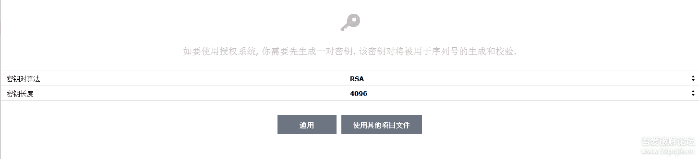

`image-1.png`（20.82 KB，下载次数：3），[附件下载](https://www.52pojie.cn/forum.php?mod=attachment&aid=Mjc0NzQzNXwwM2EwYzEzOHwxNzkzNTcxNDM0fDE2ODA4NnwxOTk2MjUy&nothumb=yes)，2025-1-1 19:19 上传。

然后我们可以用 `VMP` 以前提供的 `keygen`（在 `2.x` 版本里附带）生成一个序列号，只需要导出密钥对并复制粘贴到 `Keygen` 的源码里即可。生成序列号后，去掉它的换行符，再写到 `test.key` 给测试程序读取。`keygen` 里其实已经写了序列号是 `RSA` 算法，破解的话要么替换模数要么修改解密结果，但无论哪种都需要正常的序列号运行并解密，知道是 `RSA`，我们的目标就是尽可能找到公钥跟模数了。

## 分析 key 解密以及大数存放的加解密

用 `x64dbg` 调试，直接找到 `VMProtectSetSerialNumber` 的位置，下断点，运行就可以看到序列号了。

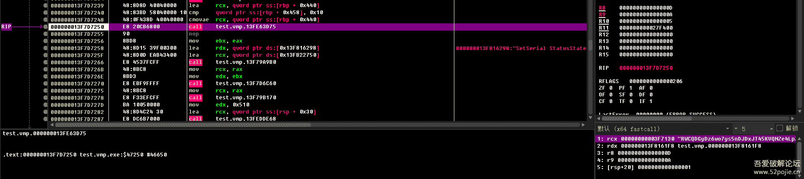

`image-2.png`（37.93 KB，下载次数：3），[附件下载](https://www.52pojie.cn/forum.php?mod=attachment&aid=Mjc0NzQzNnw2OTdmMTQ4MHwxNzkzNTcxNDM0fDE2ODA4NnwxOTk2MjUy&nothumb=yes)，2025-1-1 19:19 上传。

但这个位置，一般会被其他虚拟化水印保护，不会这么容易被找到。遇到这种情况，可以在 `RtlEnterCriticalSection` 处下断点，观察堆栈跟寄存器是否有 `key` 的出现。如下图，可以在 `rdx` 跟 `rsp+78` 处看到序列号。`32` 位也是这样，但寄存器不一样，要看 `ecx` 跟 `ebp`。

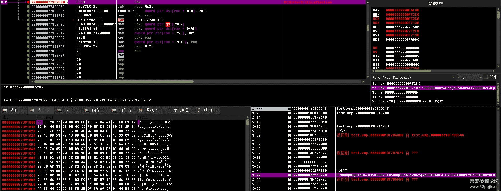

`image-3.png`（68.92 KB，下载次数：2），[附件下载](https://www.52pojie.cn/forum.php?mod=attachment&aid=Mjc0NzQzN3xmNmIwZDU4OHwxNzkzNTcxNDM0fDE2ODA4NnwxOTk2MjUy&nothumb=yes)，2025-1-1 19:19 上传。

继续跟进，在 `RtlAllocateHeap` 处下断点并运行，第一次停下的情况。

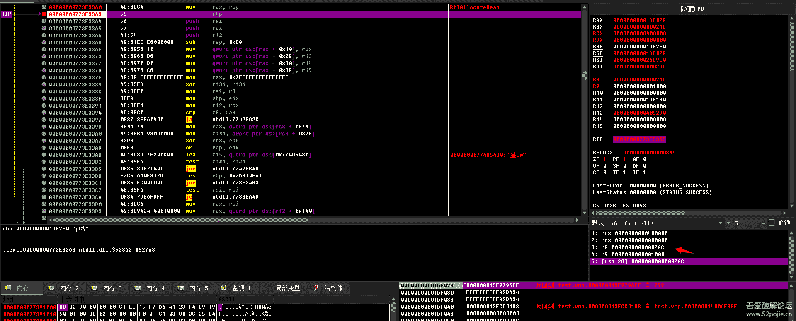

`image-4.png`（67.18 KB，下载次数：2），[附件下载](https://www.52pojie.cn/forum.php?mod=attachment&aid=Mjc0NzQzOHxjYWU5MmJlNHwxNzkzNTcxNDM0fDE2ODA4NnwxOTk2MjUy&nothumb=yes)，2025-1-1 19:19 上传。

`0x2AC` 为序列号的长度，这里分配的内存会用来存放序列号 `base64` 解码后的结果。执行到 `retn`，记录下分配的地址，运行后停下，可以看到解密结果与直接 `base64` 解码的结果相同。

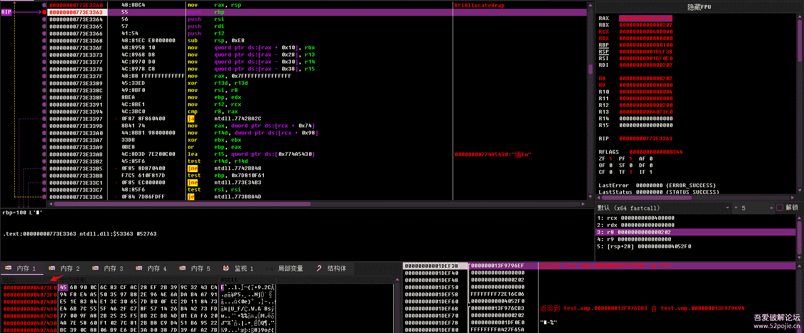

`image-5.png`（70.24 KB，下载次数：2），[附件下载](https://www.52pojie.cn/forum.php?mod=attachment&aid=Mjc0NzQzOXxmZjhjMWUxMnwxNzkzNTcxNDM0fDE2ODA4NnwxOTk2MjUy&nothumb=yes)，2025-1-1 19:19 上传。

第二次分配是 `0x202` 的大小，`0x200` 同样也是 `RSA` `4096` 的数据长度，分配的内存用来将这个 `base64` 解码结果转成 `VMP` 自己的大数结构存放。同样执行到 `retn`，记录分配地址后运行。停下后就能看到数据了，但这些数据被加密了，可以在没写入之前下硬件写入断点，跟踪分析得到解密算法。

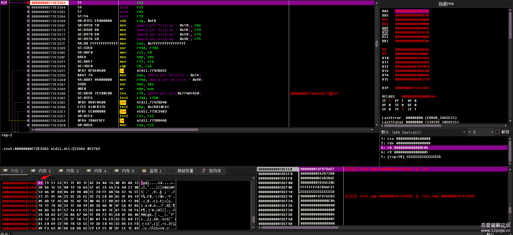

`image-6.png`（78.12 KB，下载次数：3），[附件下载](https://www.52pojie.cn/forum.php?mod=attachment&aid=Mjc0NzQ0MHw4M2EyOGFhYnwxNzkzNTcxNDM0fDE2ODA4NnwxOTk2MjUy&nothumb=yes)，2025-1-1 19:19 上传。

限于篇幅，这里不详细讲解怎么跟踪的算法，毕竟纯体力活，直接说结论：`VMP` 使用了存放大数的地址跟随机生成的 `20` 字节的 `salt` 进行加密，`salt` 存放在堆栈，可以直接在堆栈搜这个存放大数的地址，`salt` 就在后面。

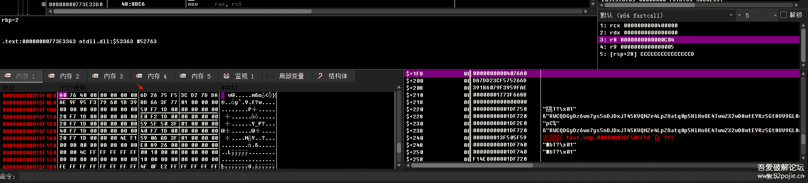

`image-7.png`（40.57 KB，下载次数：3），[附件下载](https://www.52pojie.cn/forum.php?mod=attachment&aid=Mjc0NzQ0MXw0YWNjZjYzNXwxNzkzNTcxNDM0fDE2ODA4NnwxOTk2MjUy&nothumb=yes)，2025-1-1 19:19 上传。

这次的 `salt` 就是 `6D 26 75 F5 3C D2 7D DA AE 9F 95 F3 79 60 1B 39 8B 66 3F 77`，因为是随机生成的所以只能用在这次解密。这里直接提供解密后的结果，算法会在后面提供。

```text
00 01 69 71 63 7D 93 5F FF 4C E3 5D 49 AF 43 E2
0F 98 D9 32 67 61 41 14 99 93 01 0A 89 19 50 72
CB 15 E5 AC 3A B4 8A 55 3A 4B 71 08 F2 27 B2 62
4D 72 EB 28 4F 1E 67 DF A6 9E 8E CA FC 41 CA 97
D8 4C 4E 36 A5 39 42 00 1C F6 04 3C CD 8D 69 DB
5D 58 33 7B D2 D7 51 DB 67 5D B4 72 72 6A F8 3F
F1 DB 8D 87 64 F5 56 AA 61 F9 3C 73 26 6C 2D 15
A0 9D 3A B8 A5 CF 50 A2 80 47 75 5A 07 91 2B 4B
0E 29 02 26 D8 90 18 E9 5E C9 23 C2 F1 1A A6 88
4B 3D 8C 68 49 4F E1 1A 09 D3 84 27 3C 85 A7 CF
A1 08 A7 D9 76 63 C8 35 CD C5 87 E4 25 03 44 27
AA 1C 16 B7 79 B7 7D AF 7E 30 31 5E 67 00 43 02
C5 11 BB 93 F7 A6 2F DF B7 B3 65 38 32 64 68 56
B1 73 A8 BB B6 5C 99 02 47 4D A5 85 D4 D1 A7 A4
92 C0 73 5F 3A 78 2F CC 60 FD 2D C3 B7 8C 51 1F
07 DB DC 5F 44 DE CA FE 76 86 AA 1E 12 0B 15 BA
E6 66 10 A7 51 13 77 F4 76 27 AD 92 84 8C 2A 1E
00 C9 50 B3 74 0D DA AB 38 E5 A5 51 F6 8D A1 8F
D5 EB C4 DE 36 C8 A4 22 95 AA F5 2C AE FF 48 48
2A B1 78 37 3B 5F 3D FA F8 B8 7A 3A FD 5F B3 29
08 93 5F F6 25 05 EF CB 77 56 30 D3 70 11 C3 1C
27 76 5B 17 0F CB 5E 9D 76 5F 88 C4 7B 29 64 27
D5 27 5F 30 87 AC F3 F6 3E D7 BB 4C 82 2E 83 F8
12 92 65 19 94 7B 2E CA 2E 6D FA A3 68 97 13 BA
A3 6C 76 D8 5E 59 67 2D 72 E5 AF 5B E6 33 0F A1
1B F6 7B A2 6F 39 7D 38 D0 3A DE E6 B9 06 88 0C
39 BC 22 95 B6 51 D4 C9 B8 2B 81 7C 02 F1 60 58
7E 4A 20 F6 EA 01 4D DB 2C BB F5 25 25 2B A8 9F
00 77 FD 73 42 B4 26 14 57 8F C7 2F 46 5F 55 7C
6B E4 73 84 11 2D CC 0F B0 7D 65 30 3C E1 84 83
1E E5 91 A7 B4 DA 6A 4E 96 2E B8 97 35 50 A5 E4
F8 94 C4 43 32 9C 39 2B EF 28 AC CF 83 6C 0C 90
60 45
```

回到第三次 `RtlAllocateHeap`，分配的大小是 `0xC04`，用来存放公钥（`0x4`，公钥也可以自定义只不过一般不做），模数（`0x200`），消息（`base64` 解码结果 `0x200`），以及两个缓冲区（`0x400*2`），存放顺序是随机的，每次运行都不一样，同样执行到 `retn`，记录分配地址后运行，查看并解密数据，这次分配可以视为是解密结束了。`64` 位分配大小是 `0x20`，`32` 位是 `0x10`。

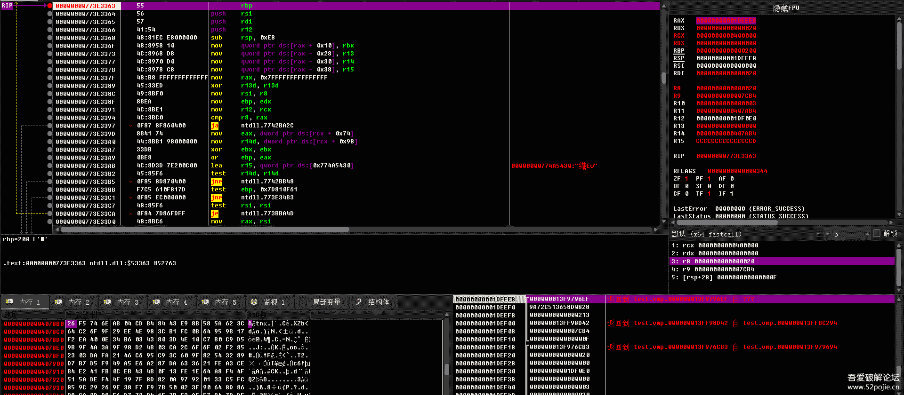

`image-8.png`（74.31 KB，下载次数：2），[附件下载](https://www.52pojie.cn/forum.php?mod=attachment&aid=Mjc0NzQ0MnxhZGM2N2U5NnwxNzkzNTcxNDM0fDE2ODA4NnwxOTk2MjUy&nothumb=yes)，2025-1-1 19:19 上传。

同样提取数据并解密，这次解密用的跟之前提取的 `salt` 一样，但解密用的内存地址要用这个本身的，稍微整理一下。

```text
msg:

60 45 0C 90 83 6C AC CF EF 28 39 2B 32 9C C4 43
F8 94 A5 E4 35 50 B8 97 96 2E 6A 4E B4 DA 91 A7
1E E5 84 83 3C E1 65 30 B0 7D CC 0F 11 2D 73 84
6B E4 55 7C 46 5F C7 2F 57 8F 26 14 42 B4 FD 73
00 77 A8 9F 25 2B F5 25 2C BB 4D DB EA 01 20 F6
7E 4A 60 58 02 F1 81 7C B8 2B D4 C9 B6 51 22 95
39 BC 88 0C B9 06 DE E6 D0 3A 7D 38 6F 39 7B A2
1B F6 0F A1 E6 33 AF 5B 72 E5 67 2D 5E 59 76 D8
A3 6C 13 BA 68 97 FA A3 2E 6D 2E CA 94 7B 65 19
12 92 83 F8 82 2E BB 4C 3E D7 F3 F6 87 AC 5F 30
D5 27 64 27 7B 29 88 C4 76 5F 5E 9D 0F CB 5B 17
27 76 C3 1C 70 11 30 D3 77 56 EF CB 25 05 5F F6
08 93 B3 29 FD 5F 7A 3A F8 B8 3D FA 3B 5F 78 37
2A B1 48 48 AE FF F5 2C 95 AA A4 22 36 C8 C4 DE
D5 EB A1 8F F6 8D A5 51 38 E5 DA AB 74 0D 50 B3
00 C9 2A 1E 84 8C AD 92 76 27 77 F4 51 13 10 A7
E6 66 15 BA 12 0B AA 1E 76 86 CA FE 44 DE DC 5F
07 DB 51 1F B7 8C 2D C3 60 FD 2F CC 3A 78 73 5F
92 C0 A7 A4 D4 D1 A5 85 47 4D 99 02 B6 5C A8 BB
B1 73 68 56 32 64 65 38 B7 B3 2F DF F7 A6 BB 93
C5 11 43 02 67 00 31 5E 7E 30 7D AF 79 B7 16 B7
AA 1C 44 27 25 03 87 E4 CD C5 C8 35 76 63 A7 D9
A1 08 A7 CF 3C 85 84 27 09 D3 E1 1A 49 4F 8C 68
```


```
4B 3D A6 88 F1 1A 23 C2 5E C9 18 E9 D8 90 02 26
0E 29 2B 4B 07 91 75 5A 80 47 50 A2 A5 CF 3A B8
A0 9D 2D 15 26 6C 3C 73 61 F9 56 AA 64 F5 8D 87
F1 DB F8 3F 72 6A B4 72 67 5D 51 DB D2 D7 33 7B
5D 58 69 DB CD 8D 04 3C 1C F6 42 00 A5 39 4E 36
D8 4C CA 97 FC 41 8E CA A6 9E 67 DF 4F 1E EB 28
4D 72 B2 62 F2 27 71 08 3A 4B 8A 55 3A B4 E5 AC
CB 15 50 72 89 19 01 0A 99 93 41 14 67 61 D9 32
0F 98 43 E2 49 AF E3 5D FF 4C 93 5F 63 7D 69 71
```

`pub`：
```
01 00 01 00
```

`tmp1`：
```
00 00 00 00 00 00 00 00 00 00 00 00 00 00 00 00
00 00 00 00 00 00 00 00 00 00 00 00 00 00 00 00
// 0x200个00 省略掉一些
00 00 00 00 00 00 00 00 00 00 00 00 00 00 00 00
02 00 2F E2 20 25 86 8C 52 9D 1C 60 F2 B1 E4 56
C3 30 01 00 02 01 4A 08 68 6F 20 6E 6F 44 03 65
6A 0C 68 6F 40 6E 6F 64 2E 65 6F 63 04 6D 00 10
00 00 00 00 00 00 00 00 00 00 00 00 00 00 07 00
A4 76 A3 A8 83 89 F8 00 33 FF 2F 31 DD 77 D2 3D
5B FD CF 77 08 A7 39 DC CB 08 E2 24 02 8A 56 B5
42 E2 23 E0 9E C4 F9 3B 67 8D ED 4F 70 9E CA 75
E6 5E 58 D2 A6 86 7E EC 33 C5 96 4E 34 58 6F A3
1A 1A B8 5C 53 B5 F9 9E 2C F7 2F AB CC 69 31 02
6A AF A2 D9 17 DE 5A BB 53 41 22 E8 C2 2B 41 3D
2F 71 17 45 34 9E 55 45 BC 61 8E 50 35 EE A0 3B
1D 40 4F 09 4C ED FC 1A 9F 8B C9 3E 6B CD 31 6C
52 59 49 CC 6D 79 C8 CF E5 39 FC 77 62 7B C7 1A
68 A3 D6 C4 28 6F AA FB BE F6 AA 77 5E 90 39 BB
84 05 2F 08 9A 4A A0 05 29 35 41 40 7C E0 6A BE
E7 2F 00 56 04 27 BC F7 0B 1A 31 A6 40 47 E5 DD
FE 6E 7B 71 CF 14 3F CE 3A 4F 73 2C 25 75 61 6C
6F FC EA E6 2B 5C 9E 4A 92 51 21 41 2C C7 58 28
AC D0 38 65 91 5F 1B 3B 02 44 FE 22 EE 92 15 88
04 6B 07 07 5D 59 D0 D3 98 BB 10 1E AC 70 46 91
2D 2C 3F 26 5A B8 BF FA 9C 93 A5 6C DE 95 87 9F
DD 9C 9C 2A CF 6C 66 18 93 3B 6B 79 44 9F 78 39
54 44 41 58 97 B0 C9 E4 D9 05 7C 39 72 61 4A 60
EB 76 C3 26 29 67 89 3E 2D 78 EF F4 E7 B8 CD DE
A9 A1 C0 06 AC DD 6D 73 3F A0 EA 9B 97 5A 05 9B
CF 23 EA 38 86 A2 76 13 45 DC B0 14 7F A3 35 67
E8 91 18 1D EE D5 ED C2 06 33 AF 8A B1 6A F2 CA
5D 11 D3 7F 77 78 FA 86 6D 99 15 40 69 4C B5 DA
80 A2 70 EC A7 38 A8 96 99 CD 5A DD 97 7E E3 87
20 F2 94 FE 80 46 FD AC 6C 9F 57 44 76 21 E7 68
94 A9 CB AD 16 A3 8A 53 1A C5 CF 56 14 89 BA 91
54 3D 96 9D 98 70 77 3B BB 28 06 D1 E9 97 79 5F
```

`mod`：
```
97 D7 00 1D 34 D4 36 1D 09 D8 21 F4 A1 35 AB 06
28 9F 9D 94 53 C1 A7 4E 00 1C 22 75 34 DF 3C B7
A9 17 31 97 63 B3 16 22 1F 0D 9F 80 2F 43 BE 39
84 62 13 5C 33 32 3F FC 6A A8 AC 0D 67 F2 F2 EE
4A A4 EA 83 04 29 28 7C D9 7D 2D B8 F5 BC AE 89
D2 84 70 22 EC 62 70 C4 E0 75 44 83 2A E9 2B B9
0B 72 C7 72 15 BB E1 C2 BF AE 27 65 40 BF 6E 7C
11 14 49 E6 1D A3 B8 90 E9 4B 55 A2 96 67 B6 E5
15 E0 55 BC 0D 55 F4 10 5F AF 6E BE A4 D8 24 5E
C3 57 8A 7E 72 2E CC 8B AB 6B C1 EF 40 8A 16 00
A2 54 52 BD C0 26 95 2B 5D 0C DF D2 4F C0 1D 30
11 D6 56 6B 52 08 CA DD 6C 38 57 F4 6C 16 3A 4C
6C BC 46 16 F5 39 90 C3 49 6B E6 B0 EB 2D 6B 75
09 0C FE 41 EC 60 CD 93 73 44 61 E7 C0 17 04 19
CC C6 2A F5 64 2B EE CA 37 03 11 9F 2A 9A C3 F7
DB 1B 3C 5A E6 80 B3 24 A6 C8 D6 44 92 AD 66 53
EA DB 65 7E 16 EA 3E 20 66 6B 4E B3 FC 9F F7 3D
1F 41 68 B0 53 3F 94 70 7C 53 25 DD 89 72 D2 D0
86 25 9F 5E BA 06 46 9A 5F 59 FA 51 FA 0D 28 5E
90 33 12 CB 9E 36 5D 31 F9 4F 9F 8E 63 17 C7 36
AA 2C 07 5A 2A FE 88 1B B7 43 55 CF FD 92 C5 C8
AA 3F 50 B1 EB 17 2A 18 89 0B 47 1E EC EA E9 0D
8D BD 1A 78 B8 98 5F B2 3F B6 29 6B 19 D2 6D 9F
10 98 C1 F2 AD C1 6D D4 C2 97 39 E8 E4 63 E6 00
FD 68 D7 46 87 28 0A 7C 2D D9 71 C9 54 F8 7B DB
8F 71 08 DF B2 A5 9C F4 FD 39 08 D7 6F DD B8 46
22 EB FC DC A3 A6 55 B4 3A 72 A0 E7 F3 D5 33 8C
FB D0 37 F8 10 27 F0 49 C0 43 80 46 E4 B0 AE A1
D1 BD A9 E7 57 5C 61 81 07 45 96 14 40 07 3D 49
E0 EB 84 35 10 8B 9D E1 53 7D CD F5 CA B1 E2 45
68 D8 2D 51 9A E0 74 DE 90 16 D5 F7 73 3C 0F C0
9C 70 9A 6B 15 D5 BE D0 B0 D7 B9 A4 65 51 49 16
```

`tmp2`：
```
//没发现用处 省略 前0x200都是00
```

根据前面的`msg`解密结果可以看出来，这部分的数据，两个字节为间隔，前后交换位置了，调整一下就行。

虽然这部分内容是乱序存储的，但`pub`通常是`0x10001`不用特意去提取，`tmp1`是最重要的`VMPSerialData`，也就是序列号解密后的结果，可以用`0x200`个00以及数据区的`00 02`来特征搜索定位，`tmp2`没找到什么用处，它也有`0x200`个00，但没有`00 02`这个特征，查找到了就直接舍弃，`msg`可以直接明文查找排除，剩下的就是`mod`模数了，至此提取数据的部分搞定，我们得到了这样子的数据。

```
00 02 E2 2F 25 20 8C 86 9D 52 60 1C B1 F2 56 E4
30 C3 00 01 01 02 08 4A 6F 68 6E 20 44 6F 65 03
0C 6A 6F 68 6E 40 64 6F 65 2E 63 6F 6D 04 10 00
00 00 00 00 00 00 00 00 00 00 00 00 00 00 00 07
76 A4 A8 A3 89 83 00 F8 FF 33 31 2F 77 DD 3D D2
FD 5B 77 CF A7 08 DC 39 08 ... // 后面的是没用的填充数据
```

## `VMPSerialData`结构

这部分可以参考`keygen`的`VMProtectGenerateSerialNumber`函数，测试程序提取出来的数据具体结构如下。

```
00 02 E2 2F 25 20 8C 86 9D 52 60 1C B1 F2 56 E4 30 C3 00 // 前面的0002 以及最后的00固定 剩下的用随机长度的随机数填充

01 01 // 版本号标记 目前固定是两个01

02 // 用户名

08 4A 6F 68 6E 20 44 6F 65 // 一字节长度+文本

03 // 邮箱

0C 6A 6F 68 6E 40 64 6F 65 2E 63 6F 6D // 一字节长度+文本

04 // 机器码

10 00 00 00 00 00 00 00 00 00 00 00 00 00 00 00 00 // 一字节长度+机器码

07 // ProductCode 最重要的一个 没有它不能解密被锁定序列号的代码

76 A4 A8 A3 89 83 00 F8 // 固定八个字节的ProductCode

FF // CRC并且解析结束

33 31 2F 77 DD 3D D2 FD 5B 77 CF A7 08 DC 39 08 // 20字节的SHA1校验值 防止直接篡改这部分的数据

//解析结束 后面的是无用的随机填充数据
```

还有其他字段的解析，如到期日期，时间限制等，不做赘述，可参考`VMProtectGenerateSerialNumber`的实现。

同样的我们也可以用`VMProtectGenerateSerialNumber`来生成自己的序列号，因为我们已经拿到了`ProductCode`，其他的限制字段都可以不加，只需要自己生成一组RSA，并替换掉程序的`mod`值就可以`keygen`了。

## 大数加解密算法的版本差异

vmp使用的大数都在内存中加密了，加解密算法根据版本的不同有一些细微差异，但都需要随机生成的20字节`salt`跟内存地址进行加解密，下硬件写断点跟踪虚拟机可以得到算法。

### 3.5

```
//解密
        uint16_t* salt_ = (uint16_t*)psalt;
        for (size_t i = 0; i > 7)) % 16;
                size_t salt = *((uint8_t*)(salt_)+offset) + 0x37 + (addr >> 4);
                buffer[i] = (uint16_t)((buffer[i] ^ salt) + addr);
                addr += 2;
        }

//加密
        uint16_t* salt_ = (uint16_t*)psalt;
        for (size_t i = 0; i > 7)) % 16;
                size_t salt = *((uint8_t*)(salt_)+offset) + 0x37 + (addr >> 4);
                buffer[i] = (uint16_t)((buffer[i] - addr) ^ salt);
                addr += 2;
        }
```

### 3.6与3.7相同

```
//解密
        uint16_t* salt_ = (uint16_t*)psalt;
        for (size_t i = 0; i > 7)) % 10;
                size_t salt = salt_[offset] + 0x73 + ((uint16_t)(addr) >> 4);
                buffer[i] = (uint16_t)((buffer[i] ^ salt) + addr);
                addr += 2;
        }

//加密
        uint16_t* salt_ = (uint16_t*)psalt;
        for (size_t i = 0; i > 7)) % 10;
                size_t salt = salt_[offset] + 0x73 + ((uint16_t)(addr) >> 4);
                buffer[i] = (uint16_t)((buffer[i] - addr) ^ salt);
                addr += 2;
        }
```

### 3.8


```c
//解密
uint16_t* salt_ = (uint16_t*)psalt;
for (size_t i = 0; i > 7)) % 10;
        size_t idx = offset ^ ((uint16_t)addr >> 5);
        size_t salt = salt_[offset] + (_rotl(0xFACE001E, idx % 8) & 0xFFFF);
        buffer[i] = (uint16_t)((buffer[i] ^ salt) + addr);
        addr += 2;
}
```

```c
//加密
uint16_t* salt_ = (uint16_t*)psalt;
for (size_t i = 0; i > 7)) % 10;
        size_t idx = offset ^ ((uint16_t)addr >> 5);
        size_t salt = salt_[offset] + (_rotl(0xFACE001E, idx % 8) & 0xFFFF);
        buffer[i] = (uint16_t)((buffer[i] - addr) ^ salt);
        addr += 2;
}
```

大体解密思路差不多，只不过对一些常数跟`salt`做了微调。有了算法就能解开这些大数了。

## patch解密结果的可行性

由于有序列号有`CRC`校验，不能直接修改部分`VMPSerialData`的字节来变更序列号的属性，比如说机器的绑定或者到期时间等等，需要更新一下序列号自带的`SHA1`才行。不过我们有`VMP`自带的那份`keygen`，可以做一些小修改，只需要删掉`RSA`加密的部分，让它直接生成`VMPSerialData`的数据就可以了。调用`VMProtectGenerateSerialNumber`时，除了必要的`ProductCode`，其他的字段都可以不用设置，重新生成一份`VMPSerialData`，就可以一直使用了。

`patch`流程则是：先传入一个伪造的同长度的序列号，`Hook` `RtlAllocateHeap` 函数，在之前说到的分配`0xC04`大小的内存时，记录下内存地址，在分配`0x20`的时候，解密这个大数，需要在之前的分配`0x202`的时候记录下分配的地址，并在堆栈上搜索这个地址，就能找到解密需要的`salt`，然后把已经生成的`VMPSerialData` `patch`到`tmp1`对应的区域，即可正常运行。如果分不清`tmp1` `tmp2`，也可以把`tmp1` `tmp2`都`patch`了，只需要搜索有`0x200`个`00`开头的区域就行了。

## Keygen的可行性

`3.5`以及之前的版本可行且容易实现，因为我们已经拿到了`ProductCode`，跟上面一样能自己生成序列号，甚至都不用对`keygen`做修改，只需要自己生成一组`RSA`，`Hook` `RtlAllocateHeap`函数后在第一次分配`0x202`大小的内存，存储的就是`mod`的模数（第二次是分配存放序列号`base64`解码的），在第二次分配`0x202`的时候对这个模数进行解密，替换成自己的模数，加密覆盖回去即可`keygen`。`3.6`以后，`vmp`不会单独分配存储模数的空间，而是一次性分配出所有需要的空间并进行乱序存储，需要设置硬件写入断点才可以找到合适的`patch`模数的时机，硬件断点写起来较为麻烦，故本文不做考虑，只讲述大致流程，有兴趣的可以自行尝试。

## 编写dll辅助patch破解授权锁

综合上面的分析，我们可以写一个`dll`注入到主程序里对`RtlAllocateHeap`进行`Hook`并修改`RSA`解密后的结果，方案如下。

```
1.Hook RtlEnterCriticalSection ，由于这个函数调用频繁容易误判，需要判断返回地址是否属于主程序的调用，再通过判断寄存器跟堆栈上是否出现了序列号来判断是否为VMProtectSetSerialNumber调用的，记为EnterRVA。这步用调试器手动查找。

2.一旦由EnterRVA调用了RtlEnterCriticalSection，则Hook RtlAllocateHeap，在分配0x202大小空间的时候，记录地址，分配0xC04空间的时候，搜索0x202的地址获得salt，并且可以尝试内置几种VMP解密大数的算法解密0x202的大数，只要解密成功就能自动判断VMP的版本，最后分配0x20空间的时候，便可以用记录的salt解密0xC04的大数了，将tmp1区域的数据直接拷贝出来，解析后去掉限制类的字段（机器码，到期时间等），重新生成一份无限制VMPSerialData储存到本地的文件并结束程序。

3.重新打开程序，读取本地的文件，伪造序列号，按照上面的流程重新找到tmp1，将VMPSerialData加密后patch进去即可。

4.为了方便调整如EnterRVA字段这种频繁改动的字段，将一些字段存到ini里读取。
```

考虑到生成`VMPSerialData`跟`patch`在流程上有一定冲突，以及功能上的精简，故拆成两个`dll`来完成上面的工作，`VMPGetKey.dll`专门生成`VMPSerialData`并存到文件，`VMPKeyPatcher.dll`专门读取`VMPSerialData`的文件并进行`patch`操作。

有了`dll`以后可以将破解流程简化为

手动调试，定位到`VMProtectSetSerialNumber`调用的`RtlEnterCriticalSection`，也就是`EnterRVA`，写到`InjectConfig.ini`文件并调整参数->正常运行的情况下注入`VMPGetKey.dll`获取`VMPSerialData.data`(可在`InjectConfig.ini`中调整名字)->伪造任意同长度序列号，注入`VMPKeyPatcher.dll`完成授权锁的破解。

## 使用dll对某网络验证的授权锁进行破解

该样本只用来测试本地授权锁，不分析网络验证，用易语言编译一个样本并添加授权锁保护标记。

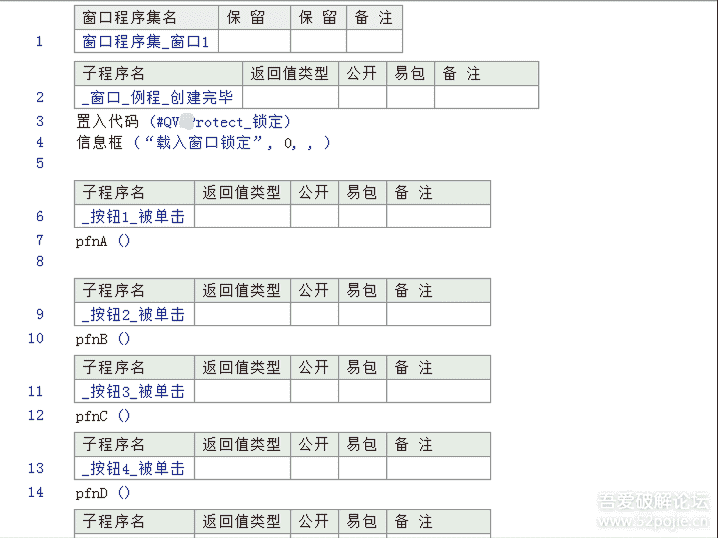

`img9.png` (108.95 KB, 下载次数: 4)

[href="forum.php?mod=attachment&aid=Mjc0NzQzNHxmOWFkZmRjYnwxNzkzNTcxNDM0fDE2ODA4NnwxOTk2MjUy&nothumb=yes" target="_blank"](https://www.52pojie.cn/forum.php?mod=attachment&aid=Mjc0NzQzNHxmOWFkZmRjYnwxNzkzNTcxNDM0fDE2ODA4NnwxOTk2MjUy&nothumb=yes)

2025-1-1 19:19 上传

加密后有一个`dllbox`，本身没啥用，获取完序列号就可以干掉。

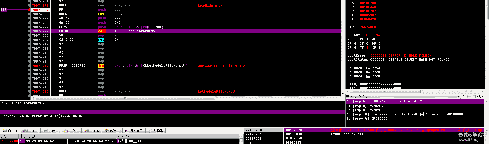

`image-10.png` (49.42 KB, 下载次数: 3)

[href="forum.php?mod=attachment&aid=Mjc0NzQ0M3wzZDEyMmE3NXwxNzkzNTcxNDM0fDE2ODA4NnwxOTk2MjUy&nothumb=yes" target="_blank"](https://www.52pojie.cn/forum.php?mod=attachment&aid=Mjc0NzQ0M3wzZDEyMmE3NXwxNzkzNTcxNDM0fDE2ODA4NnwxOTk2MjUy&nothumb=yes)

2025-1-1 19:19 上传

可以搞一个`winspool.drv`劫持补丁来获取`VMProtectSetSerialNumber`的`EnterRVA`，或者能过反调试的人直接调试，在点击登录并弹出信息框后，于主线程`TEB+0x100`处的地址就是存放序列号的地址。

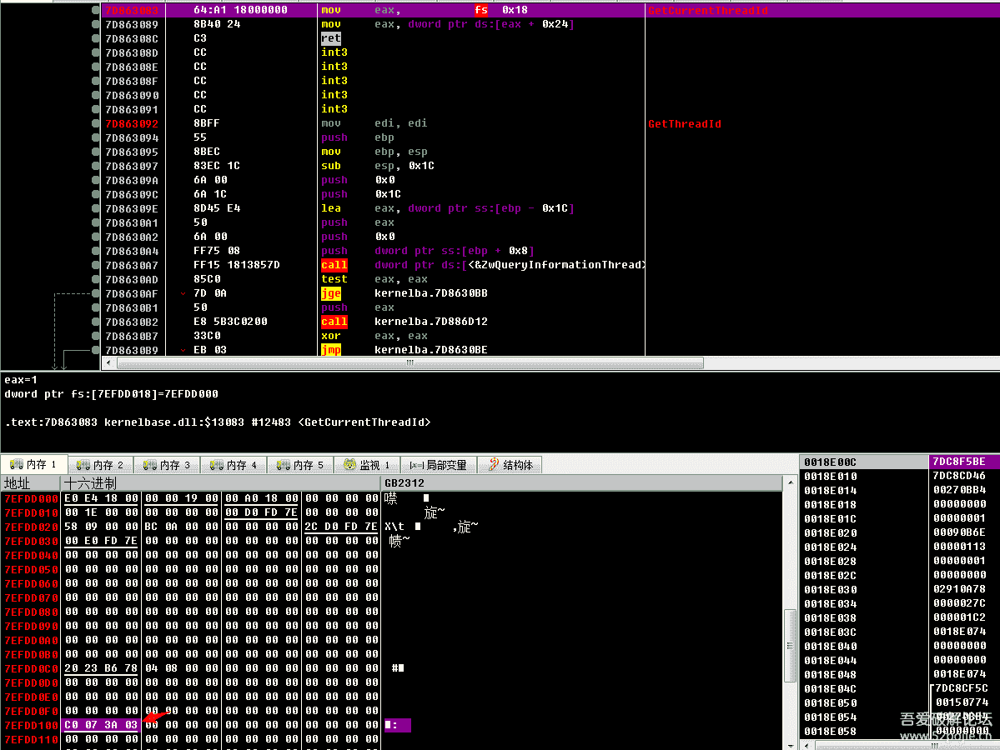

`image-11.png` (54.27 KB, 下载次数: 3)

[href="forum.php?mod=attachment&aid=Mjc0NzQyOXxkMjllMDc4M3wxNzkzNTcxNDM0fDE2ODA4NnwxOTk2MjUy&nothumb=yes" target="_blank"](https://www.52pojie.cn/forum.php?mod=attachment&aid=Mjc0NzQyOXxkMjllMDc4M3wxNzkzNTcxNDM0fDE2ODA4NnwxOTk2MjUy&nothumb=yes)

2025-1-1 19:19 上传

之后同样在`RtlEnterCriticalSection`处下断点并获取`EnterRVA`的地址，图里堆栈上的地址减掉`0x400000`就是`EnterRVA`了，填写到`InjectConfig.ini`里。

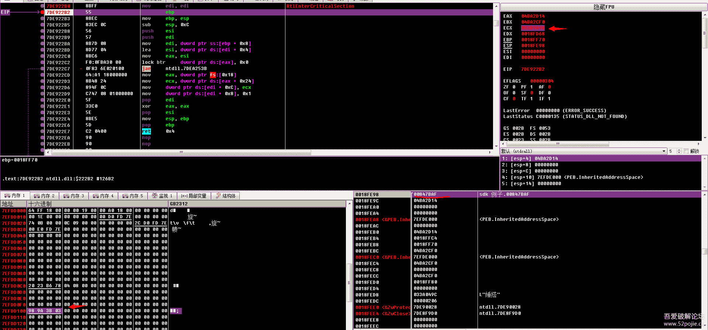

`image-12.png` (74.04 KB, 下载次数: 3)

[href="forum.php?mod=attachment&aid=Mjc0NzQzMHw3ZDYwNGJiY3wxNzkzNTcxNDM0fDE2ODA4NnwxOTk2MjUy&nothumb=yes" target="_blank"](https://www.52pojie.cn/forum.php?mod=attachment&aid=Mjc0NzQzMHw3ZDYwNGJiY3wxNzkzNTcxNDM0fDE2ODA4NnwxOTk2MjUy&nothumb=yes)

2025-1-1 19:19 上传

劫持补丁也做了个自动查找的功能，直接运行后会输出`EnterLog.log`，里面有`EnterRVA`的地址，如果有多行`EnterRVA`，一般是第一个，如果自动查找不到，建议还是手动查找。然后根据序列号的长度判断`KeySize`要写多少，就取序列号`base64`解码后的长度`*8`，然后写最接近的那个就行。

获取完毕，之后的`dll`注入可以考虑直接干掉`VMP`的`dllbox`，考虑到`VMP`要求必须要加载`dllbox`成功才可继续流程，往加载的`dllbox`的入口处写入`mov eax,1;retn 0xC;`即可。之后需要把序列号设置在`TEB+0x100`那里，`drv`补丁会导出`VMPLic.key`并自行设置，不想使用`drv`的自己用调试器搞也行。干掉`dllbox`后，剩下的就是加载两个`Dll`了，这些事情将`InjectConfig.ini`的`LoadMode`设置为`0`，`drv`补丁就会自动处理，只需要填写`EnterRVA`。

`ini`填写完`EnterRVA`，再将`LoadMode`设置为`1`，加载`VMPGetKey.dll`自动导出`VMPKeyData.data`，固定序列号的工作由`drv`补丁处理，看到文件了就算成功。


`image-13.png` (1.82 KB, 下载次数: 3)

[href="forum.php?mod=attachment&aid=Mjc0NzQzMXxlZmU2NDkwZnwxNzkzNTcxNDM0fDE2ODA4NnwxOTk2MjUy&nothumb=yes" target="_blank"](https://www.52pojie.cn/forum.php?mod=attachment&aid=Mjc0NzQzMXxlZmU2NDkwZnwxNzkzNTcxNDM0fDE2ODA4NnwxOTk2MjUy&nothumb=yes)

2025-1-1 19:19 上传

最后把`ini`的`LoadMode`设置为`2`，加载`VMPKeyPatcher.dll`进行破解，伪造序列号的工作也同样由`drv`补丁处理，成功进入主界面，所有按钮均可点击，包括锁定的按钮。

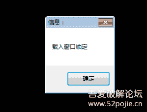

`image-14.png` (9.82 KB, 下载次数: 3)

[href="forum.php?mod=attachment&aid=Mjc0NzQzMnw5ZDUzZDdhMXwxNzkzNTcxNDM0fDE2ODA4NnwxOTk2MjUy&nothumb=yes" target="_blank"](https://www.52pojie.cn/forum.php?mod=attachment&aid=Mjc0NzQzMnw5ZDUzZDdhMXwxNzkzNTcxNDM0fDE2ODA4NnwxOTk2MjUy&nothumb=yes)

2025-1-1 19:19 上传

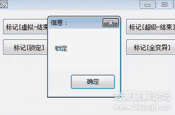

`image-15.png` (13.09 KB, 下载次数: 2)

[href="forum.php?mod=attachment&aid=Mjc0NzQzM3w3MjY3MDQ2N3wxNzkzNTcxNDM0fDE2ODA4NnwxOTk2MjUy&nothumb=yes" target="_blank"](https://www.52pojie.cn/forum.php?mod=attachment&aid=Mjc0NzQzM3w3MjY3MDQ2N3wxNzkzNTcxNDM0fDE2ODA4NnwxOTk2MjUy&nothumb=yes)

2025-1-1 19:19 上传

至此`VMProtect`本地授权锁破解完毕。

## 总结

如前言所说，`VMProtect`授权锁的强度还是太依赖于`VMProtectSetSerialNumber`的函数，虽然对所有保护标记都有做加密保护，但只要对序列号解密后获取8字节的`ProductCode`，便可自己构造序列号或者`patch`解密结果了。

该样本仅用于测试分析`VMProtect`的本地授权锁, 不涉及`Q`量子网络验证部分, 这部分可以简单的`ret`即可。该验证没有任何分析的必要, 过掉授权锁就行。(友好建议`Q`量子验证采用其他更有效的防破解方案, 例如某网络验证`S`的`PIC`盾以及防脱壳`AntiDump`算法的思路, 目前`S`的`PIC`盾还没想到如何破解）

补丁后续开源
