# [CTF] 全国大学生软件安全攻防赛初赛wp

- 原帖：https://www.52pojie.cn/forum.php?mod=viewthread&tid=1998165
- 抓取时间：2026-11-01T22:17:03

## 第18届软件系统安全大赛攻防赛初赛wp

### 钓鱼邮件

给了一个`.eml`文件，`outlook`打开，有一个`生日快乐.zip`，解压需要密码，根据发件日期，24岁等信息，可以猜测出解压密码即为生日`20001111`。

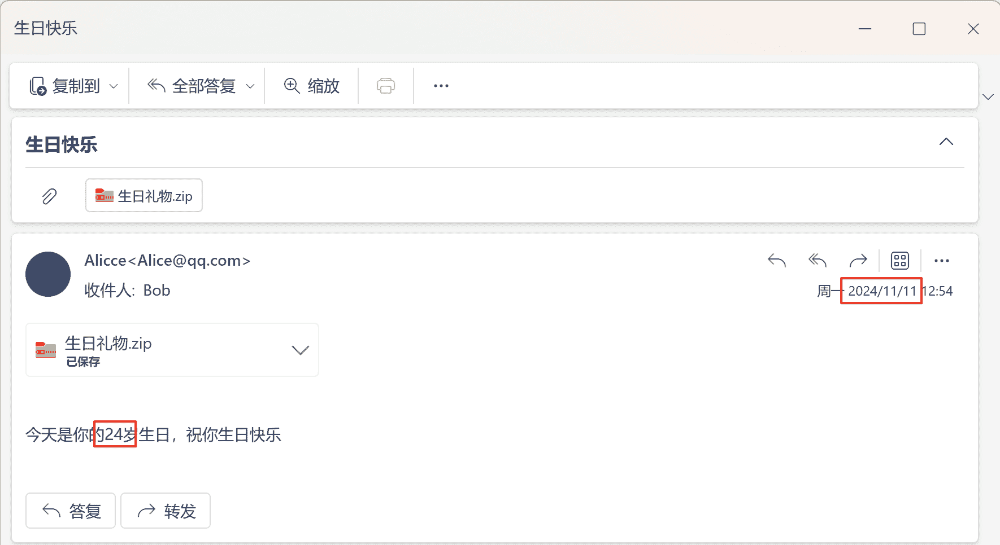

解压后得到`生日快乐.exe`，双击运行，`wirshark`抓包，找到`ip`和`port`。

`md5`结果

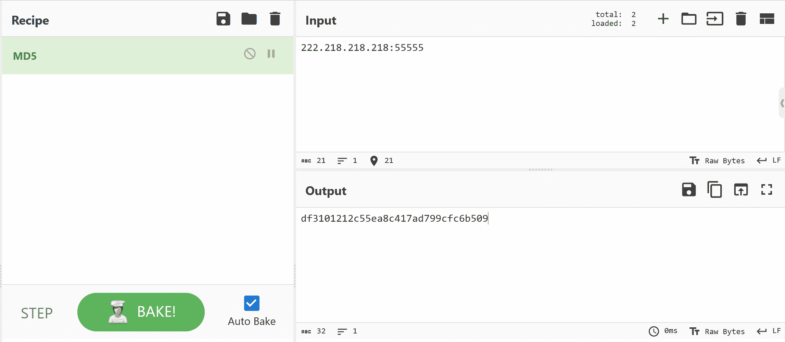

### donntyousee

查看函数`sub_405559()`

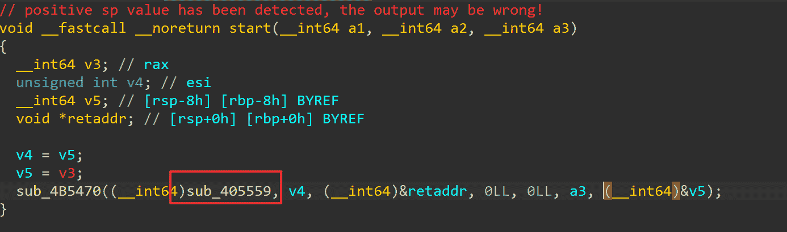

存在花指令

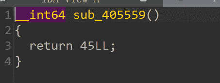

将`ret` `nop`掉

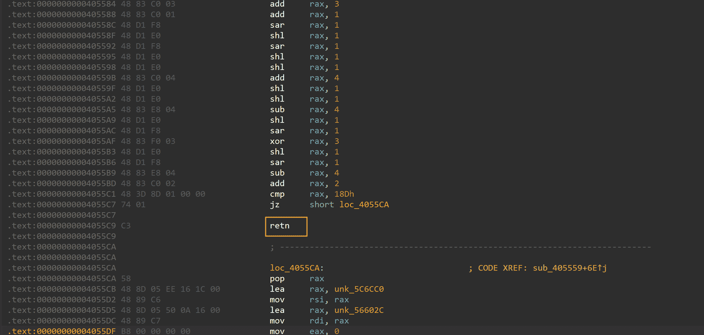

动调跑一下，这里一定要在函数`sub_405559()`里面下断，不然单步会直接跳过该函数，直接跟丢了

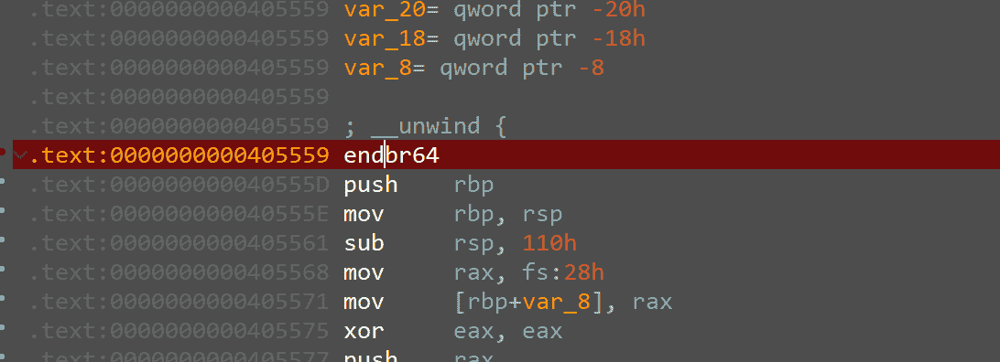

多次尝试发现这个`call`是进行输入的地方，这里直接进行输入然后步过

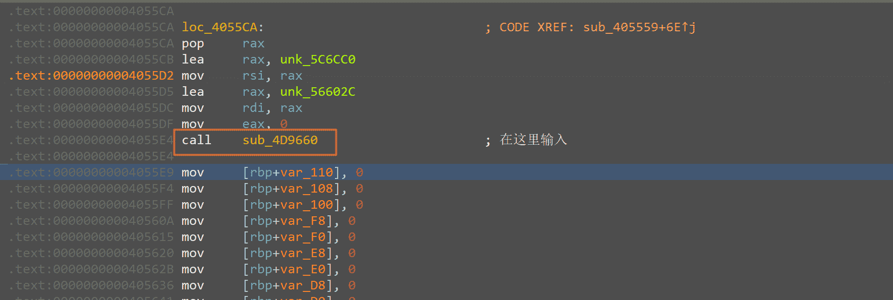

这两个`call`步入

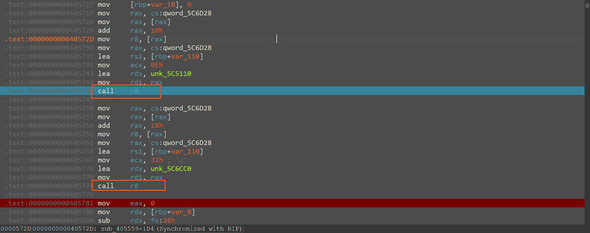

第一个`call`，发现是`rc4`初始化

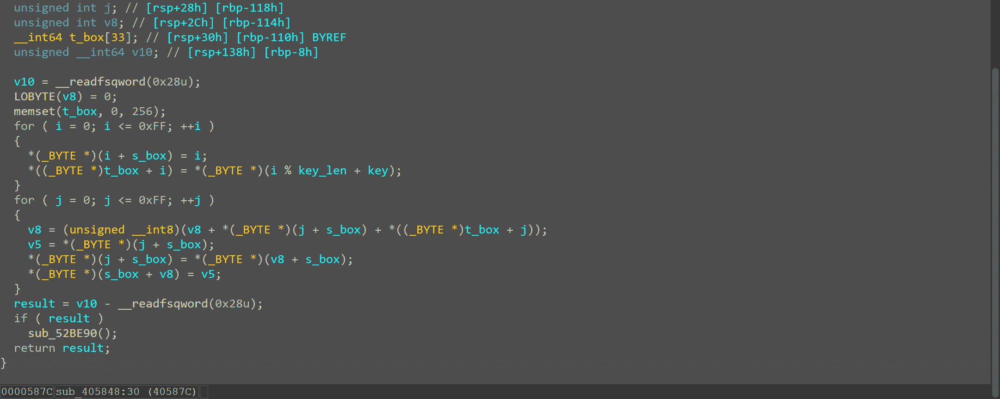

第二个`call`是魔改的`RC4`，最后加了个亦或

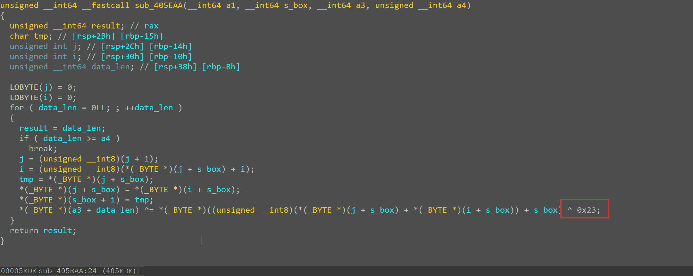

跟一下加密后的结果，找到存储密文的地址`unk_5C6CC0`

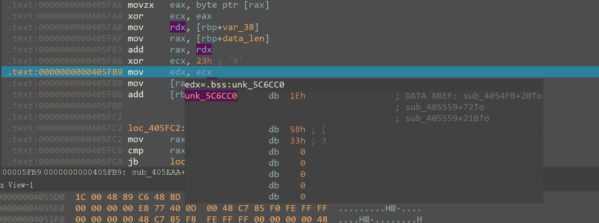

然后去看密文在哪里进行check，这里交叉引用

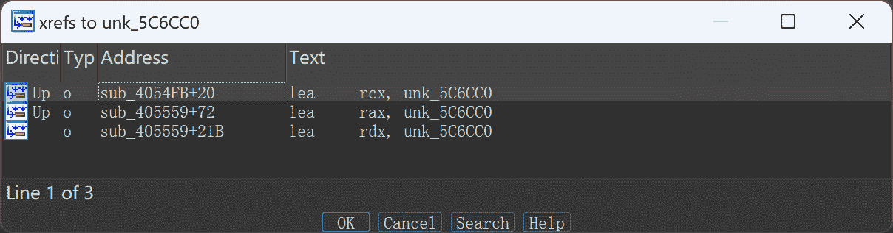

定位到函数`sub_4054FB`，这个`call`步入

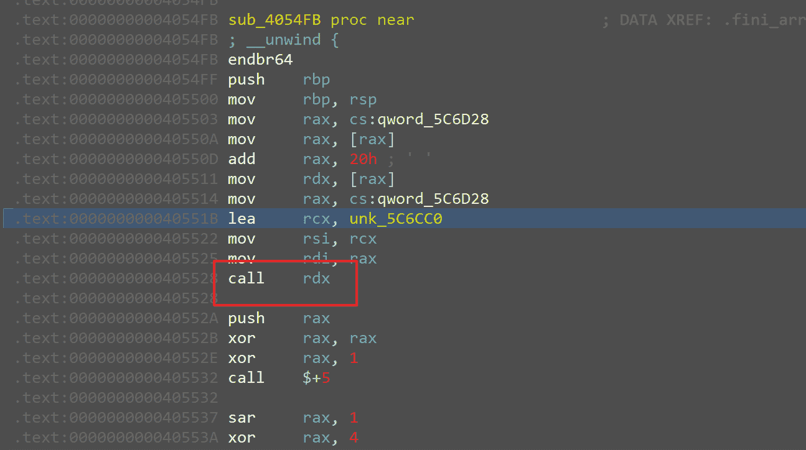

发现密文

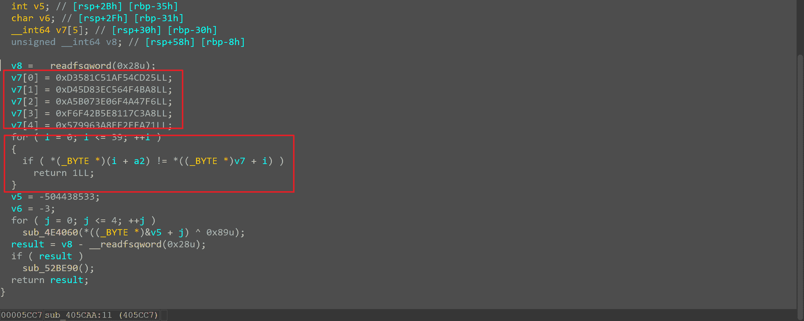

秘钥`key`

这里做了反调试，导致`key`动态和静态的值不一样

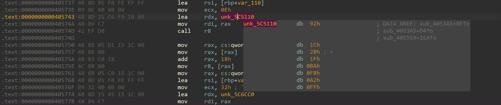

将密文和`key` `dump`出来，用工具解密即可

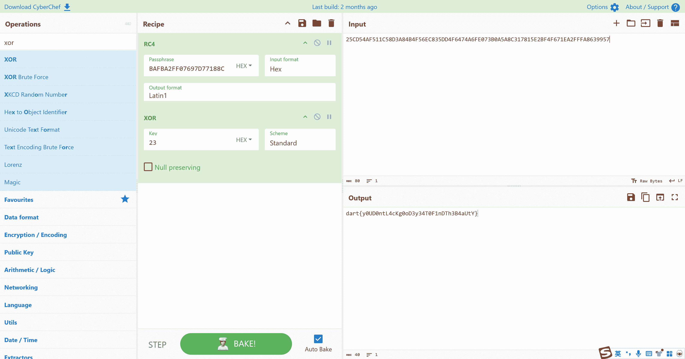
