# [Web逆向] 某某网站载荷逆向------小白讲解05

- 原帖: https://www.52pojie.cn/forum.php?mod=viewthread&tid=1999830
- 抓取时间: 2026-11-01T22:16:45

本文章中所有内容仅供学习交流使用，不用于其他任何目的，不提供完整代码，抓包内容、敏感网址、数据接口等均已做脱敏处理，严禁用于商业用途和非法用途，否则由此产生的一切后果均与作者无关.本文章未经许可禁止转载，禁止任何修改后二次传播，擅自使用本文讲解的技术而导致的任何意外，作者均不负责。


---

目标网址: aHR0cHM6Ly93d3cubXl0b2tlbmNhcC5jb20vbmV3LXRva2VuLWxpc3RpbmdzLzEv

---

## 文章思路

1. 找出目标数据包
2. 分析参数跟栈
3. 找到加密位置
4. 扣取代码与修改代码

---

文章哪里讲的不对或不清楚 还请各位大佬给出宝贵意见


---

## 第一步：

### 1.1 打开开发者工具找出目标数据包

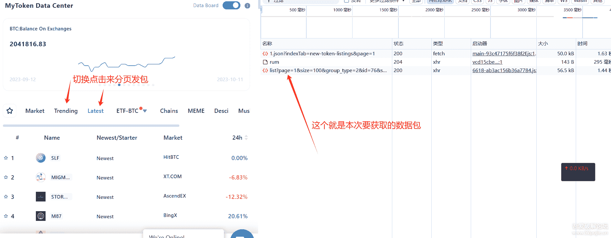

图片 1.png (119.85 KB, 下载次数: 2)

[href="forum.php?mod=attachment&aid=Mjc0OTc1MnxmMDk2Y2U4OXwxNzkzNTcxNDAzfDE2ODA4NnwxOTk5ODMw&nothumb=yes" target="_blank"](https://www.52pojie.cn/forum.php?mod=attachment&aid=Mjc0OTc1MnxmMDk2Y2U4OXwxNzkzNTcxNDAzfDE2ODA4NnwxOTk5ODMw&nothumb=yes)

2025-1-14 18:24 上传

### 1.2 对载荷进行分析 确定要逆向的参数

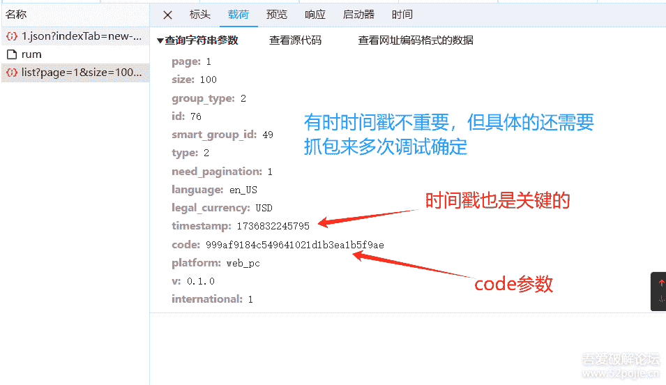

图片 2.png (52.64 KB, 下载次数: 2)

[href="forum.php?mod=attachment&aid=Mjc0OTc1M3wxNDZkODI4NHwxNzkzNTcxNDAzfDE2ODA4NnwxOTk5ODMw&nothumb=yes" target="_blank"](https://www.52pojie.cn/forum.php?mod=attachment&aid=Mjc0OTc1M3wxNDZkODI4NHwxNzkzNTcxNDAzfDE2ODA4NnwxOTk5ODMw&nothumb=yes)

2025-1-14 18:24 上传

### 1.1 分析完之后就开始点击启动器，进入源文件对参数进行跟踪

### 1.2 然后下断点，追目标参数

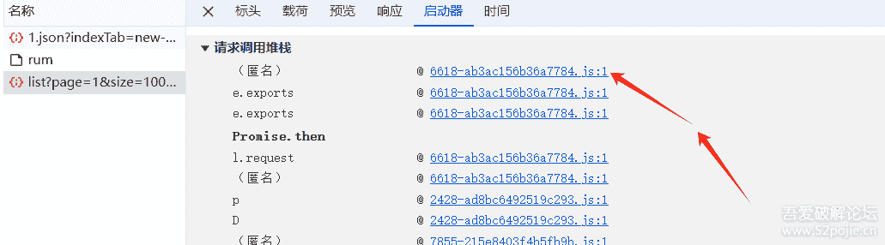

图片 3.png (27.85 KB, 下载次数: 1)

[href="forum.php?mod=attachment&aid=Mjc0OTc1NHwwMjJmOTU0NnwxNzkzNTcxNDAzfDE2ODA4NnwxOTk5ODMw&nothumb=yes" target="_blank"](https://www.52pojie.cn/forum.php?mod=attachment&aid=Mjc0OTc1NHwwMjJmOTU0NnwxNzkzNTcxNDAzfDE2ODA4NnwxOTk5ODMw&nothumb=yes)

2025-1-14 18:25 上传

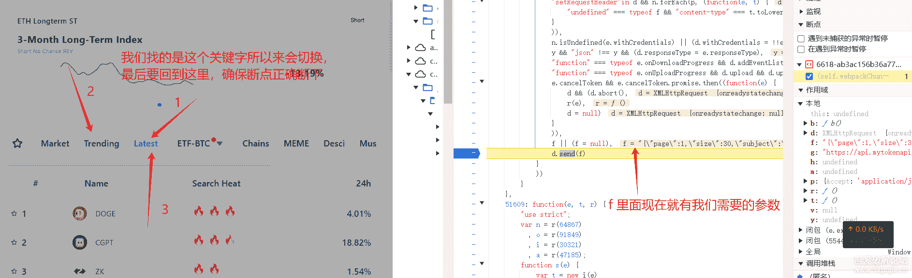

图片 4.png (129.92 KB, 下载次数: 2)

[href="forum.php?mod=attachment&aid=Mjc0OTc1NXwwNGM0M2M0NnwxNzkzNTcxNDAzfDE2ODA4NnwxOTk5ODMw&nothumb=yes" target="_blank"](https://www.52pojie.cn/forum.php?mod=attachment&aid=Mjc0OTc1NXwwNGM0M2M0NnwxNzkzNTcxNDAzfDE2ODA4NnwxOTk5ODMw&nothumb=yes)

2025-1-14 18:26 上传

## 第二步

### 2.1 接着依次向后跟栈 到指定位置

### 2.2 让断点断在加载器处，我们进行分析

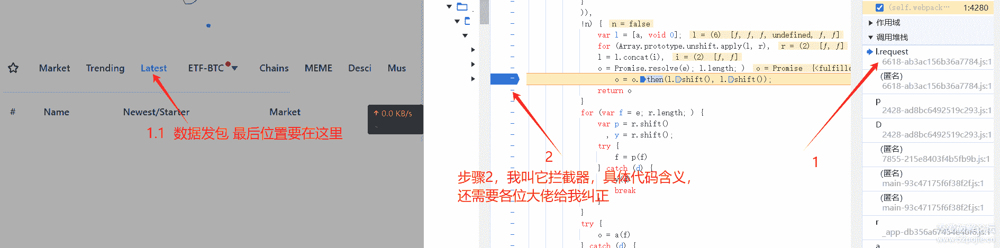

图片 5.png (94.16 KB, 下载次数: 2)

[href="forum.php?mod=attachment&aid=Mjc0OTc1N3xhMjA4OTFlYXwxNzkzNTcxNDAzfDE2ODA4NnwxOTk5ODMw&nothumb=yes" target="_blank"](https://www.52pojie.cn/forum.php?mod=attachment&aid=Mjc0OTc1N3xhMjA4OTFlYXwxNzkzNTcxNDAzfDE2ODA4NnwxOTk5ODMw&nothumb=yes)

2025-1-14 18:27 上传

### 2.3 我们看这段代码

每次执行，它里面的函数，结束后，就会将执行过的函数删除掉，也就是 `L` 变量，我们看到里面有很多函数。

### 2.4 在这里进行分析

首先各位可以在堆栈往后上追，参数就丢了，那么参数在这之前是有的，在之后就没了，所以推断出，参数的生成，是在这个拦截器里面生成的，也就是 `L` 里面某个函数返回的，所以我们依次进入，来寻找。

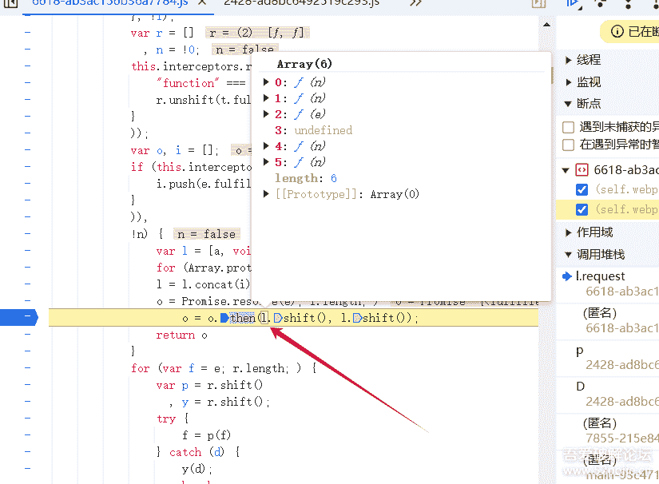

图片 6.png (54.82 KB, 下载次数: 2)

[href="forum.php?mod=attachment&aid=Mjc0OTc1OHwwOGJkMThhYXwxNzkzNTcxNDAzfDE2ODA4NnwxOTk5ODMw&nothumb=yes" target="_blank"](https://www.52pojie.cn/forum.php?mod=attachment&aid=Mjc0OTc1OHwwOGJkMThhYXwxNzkzNTcxNDAzfDE2ODA4NnwxOTk5ODMw&nothumb=yes)

2025-1-14 18:28 上传

## 第三步：

根据上述我们开始进入拦截器在每一个函数的 `return` 处下断，然后再分页发包看最后会断在那个地方，如果没有断住说明数据包没有经过这里，随后我们另外分析。

### 3.1 因为 `L` 里面的下标 3 没有，所以不展示，只进入有的

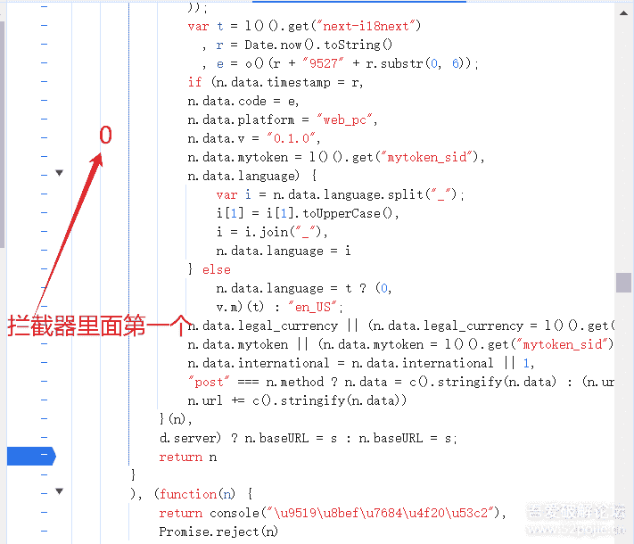

图片 7.png (30.29 KB, 下载次数: 2)

[href="forum.php?mod=attachment&aid=Mjc0OTc1OXw3OGJlZDk0MnwxNzkzNTcxNDAzfDE2ODA4NnwxOTk5ODMw&nothumb=yes" target="_blank"](https://www.52pojie.cn/forum.php?mod=attachment&aid=Mjc0OTc1OXw3OGJlZDk0MnwxNzkzNTcxNDAzfDE2ODA4NnwxOTk5ODMw&nothumb=yes)

2025-1-14 18:29 上传

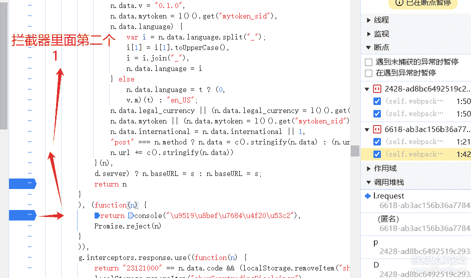

图片 8.png (58.7 KB, 下载次数: 2)

[href="forum.php?mod=attachment&aid=Mjc0OTc2MHxlNzgxMmNkZnwxNzkzNTcxNDAzfDE2ODA4NnwxOTk5ODMw&nothumb=yes" target="_blank"](https://www.52pojie.cn/forum.php?mod=attachment&aid=Mjc0OTc2MHxlNzgxMmNkZnwxNzkzNTcxNDAzfDE2ODA4NnwxOTk5ODMw&nothumb=yes)

2025-1-14 18:29 上传

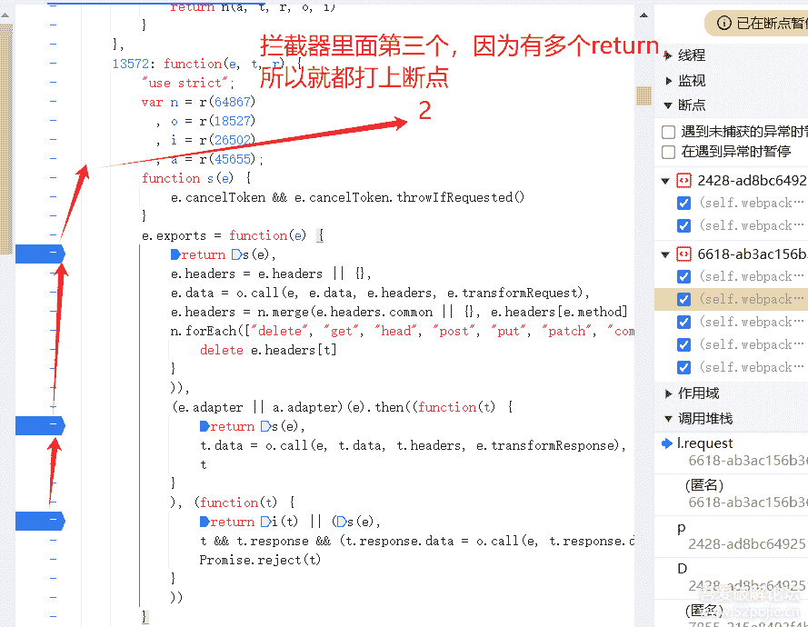

图片 9.png (67.6 KB, 下载次数: 2)

[href="forum.php?mod=attachment&aid=Mjc0OTc2MXxjZjgyM2RhZXwxNzkzNTcxNDAzfDE2ODA4NnwxOTk5ODMw&nothumb=yes" target="_blank"](https://www.52pojie.cn/forum.php?mod=attachment&aid=Mjc0OTc2MXxjZjgyM2RhZXwxNzkzNTcxNDAzfDE2ODA4NnwxOTk5ODMw&nothumb=yes)

2025-1-14 18:29 上传

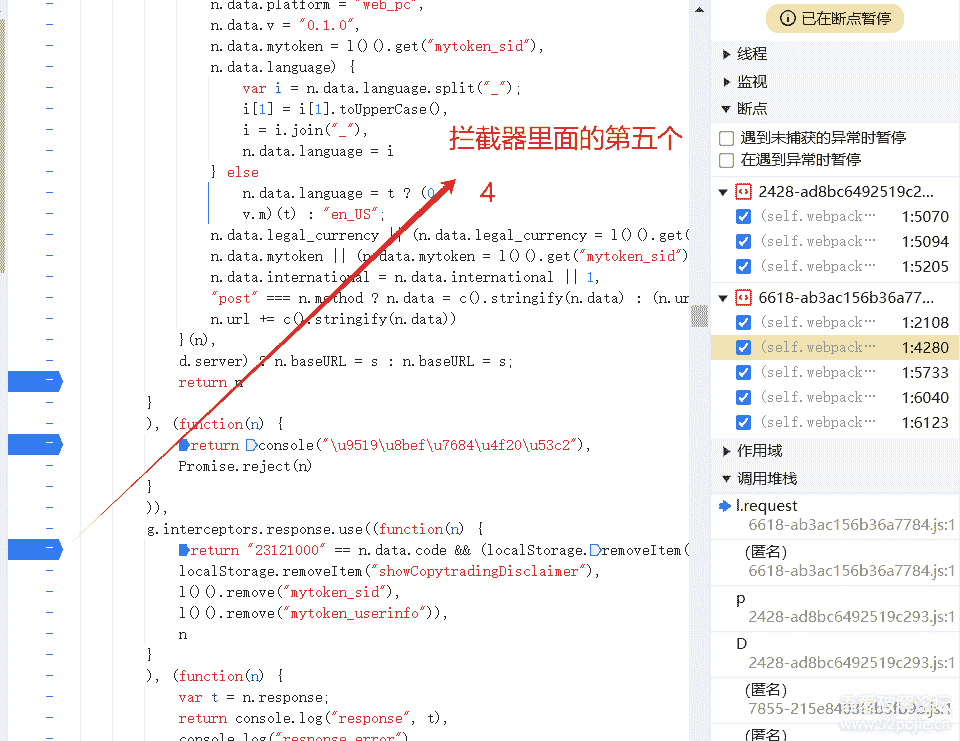

图片 10.png (79.6 KB, 下载次数: 2)

[href="forum.php?mod=attachment&aid=Mjc0OTc2MnxhYzJhM2Q4MXwxNzkzNTcxNDAzfDE2ODA4NnwxOTk5ODMw&nothumb=yes" target="_blank"](https://www.52pojie.cn/forum.php?mod=attachment&aid=Mjc0OTc2MnxhYzJhM2Q4MXwxNzkzNTcxNDAzfDE2ODA4NnwxOTk5ODMw&nothumb=yes)

2025-1-14 18:29 上传

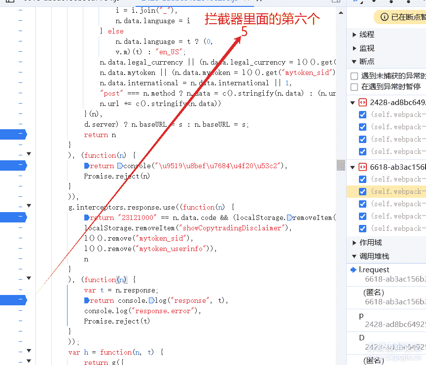

图片 11.png (70.86 KB, 下载次数: 2)

[href="forum.php?mod=attachment&aid=Mjc0OTc2M3w0ZTA4MmMwMXwxNzkzNTcxNDAzfDE2ODA4NnwxOTk5ODMw&nothumb=yes" target="_blank"](https://www.52pojie.cn/forum.php?mod=attachment&aid=Mjc0OTc2M3w0ZTA4MmMwMXwxNzkzNTcxNDAzfDE2ODA4NnwxOTk5ODMw&nothumb=yes)

2025-1-14 18:29 上传

### 3.2 按下图，去掉其余断点和拦截器断点，然后分页发包看断点最后断在哪里

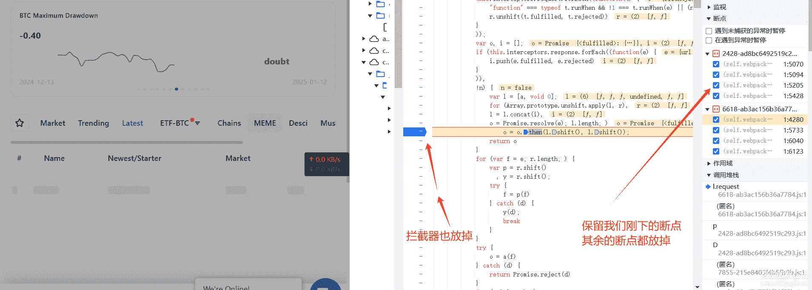

图片 12.png (123.43 KB, 下载次数: 0)

[href="forum.php?mod=attachment&aid=Mjc0OTc2NHw3ZjY4MzgxZHwxNzkzNTcxNDAzfDE2ODA4NnwxOTk5ODMw&nothumb=yes" target="_blank"](https://www.52pojie.cn/forum.php?mod=attachment&aid=Mjc0OTc2NHw3ZjY4MzgxZHwxNzkzNTcxNDAzfDE2ODA4NnwxOTk5ODMw&nothumb=yes)

2025-1-14 18:29 上传

### 3.3 可以看到断点断下来了

并且证实了，我们的目标数据包，经过这里，还有最后返回的 `n.data` 里面就存放了我们想要的参数，这样看还不清晰，我们将全部断点去掉，只保留这一个 ，并且在他的头部也下一个。

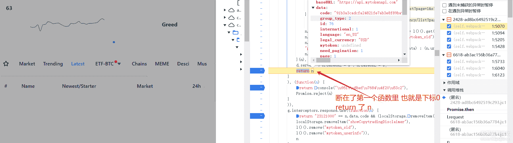

图片 13.png (100.72 KB, 下载次数: 0)

[href="forum.php?mod=attachment&aid=Mjc0OTc2Nnw1NDM3OGY3ZXwxNzkzNTcxNDAzfDE2ODA4NnwxOTk5ODMw&nothumb=yes" target="_blank"](https://www.52pojie.cn/forum.php?mod=attachment&aid=Mjc0OTc2Nnw1NDM3OGY3ZXwxNzkzNTcxNDAzfDE2ODA4NnwxOTk5ODMw&nothumb=yes)

2025-1-14 18:32 上传

### 3.4 操作完之后 我们先看一看 这个函数内有没有，线索，或者参数就是在这里面生成的

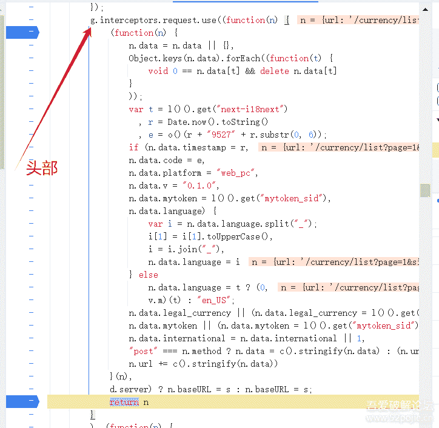

图片 14.png (35.24 KB, 下载次数: 2)

[href="forum.php?mod=attachment&aid=Mjc0OTc2N3w4NGU5OGJmMHwxNzkzNTcxNDAzfDE2ODA4NnwxOTk5ODMw&nothumb=yes" target="_blank"](https://www.52pojie.cn/forum.php?mod=attachment&aid=Mjc0OTc2N3w4NGU5OGJmMHwxNzkzNTcxNDAzfDE2ODA4NnwxOTk5ODMw&nothumb=yes)

2025-1-14 18:32 上传

### 3.5 不过为了准确，我们分页发包让断点，到头部，看看有没有新情况

### 3.6 断点到头部之后

我们看到形参 `n` 里面的 `data` 我们要的参数没了，那我们就又可以猜测上面没有参数的生成，那么就有可能是在往下时进行的参数生成与赋值,因为我们需要参数在最后 `return n` 里面，可以在 3.3 清楚看到,那我们就单步调试一步一步走，看看在哪一行出现的。

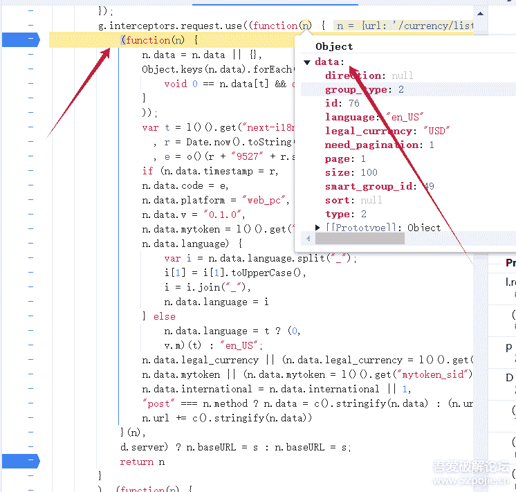

图片 15.png (44.24 KB, 下载次数: 1)


[href="forum.php?mod=attachment&aid=Mjc0OTc2OXw1YzA2YTAwMXwxNzkzNTcxNDAzfDE2ODA4NnwxOTk5ODMw&nothumb=yes" target="_blank"](https://www.52pojie.cn/forum.php?mod=attachment&aid=Mjc0OTc2OXw1YzA2YTAwMXwxNzkzNTcxNDAzfDE2ODA4NnwxOTk5ODMw&nothumb=yes)

2025-1-14 18:34 上传

## 第四步

### 1.1 节省时间我就直接往下走到指定位置了

### 1.2 可以看到他是在一个if判断条件里生成的，也就是 `n.data.code` 还有时间戳 `n.data.timestamp`

### 1.3 那么我们就找 Code参数的 `e` 和时间戳 `r` 向上 因为是先定义后使用

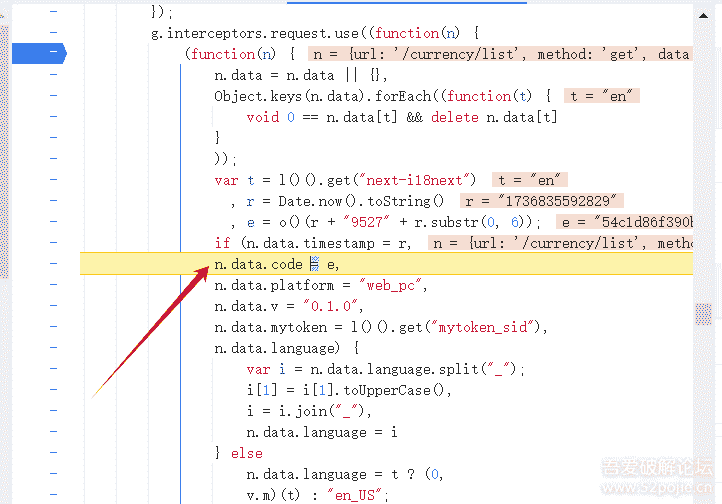

图片 16.png (25.15 KB, 下载次数: 0)

[href="forum.php?mod=attachment&aid=Mjc0OTc3MnxkZmEwNjRhMnwxNzkzNTcxNDAzfDE2ODA4NnwxOTk5ODMw&nothumb=yes" target="_blank"](https://www.52pojie.cn/forum.php?mod=attachment&aid=Mjc0OTc3MnxkZmEwNjRhMnwxNzkzNTcxNDAzfDE2ODA4NnwxOTk5ODMw&nothumb=yes)

2025-1-14 18:36 上传

## 第五步

### 5.1 我们找到了参数的定义处，那么代码分析就快了:

```
e = o()(r + "9527" + r.substr(0, 6))
```

这段代码我们就只需要看 `o()`( ‘ 参数 ’ ) 因为这种方式就相当于 `o('参数')` 可以自己在控制套打印试试 一样的效果 ,
参数的分析就是 时间戳 + 字符串 + 取出时间戳 `0-6` 位 所以 我们现在只需要找出 `o` 就可以

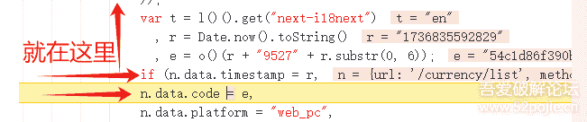

图片 17.png (16.16 KB, 下载次数: 2)

[href="forum.php?mod=attachment&aid=Mjc0OTc3NHw4NTRmYjRjYXwxNzkzNTcxNDAzfDE2ODA4NnwxOTk5ODMw&nothumb=yes" target="_blank"](https://www.52pojie.cn/forum.php?mod=attachment&aid=Mjc0OTc3NHw4NTRmYjRjYXwxNzkzNTcxNDAzfDE2ODA4NnwxOTk5ODMw&nothumb=yes)

2025-1-14 18:37 上传

### 5.2 对于 `o`，我们肯定也是找到他的定义处，所以我们就向上接着找

### 5.3 找到定义处之后扣取代码就简洁明了

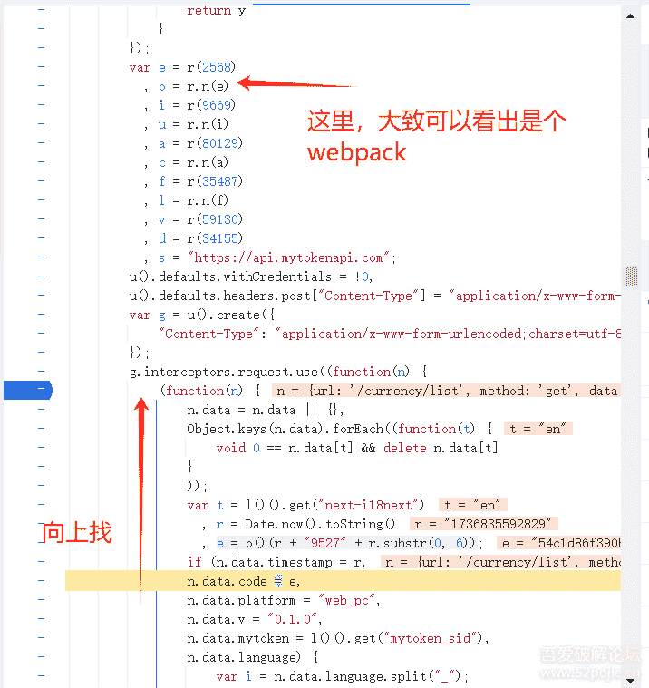

图片 18.png (38.13 KB, 下载次数: 2)

[href="forum.php?mod=attachment&aid=Mjc0OTc3OXwxYTY0MzMzZHwxNzkzNTcxNDAzfDE2ODA4NnwxOTk5ODMw&nothumb=yes" target="_blank"](https://www.52pojie.cn/forum.php?mod=attachment&aid=Mjc0OTc3OXwxYTY0MzMzZHwxNzkzNTcxNDAzfDE2ODA4NnwxOTk5ODMw&nothumb=yes)

2025-1-14 18:38 上传

## 代码扣取与调用

## 第六步

### 6.1 我们清楚的看到了 `o` 的定义所以进行分析

`var e = r(2568), o = r.n(e)` 为什么会有 `e`，因为 `o` 加载了 `e` 所以看 `e`，它加载了一个模块，

现在将断点放在 `var e = r(2568)` 将网页刷新断住，因为需要先加载模块，才有后来的功能代码

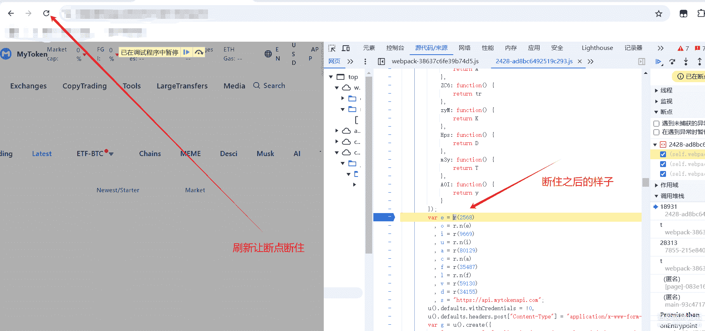

图片 19.png (138.91 KB, 下载次数: 2)

[href="forum.php?mod=attachment&aid=Mjc0OTc4NHw0YzI0YjRkN3wxNzkzNTcxNDAzfDE2ODA4NnwxOTk5ODMw&nothumb=yes" target="_blank"](https://www.52pojie.cn/forum.php?mod=attachment&aid=Mjc0OTc4NHw0YzI0YjRkN3wxNzkzNTcxNDAzfDE2ODA4NnwxOTk5ODMw&nothumb=yes)

2025-1-14 18:40 上传

### 6.2 我们选中 `r(2568)` 进入里面查看是不是有其他模块,可以看到进入之后它还加载了其他模块

这里就长话短说，可以自己一个一个进去看，也就 2568 模块加载的这几个，它们各自内部并没有在加载，

所以可以很轻松的去扣取代码，

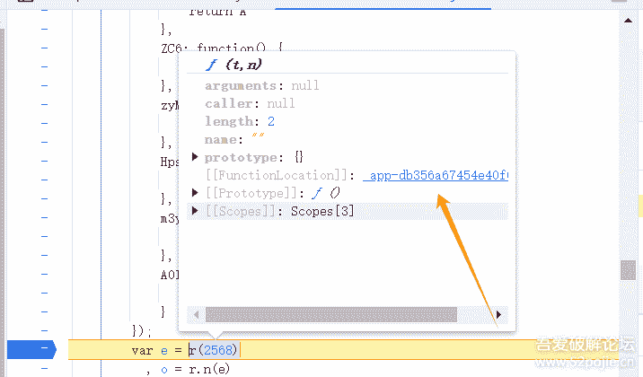

图片 20.png (22.57 KB, 下载次数: 4)

[href="forum.php?mod=attachment&aid=Mjc0OTc4NXxlZTAxZmY3ZnwxNzkzNTcxNDAzfDE2ODA4NnwxOTk5ODMw&nothumb=yes" target="_blank"](https://www.52pojie.cn/forum.php?mod=attachment&aid=Mjc0OTc4NXxlZTAxZmY3ZnwxNzkzNTcxNDAzfDE2ODA4NnwxOTk5ODMw&nothumb=yes)

2025-1-14 18:42 上传

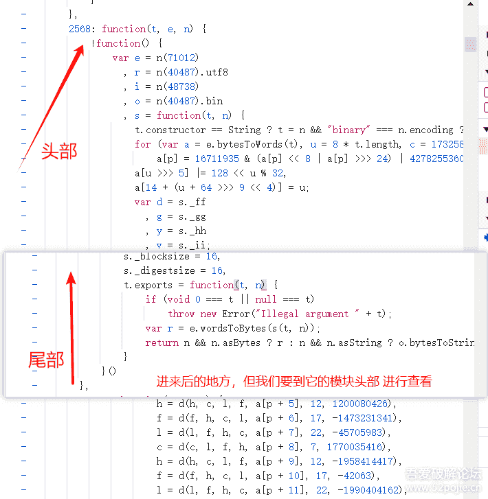

图片 21.png (39.23 KB, 下载次数: 1)

[href="forum.php?mod=attachment&aid=Mjc0OTc4Nnw3NTE5MDExYXwxNzkzNTcxNDAzfDE2ODA4NnwxOTk5ODMw&nothumb=yes" target="_blank"](https://www.52pojie.cn/forum.php?mod=attachment&aid=Mjc0OTc4Nnw3NTE5MDExYXwxNzkzNTcxNDAzfDE2ODA4NnwxOTk5ODMw&nothumb=yes)

2025-1-14 18:43 上传

## 加载器与最终代码

## 第七步

### 7.1 加载器就不在讲解，在这里只说加载器里存在的问题

### 7.2 我们打开Code 将代码扣取出来放入

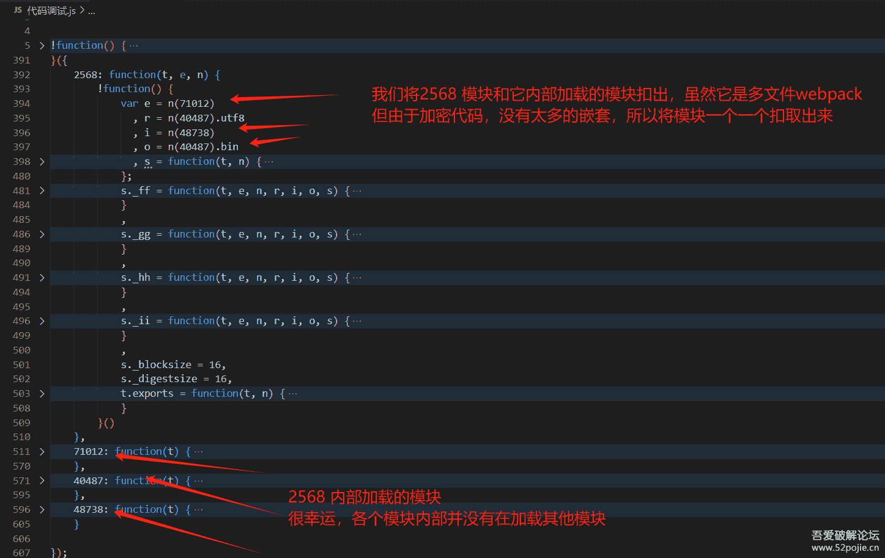

图片 22.png (123.62 KB, 下载次数: 2)

[href="forum.php?mod=attachment&aid=Mjc0OTc4N3xhNTE4YzRhN3wxNzkzNTcxNDAzfDE2ODA4NnwxOTk5ODMw&nothumb=yes" target="_blank"](https://www.52pojie.cn/forum.php?mod=attachment&aid=Mjc0OTc4N3xhNTE4YzRhN3wxNzkzNTcxNDAzfDE2ODA4NnwxOTk5ODMw&nothumb=yes)

2025-1-14 18:44 上传

### 7.3 加载器和模块都已准备完毕，按照浏览器调用 ，从第五步我们知道，我们需要的是

`e = o()(r + "9527" + r.substr(0, 6))`,

还有 第六步 `var e = r(2568), o = r.n(e)` 这是加密函数 `o`

### 7.4 组装我们代码 加密的参数 我们在第五步也分析完毕 所以将 `r` 也扣取下来 ，或自己创建


图片 23.png (11.5 KB, 下载次数: 1)

[href="forum.php?mod=attachment&aid=Mjc0OTc4OHwwMThmMmY2MXwxNzkzNTcxNDAzfDE2ODA4NnwxOTk5ODMw&nothumb=yes" target="_blank"](https://www.52pojie.cn/forum.php?mod=attachment&aid=Mjc0OTc4OHwwMThmMmY2MXwxNzkzNTcxNDAzfDE2ODA4NnwxOTk5ODMw&nothumb=yes)

2025-1-14 18:46 上传

### 7.5 代码组装

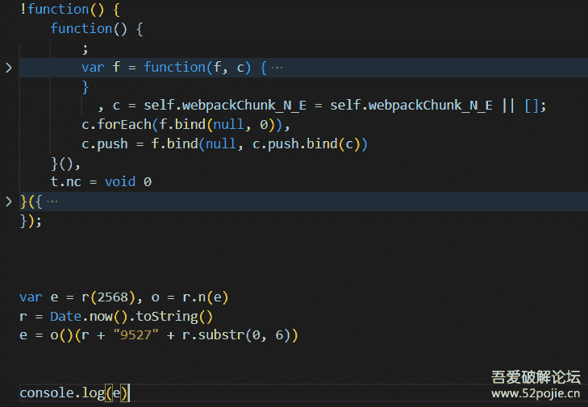

图片 24.png (35.54 KB, 下载次数: 1)

[href="forum.php?mod=attachment&aid=Mjc0OTc4OXwzNmU5YTFmMXwxNzkzNTcxNDAzfDE2ODA4NnwxOTk5ODMw&nothumb=yes" target="_blank"](https://www.52pojie.cn/forum.php?mod=attachment&aid=Mjc0OTc4OXwzNmU5YTFmMXwxNzkzNTcxNDAzfDE2ODA4NnwxOTk5ODMw&nothumb=yes)

2025-1-14 18:46 上传

## 第八步

### 8.1 我们来依次修改代码，经过第七步代码组装，我们运行

会出现报错 `self` 未定义，因为我们没有所以我们跳到代码报错位置，

直接置空，因为没有，我们是单个模块扣取，不是多文件直接扣取

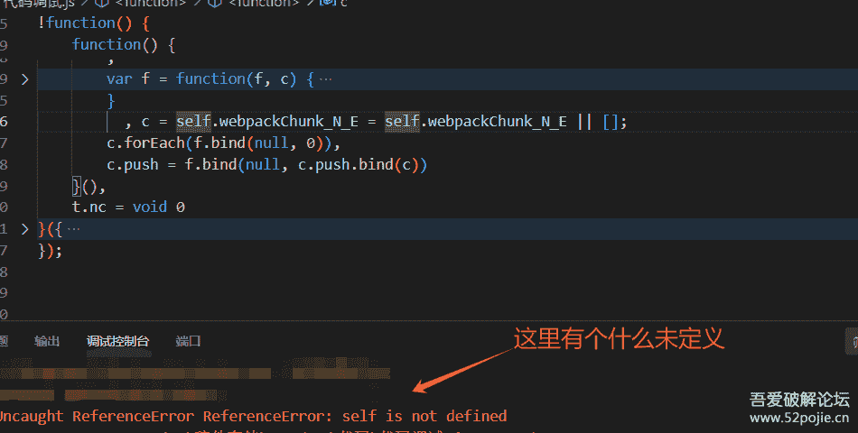

图片 25.png (43.41 KB, 下载次数: 3)

[href="forum.php?mod=attachment&aid=Mjc0OTc5MHw5MDk4YmRjNXwxNzkzNTcxNDAzfDE2ODA4NnwxOTk5ODMw&nothumb=yes" target="_blank"](https://www.52pojie.cn/forum.php?mod=attachment&aid=Mjc0OTc5MHw5MDk4YmRjNXwxNzkzNTcxNDAzfDE2ODA4NnwxOTk5ODMw&nothumb=yes)

2025-1-14 18:47 上传

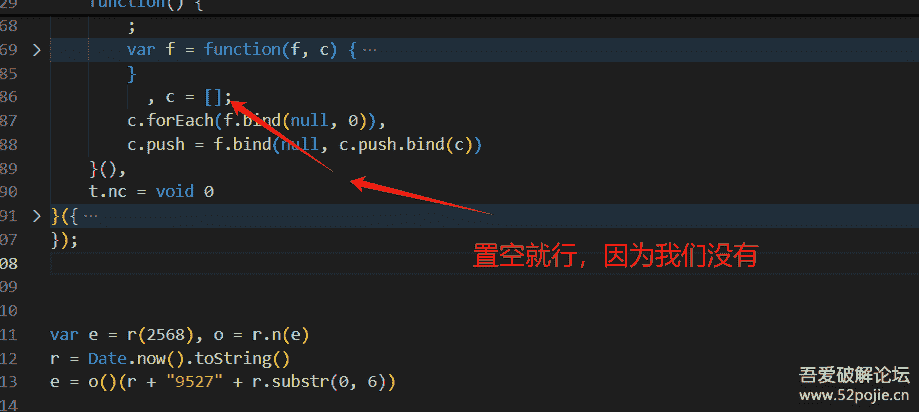

图片 26.png (43.98 KB, 下载次数: 1)

[href="forum.php?mod=attachment&aid=Mjc0OTc5MXxjNjFkMWZjOHwxNzkzNTcxNDAzfDE2ODA4NnwxOTk5ODMw&nothumb=yes" target="_blank"](https://www.52pojie.cn/forum.php?mod=attachment&aid=Mjc0OTc5MXxjNjFkMWZjOHwxNzkzNTcxNDAzfDE2ODA4NnwxOTk5ODMw&nothumb=yes)

2025-1-14 18:48 上传

### 8.3 再次运行 又报错 根据步骤1、2、3，发现是加载模块出错，原因就是 `r` 未定义，

那是因为浏览器的加载器是叫 `r`(可以返回6.1查看),而我们本地用不了，

所以要导出加载器进行替换

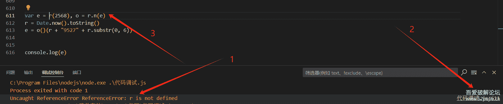

图片 27.png (55.4 KB, 下载次数: 2)

[href="forum.php?mod=attachment&aid=Mjc0OTc5MnwyZjdmYWZhOHwxNzkzNTcxNDAzfDE2ODA4NnwxOTk5ODMw&nothumb=yes" target="_blank"](https://www.52pojie.cn/forum.php?mod=attachment&aid=Mjc0OTc5MnwyZjdmYWZhOHwxNzkzNTcxNDAzfDE2ODA4NnwxOTk5ODMw&nothumb=yes)

2025-1-14 18:49 上传

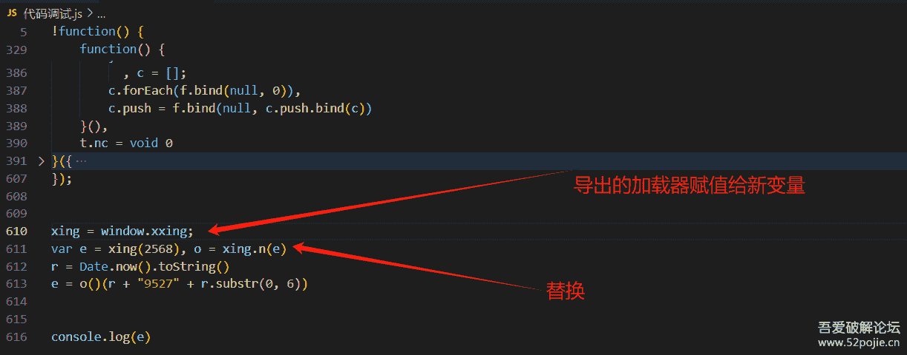

图片 28.png (58.62 KB, 下载次数: 2)

[href="forum.php?mod=attachment&aid=Mjc0OTc5M3xmMmQ3NTI4M3wxNzkzNTcxNDAzfDE2ODA4NnwxOTk5ODMw&nothumb=yes" target="_blank"](https://www.52pojie.cn/forum.php?mod=attachment&aid=Mjc0OTc5M3xmMmQ3NTI4M3wxNzkzNTcxNDAzfDE2ODA4NnwxOTk5ODMw&nothumb=yes)

2025-1-14 18:49 上传

### 8.4 再次运行，我们发现又报错，这次是模块的问题，为什么会出现这样的错误明明有模块，

却说模块错误，这是怎么回事，但经过多次调试，我们发现是在加载器头部的出现的报错，

我们转移到头部来看

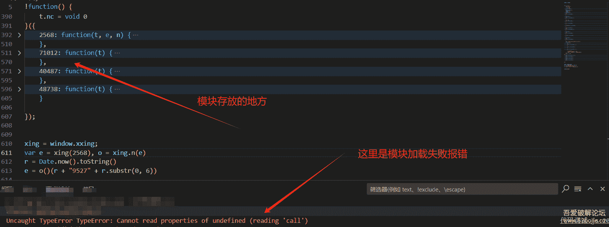

图片 29.png (86.77 KB, 下载次数: 2)

[href="forum.php?mod=attachment&aid=Mjc0OTc5NHwyY2YzMTExMXwxNzkzNTcxNDAzfDE2ODA4NnwxOTk5ODMw&nothumb=yes" target="_blank"](https://www.52pojie.cn/forum.php?mod=attachment&aid=Mjc0OTc5NHwyY2YzMTExMXwxNzkzNTcxNDAzfDE2ODA4NnwxOTk5ODMw&nothumb=yes)

2025-1-14 18:50 上传

### 8.5 我们分析加载器头部代码整个加载器是个自执行 所以 参数传递 从尾部 直达步骤1

步骤1: 参数会首先经过这里，但是可以看到步骤1没有形参也就意味着 参数传不进来 所以就会导致报错

步骤2：这里是 `e = {}` 如果我们将形参定义为 变量 `e` 那么即使参数 进来了，那么也会被设置为空，从而导致报错

步骤3: 此处的 `e` 里面是存储模块的，可以自己去看浏览器，和本地对比，那么问题就来了既然是存储模块的，

如果步骤1不设置 为变量 `e` 而设置为其他变量，使这里的 `e` 接受不到外部模块，就会发生一系列报错

所以:

在这给出解决办法我们可以将步骤1 添加一个形参 `e`，而将步骤2,注释掉让他不起作用，那么自然而然，代码的执行就与浏览器对应了

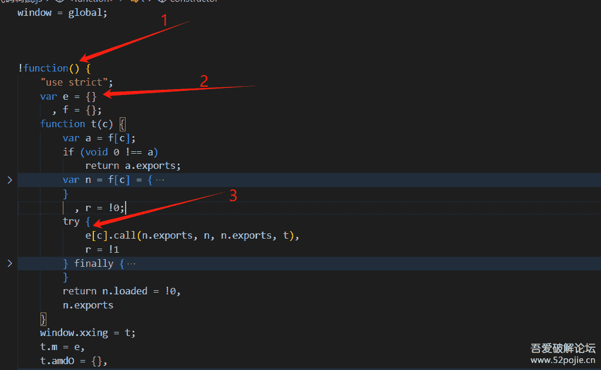


`图片 30.png` (44.72 KB, 下载次数: 2)

[href="forum.php?mod=attachment&aid=Mjc0OTc5NXxkYjEyOThkMXwxNzkzNTcxNDAzfDE2ODA4NnwxOTk5ODMw&nothumb=yes" target="_blank"](https://www.52pojie.cn/forum.php?mod=attachment&aid=Mjc0OTc5NXxkYjEyOThkMXwxNzkzNTcxNDAzfDE2ODA4NnwxOTk5ODMw&nothumb=yes)

2025-1-14 18:53 上传

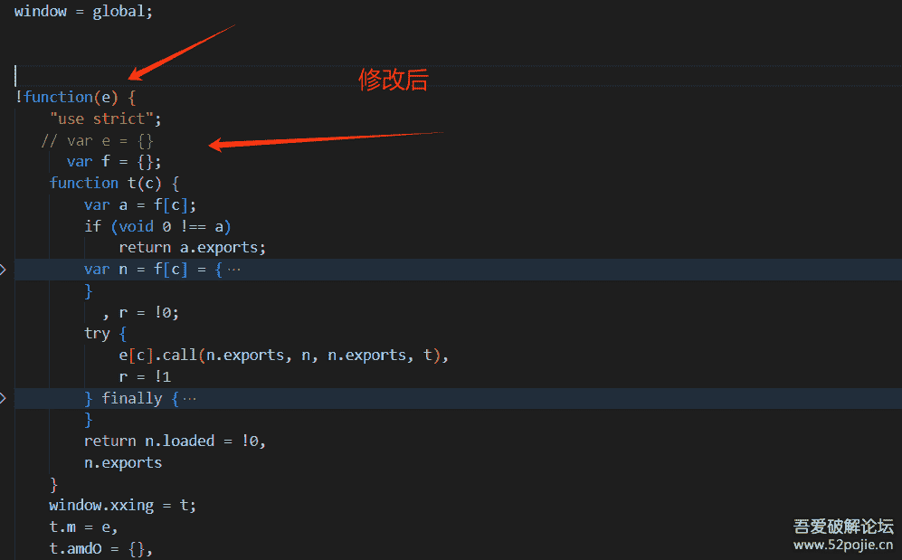

`图片 31.png` (41.17 KB, 下载次数: 2)

[href="forum.php?mod=attachment&aid=Mjc0OTc5NnxiMGFiNDg1NHwxNzkzNTcxNDAzfDE2ODA4NnwxOTk5ODMw&nothumb=yes" target="_blank"](https://www.52pojie.cn/forum.php?mod=attachment&aid=Mjc0OTc5NnxiMGFiNDg1NHwxNzkzNTcxNDAzfDE2ODA4NnwxOTk5ODMw&nothumb=yes)

2025-1-14 18:53 上传

### 8.6 最后我们再次运行，可以看到完美出值

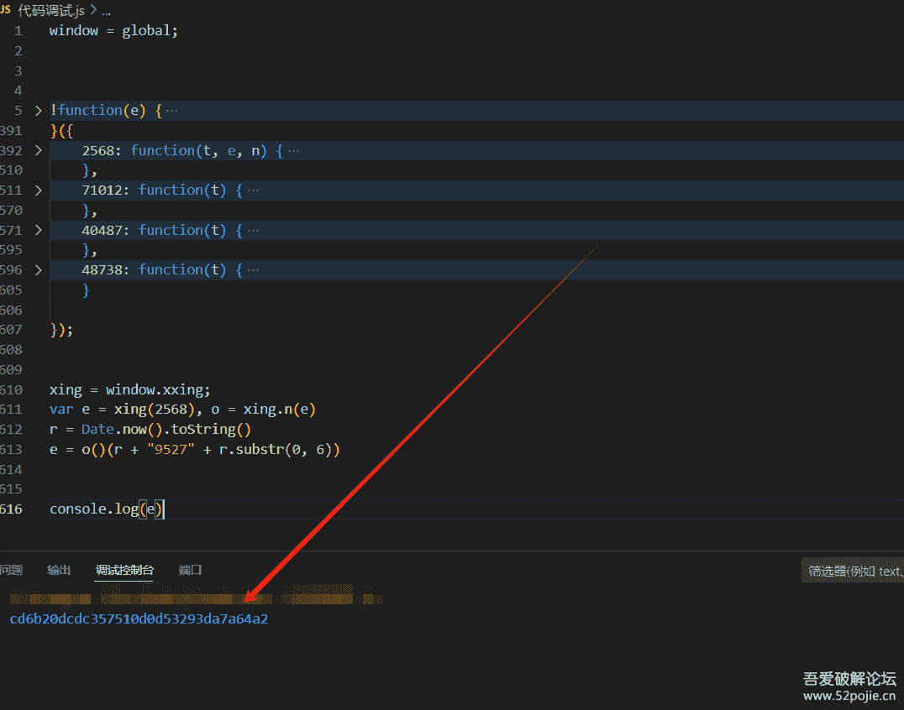

`图片 32.png` (64.13 KB, 下载次数: 2)

[href="forum.php?mod=attachment&aid=Mjc0OTc5OXw0MWE4YjM2NnwxNzkzNTcxNDAzfDE2ODA4NnwxOTk5ODMw&nothumb=yes" target="_blank"](https://www.52pojie.cn/forum.php?mod=attachment&aid=Mjc0OTc5OXw0MWE4YjM2NnwxNzkzNTcxNDAzfDE2ODA4NnwxOTk5ODMw&nothumb=yes)

2025-1-14 18:54 上传

## 总结

总体来说是简单的，但8.5过于隐蔽，不仔细看，很容易忽略

## 最后

感谢大家的收看，希望各位大佬可以给我的文章提出宝贵的意见，感谢你们的喜欢


