# [分享] 学习记录破解【160个CrackMe】之001

- 原帖: https://www.52pojie.cn/forum.php?mod=viewthread&tid=2001257
- 抓取时间: 2026-11-01T22:16:41

尝试[反汇编练习]160个CrackMe之001

本次使用到的断点方式：中文搜索引擎-智能搜索

本次使用到的汇编语言分析：

- `call` 调用进程
- `mov` 赋值 `mov a,b` 等价于 `a=b`
- `je`、`jge`、`jne`、`jnz` 判断
- `jmp` 跳过
- `retn` 返回

## 先看问题

### 问题1：弹窗

image.png (11.46 KB, 下载次数: 4)

[1](https://www.52pojie.cn/forum.php?mod=attachment&aid=Mjc1MDczMHxhZjhkOGE5YnwxNzkzNTcxMzk5fDE2ODA4NnwyMDAxMjU3&nothumb=yes)

2025-1-20 10:24 上传

### 问题2：账号密码

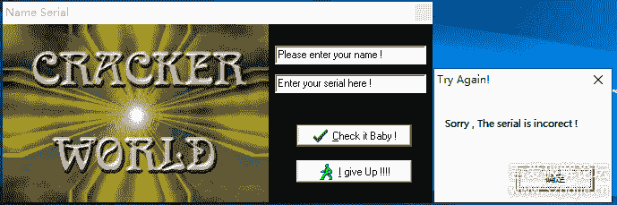

image.png (132.13 KB, 下载次数: 2)

[2](https://www.52pojie.cn/forum.php?mod=attachment&aid=Mjc1MDczMXxhMWFjYmFmOHwxNzkzNTcxMzk5fDE2ODA4NnwyMDAxMjU3&nothumb=yes)

2025-1-20 10:25 上传

### 问题3：注册码

image.png (125 KB, 下载次数: 4)

[3](https://www.52pojie.cn/forum.php?mod=attachment&aid=Mjc1MDczMnxjY2JmY2Y0ZHwxNzkzNTcxMzk5fDE2ODA4NnwyMDAxMjU3&nothumb=yes)

2025-1-20 10:25 上传

## 问题1，弹窗 解题思路

### 解题思路

1. 直接把弹窗窗口`nop`掉或者跳过（该方法不可以，如果直接把弹窗窗口`nop`或跳过，将导致问题2和问题3的没有弹窗提示）。

该思路错误，放弃。

2. 找到弹窗窗口的位置，然后精准跳过弹窗（该方法不会影响到其他弹窗窗口）。

使用该思路。

### 开始解题

将软件拖入到OD中。

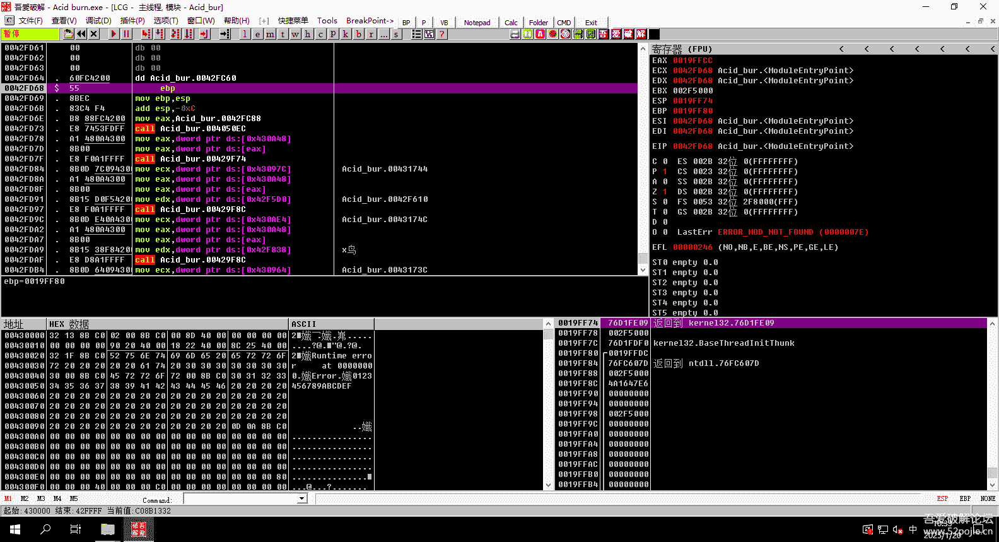

image.png (109.88 KB, 下载次数: 3)

[4](https://www.52pojie.cn/forum.php?mod=attachment&aid=Mjc1MDczM3wzZGY3MDAzYXwxNzkzNTcxMzk5fDE2ODA4NnwyMDAxMjU3&nothumb=yes)

2025-1-20 10:33 上传

使用插件-23中文搜索引擎-3智能搜索 找到问题1的关键词。

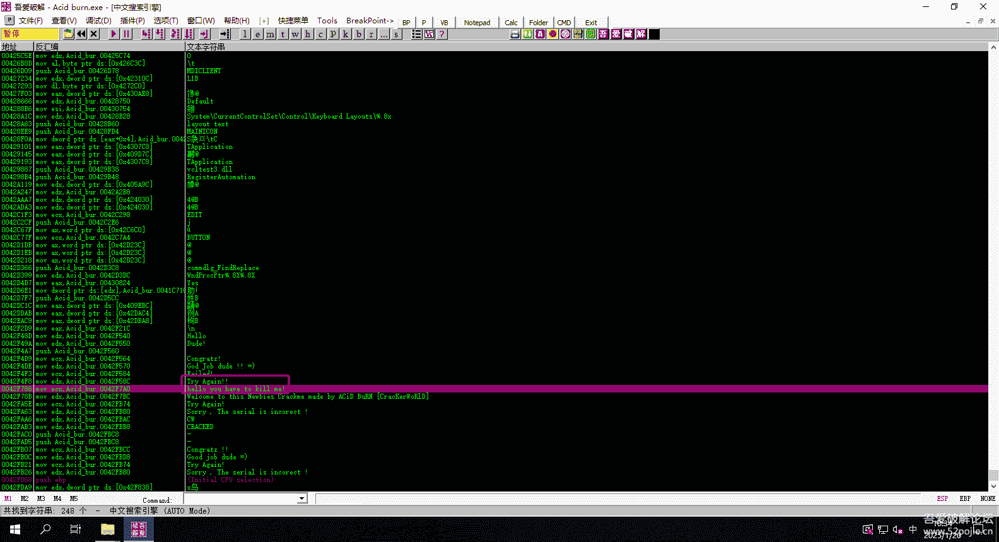

image.png (108.07 KB, 下载次数: 3)

[5](https://www.52pojie.cn/forum.php?mod=attachment&aid=Mjc1MDczNHw1OGI3MDIxOXwxNzkzNTcxMzk5fDE2ODA4NnwyMDAxMjU3&nothumb=yes)

2025-1-20 10:35 上传

双击进入，F2下断点，这时我们看到该语句最后有个`retn`（分析：该进程被`call`调用，返回到上层就能找到调用的`call`）。

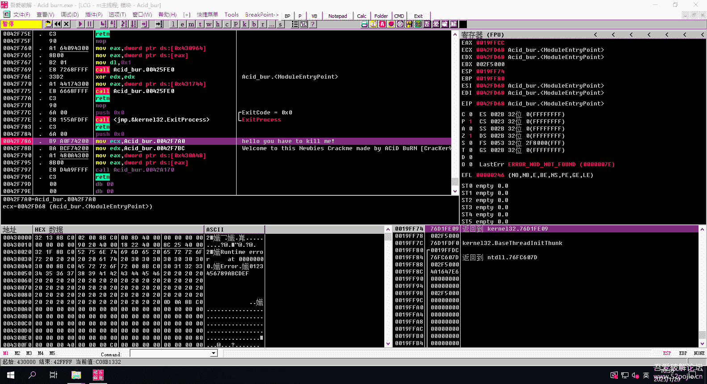

image.png (109.03 KB, 下载次数: 3)

[6](https://www.52pojie.cn/forum.php?mod=attachment&aid=Mjc1MDczNXxjYzljMDJmOXwxNzkzNTcxMzk5fDE2ODA4NnwyMDAxMjU3&nothumb=yes)

2025-1-20 10:36 上传

F9执行软件，在该断点停下，然后按F8，直到`call`开始弹窗报错。

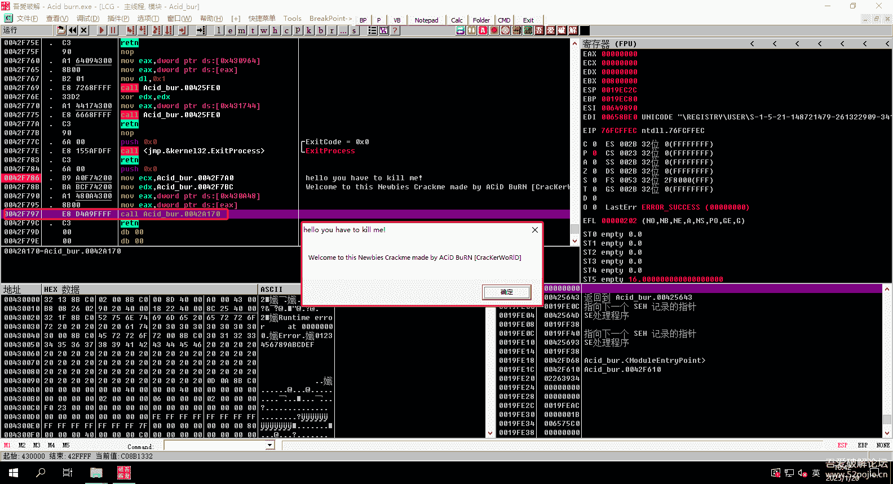

image.png (115.5 KB, 下载次数: 4)

[7](https://www.52pojie.cn/forum.php?mod=attachment&aid=Mjc1MDczNnw5MzUxMDdjZHwxNzkzNTcxMzk5fDE2ODA4NnwyMDAxMjU3&nothumb=yes)

2025-1-20 10:42 上传

点击确定，来到`retn`，继续按F8。

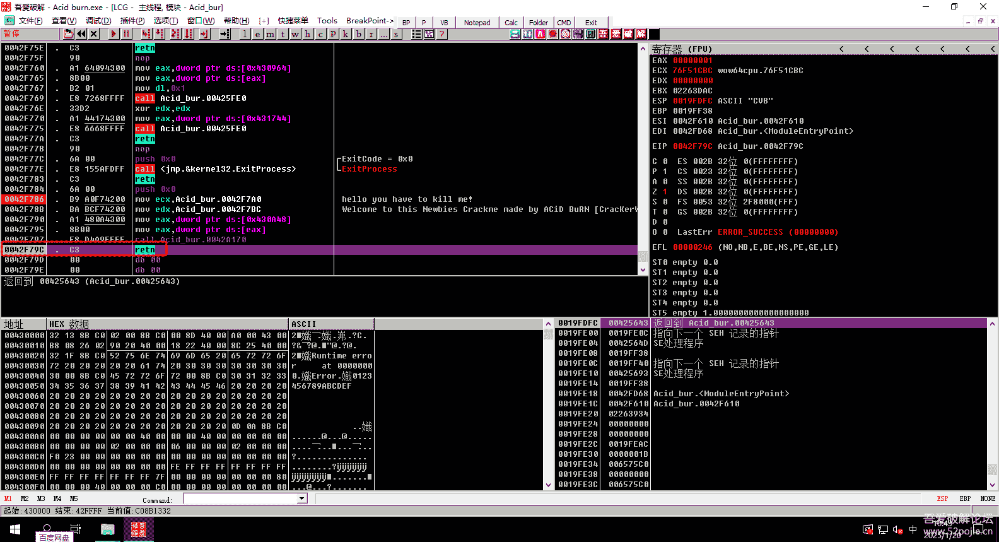

image.png (112.76 KB, 下载次数: 3)

[8](https://www.52pojie.cn/forum.php?mod=attachment&aid=Mjc1MDczN3wyNjg4YmY0NXwxNzkzNTcxMzk5fDE2ODA4NnwyMDAxMjU3&nothumb=yes)

2025-1-20 10:44 上传

来到上层，找到`call`调用报错弹窗，并找到代码组。思路：将判断语句改为跳过，就不会弹窗。

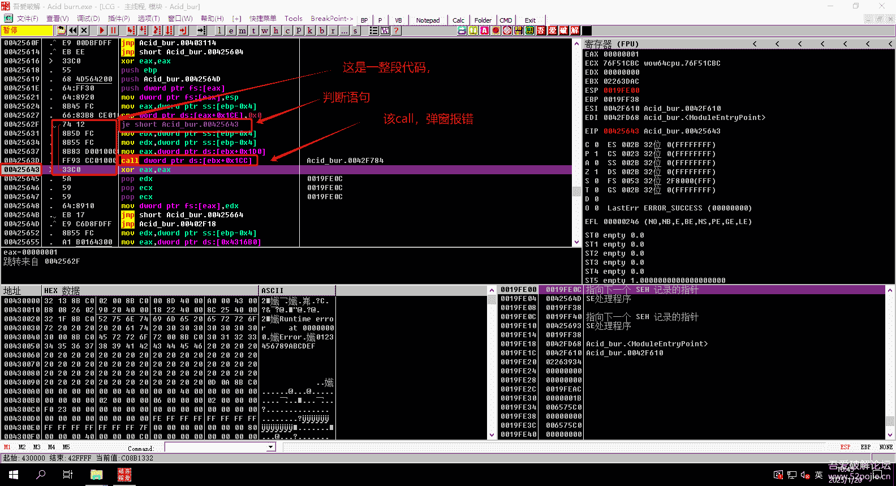

image.png (138.12 KB, 下载次数: 4)

[9](https://www.52pojie.cn/forum.php?mod=attachment&aid=Mjc1MDc0MHxlYjdiODZiZXwxNzkzNTcxMzk5fDE2ODA4NnwyMDAxMjU3&nothumb=yes)

2025-1-20 10:48 上传

修改`je`为`jmp`，并右键保存为可执行文件，选择。

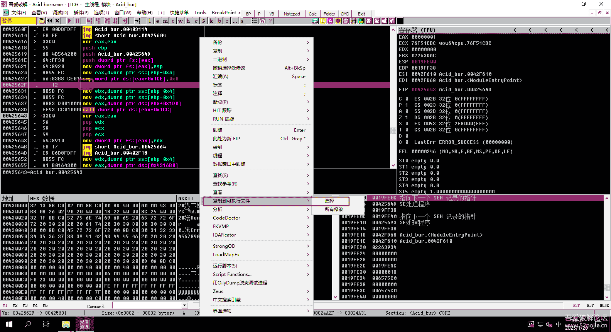

image.png (155.92 KB, 下载次数: 3)

[10](https://www.52pojie.cn/forum.php?mod=attachment&aid=Mjc1MDc0MXw3ZjBlMDkzMnwxNzkzNTcxMzk5fDE2ODA4NnwyMDAxMjU3&nothumb=yes)

2025-1-20 10:50 上传

继续右键保存文件。

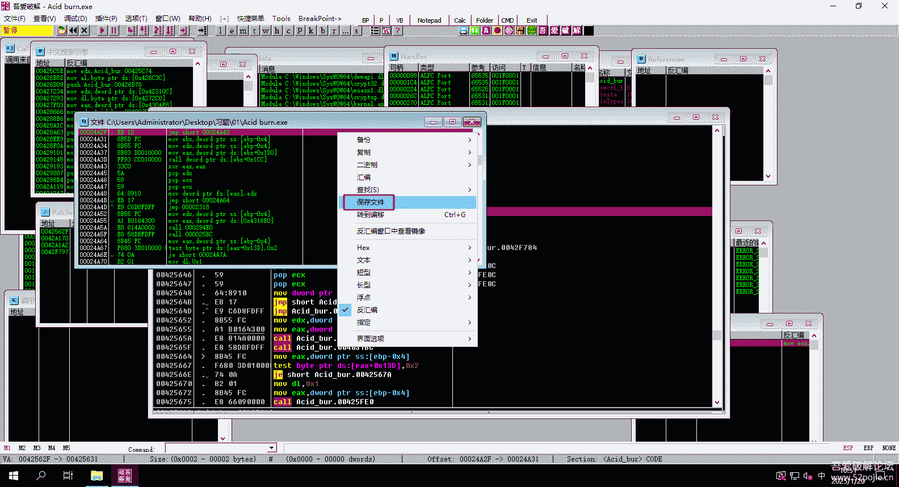

image.png (157.18 KB, 下载次数: 5)

[11](https://www.52pojie.cn/forum.php?mod=attachment&aid=Mjc1MDc0Mnw2ZjNiMzNkYnwxNzkzNTcxMzk5fDE2ODA4NnwyMDAxMjU3&nothumb=yes)

2025-1-20 10:51 上传

命名保存。

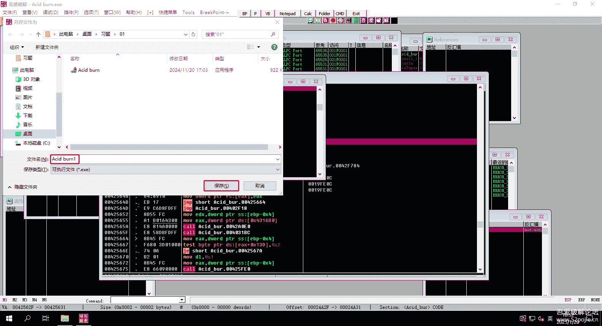

image.png (129.27 KB, 下载次数: 3)

[12](https://www.52pojie.cn/forum.php?mod=attachment&aid=Mjc1MDc0M3xmZjQxNmI0NXwxNzkzNTcxMzk5fDE2ODA4NnwyMDAxMjU3&nothumb=yes)

2025-1-20 10:52 上传

运行保存文件，问题1已解决。

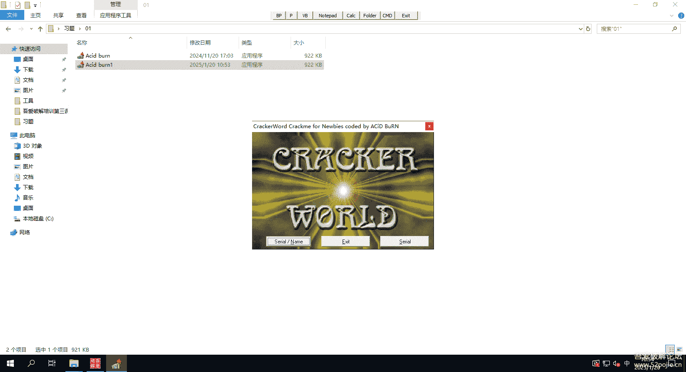

image.png (316.44 KB, 下载次数: 3)

[13](https://www.52pojie.cn/forum.php?mod=attachment&aid=Mjc1MDc0NHxjM2JjZmVlZHwxNzkzNTcxMzk5fDE2ODA4NnwyMDAxMjU3&nothumb=yes)

2025-1-20 10:54 上传

## 问题2，账户密码

### 思路1：跳过报错弹窗

### 开始解题

将保存的文件1拖入OD，并按F9启动，并使用中文引擎搜索报错信息，找到两处报错内容，这里分为报错内容1、报错内容2。

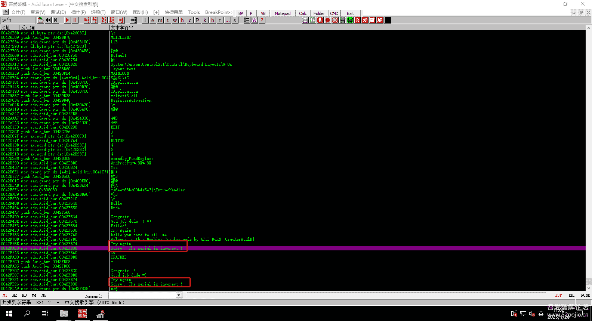

image.png (108.14 KB, 下载次数: 3)

[14](https://www.52pojie.cn/forum.php?mod=attachment&aid=Mjc1MDc0OHxjNzNjNDRiMHwxNzkzNTcxMzk5fDE2ODA4NnwyMDAxMjU3&nothumb=yes)

2025-1-20 11:03 上传

双击报错内容1，找到一处`jge`开头的判断语句。分析：将`jge`改为`jmp`就能跳过该报错。

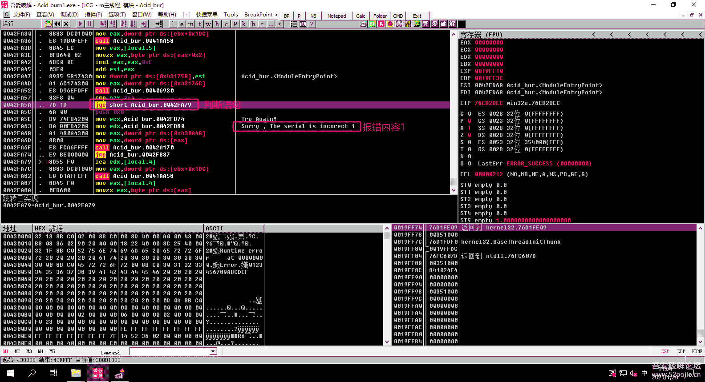

image.png (124.03 KB, 下载次数: 4)

[15](https://www.52pojie.cn/forum.php?mod=attachment&aid=Mjc1MDc1MHxjNWMwNGQ4MHwxNzkzNTcxMzk5fDE2ODA4NnwyMDAxMjU3&nothumb=yes)

2025-1-20 11:05 上传

修个`jge`为`jmp`。

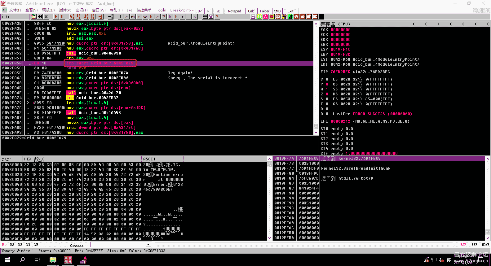

image.png (122.23 KB, 下载次数: 3)

[16](https://www.52pojie.cn/forum.php?mod=attachment&aid=Mjc1MDc1MXw0MzVjOWJjY3wxNzkzNTcxMzk5fDE2ODA4NnwyMDAxMjU3&nothumb=yes)

2025-1-20 11:08 上传

双击报错内容2。

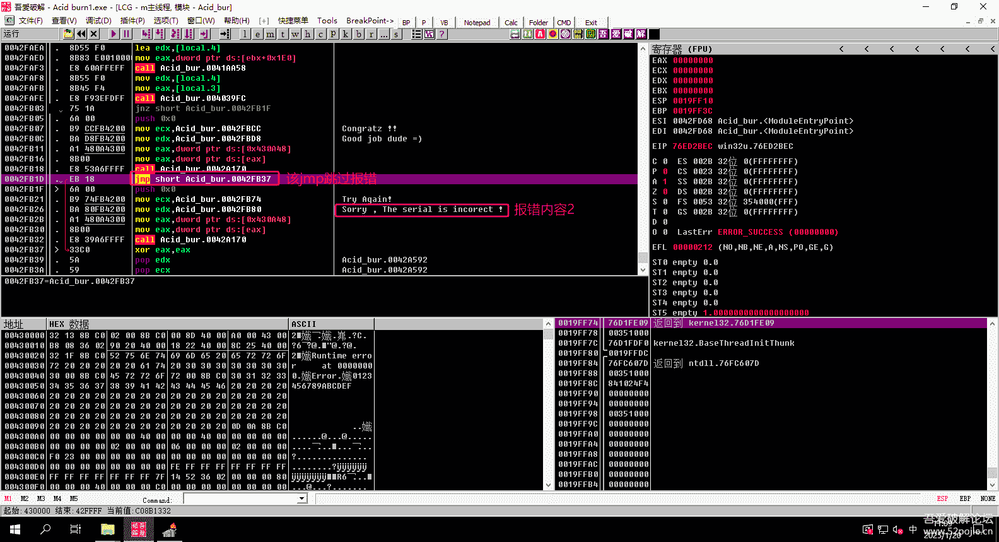

image.png (127.96 KB, 下载次数: 5)

[17](https://www.52pojie.cn/forum.php?mod=attachment&aid=Mjc1MDc1MnwwYTg1NDBmM3wxNzkzNTcxMzk5fDE2ODA4NnwyMDAxMjU3&nothumb=yes)

2025-1-20 11:10 上传

往上看，发现正确内容及`jne`判断语句。思路：将判断语句改为`00`（能改为`00`，不要改为`nop`，部分改为`nop`将导致文件失效，问题3改为`nop`后，就报错）。

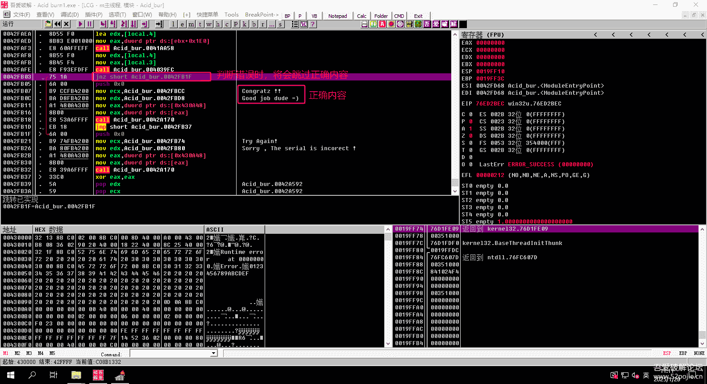

image.png (131.28 KB, 下载次数: 4)

[18](https://www.52pojie.cn/forum.php?mod=attachment&aid=Mjc1MDc1M3w4YTM5ODJhNHwxNzkzNTcxMzk5fDE2ODA4NnwyMDAxMjU3&nothumb=yes)

2025-1-20 11:12 上传

修改`jne`判断语句为`push 0x0`。

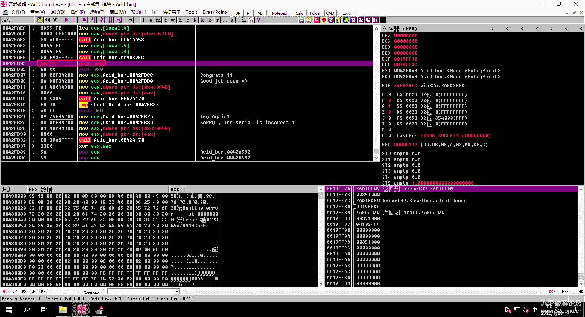

image.png (120.16 KB, 下载次数: 3)

## 问题2 解决

https://www.52pojie.cn/forum.php?mod=attachment&aid=Mjc1MDc1NHw2NWRmZmM1ZnwxNzkzNTcxMzk5fDE2ODA4NnwyMDAxMjU3&nothumb=yes
19
2025-1-20 11:16 上传

保存文件，并执行，问题2解决（为什么要修改报错内容1呢？因为第一次时候打开该软件仍会进行报错，修改保存内容1后，将不会抱错）

`image.png` (120.08 KB, 下载次数: 5)

## 问题3、注册码

https://www.52pojie.cn/forum.php?mod=attachment&aid=Mjc1MDc1NXw5ZDYyNTIxYnwxNzkzNTcxMzk5fDE2ODA4NnwyMDAxMjU3&nothumb=yes
20
2025-1-20 11:17 上传

该方法与问题2一致，找到文字断点

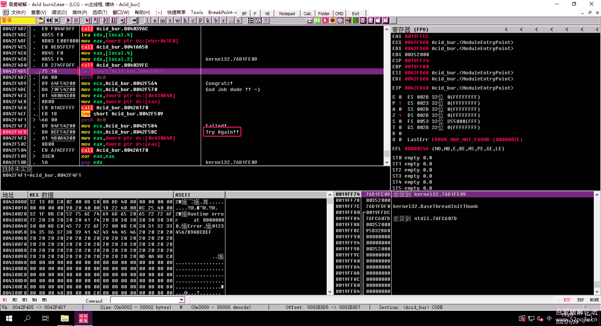
`image.png` (115.06 KB, 下载次数: 5)

https://www.52pojie.cn/forum.php?mod=attachment&aid=Mjc1MDc1N3wyOGQwOTFmNHwxNzkzNTcxMzk5fDE2ODA4NnwyMDAxMjU3&nothumb=yes
21
2025-1-20 11:21 上传

修改 `jnz` 为 `push 0x0`

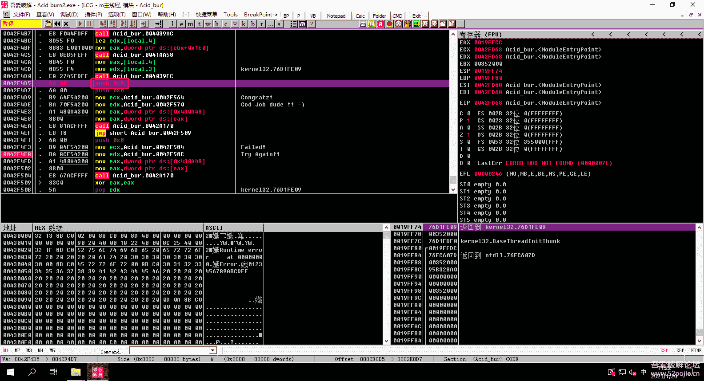
`image.png` (113.91 KB, 下载次数: 4)

https://www.52pojie.cn/forum.php?mod=attachment&aid=Mjc1MDc1OHwyYjI1MWZkM3wxNzkzNTcxMzk5fDE2ODA4NnwyMDAxMjU3&nothumb=yes
22
2025-1-20 11:22 上传

保存文件查看，问题解决

`image.png` (118.97 KB, 下载次数: 2)

https://www.52pojie.cn/forum.php?mod=attachment&aid=Mjc1MDc1OXwwYjdhNTg4NXwxNzkzNTcxMzk5fDE2ODA4NnwyMDAxMjU3&nothumb=yes
23
2025-1-20 11:23 上传
