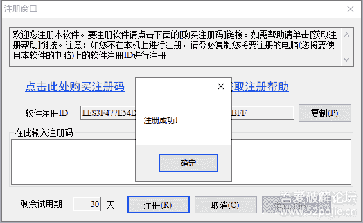

# [.NET逆向] .net 劫持 使用特征码一补丁通杀某标签软件所有版本

- 原帖: https://www.52pojie.cn/forum.php?mod=viewthread&tid=2001276
- 抓取时间: 2026-11-01T22:16:40

通杀软件这里不再分析，软件的注册位置特征码没有变过

分析过程在这里：[//www.52pojie.cn/thread-851880-1-1.html" target="_blank" rel="noopener noreferrer nofollow"](https://www.52pojie.cn/thread-851880-1-1.html:href="https)

我们使用文章中的方法3修改内存地址，将十六进制16改为17

这里主要使用.net特征码的形式对程序运行时的内存进行修改，从而达到注册的目的

使用到的 .net内存特征码搜索和内存修改在这里

[//www.52pojie.cn/thread-2001085-1-1.html" target="_blank" rel="noopener noreferrer nofollow"](https://www.52pojie.cn/thread-2001085-1-1.html:href="https)

既然使用劫持，肯定要写部分代码

首先使用Visual Studio新建一个 .net的类库工程，名称随意

我这里命名为`version`

```
using System;
using System.Collections.Generic;
using System.Diagnostics;
using System.Linq;
using System.Text;

namespace version
{
    public class Adm
    {

    }
}
```

建立好工程以后，做一下基本的引用，将.net内存特征码搜索和内存修改文章里的`PatchPattern.dll`引入到工程

在`Adm`类里继承`AppDomainManager`

```
using System;

using System.Collections.Generic;

using System.Diagnostics;

using System.Linq;

using System.Text;

namespace version

{

    public class Adm : AppDomainManager

    {

    }

}
```

下面使用构造函数的原理进行编写劫持代码

```
using System;
using System.Collections.Generic;
using System.Diagnostics;
using System.Linq;
using System.Text;

namespace version
{
    public class Adm : AppDomainManager
    {
        public Adm()
        {
            Debug.WriteLine("劫持进入……");
            AppDomain.CurrentDomain.AssemblyLoad += (sender, args) =>
            {
                if (args.LoadedAssembly.Location.IndexOf("Chen.dll", StringComparison.OrdinalIgnoreCase) >= 0)
                {
                    Debug.WriteLine("Assembly loaded: " + args.LoadedAssembly.Location);

                    IntPtr hModule = Process.GetCurrentProcess().Handle;
                    ulong baseAddress = PatchPattern.Get_Assembly_Module_BaseAddress("Chen.dll");
                    ulong sizeOfImage = PatchPattern.Get_Moule_SizeOfImage(baseAddress);
                    string pattern = "16 2A 16 0A 02 28 52";
                    Debug.WriteLine("模块基址：0x" + baseAddress.ToString("X") + "----模块大小：0x" + sizeOfImage.ToString("X"));

                    List retAddresses = PatchPattern.SundayPatternFind(hModule, baseAddress, baseAddress + sizeOfImage, pattern, 0);
                    retAddresses.ForEach(x => Debug.WriteLine("特征码地址：0x" + x.ToString("X")));
                    // 修改内存数据
                    retAddresses.ForEach(x => PatchPattern.WriteMemoryData(x, "17"));
                }
            };
        }
    }
}
```

这样dll就编写完成了！如果不想多带一个dll，可以在工程里使用`Costura.Fody`编译为一个dll文件，`Costura.Fody`用法自己搜索

既然有了dll，要怎样才能使程序加载自己编写的dll并执行呢，如果是.net4的版本，只要编写一个后缀为`.config`的配置文件即可，如我的程序名称为：`xxx.exe`，那么就在目录里添加一个`xxx.exe.config`文件，内容为

```
```

注意：

`appDomainManagerType` `value="version.Adm"` 里的`version`为程序集

`appDomainManagerAssembly` `value="version"` 里的`version`为dll名称

`supportedRuntime` `version="v4.0"`里的版本如果有多个，这个一定要第一个

如文章中的软件自己就有.config，只需要更改就行，它有两个`supportedRuntime`，所以要将`supportedRuntime` `version="v4.0"`改到第一个

下面就是在`runtime`里添加两行就行，即

```
```

.config文件修改完成以后，将生成的`version.dll`拷贝到程序根目录

未劫持修改前


000000.jpg (23.21 KB, 下载次数: 2)

[href="forum.php?mod=attachment&aid=Mjc1MDc2Mnw5YmVkMjJhOXwxNzkzNTcxMzk4fDE2ODA4NnwyMDAxMjc2&nothumb=yes" target="_blank"](https://www.52pojie.cn/forum.php?mod=attachment&aid=Mjc1MDc2Mnw5YmVkMjJhOXwxNzkzNTcxMzk4fDE2ODA4NnwyMDAxMjc2&nothumb=yes)

2025-1-20 12:47 上传

劫持修改后



111111.jpg (23.18 KB, 下载次数: 2)

[href="forum.php?mod=attachment&aid=Mjc1MDc2M3w1ZjRhNTk0Y3wxNzkzNTcxMzk4fDE2ODA4NnwyMDAxMjc2&nothumb=yes" target="_blank"](https://www.52pojie.cn/forum.php?mod=attachment&aid=Mjc1MDc2M3w1ZjRhNTk0Y3wxNzkzNTcxMzk4fDE2ODA4NnwyMDAxMjc2&nothumb=yes)

2025-1-20 12:47 上传

主要是说明.net的优雅劫持和通过特征码定位修改内存数据的方法，不提供软件和成品的dll，如果按以上操作一切顺利，应该能达到效果，祝成功……
