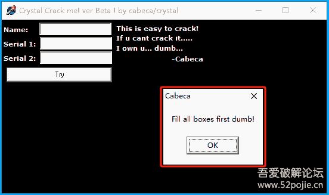
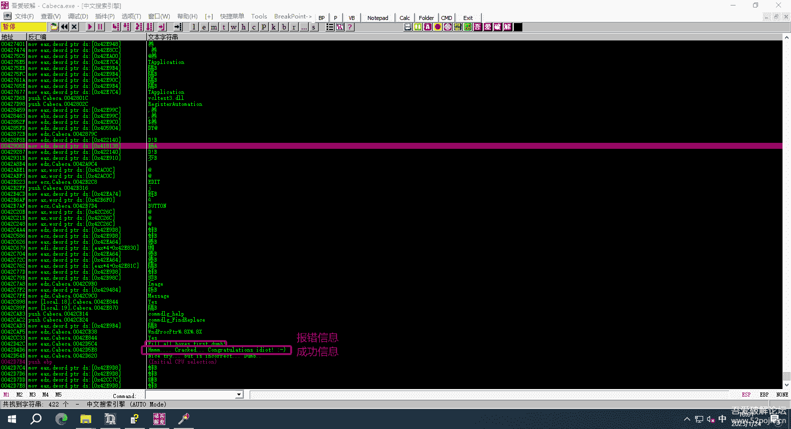
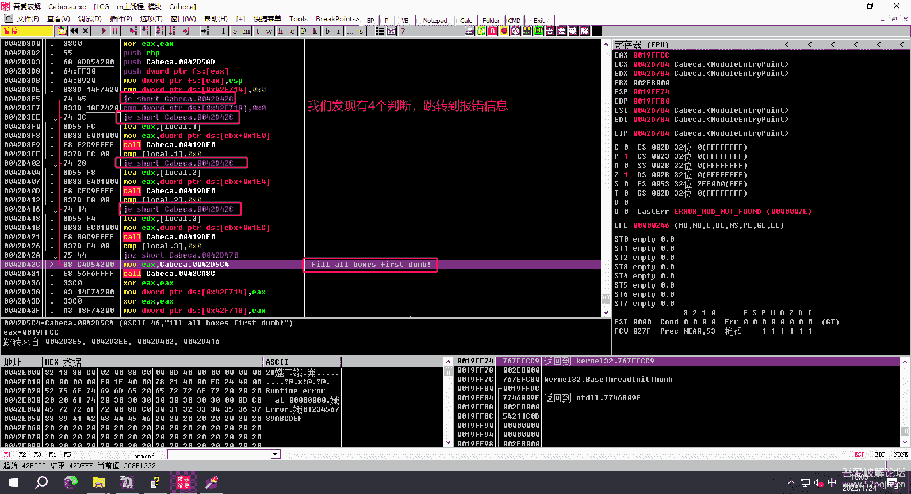
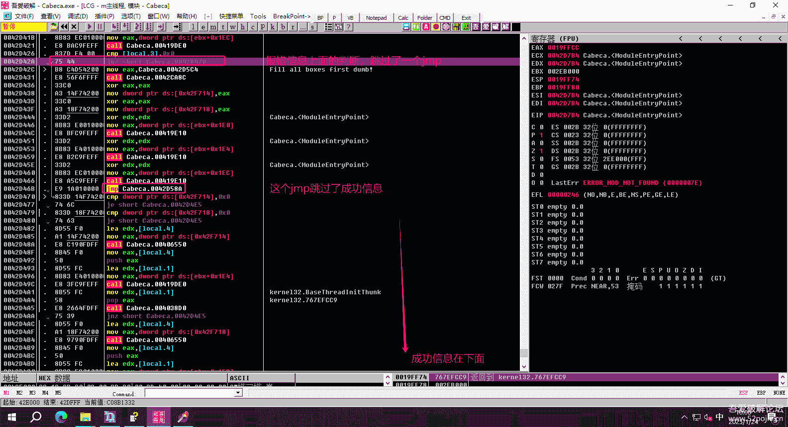
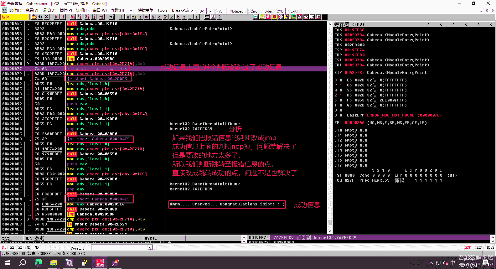
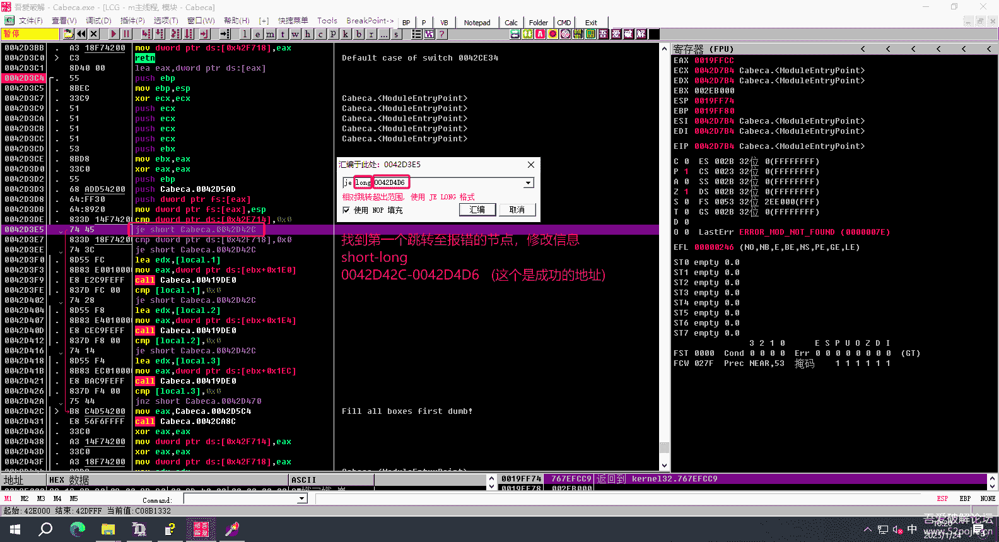
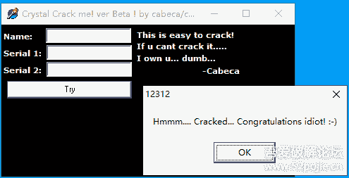

# [分享] 学习记录破解【160个CrackMe】之021

- 原帖: https://www.52pojie.cn/forum.php?mod=viewthread&tid=2002195
- 抓取时间: 2026-11-01T22:16:29

尝试[反汇编练习]160个CrackMe之021

之前的破解基本都是使用`nop`方法来破解，021这题需要`nop`的地方实在太多，所以准备使用新的方法来爆破

本次使用到的断点方式

中文搜索引擎-智能搜索

本次使用到的汇编语言分析

`call` 调用进程
`jnz` 判断
`jmp` 跳过
`retn` 返回

来看问题，点击`try`后，报错

`image.png` (16.79 KB, 下载次数: 1)

将软件拖入`OD`，中文搜索引擎-智能搜索，寻找关键字段

`image.png` (116.82 KB, 下载次数: 0)

双击报错信息，发现有4个判断跳转至报错信息

`image.png` (134.08 KB, 下载次数: 1)

报错信息上面的`jnz`跳过了一个`jmp`，这个`jmp`跳过了成功信息

`image.png` (140.6 KB, 下载次数: 1)

再往下查看，发现成功信息上面有4个判断都跳过了成功信息

方法1：跳转至失败的报错，`nop`掉，跳转过失败的判断改为`jmp`，然后跳过成功的判断全部`nop`掉，要改的地方好多
方法2：跳转至失败的报错，直接跳转至成功，问题解决（用这方法）

`image.png` (171.8 KB, 下载次数: 1)

我们看到成功的地址是：`0042D4D6`

找到第一个跳转至错误的判断，修改信息 `je long 0042D4D6`，保存程序

`image.png` (143.48 KB, 下载次数: 1)

运行程序，成功

`image.png` (17.92 KB, 下载次数: 1)

这次记录，主要是使用新的方式来做爆破，并非只用`nop`来解决，找到关键的判断逻辑，直接跳转至成功，一样可以
