# [分享] 学习记录破解【160个CrackMe】之032

- 原帖：<https://www.52pojie.cn/forum.php?mod=viewthread&tid=2002296>
- 抓取时间：2026-11-01T22:16:28

尝试[反汇编练习]160个CrackMe之032

难度进步增加，这次破解，用原先的快速找到断点已无法解决，还需要稍微对代码进行查看。

第一次尝试，花了点时间没有解决，找大佬的帖子，才找到关键节点，下次找不到关键节点的时候，也需要看代码分析了。

## 工具与断点

### 本次使用到的断点方式

- `中文搜索引擎-智能搜索`
- `CTRL+G`，直接断关键节点

### 本次用到的工具

- `PEiD_boxed`（查壳）
- `IDR (Interactive Delphi Reconstructor)`（寻找关键地址）：[下载](<https://down.52pojie.cn/Tools/Disassemblers/IDR%20(Interactive%20Delphi%20Reconstructor).rar>)，解压码 `www.52pojie.cn`
- `UPX Unpacker`（`UPX` 脱壳工具）：[下载](<https://down.52pojie.cn/Tools/Unpackers/UPX%20Unpacker.zip>)，解压码 `www.52pojie.cn`

### 本次使用到的汇编语言分析

- `call` 调用进程
- `mov` 赋值（`mov a,0x1` 意思为 `a=1`）
- `test` 测试
- `je`、`jnz` 判断
- `jmp` 跳过
- `retn` 返回

## 破解过程

来看程序，一打开就报错

（2025-1-24 14:14 上传）

还带`UPX`壳

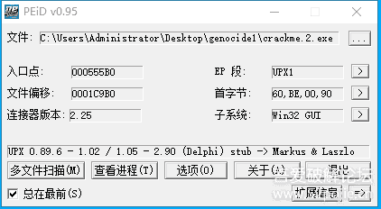（2025-1-24 14:15 上传）

直接扔到`UPX`的脱壳工具脱壳，脱壳成功

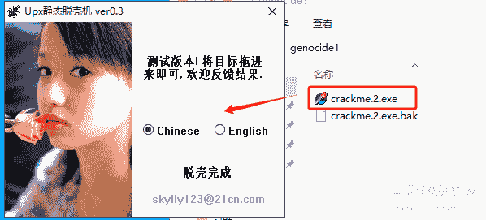（2025-1-24 14:17 上传）

再将程序拖入查壳，`UPX`壳已脱，用Delphi写的，后面需要用到`IDR`

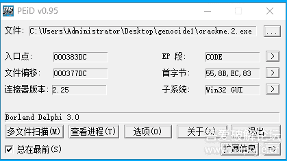（2025-1-24 14:24 上传）

把程序拖入`OD`，一眼就看到了报错信息

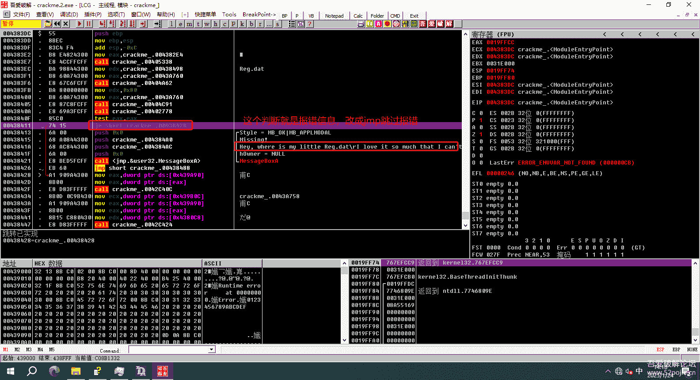（2025-1-24 14:20 上传）

将`je`改成`jmp`就能跳过报错，保存程序，并运行

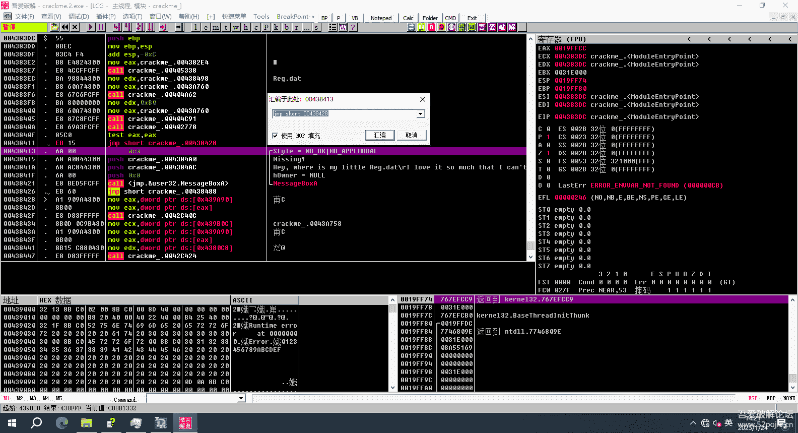（2025-1-24 14:21 上传）

报错信息没有了，点击`about`，显示激活，并且`OK`键还是灰色的。

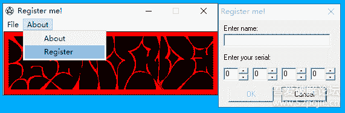（2025-1-24 14:22 上传）

由于软件是Delphi写的，将保存后的程序拖入`IDR`找关键断点

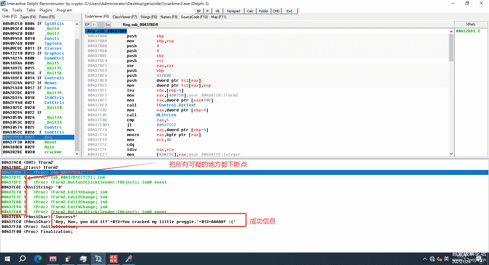（2025-1-24 15:26 上传）

继续将程序拖入`OD`

在可能的节点都下断：`00437BD8`、`00437D1C`、`00437DFC`、`00437E70`、`00437E7C`、`00437E88`、`00437E94`、`00437D1C`（这几个其实不需要下断，因为这里面都没有判断语句相关的），如果下断并到这里停下时，取消断点。

在下断的时候，我们发现所有的编辑事件都指向一个`call 00437D1C`

`CTRL+G` 输入地址，`F2` 断点

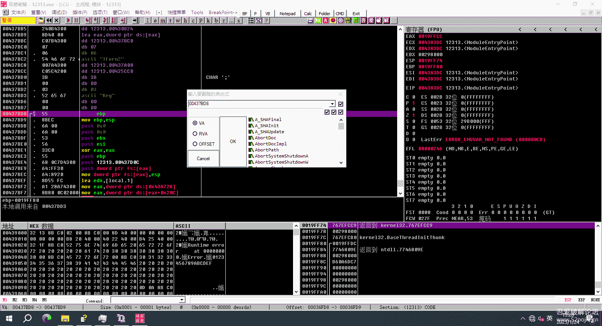（2025-1-24 15:28 上传）

断点都下完后，`F9` 运行软件，点击`about-register`，输入`01`时，在`00437D1C`断下

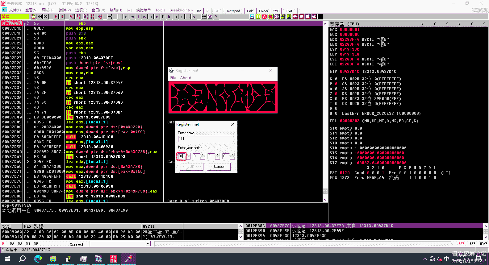（2025-1-24 15:36 上传）

先查看代码，发现所有的判断跳过均指向一个`call`，

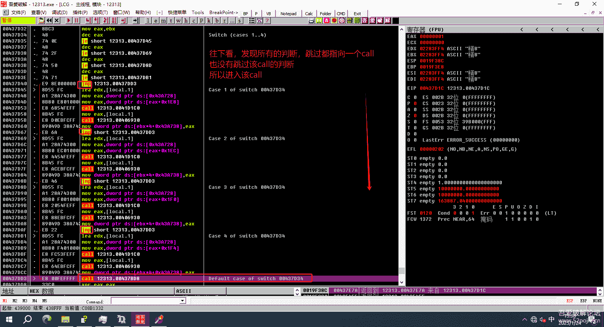（2025-1-24 15:40 上传）

按`F8`运行该`call`

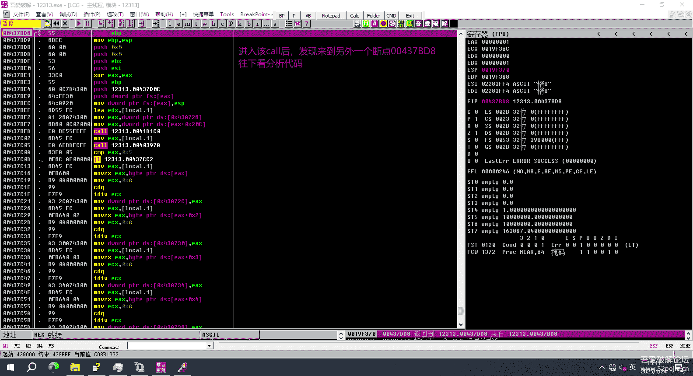（2025-1-24 15:42 上传）

将关键判断`nop`掉，保存程序，以后看到`test`做比较，还有`mov`给某个字段赋值，需要多注意一下，说不准就是坑

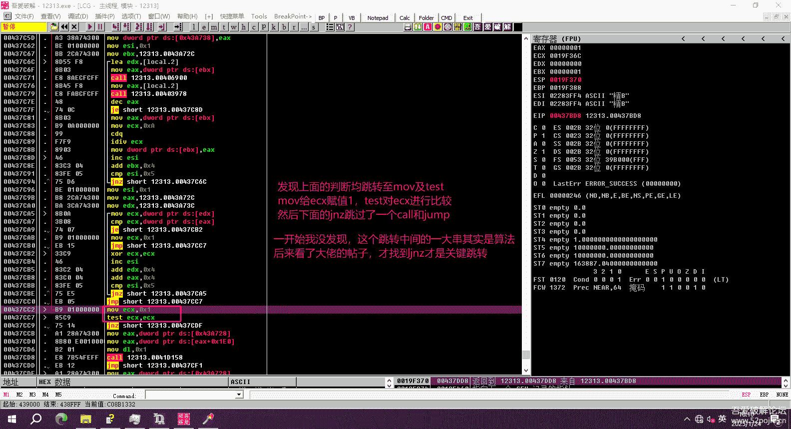（2025-1-24 16:22 上传）

运行程序，程序破解成功

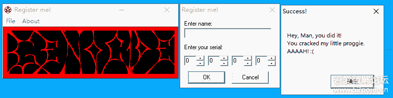（2025-1-24 16:24 上传）
