# [Web逆向] 记录一次某标准规范网的逆向分析

原帖: https://www.52pojie.cn/forum.php?mod=viewthread&tid=2002450
抓取时间: 2026-11-01T22:16:26
本文章中所有内容仅供学习交流使用，不提供完整代码，旨在思路分析；
前面由于工作需要搜索建筑规范的时候无意找到了这个网站，一时兴起就研究了一下；现在把分析思路整理一下交流学习，因为非专业纯爱好，如有不足还请指教；
目标网址：
aHR0cHM6Ly9vcGVuc3RkLnNhbXIuZ292LmNuLw==

## 目录
一、验证分析
二、页面内容分析
三、整体流程分析

## 一、验证分析
任意选了一篇可在线预览的规范；先走一遍流程：点在线预览之后直接是验证码，输入正确验证码之后会加载规范内容；
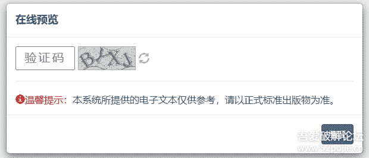
然后想着看看源码：按 `F12` 无效，点击开发者工具直接跳转空白页；看到这里反而增加了分析代码的信心，猜想源码应该不会太难；使用 `Fiddler` 抓包发现两个反爬代码，一个跳转空白页，一个禁止 `F12`；
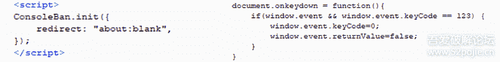
然后 `Fiddler` 设置自动断点在请求之后，刷新页面，把这两段代码删掉，就可以打开调试了；（可以在 `Fiddler` 设置自动替换，不然每次刷新都要删一遍）
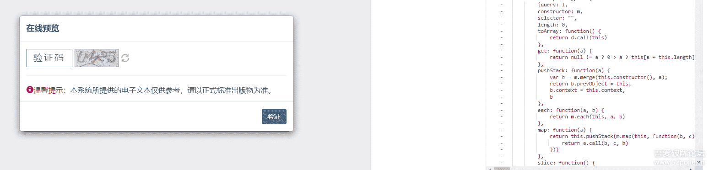
任意输入验证码后发现向该网址发送验证，验证失败返回 `error`，验证成功返回 `success`；
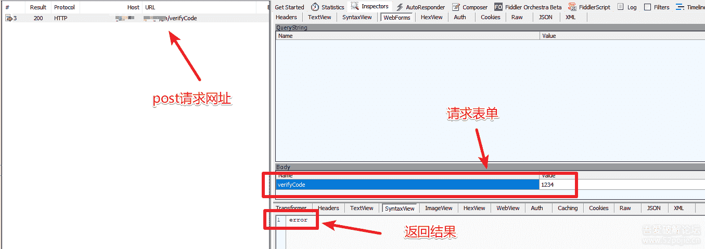
验证失败后会刷新图片，点击刷新会得到新的图片；
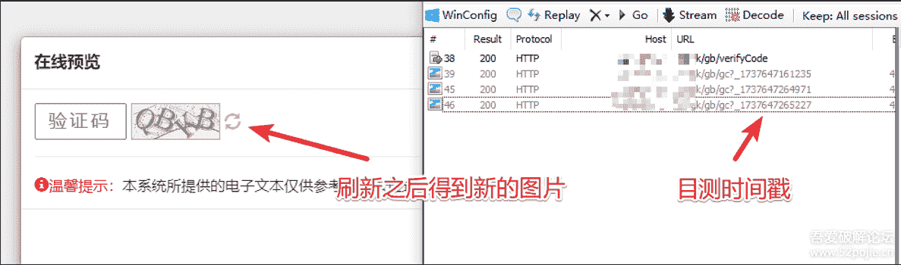
这里图片和验证肯定是有联系的，不然怎么知道验证的是哪张图片，所以想到查看 `cookie`；
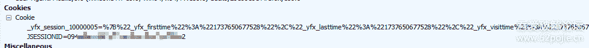
有两个参数，先看第一个参数，通过 URL 解码发现数据里有 7 个参数；
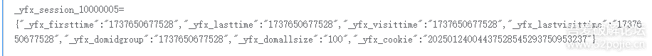
直接搜 `_yfx_firsttime` 代码，发现所有的参数都在这里；前 5 个是时间戳，第 6 个是固定值，最后是调用 `re()` 和 `oe()` 字符串组合；
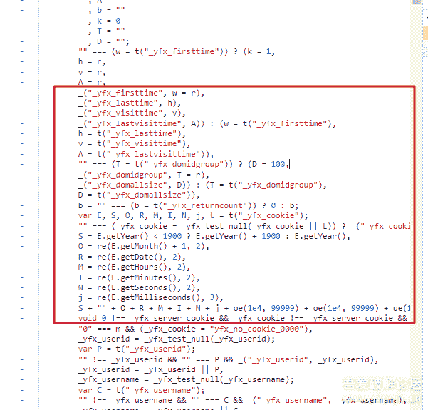
根据逻辑转成 `python` 代码就得到了 `_yfx_cookie` 的值；
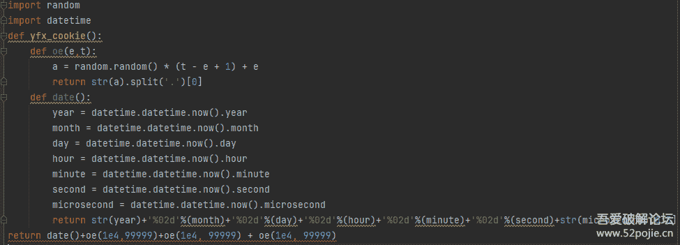
然后看 `JSESSIONID` 的值，搜了一遍发现没有，然后百度发现他是访问网页的时候生成在 `cookie` 里的，于是代码获取；
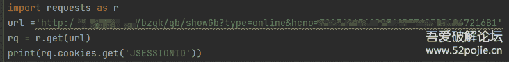
参数齐全写入 `cookie` 就可以请求验证码了，
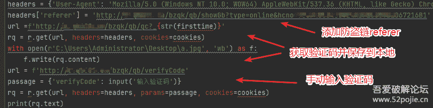
返回验证结果，验证成功；
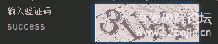
这时再次请求网址返回就是目标网页源代码了；
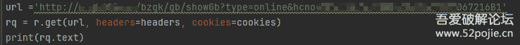
验证就分析完了，然后进入页面内容的逻辑分析；

## 二、页面内容分析
进入页面分析发现他是很多小图片拼在一起的，并且每一块都有编号；
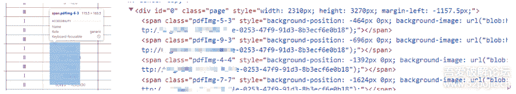
然后翻到源代码，分析发现他的规则很清晰；
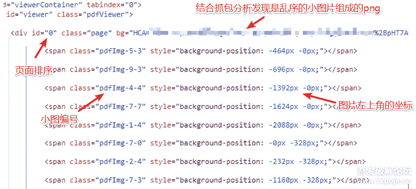
然后他前面已经把编码的规则排好了；
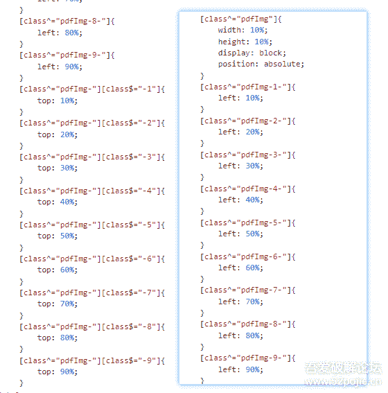
那就按他这个规则来写；
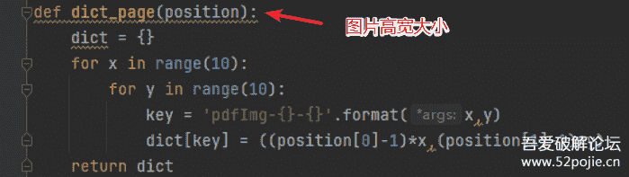
因为不同的规范他的小图高宽都不一样，但是又没有直接提取高宽的地方，所以提取所有页面的坐标排序筛选；
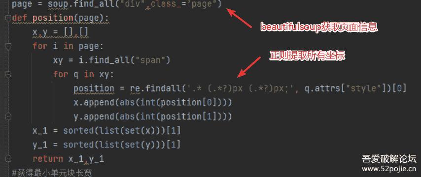
现在我们获取乱序大图，抓包发现；
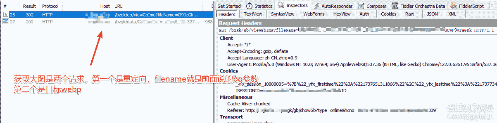

[附件](https://www.52pojie.cn/forum.php?mod=attachment&aid=Mjc1MTc5MnwxNjM0YTRlM3wxNzkzNTcxMzgzfDE2ODA4NnwyMDAyNDUw&nothumb=yes)

2025-1-25 16:12 上传

我先是直接复制地址，发现网页不显示，然后带`cookie`和`referer`请求也不返回任何信息，查看抓包其他栏里面除了`referer`还有个`chunked`参数但不知道是啥，后来我想到他请求图片必然会在代码里面留下信息，于是我搜索了`request`；

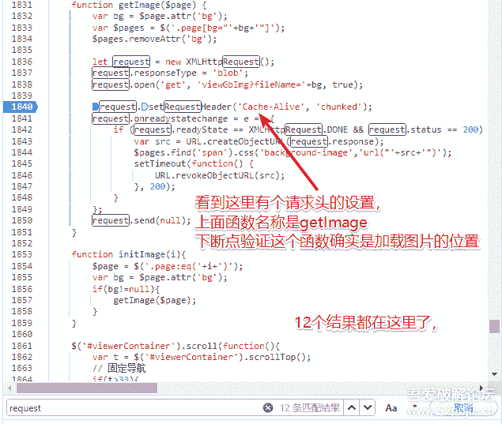

`021.png` (111.54 KB, 下载次数: 1)

[附件](https://www.52pojie.cn/forum.php?mod=attachment&aid=Mjc1MTc5M3xhZmNjZTg5YnwxNzkzNTcxMzgzfDE2ODA4NnwyMDAyNDUw&nothumb=yes)

2025-1-25 16:12 上传

于是添加请求头参数，设置允许重定向为`False`，结果保存成功；

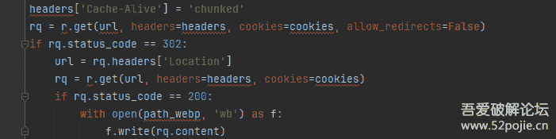

`022.png` (38.77 KB, 下载次数: 2)

[附件](https://www.52pojie.cn/forum.php?mod=attachment&aid=Mjc1MTc5NHwwM2M5NzllZnwxNzkzNTcxMzgzfDE2ODA4NnwyMDAyNDUw&nothumb=yes)

2025-1-25 16:12 上传

现在我们有了页码，有乱序大图，有小图编号，有位置坐标，就可以按规则还原了；

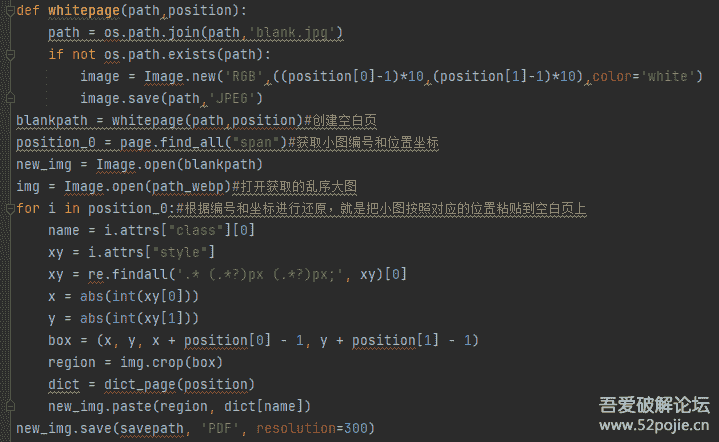

`023.png` (66.55 KB, 下载次数: 2)

[附件](https://www.52pojie.cn/forum.php?mod=attachment&aid=Mjc1MTc5NXxjOWE4NzdiMnwxNzkzNTcxMzgzfDE2ODA4NnwyMDAyNDUw&nothumb=yes)

2025-1-25 16:21 上传

最后完美还原；

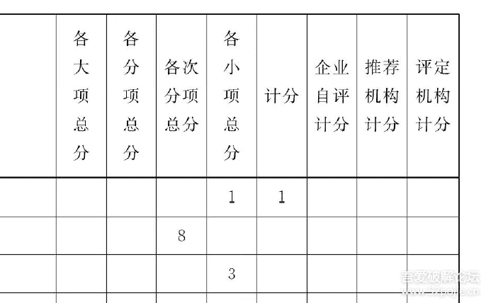

`024.png` (88.13 KB, 下载次数: 2)

[附件](https://www.52pojie.cn/forum.php?mod=attachment&aid=Mjc1MTc5Nnw2M2Y3OWUxNnwxNzkzNTcxMzgzfDE2ODA4NnwyMDAyNDUw&nothumb=yes)

2025-1-25 16:21 上传

## 三、整体流程

从抓包来看（无关的我删了），从点击预览到加载内容的步骤如下：

1. 进入验证页面；
2. 获取验证码图片；
3. 输入验证码后提交验证，返回验证结果；
4. 验证成功后再次请求步骤1得到内容代码；
5. 请求乱序大图有一个重定向到目标`webp`；

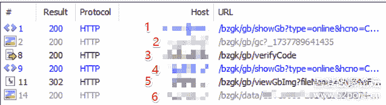

`025.png` (85.29 KB, 下载次数: 1)

[附件](https://www.52pojie.cn/forum.php?mod=attachment&aid=Mjc1MTc5N3xlZTIxMDhjNXwxNzkzNTcxMzgzfDE2ODA4NnwyMDAyNDUw&nothumb=yes)

2025-1-25 16:21 上传

以上就是所有内容了，不足之处希望大佬指点，也给其他感兴趣的朋友提供参考；
