# [原创] Sublime Text 4192 无授权注册你这么玩

- 原帖：https://www.52pojie.cn/forum.php?mod=viewthread&tid=2002566
- 抓取时间：2026-11-01T22:16:24

## 备份并打开程序

到资源管理器中，先把主程序 `sublime_text.exe` 按住 `Ctrl` 键备份一份为 `bak_sublime_text.exe`。

接下来用 `x64dbg` 打开。

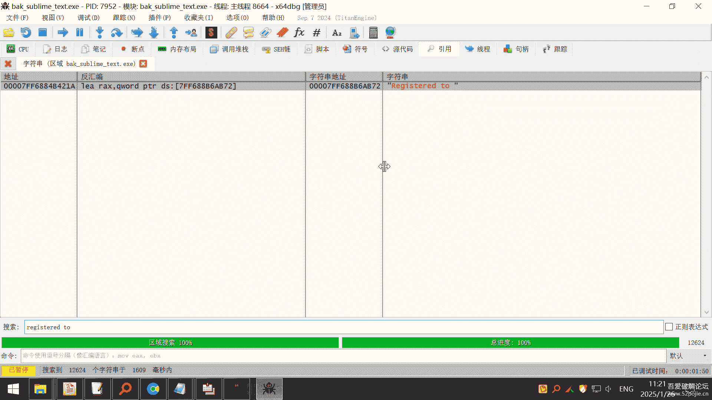

`image.png`（195.92 KB，下载次数：2），2025-1-26 11:21 上传

## 定位关键字符串

搜索一下 `"Registered to "`，双击定位过去。

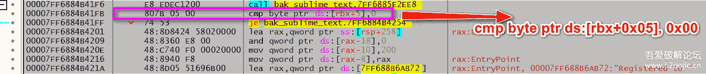

`image.png`（79.62 KB，下载次数：2），2025-1-26 11:23 上传

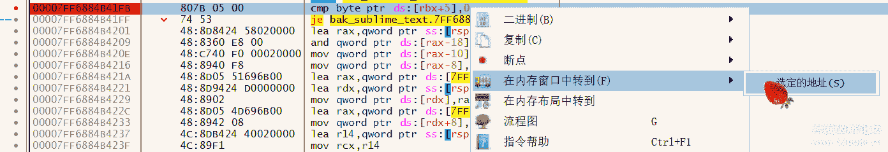

`image.png`（96.95 KB，下载次数：3），2025-1-26 11:24 上传

## 设置断点并标记

当前没下断点，断下来过，没法直接转到 `[rbx+0x05]`。

直接按 `Shift+F9` 跳过异常，运行程序去点“关于”，现在断到了，能转到了……

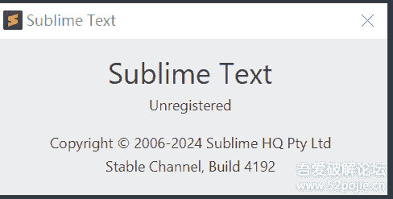

`image.png`（20.44 KB，下载次数：2），2025-1-26 11:31 上传

同时做个试验：修改下面这条语句时，在 `[rbx+0x05]` 指向的内存下断点：

```
cmp byte ptr ds:[rbx+0x05], 0x00
```

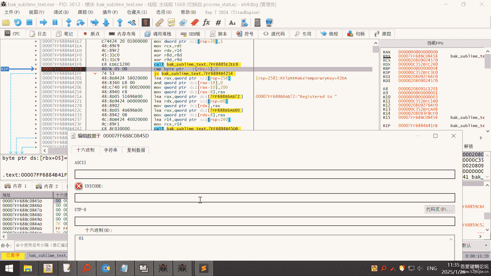

`image.png`（348.69 KB，下载次数：1），2025-1-26 11:39 上传

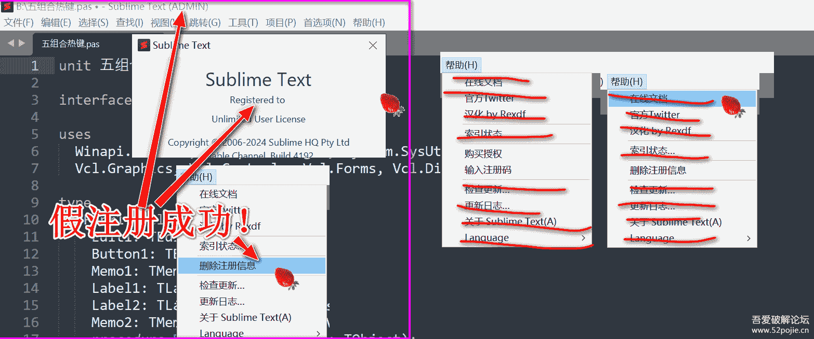

`image.png`（249.58 KB，下载次数：1），2025-1-26 11:38 上传

现在我们能得到初步结论：`[rbx+0x05]` 指向的内存断点有一部分注册成功的标志。

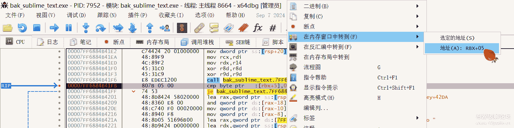

`image.png`（143.73 KB，下载次数：2），2025-1-26 11:26 上传

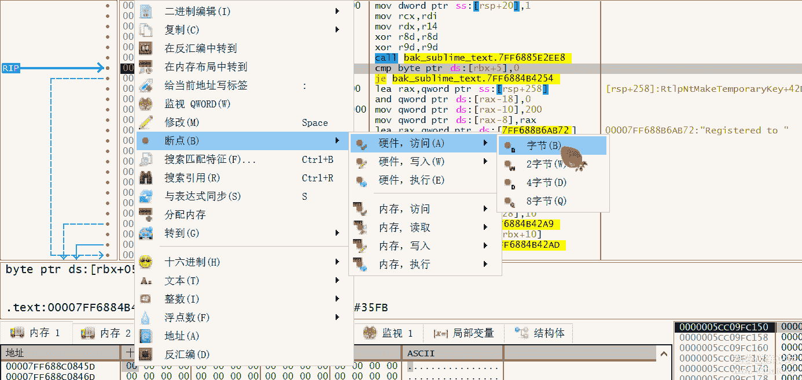

`image.png`（157.38 KB，下载次数：1），2025-1-26 11:28 上传

为该地址下一个硬件访问断点，按 `Ctrl+F2` 重启。

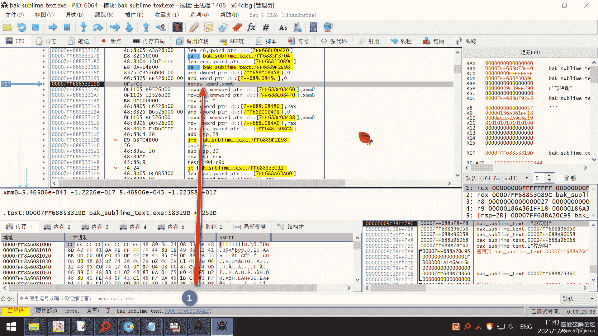

`image.png`（487.56 KB，下载次数：3），2025-1-26 11:43 上传

然后为了标记，你可以给该行下个 `F2` 断点，按下 `;` 号键，并写上注释“第一次断下”。

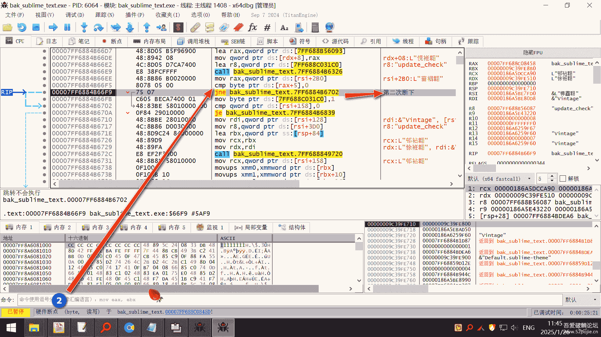

`image.png`（531.68 KB，下载次数：3），2025-1-26 11:45 上传

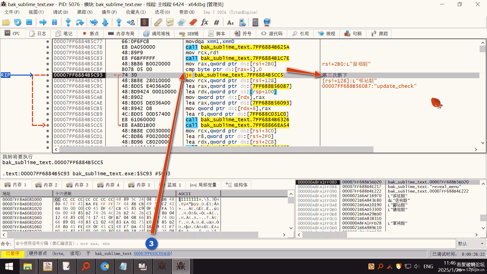

`image.png`（446.15 KB，下载次数：1），2025-1-26 11:47 上传

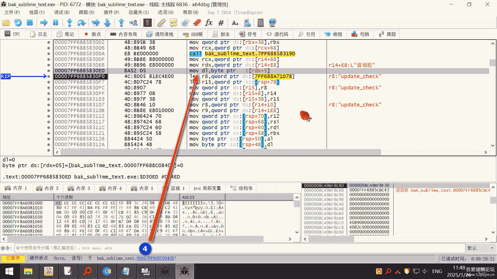

`image.png`（435.56 KB，下载次数：1），2025-1-26 11:49 上传

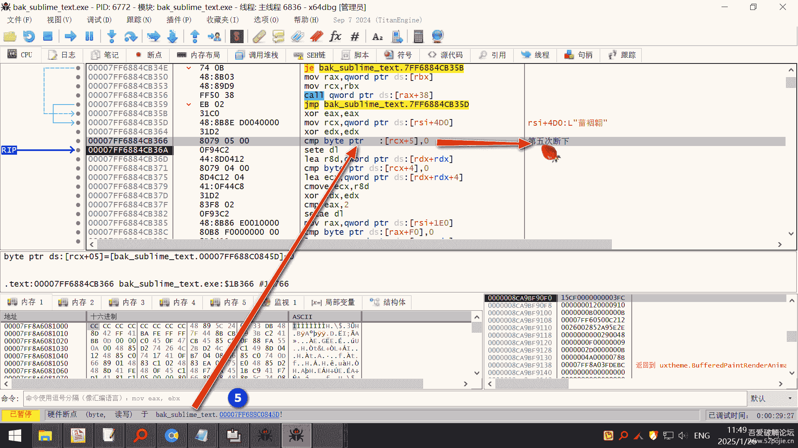

`image.png`（425.82 KB，下载次数：2），2025-1-26 11:49 上传

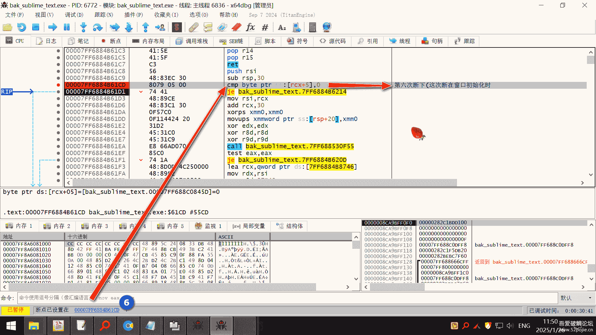

`image.png`（419.9 KB，下载次数：1），2025-1-26 11:51 上传

现在标记好注释了，硬件断点可以禁用了。

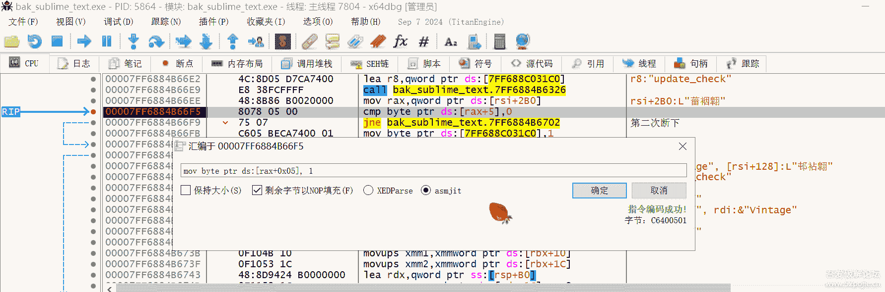

`image.png`（155.54 KB，下载次数：2），2025-1-26 11:59 上传

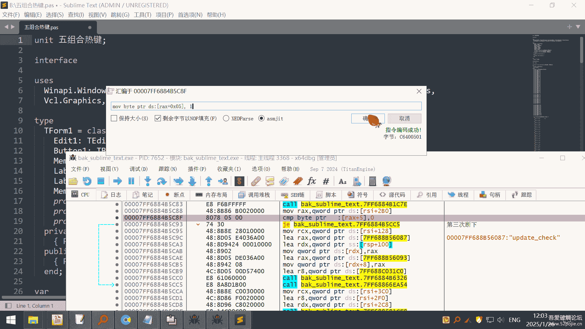

`image.png`（392.15 KB，下载次数：2），2025-1-26 12:04 上传

## 修改并验证

试着修改上面的地方，并转到内存查看该值 `[rbx+0x05]` 是否变化了？

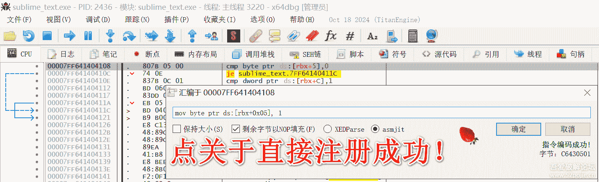

`image.png`（163.56 KB，下载次数：2），2025-1-26 12:15 上传

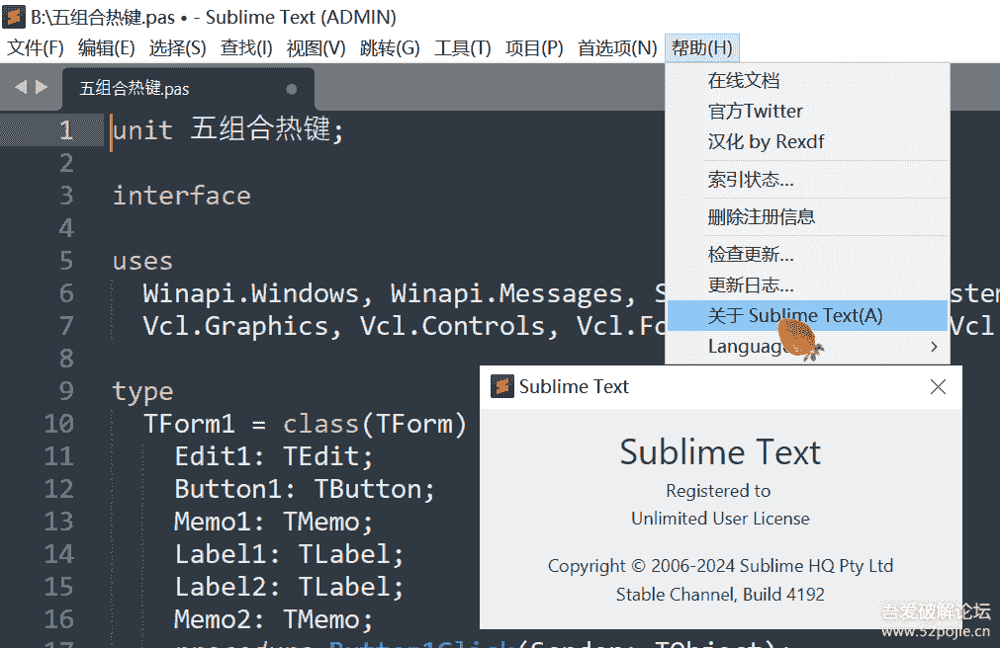

`image.png`（112.86 KB，下载次数：1），2025-1-26 12:00 上传

这样我们就免注册码注册成功了。
