# [原创] v12.0.1 010editor简单绕过nag窗口

- 原帖: https://www.52pojie.cn/forum.php?mod=viewthread&tid=2002680
- 抓取时间: 2026-11-01T22:16:17

原帖：https://www.52pojie.cn/thread-1690709-1-1.html

最后的师傅弄完后还有弹窗没解决掉，就想着把这个窗口去掉，如觉得过程繁琐可直接跳到最后的“修补地址”处

拉入`IDA`&`x64dbg`中，搜索字符串（`Thank you for using 010 Editor, the only text`），来到对应地址

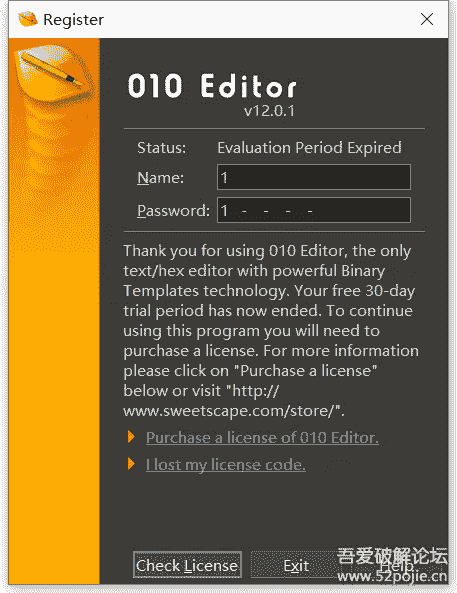

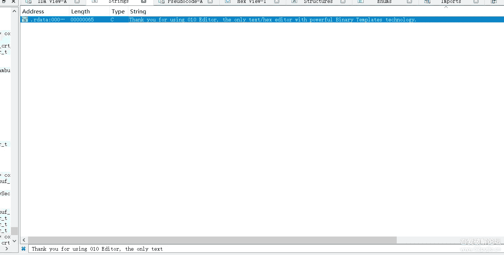

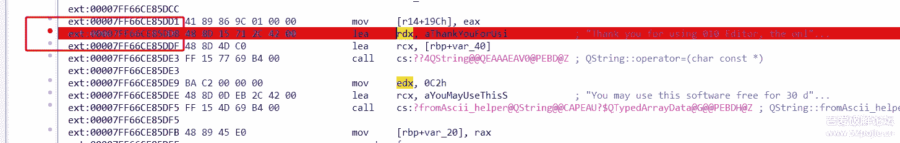

来到`x64dbg`对应地址处

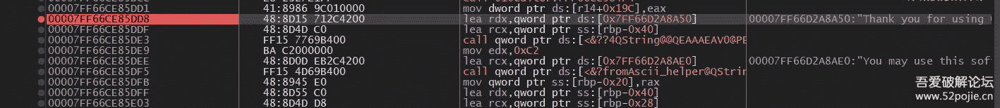

机器码一致，`ida`来到函数名处，按`X`查看谁调用了，来到该处

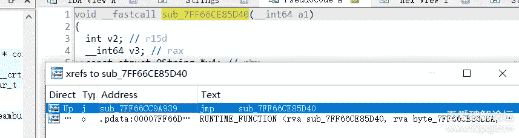

继续对函数按`x`查看调用，来到该处复制对应地址取`x64dbg`查找，`0x7FF66CE8741F`

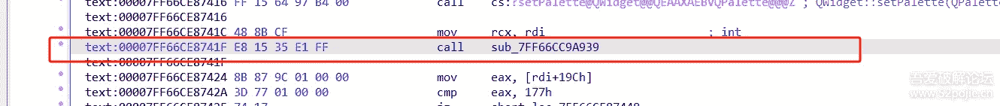

来到对应地址，修改`call`的地址到新的地址，直接跳过即可。（记得地址得在`text`段内，权限问题）：将地址从原来的`00007FF66CC9A939`修改为`00007FF66CC9c000`，新地址处代码为`ret`（`C3`）直接返回，跳过弹窗。（后续直接将对应机器码改为`90`即可）

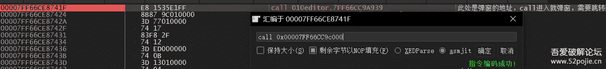


保存后打开，发现其他弹窗

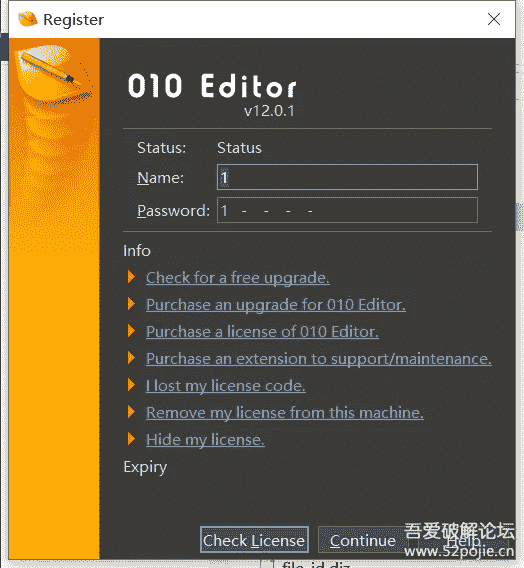

从函数下手

利用`Apimonitor`监控函数,看了一圈，程序运行后，利用`spy++`查找窗口信息，得到句柄类名信息，直接在`apimonitor`里面搜，全程只看到一个`CreateWindowExW()`创建窗口函数，在`x64dbg`中下断点想着`nop`掉，但后续在`x64dbg`追踪后发现此处不是弹窗。

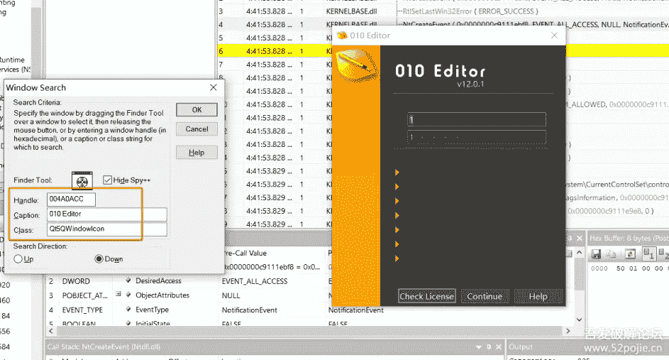

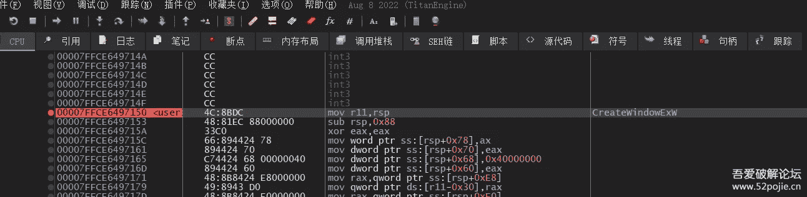

由于此窗口是最开始就弹了，那就用笨法子，从一开始的地方一个个跟踪过去（一路`F8`），最后找到入口点位置。

首先拉入`x64dbg`后，来到入口点处，直接`f8`进入，继续运行到`jmp`位置，来到新地址

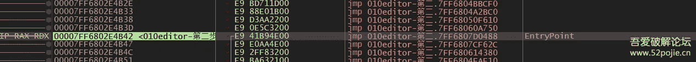

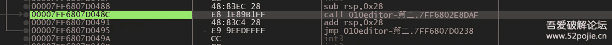

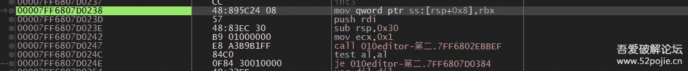

直至运行到`00007FF6807D0339`处，`F7`进入，继续`F7`+`F8`

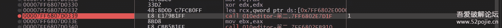

来到`00007FF6807D13B2`地址处进入


来到关键函数内，一步步`F8`,直到`00007FF68069C73B`地址处，跟入可以看到是`dialog`相关字眼,第一感觉就是此处了，包括`F8`后来到其他模块（`qt5widgets.dll`）地址。更加确定了

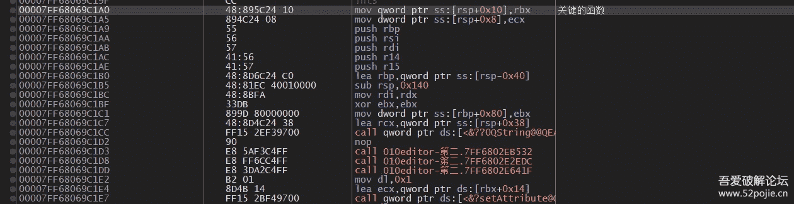

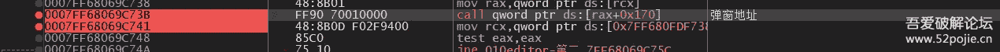

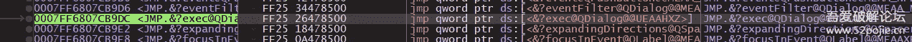


[href="forum.php?mod=attachment&aid=Mjc1MjA1NnwzNjdmN2Q0YXwxNzkzNTcxMzc1fDE2ODA4NnwyMDAyNjgw&nothumb=yes" target="_blank"](https://www.52pojie.cn/forum.php?mod=attachment&aid=Mjc1MjA1NnwzNjdmN2Q0YXwxNzkzNTcxMzc1fDE2ODA4NnwyMDAyNjgw&nothumb=yes)

2025-1-27 00:40 上传

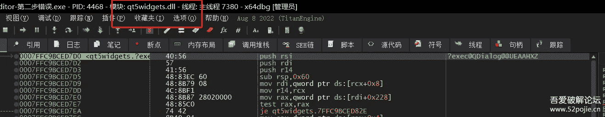

`image.png` (249.75 KB, 下载次数: 0)

[href="forum.php?mod=attachment&aid=Mjc1MjA1N3wzMGYyOGE5ZXwxNzkzNTcxMzc1fDE2ODA4NnwyMDAyNjgw&nothumb=yes" target="_blank"](https://www.52pojie.cn/forum.php?mod=attachment&aid=Mjc1MjA1N3wzMGYyOGE5ZXwxNzkzNTcxMzc1fDE2ODA4NnwyMDAyNjgw&nothumb=yes)

2025-1-27 00:40 上传

直接将地址`nop`后保存，打开后的确绕过了弹窗

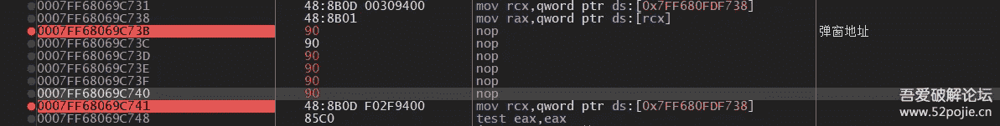

`image.png` (141.04 KB, 下载次数: 0)

[href="forum.php?mod=attachment&aid=Mjc1MjA1OHw5ZThkZDY2N3wxNzkzNTcxMzc1fDE2ODA4NnwyMDAyNjgw&nothumb=yes" target="_blank"](https://www.52pojie.cn/forum.php?mod=attachment&aid=Mjc1MjA1OHw5ZThkZDY2N3wxNzkzNTcxMzc1fDE2ODA4NnwyMDAyNjgw&nothumb=yes)

2025-1-27 00:40 上传

## 修补地址

第一个关键机器码：
```
FF 15 64 97 B4 00 48 8B CF E8 15 35 E1 FF
```
修改为：
```
FF 15 64 97 B4 00 48 8B CF 90 90 90 90 90
```

第二个关键机器码：
```
48 8B 0D 00 30 94 00 48 8B 01 FF 90 70 01 00 00
```
修改为：
```
48 8B 0D 00 30 94 00 48 8B 01 90 90 90 90 90 90
```
即可绕过两个弹窗
