# [原创] godot 游戏提取aeskey

- 原帖: https://www.52pojie.cn/forum.php?mod=viewthread&tid=2002779
- 抓取时间: 2026-11-01T22:16:13

一些没有加密的游戏可以通过`gdre_tools`工具来直接提取游戏里面的资源和脚本

github的项目地址：https://github.com/GDRETools/gdsdecomp

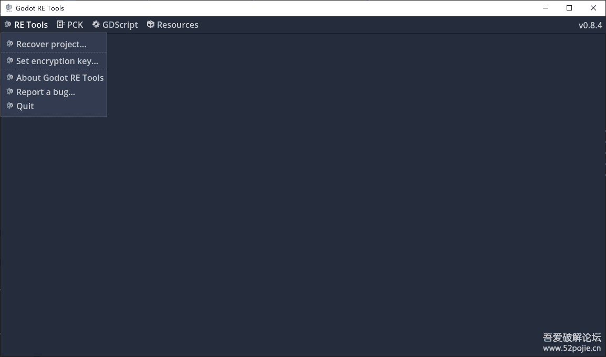

有些`godot`开发者会对游戏进行预编译，预编译后`scripts`目录下的文件都会以`.gdc`作为文件后缀，如果进一步加密，则以`.gde`结尾。只是预编译并且没有对`GDScript`的解释器实现进行修改，那么用`gdsdecomp`还是可以直接反编译的，`gde`也可以反编译，但是需要先设置密钥

接下来我们逆向一款游戏，使用`ida`打开游戏`exe`

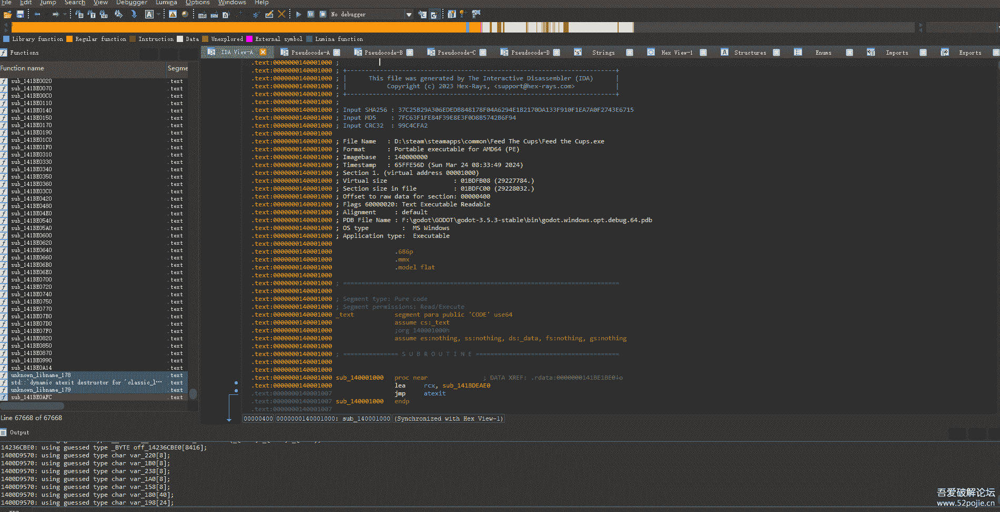

按`shift + f12`搜索`gdscript::load_byte_code`字符串

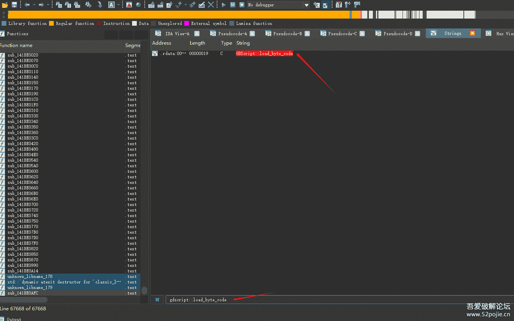

双击进去右键

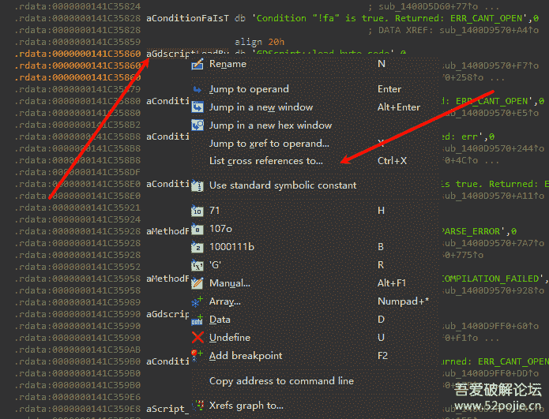

选择第一个

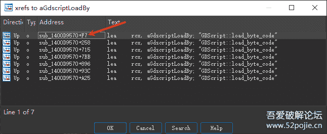

按`f5`

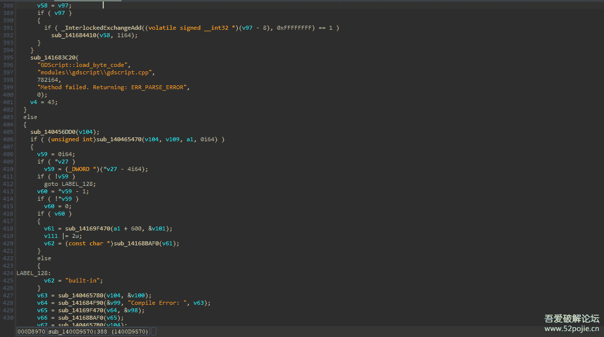

查找里面的全局变量这个代码我也看不懂我给`deepseek`分析的

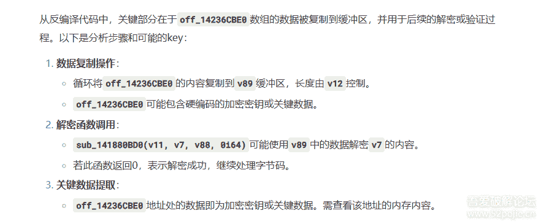

双击进入

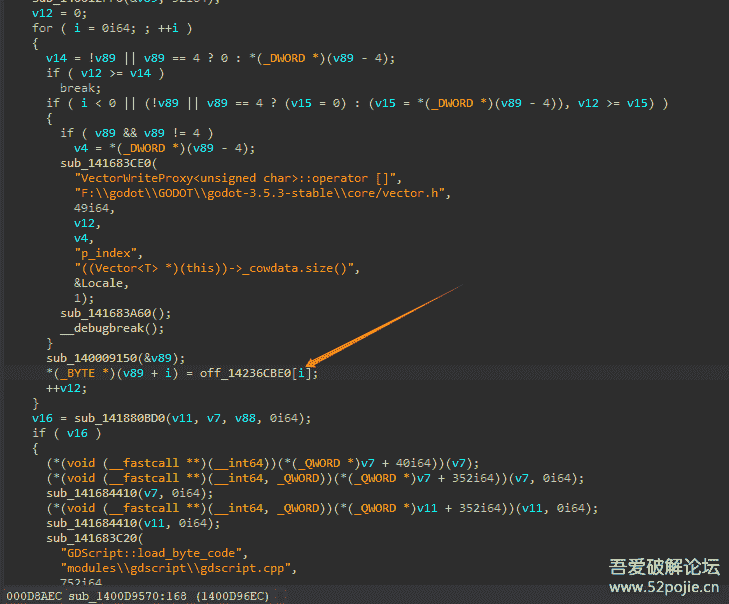

这里就是`aeskey`的位置了

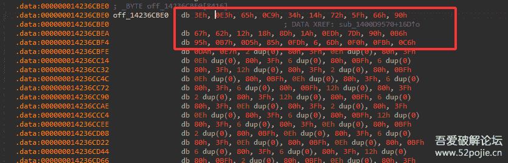

```
3E E3 65 C9 34 14 72 5F 66 90 67 62 12 18 8D 1A
ED 7D 90 B6 95 B7 D5 85 FD 06 6D F0 FB C6 DA E7
3EE365C93414725F6690676212188D1AED7D90B695B7D585FD066DF0FBC6DAE7
```

然后填入`gdre_tools`在重新提取文件就可以看到`gd`文件脚本

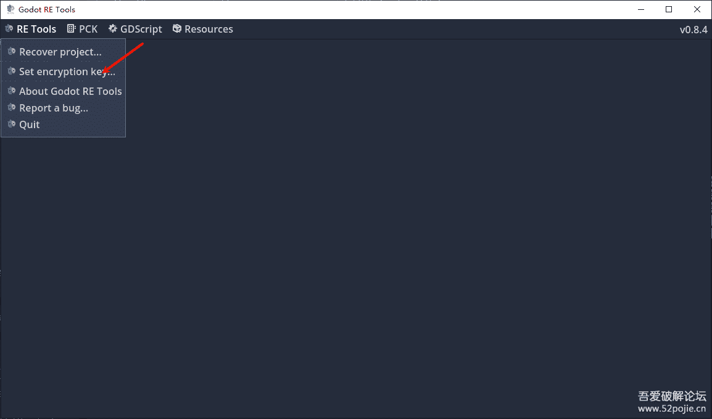

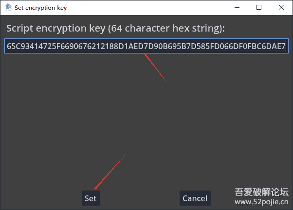
