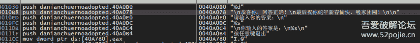
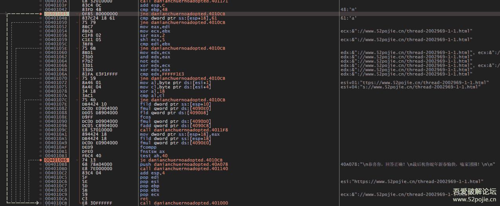
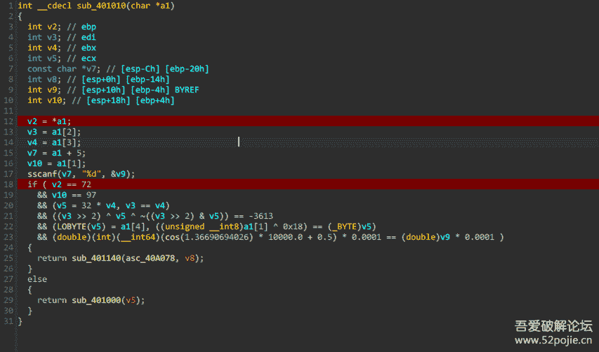

# [CTF] DaNianChuErNoadopted 逆向过程和思路

- 原帖: https://www.52pojie.cn/forum.php?mod=viewthread&tid=2002981
- 抓取时间: 2026-11-01T22:16:12

## 引言

怀着一个激动的内心写一篇反向思考教程，这也是第一次写，如有不对的地方，还请各位大佬轻喷哈。

帖子链接

## 思考过程

题目中说没有加壳，C语言写的，那就考虑用`x96dbg`和`ida`了，因为有些语言，比如说vb，c#这些是有工具取得源码的。

先扔进`x32dbg`中看一下，查找关键字符串：



[image.png (51.83 KB, 下载次数: 0)](https://www.52pojie.cn/forum.php?mod=attachment&aid=Mjc1MjMyMXwxMTU5M2Y3N3wxNzkzNTcxMzY5fDE2ODA4NnwyMDAyOTgx&nothumb=yes)

引用

2025-1-29 22:55 上传

打上断点，实际上字符串最近的断点作用不大，因为上面的条件如果不匹配，就直接到了错误那里了，所以找到根源。



[image.png (255.84 KB, 下载次数: 0)](https://www.52pojie.cn/forum.php?mod=attachment&aid=Mjc1MjMyMHw5MzRhMmZhMHwxNzkzNTcxMzY5fDE2ODA4NnwyMDAyOTgx&nothumb=yes)

断点

2025-1-29 22:54 上传

根据其中的一些提示，肯定是有`Ha`这两个字符的了，因为学的不精，扔到`ida`中F5吧。



[image.png (84.98 KB, 下载次数: 0)](https://www.52pojie.cn/forum.php?mod=attachment&aid=Mjc1MjMyMnwxODQyZDU0ZnwxNzkzNTcxMzY5fDE2ODA4NnwyMDAyOTgx&nothumb=yes)

ida

2025-1-29 22:56 上传

其中一些变量，我用`python`分析了一下，这里也包含用眼睛看出来的：

```
v2 = 72
v3 = 154 # v3 == v4
v4 = 154 # v3 == v4
v5 = 32 * 154
v7 = a1[5]
v10 = 97
```

经过上面的分析，`v2`和`v10`，是`H`和`a`，才能走到`if`真里面去。

这段代码是猜测`v3`和`v4`的值的：

```
# for i in range(1, 122):
# print(i,((i >> 2) ^ 32*i ^ ~((i >> 2) & 32*i)) == -3613) # 112
# print(chr(112))
```

经过一系列的试测，得到`i=112`，也就是`p`，此时得到这个字符串应该是`Happ`开头，这里猜测应该是`Happy`，但是这个`y`是怎么来的？

`((unsigned __int8)a1[1] ^ 0x18) == (_BYTE)v5`

其中已知`a1[1] == 'a' == 97`，`97 …… 0x18 == 121` 也就是`y`。

此时已经知道了前五个字符是`Happy`了。

接下来分析`(double)(int)(__int64)(cos(1.36690694026) * 10000.0 + 0.5) * 0.0001 == (double)v9 * 0.0001 )`，先算一下这个是什么：

```
print((cos(1.36690694026) * 10000.0 + 0.5) * 0.0001) # 0.20252967626955654
```

其中`(double)v9 * 0.0001` == 上面的结果，取整后是`2025`。

基本上也就能猜出答案是`Happy2025`。

当我做出来后问了一下GPT，答案和我做出来的也不太一样，虽然AI很强，但是有些时候还是需要人工去甄别的。
