# [CTF] 结合z3求解2025新春题目DaNianChuErNoadopted的flag

- 原帖: https://www.52pojie.cn/forum.php?mod=viewthread&tid=2003024
- 抓取时间: 2026-11-01T22:16:09

## 结合z3求解DaNianChuErNoadopted的flag

直接丢进IDA，观察`main`函数

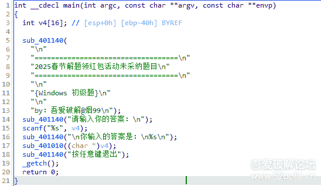

分析可知，`main`函数接收了用户输入并且将输入传到`sub_401010`函数中。

`sub_401010`函数大致逻辑如下：

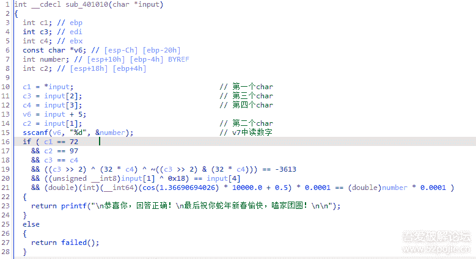

注意到反编译代码中将输入字符与数字比对，这里需要将光标放在数字上面右键，菜单中选择Char，或将单击数字后按R键

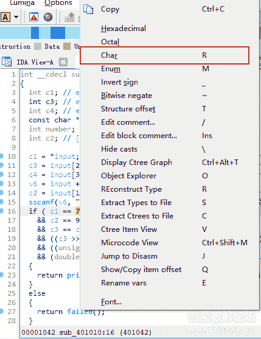

修改后：

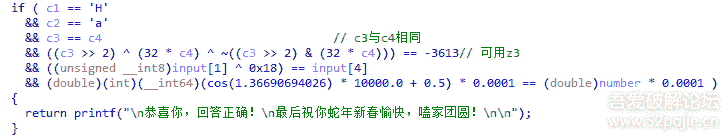

可以看到前两个字符，分别是H和a

第三个和第四个字符是相同的，并且有一个判断条件，可以将这个条件输入z3求解

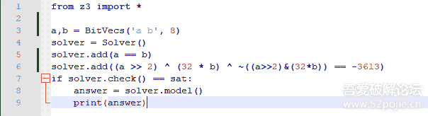

输出为：

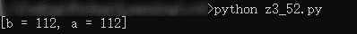

根据ASCII码表，对应字符p

`((unsigned __int8)input[1] ^ 0x18) == input[4]`

第5个字符根据第2个字符推出，第2个字符是a，python中输出：

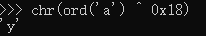

现在已知前五个字符，Happy

后面是数字

`(double)(int)(__int64)(cos(1.36690694026) * 10000.0 + 0.5) * 0.0001 == (double)number * 0.0001`

等式两段都乘了0.0001，可忽略，先用python算出前面表达式的值

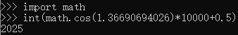

得2025，可知flag为Happy2025

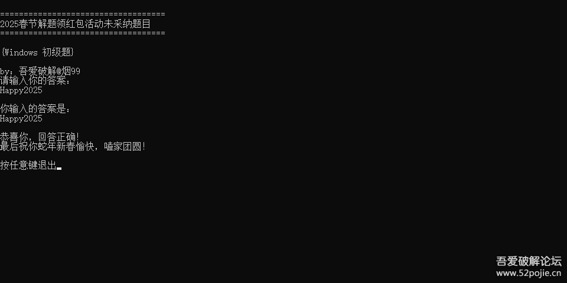

### 中文字符串处理

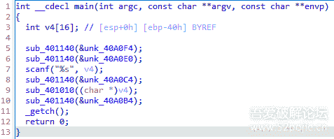

中文是不能正常显示的，需要设置一下IDA中对字符串的编码格式，如下：

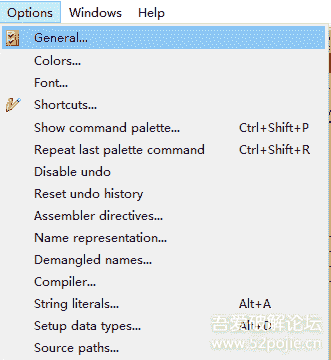

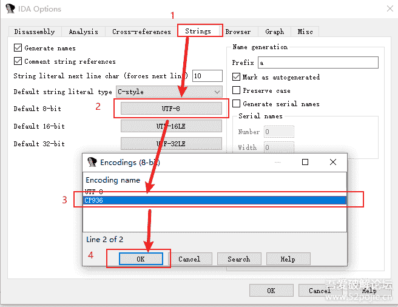

设置完毕后，双击一个字符串地址处，按a，全部完成后回到反编译界面F5刷新即可
