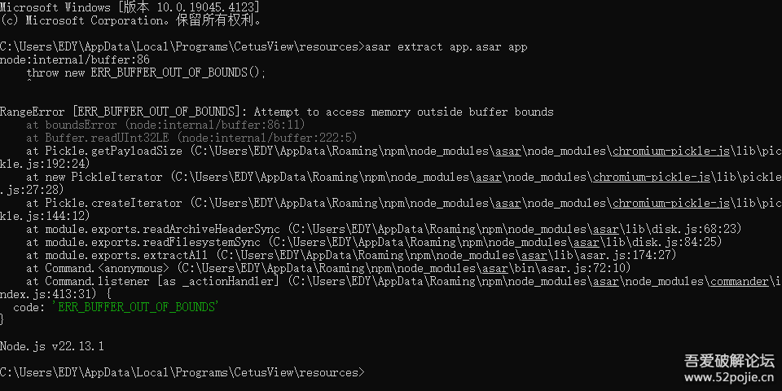
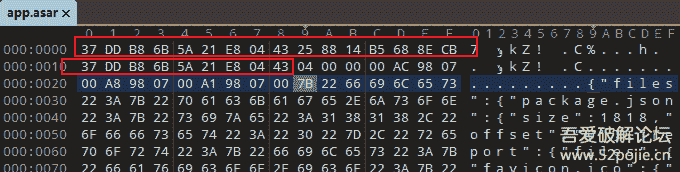
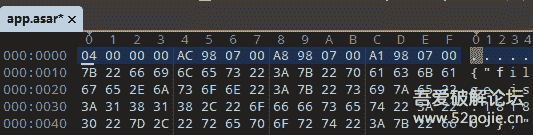
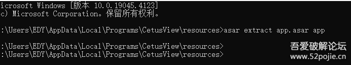
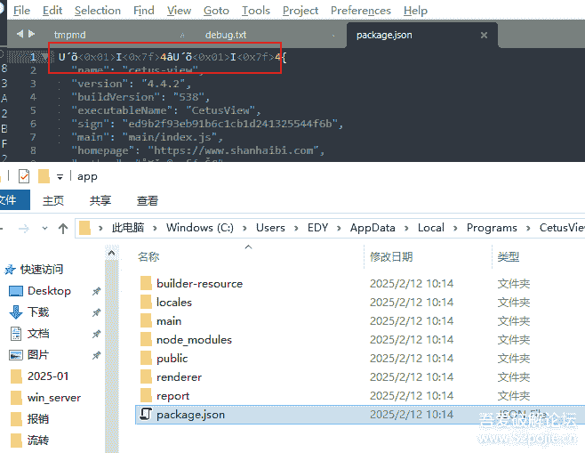
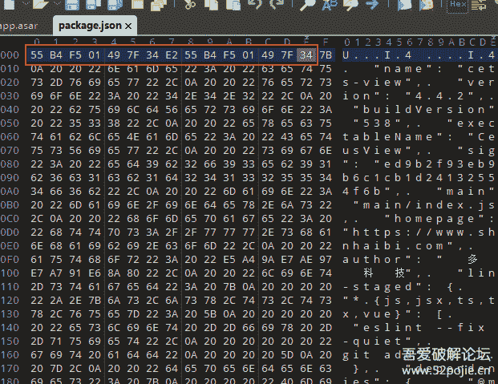
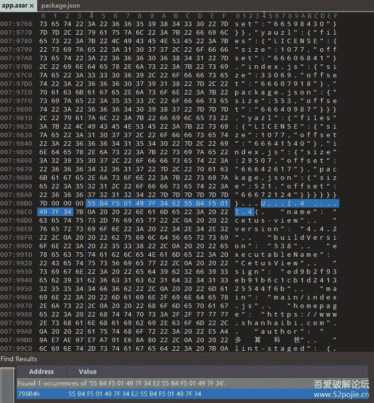
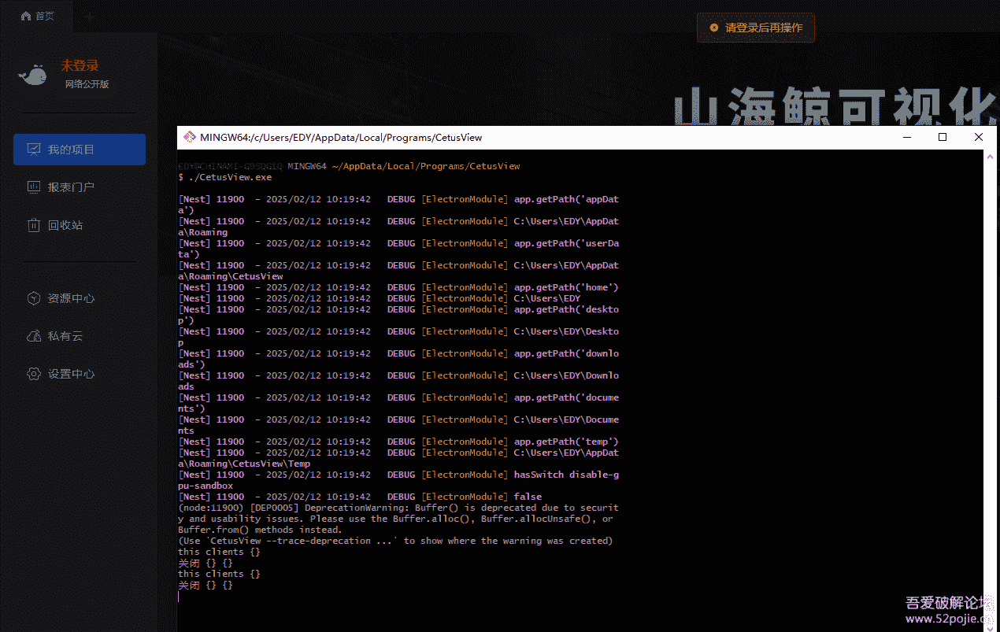

# [Web逆向] electron asar 加密包解压 偏移修复

- 原帖: https://www.52pojie.cn/forum.php?mod=viewthread&tid=2005677
- 抓取时间: 2026-11-01T22:15:48

## 0x0 前记

众所周知, `electron` 封装的可执行文件, 依赖 `app.asar`, 通常要逆向的话, 需要执行 `asar` 相关命令来解压归档文件, 然后在进行修改操作;
`app.asar` 的文件有一些固定格式,
通常前十六个字节为头文件, 来描述 `ASAR` 文件的结构和元数据;
后面会跟一个 `json` 文件, 来描述具体资源文件的大小与偏移;

## 0x1 问题

不多说. 今天碰到一个程序, 我们直接解压会报错;

```
asar extract app.asar app
```



1.png (29.98 KB, 下载次数: 0)

[href="forum.php?mod=attachment&aid=Mjc1NDIxM3w4NWIzZDcyN3wxNzkzNTcxMzQ1fDE2ODA4NnwyMDA1Njc3&nothumb=yes" target="_blank"](https://www.52pojie.cn/forum.php?mod=attachment&aid=Mjc1NDIxM3w4NWIzZDcyN3wxNzkzNTcxMzQ1fDE2ODA4NnwyMDA1Njc3&nothumb=yes)

2025-2-12 15:02 上传

查看文件的 `hex`, 发现, 按照16字节的 `header`, 之后是 `json` 字符串的话, 该文件似乎 `header` 比较大, 多了 25个字节; 想必是 `asar` 解压获取大小超额导致报错



2.png (31.7 KB, 下载次数: 0)

[href="forum.php?mod=attachment&aid=Mjc1NDIxNHw2ZGZjYzc1YXwxNzkzNTcxMzQ1fDE2ODA4NnwyMDA1Njc3&nothumb=yes" target="_blank"](https://www.52pojie.cn/forum.php?mod=attachment&aid=Mjc1NDIxNHw2ZGZjYzc1YXwxNzkzNTcxMzQ1fDE2ODA4NnwyMDA1Njc3&nothumb=yes)

2025-2-12 15:02 上传

## 0x2 修复

我们用 `010Edit` 打开, 把前面 25 个字节删掉, 然后保存, 继续执行解压



3.png (21.41 KB, 下载次数: 0)

[href="forum.php?mod=attachment&aid=Mjc1NDIxNXw1ZjdlNjlkN3wxNzkzNTcxMzQ1fDE2ODA4NnwyMDA1Njc3&nothumb=yes" target="_blank"](https://www.52pojie.cn/forum.php?mod=attachment&aid=Mjc1NDIxNXw1ZjdlNjlkN3wxNzkzNTcxMzQ1fDE2ODA4NnwyMDA1Njc3&nothumb=yes)

2025-2-12 15:02 上传

此时, 发现解压似乎成功了, 没有报错了;



4.png (10.9 KB, 下载次数: 0)

[href="forum.php?mod=attachment&aid=Mjc1NDIxNnw3MTE3MDllNnwxNzkzNTcxMzQ1fDE2ODA4NnwyMDA1Njc3&nothumb=yes" target="_blank"](https://www.52pojie.cn/forum.php?mod=attachment&aid=Mjc1NDIxNnw3MTE3MDllNnwxNzkzNTcxMzQ1fDE2ODA4NnwyMDA1Njc3&nothumb=yes)

2025-2-12 15:02 上传

然后我们打开解压后的 `app/package.json` 文件看看,发现文件似乎有乱码, 而且不只是这个 `json` 文件, 几乎所有的资源文件 包括 `js` 文件 首位都多或者少了一堆乱码;



5.png (63.05 KB, 下载次数: 0)

[href="forum.php?mod=attachment&aid=Mjc1NDIxN3wxNjg3N2U5MHwxNzkzNTcxMzQ1fDE2ODA4NnwyMDA1Njc3&nothumb=yes" target="_blank"](https://www.52pojie.cn/forum.php?mod=attachment&aid=Mjc1NDIxN3wxNjg3N2U5MHwxNzkzNTcxMzQ1fDE2ODA4NnwyMDA1Njc3&nothumb=yes)

2025-2-12 15:02 上传

此时, 解压后的文件明显是不可用的

## 0x3 继续修复

将 `app/package.json` 文件放入 `010edit`, 查看 `hex` 数据;
记录一下乱码的内容



6.png (72.74 KB, 下载次数: 0)

[href="forum.php?mod=attachment&aid=Mjc1NDIxOHxiN2EwNDg5MXwxNzkzNTcxMzQ1fDE2ODA4NnwyMDA1Njc3&nothumb=yes" target="_blank"](https://www.52pojie.cn/forum.php?mod=attachment&aid=Mjc1NDIxOHxiN2EwNDg5MXwxNzkzNTcxMzQ1fDE2ODA4NnwyMDA1Njc3&nothumb=yes)

2025-2-12 15:02 上传

之后在 `app.asar` 中 搜索该 `hex`
定位到了之后 删除掉;



7.png (124.8 KB, 下载次数: 0)

[href="forum.php?mod=attachment&aid=Mjc1NDIxOXxmMzk5NzIyMHwxNzkzNTcxMzQ1fDE2ODA4NnwyMDA1Njc3&nothumb=yes" target="_blank"](https://www.52pojie.cn/forum.php?mod=attachment&aid=Mjc1NDIxOXxmMzk5NzIyMHwxNzkzNTcxMzQ1fDE2ODA4NnwyMDA1Njc3&nothumb=yes)

2025-2-12 15:02 上传

之后 再次执行解压命令

```
asar extract app.asar app
```

成功了, 没报错, 随便找几个文件看看, 发现没什么问题;
由于 `package.json` 是第一个文件, 所以前面删除的字符会导致全部文件的偏移都会修正;

## 0x4

之后我们把 `app.asar` `rename` 成 `app.asar.ori`
让程序启动的时候直接 `load` 我们解压后的文件, 方便快速修改;
双击 `exe` 执行, 启动成功,



8.png (178.81 KB, 下载次数: 0)

[href="forum.php?mod=attachment&aid=Mjc1NDIyMHw4M2NhM2VmN3wxNzkzNTcxMzQ1fDE2ODA4NnwyMDA1Njc3&nothumb=yes" target="_blank"](https://www.52pojie.cn/forum.php?mod=attachment&aid=Mjc1NDIyMHw4M2NhM2VmN3wxNzkzNTcxMzQ1fDE2ODA4NnwyMDA1Njc3&nothumb=yes)

2025-2-12 15:03 上传

之后就可以 添加代码, 开启愉快的 `hook` 了.!
