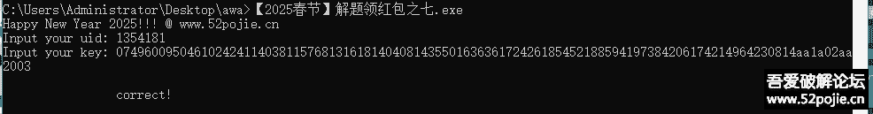
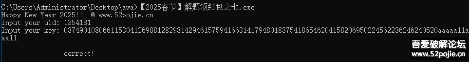

# [CTF] 2025解题领红包之七 Windows高级Writeup

- 原帖：https://www.52pojie.cn/forum.php?mod=viewthread&tid=2005827
- 抓取时间：2026-11-01T22:15:33

## 前言

又过了一年，终于能做出高级题了，也马上就要中考了…… 嗯……

顺带发现还有一种答案（同样提示 `Correct` 但交上去不认可…… 后来证实是题目设计不足），文中也将写到。

（就是客户端只验证 `key`，服务端验证 `key` 和生成 `key` 的参数，如果本地验证通过，服务端通不过，请检查 `key` 参数这个提示的来源）

## 正常解法

### 找 `main` 函数

拖进 IDA，`main` 是这么个东西：

```
int __fastcall main(int argc, const char **argv, const char **envp)
{
  return ((__int64 (__fastcall *)(int, const char **, const char **))off_140026AD8)(argc, argv, envp);
}
```

而 `off_140026AD8` 如果你直接点进去，你会发现它指向的是一个虚假的函数 `sub_140001390`：

```
mov     eax, 0FFFFFFFFh
retn
```

此时需要要使用 IDA 的 `Xrefs(X)` 寻找 `off_140026AD8` 的引用，可以发现在 `sub_140001190` 进行判断后被重新赋值为 `sub_1400017A0`：

```
__int64 sub_140001190()
{
  __int64 result; // rax
  __int64 (__fastcall *v1)(); // rcx

  result = sub_140001C50(0LL, 0LL);
  v1 = off_140026AD8;
  if ( !result )
    v1 = sub_1400017A0;
  // ......底部省略一堆+16
  return result;
}
```

跟进 `sub_1400017A0`，可以发现这才是真正的 `main` 函数！

### 算法分析

先说一下椭圆曲线加密的一些知识。

椭圆曲线 `y² = x³ + ax + b (mod p)`

`a` 和 `b` 决定了曲线的形状。

`p` 是素数，定义了有限域。所有运算都在该域内进行。

`G` 是椭圆曲线上的一个特定点，通常是曲线的“基点”。它是所有其他点的基础，用于生成公钥，是一个在曲线上的点，`Gx` 与 `Gy` 是已知的。

概括（不想看代码的可以直接看这个）：

程序先将 `UID` 与整十秒的时间戳（10s 后过期）进行异或然后平方并转为字符串（如果字符串长度超过 16 就截断）。

程序中使用了椭圆曲线加密算法（ECC），而 `sub_1400013B0`（代码中 `point_add`）是点加法运算。

然后将用户输入的字符串转为数组（一次 6 个字符然后 `parseInt`，数组长度为 `108/6=18`）。

并将 `Gx`、`Gy`（定值）通过 ECC 进行加密，然后将刚才数组中最后两项作为解密时的 `a`、`p`。

并对前 16 项进行 `(char) ((IntArray[i] + -10 * Gy - i * 10202) / Gx)` 得到字符串，并与 `UID` 操作后得到的字符串进行比较（`i` 为索引，`IntArray` 为数组）。

```
__int64 sub_1400017A0()

{

  __int64 a; // r12

  __int64 Gx; // r14

  __int64 Gy; // r15

  int v4; // r13d

  int FlagLength; // ecx

  _BYTE *v6; // rax

  __int64 v7; // rsi

  char *Flag_1; // rdi

  __int64 v9; // rbx

  __int64 v10; // rbx

  __int64 v11; // rdx

  __int64 v12; // rdi

  __int64 v13; // rsi

  __int64 p; // r13

  __int64 v15; // rbx

  __int64 v16; // r8

  __int64 de_p; // r14

  __int64 *v18; // rbx

  __int64 de_a; // r15

  __int64 v20; // r12

  unsigned __int64 x1; // rcx

  __int64 y1; // rax

  __int64 v23; // rbx

  int v24; // eax

  const char *v25; // rcx

  __int64 d; // [rsp+40h] [rbp-C0h]

  __int64 res[2]; // [rsp+48h] [rbp-B8h] BYREF

  __int64 result[2]; // [rsp+58h] [rbp-A8h] BYREF

  char Format[4]; // [rsp+68h] [rbp-98h] BYREF

  char a1[4]; // [rsp+6Ch] [rbp-94h] BYREF

  char v31[4]; // [rsp+70h] [rbp-90h] BYREF

  char v32[4]; // [rsp+74h] [rbp-8Ch] BYREF

  unsigned __int64 UID; // [rsp+78h] [rbp-88h] BYREF

  __int64 IntArray[18]; // [rsp+80h] [rbp-80h] BYREF

  char Str1[32]; // [rsp+110h] [rbp+10h] BYREF

  char Str2[32]; // [rsp+130h] [rbp+30h] BYREF

  _OWORD FlagInput[8]; // [rsp+150h] [rbp+50h] BYREF

  a = ::a;

  Gx = ::Gx;

  Gy = ::Gy;

  d = ::d;

  res[0] = ::p; 

  // 上述值在sub_140001000中被sub_140001520初始化; a, d与时间有关

  printf_0_0(::Format);

  printf_0_0(InputYourUID);

  scanf_s_0(::Format, &UID);

  if ( UID - 1 > 0x5F5E0FE )

  {

    printf_0_0(&Error);

    exit(-1);

  }

  UID ^= 60 * (time(0LL) / 60) / 10;

  sprintf_s((char (*)[32])Str2, ::Format, abs64(UID * UID)); // UID与时间取整之后除以10得到的值进行异或然后平方

  Str2[16] = 0;

  memset(FlagInput, 0, sizeof(FlagInput));

  printf_0_0(InputYourKey);

  if ( scanf_s_0(asc_140026AC4, FlagInput, 128LL) )

  {

    v4 = 0;

    FlagLength = 0;

    v6 = FlagInput;

    do

    {

      ++FlagLength;

      ++v6;

    }

    while ( *v6 );

    if ( FlagLength == 108 * (FlagLength / 108) ) // 判断长度是否为108

    {

LABEL_10:

      v7 = 0LL;

      Flag_1 = (char *)FlagInput + 1;

      a1[2] = 0;

      v31[2] = 0;

      v32[2] = 0;

      do

      {

        a1[0] = *(Flag_1 - 1);

        a1[1] = *Flag_1;

        v31[0] = Flag_1[1];

        v31[1] = Flag_1[2];

        v32[0] = Flag_1[3];

        v32[1] = Flag_1[4];

        v9 = 100 * ParseInt(a1);

        v10 = 100 * (v9 + ParseInt(v31));

        Flag_1 += 6;

        IntArray[v7++] = v10 + ParseInt(v32);

      }

      while ( v7 
```

### 解题

如果要解密被 ECC 加密后的 `Gx` 与 `Gy`，我们需要让 `a` 和 `p` 与加密时的相等（即：`IntArray[16] == ::a && IntArray[17] == ::p`）。

那么我们就得想办法获取到加密时的 `a` 与 `p`，还要得到 `Gx` 与 `Gy` 的值，这里我选择用 IDAPython 直接 Hook。

如果要 Hook，选哪里呢？我们不难注意到开头有这样一段代码：

```
a = ::a;
Gx = ::Gx;
Gy = ::Gy;
d = ::d;
res[0] = ::p;
```

这是上面那段代码对应的汇编：

```
mov     r12, cs:a
mov     r14, cs:Gx
mov     r15, cs:Gy
mov     [rsp+200h+d], rax
mov     rax, cs:p
mov     [rsp+200h+res], rax  ; 我选择在这里Hook, 获取寄存器值, 此时rax为p, r12为a, r14为Gx, r15为Gy, 完美!
```

这里正好有我们所需要的 `a`、`Gx`、`Gy`、`p`，还相当好 Hook。

于是可以得到如下代码：

```
import idaapi
import idc
import time

# s是最后需要在解密时得到的字符串
def build_str(s: str, Gx: int, Gy: int) -> str:
    res = ''
    for i, v20 in zip(s, range(0, 163232, 10202)): # 步长10202模拟代码中v20 += 10202LL
        res += str(ord(i) * Gx + v20 + 10 * Gy).zfill(6) # 补齐6位
    return res

class MyDbgHook(idaapi.DBG_Hooks):
    def dbg_bpt(self, tid, ea):
        if ea == 0x1400017F8:
            UID = 1354181  # 此处写UID
            UID ^= int(60 * (int(time.time()) // 60 / 10))
            # r14: Gx, r15: Gy, r12: a, rax: p
            print(build_str(str(UID * UID)[:-1] if len(str(UID * UID)) == 17 else str(UID * UID), idc.get_reg_value("r14"), idc.get_reg_value("r15")) + str(idc.get_reg_value("r12")).zfill(6) + str(idc.get_reg_value("rax")).zfill(6))
        return 0

hook = MyDbgHook()
hook.hook()
idc.add_bpt(0x1400017F8)  # 刚才那行汇编的地址
```

## 意料之外的解法

### 先说一下

第一遍做完之后提交了好几次，都提示不对，但本地就是 `correct`，然后发了个站务帖。

H 大后来的回复（嗯，不算错但也不对……？）：

> 找到原因了，算题目设计不足，你看下主题中昨天的提醒，主要还是让你找到程序自己的私钥，你改了私钥不行，服务端这边有验证，`bin` 这边倒是没验证。还在和作者沟通，看看是修复 `bin` 的验证还是增加一个说明。
>
> 不算错，只是还差一点点，加油哈~

后来服务端就修复了，应该是加了个提示（？）

### 我当时的想法

一开始做题我并没有和现在一样对 ECC 有一定的了解，也不知道要解出那俩参数（甚至没看提示直接莽）。

不过我发现了一点点规律……

同样是那段代码：

```
de_p = IntArray[17];                      // 此处从数组中下标为16与17的地方读出a与p
v18 = IntArray;
de_a = IntArray[16];
v20 = 0LL;
res[0] = (__int64)IntArray;
Str1[0] = 0;
*(_DWORD *)Format = 25381; // %c
do
{
  x1 = v12;                               // 解密后甭管是啥, 总之10s内, 输入相同a, p的话这个值不会变 (rcx)
  y1 = v13;                               // 解密后甭管是啥, 总之10s内, 输入相同a, p的话这个值不会变 (rax)
  if ( v11 != 1 )
  {
    v23 = v16;
    do
    {
            point_add(result, x1, y1, v12, v13, de_a, de_p); // 根据我们传进来的a与p解密刚才加密的Gx, Gy; 解出来的对不对? 不关我事
            x1 = result[1];
            y1 = result[0];
            --v23;
    }
    while ( v23 );
    v18 = (__int64 *)res[0];
  }
  // 虽然解出的x1, y1和题中Gx, Gy不一样, 但是在10s内依旧是个定值
  sprintf_s_0_1(&Str1[v4], 2uLL, Format, (unsigned int)(char)((*v18 + -10 * y1 - v20) / x1)); // 从数组中开始读数, 向Str1中追加经过处理后的字符; 我当时选择在这里进行Hook
}
```

我还是 Hook，但是我选择了在 `sprintf_s` 处 Hook，得到通过我输入的错误的 `p`、`a` 解密 `Gx`、`Gy` 得到的 `x1`、`y1`。

```
imul    rax, -0Ah  ; 我选择hook这一条指令, 获取寄存器值
xor     edx, edx
lea     r8, [rsp+200h+Format] ; Format
sub     rax, r12
add     rax, [rbx]
div     rcx
; ......call在底下
```

但是由于 Hook 位置的缘故，导致每次要执行到那都需先输入一遍 `UID`，再输入一遍后 12 个字符可以不使程序闪退的 `Key`（速度要快）。

在当时的想法下，我写的 Python 代码（顺带一提，它的 `parseInt` 函数遇到字母会直接停止，也就是说其实是可以有字母的……）：

```
import idaapi
import idc
import time

def build_str(s: str, v21: int, v22: int) -> str:
    res = ''
    for i, v20 in zip(s, range(0, 163232, 10202)):
        res += str(ord(i) * v21 + v20 + 10 * v22).zfill(6)
    return res

class MyDbgHook(idaapi.DBG_Hooks):
    def dbg_bpt(self, tid, ea):
        if ea == 0x140001B37:
            UID = 1354181
            print(int(time.time()))
            UID ^= int(60 * (int(time.time()) // 60 / 10))
            print(str(UID * UID))
            # rcx: x1, rax: y1  最后加上的后12个字符可以是其他的, 但是要求必须与你在程序中输入的Key一致
            print(build_str(str(UID * UID)[:-1], idc.get_reg_value("rcx"), idc.get_reg_value("rax")) + 'aaaa11aaaa11')
        return 0

hook = MyDbgHook()
hook.hook()
idc.add_bpt(0x140001B37)
```

成果（虽然无法提交）：



52PJ2025_9.png (8.11 KB, 下载次数: 2)

[附件下载](https://www.52pojie.cn/forum.php?mod=attachment&aid=Mjc1NDMzOXw3MzZlNGE2ZXwxNzkzNTcxMzMxfDE2ODA4NnwyMDA1ODI3&nothumb=yes)


2025-2-13 08:23 上传



52PJ2025_10.png (7.79 KB, 下载次数: 3)

[href="forum.php?mod=attachment&aid=Mjc1NDM0MHw1MjkyMDIyZXwxNzkzNTcxMzMxfDE2ODA4NnwyMDA1ODI3&nothumb=yes" target="_blank"](https://www.52pojie.cn/forum.php?mod=attachment&aid=Mjc1NDM0MHw1MjkyMDIyZXwxNzkzNTcxMzMxfDE2ODA4NnwyMDA1ODI3&nothumb=yes)

2025-2-13 08:23 上传
