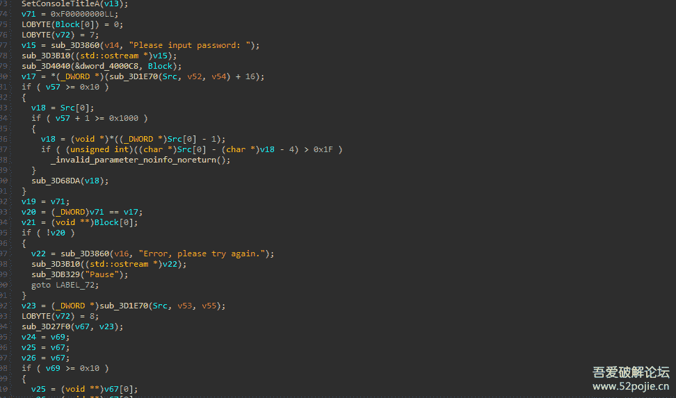
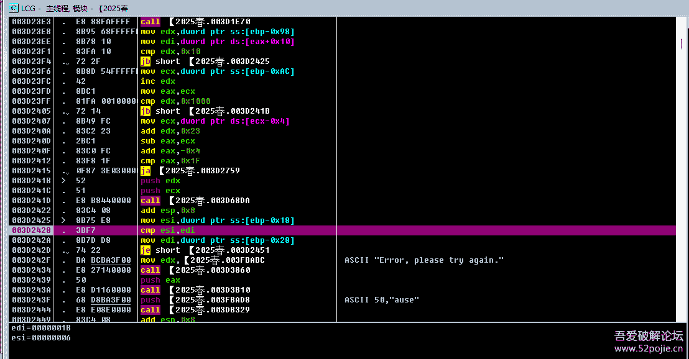
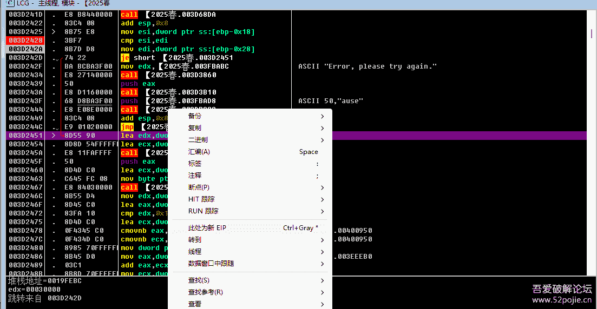
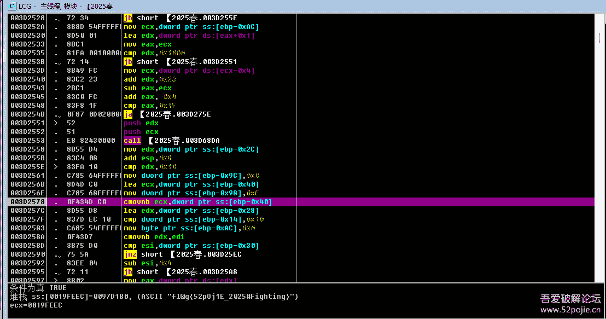

# [CTF] 2025解题领红包 Windows Android初级Writeup

- 原帖: https://www.52pojie.cn/forum.php?mod=viewthread&tid=2005828
- 抓取时间: 2026-11-01T22:15:31

## Windows

这题做的感觉跟瞎猫碰死耗子一样 (

拿到程序, 第一时间直接拖进IDA



52PJ2025_1.png (63.02 KB, 下载次数: 0)

[href="forum.php?mod=attachment&aid=Mjc1NDMzNXw1Y2RjM2M1Y3wxNzkzNTcxMzI4fDE2ODA4NnwyMDA1ODI4&nothumb=yes" target="_blank"](https://www.52pojie.cn/forum.php?mod=attachment&aid=Mjc1NDMzNXw1Y2RjM2M1Y3wxNzkzNTcxMzI4fDE2ODA4NnwyMDA1ODI4&nothumb=yes)

2025-2-13 08:20 上传

呃, 然后发现一堆识别不出来的(照这玩意看容易被带偏)... 还得OD

随便输点什么 (例如: `114514`), 然后用OD断在上图中`v20 = (_DWORD)v71 == v17;`处 （下面有个判断, 可以感觉出来是长度判断)



52PJ2025_2.png (34.81 KB, 下载次数: 0)

[href="forum.php?mod=attachment&aid=Mjc1NDMzNnwxOGIxZDI3ZHwxNzkzNTcxMzI4fDE2ODA4NnwyMDA1ODI4&nothumb=yes" target="_blank"](https://www.52pojie.cn/forum.php?mod=attachment&aid=Mjc1NDMzNnwxOGIxZDI3ZHwxNzkzNTcxMzI4fDE2ODA4NnwyMDA1ODI4&nothumb=yes)

2025-2-13 08:20 上传

注意到`esi`即为为我们输入的长度, 和`edi`进行比较, 而`edi`为`0x1B`, 也就是说输入的长度必须为27

但其实这里如果你长度输入不对也没关系, 可以设置`EIP`到长度正确时的位置



52PJ2025_3.png (47.95 KB, 下载次数: 0)

[href="forum.php?mod=attachment&aid=Mjc1NDMzN3w1MjI0M2ExNXwxNzkzNTcxMzI4fDE2ODA4NnwyMDA1ODI4&nothumb=yes" target="_blank"](https://www.52pojie.cn/forum.php?mod=attachment&aid=Mjc1NDMzN3w1MjI0M2ExNXwxNzkzNTcxMzI4fDE2ODA4NnwyMDA1ODI4&nothumb=yes)

2025-2-13 08:20 上传

然后一直按`F8`, 期间会经过一个循环 (解密flag), 然后要注意观察



52PJ2025_4.png (36.31 KB, 下载次数: 1)

[href="forum.php?mod=attachment&aid=Mjc1NDMzOHw1YmMxNTMwNHwxNzkzNTcxMzI4fDE2ODA4NnwyMDA1ODI4&nothumb=yes" target="_blank"](https://www.52pojie.cn/forum.php?mod=attachment&aid=Mjc1NDMzOHw1YmMxNTMwNHwxNzkzNTcxMzI4fDE2ODA4NnwyMDA1ODI4&nothumb=yes)

2025-2-13 08:21 上传

Flag即为: `fl@g{52pOj1E_2025#Fighting}`

## Android

三折叠, 怎么折, 都有面

Jadx打开, 发现有两个`Fragment`, 默认打开的是`FoldFragment1`

```
public final class FoldPagerAdapter extends FragmentStateAdapter {
    public static final int $stable = 0;

    [//www.52pojie.cn/home.php?mod=space&uid=1892347" target="_blank"](https://www.52pojie.cn/home.php?mod=space&uid=1892347:href="https) // androidx.recyclerview.widget.RecyclerView.Adapter
    public int getItemCount() {
        return 2;
    }

    /* JADX WARN: 'super' call moved to the top of the method (can break code semantics) */
    public FoldPagerAdapter(FragmentActivity activity) {
        super(activity);
        Intrinsics.checkNotNullParameter(activity, "activity");
    }

    @Override // androidx.viewpager2.adapter.FragmentStateAdapter
    public Fragment createFragment(int position) {
        if (position == 0) {
            return new FoldFragment1();
        }
        if (position == 1) {
            return new FoldFragment2();
        }
        throw new IllegalStateException("Unexpected position: " + position);
    }
}
```

`FoldFragment1`只是放音频的, 没用, 所以直接看`FoldFragment2`

```
public final class FoldFragment2 extends Fragment {

    public static final int $stable = 8;

    private final long LONG;

    private float a;

    private final float b;

    private final int c;

    private final int f;

    private final int g;

    private long l;

    private Handler longPressTimer;

    private final float r;

    private boolean un;

    public FoldFragment2() {

        super(C1347R.layout.activity_fragment_fold2);

        this.b = 180.0f;

        this.c = 10;

        this.r = 180.0f / 10;

        this.f = 5;

        this.g = 500;

        this.LONG = 3000L;

    }

    @Override // androidx.fragment.app.Fragment

    public void onViewCreated(View view, Bundle savedInstanceState) {

        Intrinsics.checkNotNullParameter(view, "view");

        super.onViewCreated(view, savedInstanceState);

        final ImageView imageView = (ImageView) view.findViewById(C1347R.id.imageView);

        final GestureDetector gestureDetector = new GestureDetector(requireContext(), new GestureDetector.SimpleOnGestureListener() { // from class: com.zj.wuaipojie2025.FoldFragment2$onViewCreated$gestureDetector$1

            @Override // android.view.GestureDetector.SimpleOnGestureListener, android.view.GestureDetector.OnGestureListener

            public boolean onScroll(MotionEvent e1, MotionEvent e2, float distanceX, float distanceY) {

                long j;

                int i;

                int i2;

                int i3;

                float f;

                float f2;

                float f3;

                float f4;

                float f5;

                float f6;

                float f7;

                float f8;

                Intrinsics.checkNotNullParameter(e2, "e2");

                if (e1 == null) {

                    return true;

                }

                long currentTimeMillis = System.currentTimeMillis();

                j = FoldFragment2.this.l;

                long j2 = currentTimeMillis - j;

                i = FoldFragment2.this.g;

                if (j2 = (-i2)) {

                    i3 = FoldFragment2.this.f;

                    if (x > i3) {

                        FoldFragment2 foldFragment2 = FoldFragment2.this;

                        f = foldFragment2.a;

                        f2 = FoldFragment2.this.r;

                        foldFragment2.a = RangesKt.coerceAtLeast(f - f2, 0.0f);

                    }

                } else {

                    FoldFragment2 foldFragment22 = FoldFragment2.this;

                    f6 = foldFragment22.a;

                    f7 = FoldFragment2.this.r;

                    float f9 = f6 + f7;

                    f8 = FoldFragment2.this.b;

                    foldFragment22.a = RangesKt.coerceAtMost(f9, f8);

                }

                ImageView imageView2 = imageView;

                f3 = FoldFragment2.this.a;

                imageView2.setRotationY(f3);

                f4 = FoldFragment2.this.a;

                f5 = FoldFragment2.this.b;

                if (f4 >= f5) {

                    SPU spu = SPU.INSTANCE;

                    Context requireContext = FoldFragment2.this.requireContext();

                    Intrinsics.checkNotNullExpressionValue(requireContext, "requireContext(...)");

                    spu.m136s(requireContext, 1, "2hyWtSLN69+QWLHQ");

                }

                FoldFragment2.this.l = currentTimeMillis;

                return true;

            }

        });

    /* JADX INFO: Access modifiers changed from: private */

    public static final void startLongPressTimer$lambda$1(FoldFragment2 this$0) {

        Intrinsics.checkNotNullParameter(this$0, "this$0");

        this$0.un = true;

        SPU spu = SPU.INSTANCE;

        Context requireContext = this$0.requireContext();

        Intrinsics.checkNotNullExpressionValue(requireContext, "requireContext(...)");

        spu.m136s(requireContext, 2, "hjyaQ8jNSdp+mZic7Kdtyw==");

        this$0.getParentFragmentManager().beginTransaction().replace(C1347R.id.fold2, new FoldFragment1()).addToBackStack(null).commit();

        Toast.makeText(this$0.requireContext(), C1349TO.INSTANCE.m142db("cYoiUd2BfEDc/V9e4LdciBz9Mzwzs3yr0kgrLA=="), 0).show();

    }
```

可以发现调用了`TO.Companion.db`和`SPU.s`进行解密

而`SPU.s`最后也是调用`TO.Companion.db`

```
public final void m136s(Context context, int index, String value) {
    Intrinsics.checkNotNullParameter(context, "context");
    Intrinsics.checkNotNullParameter(value, "value");
    context.getSharedPreferences("F", 0).edit().putString(String.valueOf(index), C1349TO.INSTANCE.m142db(value)).apply();
}

// TO

public final class C1349TO {

    public static final int $stable = 0;

    /* renamed from: Companion, reason: from kotlin metadata */

    public static final Companion INSTANCE = new Companion(null);

    private static final String YYLX = "my-xxtea-secret";
```


## 反编译代码

```java
/* renamed from: com.zj.wuaipojie2025.TO$Companion, reason: from kotlin metadata */
public static final class Companion {
    public /* synthetic */ Companion(DefaultConstructorMarker defaultConstructorMarker) {
        this();
    }

    private Companion() {
    }

    /* renamed from: db */
    public final String m142db(String value) {
        Intrinsics.checkNotNullParameter(value, "value");
        byte[] decode = Base64.decode(value, 0);
        C1348T c1348t = C1348T.INSTANCE;
        Intrinsics.checkNotNull(decode);
        byte[] bytes = C1349TO.YYLX.getBytes(Charsets.UTF_8);
        Intrinsics.checkNotNullExpressionValue(bytes, "this as java.lang.String).getBytes(charset)");
        return new String(c1348t.m140de(decode, bytes), Charsets.UTF_8);
    }
}
```

可见是 `XXTea`（`my-xxtea-secret` 瞩目）。

## 调用解密

直接偷一波懒，用 Frida 调用 `TO.Companion.db` 解密那几个字符串。

```javascript
Java.perform(
    function () {
        let TO = Java.use("com.zj.wuaipojie2025.TO")
        console.log(TO.Companion.value.db("hjyaQ8jNSdp+mZic7Kdtyw=="))
        console.log(TO.Companion.value.db("2hyWtSLN69+QWLHQ"))
        console.log(TO.Companion.value.db("cYoiUd2BfEDc/V9e4LdciBz9Mzwzs3yr0kgrLA=="))
    }
)
```

## 输出

```text
xnkl2025!}
flag{
快去寻找flag吧！
```

故 `Flag` 为：`flag{xnkl2025!}`
