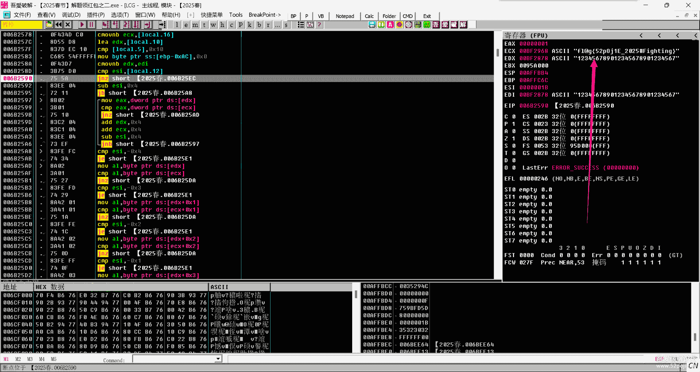
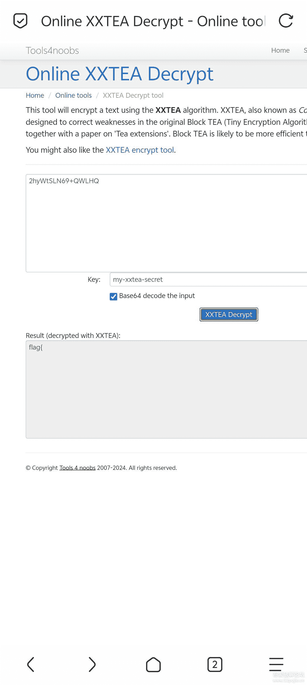
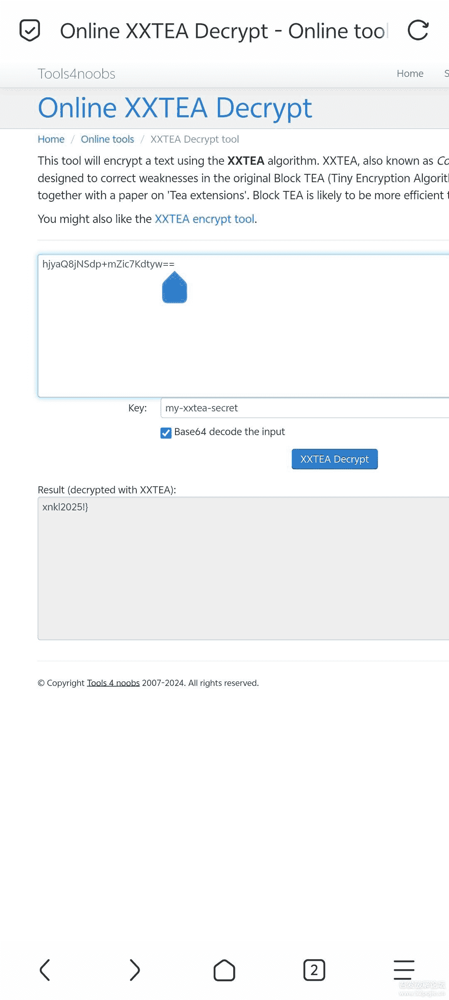
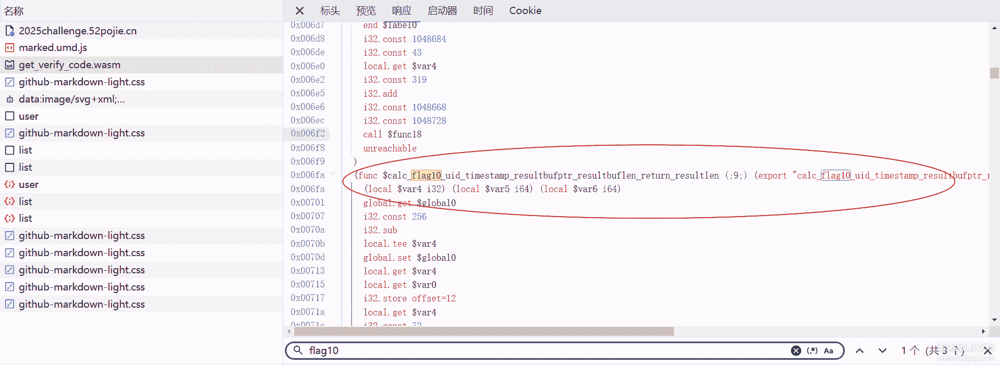

# [CTF] 2025春节解题领红包 Win Android初级、番外二

- 原帖: https://www.52pojie.cn/forum.php?mod=viewthread&tid=2005871
- 抓取时间: 2026-11-01T22:15:22

## Windows初级

拿到程序后直接拖入`OD`, 中文智能搜索字符串在关键词部分打上断点, 运行程序, 断住了, 此时在右侧直接出现`flag`



`windows初级.png` (517.08 KB, 下载次数: 0)

[href="forum.php?mod=attachment&aid=Mjc1NDQ5N3xhNDY0ZWM1NnwxNzkzNTcxMzIwfDE2ODA4NnwyMDA1ODcx&nothumb=yes" target="_blank"](https://www.52pojie.cn/forum.php?mod=attachment&aid=Mjc1NDQ5N3xhNDY0ZWM1NnwxNzkzNTcxMzIwfDE2ODA4NnwyMDA1ODcx&nothumb=yes)

`win初级`
2025-2-13 09:39 上传

`fl@g{52pOj1E_2025#Fighting}`

## Android初级

用MT管理器打开, 发现`FoldFragment1`和`flag`无关, 直接看`FoldFragment2`, 发现有三处密文均调用了 `TO.Companion.db` 进行解密, 进到里面查看代码
发现就是使用`xxtea`加解密, 而且秘钥也给定了`my-xxtea-secret`, 网上随便找一个在线解密的网站解密一下



`4.jpg` (152.03 KB, 下载次数: 1)

[href="forum.php?mod=attachment&aid=Mjc1NDUwM3xiZjM2NjA0M3wxNzkzNTcxMzIwfDE2ODA4NnwyMDA1ODcx&nothumb=yes" target="_blank"](https://www.52pojie.cn/forum.php?mod=attachment&aid=Mjc1NDUwM3xiZjM2NjA0M3wxNzkzNTcxMzIwfDE2ODA4NnwyMDA1ODcx&nothumb=yes)

2025-2-13 09:54 上传



`5.jpg` (156.88 KB, 下载次数: 0)

[href="forum.php?mod=attachment&aid=Mjc1NDUwNHxjMWU3ZmY3MHwxNzkzNTcxMzIwfDE2ODA4NnwyMDA1ODcx&nothumb=yes" target="_blank"](https://www.52pojie.cn/forum.php?mod=attachment&aid=Mjc1NDUwNHxjMWU3ZmY3MHwxNzkzNTcxMzIwfDE2ODA4NnwyMDA1ODcx&nothumb=yes)

2025-2-13 09:54 上传

得到`flag{xnkl2025!}`

## 番外篇

番外篇只找到了`flag10`, `flag9`是没找到, `flag11`明白原理, 但是实操太费时间, 也没弄

### flag10

在抽奖页面可以找到这两句注释

```
      // 这个 getVerifyCode 的 wasm 实现比 blueimp-md5 js 实现快 20 倍。
      // 猜猜 flag10 藏在什么地方？
```

那就得看看这个`wasm`文件了, 在文件里搜索`flag`, 发现关键函数:



`1.png` (182.89 KB, 下载次数: 2)

[href="forum.php?mod=attachment&aid=Mjc1NDUwNXw0MTgxMjc4YnwxNzkzNTcxMzIwfDE2ODA4NnwyMDA1ODcx&nothumb=yes" target="_blank"](https://www.52pojie.cn/forum.php?mod=attachment&aid=Mjc1NDUwNXw0MTgxMjc4YnwxNzkzNTcxMzIwfDE2ODA4NnwyMDA1ODcx&nothumb=yes)

2025-2-13 10:01 上传

于是照猫画虎, 仿照`getVerifyCode()`这个函数构造一个调用`flag10`的函数:

```
          window.getFlag10 = (uid) => {

            const memory = new Uint8Array(instance.exports.memory.buffer);

            const resultBufPtr = 0;

            const resultBufLen = 16;

            const resultLen =

              instance.exports.calc_flag10_uid_timestamp_resultbufptr_resultbuflen_return_resultlen(

                uid,

                Math.floor(Date.now() / 1000),

                resultBufPtr,

                resultBufLen

              );

            const code = new TextDecoder().decode(

              memory.subarray(resultBufPtr, resultBufPtr + resultLen)

            );

            return code;

          };
```

执行后, 在控制台可以输出`flag10`

### flag9

这个我确实没想到是提示词攻击, 只能说自己的发散思维不够, 我一直以为是调用接口直接返回`flag9`呢, 但是值得注意的是, 可以把抽奖页面的那个`getVerifyCode()`的 `wasm`实现放到这里, 可以显著提高速度

### flag11

```
blockNumber=$(curl -s -H 'Content-type: application/json' --data-raw '{"body":{}}' 'https://api.upowerchain.com/apis/v1alpha1/statistics/overview' | jq -r '.blockHeight')
blockHash=$(curl -s -H 'Content-type: application/json' --data-raw '{"number":"'$blockNumber'"}' 'https://api.upowerchain.com/apis/v1alpha1/block/get' | jq -r '.data.blockHash')
userCount=10001
userIndex=$(python -c "print($blockHash % $userCount)")
echo $userIndex
```

这个题的关键点在于抽奖之前就已经给出了`blockNumber`, 那么就可以提前预判中奖者, 只需要人为控制抽奖的总人数, 就可以将`userIndex`(中奖者序号)指定给自己, 不过这太吃操作和时间了, 春节期间也没有太多时间, 弄清楚原理就草草了事了, 下面是一个写了一点点的`py`脚本

```
def get_block_hash(block_number):
    """获取指定区块的哈希值"""
    url = "https://api.upowerchain.com/apis/v1alpha1/block/get"
    headers = {"Content-type": "application/json"}
    data = {"number": block_number}
    response = requests.post(url, headers=headers, json=data)
    if response.status_code == 200:
        return response.json().get("data", {}).get("blockHash")
    else:
        raise Exception(f"Failed to get block hash: {response.status_code}")

def calculate_user_index(block_hash, user_count):
    """根据区块哈希值计算用户索引"""
    # 将哈希值转换为整数
    block_hash_int = int(block_hash, 16)
    # 使用取模运算计算用户索引
    user_index = block_hash_int % user_count
    return user_index

def main():
    try:
        block_num, user_count = get_info()
        print(f"Block Number: {block_num}")
        print(f"User Count: {user_count}")
        # block_num, user_count = (29360304, 10071)
        # 获取区块哈希值
        block_hash = get_block_hash(block_num)
        print(f"Block Hash: {block_hash}")
        # 计算用户索引
        user_index = calculate_user_index(block_hash, user_count)
        print(f"User Index: {user_index}")
        return user_index
    except Exception as e:
        print(f"Error: {e}")
        return None
```
