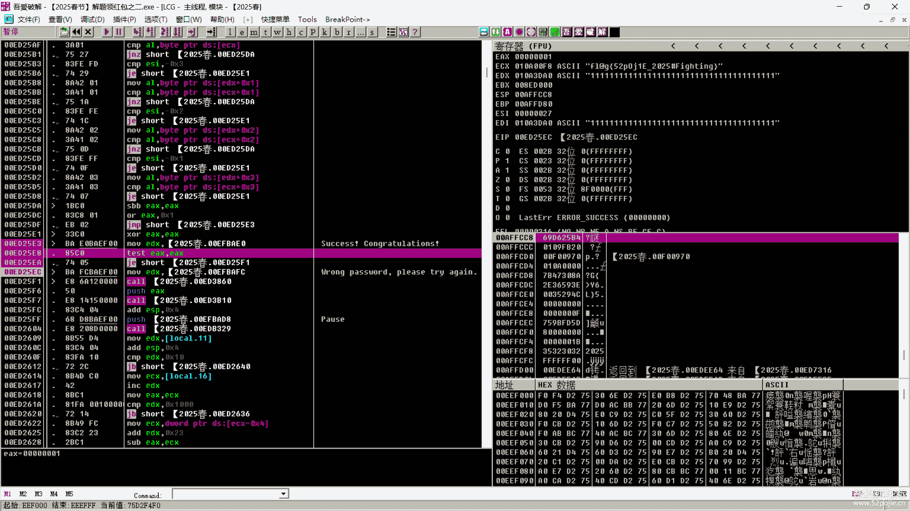
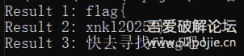

# [CTF] [CTF] 2025解题领红包 Windows和Android初级新人解法

- 原帖: https://www.52pojie.cn/forum.php?mod=viewthread&tid=2005886
- 抓取时间: 2026-11-01T22:15:18

一开始红包题发出来只做了第一题白给题，不敢碰后面的题目

初十开始上班觉得工作太无聊了，打算入门下：

Windows初级题参考了往年的解题思路搞定

安卓初级由于没时间看正己大佬的视频折腾了2天：后面一定认真白嫖视频

## Windows初级题

没有壳，将 `exe` 直接拖进吾爱[//www.52pojie.cn" target="_blank" class="relatedlink"](https://www.52pojie.cn:href="https)专用版[//www.52pojie.cn/thread-350397-1-1.html" target="_blank" class="relatedlink"](https://www.52pojie.cn/thread-350397-1-1.html:href="https)进行 `debug`，找到 `Success` 的关键词，在前后 `call` 的地方上断点

要点是要输对密钥的长度才能走到：`Wrong password，please try again`

在往上一点可以看到：`6b 83 53 7e 8a 30 47 7b 3e 59 36 2e 4c 29 35 35 34 0c 5b 5a 5c 79 7f 50 73 74 7e`，长度是27

随便输入27位长度的密码，在 `Wrong` 前设置断点，运行到断点位置，在寄存器（`FPU`）中可看到口令



`answer-20250210-151606.png` (370.57 KB, 下载次数: 0)

[href="forum.php?mod=attachment&aid=Mjc1NDM0N3xmZjE5NjUwOXwxNzkzNTcxMzE2fDE2ODA4NnwyMDA1ODg2&nothumb=yes" target="_blank"](https://www.52pojie.cn/forum.php?mod=attachment&aid=Mjc1NDM0N3xmZjE5NjUwOXwxNzkzNTcxMzE2fDE2ODA4NnwyMDA1ODg2&nothumb=yes)

`debug` Windows初级题

2025-2-13 08:53 上传

## 安卓初级题

没认真学习的折腾。。。

`apk` 拖到 `jadx` 反编译获得源码，从 `MainActivity` 向下找，`main` 部分没啥有用的信息

`FoldFragment1` 播放 `mp3`，`szd.mp3` 看下十六进制文件内容没啥有用信息。`FoldFragment2` 有 `onScroll` 和 `longPressTimer`，尝试题目提示的左滑没啥反应，长按也没反应。。。深入看了下代码发现三个字符串：`"2hyWtSLN69+QWLHQ"`，`"hjyaQ8jNSdp+mZic7Kdtyw=="` 和 `"cYoiUd2BfEDc/V9e4LdciBz9Mzwzs3yr0kgrLA=="`。还没学 `Frida`，刚刚看其他同学用着真方便，只能参考 `SPU`、`TO` 和 `T` 的实现用 `python` 实现了 `db`：

[Python] 纯文本查看 复制代码

```
import base64
# 密钥
key = b"my-xxtea-secret"
def fK(key):
    bArr = bytearray(16)
    for i in range(min(len(key), 16)):
        bArr[i] = key[i]
    return bArr

def toIntArray(data, include_length):
    length = (len(data) + 3) // 4
    iArr = [0] * (length + (1 if include_length else 0))
    
    for i in range(len(data)):
        iArr[i // 4] |= (data[i] & 0xFF)  0:
        length = data[-1]
    else:
        length = len(data) * 4
    bArr = bytearray(length)
    
    for i in range(length):
        bArr[i] = (data[i // 4] >> ((i % 4) * 8)) & 0xFF
    return bArr

def delta():
    return 0x9E3779B9

def mx(sum, y, z, p, e, k):
    return (((z >> 5) ^ (y > 3) ^ (z > 2) & 3
        for p in range(n - 1, 0, -1):
            z = v[p - 1]
            y = (v[p] - mx(sum, y, z, p, e, k)) & 0xFFFFFFFF
            v[p] = y
        
        z = v[n - 1]
        y = (v[0] - mx(sum, y, z, 0, e, k)) & 0xFFFFFFFF
        v[0] = y
        sum -= delta()
    
    return v

def db(encoded_string):
    # Base64 解码
    decoded_bytes = base64.b64decode(encoded_string)

    # 将字节数组转换为整数数组
    int_array = toIntArray(decoded_bytes, False)

    # 将密钥字节数组转换为整数数组
    key_array = toIntArray(fK(key), False)

    # 使用 XXTEA 解密
    decrypted_int_array = de(int_array, key_array)

    # 将解密后的整数数组转换回字节数组
    decrypted_bytes = toByteArray(decrypted_int_array, True)

    # 转换为 UTF-8 字符串并去除可能的填充字符
    result = decrypted_bytes.decode('utf-8').rstrip('\x00')
    return result

result1 = db("2hyWtSLN69+QWLHQ")
result2 = db("hjyaQ8jNSdp+mZic7Kdtyw==")
result3 = db("cYoiUd2BfEDc/V9e4LdciBz9Mzwzs3yr0kgrLA==")

print(f"Result 1: {result1}")
print(f"Result 2: {result2}")
print(f"Result 3: {result3}")
```



`image.png` (11.41 KB, 下载次数: 0)

[href="forum.php?mod=attachment&aid=Mjc1NDUzM3w4ZTBkN2VkNHwxNzkzNTcxMzE2fDE2ODA4NnwyMDA1ODg2&nothumb=yes" target="_blank"](https://www.52pojie.cn/forum.php?mod=attachment&aid=Mjc1NDUzM3w4ZTBkN2VkNHwxNzkzNTcxMzE2fDE2ODA4NnwyMDA1ODg2&nothumb=yes)

结果

2025-2-13 10:36 上传

大佬们是真厉害，他们解得真快，还有些大佬初级都不做的


虽然是初级题，解出来还是挺开心的

得开始从基础学起来了，不断提升下自己，争取明年搞高级题
