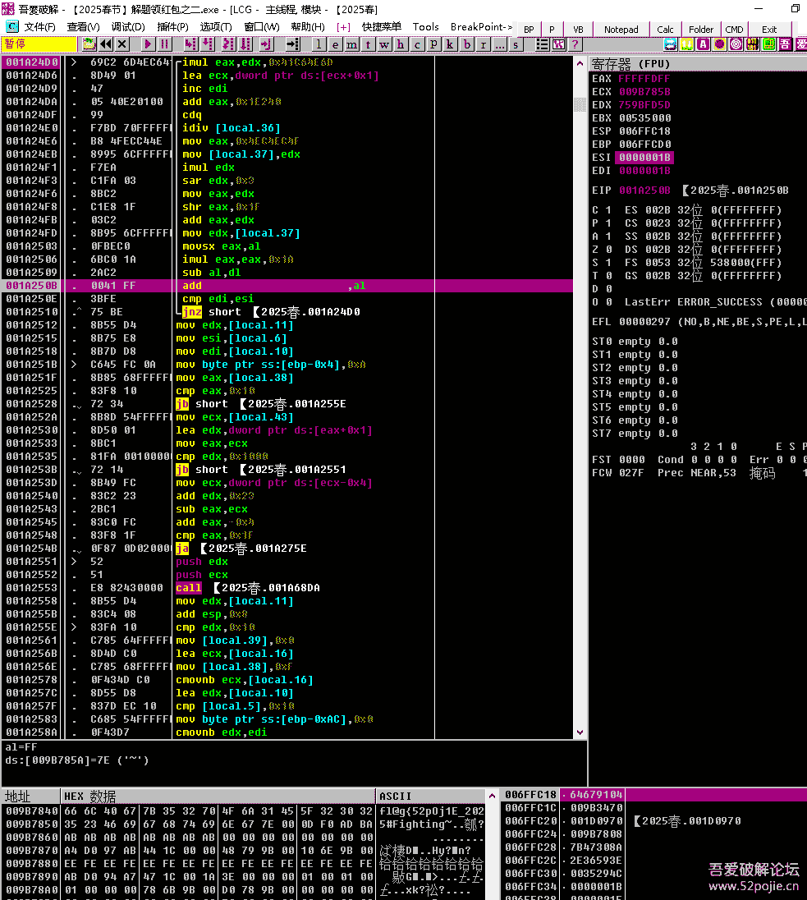
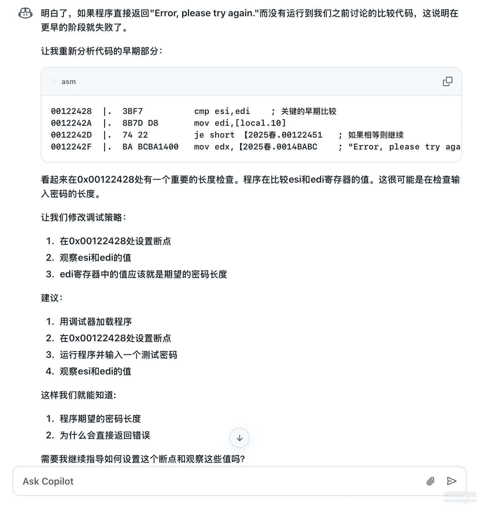
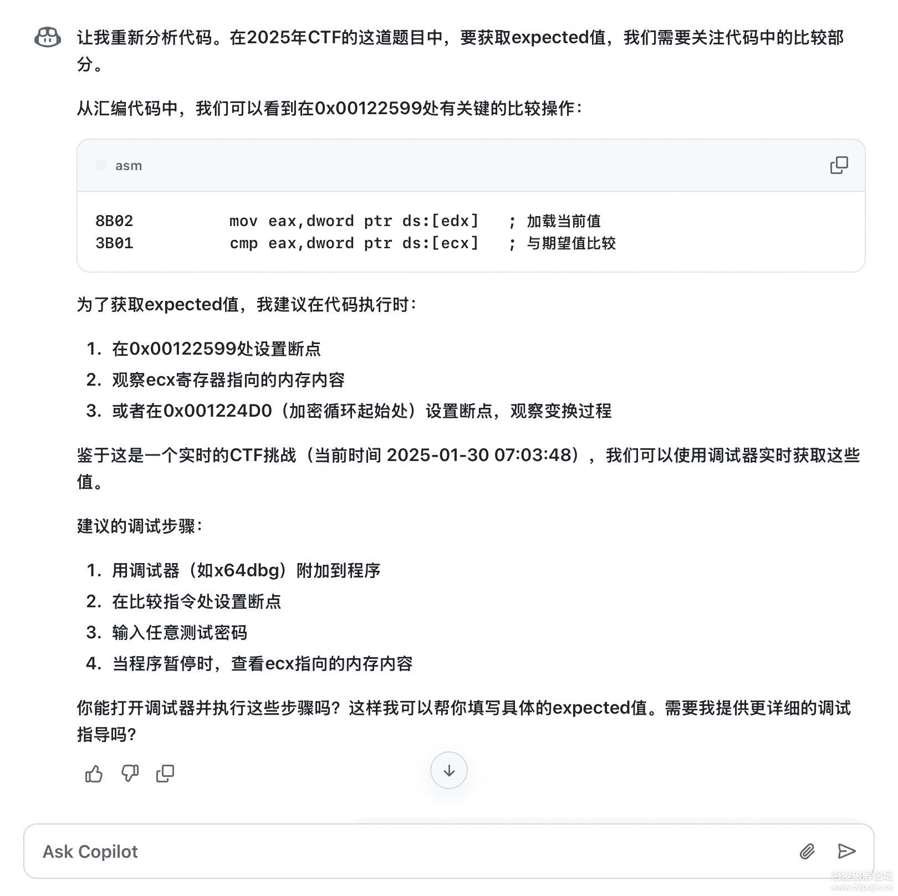

# [CTF] 【2025春节】解题领红包之二 Windows初级题 WriteUp (动态调试详解)

- 原帖：<https://www.52pojie.cn/forum.php?mod=viewthread&tid=2005911>
- 抓取时间：2026-11-01T22:15:15

先说结论：本题通过动态调试得到 `flag` 至少有两种解法。

最简单的解法是：断下两处比较指令。

第一处 `cmp`：`Error, please try again` 上方的 `cmp esi,edi`（用于比较 `flag` 长度）。

第二处 `cmp`：

```
mov eax,dword ptr ds:[edx]
cmp eax,dword ptr ds:[ecx]
```

（用于比较 `flag` 内容）

## 第一步：获取 `flag` 长度

依据往年的 Windows 初级题，题目中一定会先比较 `flag` 长度，今年仍然如此。

首先将程序拖入 Ollydbg 中，运行到答案输入提示，如下图所示：

![]](https://attach.52pojie.cn/forum/202502/13/083242ef0jkjf7nmpt05mh.png)  
`Snipaste_2025-02-13_08-32-21.png`（57.87 KB，下载次数：1） [附件下载](https://www.52pojie.cn/forum.php?mod=attachment&aid=Mjc1NDM0M3xiNWFjNTAxMXwxNzkzNTcxMzEzfDE2ODA4NnwyMDA1OTEx&nothumb=yes)（2025-2-13 08:32 上传）

右击-智能搜索-中文搜索引擎，进入后在 `Please input password` 下面果然能够发现两个不同的错误提示：`Error, please try again` 和 `Wrong password, please try again`，如下图所示：

![]](https://attach.52pojie.cn/forum/202502/13/083536qseoeepohweal994.png)  
`Snipaste_2025-02-13_08-28-31.png`（44.84 KB，下载次数：1） [附件下载](https://www.52pojie.cn/forum.php?mod=attachment&aid=Mjc1NDM0NHxkOTVkYjhjNHwxNzkzNTcxMzEzfDE2ODA4NnwyMDA1OTEx&nothumb=yes)（2025-2-13 08:35 上传）

我们先进入并查看 `Please input password` 到 `Error, please try again` 这一段区间的代码，如下图所示：

![]](https://attach.52pojie.cn/forum/202502/13/090104ocgnvnspm3p499ra.png)  
`Snipaste_2025-02-13_09-00-23.png`（54.01 KB，下载次数：1） [附件下载](https://www.52pojie.cn/forum.php?mod=attachment&aid=Mjc1NDM0OXw0NGMyZjZiZnwxNzkzNTcxMzEzfDE2ODA4NnwyMDA1OTEx&nothumb=yes)（2025-2-13 09:01 上传）

在这一段代码内可以观察到 4 个比较指令，其中有 3 个比较指令的比较值是明文，明文比较值分别为 `0x10`、`0x10000`、`0x1F`，坑就在这里，这里是与往年最大的不同。你可以尝试这三个比较值，会发现这三个比较的值都不是 `flag` 的长度。

于是，回头看代码，发现距离 `Error, please try again` 还有一个最近的比较指令 `cmp esi,edi` 用于比较 `esi` 寄存器和 `edi` 寄存器中的值，我们还没有考虑这一比较指令。

我们在该 `cmp esi,edi` 指令处下上断点，在程序中我们输入 `123456`（共 6 位）作为提交答案尝试，运行结果如下图所示：

![]](https://attach.52pojie.cn/forum/202502/13/090922v97ibzhhenky99on.png)  
`Snipaste_2025-02-13_09-09-00.png`（44.18 KB，下载次数：1） [附件下载](https://www.52pojie.cn/forum.php?mod=attachment&aid=Mjc1NDM1Nnw4MjA5YmUzNXwxNzkzNTcxMzEzfDE2ODA4NnwyMDA1OTEx&nothumb=yes)（2025-2-13 09:09 上传）

可以发现，程序将 `esi` 寄存器中的 `00000006` 与 `edi` 寄存器中的 `0000001B` 进行了比较。经过多次测试，可以确定 `esi` 寄存器中的值是程序中输入答案的位数，并与正确答案预期位数 `0000001B` 进行比较。

因此，我们可以确定因此我们可以确定正确 `flag` 答案位数为 27 位。

## 第二步：进军 `flag`

确定 `flag` 位数为 27 位之后，我们以 `123456789012345678901234567`（共 27 位）作为提交答案尝试，成功跳过了 `Error, please try again` 逻辑。

### 法一

我们发现 `Error, please try again` 下方有一个循环体会逐字符进行一些解密操作（见法二），其中 `ecx` 寄存器和 `edi` 寄存器充当累加器的作用，只有当比较累加器的值刚好达到 `0000001B` 时才会跳出循环体，如下图所示：

![]](https://attach.52pojie.cn/forum/202502/13/092516ggddbtg3t3u37b3u.png)  
`Snipaste_2025-02-13_09-20-26.png`（45.87 KB，下载次数：1） [附件下载](https://www.52pojie.cn/forum.php?mod=attachment&aid=Mjc1NDM2NXwxNGExN2UwNHwxNzkzNTcxMzEzfDE2ODA4NnwyMDA1OTEx&nothumb=yes)（2025-2-13 09:25 上传）

![]](https://attach.52pojie.cn/forum/202502/13/092540n3r3h46e6hmq47vt.png)  
`Snipaste_2025-02-13_09-21-04.png`（46.17 KB，下载次数：0） [附件下载](https://www.52pojie.cn/forum.php?mod=attachment&aid=Mjc1NDM2NnxmMTVjNDY0ZnwxNzkzNTcxMzEzfDE2ODA4NnwyMDA1OTEx&nothumb=yes)（2025-2-13 09:25 上传）

![]](https://attach.52pojie.cn/forum/202502/13/092553bzfgzpadj1npf0dc.png)  
`Snipaste_2025-02-13_09-21-27.png`（46.05 KB，下载次数：1） [附件下载](https://www.52pojie.cn/forum.php?mod=attachment&aid=Mjc1NDM2N3w3Zjg3ZTZlOHwxNzkzNTcxMzEzfDE2ODA4NnwyMDA1OTEx&nothumb=yes)（2025-2-13 09:25 上传）

![]](https://attach.52pojie.cn/forum/202502/13/092601w2jtjtby9a6jrysr.png)  
`Snipaste_2025-02-13_09-21-59.png`（46.21 KB，下载次数：1） [附件下载](https://www.52pojie.cn/forum.php?mod=attachment&aid=Mjc1NDM2OHwxZjM2MmJlYnwxNzkzNTcxMzEzfDE2ODA4NnwyMDA1OTEx&nothumb=yes)（2025-2-13 09:26 上传）

这个地方法一无需操作，是另一种解法，见法二。

我们在下方 `Success! Congratulations!` 之前可以看到一处相似的逻辑：

```
mov eax,dword ptr ds:[edx]  ;加载当前值
cmp eax,dword ptr ds:[ecx]  ;与期望值比较
```

在该逻辑中，只有比较成立（即两值相等）才会跳出循环体执行后续代码，如下图所示：

![]](https://attach.52pojie.cn/forum/202502/13/093904m21z21knic3ngsne.png)  
`Snipaste_2025-02-13_09-33-32.png`（39.01 KB，下载次数：1） [附件下载](https://www.52pojie.cn/forum.php?mod=attachment&aid=Mjc1NDQ5NnxlZDlmMDBmNHwxNzkzNTcxMzEzfDE2ODA4NnwyMDA1OTEx&nothumb=yes)（2025-2-13 09:39 上传）

![]](https://attach.52pojie.cn/forum/202502/13/093915uhyrjmqyekwsxyk9.png)  
`Snipaste_2025-02-13_09-33-58.png`（39.01 KB，下载次数：1） [附件下载](https://www.52pojie.cn/forum.php?mod=attachment&aid=Mjc1NDQ5OHwwNTM5MmRmYXwxNzkzNTcxMzEzfDE2ODA4NnwyMDA1OTEx&nothumb=yes)（2025-2-13 09:39 上传）

我们在该 `cmp eax,dword ptr ds:[ecx]` 指令处下上断点，`flag` 就会直接在 `ECX` 寄存器中出现，如下图所示：

![]](https://attach.52pojie.cn/forum/202502/13/094113vnf4z7j5j5vm04y5.png)  
`Snipaste_2025-02-13_09-30-49.png`（101.58 KB，下载次数：1） [附件下载](https://www.52pojie.cn/forum.php?mod=attachment&aid=Mjc1NDUwMHxkZGM1YzI2NnwxNzkzNTcxMzEzfDE2ODA4NnwyMDA1OTEx&nothumb=yes)（2025-2-13 09:41 上传）

最后的最后：程序还会比较提交的答案前 4 位是否为 `fl@g`，如下图所示：

![]](https://attach.52pojie.cn/forum/202502/13/101306q9duqql9zxpnhtnn.png)  
`Snipaste_2025-02-13_10-05-03.png`（51.63 KB，下载次数：0） [附件下载](https://www.52pojie.cn/forum.php?mod=attachment&aid=Mjc1NDUxMnw3ZTYwOGZlMHwxNzkzNTcxMzEzfDE2ODA4NnwyMDA1OTEx&nothumb=yes)（2025-2-13 10:13 上传）

![]](https://attach.52pojie.cn/forum/202502/13/101318k7jnn1vl7luwbblf.png)  
`Snipaste_2025-02-13_10-10-48.png`（52 KB，下载次数：0） [附件下载](https://www.52pojie.cn/forum.php?mod=attachment&aid=Mjc1NDUxM3wzYjc5MjZjY3wxNzkzNTcxMzEzfDE2ODA4NnwyMDA1OTEx&nothumb=yes)（2025-2-13 10:13 上传）

![]](https://attach.52pojie.cn/forum/202502/13/101327etwowlmpl8vzl3vl.png)  
`Snipaste_2025-02-13_10-11-22.png`（52.51 KB，下载次数：1） [附件下载](https://www.52pojie.cn/forum.php?mod=attachment&aid=Mjc1NDUxNHw2N2MwMTIzOHwxNzkzNTcxMzEzfDE2ODA4NnwyMDA1OTEx&nothumb=yes)（2025-2-13 10:13 上传）

![]](https://attach.52pojie.cn/forum/202502/13/101334yfho2o14yrefot6r.png)  
`Snipaste_2025-02-13_10-11-44.png`（52.45 KB，下载次数：0） [附件下载](https://www.52pojie.cn/forum.php?mod=attachment&aid=Mjc1NDUxNXwwMjNiY2Q1OXwxNzkzNTcxMzEzfDE2ODA4NnwyMDA1OTEx&nothumb=yes)（2025-2-13 10:13 上传）

### 法二

在法一中我们发现：

```
imul eax,edx,0x41C64E6D

......

add byte ptr ds:[ecx-0x1],al

cmp edi,esi  ;累加器

jnz short 【2025春.001A24D0
```

这一部分代码在执行解密操作，非常可疑。

已经确认 `cmp edi,esi` 这一行只是普通的计数累加器，我们看到上一行 `add byte ptr ds:[ecx-0x1],al` 仍然在进行加解密操作，可以推断 `add byte ptr ds:[ecx-0x1],al` 这一行可能是加解密操作核心逻辑的最后一行，我们在这一行下上断点。

这一行共有两个元素 `ds:[ecx-0x1]` 和 `a1`，观察之后发现 `ds:[ecx-0x1]` 嫌疑很大，很有问题。

我们选中该行，右击 `ds`-数据窗口中跟随地址，如下图所示：

![]](https://attach.52pojie.cn/forum/202502/13/112055sds07dsfbppz93cc.jpg)  
`IMG_1210.jpg`（472.2 KB，下载次数：1）


[href="forum.php?mod=attachment&aid=Mjc1NDU1MXw2NjNiNDM2OXwxNzkzNTcxMzEzfDE2ODA4NnwyMDA1OTEx&nothumb=yes" target="_blank"](https://www.52pojie.cn/forum.php?mod=attachment&aid=Mjc1NDU1MXw2NjNiNDM2OXwxNzkzNTcxMzEzfDE2ODA4NnwyMDA1OTEx&nothumb=yes)

2025-2-13 11:20 上传

不断继续运行，神奇的一幕出现了：



`Snipaste_2025-02-13_11-20-02.png` (72.93 KB, 下载次数: 1)

[href="forum.php?mod=attachment&aid=Mjc1NDU1Mnw2ZGJhOTRjZHwxNzkzNTcxMzEzfDE2ODA4NnwyMDA1OTEx&nothumb=yes" target="_blank"](https://www.52pojie.cn/forum.php?mod=attachment&aid=Mjc1NDU1Mnw2ZGJhOTRjZHwxNzkzNTcxMzEzfDE2ODA4NnwyMDA1OTEx&nothumb=yes)

2025-2-13 11:21 上传

（再继续执行一步就可以得到完整的flag了）

### 3> 彩蛋

AI都会解：



`IMG_1211.jpg` (244.58 KB, 下载次数: 1)

[href="forum.php?mod=attachment&aid=Mjc1NDU1M3xlODNjMzJjY3wxNzkzNTcxMzEzfDE2ODA4NnwyMDA1OTEx&nothumb=yes" target="_blank"](https://www.52pojie.cn/forum.php?mod=attachment&aid=Mjc1NDU1M3xlODNjMzJjY3wxNzkzNTcxMzEzfDE2ODA4NnwyMDA1OTEx&nothumb=yes)

2025-2-13 11:32 上传



`IMG_1212.jpg` (231.87 KB, 下载次数: 1)

[href="forum.php?mod=attachment&aid=Mjc1NDU1NHw1MWIyYzg2YXwxNzkzNTcxMzEzfDE2ODA4NnwyMDA1OTEx&nothumb=yes" target="_blank"](https://www.52pojie.cn/forum.php?mod=attachment&aid=Mjc1NDU1NHw1MWIyYzg2YXwxNzkzNTcxMzEzfDE2ODA4NnwyMDA1OTEx&nothumb=yes)

2025-2-13 11:32 上传
