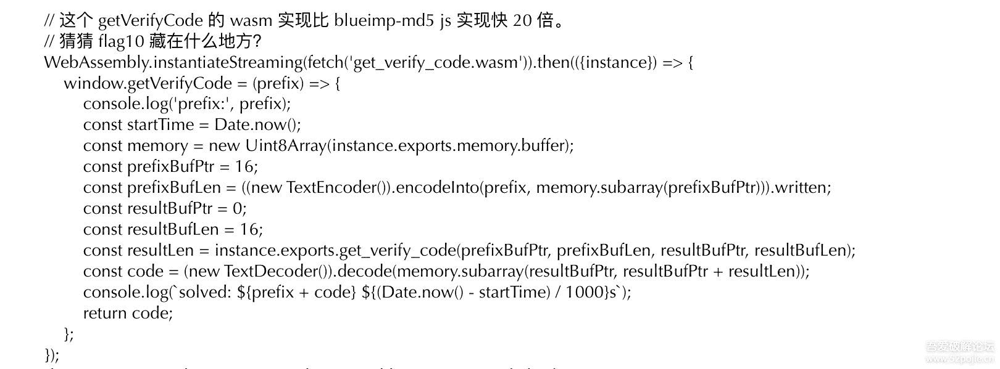
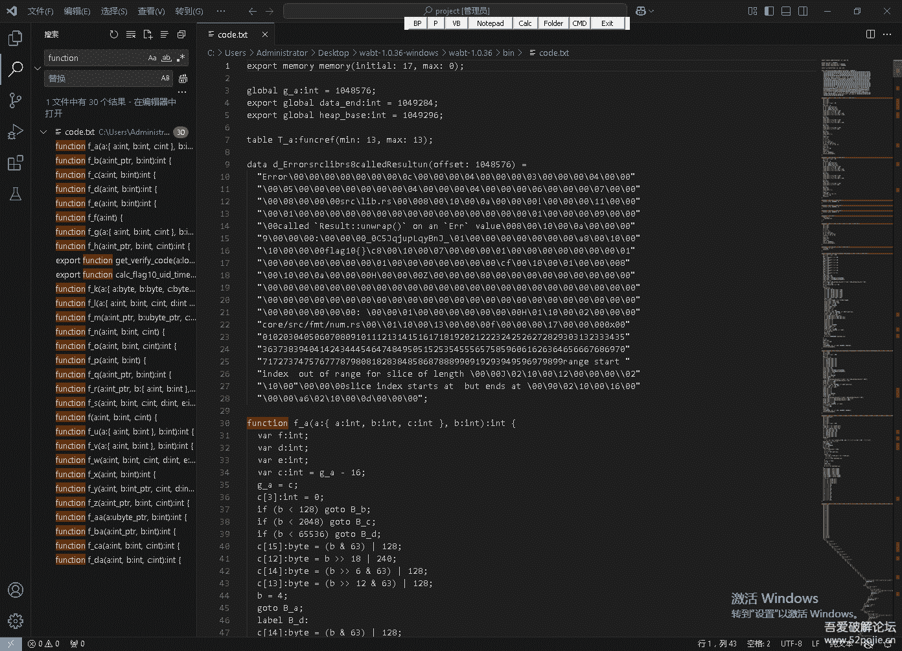
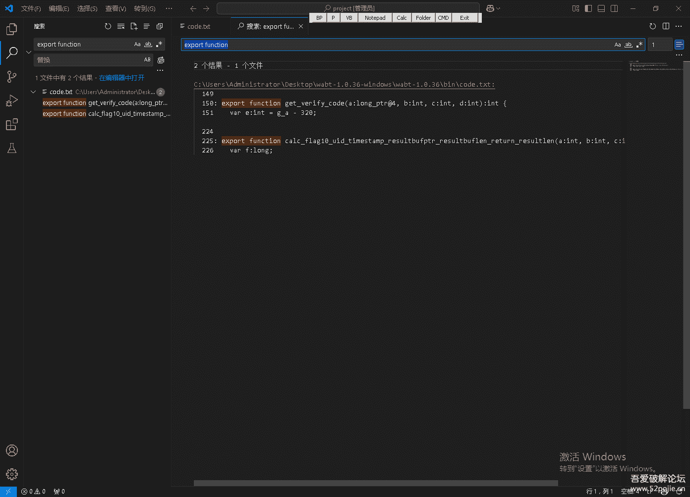
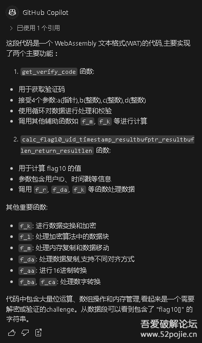
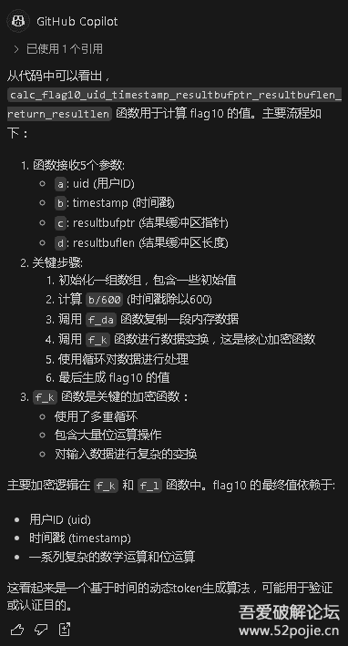

# [CTF] 【2025春节】解题领红包之番外篇二 Web题 WriteUp

- 原帖：[https://www.52pojie.cn/forum.php?mod=viewthread&tid=2006022](https://www.52pojie.cn/forum.php?mod=viewthread&tid=2006022)
- 抓取时间：2026-11-01T22:15:09

## 一、发现 Wasm 验证码逻辑

在抽奖页面网页源代码中，有几行提示和代码：

```javascript
    // 这个 getVerifyCode 的 wasm 实现比 blueimp-md5 js 实现快 20 倍。
    // 猜猜 flag10 藏在什么地方？
    WebAssembly.instantiateStreaming(fetch('get_verify_code.wasm')).then(({instance}) => {
        window.getVerifyCode = (prefix) => {
            console.log('prefix:', prefix);
            const startTime = Date.now();
            const memory = new Uint8Array(instance.exports.memory.buffer);
            const prefixBufPtr = 16;
            const prefixBufLen = ((new TextEncoder()).encodeInto(prefix, memory.subarray(prefixBufPtr))).written;
            const resultBufPtr = 0;
            const resultBufLen = 16;
            const resultLen = instance.exports.get_verify_code(prefixBufPtr, prefixBufLen, resultBufPtr, resultBufLen);
            const code = (new TextDecoder()).decode(memory.subarray(resultBufPtr, resultBufPtr + resultLen));
            console.log(`solved: ${prefix + code} ${(Date.now() - startTime) / 1000}s`);
            return code;
        };
    });
```

如下图所示：



`IMG_1099.jpg` (139.18 KB, 下载次数: 0)

[附件下载](https://www.52pojie.cn/forum.php?mod=attachment&aid=Mjc1NDczM3xkMTliMjk1ZXwxNzkzNTcxMzA3fDE2ODA4NnwyMDA2MDIy&nothumb=yes)

2025-2-13 17:14 上传

在代码（不包括注释）的第一行可以看到，网页试图通过绝对路径加载 `get_verify_code.wasm` 二进制文件（因此该文件实际 URL 路径为 `https://2025challenge.52pojie.cn/get_verify_code.wasm`）。

在代码（不包括注释）的第二行可以看到，网页试图调用 `get_verify_code.wasm` 中的 `getVerifyCode` 函数。

这不得拉下来逆一逆？

那么，废话不多说，我们把 `get_verify_code.wasm` 下载下来看一看到底是何方神圣，一探究竟，如下图所示：


`Snipaste_2025-02-13_12-28-26.png` (9.1 KB, 下载次数: 0)

[附件下载](https://www.52pojie.cn/forum.php?mod=attachment&aid=Mjc1NDcyN3wxNjdlNGIxZXwxNzkzNTcxMzA3fDE2ODA4NnwyMDA2MDIy&nothumb=yes)

2025-2-13 17:02 上传

## 二、反编译并分析 Wasm 文件

我们使用 [WebAssembly/wabt releases](https://github.com/WebAssembly/wabt/releases) 中的 `wasm-decompile` 工具来将 `get_verify_code.wasm` 转换为伪代码之后进行分析：

```bash
wasm-decompile.exe get_verify_code.wasm -o code.txt
```

转换为伪代码后，我们搜索其中的所有函数，发现 `export function` 只有 2 个，并且其中一个就是 `getVerifyCode(a, b, c, d)` 函数，如下图所示：



`Snipaste_2025-02-13_16-39-34.png` (115.44 KB, 下载次数: 0)

[附件下载](https://www.52pojie.cn/forum.php?mod=attachment&aid=Mjc1NDcyOHxjNDJjMWU3ZXwxNzkzNTcxMzA3fDE2ODA4NnwyMDA2MDIy&nothumb=yes)

2025-2-13 17:03 上传

查看另一个 `export function` 后，发现是 `calc_flag10_uid_timestamp_resultbufptr_resultbuflen_return_resultlen(a, b, c, d)` 函数，如下图所示：



`Snipaste_2025-02-13_16-40-47.png` (39.88 KB, 下载次数: 0)

[附件下载](https://www.52pojie.cn/forum.php?mod=attachment&aid=Mjc1NDcyOXwyNGQ1NGJmYXwxNzkzNTcxMzA3fDE2ODA4NnwyMDA2MDIy&nothumb=yes)

2025-2-13 17:03 上传

由于伪代码非常杂乱，我们借助 AI 分析一下该函数的输入值和作用，如下图所示：



`Snipaste_2025-02-13_16-43-41.png` (25.37 KB, 下载次数: 0)

[附件下载](https://www.52pojie.cn/forum.php?mod=attachment&aid=Mjc1NDczMHwxZDJlNmIwMnwxNzkzNTcxMzA3fDE2ODA4NnwyMDA2MDIy&nothumb=yes)

2025-2-13 17:04 上传



`Snipaste_2025-02-13_16-44-22.png` (25.57 KB, 下载次数: 0)

[附件下载](https://www.52pojie.cn/forum.php?mod=attachment&aid=Mjc1NDczMXwwNTY2NDRhNXwxNzkzNTcxMzA3fDE2ODA4NnwyMDA2MDIy&nothumb=yes)

2025-2-13 17:04 上传

## 三、编写 Python 脚本计算 flag

我们通过导入 Python 的 `time` 库，利用 `time.time()` 直接计算时间戳，然后再导入 `wasmtime` 库在本地加载 `get_verify_code.wasm`（将 Python 脚本与 `get_verify_code.wasm` 放置在同一目录下），依次传入 `uid`、`timestamp`、`buf_ptr`、`buf_len`，调用 `calc_flag10_uid_timestamp_resultbufptr_resultbuflen_return_resultlen(uid, timestamp, buf_ptr, buf_len)`，即可得到 `flag`，代码如下：

```python
import wasmtime
import time

store = wasmtime.Store()
module = wasmtime.Module.from_file(store.engine, "get_verify_code.wasm")
instance = wasmtime.Instance(store, module, [])

# 获取导出函数和内存
calc_flag10 = instance.exports(store)["calc_flag10_uid_timestamp_resultbufptr_resultbuflen_return_resultlen"]
memory = instance.exports(store)["memory"]

# 参数说明：
# a: UID（根据需要填写正确的UID）
# b: 时间戳
# c: 结果缓冲区指针（这里选用 heap_base，即 1049296）
# d: 结果缓冲区长度（根据实际需要，此处设置为32）
uid = int(input("Please enter your UID: "))
timestamp = int(time.time())
buf_ptr = 1049296     # heap_base
buf_len = 32

# 调用函数，返回值为写入结果的长度
res_len = calc_flag10(store, uid, timestamp, buf_ptr, buf_len)

# 从内存中读取结果
# memory.data_ptr(store) 返回一个可切片的字节数组
raw = memory.data_ptr(store)[buf_ptr:buf_ptr+res_len]
flag = bytes(raw).decode("utf-8")
print(flag)
```

## 四、附件

附件（包含题目 `get_verify_code.wasm` 文件 & 转换后的 `code.txt` 伪代码文件 & 解题 Python 脚本文件）：


[附件下载](https://www.52pojie.cn/forum.php?mod=attachment&aid=Mjc1NDczMnwwNGZhMzNjM3wxNzkzNTcxMzA3fDE2ODA4NnwyMDA2MDIy)

(13.6 KB, 下载次数: 1)

2025-2-13 17:06 上传

点击文件名下载附件
下载积分: 吾爱币 -1 CB
