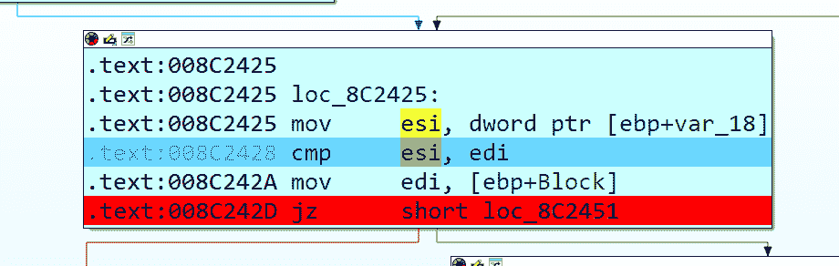
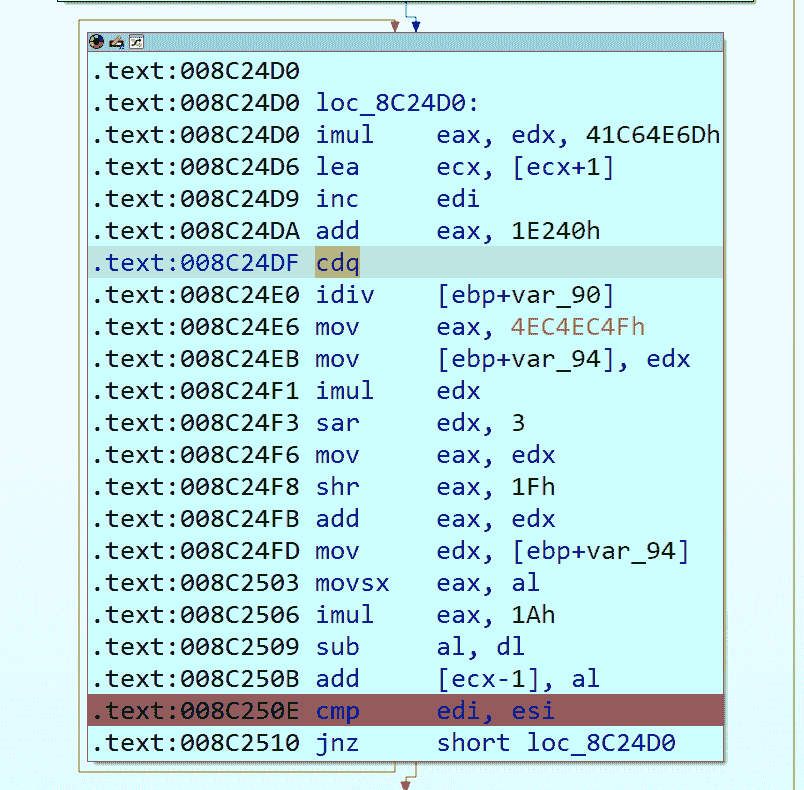

# [CTF] 【2025春节】解题领红包之windows初级题writeup

- 原帖: https://www.52pojie.cn/forum.php?mod=viewthread&tid=2006085
- 抓取时间: 2026-11-01T22:15:07

[//www.52pojie.cn/home.php?mod=task&do=view&id=21" target="_blank" rel="noopener noreferrer nofollow"](https://www.52pojie.cn/home.php?mod=task&do=view&id=21:href="https)

这题我没做出来，看了题解才恍然大悟。

文件的字符串有提示：

```
.rdata:008EBA28        0000001E        C        Hint: Debug the LCG sequence!
```

我的思路是找到那个变量储存的输入，然后再跟踪，没想到找了很长时间没找到，猜测代码里面应该用了结构体之类的东西。

在第一个关键判断位置下断点：



因为红色跳转会到下面的汇编：

```
.text:008C242F mov     edx, offset aErrorPleaseTry ; "Error, please try again."
.text:008C2434 call    sub_8C3860
.text:008C2439 push    eax
.text:008C243A call    sub_8C3B10
.text:008C243F push    offset aPause   ; "Pause"
.text:008C2444 call    sub_8CB329
.text:008C2449 add     esp, 8
.text:008C244C jmp     loc_8C2652
```

先尝试输入字符串 111，调试。由于`cmp`会影响 `jz` 的走向，所以在`cmp`语句上看看两个寄存器的值：

```
esi:0x00000003
edi:0x0000001B
```

可以猜测，`esi`是我们输入的`password`的长度。可以多输入不同的字符串验证。

当这两个不相等的时候，会走到错误条件，所以让他们相等就好了。

直接 `set ip`，让他走正确的流程，找到`lcg`的地方：



也可以按`tab`查看伪代码，`ecx`寄存器就储存的密码，一次循环一个字符。

一步一步的调试，就能得到密码，拼接起来就是：

```
debug022:01608070 db  66h ; f
debug022:01608071 db  6Ch ; l
debug022:01608072 db  40h ; @
debug022:01608073 db  67h ; g
debug022:01608074 db  7Bh ; {
debug022:01608075 db  35h ; 5
debug022:01608076 db  32h ; 2
debug022:01608077 db  70h ; p
debug022:01608078 db  4Fh ; O
debug022:01608079 db  6Ah ; j
debug022:0160807A db  31h ; 1
debug022:0160807B db  45h ; E
debug022:0160807C db  5Fh ; _
debug022:0160807D db  32h ; 2
debug022:0160807E db  30h ; 0
debug022:0160807F db  32h ; 2
debug022:01608080 db  35h ; 5
debug022:01608081 db  23h ; #
debug022:01608082 db  46h ; F
debug022:01608083 db  69h ; i
debug022:01608084 db  67h ; g
debug022:01608085 db  68h ; h
debug022:01608086 db  74h ; t
debug022:01608087 db  69h ; i
debug022:01608088 db  6Eh ; n
debug022:01608089 db  67h ; g
debug022:0160808A db  7Dh ; }
```
