# [Web逆向] web壁纸网站逆向爬取

- 原帖: https://www.52pojie.cn/forum.php?mod=viewthread&tid=2006127
- 抓取时间: 2026-11-01T22:15:02

## 爬取图片地址

网站地址：aHR0cHM6Ly9oYW93YWxscGFwZXIuY29tLw==

## f12 分析请求

没有反作弊的
翻页请求发现`data`请求数据是加密的

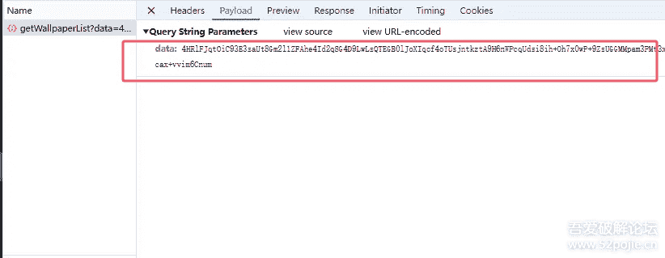

image.png (66.02 KB, 下载次数: 0)

[href="forum.php?mod=attachment&aid=Mjc1NDgyM3xhZGYxNGZmY3wxNzkzNTcxMzAwfDE2ODA4NnwyMDA2MTI3&nothumb=yes" target="_blank"](https://www.52pojie.cn/forum.php?mod=attachment&aid=Mjc1NDgyM3xhZGYxNGZmY3wxNzkzNTcxMzAwfDE2ODA4NnwyMDA2MTI3&nothumb=yes)

2025-2-14 00:32 上传

返回数据也是加密的

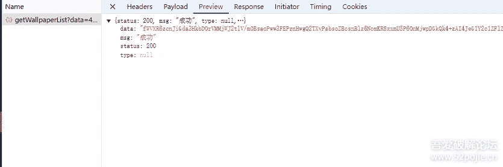

image.png (62.9 KB, 下载次数: 0)

[href="forum.php?mod=attachment&aid=Mjc1NDgyNHw0Y2Q4ZDc4MXwxNzkzNTcxMzAwfDE2ODA4NnwyMDA2MTI3&nothumb=yes" target="_blank"](https://www.52pojie.cn/forum.php?mod=attachment&aid=Mjc1NDgyNHw0Y2Q4ZDc4MXwxNzkzNTcxMzAwfDE2ODA4NnwyMDA2MTI3&nothumb=yes)

2025-2-14 00:32 上传

`data`关键词是一个常用变量 不适合搜索 尝试一下`json` `hook`的方式来获取

## hook

```
var my_parse = JSON.parse;
JSON.parse = function (params) {
  // 这里可以添加其他逻辑比如
  debugger
  console.log("json_parse params:",params);
  return my_parse(params);
};
```

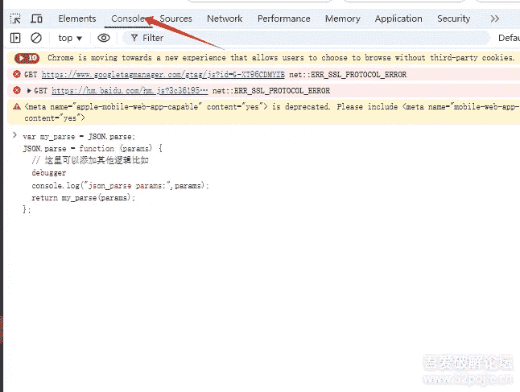

image.png (149.54 KB, 下载次数: 0)

[href="forum.php?mod=attachment&aid=Mjc1NDgyNXxhNzcyZDRkOXwxNzkzNTcxMzAwfDE2ODA4NnwyMDA2MTI3&nothumb=yes" target="_blank"](https://www.52pojie.cn/forum.php?mod=attachment&aid=Mjc1NDgyNXxhNzcyZDRkOXwxNzkzNTcxMzAwfDE2ODA4NnwyMDA2MTI3&nothumb=yes)

2025-2-14 00:32 上传

重新翻页请求数据，然后把`debugger`全部放掉，可以在控制台里面查看加密的数据和被加密的数据

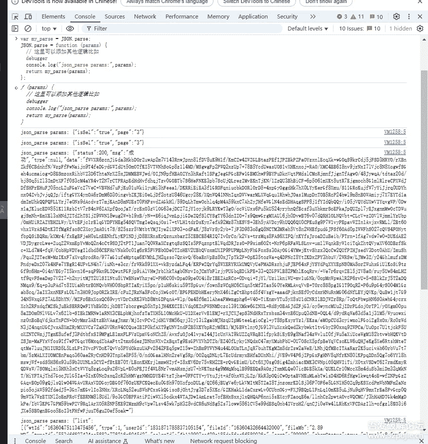

image.png (1.06 MB, 下载次数: 0)

[href="forum.php?mod=attachment&aid=Mjc1NDgyNnwxNzQ1ZTZiNHwxNzkzNTcxMzAwfDE2ODA4NnwyMDA2MTI3&nothumb=yes" target="_blank"](https://www.52pojie.cn/forum.php?mod=attachment&aid=Mjc1NDgyNnwxNzQ1ZTZiNHwxNzkzNTcxMzAwfDE2ODA4NnwyMDA2MTI3&nothumb=yes)

2025-2-14 00:32 上传

## 代码分析

## 响应数据解密

在重新翻页把`debugger`部分断在加密处，往上一个栈查找这个数据在哪里解密的

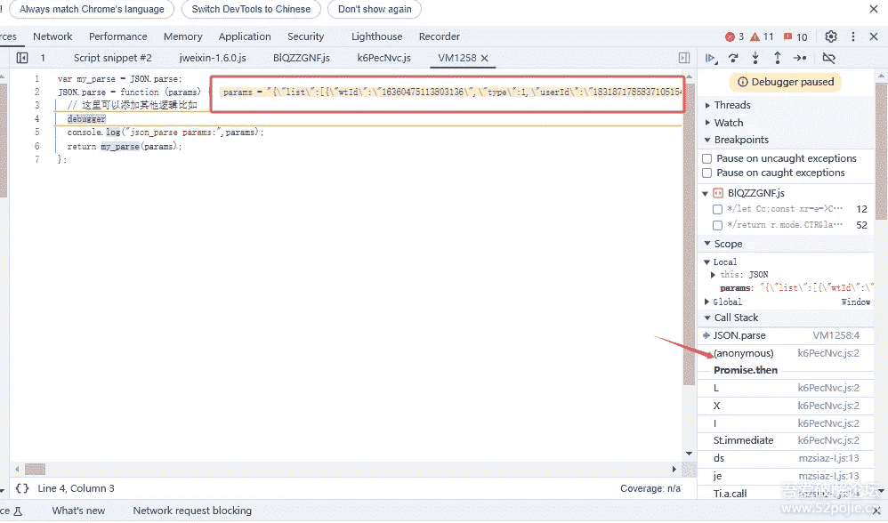

image.png (235.16 KB, 下载次数: 0)

[href="forum.php?mod=attachment&aid=Mjc1NDgyN3wzNDcxMjI1OHwxNzkzNTcxMzAwfDE2ODA4NnwyMDA2MTI3&nothumb=yes" target="_blank"](https://www.52pojie.cn/forum.php?mod=attachment&aid=Mjc1NDgyN3wzNDcxMjI1OHwxNzkzNTcxMzAwfDE2ODA4NnwyMDA2MTI3&nothumb=yes)

2025-2-14 00:33 上传

可以看到上面这块是发送请求的部分，请求的数据也是加密的 应该就是这个部分。

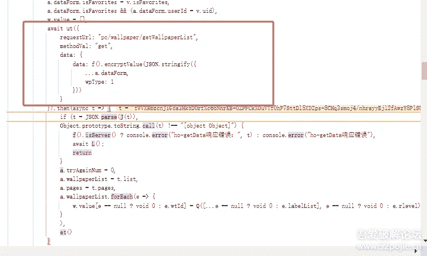

image.png (152.52 KB, 下载次数: 0)

[href="forum.php?mod=attachment&aid=Mjc1NDgyOHwzMzhkYmZjMnwxNzkzNTcxMzAwfDE2ODA4NnwyMDA2MTI3&nothumb=yes" target="_blank"](https://www.52pojie.cn/forum.php?mod=attachment&aid=Mjc1NDgyOHwzMzhkYmZjMnwxNzkzNTcxMzAwfDE2ODA4NnwyMDA2MTI3&nothumb=yes)

2025-2-14 00:33 上传

先放着，往下面走，看看在哪里解密数据

可以发现通过`J`函数出来之后就是解密的数据了  跟着进`J`函数

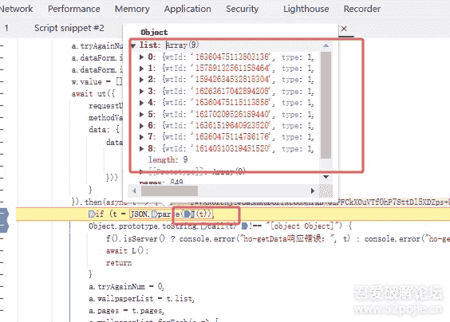

image.png (179.99 KB, 下载次数: 0)

[href="forum.php?mod=attachment&aid=Mjc1NDgyOXxjMTAzNGQwOHwxNzkzNTcxMzAwfDE2ODA4NnwyMDA2MTI3&nothumb=yes" target="_blank"](https://www.52pojie.cn/forum.php?mod=attachment&aid=Mjc1NDgyOXxjMTAzNGQwOHwxNzkzNTcxMzAwfDE2ODA4NnwyMDA2MTI3&nothumb=yes)

2025-2-14 00:33 上传

继续往下面走，`A.apply(this && this.$id === e ? this : w, b)`部分就是最后解密

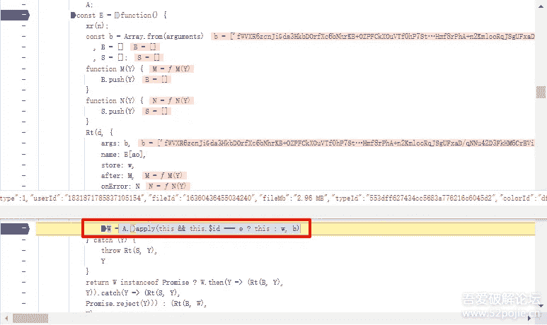

image.png (172.5 KB, 下载次数: 0)

[href="forum.php?mod=attachment&aid=Mjc1NDgzMHw2MWY2NmVkOXwxNzkzNTcxMzAwfDE2ODA4NnwyMDA2MTI3&nothumb=yes" target="_blank"](https://www.52pojie.cn/forum.php?mod=attachment&aid=Mjc1NDgzMHw2MWY2NmVkOXwxNzkzNTcxMzAwfDE2ODA4NnwyMDA2MTI3&nothumb=yes)

2025-2-14 00:33 上传

在跟着进`A`函数，发现里面有很多老朋友 `AES` 加密

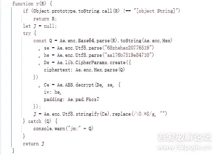

image.png (88.76 KB, 下载次数: 0)

[href="forum.php?mod=attachment&aid=Mjc1NDgzMXw4MWUyNTFiMHwxNzkzNTcxMzAwfDE2ODA4NnwyMDA2MTI3&nothumb=yes" target="_blank"](https://www.52pojie.cn/forum.php?mod=attachment&aid=Mjc1NDgzMXw4MWUyNTFiMHwxNzkzNTcxMzAwfDE2ODA4NnwyMDA2MTI3&nothumb=yes)

2025-2-14 00:33 上传

尝试进行用原版的测试是否成功

[//cyberchef.org/" target="_blank" rel="noopener noreferrer nofollow"](https://cyberchef.org/:rel="nofollow noopener" href="https)

From `Base64` -> `AES Decrypt` -> `To String` 完成数据解密

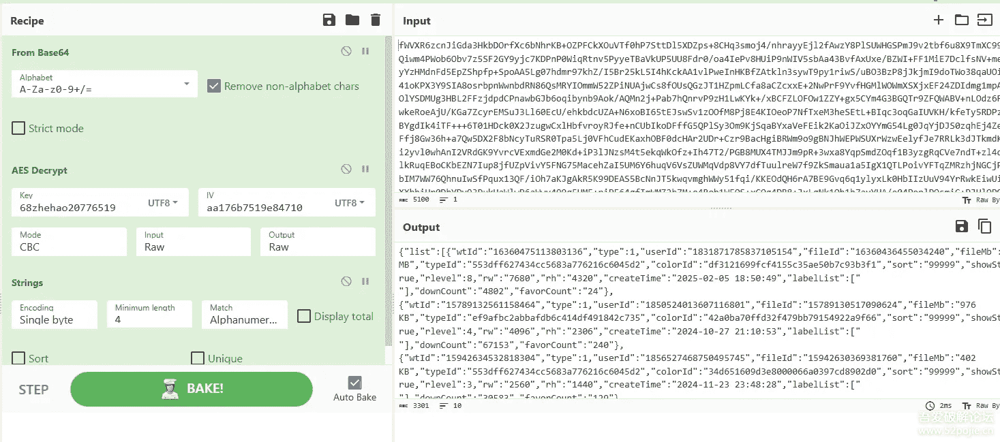

image.png (794.14 KB, 下载次数: 0)

[href="forum.php?mod=attachment&aid=Mjc1NDgzMnw3Yzk4NGExYnwxNzkzNTcxMzAwfDE2ODA4NnwyMDA2MTI3&nothumb=yes" target="_blank"](https://www.52pojie.cn/forum.php?mod=attachment&aid=Mjc1NDgzMnw3Yzk4NGExYnwxNzkzNTcxMzAwfDE2ODA4NnwyMDA2MTI3&nothumb=yes)

2025-2-14 00:33 上传

## 请求数据解密

在回到前面，我们可以先测试一下他们俩个的加密方式是不是一样的

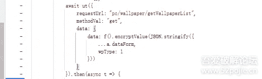

image.png (40.89 KB, 下载次数: 0)

[href="forum.php?mod=attachment&aid=Mjc1NDgzM3w4NzBmNjJkMXwxNzkzNTcxMzAwfDE2ODA4NnwyMDA2MTI3&nothumb=yes" target="_blank"](https://www.52pojie.cn/forum.php?mod=attachment&aid=Mjc1NDgzM3w4NzBmNjJkMXwxNzkzNTcxMzAwfDE2ODA4NnwyMDA2MTI3&nothumb=yes)

2025-2-14 00:33 上传

测试出他们的加密方式是相同的

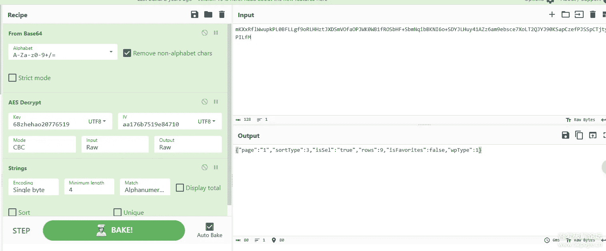

image.png (242.56 KB, 下载次数: 0)

[href="forum.php?mod=attachment&aid=Mjc1NDgzNHxiNzA0ODVhOHwxNzkzNTcxMzAwfDE2ODA4NnwyMDA2MTI3&nothumb=yes" target="_blank"](https://www.52pojie.cn/forum.php?mod=attachment&aid=Mjc1NDgzNHxiNzA0ODVhOHwxNzkzNTcxMzAwfDE2ODA4NnwyMDA2MTI3&nothumb=yes)

2025-2-14 00:42 上传

## 代码

```
from base64 import b64encode, b64decode

from Crypto.Cipher import AES

from Crypto.Util.Padding import pad, unpad

import binascii,json,random,requests

key = '68zhehao20776519'  # 密钥

iv = 'aa176b7519e84710'   # 初始向量

def aes_encrypt(plain_text, key, iv):
    try:
        # 将明文转换为字节并进行填充
        plain_bytes = plain_text.encode('utf-8')
        key_bytes = key.encode('utf-8')
        iv_bytes = iv.encode('utf-8')
        # 创建 AES 加密器对象
        cipher = AES.new(key_bytes, AES.MODE_CBC, iv_bytes)
        # 使用 PKCS7 填充模式填充明文，确保其大小是 AES 块大小的倍数
        padded_data = pad(plain_bytes, AES.block_size)
        # 执行加密操作
        encrypted_data = cipher.encrypt(padded_data)
        # 将加密后的字节数据编码为 Base64
        encrypted_base64 = b64encode(encrypted_data).decode('utf-8')
        return encrypted_base64
    except Exception as e:
        print(f"Error during encryption: {e}")
        return None

def aes_decrypt(encrypted_base64_str, key, iv):
    try:
        # 解码 Base64 加密字符串
        encrypted_data = b64decode(encrypted_base64_str)
        # 将密钥和 IV 转换为 bytes
        key_bytes = key.encode('utf-8')
        iv_bytes = iv.encode('utf-8')
        # 创建 AES 解密器对象
        cipher = AES.new(key_bytes, AES.MODE_CBC, iv_bytes)
        # 解密数据并去除 padding
        decrypted_data = unpad(cipher.decrypt(encrypted_data), AES.block_size)
        # 将解密后的数据转换为 UTF-8 字符串
        decrypted_str = decrypted_data.decode('utf-8')
        return decrypted_str
    except Exception as e:
        print(f"Error during decryption: {e}")
        return None

def getWallpaperList():
    headers = {
        "Accept-Language": "zh-CN,zh;q=0.9,en;q=0.8,ja;q=0.7",
        "Cache-Control": "no-cache",
        "Connection": "keep-alive",
        "Pragma": "no-cache",
        "Referer": "https://haowallpaper.com/homeView?isSel=false&page=1",
        "Sec-Fetch-Dest": "empty",
        "Sec-Fetch-Mode": "cors",
        "Sec-Fetch-Site": "same-origin",
        "User-Agent": "Mozilla/5.0 (Windows NT 10.0; Win64; x64) AppleWebKit/537.36 (KHTML, like Gecko) Chrome/133.0.0.0 Safari/537.36",
        "accept": "application/json",
        "sec-ch-ua": "\"Not(A:Brand\";v=\"99\", \"Google Chrome\";v=\"133\", \"Chromium\";v=\"133\"",
        "sec-ch-ua-mobile": "?0",
        "sec-ch-ua-platform": "\"Windows\"",
    }
    url = "https://haowallpaper.com/link/pc/wallpaper/getWallpaperList"
```


```python
data = json.dumps({"page": str(random.randint(1,100)),"sortType":3,"isSel":"false","rows":9,"isFavorites":False,"wpType":1},separators=(',', ':'))
encrypted_data = aes_encrypt(data, key, iv)
#print("Encrypted Data (Base64):", encrypted_data)
params = {
    "data":encrypted_data
}
res = requests.get(url,headers=headers,verify=False,params=params)
#print(res.text)
data_code = res.status_code
if data_code != 200 :
    return ""
decrypted_data = aes_decrypt(res.json()["data"], key, iv)
print("Decrypted Data:", decrypted_data)
decrypted_data = decrypted_data.replace('\x00', '').replace('true', 'True').strip()
print(type(eval(decrypted_data)))
wtId = eval(decrypted_data)["list"][random.randint(0,8)]["wtId"]
print(wtId)
res = requests.get("https://x.haowallpaper.com/link/common/file/getFileImg/" + wtId + ".png",headers=headers)
with open('1.png','wb') as f:
    f.write(res.content)
if __name__ == "__main__":
    getWallpaperList()
```
