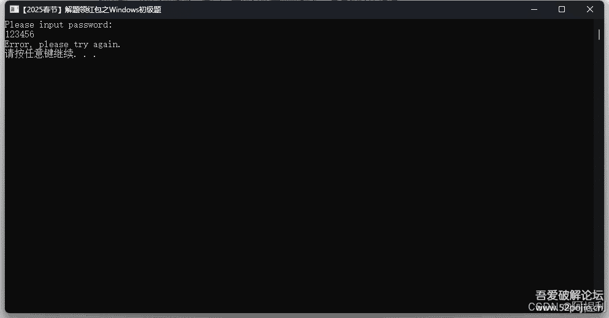
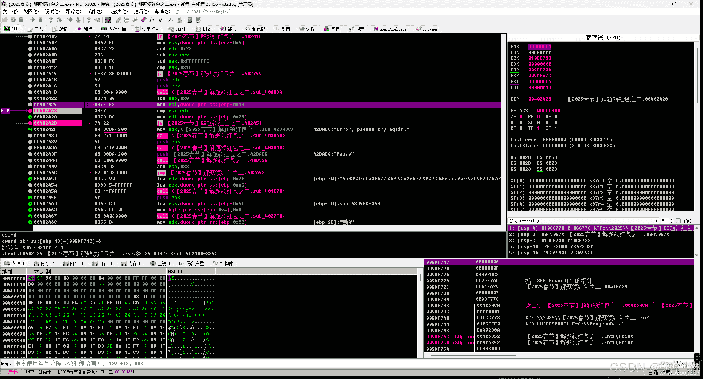
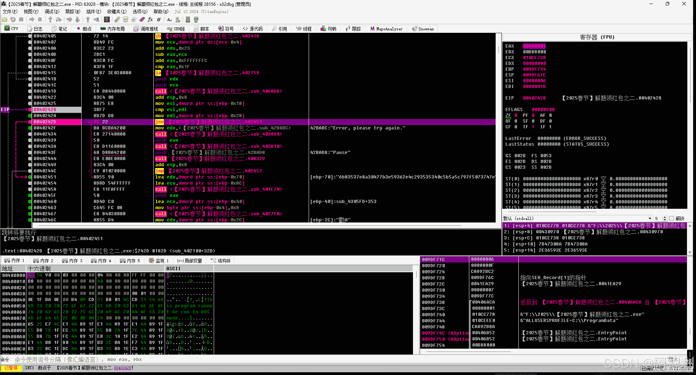
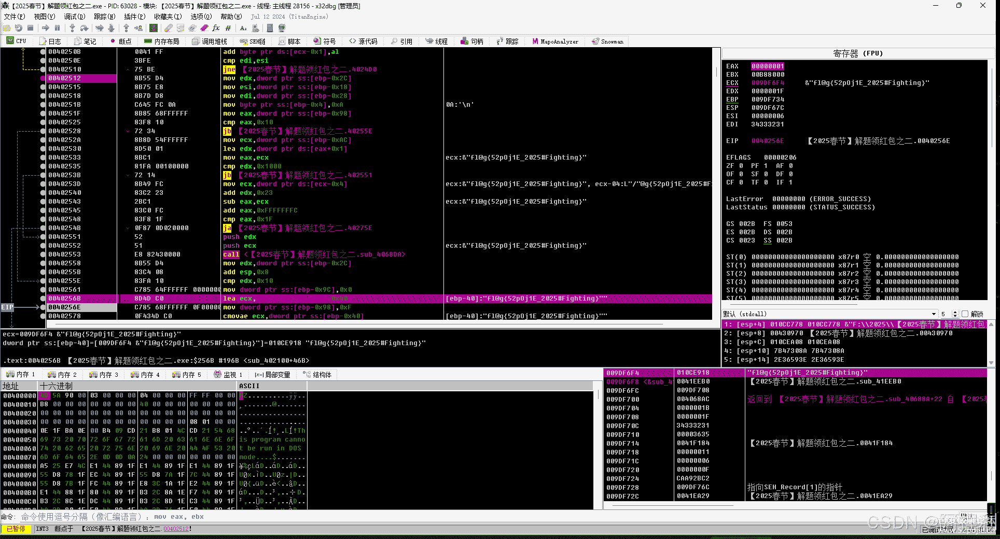
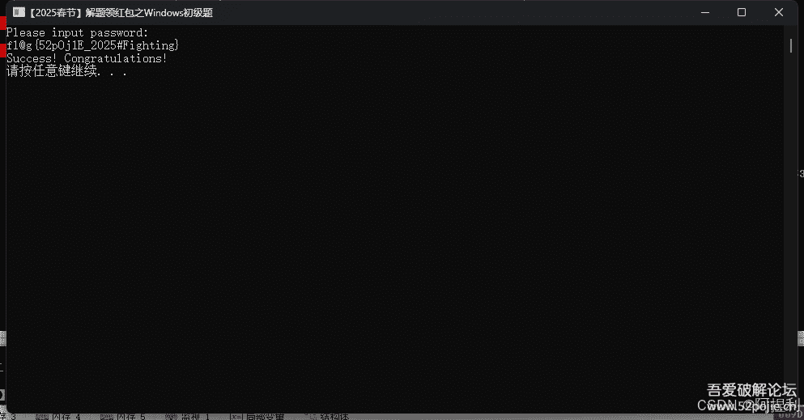

# [CTF] 【2025春节】解题领红包初级题(windows + android)

- 原帖: https://www.52pojie.cn/forum.php?mod=viewthread&tid=2006364
- 抓取时间: 2026-11-01T22:14:55

## 一、windows初级题

初级题，100%应该不会有壳，先运行起来随便输入，看看报什么错误



1.png (23.28 KB, 下载次数: 1)

[href="forum.php?mod=attachment&aid=Mjc1NDk4NXxlMmUzYmYxZnwxNzkzNTcxMjkzfDE2ODA4NnwyMDA2MzY0&nothumb=yes" target="_blank"](https://www.52pojie.cn/forum.php?mod=attachment&aid=Mjc1NDk4NXxlMmUzYmYxZnwxNzkzNTcxMjkzfDE2ODA4NnwyMDA2MzY0&nothumb=yes)

2025-2-14 17:19 上传

搜一下`x32dbg`重新启动程序并搜索字符串



2.png (148.31 KB, 下载次数: 1)

[href="forum.php?mod=attachment&aid=Mjc1NDk4NHwyMzg5NjhjNXwxNzkzNTcxMjkzfDE2ODA4NnwyMDA2MzY0&nothumb=yes" target="_blank"](https://www.52pojie.cn/forum.php?mod=attachment&aid=Mjc1NDk4NHwyMzg5NjhjNXwxNzkzNTcxMjkzfDE2ODA4NnwyMDA2MzY0&nothumb=yes)

2025-2-14 17:19 上传

前面有一个`je`，前面还有一个`cmp esi edi`，在次下断点并运行，`esi`的值是6，`edi`的值是`1B`(27)，显然不等，将`je`改为`jne`，继续运行



3.png (148.54 KB, 下载次数: 0)

[href="forum.php?mod=attachment&aid=Mjc1NDk4M3wwNzI3YTE3ZXwxNzkzNTcxMjkzfDE2ODA4NnwyMDA2MzY0&nothumb=yes" target="_blank"](https://www.52pojie.cn/forum.php?mod=attachment&aid=Mjc1NDk4M3wwNzI3YTE3ZXwxNzkzNTcxMjkzfDE2ODA4NnwyMDA2MzY0&nothumb=yes)

2025-2-14 17:19 上传

不停的向下跟，一个27次的循环结束后，`flag`会出现在`ebp-40`的地址里，后面会被复制给`ECX`



5.png (147.26 KB, 下载次数: 1)

[href="forum.php?mod=attachment&aid=Mjc1NDk4MnwyMWM4Nzk3ZXwxNzkzNTcxMjkzfDE2ODA4NnwyMDA2MzY0&nothumb=yes" target="_blank"](https://www.52pojie.cn/forum.php?mod=attachment&aid=Mjc1NDk4MnwyMWM4Nzk3ZXwxNzkzNTcxMjkzfDE2ODA4NnwyMDA2MzY0&nothumb=yes)

2025-2-14 17:19 上传

至此，`flag`已经找到了，复制输入，成功！



6.png (24.69 KB, 下载次数: 1)

[href="forum.php?mod=attachment&aid=Mjc1NDk4MXw0MTQ4OWRkZXwxNzkzNTcxMjkzfDE2ODA4NnwyMDA2MzY0&nothumb=yes" target="_blank"](https://www.52pojie.cn/forum.php?mod=attachment&aid=Mjc1NDk4MXw0MTQ4OWRkZXwxNzkzNTcxMjkzfDE2ODA4NnwyMDA2MzY0&nothumb=yes)

2025-2-14 17:19 上传

其实这个程序是先检查字符串长度是否为27，然后再将`6b83537e8a30477b3e59362e4c293535340c5b5a5c797f5073747e`进行计算，还原成答案，与输入进行比对，如果换成用输入反向计算去与目标字符串比对，难度无疑对新手不太友好。

`flag`是按位加算的，写成C代码逻辑如下

```c
int main(int argc, char** argv)
{
    unsigned char encFlag[] = {
          0x6b, 0x83, 0x53, 0x7e, 0x8a, 0x30, 0x47, 0x7b
        , 0x3e, 0x59, 0x36, 0x2e, 0x4c, 0x29, 0x35, 0x35
        , 0x34, 0x0c, 0x5b, 0x5a, 0x5c, 0x79, 0x7f, 0x50
        , 0x73, 0x74, 0x7e 
    };
    unsigned char flag[28] = { 0 };
    int edx = 0x7e9;//2025
    int v90 = 0x80000000;
    for (int i = 0; i > 32) & 0xFFFFFFFF;
        eax = eax >> 3;
        eax = ((eax + ((unsigned int)eax >> 0x1F)) & 0xff) * 0x1A;
        flag[i] = encFlag[i] + ((eax & 0xFF) - (edx & 0xFF)) & 0xFF;
    }
 
    printf("%s\n", flag);
}
```

## 二、Android初级题

往年红包只玩windows和web，今年web题少，心血来潮发现工具不足啊。

初级题先试试手吧

首先，`apk`拖入`jadx`，查找个人代码部分，发现有两个`FoldFragment`，`FoldFragment1`在播放三折叠的宣传`MP3`，没有连个字符串都没有。文本打开`mp3`，也没有`flag`。目标转向`FoldFragment2`，代码里发现了3个`base64`的字符串，使用的地方都用同一个接口去解码，直接复制在线解码，发现不是明文。调用接口跟进去发现是`xxtea`加解密，正己大神还贴心的把加密接口也写进去了。

跟踪接口调用并整理的到如下`Java`代码

```java
import java.io.IOException;

import sun.misc.BASE64Decoder;

public class calcFlag {

        private static String YYLX = "my-xxtea-secret";

        private static String m7483db(String value) throws IOException {

            BASE64Decoder decoder = new BASE64Decoder();

        byte[] decode = decoder.decodeBuffer(value);

        byte[] bytes = YYLX.getBytes("UTF-8");

        String retStr = new String(m7488de(decode, bytes), "UTF-8");

        return retStr;

    }

        private static byte[] m7488de(byte[] data, byte[] key) {

        return data.length == 0 ? data : toByteArray(m7487de(toIntArray(data, false), toIntArray(m7484fK(key), false)), true);

    }

    static int[] m7487de(int[] iArr, int[] iArr2) {

        int length = iArr.length;

        int i = length - 1;

        if (i >> 2) & 3;
            for (int i5 = i; i5 > 0; i5--) {

                int i6 = iArr[i5 - 1];

                i2 = iArr[i5] - (((i2 ^ i3) + (i6 ^ iArr2[(i5 & 3) ^ i4])) ^ (((i6 >>> 5) ^ (i2 >> 3) ^ (i6 >> 5) ^ (i2 >> 3) ^ (i7 > ((i % 4) * 8)) & 255);

        }

        return bArr;

    }

    private static byte[] m7484fK(byte[] bArr) {

        byte[] bArr2 = new byte[16];

        System.arraycopy(bArr, 0, bArr2, 0, bArr.length > 16?16:bArr.length);

        return bArr2;

    }

        public static void main(String[] args) throws IOException {

                // TODO Auto-generated method stub

                String flag = m7483db("2hyWtSLN69+QWLHQ");

                String flag2 = m7483db("hjyaQ8jNSdp+mZic7Kdtyw==");

                System.out.println(flag + flag2);

        }

}
```

`flag`拼接方法是因为试过了知道怎么用才这么写的，直接调用三次分别解三个更全面。
