# [Web逆向] 某试鸭 Web 逆向题目

- 原帖：https://www.52pojie.cn/forum.php?mod=viewthread&tid=2006876
- 抓取时间：2026-11-01T22:14:50
- 网站地址：`aHR0cHM6Ly93d3cubWlhbnNoaXlhLmNvbS8=`
- 难度：入门

## 1. F12 请求分析

按 F12 不能直接打开，需手动打开。

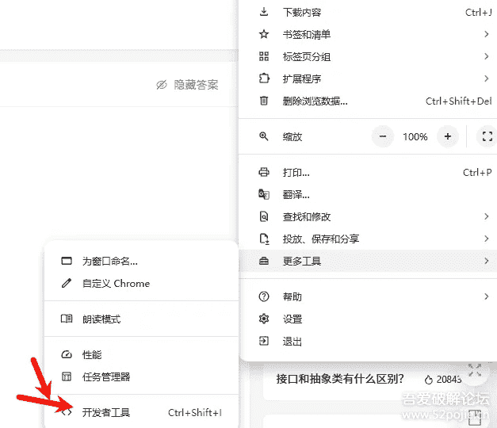

禁止当前 `debugger` 生效。

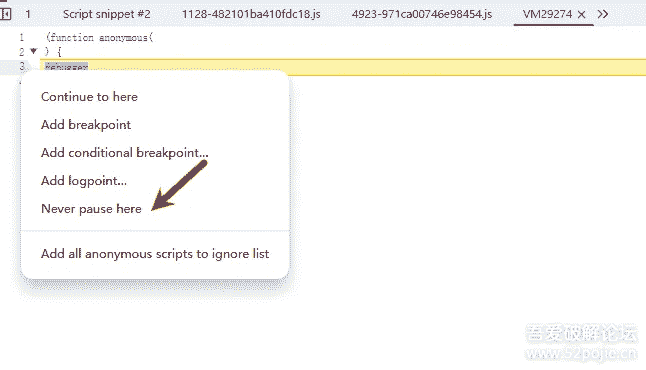

请求数据是加密的。

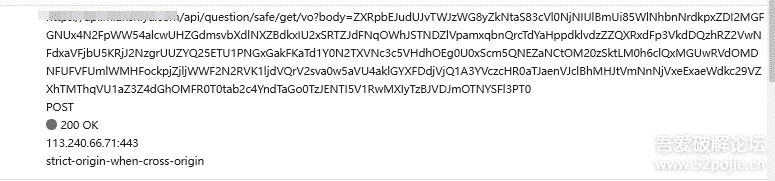

## 2. 代码分析

直接搜索 `body=`。用比较笨的办法，在全部地方打上 `debugger`。

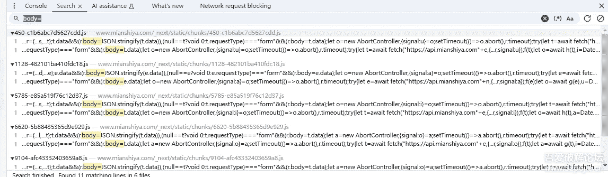

然后请求数据，在对应位置成功断下，把其他的 `debugger` 都移除。

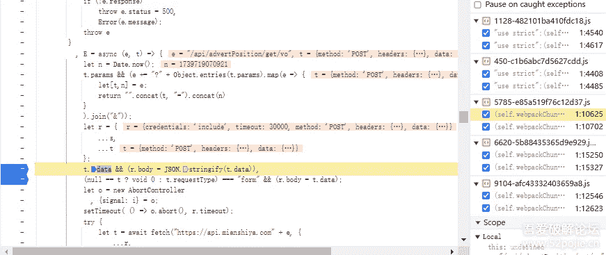

拼接了 `e`，先把它断下，从加密数据的栈往上面找。

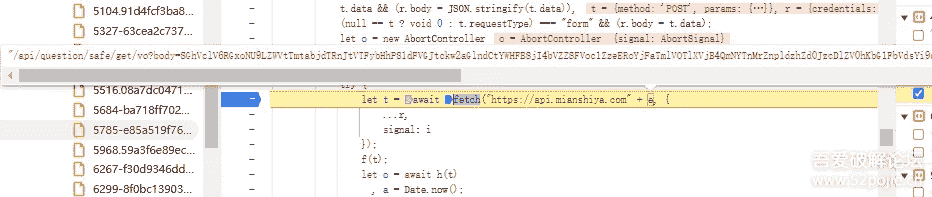

往上走一下看看，可以查找到 `publicEncrypt` 可疑的地方。

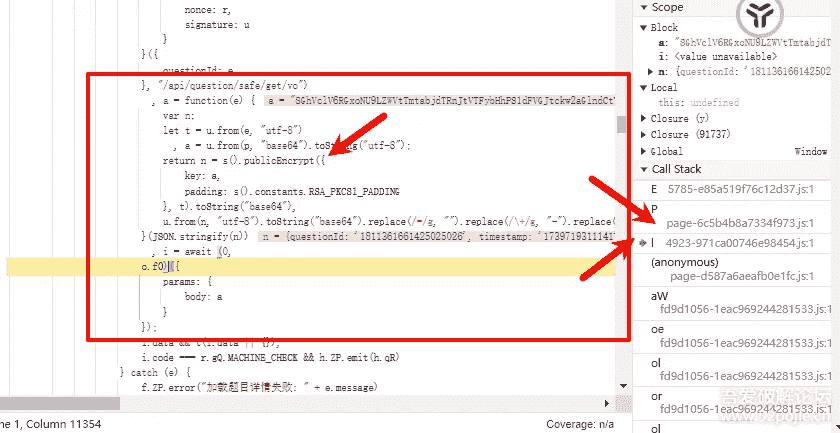

下个断点。

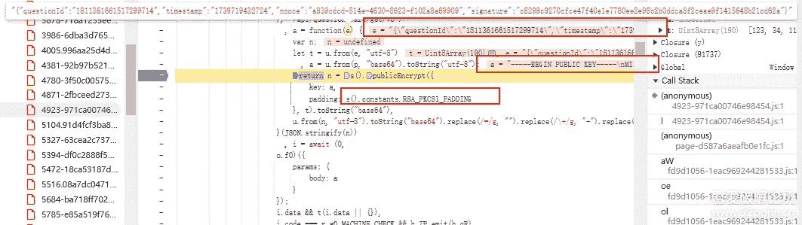

可以看到一些关键词：RSA 加密、公钥。尝试一下手动加密数据。加密之后的数据经过两次 Base64 转换，然后再替换一些字符。

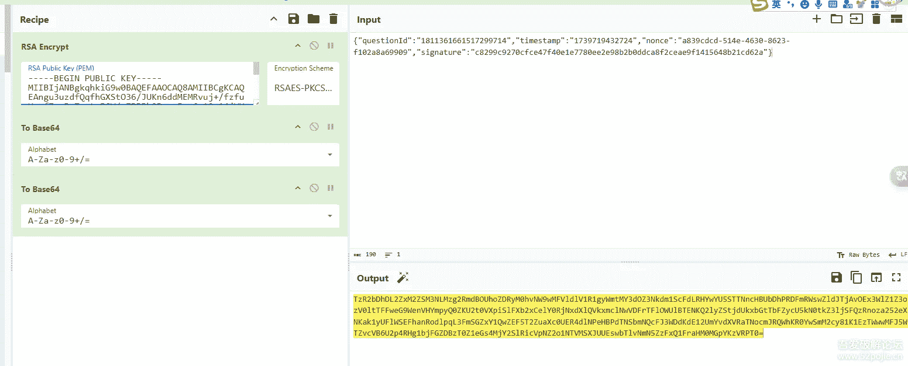

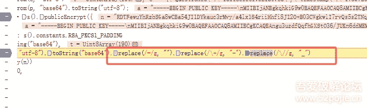

请求数据成功。

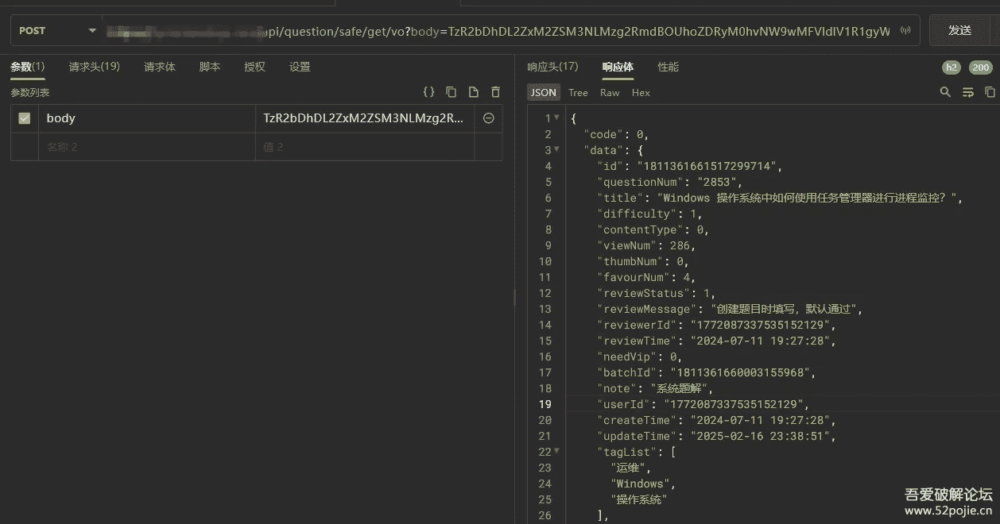

```
{"questionId":"1811361661517299714","timestamp":"1739719432724","nonce":"a839cdcd-514e-4630-8623-f102a8a69909","signature":"812cde98fba9e7112c55f9270ebf35c8f6e806ce503a0afac92f1389984d0321"}
```

`nonce` 和 `signature` 字段应该都是随机生成的。

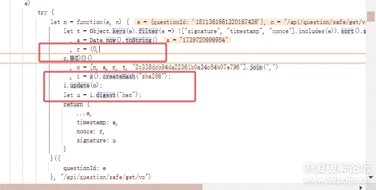

本文档所涉逆向分析内容仅为个人技术研究及学习交流之用，所有技术细节均基于公开可见信息整理。

技术研究应遵守国家法律法规及行业规范，使用者需对自身行为承担全部法律责任。如权利人认为存在侵权内容，请及时联系处理。
