# [CTF] 【2025春节】解题领红包之五 Windows高级题 小白解题全流程
- 原帖: https://www.52pojie.cn/forum.php?mod=viewthread&tid=2007440
- 抓取时间: 2026-11-01T22:14:46

## 吾爱2025-Windows逆向高级题-5
CTF逆向小白解题全流程，过程中可能有些点有问题，请大佬们多多指教。
考点：异步消息执行，变种`tea`展开、变种`MD5`、时间戳、Flag分段检查

## 解题过程
这一段是获取两个编辑框的内容，即`uid`和`flag`，然后`flag`要符合异或的那一系列条件，实际格式是`flag{...}`。
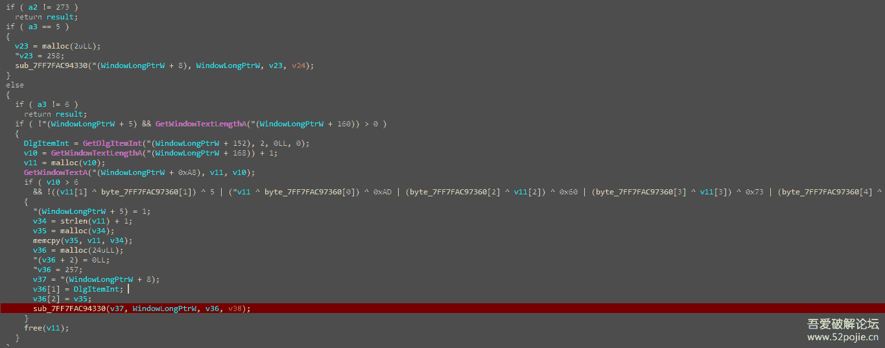
1.png (55.75 KB, 下载次数: 7)
[href="forum.php?mod=attachment&aid=Mjc1NTc5N3wxZDdmNmQ5M3wxNzkzNTcxMjg0fDE2ODA4NnwyMDA3NDQw&nothumb=yes" target="_blank"](https://www.52pojie.cn/forum.php?mod=attachment&aid=Mjc1NTc5N3wxZDdmNmQ5M3wxNzkzNTcxMjg0fDE2ODA4NnwyMDA3NDQw&nothumb=yes)
2025-2-18 18:03 上传
跟到这边发现有一系列函数，`main_program`里面的执行验证按钮后主流程，`execute`是`main_program`里面通过不同消息来执行不同命令的函数。（都是自命名的函数，仅代表个人想法）
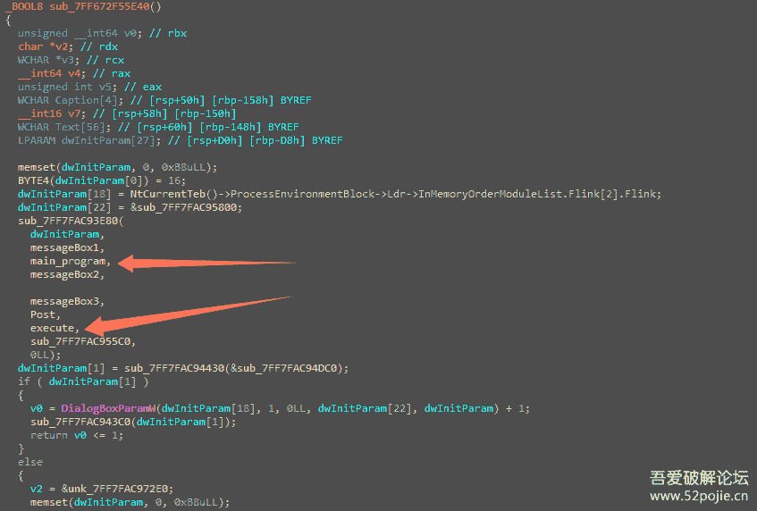
2.png (58.53 KB, 下载次数: 7)
[href="forum.php?mod=attachment&aid=Mjc1NTc5OHxhMWJjMGNlY3wxNzkzNTcxMjg0fDE2ODA4NnwyMDA3NDQw&nothumb=yes" target="_blank"](https://www.52pojie.cn/forum.php?mod=attachment&aid=Mjc1NTc5OHxhMWJjMGNlY3wxNzkzNTcxMjg0fDE2ODA4NnwyMDA3NDQw&nothumb=yes)
2025-2-18 18:03 上传

### execute函数
其他消息：将`flag`括号内数据进行`unhex`（如`1122`字符串直接转成`0x11`,`0x22`数据）
`0x35`消息：获取当前半小时整点时间戳数据。
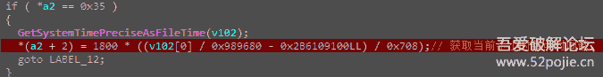
3.png (15.33 KB, 下载次数: 8)
[href="forum.php?mod=attachment&aid=Mjc1NTc5OXwzNjhlYTQzNHwxNzkzNTcxMjg0fDE2ODA4NnwyMDA3NDQw&nothumb=yes" target="_blank"](https://www.52pojie.cn/forum.php?mod=attachment&aid=Mjc1NTc5OXwzNjhlYTQzNHwxNzkzNTcxMjg0fDE2ODA4NnwyMDA3NDQw&nothumb=yes)
2025-2-18 18:03 上传
`0x55`消息：通过利用变种`MD5`+`Salt`将解密完数据的前十六字节计算得到4字节数值。
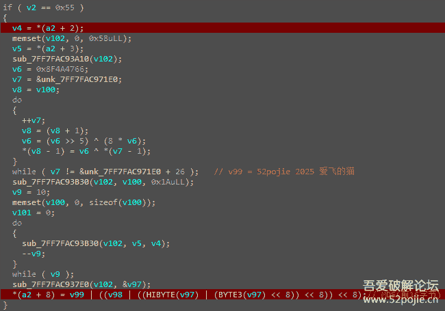
4.png (40.17 KB, 下载次数: 8)
[href="forum.php?mod=attachment&aid=Mjc1NTgwMHw0ZWYwMGNhMXwxNzkzNTcxMjg0fDE2ODA4NnwyMDA3NDQw&nothumb=yes" target="_blank"](https://www.52pojie.cn/forum.php?mod=attachment&aid=Mjc1NTgwMHw0ZWYwMGNhMXwxNzkzNTcxMjg0fDE2ODA4NnwyMDA3NDQw&nothumb=yes)
2025-2-18 18:03 上传
`0x25`消息：`unhex`后数据进行解密（`Decrypt`函数）。
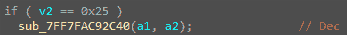
5.png (2.53 KB, 下载次数: 8)
[href="forum.php?mod=attachment&aid=Mjc1NTgwMXwxOGRjMTJhNnwxNzkzNTcxMjg0fDE2ODA4NnwyMDA3NDQw&nothumb=yes" target="_blank"](https://www.52pojie.cn/forum.php?mod=attachment&aid=Mjc1NTgwMXwxOGRjMTJhNnwxNzkzNTcxMjg0fDE2ODA4NnwyMDA3NDQw&nothumb=yes)
2025-2-18 18:03 上传

### main_program函数
#### 第一部分
获取`flag`括号内数据通过消息分发执行`execute`的`unhex`消息，然后再执行`execute`的`Decrypt`函数，解密`unhex`后的数据，将解密完的数据长度赋值给`v12`。
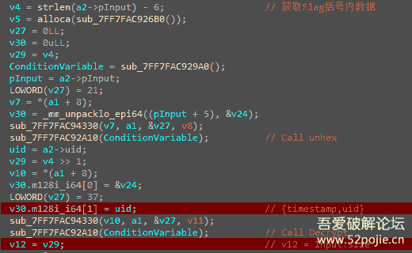
6.png (35.61 KB, 下载次数: 6)
[href="forum.php?mod=attachment&aid=Mjc1NTgwMnwyZTM4MzEwOHwxNzkzNTcxMjg0fDE2ODA4NnwyMDA3NDQw&nothumb=yes" target="_blank"](https://www.52pojie.cn/forum.php?mod=attachment&aid=Mjc1NTgwMnwyZTM4MzEwOHwxNzkzNTcxMjg0fDE2ODA4NnwyMDA3NDQw&nothumb=yes)
2025-2-18 18:03 上传

#### 第二部分
将解密完数据的前16字节进行`custom_MD5`，得到4字节数据，然后判断解密后数据第17个字节开始四个字节是否和计算得到的4字节数据相等。
如果相等就再次判断`v12`，即解密后数据长度，判断是否等于20。
再调用`execute`的时间戳获取消息，得到8字节时间戳数据。
最后再检查解密后数据前8字节是否等于时间戳数据，以及第九个字节往后8字节是否等于编辑框输入的`uid`。

#### 结论
输入的`flag`得是被和`Decrypt`相对于的加密函数进行加密后的数据，加密前格式：{半时整点时间戳（8字节），`uid`（8字节），`Custom_MD5`（前面十六字节）（4字节），`0x04`填充（四个字节）}
最后一部分填充会在下面`Decrypt`函数里面说明来由。
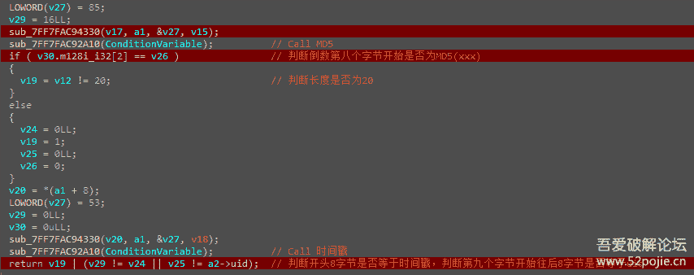
7.png (36.24 KB, 下载次数: 6)
[href="forum.php?mod=attachment&aid=Mjc1NTgwM3xkNzJlOTljN3wxNzkzNTcxMjg0fDE2ODA4NnwyMDA3NDQw&nothumb=yes" target="_blank"](https://www.52pojie.cn/forum.php?mod=attachment&aid=Mjc1NTgwM3xkNzJlOTljN3wxNzkzNTcxMjg0fDE2ODA4NnwyMDA3NDQw&nothumb=yes)
2025-2-18 18:03 上传

### Decrypt函数（`sub_7FF7FAC92C40`）
要求`unhex`后数据长度要是8的倍数，且利用一系列计算得到`v12`这个数据，参与内部解密的`Key`生成，最后还要求解密完的数据符合一系列条件验证。
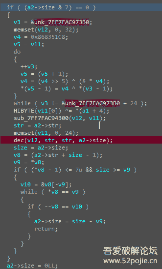
8.png (32.98 KB, 下载次数: 6)
[href="forum.php?mod=attachment&aid=Mjc1NTgwNHw0ZjAzYWI0ZnwxNzkzNTcxMjg0fDE2ODA4NnwyMDA3NDQw&nothumb=yes" target="_blank"](https://www.52pojie.cn/forum.php?mod=attachment&aid=Mjc1NTgwNHw0ZjAzYWI0ZnwxNzkzNTcxMjg0fDE2ODA4NnwyMDA3NDQw&nothumb=yes)
2025-2-18 18:03 上传

#### 解密后数据条件验证
从这部分逻辑代码可以分析，他是将最后`v8`指向最后一个数据，然后`v9`赋值最后一个数据，然后`v8`循环递减，直到当前`v8`指向`v8`开始往前的第`v9`个指针结束，然后最后解密后数据长度=`当前长度 - v9`。
已知解密后前面已经占用了20字节（时间戳+`uid`+`md5`），在`main_program`也已知解密后数据长度要等于20，所以可以知道这边`v9`必须等于4，所以`v8`等于4，最后这边一共占用4个字节，即{`4,4,4,4`}，这样经过这边的验证最后的`size`才会等于20。
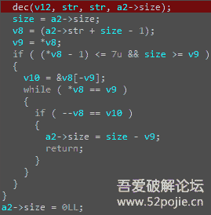
9.png (16.31 KB, 下载次数: 7)
[href="forum.php?mod=attachment&aid=Mjc1NTgwNXwxZTNlNTg5M3wxNzkzNTcxMjg0fDE2ODA4NnwyMDA3NDQw&nothumb=yes" target="_blank"](https://www.52pojie.cn/forum.php?mod=attachment&aid=Mjc1NTgwNXwxZTNlNTg5M3wxNzkzNTcxMjg0fDE2ODA4NnwyMDA3NDQw&nothumb=yes)
2025-2-18 18:03 上传

#### dec函数
将`unhex`后数据按8字节分块进行`tea`的解密，`tea`加密的`Key`由上一层传入的`v12`通过`RC4`得到，且每次解密`Key`都会变化（固定变化），直接动调就可以拿到几次解密用到的`Key`值。
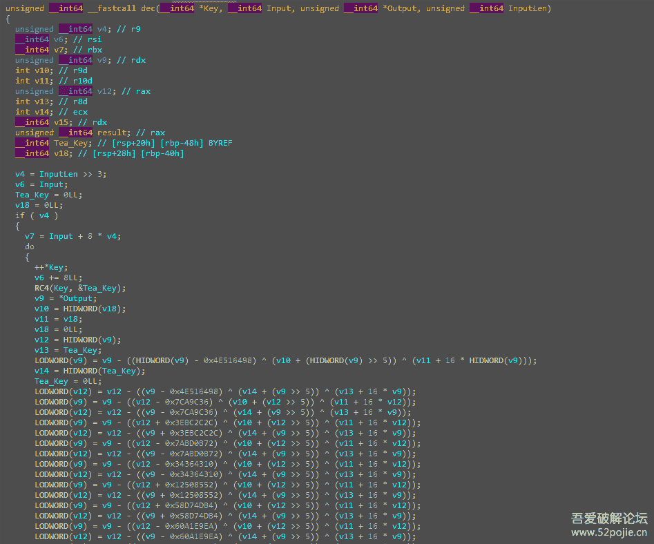
10.png (95.31 KB, 下载次数: 7)
[href="forum.php?mod=attachment&aid=Mjc1NTgwNnwwZjE0NTExZXwxNzkzNTcxMjg0fDE2ODA4NnwyMDA3NDQw&nothumb=yes" target="_blank"](https://www.52pojie.cn/forum.php?mod=attachment&aid=Mjc1NTgwNnwwZjE0NTExZXwxNzkzNTcxMjg0fDE2ODA4NnwyMDA3NDQw&nothumb=yes)
2025-2-18 18:03 上传
下面一系列解密就是`tea`的解密，不过是展开，可以数出一共是12轮，且`Delta`直接可以通过两次`sum`的值相减得到（由于`tea`解密这边应该是加上`sum`，`ida`伪代码展示是减，但是实际计算后数值一样），`B979379E`就是`tea`解密用到的`Delta`。
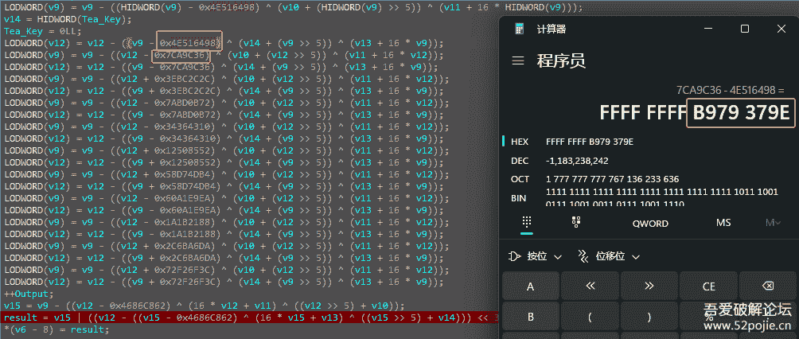
11.png (111.91 KB, 下载次数: 8)
[href="forum.php?mod=attachment&aid=Mjc1NTgwN3w3NWYyYjFhNnwxNzkzNTcxMjg0fDE2ODA4NnwyMDA3NDQw&nothumb=yes" target="_blank"](https://www.52pojie.cn/forum.php?mod=attachment&aid=Mjc1NTgwN3w3NWYyYjFhNnwxNzkzNTcxMjg0fDE2ODA4NnwyMDA3NDQw&nothumb=yes)
2025-2-18 18:03 上传
所以就可以通过动调得到的几次`Key`和`Delta`写出`tea`的加密代码。
```
uint32_t key1[] =
{
    0xD7851B65,
    0x473457C1,
    0x1231F787,
    0x9ACD6D9A
};
uint32_t key2[] =
{
    0xB728E994,
    0x1746382E,
    0xC52D865C,
    0x10778A6E
};
uint32_t key3[] =
{
    0x7459F437,
    0x90D1E5D,
    0x779375B2,
    0xEFCB8541
};

void tea_encrypt(uint32_t v[2], const uint32_t k[4])
{
    uint32_t v0 = v[0], v1 = v[1], sum = 0;

    uint32_t delta = 0xB979379E;

    for (uint32_t i = 0; i > 5) + k[3]);
        v0 += ((v1 > 5) + k[1]);
    }

    v[0] = v0;
    v[1] = v1;
}
```

### 主解题流程
通过用`c++`实现这部分代码，获取时间戳数据（8字节）。
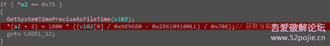
12.png (15.57 KB, 下载次数: 8)
[href="forum.php?mod=attachment&aid=Mjc1NTgwOHwwOGJmZDA3OHwxNzkzNTcxMjg0fDE2ODA4NnwyMDA3NDQw&nothumb=yes" target="_blank"](https://www.52pojie.cn/forum.php?mod=attachment&aid=Mjc1NTgwOHwwOGJmZDA3OHwxNzkzNTcxMjg0fDE2ODA4NnwyMDA3NDQw&nothumb=yes)
2025-2-18 18:03 上传
然后将`uid`转为8字节字节数据拼接到时间戳字节后面。
`MD5`值暂时填充4个`0x00`，将`MD5`值和4个`0x04`字节拼接上。
将完整数据进行`tea_encrypt`，再用`flag{}`包裹填入编辑框进行验证。
在`MD5`生成代码处，断点在箭头处，即可得到`MD5`四字节数据。
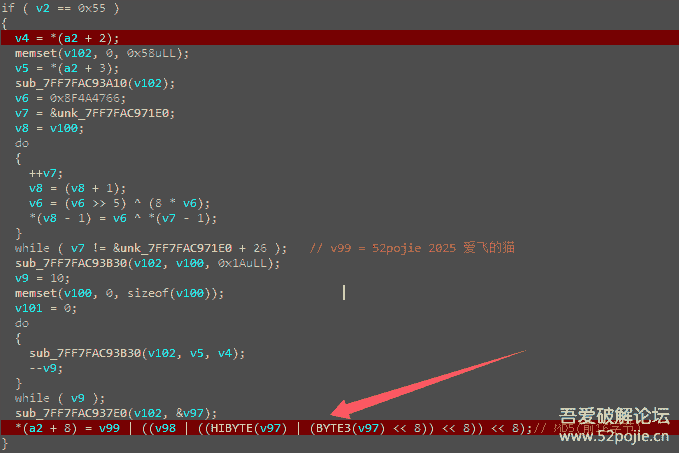
13.png (42.34 KB, 下载次数: 9)
[href="forum.php?mod=attachment&aid=Mjc1NTgwOXwwNjBmMDVhN3wxNzkzNTcxMjg0fDE2ODA4NnwyMDA3NDQw&nothumb=yes" target="_blank"](https://www.52pojie.cn/forum.php?mod=attachment&aid=Mjc1NTgwOXwwNjBmMDVhN3wxNzkzNTcxMjg0fDE2ODA4NnwyMDA3NDQw&nothumb=yes)
2025-2-18 18:03 上传
最终再重复上面步骤即可得到`flag`。

### 完整代码
```
#include 
#include 
void tea_encrypt(uint32_t v[2], const uint32_t k[4])
{
    uint32_t v0 = v[0], v1 = v[1], sum = 0;
    uint32_t delta = 0xB979379E;
    for (uint32_t i = 0; i > 5) + k[3]);
        v0 += ((v1 > 5) + k[1]);
    }
    v[0] = v0;
    v[1] = v1;
}

/*
输入格式：
flag
{
tea_enc
(
    timestamp 8字节
    uid 8字节
    md5 4字节
    0x04*4 4字节填充
)
}
*/
int main()
{
    // 动调得到的三个Key
    uint32_t key1[] =
    {
        0xD7851B65,
        0x473457C1,
        0x1231F787,
        0x9ACD6D9A
    };
    uint32_t key2[] =
    {
        0xB728E994,
        0x1746382E,
        0xC52D865C,
        0x10778A6E
    };
    uint32_t key3[] =
    {
        0x7459F437,
        0x90D1E5D,
        0x779375B2,
        0xEFCB8541
    };
    uint8_t timestamp_bytes[8]{};
```


```cpp
    uint8_t uid[]{ 0x50, 0x04, 0x23, 0x00, 0x00, 0x00, 0x00, 0x00 };

    // 动调得到MD5四个字节，加上最后4个0x04填充

    uint8_t md5_and_pad[]{ 0xD2, 0x63, 0xE4, 0xE6, 0x04, 0x04, 0x04, 0x04 };

    // 半时整点时间戳计算

    FILETIME time{};

    DWORD64 timestamp{};

    GetSystemTimeAsFileTime(&time);

    memcpy((void*)(&timestamp), (void*)(&time), 8);

    timestamp = 1800 * ((timestamp / 0x989680 - 0x2B6109100LL) / 0x708);

    memcpy((void*)(timestamp_bytes), (void*)(&timestamp), 8);

    // 加密数据

    tea_encrypt((uint32_t*)timestamp_bytes, (uint32_t*)key1);

    tea_encrypt((uint32_t*)uid, (uint32_t*)key2);

    tea_encrypt((uint32_t*)md5_and_pad, (uint32_t*)key3);

    printf("flag{");

    for (int i = 0; i 
```

## 心得

动调调试分析程序主体流程很重要，要先了解大概执行框架才能逐步往下层分析，且上层一些代码条件有助于下层的分析。

然后踩了一个严重的坑就是IDA伪代码里面的变量值和实际值一些情况下是不一样的，之前写题没在意那么多，这次很多地方都发现有这种问题，卡了我分析好久。所以关键代码段最好用汇编逐步分析，看实际数据的变化。
