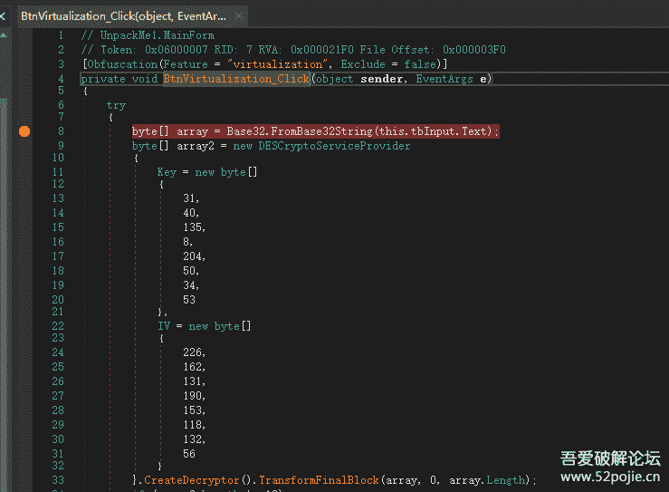
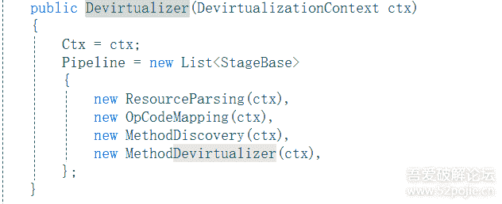
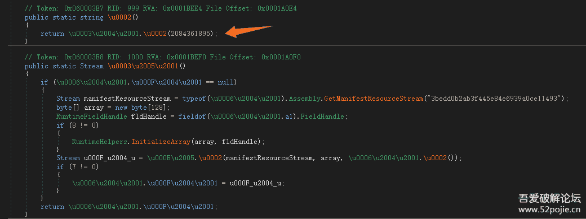
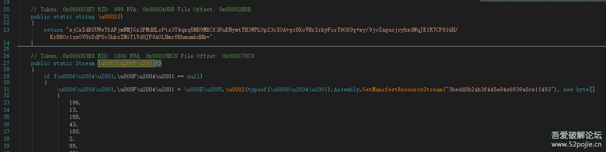
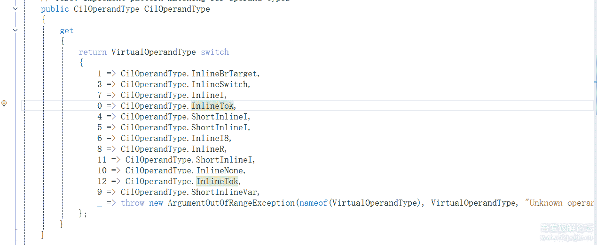
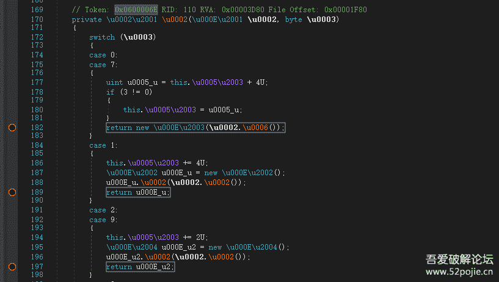
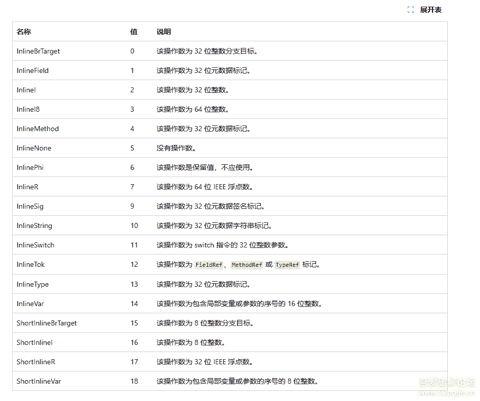

# [.NET逆向] EazFuscator.NET IL 虚拟化还原

- 原帖：[https://www.52pojie.cn/forum.php?mod=viewthread&tid=2008109](https://www.52pojie.cn/forum.php?mod=viewthread&tid=2008109)
- 抓取时间：2026-11-01T22:14:38

## EazFuscator.NET IL 虚拟化还原

有关 EazFuscator 的 IL 虚拟化保护，首先感谢 [@](https://www.52pojie.cn/home.php?mod=space&uid=520012) 的逆向分析以及提供的样本，参见[该分析帖](https://www.52pojie.cn/forum.php?mod=viewthread&tid=958680&extra=&highlight=EazFus&page=1)。

本次编写的的工具，参考的开源项目是 [EazyDevirt](https://github.com/puff/EazyDevirt)，对该项目的整个调试与修复，当然离不开原始样本，用于对照分析 IL 指令。

*image.png（24.26 KB，下载次数：0），2025-2-20 21:24 上传；[附件](https://www.52pojie.cn/forum.php?mod=attachment&aid=Mjc1NjM2MHxkNjdlMDdmZHwxNzkzNTcxMjc2fDE2ODA4NnwyMDA4MTA5&nothumb=yes)*

阅读和调试源码可知，工具再执行去虚拟化时会有四个阶段，分别是 Resource Parsing、Opcode Mapping、Method Discovery 和 Method Devirtualizer。

*image 1.png（25.32 KB，下载次数：0），2025-2-20 20:45 上传；[附件](https://www.52pojie.cn/forum.php?mod=attachment&aid=Mjc1NjMxNHw3NTI0ODNkN3wxNzkzNTcxMjc2fDE2ODA4NnwyMDA4MTA5&nothumb=yes)*

调试过程中发现 Resource Parsing 阶段会失败，是因为字符串被加密了。

*image 2.png（23.04 KB，下载次数：0），2025-2-20 20:45 上传；[附件](https://www.52pojie.cn/forum.php?mod=attachment&aid=Mjc1NjMxNXw5YjM3NDhjOHwxNzkzNTcxMjc2fDE2ODA4NnwyMDA4MTA5&nothumb=yes)*

需要进行一定的解密。

*image 3.png（21.32 KB，下载次数：0），2025-2-20 20:45 上传；[附件](https://www.52pojie.cn/forum.php?mod=attachment&aid=Mjc1NjMxNnxjMmE5NTFlNnwxNzkzNTcxMjc2fDE2ODA4NnwyMDA4MTA5&nothumb=yes)*

初始化过程中会用到下面的关键数据：

`GetVMMethodCryptoKey`、`DecryptPosition`、`Method Cryoto Key`、`GetVMPositionCryptoKey`、`Position Crypto Key`、`Encoded Method Key`、`Method Key`、`VM Resource Stream Getter`

`VM Resource Stream Initializer`、`VM Resource`、`VM Resource Stream Key Bytes`、`VM Resource Modulus String`、`Type fields`、`VM opcode dictionary method`

`VM opcodes with handlers`、`VM opcodes`、`opCode`、`operandType`、`HasVirtualCode`

`VMOpCode.cs` 处理了虚拟 `OperandType` 与真实 `OperandType` 的对应关系。

*image 4.png（57.47 KB，下载次数：0），2025-2-20 20:45 上传；[附件](https://www.52pojie.cn/forum.php?mod=attachment&aid=Mjc1NjMxN3xiZTI0MjE1NXwxNzkzNTcxMjc2fDE2ODA4NnwyMDA4MTA5&nothumb=yes)*

`Token` 为 `0x0600006E` 的函数，对这里调试主要用于修正 `VMOpCode.cs` 的代码，也就是上面的代码。

*image 5.png（22.75 KB，下载次数：0），2025-2-20 20:45 上传；[附件](https://www.52pojie.cn/forum.php?mod=attachment&aid=Mjc1NjMxOHwyMmQzNjU2ZnwxNzkzNTcxMjc2fDE2ODA4NnwyMDA4MTA5&nothumb=yes)*

微软官方给出的 `OperandType` 解释：

*image 6.png（66.67 KB，下载次数：0），2025-2-20 20:45 上传；[附件](https://www.52pojie.cn/forum.php?mod=attachment&aid=Mjc1NjMxOXxjMGZkZjQzMXwxNzkzNTcxMjc2fDE2ODA4NnwyMDA4MTA5&nothumb=yes)*

由于我对 .NET 不是很熟悉，下表是一些猜测：

| `virtual operand type` | `type` |
| --- | --- |
| 0，7 |  |
