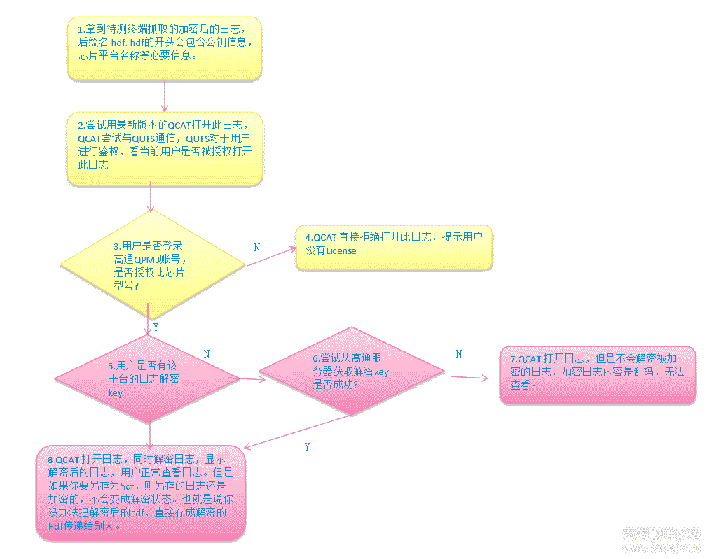
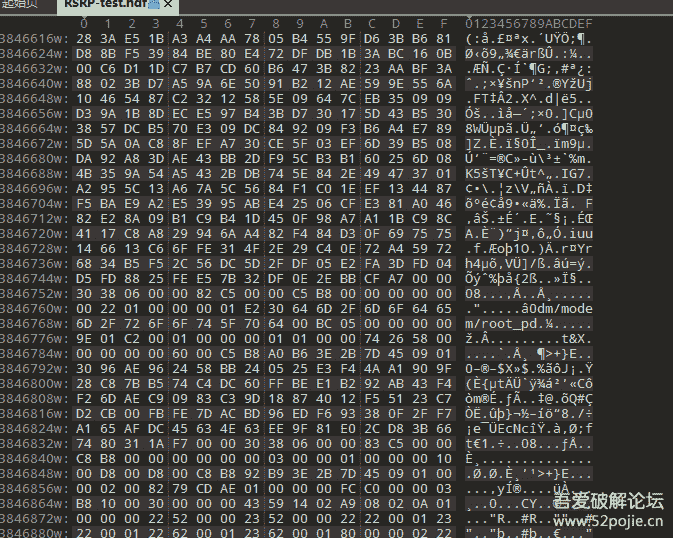
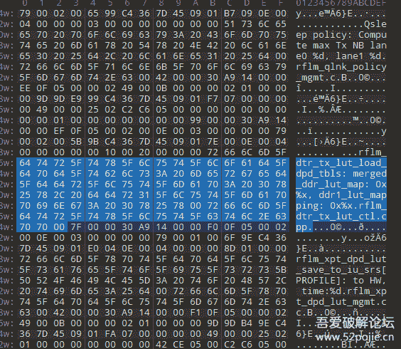
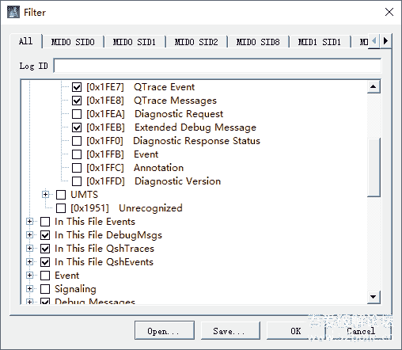
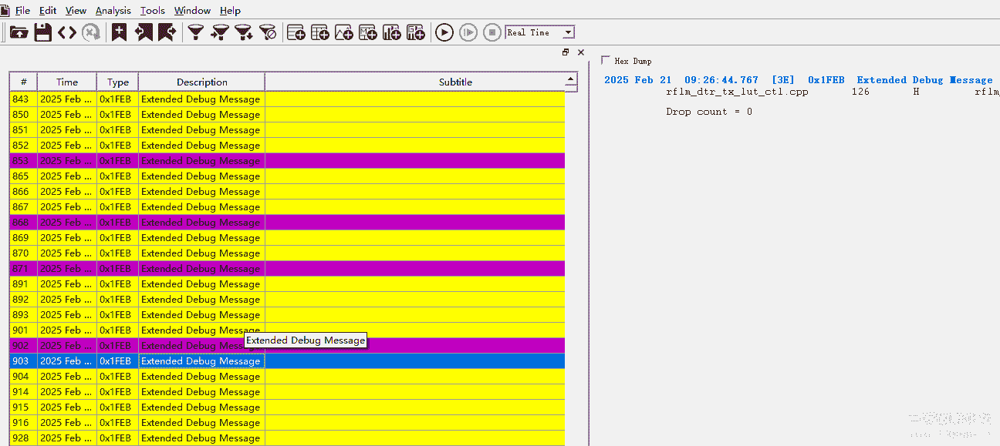
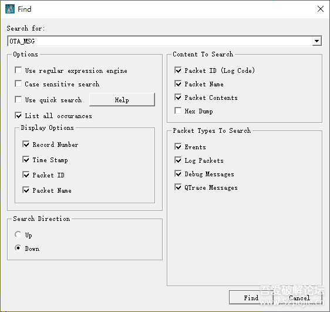
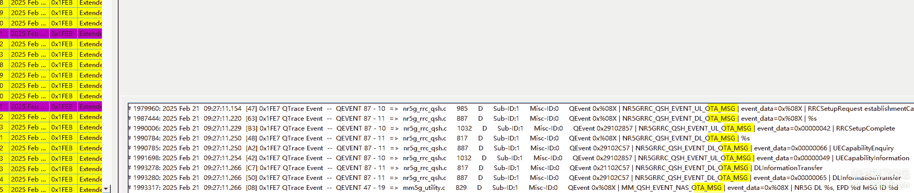
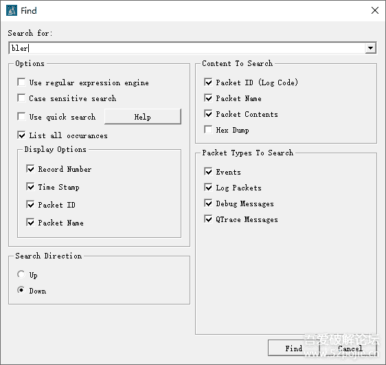
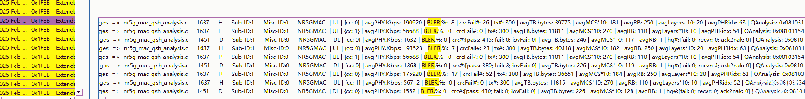
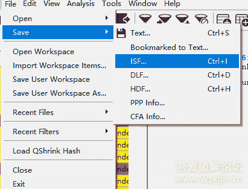

# [原创] 【原创】高通平台5G日志加密分析和部分分析信息提取方法

> 原帖：https://www.52pojie.cn/forum.php?mod=viewthread&tid=2008623
>
> 抓取时间：2026-11-01T22:14:32

## 1、技术背景

从2024年底开始，高通在最新基线上开始启用了5G中关键logpacket的加密。这种加密是从modem芯片固件中就启用的加密，也就是无论采用什么第三方软件，如果没有高通的授权，得到的芯片吐出的日志就是加密的，无法解析出正常的信令。这不仅仅是很多第三方路测软件的噩梦，导致第三方软件抓取的日志无法解析，高通曾经开放日志结构供分析的年代一去不复返了。这也是通信爱好者的一大损失。也就是说，即使你想办法拿到了别人给的log，手里有QXDM、QCAT一类的软件，由于没有license key，就无法从高通服务器拿到解密key。拿不到解密key，也就无法进行任何分析。而且这个没法子通过简单的[www.52pojie.cn](https://www.52pojie.cn)最新版本的高通工具来进行解密。那么我们就没有任何办法了么。经过一段时间的分析，我发现可以采用另一条路可以进行适当的分析。也就是高通没有堵死所有的路。还留了一扇窗。

## 2、技术原理

要理解这个新的路子，就要从高通目前的加密结构来分析。如下是根据自己的理解，画的一个流程图，展示目前高通工具如何对于加密的日志进行打开处理：

image.png (82.07 KB, 下载次数：1)

[附件](https://www.52pojie.cn/forum.php?mod=attachment&aid=Mjc1Njc3OXw3MGVlYTViMnwxNzkzNTcxMjcwfDE2ODA4NnwyMDA4NjIz&nothumb=yes)

2025-2-22 18:39 上传

其中黄色底色的部分，从2022年开始就已经有了，当时的日志是没有加密的，只是会校验license，如果没有license，QCAT就拒绝打开。由于这套逻辑是在QCAT这个软件里面的，通过仔细研究，以及前面的帖子提到的技术，比较容易的就能破解QCAT，让他无论什么条件都能打开日志。而且只有`hdf`格式的日志才能存储License所需的信息，打开之后我只需要将日志另存为`isf`或者`dlf`格式，就完全将高通这套机制攻克了。`isf`和`dlf`格式是被很多第三方软件支持的，而且也可以传递给其他人去分析，而不受任何License限制。这是在QCAT6很容易做到的事情。

从QCAT7系列开始，一些关键的解码操作就从QCAT本身挪到了QUTS里面，导致如果QUTS不会破解，光破解QCAT就没用。而且QCAT7取消了`isf`和`dlf`的另存为选项，导致只能存`hdf`格式。相当于堵上了一条路。但是QUTS经过一系列的分析也是可以破解的，凡是拒绝服务的逻辑，都是经过一定时间的付出，总是可以攻克的。最差的情况下可以存为`txt`传递给其他人帮忙分析。

直到2024年底，遇到了log加密。破解解密密钥，从实际上来说基本不可能。而且是芯片内部的加密，不论是采用什么软件读取出来都是加密信息。也就是后面红色部分的技术。基本上让分析之路无路可走。

难道真的就是所有东西都加密了??? 直到我用十六进制文件编辑器010editor打开一个`hdf`文件之后，我发现了一些有意思的东西。可以看到大部分是乱码，也就是被加密的。

image.png (125.1 KB, 下载次数：1)

[附件](https://www.52pojie.cn/forum.php?mod=attachment&aid=Mjc1Njc4MHxhNTZjY2U1MXwxNzkzNTcxMjcwfDE2ODA4NnwyMDA4NjIz&nothumb=yes)

2025-2-22 18:50 上传

但是偶尔却找到一些明文，而且是一些关键信息的打印，如下可见，下面的部分是没有加密的，明文字符串。里面有`%d`、`%x`等格式化字符串的指令。

image.png (82.53 KB, 下载次数：1)

[附件](https://www.52pojie.cn/forum.php?mod=attachment&aid=Mjc1Njc4MXw3OTU4NjVkNHwxNzkzNTcxMjcwfDE2ODA4NnwyMDA4NjIz&nothumb=yes)

2025-2-22 18:52 上传

也就是说高通只加密了一部分信息。那到底是什么信息呢。经过仔细研究，高通的log类型分为如下几种：

Log packet & Log packet OTA：是高通自定义用于查看内部状态的日志或者3GPP定义的与基站交互的信令——打印频度较高，重要程度比较重要——加密了

event & debug message & QTrace：是高通软件开发自行打印的一些信息，也包含了很重要的一些关键信息步骤——打印频度非常高，重要程度一般，但是也包含了很多有用的信息——没有加密，估计这种大规模的打印加密的话，会影响芯片性能，故而暂时没有加密。

这些没有加密的信息就是我的突破点了，而且这部分信息也是查看内部状态的很重要的信息。某种程度上来说比加密的部分还有用。

关键还是怎么看到真正的信息。

## 3、具体实施方法

### （1）找到一个能打开`hdf`的老版本的破解版QCAT

我自行破解的版本如下：

image.png (7.03 KB, 下载次数：1)

[附件](https://www.52pojie.cn/forum.php?mod=attachment&aid=Mjc1Njc4Mnw1MmZlNjFiMHwxNzkzNTcxMjcwfDE2ODA4NnwyMDA4NjIz&nothumb=yes)

2025-2-22 18:58 上传

用这个版本打开`hdf`文件，采用如下过滤规则，过滤出没有加密的部分：

image.png (27.13 KB, 下载次数：1)

[附件](https://www.52pojie.cn/forum.php?mod=attachment&aid=Mjc1Njc4M3w3Njc5NWQ5NnwxNzkzNTcxMjcwfDE2ODA4NnwyMDA4NjIz&nothumb=yes)

2025-2-22 19:14 上传

确定后，QCAT破解版开始过滤，过滤后如下：

image.png (70.11 KB, 下载次数：1)

[附件](https://www.52pojie.cn/forum.php?mod=attachment&aid=Mjc1Njc4NHxhNmM3ZTRiOHwxNzkzNTcxMjcwfDE2ODA4NnwyMDA4NjIz&nothumb=yes)

2025-2-22 19:15 上传

可以看到右面显示了没有加密的信息。比如我们想看注册过程中一些流程，就可以搜索关键词了，按下CTRL+F，输入关键词

image.png (18.97 KB, 下载次数：1)

[附件](https://www.52pojie.cn/forum.php?mod=attachment&aid=Mjc1Njc4NXxlYmYxY2U4ZnwxNzkzNTcxMjcwfDE2ODA4NnwyMDA4NjIz&nothumb=yes)

2025-2-22 19:16 上传

结果如下：

image.png (74.08 KB, 下载次数：1)

[附件](https://www.52pojie.cn/forum.php?mod=attachment&aid=Mjc1Njc4NnwxOTNhNGVkZnwxNzkzNTcxMjcwfDE2ODA4NnwyMDA4NjIz&nothumb=yes)

2025-2-22 19:18 上传

可以看到是不是流程都看到了。

用如下关键词，可以看到终端整个测试过程中的数据流量参数

image.png (18.56 KB, 下载次数：1)

[附件](https://www.52pojie.cn/forum.php?mod=attachment&aid=Mjc1Njc4N3xiNmNmNzkzZXwxNzkzNTcxMjcwfDE2ODA4NnwyMDA4NjIz&nothumb=yes)

2025-2-22 19:19 上传

可以看到不同CC上的流量信息。

image.png (67.73 KB, 下载次数：1)

[附件](https://www.52pojie.cn/forum.php?mod=attachment&aid=Mjc1Njc4OHwxNWQ4MDc0NnwxNzkzNTcxMjcwfDE2ODA4NnwyMDA4NjIz&nothumb=yes)

2025-2-22 19:20 上传

更好的是QCAT 6允许保存为`dlf`，或者`isf`，这样的话发给任何人都无需license了。

image.png (25.9 KB, 下载次数：2)

[附件](https://www.52pojie.cn/forum.php?mod=attachment&aid=Mjc1Njc4OXw4NmRkMDJmZHwxNzkzNTcxMjcwfDE2ODA4NnwyMDA4NjIz&nothumb=yes)

2025-2-22 19:21 上传

实践表明，通过仔细的研究，还是能有所回报的。
