# [Web逆向] Akamai某环境VMP算法分析

- 原帖: https://www.52pojie.cn/forum.php?mod=viewthread&tid=2009699
- 抓取时间: 2026-11-01T22:14:25

## 前言

懂得都懂 直接开干。本文出口入口值会有些许区别 网站值没有固定。

仅分析部分算法。

## 流程分析

如下图 断点打在第一个 `wPz` 生成的地方。看 `jsz`

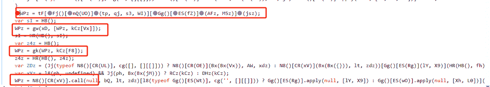

目标: 获取 `jsz` 中的 `mst` 的 `dvc`。如下图所示

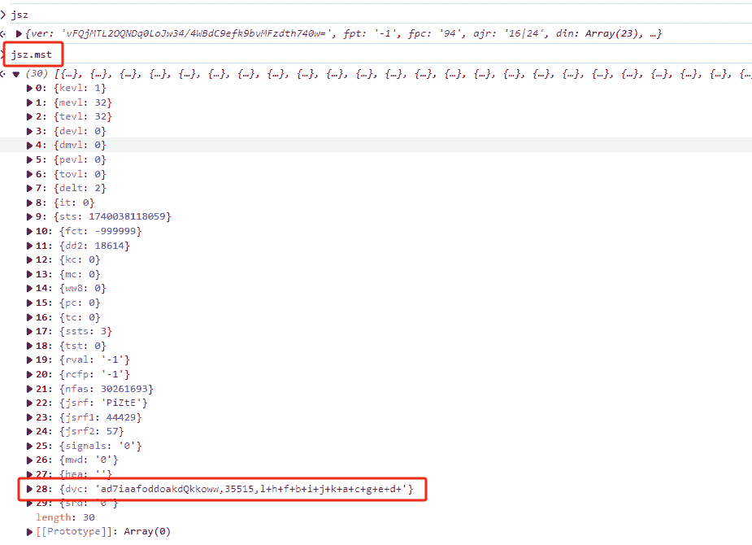

往上找，找到 `jsz` 生成的地方 如下图所示

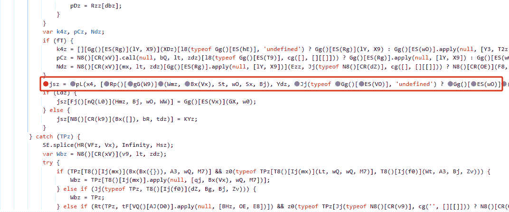

然后右边看作用域。找到与之匹配的 `"dvc"`

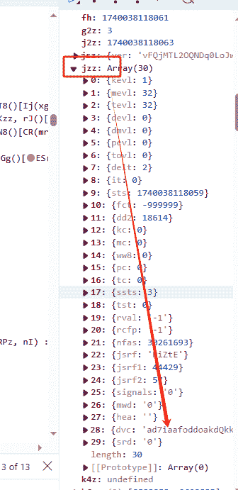

然后继续往上找 找到 `jzz` 的生成处

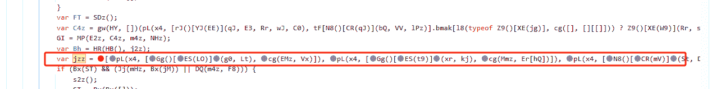

经过分析下面这段代码即使生成 `dvc` 的位置

```
pL(x4, [
    VQ()[AJ(xg)](FCz, lE, SL),
    N8()
      [CR(xV)].apply(null, [Gr, lt, zdz])
      [Gg()[ES(Rg)](lY, X9)](
        GI,
        Jj(typeof rJ()[YJ(Rg)], cg(N8()[CR(xV)](nR, lt, zdz), [][[]]))
          ? rJ()[YJ(s3)](gCz, vZ, sHz, hR, Bx(Bx(F8)))
          : rJ()[YJ(qJ)].call(null, Vx, Lt, q2z, H3, Cx)
      )
      [
        l8(typeof Gg()[ES(zx)], cg("", [][[]]))
          ? Gg()[ES(Rg)](lY, X9)
          : Gg()[ES(wO)].call(null, bI, bJ)
      ](Bh, rJ()[YJ(qJ)](Vx, Hj, q2z, H3, St))
      [
        Jj(typeof Gg()[ES(fZ)], "undefined")
          ? Gg()[ES(wO)](PCz, tO)
          : Gg()[ES(Rg)](lY, X9)
      ](bMz),
  ])
```

然后我们分析下

```
VQ()[AJ(xg)](FCz, lE, SL) = 'dvc'

GI = "a3iea3adfa3eeYe2yi2a"

Gg()[ES(Rg)](lY, X9) = 'concat'

rJ()[YJ(qJ)].call(null, Vx, Lt, q2z, H3, Cx) = ","

rJ()[YJ(qJ)](Vx, Hj, q2z, H3, St) = ","

bMz = 'l+h+f+b+i+j+k+a+c+g+e+d+'
```

这样大概的逻辑就很清楚了

如下图是入口地方

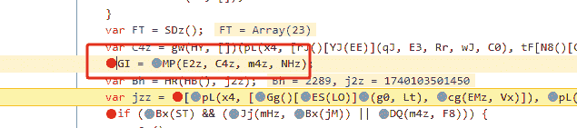

### 2> 日志

这里其实都不用看这个 随便看看 应该就知道哪个地方是重点

先监控下这个 `PT` 里的值

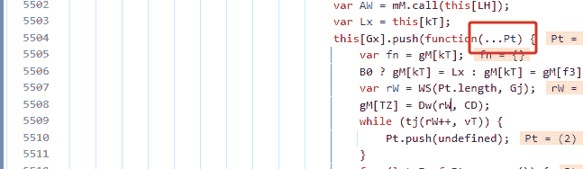

然后再监控下入口的这个传参值

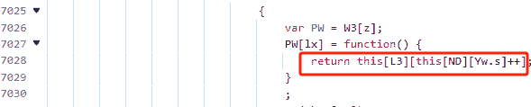

还需要看看入口的这个值 是什么

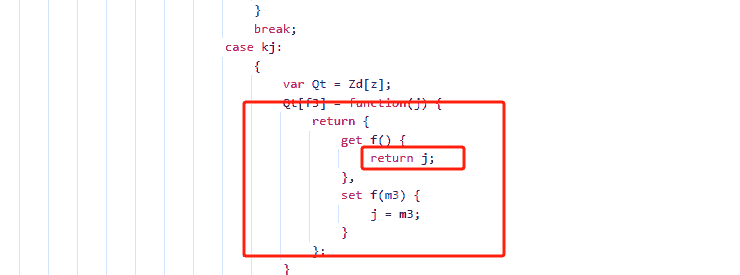

然后就是重点

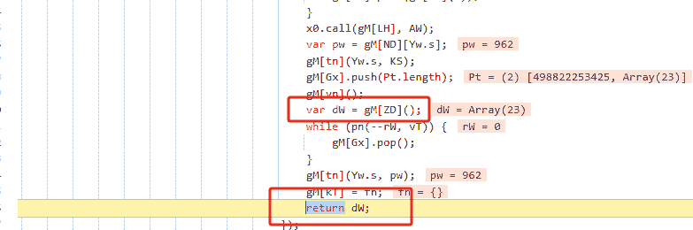

这个值会出来

先把入参找出来 本文是 `[2, '16|24', 0, 0]`

### 2> 第一个值

刷新完 看看日志。

挨个分析

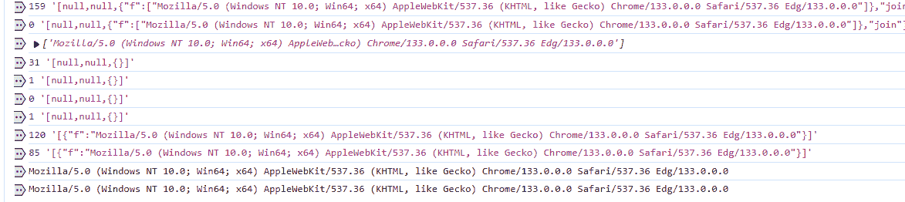

确定是 `UA` 可以暂时不用分析了。

### 2> 第二个值

如下图

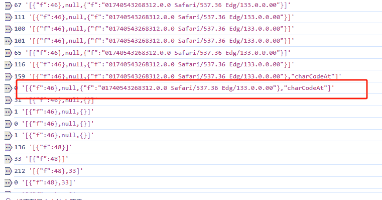

不讲了。 但是这个值得记录下来 2482411364

这里分享个第一个算法吧。 其他的自己努力努力

```
let UA =
  "Mozilla/5.0 (Windows NT 10.0; Win64; x64) AppleWebKit/537.36 (KHTML, like Gecko) Chrome/133.0.0.0 Safari/537.36 Edg/133.0.0.0";
let startTs = 1740487469858;

let frist = "0" + startTs.toString() + UA.slice(-32) + "0";

let r2 = 5381;
for (let i = 0; i >> 0;
console.log("r2", r2);
```

### 2> 第三个值

如下图

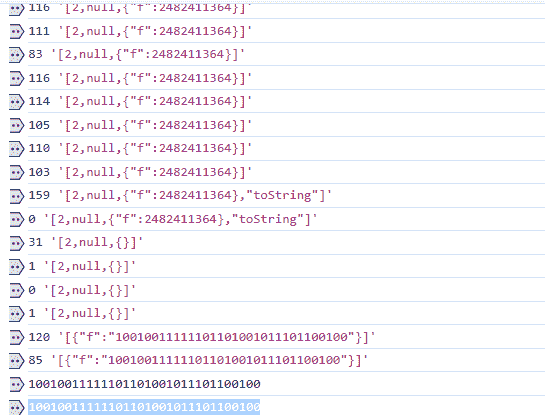

不讲了

把这个值也记录下来 10010011111101101001011101100100

### 2> 第四个值

第四个稍微就有点多了 坑点也增多

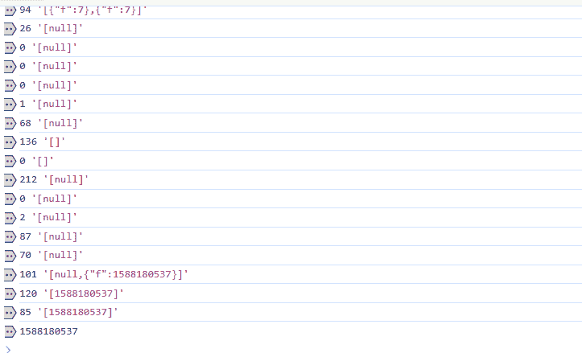

如下 入参的某个值 `charCodeAt` 了记录下来

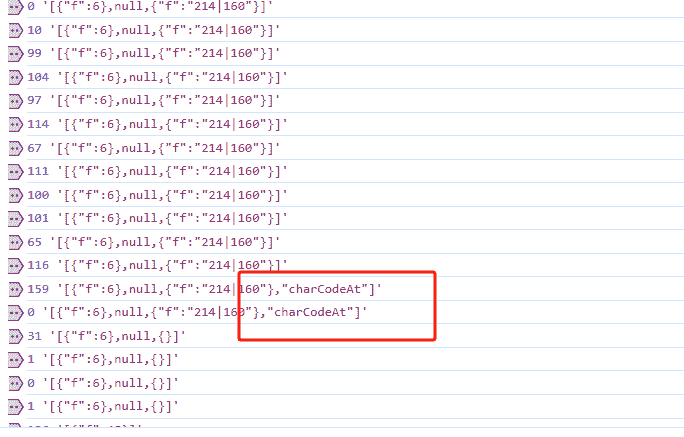

```
[..."214|160"].map(char=>char.charCodeAt())
```

这个 214 和 160是哪来的呢？

看入参的第二个值

拼接逻辑如下

```
[2, '16|24', 0, 0][0].toString() + [2, '16|24', 0, 0][1].toString() + [2, '16|24', 0, 0][2].toString()
```

继续网上看

可以发现 有个固定值 `split` 并且固定值 每次都经过了一些判断 并且 变成了新的一个值。

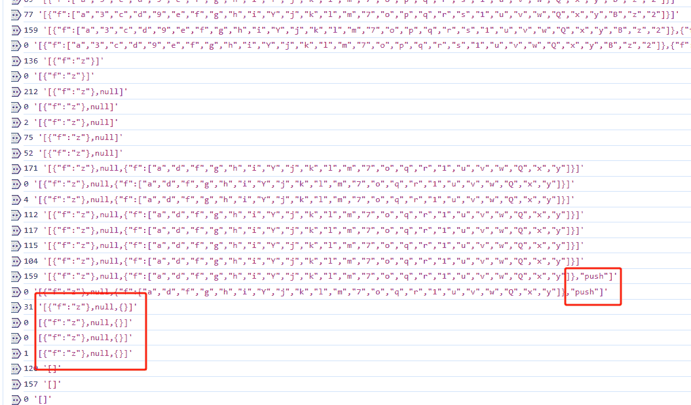

这里的逻辑和第四个值没啥关系 但是也还是需要搞出来。

如下图 得到最终值 以及一些算法 可以反推出来

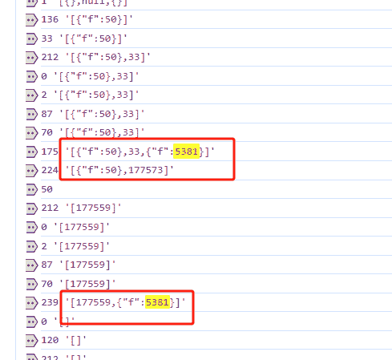

这里细节不多说了 最终值 1588180537

### 2> 第五个值

如下图

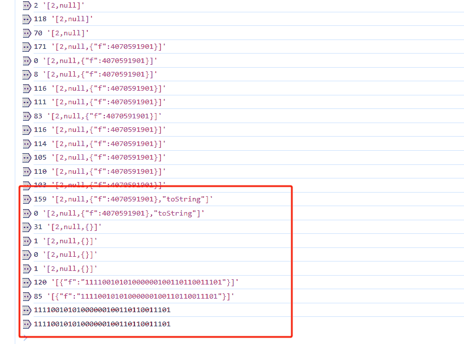

生成如下

```
(4070591901).toString(2)
```

重点就是 4070591901 怎么来的

不讲了 网上看看 有些坑 自己注意下就好了。

### 2> 第六个

这个 是最难的 也是最麻烦的

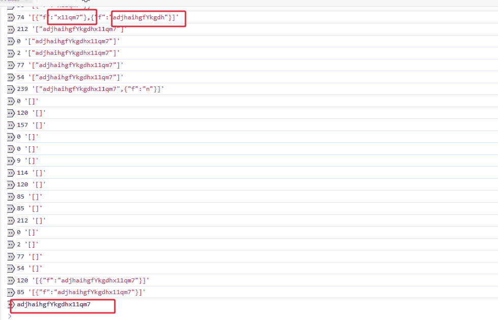

简单说下

这里分两个 长的字符串+短的字符串

#### 3> 长

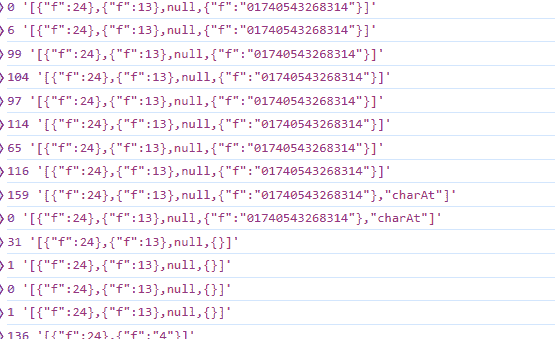

基于 两个传参的互相相加 然后 `charAt` 互相相加

#### 3> 短

太麻烦，有空了再说 单开贴 这个要搞的话日志要打全。

最好挨个跟栈去看控制流。

### 2> 结果

最后验证下结果

传入传参与入参

这是代码生成的值

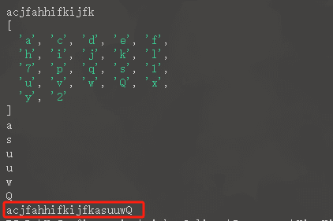

这是网站生成的值

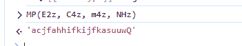

教程帮助 感谢我7
