# [原创] 分享一个逆向一个网络游戏的痛苦经历-小白

- 原帖：<https://www.52pojie.cn/forum.php?mod=viewthread&tid=2010644>
- 抓取时间：2026-11-01T22:14:17

遇事不决，可问春风，那么软件套壳加密到底是为了什么？

齐先生：作者操0，让你们这些cracker的0疼。哈哈哈。

我是菜鸡，大佬别笑话我。发个贴就是记录下，我下了删，删了下的爱盘工具终于用了一次。来吾爱的时候 Hmily（大力水手呼死你）还是小鲜肉，这多年了我总要留下点什么。

游戏是某易的某飞，申明水平很菜，帖子也很水，是基于一个开源的逆向自己来瞎折腾的。我其实也没啥进展，只是觉得找对了方向，分享一下经验。算不算原创了，我也不好说。这个开源的项目是10年以前了，作者早就没弄了，我猜测要么某易给了封口费，要么被制裁了。项目 github 上有：`SSchnitzler/XinFeiFei`，另外一个作者改了给 mySql 的版本新飞飞模拟器-老飞飞公益网。

版本都比较老，VS2012 版本的。高版本运行需要把里面的加密动态库重新生成一下，原作者的要有老版本 VS，我就用的是另外一个作者的包。

说说我为啥来研究了个残端了。这个游戏说真的被渣渣后端给玩废了的，对不起前端做的 UI，侮辱了我的青春。最近想进去看看，注册账号，上来就给我整破防了。

上图官方。

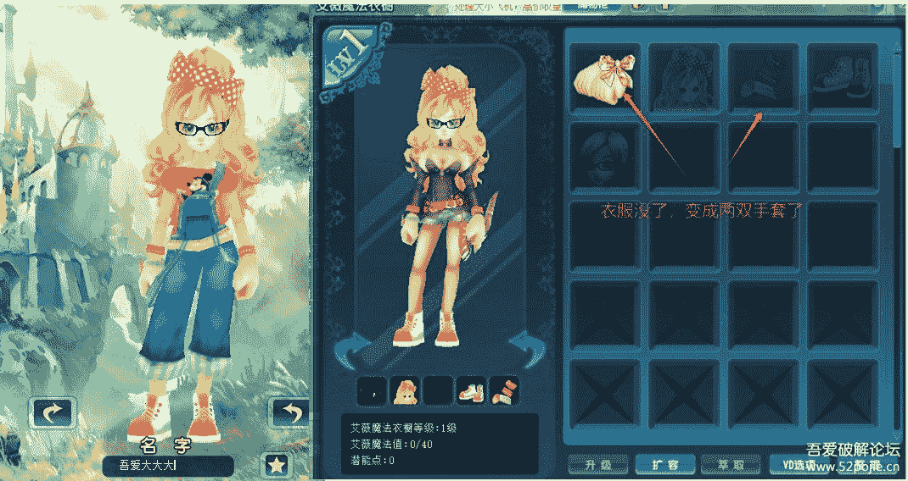

`微信截图_20250301190001.png` (125.95 KB, 下载次数: 0)

[附件](https://www.52pojie.cn/forum.php?mod=attachment&aid=Mjc1ODEzOHw2Mjk2ZmVlOHwxNzkzNTcxMjU1fDE2ODA4NnwyMDEwNjQ0&nothumb=yes)

2025-3-1 19:02 上传

残端

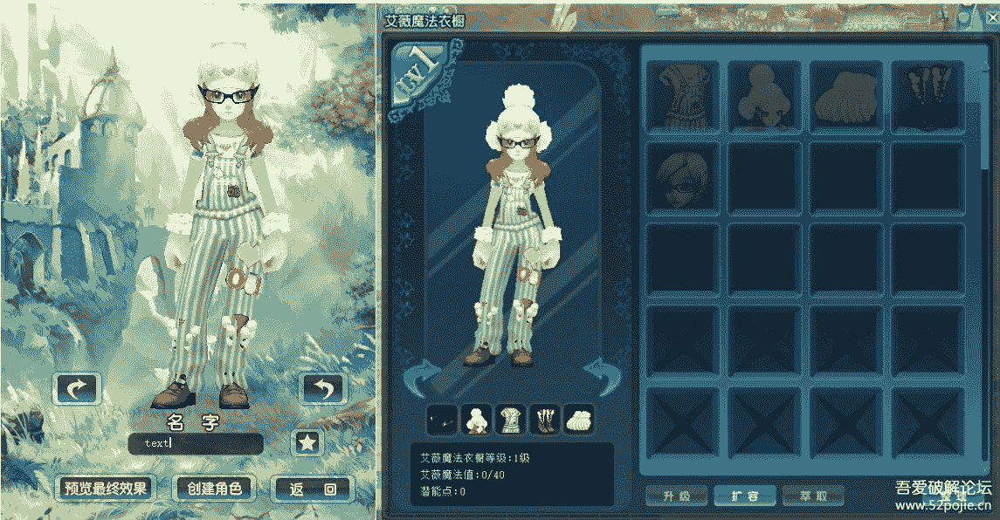

`微信截图_20250301190035.png` (142.02 KB, 下载次数: 0)

[附件](https://www.52pojie.cn/forum.php?mod=attachment&aid=Mjc1ODEzOXxjOWM1NWU5ZHwxNzkzNTcxMjU1fDE2ODA4NnwyMDEwNjQ0&nothumb=yes)

2025-3-1 19:02 上传

脑子是个好东西，多喝六个核桃。接下来上查壳图。

2017年2.1.466版本，还在裸奔状态，这就是为什么挂漫天飞的原因。

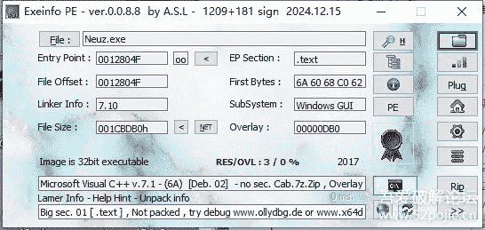

`01.png` (48.87 KB, 下载次数: 0)

[附件](https://www.52pojie.cn/forum.php?mod=attachment&aid=Mjc1ODE0MHwxMWNjMmJhM3wxNzkzNTcxMjU1fDE2ODA4NnwyMDEwNjQ0&nothumb=yes)

2025-3-1 19:07 上传

最新版本2.1.635是2024年初的重新封的包。

查一条大佬分享的知乎（非常建议新手看，清晰明了，就不试了，VMP不是我等凡人能碰的）：

对 VMProtect_v3.x 加壳后的软件进行 [//www.52pojie.cn/forum-5-1.html](https://www.52pojie.cn/forum-5-1.html) - 知乎

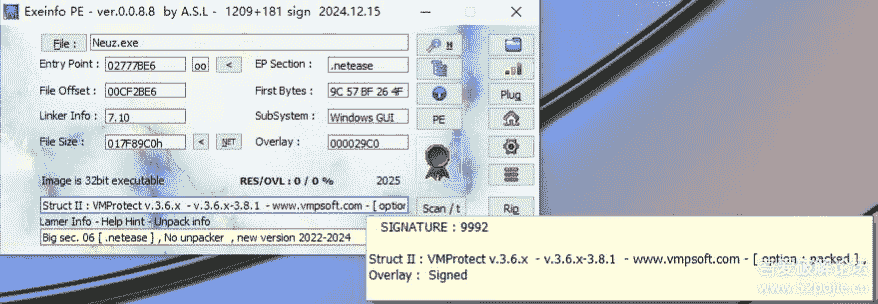

`02-01.png` (51.48 KB, 下载次数: 0)

[附件](https://www.52pojie.cn/forum.php?mod=attachment&aid=Mjc1ODE0MXxkYWU4NmQxNnwxNzkzNTcxMjU1fDE2ODA4NnwyMDEwNjQ0&nothumb=yes)

2025-3-1 19:09 上传

长达10多年的裸奔，你天天拿着游戏玩家花费的钱，满地是商人这个没毛病，让人家花钱还天天被挂虐好意思吗？我只能说欺负下我这种小白还行，稍微有点经验的，没一点用。我看别人是勾一堆，他这个查出来只勾了一个，可能是膨胀了会影响游戏运行，他们也不想大改，貌似是没啥挂了，可能是人气低没人玩，别人懒得研究了。

声明我对 [//www.52pojie.cn](https://www.52pojie.cn) 最新端不感兴趣，老端是不需要破解的，只需要修改 `server.ini`（这个文件本身是不会生成的，只有启动游戏才会生成，我自己放一个进去，用游戏的启动 `EXE` 直接启动）。

我就图个乐呵，换换时装，换换装备，带带宠物，要是能飞行也可以，慢慢研究。NPC、怪物、任务，我都不太感兴趣，就为了看看风景。这个Q萌的UI真不错，放在现在看也还行。

抓包，密钥种子1087355680，不要问我为啥知道，跟10多年前一样的配方。为啥抓包，后面说原因。

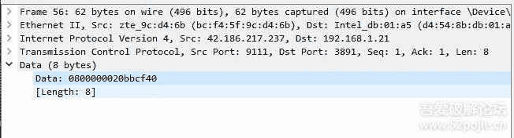

`微信截图_20250301191302.png` (30.69 KB, 下载次数: 0)

[附件](https://www.52pojie.cn/forum.php?mod=attachment&aid=Mjc1ODE0MnxhZTI2NjM4OXwxNzkzNTcxMjU1fDE2ODA4NnwyMDEwNjQ0&nothumb=yes)

2025-3-1 19:27 上传

开始主体，先说资源：Sever端，MySql，客户端。客户端的提取的lua脚本资源。

## 第一虐：开发环境

VS2012 太老了，用了 17 19 22，最终明白了就是把加密解密的动态库重新生产一下就好了。当然装给 12 的环境，其他版本也就能正常用了。

## 第二虐：数据库

`mysql` 我不会用，我是用图形软件 Navicat Premium 还原加手搓。

这个端服务器设计很不友好，文件夹套娃，看的真心累，我想着学习个框架，重构下，大约在冬季。第一个问题是数据有 `Item` 的表，但是背包里面的物品不能加载，进入游戏功能正常。那就说明数据结构没有大的问题。我仔细分析最终找到数据的 ID 是实际物品 `itmeID`，数据库 `tiemID` 其实是数据表的索引，所以加载不成功。找出这个问题到没多困难，难得是他套娃的文件夹管理把人整的没脾气。主要是我菜，IDE 跳转用不好。当时哪个开发者为啥没继续了，有没有种可能被这种低级的错误搞心态了。此处，大佬们需要一个我这样的小弟。这个就解决了部分物品加载的问题。

## 第二虐：装备属性

`attr` 看 lua 脚本里面是字节数组。就自己试着改了好几个版本就是都不行，贴出源码，大佬也可以帮我分析一下。

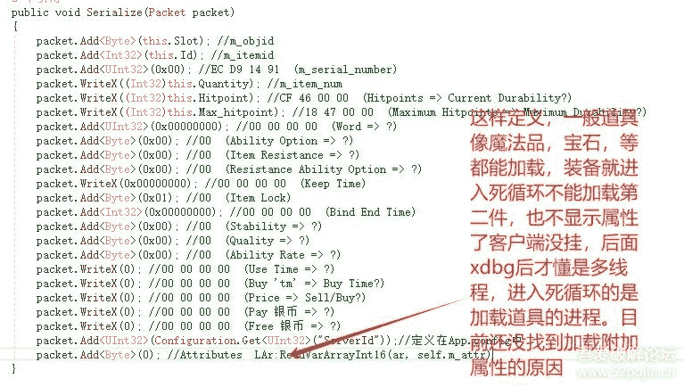

`微信截图_20250301195833.png` (121.4 KB, 下载次数: 1)

[附件](https://www.52pojie.cn/forum.php?mod=attachment&aid=Mjc1ODE0NnwzMzQ1OWYxZHwxNzkzNTcxMjU1fDE2ODA4NnwyMDEwNjQ0&nothumb=yes)

2025-3-1 20:01 上传

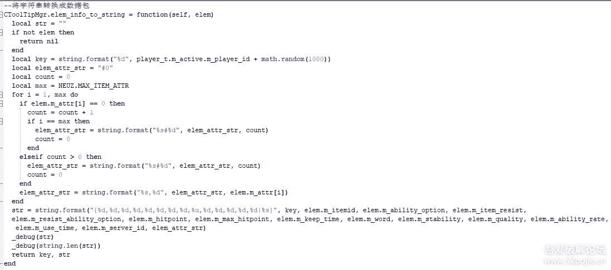

`微信截图_20250301200256.png` (64.09 KB, 下载次数: 0)

[附件](https://www.52pojie.cn/forum.php?mod=attachment&aid=Mjc1ODE0OHxlMDhjNmY4ZHwxNzkzNTcxMjU1fDE2ODA4NnwyMDEwNjQ0&nothumb=yes)

2025-3-1 20:06 上传

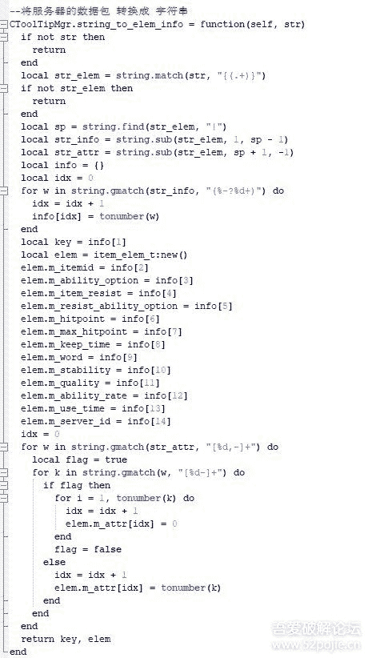

`微信截图_20250301200314.png` (85.71 KB, 下载次数: 0)

[附件](https://www.52pojie.cn/forum.php?mod=attachment&aid=Mjc1ODE0OXw0YjYzZWU1MHwxNzkzNTcxMjU1fDE2ODA4NnwyMDEwNjQ0&nothumb=yes)

2025-3-1 20:06 上传

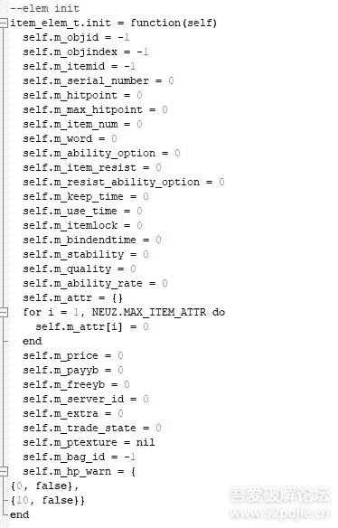

`微信截图_20250301200324.png` (50.37 KB, 下载次数: 0)

[附件](https://www.52pojie.cn/forum.php?mod=attachment&aid=Mjc1ODE1MHxjYTJmODZjYXwxNzkzNTcxMjU1fDE2ODA4NnwyMDEwNjQ0&nothumb=yes)

2025-3-1 20:06 上传

900多个lua脚本里面找出来三个有关的定义，我都不知道我经历了啥，还是我太菜不会找，VS CODE 可以搜索，但是甄别出来很费劲，我擅长的就是穷举，磨时间，最终是找到了但是改来改去，还是不行。

## 第三虐

这就是我为啥去抓游戏的包了，抓到这个包，解包，然后分析出来就行了。这个坑就有点大了，为了抓包我也是煞费苦心，抓了得会解密，的写个加解密脚本，写脚本是指导元宝写的，惨痛的经历，贴加解密的接口，算法太长了就不贴了，感兴趣的可以去看看，大模型都说很不安全，某易的新版本用了 AES 加密，我不不太懂 AES，反正他这个就是 Socket 服务器拿到一个种子，种子都明文了，我觉得至少加点盐啥的吧。结果是惨败，他改了封包，有了新的加密，我脚本是花费了好多口水让 AI 写好了，但是没达到效果，这个里面的坑是种子给动态库生成密钥，加密解密密钥看着是一样的。加密解密的算法也是一样的，AI 分析说会影响到 `key`，但是我没找到 `key` 的作用，好像也没被用到，反正我的第一个脚本失败，方法是自己 `new byte[]{}`，放到脚本解密。

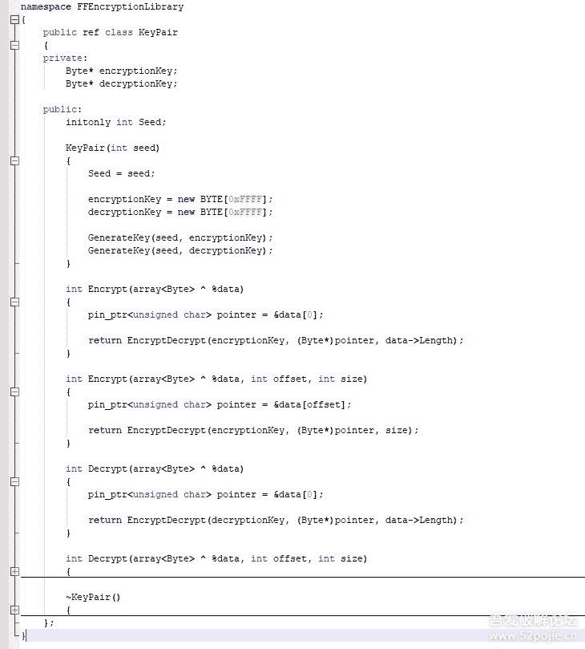

`001.png` (76.79 KB, 下载次数: 0)

[附件](https://www.52pojie.cn/forum.php?mod=attachment&aid=Mjc1ODE1N3w3MDVjNmZkOHwxNzkzNTcxMjU1fDE2ODA4NnwyMDEwNjQ0&nothumb=yes)

2025-3-1 20:30 上传

第一个脚本纪念下

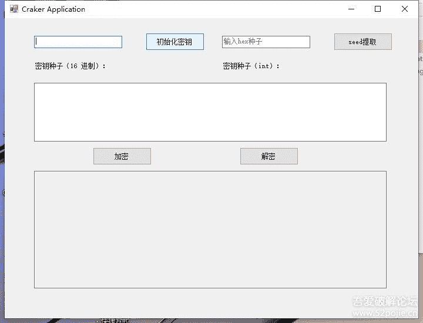

`微信截图_20250301203348.png` (30.92 KB, 下载次数: 0)

[附件](https://www.52pojie.cn/forum.php?mod=attachment&aid=Mjc1ODE1OHxmNWNmYTgxY3wxNzkzNTcxMjU1fDE2ODA4NnwyMDEwNjQ0&nothumb=yes)

2025-3-1 20:34 上传

我不是研究加解密的，我甚至不copy 不AI都不会写程序的，我换了个野路子，我可以写个简单的客户端，连接到我的服务端，发包通过服务端解密，恭喜成功。搁在两年前我现在已经成功了，就用Wireshark进游戏里面，把需要的玩法，玩一遍，解密数据，再照着数据，再结合客户端解包的lua脚本，一点点堆积木，服务器就慢慢的被逆向出来了。

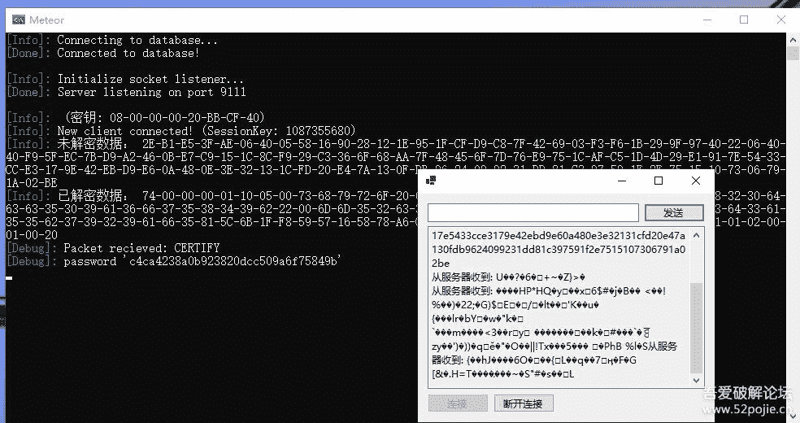

`微信截图_20250301205237.png` (115.58 KB, 下载次数: 0)

[附件](https://www.52pojie.cn/forum.php?mod=attachment&aid=Mjc1ODE1OXwzNTY4OTliMnwxNzkzNTcxMjU1fDE2ODA4NnwyMDEwNjQ0&nothumb=yes)

2025-3-1 20:53 上传

## 关于作弊与反作弊

这里讨论下游戏的作弊与反作弊，基于现在的游戏，最牛叉的不就是不要客户端，自己写个窗口，实现简单的板砖、摆摊、喊话就 OK 了，那你还反给垂耳，我把你的反作弊相关的代码去掉，服务器你问我作弊了没，我说没做就哦了，也不要 [//www.52pojie.cn/thread-661779-1-1.html](https://www.52pojie.cn/thread-661779-1-1.html) 器，一台电脑来个白开不过分吧，当然实现很难很难，加个复杂的应答机制就挂了。

反作弊的究极形态就是云游戏，我给你播放视频，你上传操作指令，算法啥的跟你没关系，你也不用 DMA 了，你作弊得分析我传输的视频流，然后再做程序，要是发现你老小子作弊，压根就不会封号，我就给你延迟发包，给你试点坏，你收到的包就是有问题的，让你老小子被虐的死去活来，你顺着网线来打我吧，我 VIP10 大佬，都是主角光环，谁让他不爽我就按他，你没证据说我不公平。哈哈，有问题我就说网络问题。

最后抓包官方游戏数据，解密失败，更新了我 Xdbg 了下用了 AES 加密。应该是用得不伦不类，我实在是不想研究 WMP，AES。

## 第四虐

没办法了，没办法了，没办法了，爱盘的工具再下一遍吧，从明天起好好学破解，PE Xdbg IDA 整活，说实话我没用认认真真的练习过脱壳，解密，汇编也基本是 0 基础，但是我有 AI 不是了，先 xdbg 新客户端，我感觉我又行了，上来就 VMP，绕过反调试，还真绕过了，也没完全吧，用的是插件，没绕过是调试你节奏慢了，还是会报调试，跑飞。一统操作猛如虎，自己是个二百五。得到的唯一有用消息就是加解密用了 AES。老老实实的 Xdbg 没壳的老版本，反正我也是没准备折腾新版本，改了封包后，不修改不能直接连非官方的服务器了。

这个地方就是有点经验分享了，我用 xdbg，为啥不 OD 不会英文呗。程序加载首先修改设置，把线程入口对勾勾上，没人教我，也没查，自己瞎翻

## 经验与教训

出来的，血的教训就是在那狂点步进几个钟头，别问为啥，为啥就是二百五呗，原因就是游戏不像其他的软件，其他的软件是注册一次，之后就可以一直用，游戏是我输入了账号，密码点击登录，就加载你的个人数据进入了，到登录界面时，他基本上把能加载的资源都加载了，你要手动到登录界面，只能说手疼。（有个二货条件步进20000行，点了两个小时，我也不认识他，你们笑话他吧）

## 定位游戏加载界面

这里我们先用线程入口来找到游戏加载的界面，然后再这个附近位置分析进程，查看字符，搜索能确定的信息，附近打断点。也很麻烦，因为不同的事情可能再不同的线程处理，有的已加载，分到到具体还得去打断点，打完断点，你重新加载的时候又可能要不停的跳。上来就又给自己加难度啊，多线程。

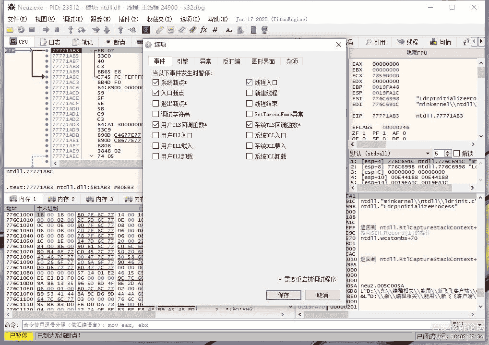

`设置.png` (187.53 KB, 下载次数: 0)

[href="forum.php?mod=attachment&aid=Mjc1ODE2NHxlMzQ2ODNiNnwxNzkzNTcxMjU1fDE2ODA4NnwyMDEwNjQ0&nothumb=yes" target="_blank"](https://www.52pojie.cn/forum.php?mod=attachment&aid=Mjc1ODE2NHxlMzQ2ODNiNnwxNzkzNTcxMjU1fDE2ODA4NnwyMDEwNjQ0&nothumb=yes)

2025-3-1 21:25 上传

## 程序规范与明文

如果游戏没壳，并且程序规范（这个时候越规范对你越友好）很多东西都是明文的

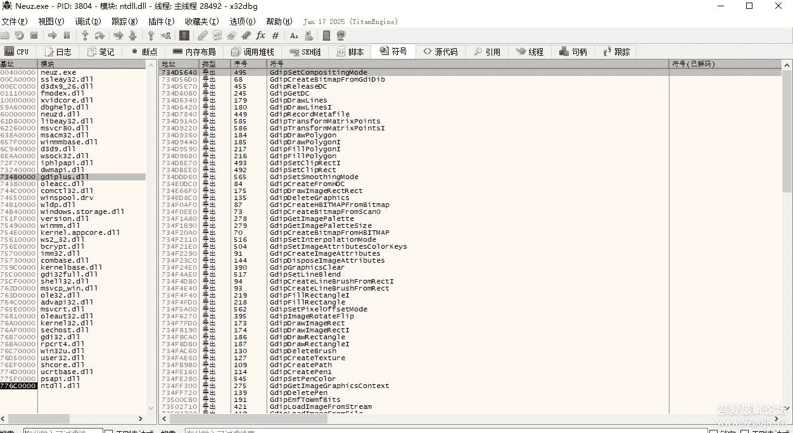

`春天.png` (186.14 KB, 下载次数: 0)

[href="forum.php?mod=attachment&aid=Mjc1ODE2NXxmMGYxZGRmN3wxNzkzNTcxMjU1fDE2ODA4NnwyMDEwNjQ0&nothumb=yes" target="_blank"](https://www.52pojie.cn/forum.php?mod=attachment&aid=Mjc1ODE2NXxmMGYxZGRmN3wxNzkzNTcxMjU1fDE2ODA4NnwyMDEwNjQ0&nothumb=yes)

2025-3-1 21:27 上传

## OD 与 Xdbg 使用经验

最后一个，使用经验，可能是 OD 我不会用，说错话，大佬捶我就好，我认错。OD 作者好久没更新了，听说有 2.0 我也不知道，Xdbg 是在维护的，有中文最最最让我喜欢的是有流程图，快捷键别的没记住这个记住了`G`，外挂？框图的作用是能让我这种小菜鸡简单的理清楚跳转的脉络。对哪个地方分析的越细，流程图就越复杂。这个觉得是对新手非常友好的功能。

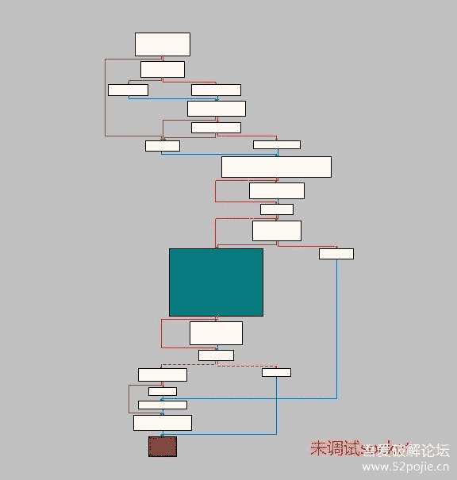

`微信截图_20250301175905.png` (23.99 KB, 下载次数: 0)

[href="forum.php?mod=attachment&aid=Mjc1ODE2OXxiMmMxZjI5ZXwxNzkzNTcxMjU1fDE2ODA4NnwyMDEwNjQ0&nothumb=yes" target="_blank"](https://www.52pojie.cn/forum.php?mod=attachment&aid=Mjc1ODE2OXxiMmMxZjI5ZXwxNzkzNTcxMjU1fDE2ODA4NnwyMDEwNjQ0&nothumb=yes)

2025-3-1 21:43 上传

## 断点与数据流分析

我们要重点分析哪个位置就只断那些位置，不调试的位置不会出现线，下面是，`get` 服务器数据，跟不 `get` 的区别，我们可以看出来交换数据在哪些断里面。在加解密的位置肯定会有个断开的，数据一定是加密了发送出去，解密了传递到程序。

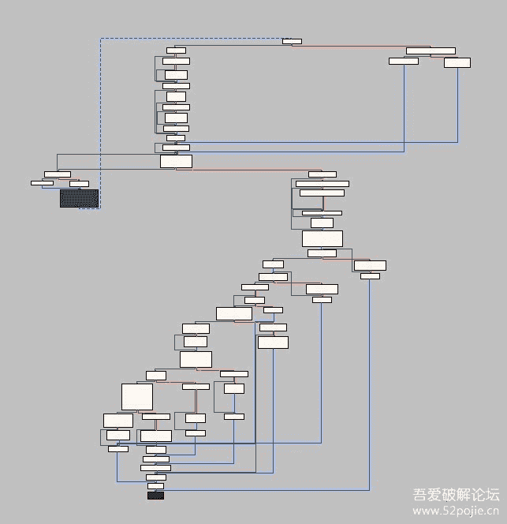

`框线图.png` (38.9 KB, 下载次数: 0)

[href="forum.php?mod=attachment&aid=Mjc1ODE3MHxiMmQ0MWNkNHwxNzkzNTcxMjU1fDE2ODA4NnwyMDEwNjQ0&nothumb=yes" target="_blank"](https://www.52pojie.cn/forum.php?mod=attachment&aid=Mjc1ODE3MHxiMmQ0MWNkNHwxNzkzNTcxMjU1fDE2ODA4NnwyMDEwNjQ0&nothumb=yes)

2025-3-1 21:43 上传

## 总结

好吧，总结一下，破解需要一颗强大的内心，对大佬的敬意，然后老老实实的学`debug`吧，还需要一个 DeepSeek 帮我们写代码。我接下来就是好好学学习一下 Xdbg，有看到这里的大佬，给你准话，这次这条路能通不了。
