# [Web逆向] 扇贝单词js逆向补环境

- 原帖: [https://www.52pojie.cn/forum.php?mod=viewthread&tid=2010844](https://www.52pojie.cn/forum.php?mod=viewthread&tid=2010844)
- 抓取时间: `2026-11-01T22:14:15`

目标站点: [web.shanbay.com/wordsweb/#/collection](https://web.shanbay.com/wordsweb/#/collection)

## 单词数据加密

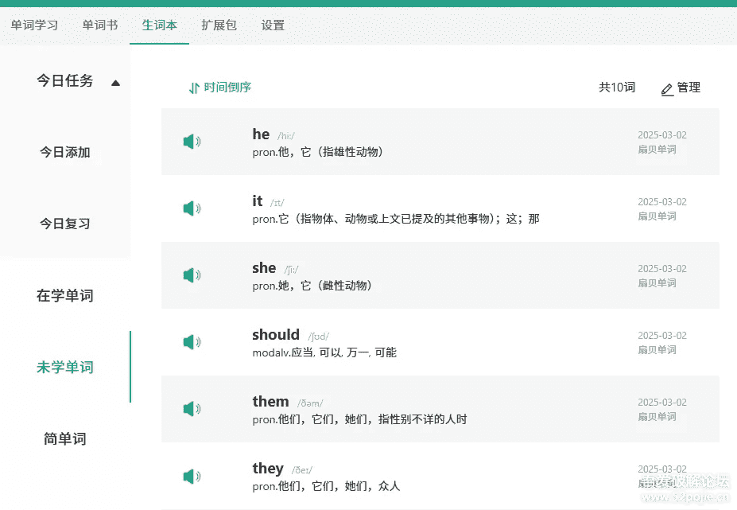 `image.png` (170.65 KB, 下载次数: 1) · [下载附件](https://www.52pojie.cn/forum.php?mod=attachment&aid=Mjc1ODQwNXxhZmQyMGU3YnwxNzkzNTcxMjUzfDE2ODA4NnwyMDEwODQ0&nothumb=yes) · 2025-3-2 22:10 上传

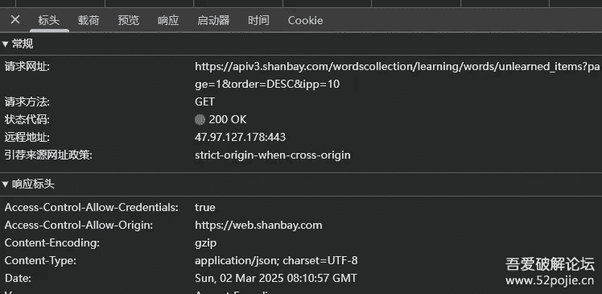 `image.png` (102.95 KB, 下载次数: 1) · [下载附件](https://www.52pojie.cn/forum.php?mod=attachment&aid=Mjc1ODQwN3wyYmMyMGE2YXwxNzkzNTcxMjUzfDE2ODA4NnwyMDEwODQ0&nothumb=yes) · 2025-3-2 22:10 上传

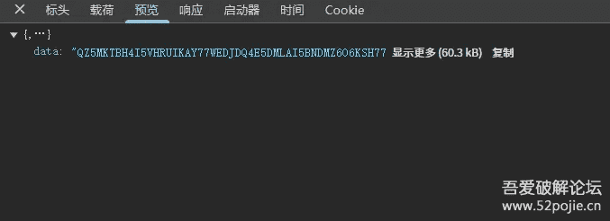 `image.png` (44.57 KB, 下载次数: 0) · [下载附件](https://www.52pojie.cn/forum.php?mod=attachment&aid=Mjc1ODQwOHxkNDlmYWE3ZnwxNzkzNTcxMjUzfDE2ODA4NnwyMDEwODQ0&nothumb=yes) · 2025-3-2 22:11 上传

使用 JSON hook：

```js
var my_parse = JSON.parse;
JSON.parse = function (params) { // 这里可以添加其他逻辑比如 console.log("json_parse params:",params); debugger return my_parse(params);};
```

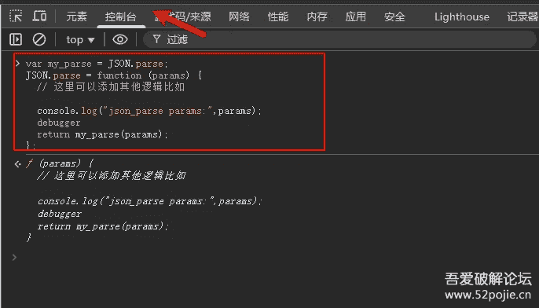 `image.png` (92.83 KB, 下载次数: 0) · [下载附件](https://www.52pojie.cn/forum.php?mod=attachment&aid=Mjc1ODQxMHw4ODhhZjg0OXwxNzkzNTcxMjUzfDE2ODA4NnwyMDEwODQ0&nothumb=yes) · 2025-3-2 22:11 上传

跳过这个断点 因为这个是服务器返回的加密数据，我们需要找到他的解密位置

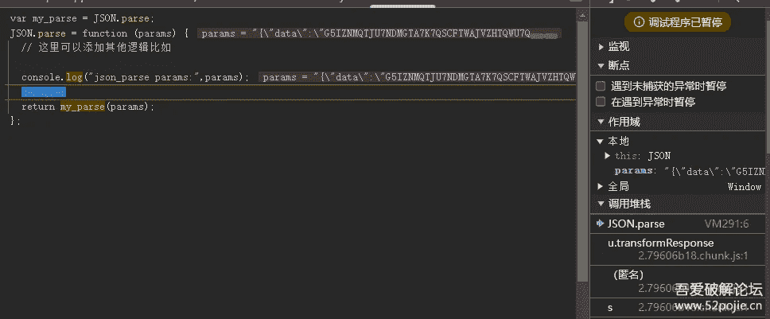 `image.png` (137.9 KB, 下载次数: 1) · [下载附件](https://www.52pojie.cn/forum.php?mod=attachment&aid=Mjc1ODQxMXwzOGQ4NDgyMHwxNzkzNTcxMjUzfDE2ODA4NnwyMDEwODQ0&nothumb=yes) · 2025-3-2 22:11 上传

断在他解密之后的数据上面，往上面跟栈

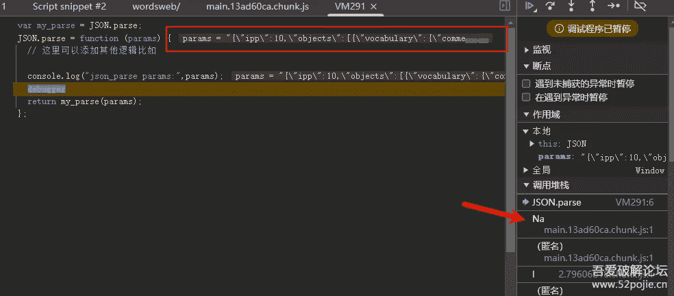 `image.png` (157.95 KB, 下载次数: 1) · [下载附件](https://www.52pojie.cn/forum.php?mod=attachment&aid=Mjc1ODQxNHxlZjhjOTMyM3wxNzkzNTcxMjUzfDE2ODA4NnwyMDEwODQ0&nothumb=yes) · 2025-3-2 22:11 上传

解密函数

 `image.png` (59.28 KB, 下载次数: 1) · [下载附件](https://www.52pojie.cn/forum.php?mod=attachment&aid=Mjc1ODQxNXw1YjVlNzlmMnwxNzkzNTcxMjUzfDE2ODA4NnwyMDEwODQ0&nothumb=yes) · 2025-3-2 22:11 上传

扣出来，开始补代码。可以看到这个`_checkVersion`是检测版本什么的，应该不是的。返回空字符串肯定是错的，直接删掉。

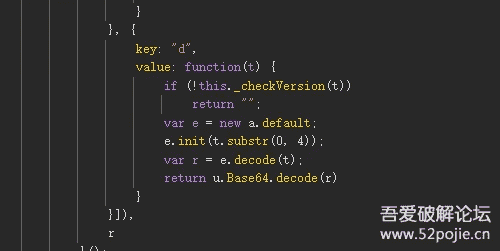 `image.png` (45.41 KB, 下载次数: 0) · [下载附件](https://www.52pojie.cn/forum.php?mod=attachment&aid=Mjc1ODQxNnw2MTBmNGMyM3wxNzkzNTcxMjUzfDE2ODA4NnwyMDEwODQ0&nothumb=yes) · 2025-3-2 22:11 上传

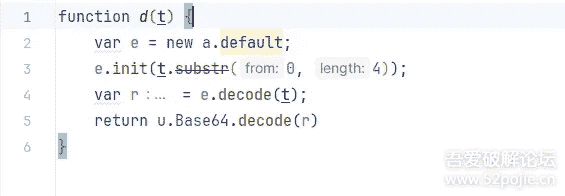 `image.png` (54.87 KB, 下载次数: 1) · [下载附件](https://www.52pojie.cn/forum.php?mod=attachment&aid=Mjc1ODQxN3xkZjI3NTY0N3wxNzkzNTcxMjUzfDE2ODA4NnwyMDEwODQ0&nothumb=yes) · 2025-3-2 22:11 上传

接着运行

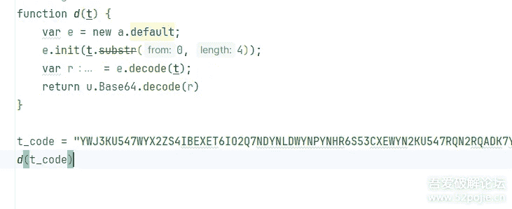 `image.png` (90.8 KB, 下载次数: 1) · [下载附件](https://www.52pojie.cn/forum.php?mod=attachment&aid=Mjc1ODQxOHw3MzE4Yjg2NHwxNzkzNTcxMjUzfDE2ODA4NnwyMDEwODQ0&nothumb=yes) · 2025-3-2 22:12 上传

缺少`new a.default;`未定义

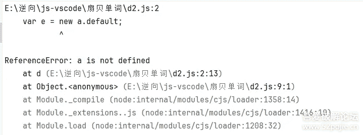 `image.png` (126.11 KB, 下载次数: 1) · [下载附件](https://www.52pojie.cn/forum.php?mod=attachment&aid=Mjc1ODQxOXwxY2M5NjY3MnwxNzkzNTcxMjUzfDE2ODA4NnwyMDEwODQ0&nothumb=yes) · 2025-3-2 22:12 上传

断道这里跟进去

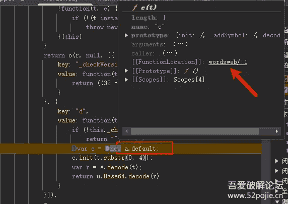 `image.png` (124.76 KB, 下载次数: 1) · [下载附件](https://www.52pojie.cn/forum.php?mod=attachment&aid=Mjc1ODQyMHxkNGZhMmQ4MnwxNzkzNTcxMjUzfDE2ODA4NnwyMDEwODQ0&nothumb=yes) · 2025-3-2 22:12 上传

扣出来把函数名修改一下

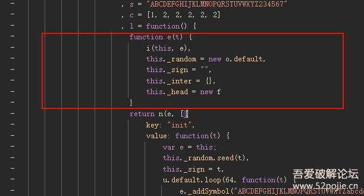 `image.png` (99.27 KB, 下载次数: 1) · [下载附件](https://www.52pojie.cn/forum.php?mod=attachment&aid=Mjc1ODQyMXxkZWI4NjRmN3wxNzkzNTcxMjUzfDE2ODA4NnwyMDEwODQ0&nothumb=yes) · 2025-3-2 22:12 上传

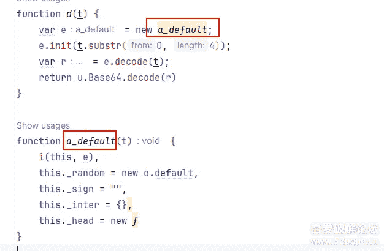 `image.png` (102.18 KB, 下载次数: 0) · [下载附件](https://www.52pojie.cn/forum.php?mod=attachment&aid=Mjc1ODQyMnwzNzU2YWQ1MnwxNzkzNTcxMjUzfDE2ODA4NnwyMDEwODQ0&nothumb=yes) · 2025-3-2 22:12 上传

继续扣`i`函数

 `image.png` (21.03 KB, 下载次数: 1) · [下载附件](https://www.52pojie.cn/forum.php?mod=attachment&aid=Mjc1ODQyM3w4MjNkYjM2MHwxNzkzNTcxMjUzfDE2ODA4NnwyMDEwODQ0&nothumb=yes) · 2025-3-2 22:12 上传

修改一下函数让把参数`t`给传参进去

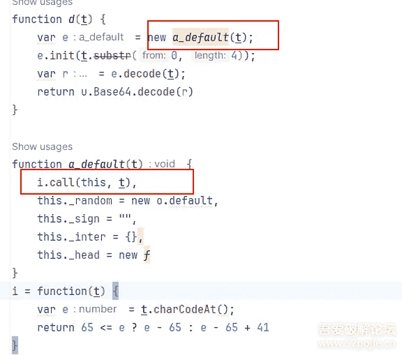 `image.png` (137.82 KB, 下载次数: 1) · [下载附件](https://www.52pojie.cn/forum.php?mod=attachment&aid=Mjc1ODQyNHxhOTAxODkxN3wxNzkzNTcxMjUzfDE2ODA4NnwyMDEwODQ0&nothumb=yes) · 2025-3-2 22:12 上传

扣`o.default`对象

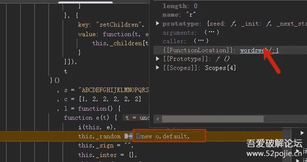 `image.png` (101.32 KB, 下载次数: 1) · [下载附件](https://www.52pojie.cn/forum.php?mod=attachment&aid=Mjc1ODQyNXw3M2MwMDk0Y3wxNzkzNTcxMjUzfDE2ODA4NnwyMDEwODQ0&nothumb=yes) · 2025-3-2 22:12 上传

上面有个异常处理直接不要了 下面他的函数 也可以一起扣下来

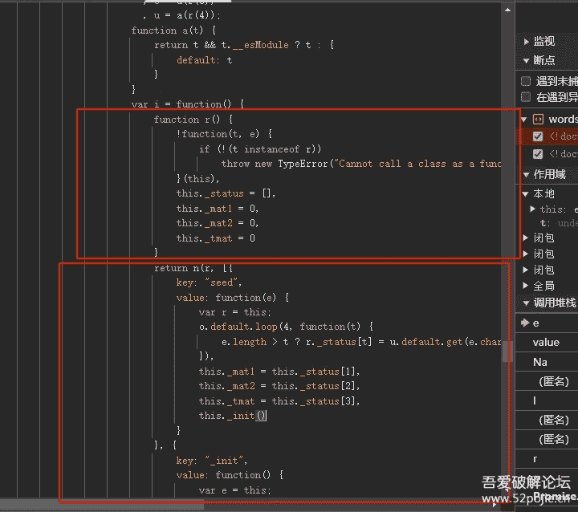 `image.png` (189.64 KB, 下载次数: 1) · [下载附件](https://www.52pojie.cn/forum.php?mod=attachment&aid=Mjc1ODQyNnw1YWVhM2I0NHwxNzkzNTcxMjUzfDE2ODA4NnwyMDEwODQ0&nothumb=yes) · 2025-3-2 22:13 上传

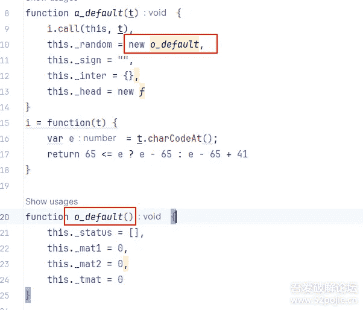 `image.png` (132.6 KB, 下载次数: 1) · [下载附件](https://www.52pojie.cn/forum.php?mod=attachment&aid=Mjc1ODQyN3xjNjliYzNmN3wxNzkzNTcxMjUzfDE2ODA4NnwyMDEwODQ0&nothumb=yes) · 2025-3-2 22:13 上传

扣`f`

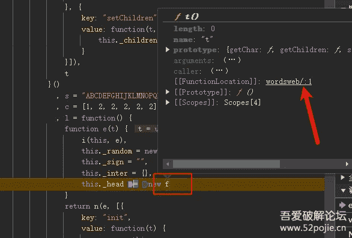 `image.png` (116.79 KB, 下载次数: 1) · [下载附件](https://www.52pojie.cn/forum.php?mod=attachment&aid=Mjc1ODQyM3w4MjNkYjM2MHwxNzkzNTcxMjUzfDE2ODA4NnwyMDEwODQ0&nothumb=yes) · 2025-3-2 22:13 上传


[href="forum.php?mod=attachment&aid=Mjc1ODQyOHw5MTVjODVjY3wxNzkzNTcxMjUzfDE2ODA4NnwyMDEwODQ0&nothumb=yes" target="_blank"](https://www.52pojie.cn/forum.php?mod=attachment&aid=Mjc1ODQyOHw5MTVjODVjY3wxNzkzNTcxMjUzfDE2ODA4NnwyMDEwODQ0&nothumb=yes)
2025-3-2 22:13 上传

image.png (21.33 KB, 下载次数: 0)
[href="forum.php?mod=attachment&aid=Mjc1ODQyOXw1MTNhMGVmMXwxNzkzNTcxMjUzfDE2ODA4NnwyMDEwODQ0&nothumb=yes" target="_blank"](https://www.52pojie.cn/forum.php?mod=attachment&aid=Mjc1ODQyOXw1MTNhMGVmMXwxNzkzNTcxMjUzfDE2ODA4NnwyMDEwODQ0&nothumb=yes)
2025-3-2 22:13 上传
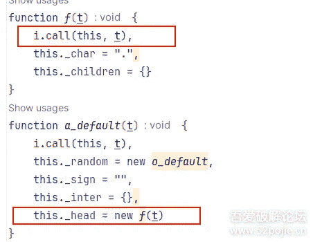
image.png (86.57 KB, 下载次数: 1)
[href="forum.php?mod=attachment&aid=Mjc1ODQzMHxkZDJjMTk1N3wxNzkzNTcxMjUzfDE2ODA4NnwyMDEwODQ0&nothumb=yes" target="_blank"](https://www.52pojie.cn/forum.php?mod=attachment&aid=Mjc1ODQzMHxkZDJjMTk1N3wxNzkzNTcxMjUzfDE2ODA4NnwyMDEwODQ0&nothumb=yes)
2025-3-2 22:13 上传
开始扣 `e.init`
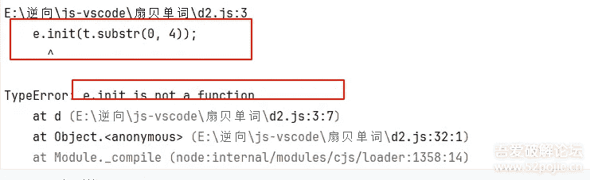
image.png (96.29 KB, 下载次数: 1)
[href="forum.php?mod=attachment&aid=Mjc1ODQzMXxlMWUzMDRhY3wxNzkzNTcxMjUzfDE2ODA4NnwyMDEwODQ0&nothumb=yes" target="_blank"](https://www.52pojie.cn/forum.php?mod=attachment&aid=Mjc1ODQzMXxlMWUzMDRhY3wxNzkzNTcxMjUzfDE2ODA4NnwyMDEwODQ0&nothumb=yes)
2025-3-2 22:13 上传
发现下面有很多函数内容 一起给扣了，把这个列表给复制出来
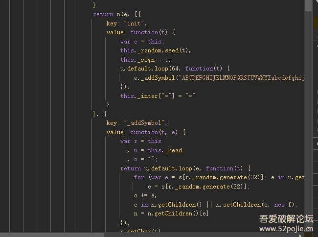
image.png (121.81 KB, 下载次数: 1)
[href="forum.php?mod=attachment&aid=Mjc1ODQzMnwzNDJhYTJhOXwxNzkzNTcxMjUzfDE2ODA4NnwyMDEwODQ0&nothumb=yes" target="_blank"](https://www.52pojie.cn/forum.php?mod=attachment&aid=Mjc1ODQzMnwzNDJhYTJhOXwxNzkzNTcxMjUzfDE2ODA4NnwyMDEwODQ0&nothumb=yes)
2025-3-2 22:13 上传
写个列表赋值一下，这个`e`对象下面的函数，是通过`new a_default`出来的 所以这些函数需要补在`a_default`下面
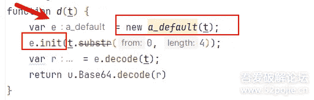
image.png (57.24 KB, 下载次数: 2)
[href="forum.php?mod=attachment&aid=Mjc1ODQzM3w5MDE4NDkzY3wxNzkzNTcxMjUzfDE2ODA4NnwyMDEwODQ0&nothumb=yes" target="_blank"](https://www.52pojie.cn/forum.php?mod=attachment&aid=Mjc1ODQzM3w5MDE4NDkzY3wxNzkzNTcxMjUzfDE2ODA4NnwyMDEwODQ0&nothumb=yes)
2025-3-2 22:14 上传
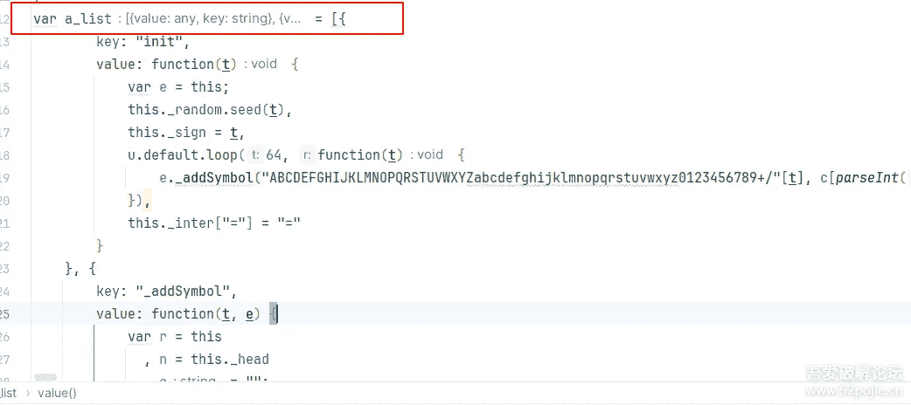
image.png (163.21 KB, 下载次数: 1)
[href="forum.php?mod=attachment&aid=Mjc1ODQzNHxiY2I4N2IxMnwxNzkzNTcxMjUzfDE2ODA4NnwyMDEwODQ0&nothumb=yes" target="_blank"](https://www.52pojie.cn/forum.php?mod=attachment&aid=Mjc1ODQzNHxiY2I4N2IxMnwxNzkzNTcxMjUzfDE2ODA4NnwyMDEwODQ0&nothumb=yes)
2025-3-2 22:14 上传
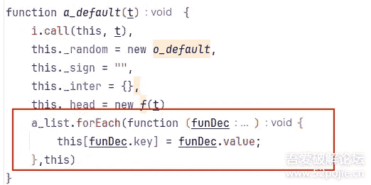
image.png (84.01 KB, 下载次数: 1)
[href="forum.php?mod=attachment&aid=Mjc1ODQzNXxhMGJmNDU1M3wxNzkzNTcxMjUzfDE2ODA4NnwyMDEwODQ0&nothumb=yes" target="_blank"](https://www.52pojie.cn/forum.php?mod=attachment&aid=Mjc1ODQzNXxhMGJmNDU1M3wxNzkzNTcxMjUzfDE2ODA4NnwyMDEwODQ0&nothumb=yes)
2025-3-2 22:14 上传
继续运行缺号`this._random.seed`继续扣

image.png (39.59 KB, 下载次数: 1)
[href="forum.php?mod=attachment&aid=Mjc1ODQzNnw5Y2EzYTQ4NXwxNzkzNTcxMjUzfDE2ODA4NnwyMDEwODQ0&nothumb=yes" target="_blank"](https://www.52pojie.cn/forum.php?mod=attachment&aid=Mjc1ODQzNnw5Y2EzYTQ4NXwxNzkzNTcxMjUzfDE2ODA4NnwyMDEwODQ0&nothumb=yes)
2025-3-2 22:14 上传
一样的方法扣出来
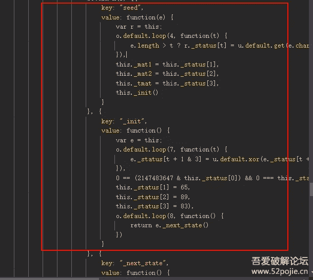
image.png (154.71 KB, 下载次数: 1)
[href="forum.php?mod=attachment&aid=Mjc1ODQzN3xlZmUyMGE1NXwxNzkzNTcxMjUzfDE2ODA4NnwyMDEwODQ0&nothumb=yes" target="_blank"](https://www.52pojie.cn/forum.php?mod=attachment&aid=Mjc1ODQzN3xlZmUyMGE1NXwxNzkzNTcxMjUzfDE2ODA4NnwyMDEwODQ0&nothumb=yes)
2025-3-2 22:14 上传
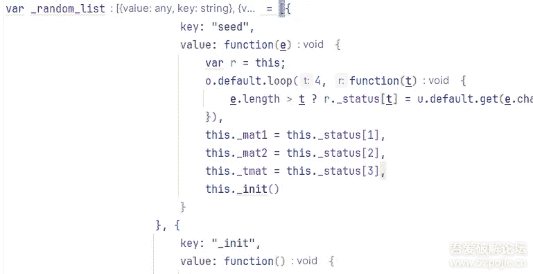
image.png (121.52 KB, 下载次数: 0)
[href="forum.php?mod=attachment&aid=Mjc1ODQzOHw0ZGZhYmFiMnwxNzkzNTcxMjUzfDE2ODA4NnwyMDEwODQ0&nothumb=yes" target="_blank"](https://www.52pojie.cn/forum.php?mod=attachment&aid=Mjc1ODQzOHw0ZGZhYmFiMnwxNzkzNTcxMjUzfDE2ODA4NnwyMDEwODQ0&nothumb=yes)
2025-3-2 22:14 上传
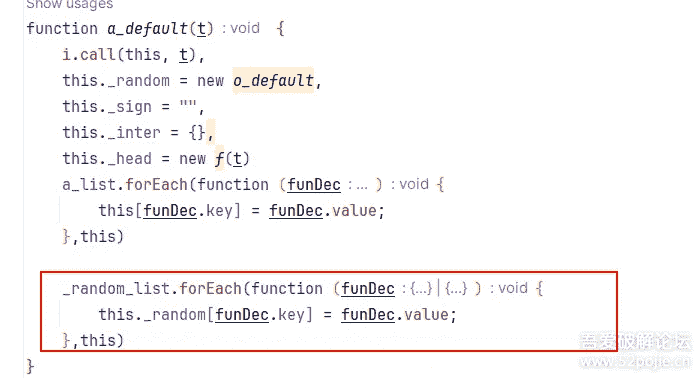
image.png (120.9 KB, 下载次数: 0)
[href="forum.php?mod=attachment&aid=Mjc1ODQzOXxmN2M1Zjk4OHwxNzkzNTcxMjUzfDE2ODA4NnwyMDEwODQ0&nothumb=yes" target="_blank"](https://www.52pojie.cn/forum.php?mod=attachment&aid=Mjc1ODQzOXxmN2M1Zjk4OHwxNzkzNTcxMjUzfDE2ODA4NnwyMDEwODQ0&nothumb=yes)
2025-3-2 22:14 上传
缺少`o`
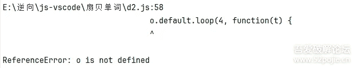
image.png (39.46 KB, 下载次数: 1)
[href="forum.php?mod=attachment&aid=Mjc1ODQ0MHw5YTNlYTY1OXwxNzkzNTcxMjUzfDE2ODA4NnwyMDEwODQ0&nothumb=yes" target="_blank"](https://www.52pojie.cn/forum.php?mod=attachment&aid=Mjc1ODQ0MHw5YTNlYTY1OXwxNzkzNTcxMjUzfDE2ODA4NnwyMDEwODQ0&nothumb=yes)
2025-3-2 22:14 上传
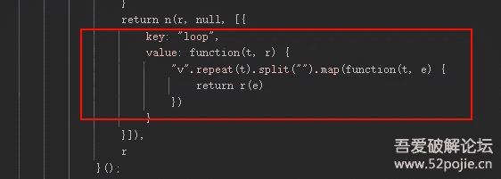
image.png (38.77 KB, 下载次数: 1)
[href="forum.php?mod=attachment&aid=Mjc1ODQ0MXw4ZmZlNmZlNHwxNzkzNTcxMjUzfDE2ODA4NnwyMDEwODQ0&nothumb=yes" target="_blank"](https://www.52pojie.cn/forum.php?mod=attachment&aid=Mjc1ODQ0MXw4ZmZlNmZlNHwxNzkzNTcxMjUzfDE2ODA4NnwyMDEwODQ0&nothumb=yes)
2025-3-2 22:15 上传
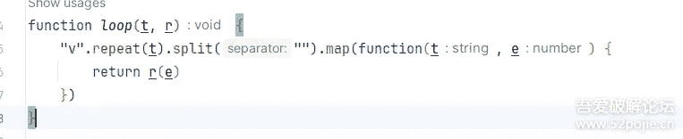
image.png (49.95 KB, 下载次数: 1)
[href="forum.php?mod=attachment&aid=Mjc1ODQ0Mnw3MGU2NDU1ZXwxNzkzNTcxMjUzfDE2ODA4NnwyMDEwODQ0&nothumb=yes" target="_blank"](https://www.52pojie.cn/forum.php?mod=attachment&aid=Mjc1ODQ0Mnw3MGU2NDU1ZXwxNzkzNTcxMjUzfDE2ODA4NnwyMDEwODQ0&nothumb=yes)
2025-3-2 22:15 上传
把`seed`函数里面的`o.default.loop` 修改成 `loop`
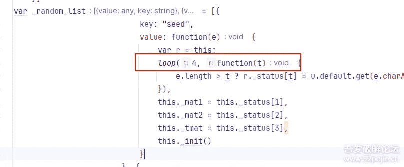
image.png (107.56 KB, 下载次数: 0)
[href="forum.php?mod=attachment&aid=Mjc1ODQ0M3w0MTEyMzhjMHwxNzkzNTcxMjUzfDE2ODA4NnwyMDEwODQ0&nothumb=yes" target="_blank"](https://www.52pojie.cn/forum.php?mod=attachment&aid=Mjc1ODQ0M3w0MTEyMzhjMHwxNzkzNTcxMjUzfDE2ODA4NnwyMDEwODQ0&nothumb=yes)
2025-3-2 22:15 上传
继续扣 `u` 函数
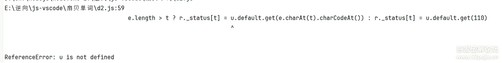
image.png (70.82 KB, 下载次数: 0)
[href="forum.php?mod=attachment&aid=Mjc1ODQ0NHw2ZjE4YzhjY3wxNzkzNTcxMjUzfDE2ODA4NnwyMDEwODQ0&nothumb=yes" target="_blank"](https://www.52pojie.cn/forum.php?mod=attachment&aid=Mjc1ODQ0NHw2ZjE4YzhjY3wxNzkzNTcxMjUzfDE2ODA4NnwyMDEwODQ0&nothumb=yes)
2025-3-2 22:15 上传
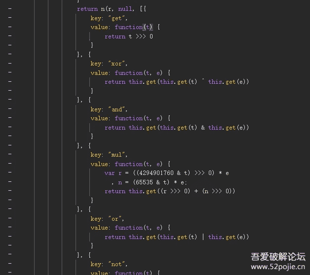
image.png (117.99 KB, 下载次数: 1)
[href="forum.php?mod=attachment&aid=Mjc1ODQ0NXwxMmU0MDQzNHwxNzkzNTcxMjUzfDE2ODA4NnwyMDEwODQ0&nothumb=yes" target="_blank"](https://www.52pojie.cn/forum.php?mod=attachment&aid=Mjc1ODQ0NXwxMmU0MDQzNHwxNzkzNTcxMjUzfDE2ODA4NnwyMDEwODQ0&nothumb=yes)
2025-3-2 22:15 上传
继续用上面的方法
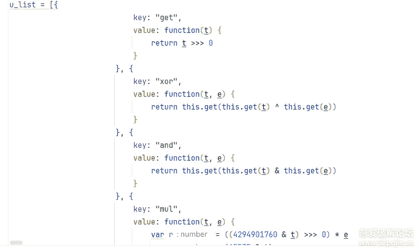
image.png (118.22 KB, 下载次数: 1)
[href="forum.php?mod=attachment&aid=Mjc1ODQ0Nnw0MDEyOGY1YXwxNzkzNTcxMjUzfDE2ODA4NnwyMDEwODQ0&nothumb=yes" target="_blank"](https://www.52pojie.cn/forum.php?mod=attachment&aid=Mjc1ODQ0Nnw0MDEyOGY1YXwxNzkzNTcxMjUzfDE2ODA4NnwyMDEwODQ0&nothumb=yes)
2025-3-2 22:15 上传
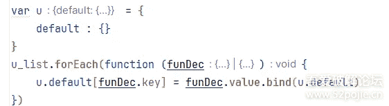
image.png (49.94 KB, 下载次数: 1)
[href="forum.php?mod=attachment&aid=Mjc1ODQ0N3xmZTI0MTg0M3wxNzkzNTcxMjUzfDE2ODA4NnwyMDEwODQ0&nothumb=yes" target="_blank"](https://www.52pojie.cn/forum.php?mod=attachment&aid=Mjc1ODQ0N3xmZTI0MTg0M3wxNzkzNTcxMjUzfDE2ODA4NnwyMDEwODQ0&nothumb=yes)
2025-3-2 22:15 上传
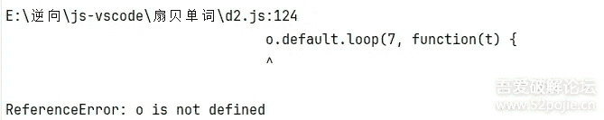
image.png (40.04 KB, 下载次数: 2)
[href="forum.php?mod=attachment&aid=Mjc1ODQ0OHwzNjI0ZTVkZXwxNzkzNTcxMjUzfDE2ODA4NnwyMDEwODQ0&nothumb=yes" target="_blank"](https://www.52pojie.cn/forum.php?mod=attachment&aid=Mjc1ODQ0OHwzNjI0ZTVkZXwxNzkzNTcxMjUzfDE2ODA4NnwyMDEwODQ0&nothumb=yes)
2025-3-2 22:15 上传
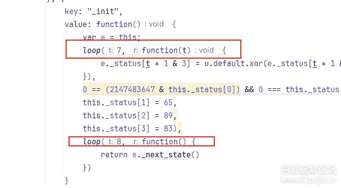


image.png (130.17 KB, 下载次数: 1)

[href="forum.php?mod=attachment&aid=Mjc1ODQ0OXw4OTAzMzVjOXwxNzkzNTcxMjUzfDE2ODA4NnwyMDEwODQ0&nothumb=yes" target="_blank"](https://www.52pojie.cn/forum.php?mod=attachment&aid=Mjc1ODQ0OXw4OTAzMzVjOXwxNzkzNTcxMjUzfDE2ODA4NnwyMDEwODQ0&nothumb=yes)

2025-3-2 22:15 上传

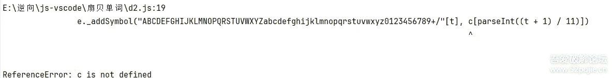
image.png (68.59 KB, 下载次数: 0)

[href="forum.php?mod=attachment&aid=Mjc1ODQ1MHxjYzQ3YmZhZnwxNzkzNTcxMjUzfDE2ODA4NnwyMDEwODQ0&nothumb=yes" target="_blank"](https://www.52pojie.cn/forum.php?mod=attachment&aid=Mjc1ODQ1MHxjYzQ3YmZhZnwxNzkzNTcxMjUzfDE2ODA4NnwyMDEwODQ0&nothumb=yes)

2025-3-2 22:16 上传

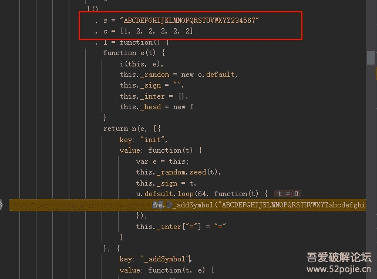
image.png (123.14 KB, 下载次数: 0)

[href="forum.php?mod=attachment&aid=Mjc1ODQ1MXxhNDVhOTI2YnwxNzkzNTcxMjUzfDE2ODA4NnwyMDEwODQ0&nothumb=yes" target="_blank"](https://www.52pojie.cn/forum.php?mod=attachment&aid=Mjc1ODQ1MXxhNDVhOTI2YnwxNzkzNTcxMjUzfDE2ODA4NnwyMDEwODQ0&nothumb=yes)

2025-3-2 22:16 上传

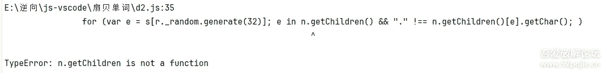
image.png (64.64 KB, 下载次数: 1)

[href="forum.php?mod=attachment&aid=Mjc1ODQ1Mnw2MzI3OTlmZHwxNzkzNTcxMjUzfDE2ODA4NnwyMDEwODQ0&nothumb=yes" target="_blank"](https://www.52pojie.cn/forum.php?mod=attachment&aid=Mjc1ODQ1Mnw2MzI3OTlmZHwxNzkzNTcxMjUzfDE2ODA4NnwyMDEwODQ0&nothumb=yes)

2025-3-2 22:16 上传

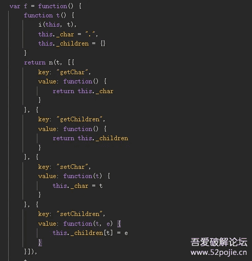
image.png (87.77 KB, 下载次数: 1)

[href="forum.php?mod=attachment&aid=Mjc1ODQ1M3wwYjkyNThmOXwxNzkzNTcxMjUzfDE2ODA4NnwyMDEwODQ0&nothumb=yes" target="_blank"](https://www.52pojie.cn/forum.php?mod=attachment&aid=Mjc1ODQ1M3wwYjkyNThmOXwxNzkzNTcxMjUzfDE2ODA4NnwyMDEwODQ0&nothumb=yes)

2025-3-2 22:16 上传

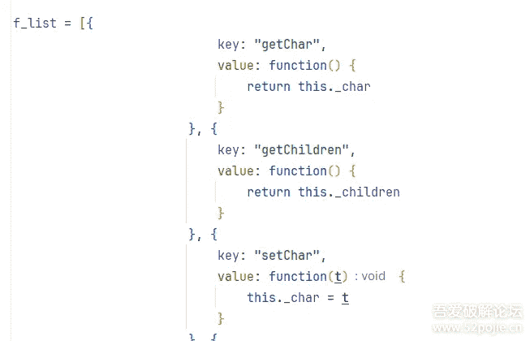
image.png (75.67 KB, 下载次数: 1)

[href="forum.php?mod=attachment&aid=Mjc1ODQ1NHw0YTEyM2JhNXwxNzkzNTcxMjUzfDE2ODA4NnwyMDEwODQ0&nothumb=yes" target="_blank"](https://www.52pojie.cn/forum.php?mod=attachment&aid=Mjc1ODQ1NHw0YTEyM2JhNXwxNzkzNTcxMjUzfDE2ODA4NnwyMDEwODQ0&nothumb=yes)

2025-3-2 22:16 上传

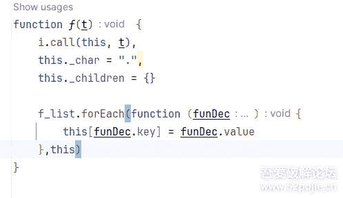
image.png (65.6 KB, 下载次数: 0)

[href="forum.php?mod=attachment&aid=Mjc1ODQ1NXw4M2M4OTQ3ZnwxNzkzNTcxMjUzfDE2ODA4NnwyMDEwODQ0&nothumb=yes" target="_blank"](https://www.52pojie.cn/forum.php?mod=attachment&aid=Mjc1ODQ1NXw4M2M4OTQ3ZnwxNzkzNTcxMjUzfDE2ODA4NnwyMDEwODQ0&nothumb=yes)

2025-3-2 22:16 上传

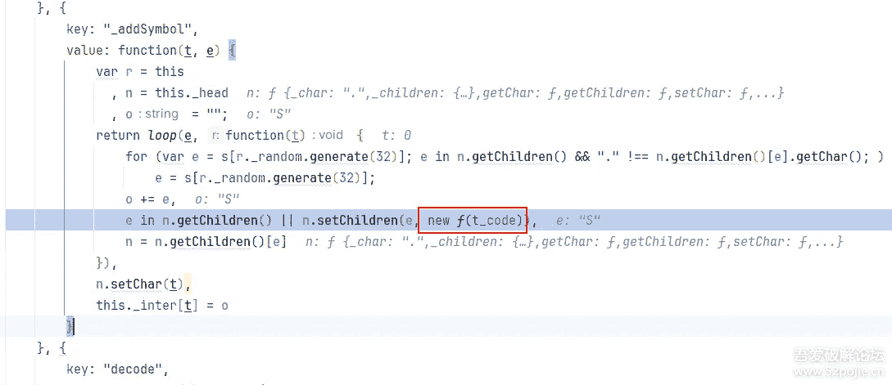
这个位置需要修改一下 给他传递`t`参数

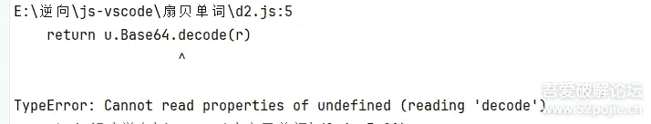
image.png (207.33 KB, 下载次数: 1)

[href="forum.php?mod=attachment&aid=Mjc1ODQ1NnxiOGEwY2QyMHwxNzkzNTcxMjUzfDE2ODA4NnwyMDEwODQ0&nothumb=yes" target="_blank"](https://www.52pojie.cn/forum.php?mod=attachment&aid=Mjc1ODQ1NnxiOGEwY2QyMHwxNzkzNTcxMjUzfDE2ODA4NnwyMDEwODQ0&nothumb=yes)

2025-3-2 22:16 上传

直接替换成`nodejs` 自带的`base64`解码

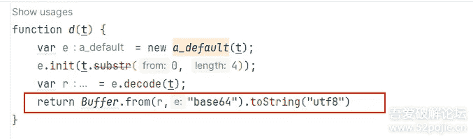
image.png (50.62 KB, 下载次数: 1)

[href="forum.php?mod=attachment&aid=Mjc1ODQ1N3wyNTAwMDJhZnwxNzkzNTcxMjUzfDE2ODA4NnwyMDEwODQ0&nothumb=yes" target="_blank"](https://www.52pojie.cn/forum.php?mod=attachment&aid=Mjc1ODQ1N3wyNTAwMDJhZnwxNzkzNTcxMjUzfDE2ODA4NnwyMDEwODQ0&nothumb=yes)

2025-3-2 22:16 上传

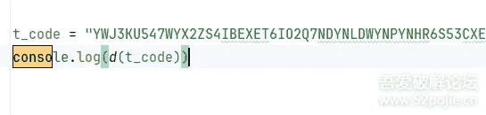
image.png (68.49 KB, 下载次数: 1)

[href="forum.php?mod=attachment&aid=Mjc1ODQ1OHw3YTNjNGM1ZHwxNzkzNTcxMjUzfDE2ODA4NnwyMDEwODQ0&nothumb=yes" target="_blank"](https://www.52pojie.cn/forum.php?mod=attachment&aid=Mjc1ODQ1OHw3YTNjNGM1ZHwxNzkzNTcxMjUzfDE2ODA4NnwyMDEwODQ0&nothumb=yes)

2025-3-2 22:16 上传

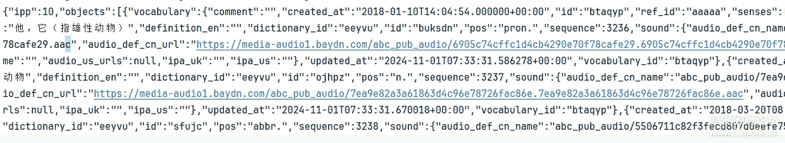
image.png (41.44 KB, 下载次数: 1)

[href="forum.php?mod=attachment&aid=Mjc1ODQ1OXwxMmE4MzYwN3wxNzkzNTcxMjUzfDE2ODA4NnwyMDEwODQ0&nothumb=yes" target="_blank"](https://www.52pojie.cn/forum.php?mod=attachment&aid=Mjc1ODQ1OXwxMmE4MzYwN3wxNzkzNTcxMjUzfDE2ODA4NnwyMDEwODQ0&nothumb=yes)

2025-3-2 22:17 上传

完成


image.png (363.45 KB, 下载次数: 1)

[href="forum.php?mod=attachment&aid=Mjc1ODQ2MHxiMmYyNTc3ZXwxNzkzNTcxMjUzfDE2ODA4NnwyMDEwODQ0&nothumb=yes" target="_blank"](https://www.52pojie.cn/forum.php?mod=attachment&aid=Mjc1ODQ2MHxiMmYyNTc3ZXwxNzkzNTcxMjUzfDE2ODA4NnwyMDEwODQ0&nothumb=yes)

2025-3-2 22:17 上传

[JavaScript] 纯文本查看 复制代码


```
function d(t) {
    var e = new a_default(t);
    e.init(t.substr(0, 4));
    var r = e.decode(t);
    return Buffer.from(r,"base64").toString("utf8")
}

f_list = [{
                            key: "getChar",
                            value: function() {
                                return this._char
                            }
                        }, {
                            key: "getChildren",
                            value: function() {
                                return this._children
                            }
                        }, {
                            key: "setChar",
                            value: function(t) {
                                this._char = t
                            }
                        }, {
                            key: "setChildren",
                            value: function(t, e) {
                                this._children[t] = e
                            }
                        }]
function f(key) {
    i.call(this, key),
    this._char = ".",
    this._children = {}

    f_list.forEach(function (funDec){
        this[funDec.key] = funDec.value
    },this)
}

s = "ABCDEFGHIJKLMNOPQRSTUVWXYZ234567"
c = [1, 2, 2, 2, 2, 2]
var a_list = [{
        key: "init",
        value: function(t) {
            var e = this;
            this._random.seed(t),
            this._sign = t,
            loop(64, function(t) {
                e._addSymbol("ABCDEFGHIJKLMNOPQRSTUVWXYZabcdefghijklmnopqrstuvwxyz0123456789+/"[t], c[parseInt((t + 1) / 11)])
            }),
            this._inter["="] = "="
        }
    }, {
        key: "_addSymbol",
        value: function(t, e) {
            var r = this
              , n = this._head
              , o = "";
            return loop(e, function(t) {
                for (var e = s[r._random.generate(32)]; e in n.getChildren() && "." !== n.getChildren()[e].getChar(); )
                    e = s[r._random.generate(32)];
                o += e,
                e in n.getChildren() || n.setChildren(e, new f(t_code)),
                n = n.getChildren()[e]
            }),
            n.setChar(t),
            this._inter[t] = o
        }
    }, {
        key: "decode",
        value: function(t) {
            for (var e = "", r = 4; r >> 0
                            }
                        }, {
                            key: "xor",
                            value: function(t, e) {
                                return this.get(this.get(t) ^ this.get(e))
                            }
                        }, {
                            key: "and",
                            value: function(t, e) {
                                return this.get(this.get(t) & this.get(e))
                            }
                        }, {
                            key: "mul",
                            value: function(t, e) {
                                var r = ((4294901760 & t) >>> 0) * e
                                  , n = (65535 & t) * e;
                                return this.get((r >>> 0) + (n >>> 0))
                            }
                        }, {
                            key: "or",
                            value: function(t, e) {
                                return this.get(this.get(t) | this.get(e))
                            }
                        }, {
                            key: "not",
                            value: function(t) {
                                return this.get(~this.get(t))
                            }
                        }, {
                            key: "shiftLeft",
                            value: function(t, e) {
                                return this.get(this.get(t) >> e
                            }
                        }, {
                            key: "mod",
                            value: function(t, e) {
                                return this.get(this.get(t) % e)
                            }
                        }]
var u = {
    default : {}
}
u_list.forEach(function (funDec){
    u.default[funDec.key] = funDec.value.bind(u.default)
})
var _random_list = [{
                            key: "seed",
                            value: function(e) {
                                var r = this;
                                loop(4, function(t) {
                                    e.length > t ? r._status[t] = u.default.get(e.charAt(t).charCodeAt()) : r._status[t] = u.default.get(110)
                                }),
                                this._mat1 = this._status[1],
                                this._mat2 = this._status[2],
                                this._tmat = this._status[3],
                                this._init()
                            }
                        }, {
                            key: "_init",
                            value: function() {
                                var e = this;
                                loop(7, function(t) {
                                    e._status[t + 1 & 3] = u.default.xor(e._status[t + 1 & 3], t + 1 + u.default.mul(1812433253, u.default.xor(e._status[3 & t], u.default.shiftRight(e._status[3 & t], 30))))
                                }),
                                0 == (2147483647 & this._status[0]) && 0 === this._status[1] && 0 === this._status[2] && 0 === this._status[3] && (this._status[0] = 66,
                                this._status[1] = 65,
                                this._status[2] = 89,
                                this._status[3] = 83),
                                loop(8, function() {
                                    return e._next_state()
                                })
                            }
                        }, {
                            key: "_next_state",
                            value: function() {
                                var t = void 0
                                  , e = void 0;
                                e = this._status[3],
                                t = u.default.xor(u.default.and(this._status[0], 2147483647), u.default.xor(this._status[1], this._status[2])),
                                t = u.default.xor(t, u.default.shiftLeft(t, 1)),
                                e = u.default.xor(e, u.default.xor(u.default.shiftRight(e, 1), t)),
                                this._status[0] = this._status[1],
                                this._status[1] = this._status[2],
                                this._status[2] = u.default.xor(t, u.default.shiftLeft(e, 10)),
                                this._status[3] = e,
                                this._status[1] = u.default.xor(this._status[1], u.default.and(-u.default.and(e, 1), this._mat1)),
                                this._status[2] = u.default.xor(this._status[2], u.default.and(-u.default.and(e, 1), this._mat2))
                            }
                        }, {
                            key: "generate",
                            value: function(t) {
                                this._next_state();
                                var e, r = void 0;
                                return r = this._status[3],
                                e = u.default.xor(this._status[0], u.default.shiftRight(this._status[2], 8)),
                                r = u.default.xor(r, e),
                                (r = u.default.xor(u.default.and(-u.default.and(e, 1), this._tmat), r)) % t
                            }
                        }]
function a_default(t) {
    i.call(this, t),
    this._random = new o_default,
    this._sign = "",
    this._inter = {},
    this._head = new f(t)
    a_list.forEach(function (funDec){
        this[funDec.key] = funDec.value;
    },this)

    _random_list.forEach(function (funDec){
        this._random[funDec.key] = funDec.value;
    },this)
}
i = function(t) {
    var e = t.charCodeAt();
    return 65 <= e ? e - 65 : e - 65 + 41
}

function o_default() {
    this._status = [],
    this._mat1 = 0,
    this._mat2 = 0,
    this._tmat = 0
}

function loop(t, r) {
    "v".repeat(t).split("").map(function(t, e) {
        return r(e)
    })
}

t_code = "" // 自行添加加密数据
console.log(d(t_code))

```
