# [Web逆向] 【JS逆向】某土地市场网逆向分析

- 原帖: https://www.52pojie.cn/forum.php?mod=viewthread&tid=2011345
- 抓取时间: 2026-11-01T22:14:11

## 逆向目标

- 网址：aHR0cHM6Ly93d3cubGFuZGNoaW5hLmNvbS8jLw==
- 目标：反调试及请求头Hash

## 反调试

进入网站，我们会发现`F12`无法打开控制台。那就换一种方式，以谷歌浏览器为例设置 -> 更多工具 -> 开发者工具，然后网页就会跳到空白页了，这是除了`debugger`外一种经典的反调试手段。

那么我们如何过掉这个反调试呢？目前，我遇到的就两种情况，第一种就是`window.close()`，第二种就是`location.href = ''`，还有其他情况的话欢迎各位大佬补充。

下面直接开始分析：

我们用无痕浏览器分析（因为在`Script`断点时不会加载插件的JS代码），打开控制台，勾上`Script`断点，输入网址，成功断住。

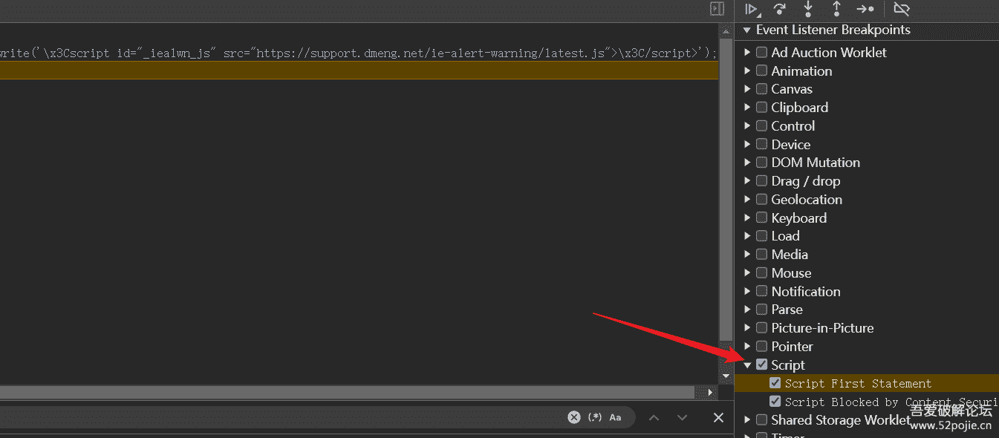
1.png (49.12 KB, 下载次数: 1)
[href="forum.php?mod=attachment&aid=Mjc1ODg0NXxmOTA4NjNkNnwxNzkzNTcxMjQ5fDE2ODA4NnwyMDExMzQ1&nothumb=yes" target="_blank"](https://www.52pojie.cn/forum.php?mod=attachment&aid=Mjc1ODg0NXxmOTA4NjNkNnwxNzkzNTcxMjQ5fDE2ODA4NnwyMDExMzQ1&nothumb=yes)
2025-3-4 15:29 上传

然后我们先搜索`window.close`，`F8`一直走，之后某个文件出现了相关代码，直接下断。

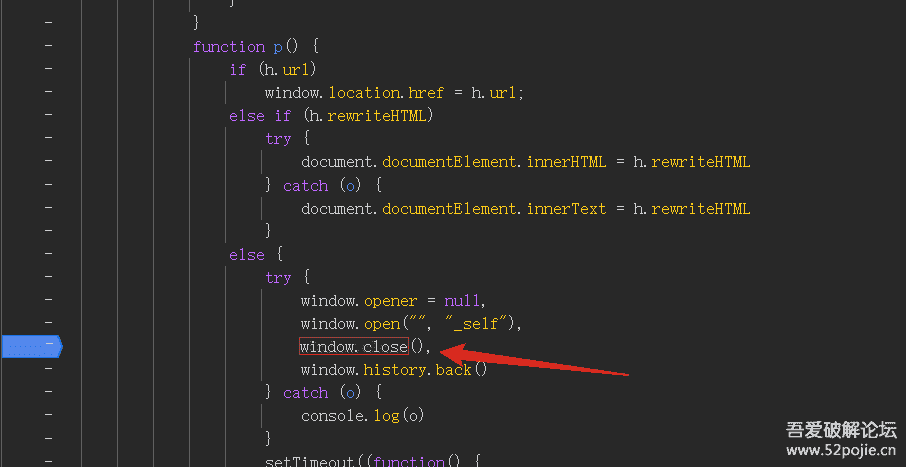
2.png (20.34 KB, 下载次数: 0)
[href="forum.php?mod=attachment&aid=Mjc1ODg0Nnw3ZjhjNjdlZnwxNzkzNTcxMjQ5fDE2ODA4NnwyMDExMzQ1&nothumb=yes" target="_blank"](https://www.52pojie.cn/forum.php?mod=attachment&aid=Mjc1ODg0Nnw3ZjhjNjdlZnwxNzkzNTcxMjQ5fDE2ODA4NnwyMDExMzQ1&nothumb=yes)
2025-3-4 15:29 上传

然后放开`Script`断点，直接`F8`过掉，成功在断点处停住。

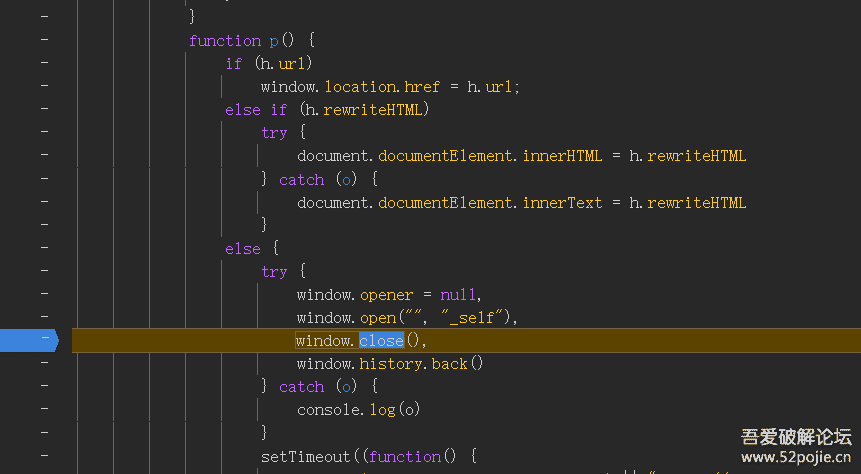
3.png (18.62 KB, 下载次数: 1)
[href="forum.php?mod=attachment&aid=Mjc1ODg0N3wxYTM0ZjNmOHwxNzkzNTcxMjQ5fDE2ODA4NnwyMDExMzQ1&nothumb=yes" target="_blank"](https://www.52pojie.cn/forum.php?mod=attachment&aid=Mjc1ODg0N3wxYTM0ZjNmOHwxNzkzNTcxMjQ5fDE2ODA4NnwyMDExMzQ1&nothumb=yes)
2025-3-4 15:29 上传

我们往前跟栈，看网站通过什么手段进行的反调试。可以看到，是`e > 10 * this.maxPrintTime`这个条件成立才触发`this.onDevToolOpen`，从而触发后续的`window.close`。

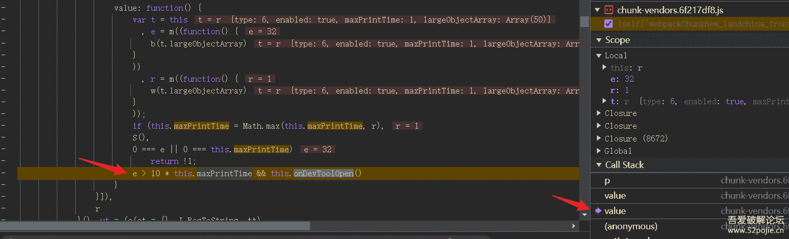
4.png (45.25 KB, 下载次数: 1)
[href="forum.php?mod=attachment&aid=Mjc1ODg0OHxkMWIwNTczZXwxNzkzNTcxMjQ5fDE2ODA4NnwyMDExMzQ1&nothumb=yes" target="_blank"](https://www.52pojie.cn/forum.php?mod=attachment&aid=Mjc1ODg0OHxkMWIwNTczZXwxNzkzNTcxMjQ5fDE2ODA4NnwyMDExMzQ1&nothumb=yes)
2025-3-4 15:30 上传

那我们就看看代码具体做了什么，我们在前面的`e`和`r`处下断，重新请求，成功断住。

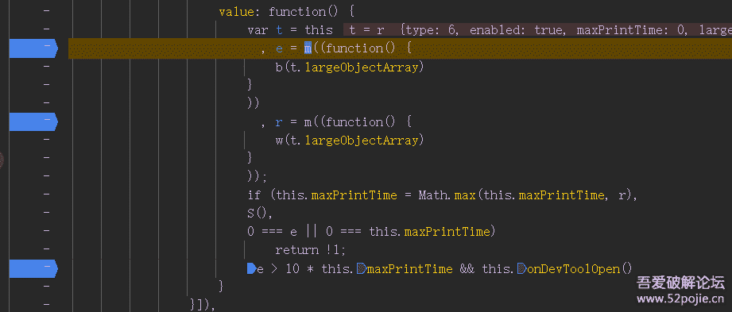
5.png (18.78 KB, 下载次数: 0)
[href="forum.php?mod=attachment&aid=Mjc1ODg0OXxkN2JjYWI4NXwxNzkzNTcxMjQ5fDE2ODA4NnwyMDExMzQ1&nothumb=yes" target="_blank"](https://www.52pojie.cn/forum.php?mod=attachment&aid=Mjc1ODg0OXxkN2JjYWI4NXwxNzkzNTcxMjQ5fDE2ODA4NnwyMDExMzQ1&nothumb=yes)
2025-3-4 15:30 上传

然后我们单步跟进去`m`函数，可以看到，先取了一下时间戳，然后调用传进的参数，最后再返回参数调用的时间差，那猫腻肯定是出现在传入的函数中了。

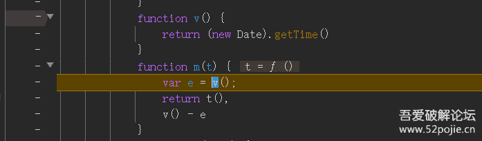
6.png (10.61 KB, 下载次数: 1)
[href="forum.php?mod=attachment&aid=Mjc1ODg1MHxhYzg3MTMxOXwxNzkzNTcxMjQ5fDE2ODA4NnwyMDExMzQ1&nothumb=yes" target="_blank"](https://www.52pojie.cn/forum.php?mod=attachment&aid=Mjc1ODg1MHxhYzg3MTMxOXwxNzkzNTcxMjQ5fDE2ODA4NnwyMDExMzQ1&nothumb=yes)
2025-3-4 15:30 上传

我们直接进入被调用的参数函数中，可以看到` t.largeObjectArray`是一个大对象，`b`其实是`console.table`函数，也就是在控制台打印一个大对象。

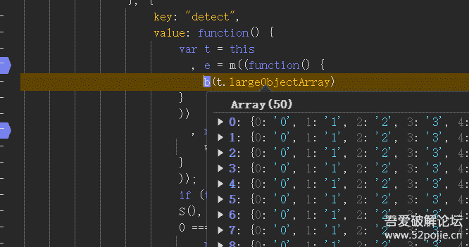
7.png (21.27 KB, 下载次数: 1)
[href="forum.php?mod=attachment&aid=Mjc1ODg1MXwyYTZhZmM4Y3wxNzkzNTcxMjQ5fDE2ODA4NnwyMDExMzQ1&nothumb=yes" target="_blank"](https://www.52pojie.cn/forum.php?mod=attachment&aid=Mjc1ODg1MXwyYTZhZmM4Y3wxNzkzNTcxMjQ5fDE2ODA4NnwyMDExMzQ1&nothumb=yes)
2025-3-4 15:30 上传

那反调试的逻辑大体清楚了：如果打开了控制台，就会通过`console.table`打印一个很大的对象，这就需要消耗时间，后续`e > 10 * this.maxPrintTime`就成立，就会进入最终`window.close`的逻辑。

我们可以通过`hook`，返回一个固定的时间戳来过掉反调试（油猴或者直接在控制台注入都可以）。


## 反调试处理

```
Date.prototype.getTime = function(){
    return 1741067137856
}
```

`hook`掉时间戳之后，我们会发现控制台一直会被清空，也不利于调试，我们直接把清空控制台的代码置为空函数`E = function(){}`。

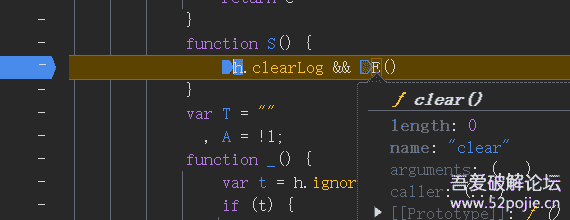

`8.png` (14.33 KB, 下载次数: 1) [附件](https://www.52pojie.cn/forum.php?mod=attachment&aid=Mjc1ODg1Mnw1NmQxZWFkNnwxNzkzNTcxMjQ5fDE2ODA4NnwyMDExMzQ1&nothumb=yes) 2025-3-4 15:30 上传

同理，再把和控制台打印相关的`b`和`w`函数也置空（在对应函数断住的时候去置空）。

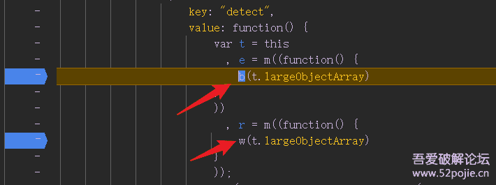

`9.png` (14.49 KB, 下载次数: 1) [附件](https://www.52pojie.cn/forum.php?mod=attachment&aid=Mjc1ODg1M3wzYjBmOWI4NXwxNzkzNTcxMjQ5fDE2ODA4NnwyMDExMzQ1&nothumb=yes) 2025-3-4 15:30 上传

最后，能够在控制台输入并输出表示我们成功过掉了反调试。

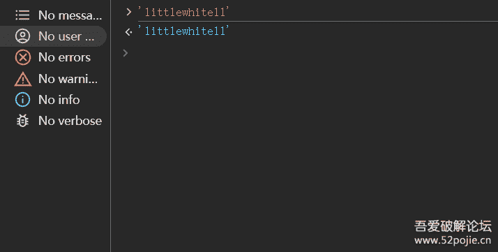

`10.png` (17.9 KB, 下载次数: 1) [附件](https://www.52pojie.cn/forum.php?mod=attachment&aid=Mjc1ODg1NHwwODBhMWViY3wxNzkzNTcxMjQ5fDE2ODA4NnwyMDExMzQ1&nothumb=yes) 2025-3-4 15:30 上传

## 抓包分析

我们直接点击土地供应 -> 供地计划，会发一个`list`的包，请求头中的`Hash`参数就是需要逆向的参数。

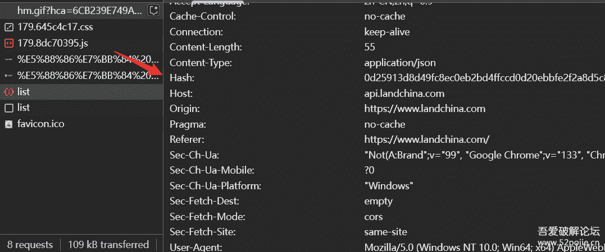

`11.png` (63.27 KB, 下载次数: 0) [附件](https://www.52pojie.cn/forum.php?mod=attachment&aid=Mjc1ODg1NXw0YzMzYzU4YXwxNzkzNTcxMjQ5fDE2ODA4NnwyMDExMzQ1&nothumb=yes) 2025-3-4 15:30 上传

## 逆向分析

一般请求头参数加密，我们可以通过`hook`的手段去找加密位置（可以去找现成的`hook`代码）。我选择直接从启动器去找了，一般都会看异步之前的`request`。

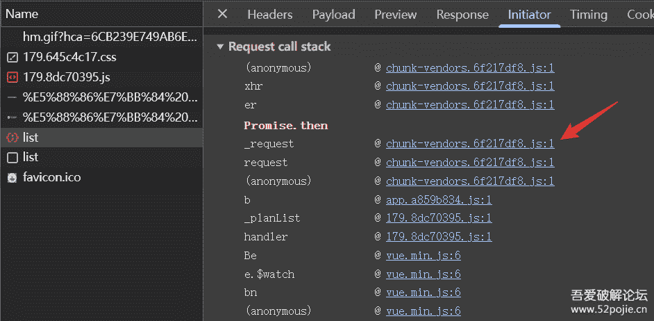

`12.png` (42.16 KB, 下载次数: 1) [附件](https://www.52pojie.cn/forum.php?mod=attachment&aid=Mjc1ODg1Nnw3Yzc5N2MwN3wxNzkzNTcxMjQ5fDE2ODA4NnwyMDExMzQ1&nothumb=yes) 2025-3-4 15:30 上传

下断，发包，然后找请求拦截器。

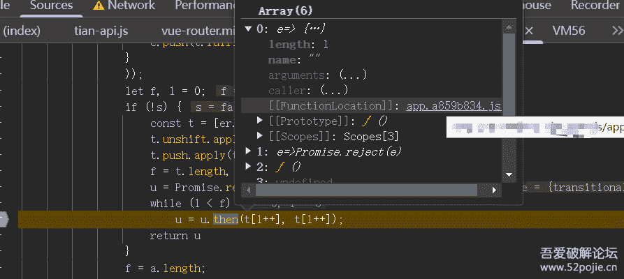

`13.png` (31.77 KB, 下载次数: 1) [附件](https://www.52pojie.cn/forum.php?mod=attachment&aid=Mjc1ODg1N3xmYTZmZDJhY3wxNzkzNTcxMjQ5fDE2ODA4NnwyMDExMzQ1&nothumb=yes) 2025-3-4 15:30 上传

很显然，下图大概率就是加密参数的生成位置。

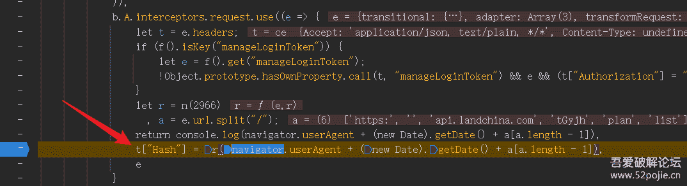

`14.png` (25.14 KB, 下载次数: 0) [附件](https://www.52pojie.cn/forum.php?mod=attachment&aid=Mjc1ODg1OHxiYmYyN2I0MHwxNzkzNTcxMjQ5fDE2ODA4NnwyMDExMzQ1&nothumb=yes) 2025-3-4 15:30 上传

我们在控制台输出一下结果，可以看到密文的长度为64，看起来很像SHA256。

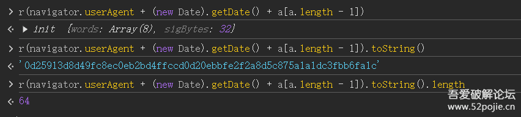

`15.png` (14.9 KB, 下载次数: 1) [附件](https://www.52pojie.cn/forum.php?mod=attachment&aid=Mjc1ODg1OXw1MWI2MjA0N3wxNzkzNTcxMjQ5fDE2ODA4NnwyMDExMzQ1&nothumb=yes) 2025-3-4 15:30 上传

那我们就去尝试一下，看是否为标准的SHA256，字符串`'1'`的摘要为`6b86b273ff34fce19d6b804eff5a3f5747ada4eaa22f1d49c01e52ddb7875b4b`。

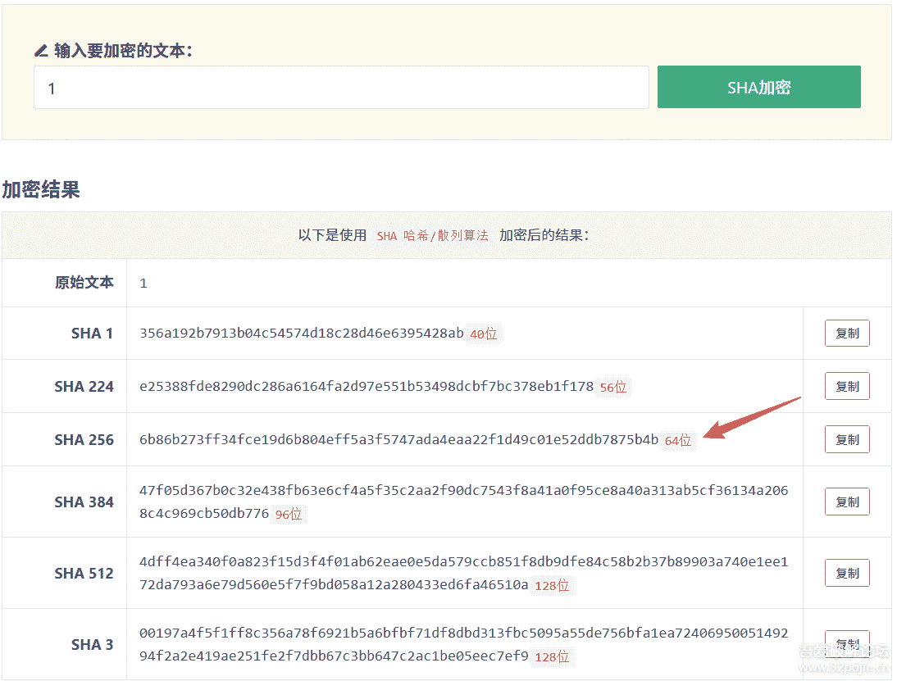

`16.png` (79.52 KB, 下载次数: 1) [附件](https://www.52pojie.cn/forum.php?mod=attachment&aid=Mjc1ODg2MHw3Yjg0N2Q4NHwxNzkzNTcxMjQ5fDE2ODA4NnwyMDExMzQ1&nothumb=yes) 2025-3-4 15:30 上传

再去控制台对字符串`'1'`进行摘要，经对比，算法是标准的，没有魔改。

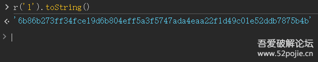

`17.png` (8.71 KB, 下载次数: 2) [附件](https://www.52pojie.cn/forum.php?mod=attachment&aid=Mjc1ODg2MXw2NWVjMDQyMXwxNzkzNTcxMjQ5fDE2ODA4NnwyMDExMzQ1&nothumb=yes) 2025-3-4 15:30 上传

那加密过程大概清楚了，对`userAgent`、今天的日期（日）以及`list`进行SHA256得到`Hash`。

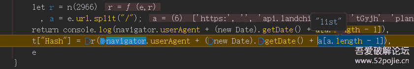

`18.png` (15.13 KB, 下载次数: 0) [附件](https://www.52pojie.cn/forum.php?mod=attachment&aid=Mjc1ODg2MnwyZDU2OTExZXwxNzkzNTcxMjQ5fDE2ODA4NnwyMDExMzQ1&nothumb=yes) 2025-3-4 15:30 上传

那我们直接对接口进行请求模拟。

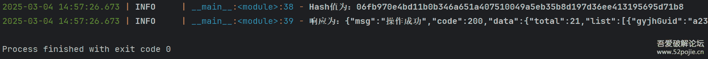

`19.png` (44.55 KB, 下载次数: 1) [附件](https://www.52pojie.cn/forum.php?mod=attachment&aid=Mjc1ODg2M3xmYzE3MTU3YXwxNzkzNTcxMjQ5fDE2ODA4NnwyMDExMzQ1&nothumb=yes) 2025-3-4 15:30 上传

成功！！！
