# [Web逆向] 药某局 webpack js逆向扣代码

- 原帖: https://www.52pojie.cn/forum.php?mod=viewthread&tid=2012536
- 抓取时间: 2026-11-01T22:14:03

## 什么是webpack

`webpack` 是一个现代 JavaScript 应用程序的模块打包器。它的主要作用是将你项目中的各种资源（JavaScript、CSS、图片等）打包成少数几个文件（通常是一个或几个 JavaScript 文件），使得前端页面加载更快，并且优化开发过程。

在`webpack`里面会有一个加载器，在网页加载的时候把函数都加载在里面，然后通过键值或者列表索引来调用，他是一个自执行函数。如下的两种格式：

```
// 列表
!function(参数){[函数体，模块1，模块2，...]}

// 键值对
!function(参数){"K1":"模块1", "K2":"模块2"}
```

加载器的格式：先通过下面的参数把函数传递进去，把函数存储起来，后面就可以通过把索引直接调用函数。

```
window = global;

!(function (e) {

    var t = {}; // 用来存储模块的对象

    // 定义模块加载函数 n

    function n(r) {

      // 如果模块已经加载过，则直接返回该模块的 exports

      if (t[r]) return t[r].exports;

      // 如果没有加载过，则创建一个新的模块

      var o = t[r] = {

        i: r,        // 模块标识符

        l: false,    // 是否已加载

        exports: {}  // 导出的内容

      };

      // 加载并执行模块的代码

      e[r].call(o.exports, o, o.exports, n);

      // 返回模块的 exports

      return o.exports.exports;

    }

    // 模块加载器或执行环境

    window.loader = n;

    // 示例：调用模块

    // nc("1002"); // 此行被注释，表示不执行

})([function () {

    console.log("function1")

},function () {

    console.log("function2")

}])

//第二种传参  键值对的方式

// ({"fun1": function () {

//     console.log("function1")

// },"fun2":function () {

//     console.log("function2")

// }})

window.loader(0)
```

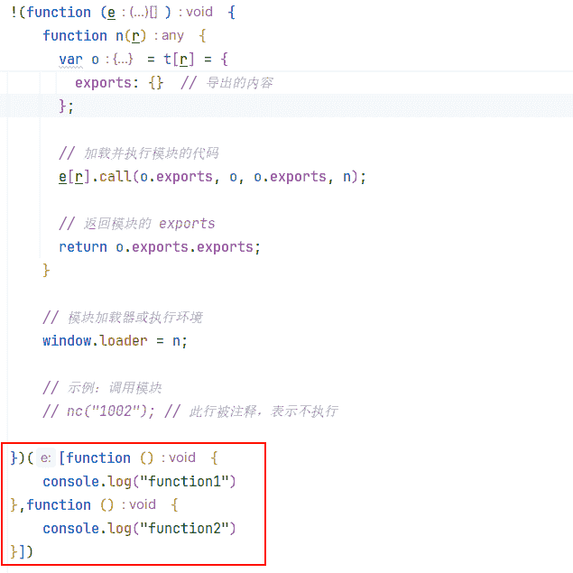

调用执行

```
window.loader(0)
// 第二种调用
window.loader("fun1")
```

结果

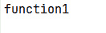

## 实战

网站：`aHR0cHM6Ly9mdXd1Lm5oc2EuZ292LmNuLw==`

位置：定点查询

## 接口分析

接口地址：`queryFixedHospital`

`encData` 是加密参数

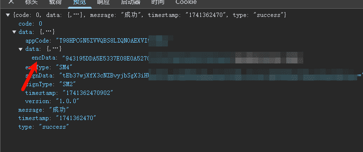

## 查找加密的位置

用 json hook 技术

```
var my_stringify = JSON.stringify;

JSON.stringify = function (params) {

  // 这里可以添加其他逻辑比如

  console.log("json_stringify params:",params);

  debugger

  return my_stringify(params);

};

var my_parse = JSON.parse;

JSON.parse = function (params) {

  // 这里可以添加其他逻辑比如

  console.log("json_parse params:",params);

  debugger

  return my_parse(params);

};
```

控制台下 hook

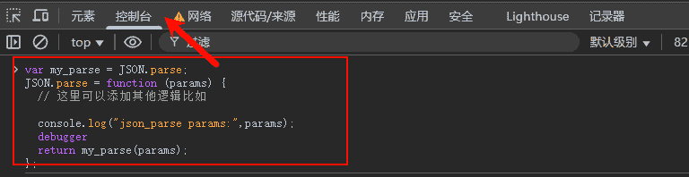

跳过三个不是完成解密的位置，在完成解密之后的地方停住向上跟站

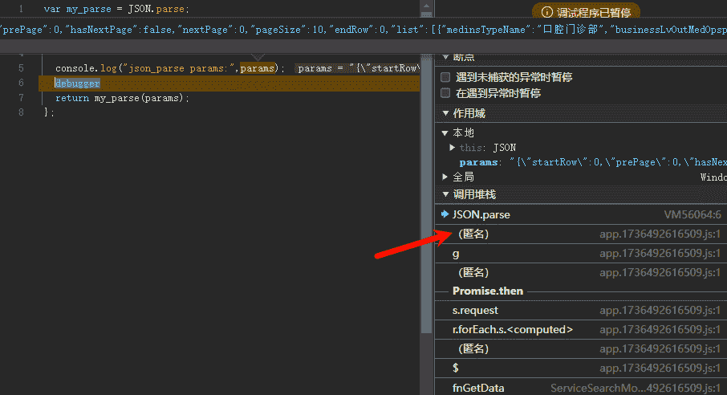

这里有一个很明显的关键词 `decrypt`

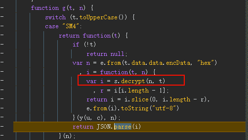

可以在`return`这个位置下个断点看看是不是真的数据，可以看到他前面通过一些处理变成列表然后再转换字符串

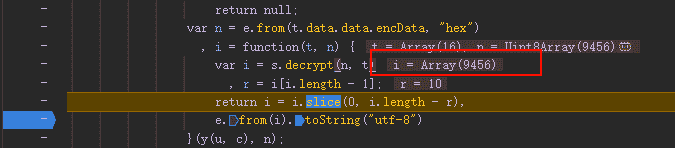

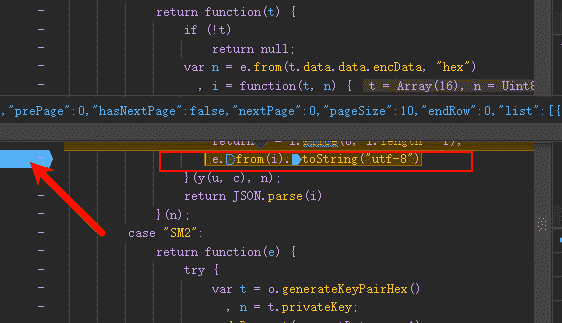

在向上跟栈看看有没有什么明显的地方

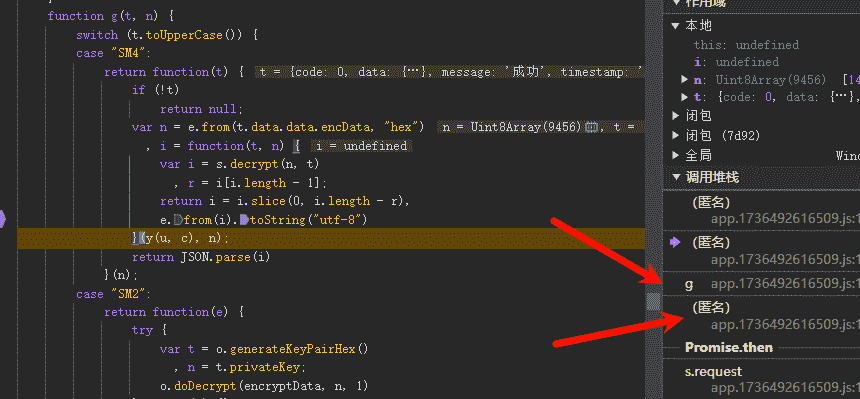

在（1）的位置是一个拦截器

在 Axios 中，interceptors（拦截器）用于拦截请求或响应，并在它们被处理之前执行某些操作。response 拦截器允许你在服务器返回响应之前，对响应数据进行处理或修改，或者在发生错误时执行某些操作。

（2）的位置就是刚刚通过把加密数据传递进去的变量

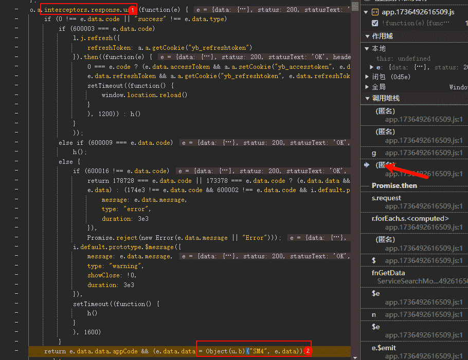

加密函数是`n.b`，我们可以看看这个在哪里 往上面找一找，可以看到这里有很多像`webpack`格式的函数调用方式，我们可以推测这个是`webpack`框架，在这个位置下个断点刷新页面

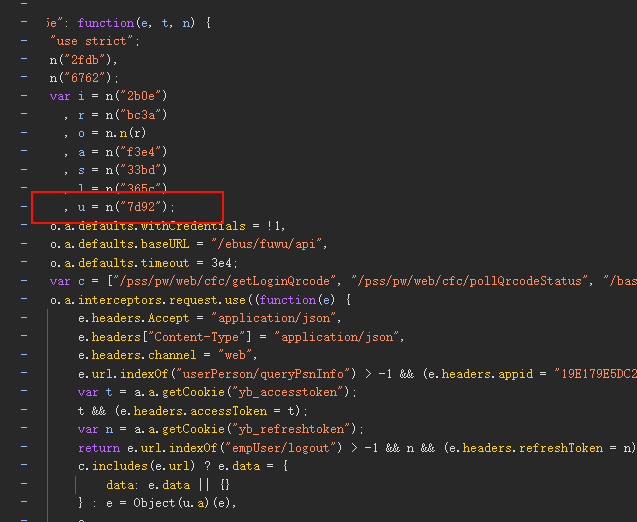

进入构造器

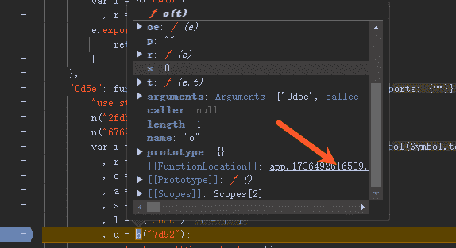

这个就是构造器了

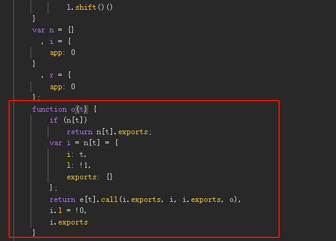

在这里可以看到下面都是我上面说过的参数键值对的格式，我们可以直接把他们都扣下来

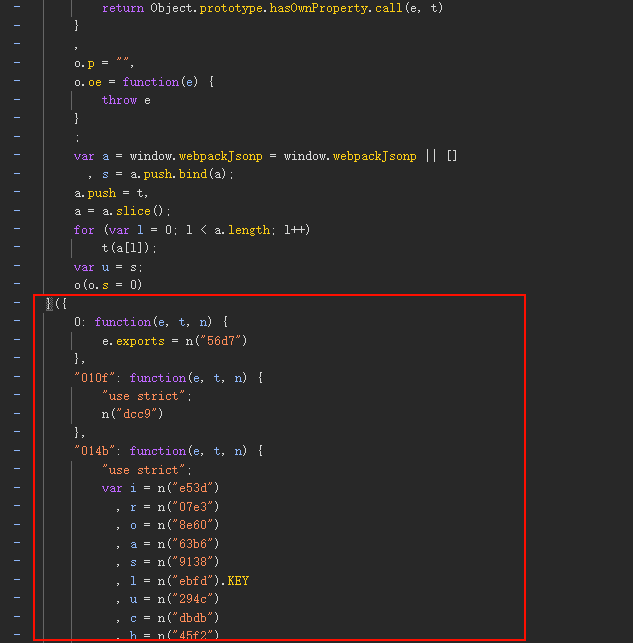

## 改代码

扣完先运行看看，缺少`window`直接在上面补

在浏览器中，`window`是一个全局对象，代表浏览器的 浏览器窗口 或 标签页。它是浏览器环境中的顶级对象，提供了访问浏览器的多种功能，比如操作浏览器的历史记录、获取用户的浏览器信息、管理定时器、处理事件、访问浏览器的`localStorage`、`sessionStorage`等。

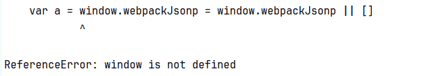

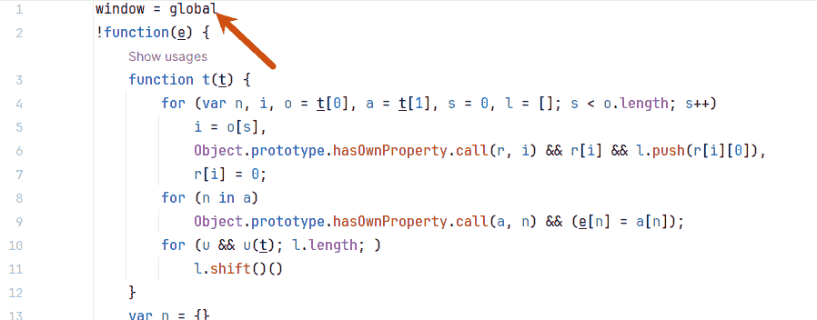

可以运行成功了  但是我们如果想运行他里面的代码 是不是得需要使用到那个构造器，但是因为`js`的域不一样不能直接调用他，所以我们需要在外面添加一个全局变量来接收他们内部的参数

在构造器的参数下面添加全局变量接收这个，构造器函数`o`

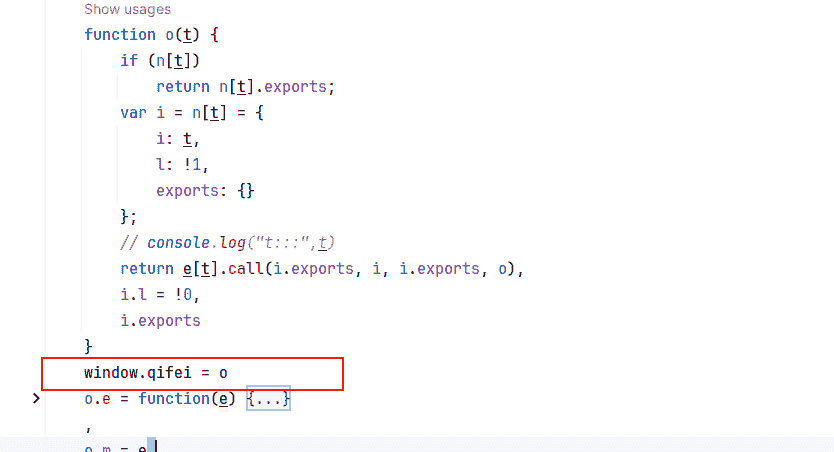

出现了环境测试的错误，在这个里面一般有一个检测环境的函数我们需要注释掉

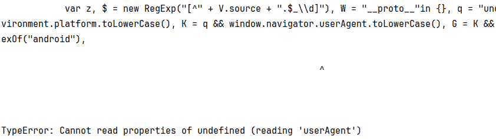

把这个注释掉`o.`的那些函数都是为了做准备 可以忽视掉，直接看最后一行，是调用了某个函数所以这个是环境检测的函数

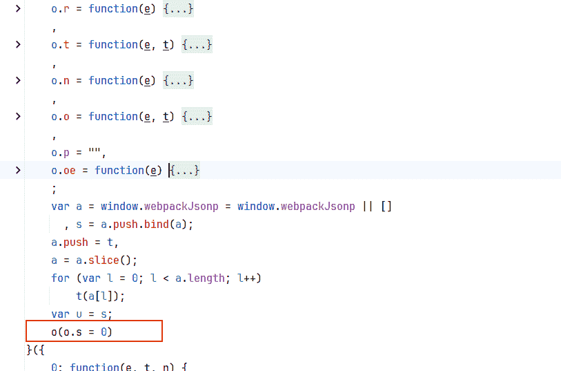

直接打印这个对象可以发现里面拥有了我们需要的函数了

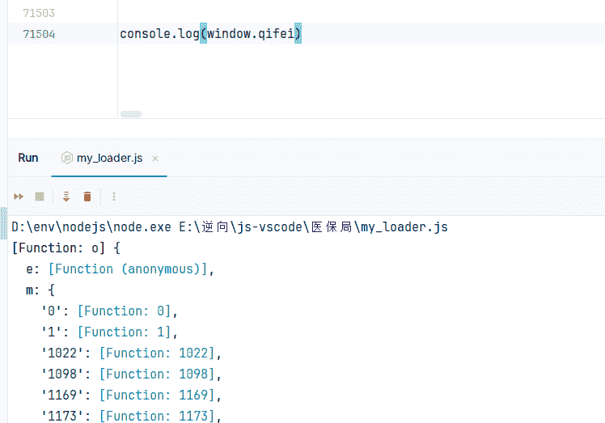

在前面中我们看到了`Object(u.b)("SM4", e.data)`位置是解密的，里面的`u.b`又是从`u = n("7d92")`得到的，直接调用就可以得到里面的函数

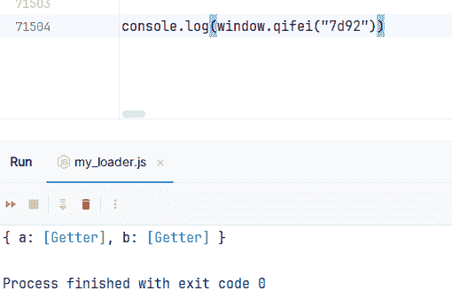

定义一个变量来接收这个函数，`e`是加密的参数

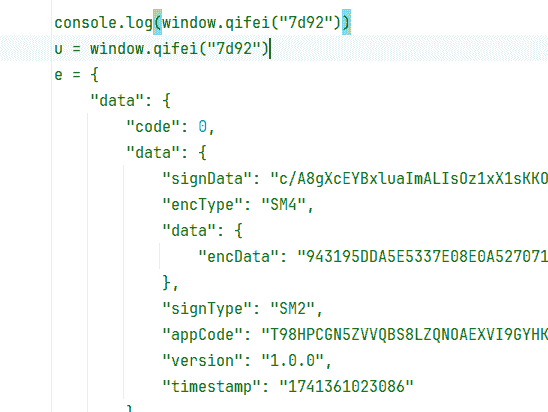

成功解密

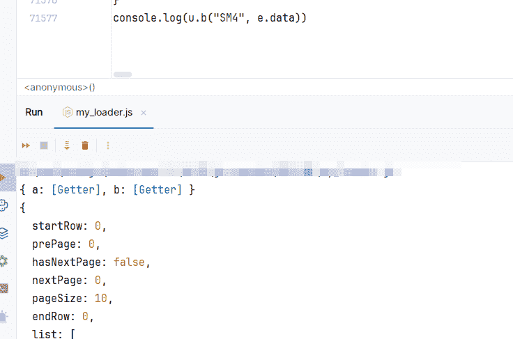
