# [原创] 某奇葩反调试 会过期OCR软件 趣味搞笑通关一例

- 原帖：https://www.52pojie.cn/forum.php?mod=viewthread&tid=2012682
- 抓取时间：2026-11-01T22:14:01

[www.52pojie.cn/thread-2006656-1-1.html](https://www.52pojie.cn/thread-2006656-1-1.html)

这是上次提问一直没搞明白的一款软件（当然很老了网站都黄了，你想注册都找不到主儿了），这款软件有几个比较怪的地方。

主要有几下几个限制：

1. 会过期
2. OCR 结束时会出现如下提示：
   > Qemo version: only the first 10 words were copied, order production version now at `http://。。省略3`
3. 调试一旦超时，就出来骚扰信息。。调试器和目标程序，你都无法结束了。。任务管理器也看不到了。。。你只能系统注销，这就导致了逆向记录和截图全飞了

费话说完，从头开始说说爆破和分析经过：

为了写本贴，只能[www.52pojie.cn/thread-661779-1-1.html](https://www.52pojie.cn/thread-661779-1-1.html)里再安装一个。。。文件是个`ScreenOCR2014.1403168654.exe`，用`WinRAR`打开会看到是个`MSI`文件。

算了，我们也不找`MSI`解包工具了，还是走正常流程安装吧。。。

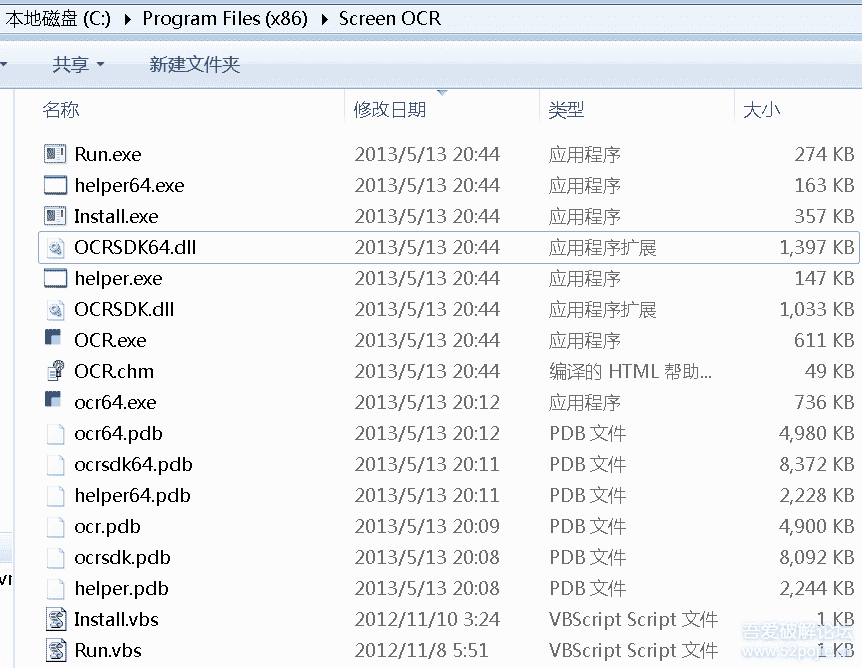

`image.png` (45.26 KB, 下载次数: 0)

[href="forum.php?mod=attachment&aid=Mjc1OTg5M3w0ZjFhMzM1YnwxNzkzNTcxMjM5fDE2ODA4NnwyMDEyNjgy&nothumb=yes" target="_blank"](https://www.52pojie.cn/forum.php?mod=attachment&aid=Mjc1OTg5M3w0ZjFhMzM1YnwxNzkzNTcxMjM5fDE2ODA4NnwyMDEyNjgy&nothumb=yes)

2025-3-8 20:44 上传

软件安装之后就是这些文件了。。。

对于开发过`x64dbg`，摸过`VS2013`，下载过`x64dbg`带符号版的应该不陌生`*.pdb`符号文件吧？

甭费话，选中这些直接删除，不放心您就先让它进回收站，保证你还能照样运行，这就是经验。

`OCR.chm`帮助文件，`Delete!`

`Install.vbs`

```
Set WSHShell = CreateObject("WScript.Shell")
Set FileSys = CreateObject("Scripting.FileSystemObject")
path = WSHShell.RegRead("HKEY_CURRENT_USER\Software\OCR\Installation Path")
path = path & "\Install.exe"
execpath = path & " " & Property("CustomActionData")
If FileSys.FileExists(path) Then
Set oExec = WSHShell.Exec(execpath)
Else
MsgBox("Install.exe not found (" & path & ")")
End If
Set FileSys = nothing
Set WSHShell = nothing
```

既然里边有注册表，我们就打开看一眼。

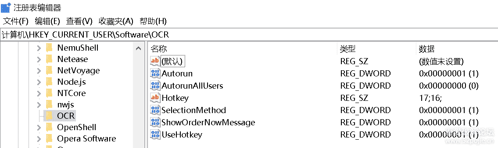

`image.png` (36.33 KB, 下载次数: 0)

[href="forum.php?mod=attachment&aid=Mjc1OTkwMHwzN2NmNjI0NXwxNzkzNTcxMjM5fDE2ODA4NnwyMDEyNjgy&nothumb=yes" target="_blank"](https://www.52pojie.cn/forum.php?mod=attachment&aid=Mjc1OTkwMHwzN2NmNjI0NXwxNzkzNTcxMjM5fDE2ODA4NnwyMDEyNjgy&nothumb=yes)

2025-3-8 20:52 上传

和过期啥的没关系 。。。

软件能试用21天。。之后就会过期。。

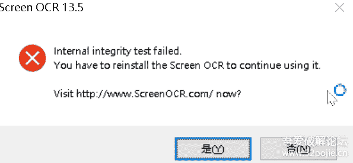

`image.png` (33.98 KB, 下载次数: 0)

[href="forum.php?mod=attachment&aid=Mjc1OTkwNXxiODE5N2MwOHwxNzkzNTcxMjM5fDE2ODA4NnwyMDEyNjgy&nothumb=yes" target="_blank"](https://www.52pojie.cn/forum.php?mod=attachment&aid=Mjc1OTkwNXxiODE5N2MwOHwxNzkzNTcxMjM5fDE2ODA4NnwyMDEyNjgy&nothumb=yes)

2025-3-8 21:13 上传

`Run.vbs`

```
Set WshShell = CreateObject("WScript.Shell")
WshShell.Exec "rundll32.exe url.dll,FileProtocolHandler """ & Property("CustomActionData") & """"
Set WshShell = Nothing
```

`helper.exe` 无论你用`OCR.exe` or `OCR64.exe`启动之第系统中都会多了这么一个进程

`helper64.exe`。。。这个我到没见过。。。

`Install.exe` `A=====>` 可以用`x32dbg`打开看一眼引用的字符串，显然关键点不在这里边。

- `OCR.exe` `b1`
- `ocr64.exe` `A1`
- `Run.exe` `A2`
- `OCRSDK.dll` `b2`
- `OCRSDK64.dll` `A3`

意外的发现，只要有`ocr64.exe`、`Run.exe`、`helper.exe` ==读取==> `OCRSDK.dll`，有时候过期的竟然又能进入主界面了。。。奇葩吧？

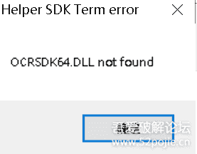

`image.png` (11 KB, 下载次数: 0)

[href="forum.php?mod=attachment&aid=Mjc1OTkwOHw2OTUwNDdjNXwxNzkzNTcxMjM5fDE2ODA4NnwyMDEyNjgy&nothumb=yes" target="_blank"](https://www.52pojie.cn/forum.php?mod=attachment&aid=Mjc1OTkwOHw2OTUwNDdjNXwxNzkzNTcxMjM5fDE2ODA4NnwyMDEyNjgy&nothumb=yes)

2025-3-8 21:20 上传

就是每次多出一个这提示。。

再来说下功能限制，当按`Ctrl+Shift+Left Click`时

选择区域开始捕获，捕获之后出现一个菜单。。让你选择处理方式（是复制文本到剪贴板。。还是保存到`*.txt`。。。）

外部分析的差不多了，该进入内部再看看究竟了。。。

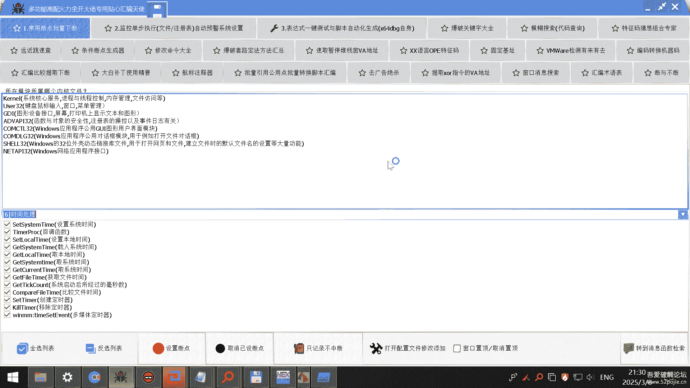

`image.png` (290.58 KB, 下载次数: 1)

[href="forum.php?mod=attachment&aid=Mjc1OTkxM3wzNDc4NmM1NHwxNzkzNTcxMjM5fDE2ODA4NnwyMDEyNjgy&nothumb=yes" target="_blank"](https://www.52pojie.cn/forum.php?mod=attachment&aid=Mjc1OTkxM3wzNDc4NmM1NHwxNzkzNTcxMjM5fDE2ODA4NnwyMDEyNjgy&nothumb=yes)

2025-3-8 21:31 上传

一般情况下，我们给时间类函数批量下个断点

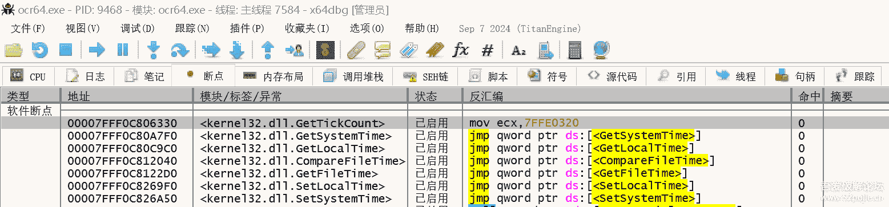

`image.png` (113.07 KB, 下载次数: 0)

[href="forum.php?mod=attachment&aid=Mjc1OTkxNXw0MmJlNDU3N3wxNzkzNTcxMjM5fDE2ODA4NnwyMDEyNjgy&nothumb=yes" target="_blank"](https://www.52pojie.cn/forum.php?mod=attachment&aid=Mjc1OTkxNXw0MmJlNDU3N3wxNzkzNTcxMjM5fDE2ODA4NnwyMDEyNjgy&nothumb=yes)

2025-3-8 21:32 上传

这个是检测你的软件开启了多久，用于判断是否软件处于被调试

因为运行不久就会出来又一个弹框，结束之后软件就被迫完蛋了。。。

所以我们有必要了解一下软件内部的调用顺序

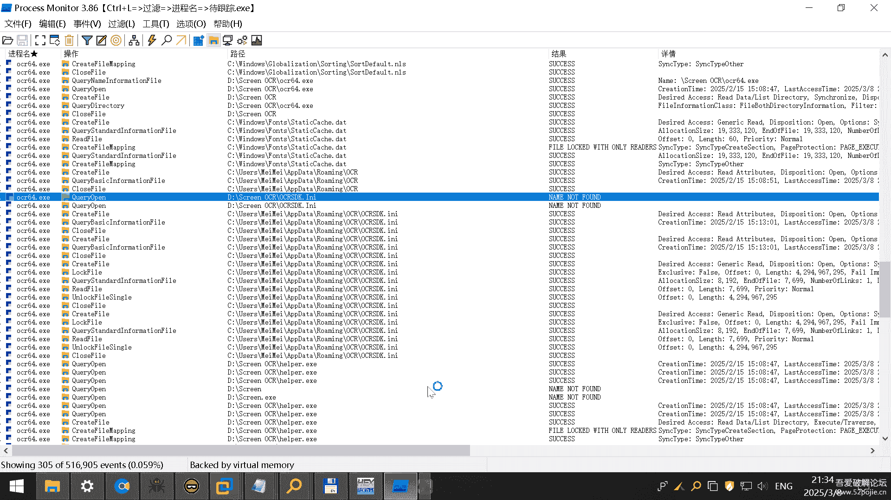

`image.png` (238.82 KB, 下载次数: 0)

[href="forum.php?mod=attachment&aid=Mjc1OTkxNnwyMmQxYjI1MnwxNzkzNTcxMjM5fDE2ODA4NnwyMDEyNjgy&nothumb=yes" target="_blank"](https://www.52pojie.cn/forum.php?mod=attachment&aid=Mjc1OTkxNnwyMmQxYjI1MnwxNzkzNTcxMjM5fDE2ODA4NnwyMDEyNjgy&nothumb=yes)

2025-3-8 21:34 上传

`Process Monitor_x64`打开后`Ctrl+L` ==> 重置 =》下拉菜单 进程名 ==》`orc64.exe` ==> 添加 ===》`Ctrl+E`

发现有两个`INI`的读取，一个在本目录中（但无此文件）

另一个在

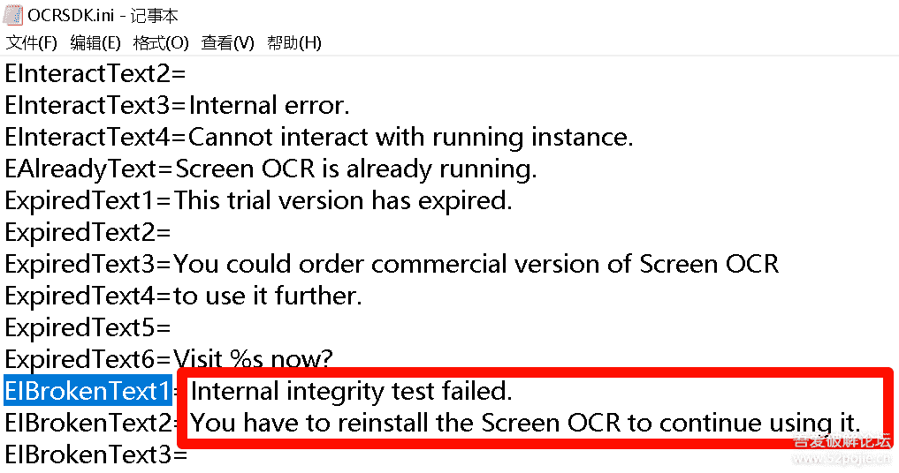

`image.png` (27.74 KB, 下载次数: 0)

[href="forum.php?mod=attachment&aid=Mjc1OTkxOHw1YjJkYmQzZHwxNzkzNTcxMjM5fDE2ODA4NnwyMDEyNjgy&nothumb=yes" target="_blank"](https://www.52pojie.cn/forum.php?mod=attachment&aid=Mjc1OTkxOHw1YjJkYmQzZHwxNzkzNTcxMjM5fDE2ODA4NnwyMDEyNjgy&nothumb=yes)

2025-3-8 21:36 上传

看到报错信息了没？你用`TC`搜索软件安装目录，根本找不到。。。

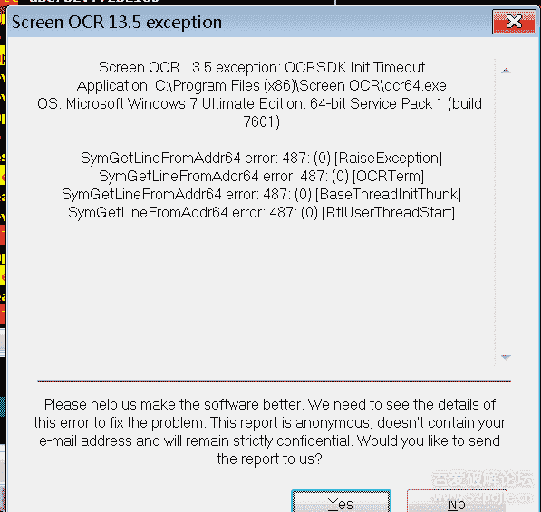

`image.png` (25.15 KB, 下载次数: 0)

[href="forum.php?mod=attachment&aid=Mjc1OTkzNHw4YzZjMDdiOXwxNzkzNTcxMjM5fDE2ODA4NnwyMDEyNjgy&nothumb=yes" target="_blank"](https://www.52pojie.cn/forum.php?mod=attachment&aid=Mjc1OTkzNHw4YzZjMDdiOXwxNzkzNTcxMjM5fDE2ODA4NnwyMDEyNjgy&nothumb=yes)

2025-3-8 21:56 上传

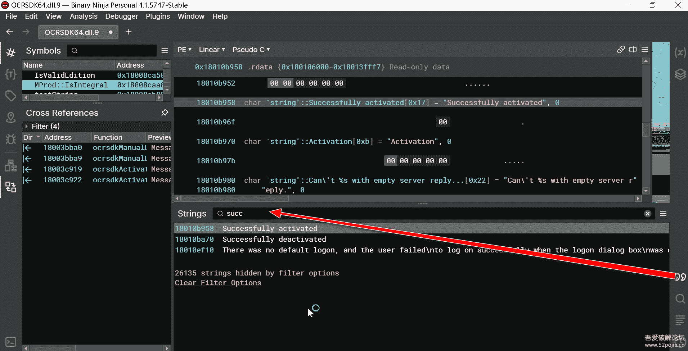

`image.png` (177.36 KB, 下载次数: 0)

[href="forum.php?mod=attachment&aid=Mjc1OTk0Mnw1M2IwY2E2MXwxNzkzNTcxMjM5fDE2ODA4NnwyMDEyNjgy&nothumb=yes" target="_blank"](https://www.52pojie.cn/forum.php?mod=attachment&aid=Mjc1OTk0Mnw1M2IwY2E2MXwxNzkzNTcxMjM5fDE2ODA4NnwyMDEyNjgy&nothumb=yes)

2025-3-8 22:11 上传

打开二进制忍者

搜索注册成功的英文

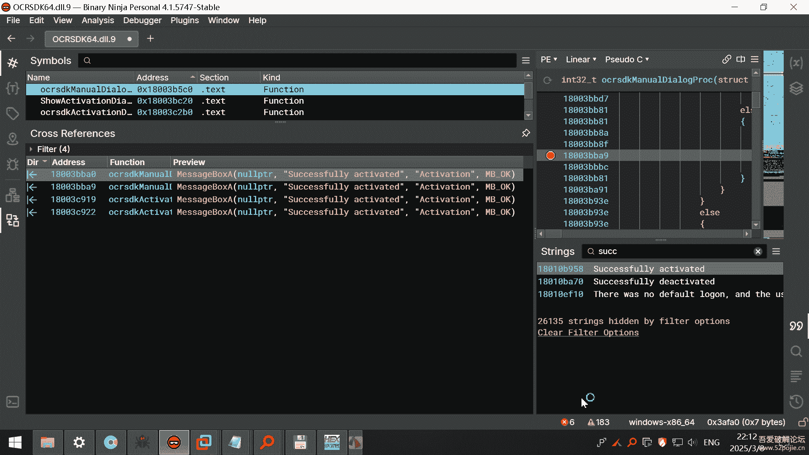

`image.png` (280.99 KB, 下载次数: 0)

[href="forum.php?mod=attachment&aid=Mjc1OTk0NHw0YzIzOTcxMXwxNzkzNTcxMjM5fDE2ODA4NnwyMDEyNjgy&nothumb=yes" target="_blank"](https://www.52pojie.cn/forum.php?mod=attachment&aid=Mjc1OTk0NHw0YzIzOTcxMXwxNzkzNTcxMjM5fDE2ODA4NnwyMDEyNjgy&nothumb=yes)

2025-3-8 22:13 上传

左侧的交叉引用看到没有？依次点击查看。

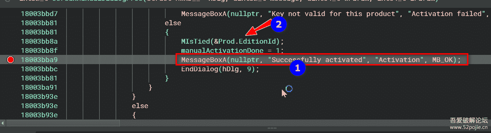

`image.png` (68.3 KB, 下载次数: 0)

[href="forum.php?mod=attachment&aid=Mjc1OTk0NXxjNjg5OWE3ZHwxNzkzNTcxMjM5fDE2ODA4NnwyMDEyNjgy&nothumb=yes" target="_blank"](https://www.52pojie.cn/forum.php?mod=attachment&aid=Mjc1OTk0NXxjNjg5OWE3ZHwxNzkzNTcxMjM5fDE2ODA4NnwyMDEyNjgy&nothumb=yes)

2025-3-8 22:14 上传

手动激活 =1

上面有一行`MIsTied(&Prod.EditionId);`

前两个是在线激活，次要的，节省时间不说了。。。不截图了。。

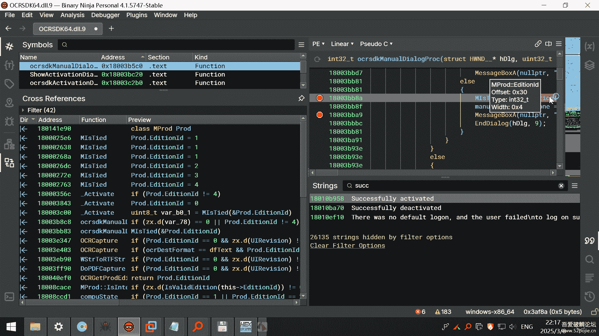

`image.png` (372.32 KB, 下载次数: 0)

[href="forum.php?mod=attachment&aid=Mjc1OTk0Nnw4ODhlZTQyMXwxNzkzNTcxMjM5fDE2ODA4NnwyMDEyNjgy&nothumb=yes" target="_blank"](https://www.52pojie.cn/forum.php?mod=attachment&aid=Mjc1OTk0Nnw4ODhlZTQyMXwxNzkzNTcxMjM5fDE2ODA4NnwyMDEyNjgy&nothumb=yes)

2025-3-8 22:17 上传

点中这个`Prod.EditionId`

左侧又出现新的交叉引用点

其实上面截图中的 圆圈2 ② 和 上上图中第一行第二行 是一个地址

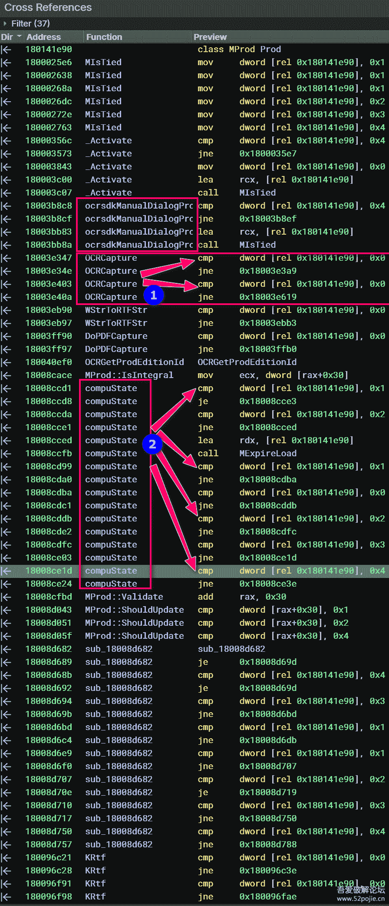

`image.png` (422.42 KB, 下载次数: 0)

[href="forum.php?mod=attachment&aid=Mjc1OTk0N3xhZDZjMjg4OHwxNzkzNTcxMjM5fDE2ODA4NnwyMDEyNjgy&nothumb=yes" target="_blank"](https://www.52pojie.cn/forum.php?mod=attachment&aid=Mjc1OTk0N3xhZDZjMjg4OHwxNzkzNTcxMjM5fDE2ODA4NnwyMDEyNjgy&nothumb=yes)

2025-3-8 22:19 上传

这里内容比较长，我们简单的分下类，是不看看起来一目了然了？

最顶上好像是

- `xx`过程的
- 是试用版本的（注意看到后面的 `1` `2` `3` `4` 没有），暗示你返回值无非 `1`、`2`、`3`、`4` 几种状态
- 激活的
- 激活对话框的
- `OCR`截图时与功能限制的`CALL`比较
- `Compu State`（可能全称就是 `Computer State`）
- 后面感觉没啥意思。。略

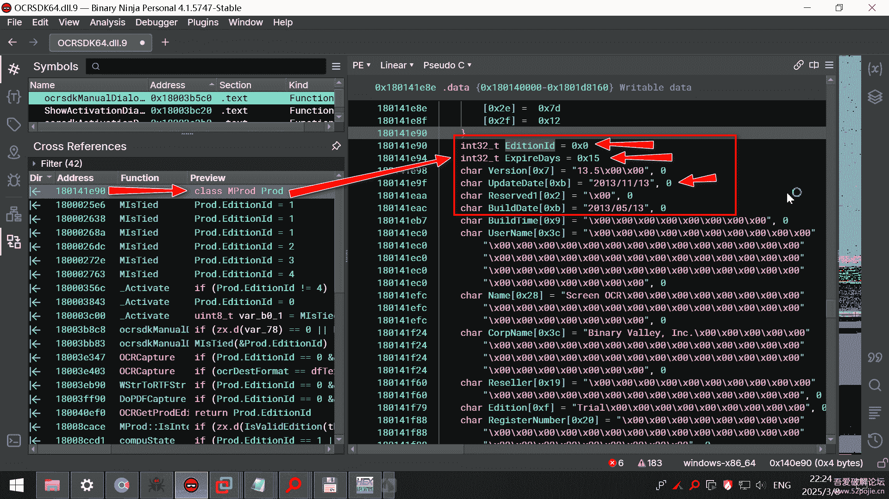

`image.png` (417.81 KB, 下载次数: 1)


[href="forum.php?mod=attachment&aid=Mjc1OTk1MHw2MGYwNGYwNHwxNzkzNTcxMjM5fDE2ODA4NnwyMDEyNjgy&nothumb=yes" target="_blank"](https://www.52pojie.cn/forum.php?mod=attachment&aid=Mjc1OTk1MHw2MGYwNGYwNHwxNzkzNTcxMjM5fDE2ODA4NnwyMDEyNjgy&nothumb=yes)

2025-3-8 22:24 上传

第一个点过去 看到没？

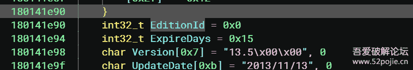

image.png (26.21 KB, 下载次数: 0)

[href="forum.php?mod=attachment&aid=Mjc1OTk1MnxlZTFjMjUzMHwxNzkzNTcxMjM5fDE2ODA4NnwyMDEyNjgy&nothumb=yes" target="_blank"](https://www.52pojie.cn/forum.php?mod=attachment&aid=Mjc1OTk1MnxlZTFjMjUzMHwxNzkzNTcxMjM5fDE2ODA4NnwyMDEyNjgy&nothumb=yes)

2025-3-8 22:25 上传

`180141e90 int32_t EditionId = 0x0` 我用PixPin版OCR过来的，凑合看吧。默认值是1

`180141e94 int32_t ExpireDays = 0x15` 天过期

`180141e98 char Version[0x7]="13.5\x00\x00"`，0版本号

`180141e9f char UpdateDate[0xb] = "2013/11/13"`，0 更新日期

`180141eac char BuildDate[0xb] ="2013/05/13"`，0

所在是`.data`段

现在就可以试着修改下，反正改坏了电脑也不爆炸。。

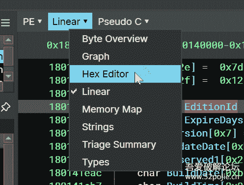

image.png (42.11 KB, 下载次数: 0)

[href="forum.php?mod=attachment&aid=Mjc1OTk1M3wwYjFjYTJkMXwxNzkzNTcxMjM5fDE2ODA4NnwyMDEyNjgy&nothumb=yes" target="_blank"](https://www.52pojie.cn/forum.php?mod=attachment&aid=Mjc1OTk1M3wwYjFjYTJkMXwxNzkzNTcxMjM5fDE2ODA4NnwyMDEyNjgy&nothumb=yes)

2025-3-8 22:29 上传

把模式由线性视图 改成 16进制编辑器 视图

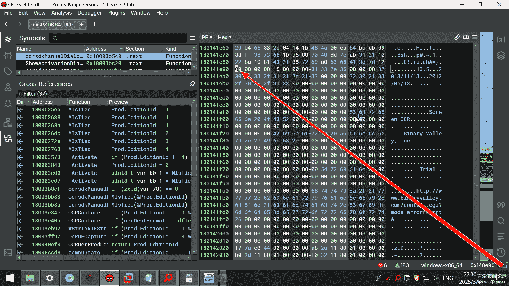

image.png (473.56 KB, 下载次数: 0)

[href="forum.php?mod=attachment&aid=Mjc1OTk1NHxhMjE2MTFkOXwxNzkzNTcxMjM5fDE2ODA4NnwyMDEyNjgy&nothumb=yes" target="_blank"](https://www.52pojie.cn/forum.php?mod=attachment&aid=Mjc1OTk1NHxhMjE2MTFkOXwxNzkzNTcxMjM5fDE2ODA4NnwyMDEyNjgy&nothumb=yes)

2025-3-8 22:30 上传

开锁状态下输入`01`, `File==>Save AS==>仅保存文件内容`

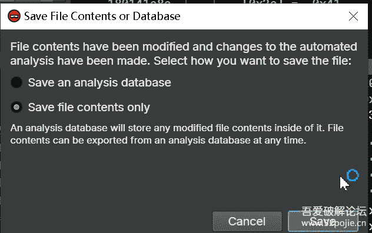

image.png (40.28 KB, 下载次数: 0)

[href="forum.php?mod=attachment&aid=Mjc1OTk1NXwwN2UxZWE5M3wxNzkzNTcxMjM5fDE2ODA4NnwyMDEyNjgy&nothumb=yes" target="_blank"](https://www.52pojie.cn/forum.php?mod=attachment&aid=Mjc1OTk1NXwwN2UxZWE5M3wxNzkzNTcxMjM5fDE2ODA4NnwyMDEyNjgy&nothumb=yes)

2025-3-8 22:31 上传

你会发现我们失败了，出现了上面的那个自校验的提示

后面还有1个`0x15`，你可以试着改成 `FF FF FF` 到死都没试用完。。

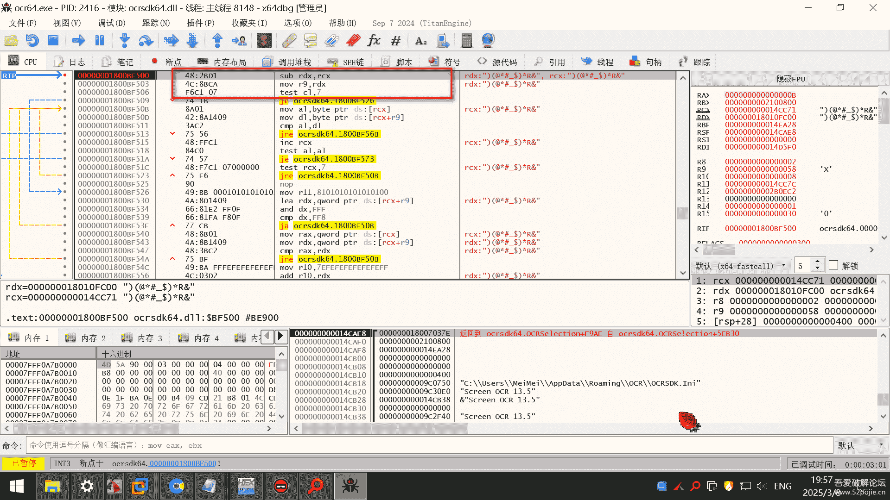

image.png (465.96 KB, 下载次数: 0)

[href="forum.php?mod=attachment&aid=Mjc1OTk1NnwxNjA4MGMzM3wxNzkzNTcxMjM5fDE2ODA4NnwyMDEyNjgy&nothumb=yes" target="_blank"](https://www.52pojie.cn/forum.php?mod=attachment&aid=Mjc1OTk1NnwxNjA4MGMzM3wxNzkzNTcxMjM5fDE2ODA4NnwyMDEyNjgy&nothumb=yes)

2025-3-8 22:36 上传

如果根据交叉引用把图中这个位置修改成 `mov al,1 ;ret`

立马软件的注册按钮就变成了灰色

。。。好像截图太多了。。。我太累了。。。反正就是依次试着改，依次下断点

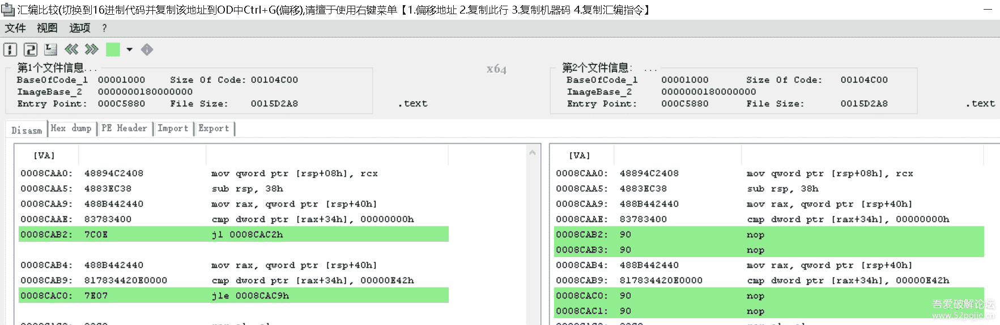

image.png (80.44 KB, 下载次数: 0)

[href="forum.php?mod=attachment&aid=Mjc1OTk1N3wzYzI5MDg0YXwxNzkzNTcxMjM5fDE2ODA4NnwyMDEyNjgy&nothumb=yes" target="_blank"](https://www.52pojie.cn/forum.php?mod=attachment&aid=Mjc1OTk1N3wzYzI5MDg0YXwxNzkzNTcxMjM5fDE2ODA4NnwyMDEyNjgy&nothumb=yes)

2025-3-8 22:41 上传

这两个地方修改 就能过点启动时的时间检测 ，和 自校验。

```
18003e34eOCRCaptureif (Prod.EditionId == 0 && zX.d(UIRevi
18003e40aOCRCaptureif (ocrDestFormat ==dfText && Prod.Ec
18003e359 if (((Prod.EditionId == 0 && ((uint32_t)UIRevision) != 0) && std::basic_string,class std::allocator >::size(&ocrBuffer) > 0))
18003e359 {
18003e37b std::basic_string >::operator+=(&var_a30, "\par\plain\f0\fs20\cf0 ");
18003e390 std::basic_string >::operator+=(&var_a30, &_Right_1);
18003e3a4 std::basic_string >::operator+=(&var_a30, "\par\r\n");
18003e359 }
```


## 反汇编片段

从最顶上开始 `OCR` 到最后 `ret` 的地方，有几次调用 `DEMO`，修改点就在其中。

```asm
000000018003D870  | 44:894424 18            | mov dword ptr ss:[rsp+18],r8d                    |
000000018003D875  | 48:895424 10            | mov qword ptr ss:[rsp+10],rdx                    |
000000018003D87A  | 48:894C24 08            | mov qword ptr ss:[rsp+8],rcx                     |
000000018003D87F  | 56                      | push rsi                                         |
000000018003D880  | 57                      | push rdi                                         |
000000018003D881  | B8 A80A0000             | mov eax,AA8                                      |
000000018003D886  | E8 C5140800             | call                     |
000000018003D88B  | 48:2BE0                 | sub rsp,rax                                      |
000000018003D88E  | 48:C78424 300A0000 FEFF | mov qword ptr ss:[rsp+A30],FFFFFFFFFFFFFFFE      |
000000018003D89A  | 48:8B05 5F561000        | mov rax,qword ptr ds:[180142F00]                 |
000000018003D8A1  | 48:33C4                 | xor rax,rsp                                      |
000000018003D8A4  | 48:898424 980A0000      | mov qword ptr ss:[rsp+A98],rax                   |
000000018003D8AC  | 48:8D8C24 E8000000      | lea rcx,qword ptr ss:[rsp+E8]                    |
000000018003D8B4  | E8 778EFDFF             | call                     |
000000018003D8B9  | 48:8D4C24 78            | lea rcx,qword ptr ss:[rsp+78]                    |
000000018003D8BE  | E8 AD8FFDFF             | call                     |
000000018003D8C3  | BA 007F0000             | mov edx,7F00                                     |
000000018003D8C8  | 33C9                    | xor ecx,ecx                                      |
000000018003D8CA  | FF15 00900C00           | call qword ptr ds:[]               |
000000018003D8D0  | 48:8BC8                 | mov rcx,rax                                      |
000000018003D8D3  | FF15 FF8F0C00           | call qword ptr ds:[]                  |
000000018003D8D9  | 48:898424 E0000000      | mov qword ptr ss:[rsp+E0],rax                    |
000000018003D8E1  | BA 8A7F0000             | mov edx,7F8A                                     |
000000018003D8E6  | 33C9                    | xor ecx,ecx                                      |
000000018003D8E8  | FF15 E28F0C00           | call qword ptr ds:[]               |
000000018003D8EE  | 48:8BC8                 | mov rcx,rax                                      |
000000018003D8F1  | FF15 E18F0C00           | call qword ptr ds:[]                  |
000000018003D8F7  | 48:894424 70            | mov qword ptr ss:[rsp+70],rax                    |
000000018003D8FC  | BA 007F0000             | mov edx,7F00                                     |
000000018003D901  | 48:8B4C24 70            | mov rcx,qword ptr ss:[rsp+70]                    |
000000018003D906  | FF15 54900C00           | call qword ptr ds:[]           |
000000018003D90C  | 48:8D0D EDC61000        | lea rcx,qword ptr ds:[18014A000]                 |
000000018003D913  | E8 185DFEFF             | call                     |
000000018003D918  | 0FB605 CBC61000         | movzx eax,byte ptr ds:[180149FEA]                |
000000018003D91F  | 85C0                    | test eax,eax                                     |
000000018003D921  | 75 48                   | jne ocrsdk64.18003D96B                           |
000000018003D923  | C705 B7C61000 20FCFFFF  | mov dword ptr ds:[180149FE4],FFFFFC20            |
000000018003D92D  | BA 007F0000             | mov edx,7F00                                     |
000000018003D932  | 48:8B8C24 E0000000      | mov rcx,qword ptr ss:[rsp+E0]                    |
000000018003D93A  | FF15 20900C00           | call qword ptr ds:[]           |
000000018003D940  | 48:8B8C24 E0000000      | mov rcx,qword ptr ss:[rsp+E0]                    |
000000018003D948  | FF15 1A900C00           | call qword ptr ds:[]             |
000000018003D94E  | 48:C78424 E0000000 0000 | mov qword ptr ss:[rsp+E0],0                      |
000000018003D95A  | 48:8D0D 9FC61000        | lea rcx,qword ptr ds:[18014A000]                 |
000000018003D961  | E8 FA5CFEFF             | call                     |
000000018003D966  | E9 940D0000             | jmp ocrsdk64.18003E6FF                           |
000000018003D96B  | 48:83BC24 C00A0000 00   | cmp qword ptr ss:[rsp+AC0],0                     | [rsp+AC0]:"\n\n   \n      \n   \n\n"
000000018003D974  | 74 1A                   | je ocrsdk64.18003D990                            |
000000018003D976  | 48:83BC24 C80A0000 00   | cmp qword ptr ss:[rsp+AC8],0                     |
000000018003D97F  | 74 0F                   | je ocrsdk64.18003D990                            |
000000018003D981  | 48:8B8424 C00A0000      | mov rax,qword ptr ss:[rsp+AC0]                   | [rsp+AC0]:"\n\n   \n      \n   \n\n"
000000018003D989  | 0FBE00                  | movsx eax,byte ptr ds:[rax]                      |
000000018003D98C  | 85C0                    | test eax,eax                                     |
000000018003D98E  | 75 48                   | jne ocrsdk64.18003D9D8                           |
000000018003D990  | C705 4AC61000 19FCFFFF  | mov dword ptr ds:[180149FE4],FFFFFC19            |
000000018003D99A  | BA 007F0000             | mov edx,7F00                                     |
000000018003D99F  | 48:8B8C24 E0000000      | mov rcx,qword ptr ss:[rsp+E0]                    |
000000018003D9A7  | FF15 B38F0C00           | call qword ptr ds:[]           |
000000018003D9AD  | 48:8B8C24 E0000000      | mov rcx,qword ptr ss:[rsp+E0]                    |
000000018003D9B5  | FF15 AD8F0C00           | call qword ptr ds:[]             |
000000018003D9BB  | 48:C78424 E0000000 0000 | mov qword ptr ss:[rsp+E0],0                      |
000000018003D9C7  | 48:8D0D 32C61000        | lea rcx,qword ptr ds:[18014A000]                 |
000000018003D9CE  | E8 8D5CFEFF             | call                     |
000000018003D9D3  | E9 270D0000             | jmp ocrsdk64.18003E6FF                           |
000000018003D9D8  | 48:8B8424 C80A0000      | mov rax,qword ptr ss:[rsp+AC8]                   |
000000018003D9E0  | 8B00                    | mov eax,dword ptr ds:[rax]                       |
000000018003D9E2  | 8905 E8C11000           | mov dword ptr ds:[],eax               |
000000018003D9E8  | 8B8424 D00A0000         | mov eax,dword ptr ss:[rsp+AD0]                   |
000000018003D9EF  | 8905 D3B11000           | mov dword ptr ds:[],eax           |
000000018003D9F5  | 48:8B9424 C00A0000      | mov rdx,qword ptr ss:[rsp+AC0]                   | [rsp+AC0]:"\n\n   \n      \n   \n\n"
000000018003D9FD  | 48:8D4C24 38            | lea rcx,qword ptr ss:[rsp+38]                    |
000000018003DA02  | E8 C9670100             | call                     |
000000018003DA07  | 90                      | nop                                              |
000000018003DA08  | 48:8D9424 F8000000      | lea rdx,qword ptr ss:[rsp+F8]                    |
000000018003DA10  | 48:8D4C24 38            | lea rcx,qword ptr ss:[rsp+38]                    |
000000018003DA15  | E8 16600000             | call                     |
000000018003DA1A  | 48:8D9424 80000000      | lea rdx,qword ptr ss:[rsp+80]                    |
000000018003DA22  | 48:8D4C24 38            | lea rcx,qword ptr ss:[rsp+38]                    |
000000018003DA27  | E8 44600000             | call                     |
000000018003DA2C  | 48:8B8424 F8000000      | mov rax,qword ptr ss:[rsp+F8]                    |
000000018003DA34  | 48:894424 30            | mov qword ptr ss:[rsp+30],rax                    |
000000018003DA39  | 48:8D4C24 38            | lea rcx,qword ptr ss:[rsp+38]                    |
000000018003DA3E  | E8 6D600000             | call                     |
000000018003DA43  | 0FB6C0                  | movzx eax,al                                     |
000000018003DA46  | 85C0                    | test eax,eax                                     |
000000018003DA48  | 74 62                   | je ocrsdk64.18003DAAC                            |
000000018003DA4A  | C705 90C51000 26FCFFFF  | mov dword ptr ds:[180149FE4],FFFFFC26            |
000000018003DA54  | BA 007F0000             | mov edx,7F00                                     |
000000018003DA59  | 48:8B8C24 E0000000      | mov rcx,qword ptr ss:[rsp+E0]                    |
000000018003DA61  | FF15 F98E0C00           | call qword ptr ds:[]           |
000000018003DA67  | 48:8B8C24 E0000000      | mov rcx,qword ptr ss:[rsp+E0]                    |
000000018003DA6F  | FF15 F38E0C00           | call qword ptr ds:[]             |
000000018003DA75  | 48:C78424 E0000000 0000 | mov qword ptr ss:[rsp+E0],0                      |
000000018003DA81  | 48:8D0D 78C51000        | lea rcx,qword ptr ds:[18014A000]                 |
000000018003DA88  | E8 D35BFEFF             | call                     |
000000018003DA8D  | 48:898424 58090000      | mov qword ptr ss:[rsp+958],rax                   | [rsp+958]:sub_180023660+1C
000000018003DA95  | 48:8D4C24 38            | lea rcx,qword ptr ss:[rsp+38]                    |
000000018003DA9A  | E8 515F0000             | call                     |
000000018003DA9F  | 48:8B8424 58090000      | mov rax,qword ptr ss:[rsp+958]                   | [rsp+958]:sub_180023660+1C
000000018003DAA7  | E9 530C0000             | jmp ocrsdk64.18003E6FF                           |
000000018003DAAC  | 48:8D4C24 30            | lea rcx,qword ptr ss:[rsp+30]                    |
000000018003DAB1  | E8 3A600000             | call                     |
000000018003DAB6  | 8B40 18                 | mov eax,dword ptr ds:[rax+18]                    |
000000018003DAB9  | 894424 60               | mov dword ptr ss:[rsp+60],eax                    |
000000018003DABD  | 48:8D4C24 30            | lea rcx,qword ptr ss:[rsp+30]                    |
000000018003DAC2  | E8 29600000             | call                     |
000000018003DAC7  | 8B40 1C                 | mov eax,dword ptr ds:[rax+1C]                    |
000000018003DACA  | 894424 64               | mov dword ptr ss:[rsp+64],eax                    |
000000018003DACE  | 48:8D4C24 30            | lea rcx,qword ptr ss:[rsp+30]                    |
000000018003DAD3  | E8 18600000             | call                     |
000000018003DAD8  | 8B40 20                 | mov eax,dword ptr ds:[rax+20]                    |
000000018003DADB  | 894424 68               | mov dword ptr ss:[rsp+68],eax                    |
000000018003DADF  | 48:8D4C24 30            | lea rcx,qword ptr ss:[rsp+30]                    |
000000018003DAE4  | E8 07600000             | call                     |
000000018003DAE9  | 8B40 24                 | mov eax,dword ptr ds:[rax+24]                    |
000000018003DAEC  | 894424 6C               | mov dword ptr ss:[rsp+6C],eax                    |
000000018003DAF0  | 48:8D4C24 30            | lea rcx,qword ptr ss:[rsp+30]                    |
000000018003DAF5  | E8 F65F0000             | call                     |
000000018003DAFA  | 48:8B40 10              | mov rax,qword ptr ds:[rax+10]                    |
000000018003DAFE  | 48:898424 F0000000      | mov qword ptr ss:[rsp+F0],rax                    |
000000018003DB06  | 833D BBB01000 04        | cmp dword ptr ds:[],4             |
000000018003DB0D  | 74 16                   | je ocrsdk64.18003DB25                            |
000000018003DB0F  | 833D B2B01000 03        | cmp dword ptr ds:[],3             |
000000018003DB16  | 74 0D                   | je ocrsdk64.18003DB25                            |
000000018003DB18  | 833D A9B01000 02        | cmp dword ptr ds:[],2             |
000000018003DB1F  | 0F85 CD000000           | jne ocrsdk64.18003DBF2                           |
000000018003DB25  | C705 A1C01000 02000000  | mov dword ptr ds:[],2                 |
000000018003DB2F  | 48:8D8424 C0090000      | lea rax,qword ptr ss:[rsp+9C0]                   |
000000018003DB37  | 48:8D4C24 60            | lea rcx,qword ptr ss:[rsp+60]                    |
000000018003DB3C  | 48:8BF8                 | mov rdi,rax                                      |
000000018003DB3F  | 48:8BF1                 | mov rsi,rcx                                      |
000000018003DB42  | B9 10000000             | mov ecx,10                                       |
000000018003DB47  | F3:A4                   | rep movsb                                        |
000000018003DB49  | 48:8D9424 C0090000      | lea rdx,qword ptr ss:[rsp+9C0]                   |
000000018003DB51  | 48:8B8C24 F0000000      | mov rcx,qword ptr ss:[rsp+F0]                    |
000000018003DB59  | E8 E2F7FFFF             | call                     |
000000018003DB5E  | 48:8BD0                 | mov rdx,rax                                      |
000000018003DB61  | 48:8D0D 98C41000        | lea rcx,qword ptr ds:[18014A000]                 |
000000018003DB68  | E8 5359FEFF             | call                     |
000000018003DB6D  | 48:8D15 0CDA0C00        | lea rdx,qword ptr ds:[18010B580]                 | 000000018010B580:"\r\n"
000000018003DB74  | 48:8D0D 85C41000        | lea rcx,qword ptr ds:[18014A000]                 |
000000018003DB7B  | E8 4059FEFF             | call                     |
000000018003DB80  | C705 5AC41000 00000000  | mov dword ptr ds:[180149FE4],0                   |
000000018003DB8A  | 48:8B8424 C80A0000      | mov rax,qword ptr ss:[rsp+AC8]                   |
000000018003DB92  | 8B0D 38C01000           | mov ecx,dword ptr ds:[]               |
000000018003DB98  | 8908                    | mov dword ptr ds:[rax],ecx                       |
000000018003DB9A  | BA 007F0000             | mov edx,7F00                                     |
000000018003DB9F  | 48:8B8C24 E0000000      | mov rcx,qword ptr ss:[rsp+E0]                    |
000000018003DBA7  | FF15 B38D0C00           | call qword ptr ds:[]           |
000000018003DBAD  | 48:8B8C24 E0000000      | mov rcx,qword ptr ss:[rsp+E0]                    |
000000018003DBB5  | FF15 AD8D0C00           | call qword ptr ds:[]             |
000000018003DBBB  | 48:C78424 E0000000 0000 | mov qword ptr ss:[rsp+E0],0                      |
000000018003DBC7  | 48:8D0D 32C41000        | lea rcx,qword ptr ds:[18014A000]                 |
000000018003DBCE  | E8 8D5AFEFF             | call                     |
000000018003DBD3  | 48:898424 60090000      | mov qword ptr ss:[rsp+960],rax                   | [rsp+960]:&"\n\n   \n      \n   \n\n"
000000018003DBDB  | 48:8D4C24 38            | lea rcx,qword ptr ss:[rsp+38]                    |
000000018003DBE0  | E8 0B5E0000             | call                     |
000000018003DBE5  | 48:8B8424 60090000      | mov rax,qword ptr ss:[rsp+960]                   | [rsp+960]:&"\n\n   \n      \n   \n\n"
000000018003DBED  | E9 0D0B0000             | jmp ocrsdk64.18003E6FF                           |
000000018003DBF2  | 45:33C0                 | xor r8d,r8d                                      |
000000018003DBF5  | 48:8D9424 68090000      | lea rdx,qword ptr ss:[rsp+968]                   |
000000018003DBFD  | 48:8D4C24 30            | lea rcx,qword ptr ss:[rsp+30]                    |
000000018003DC02  | E8 195F0000             | call                     |
000000018003DC07  | 48:8D8C24 88000000      | lea rcx,qword ptr ss:[rsp+88]                    |
000000018003DC0F  | E8 7C62FEFF             | call                     |
000000018003DC14  | 90                      | nop                                              |
000000018003DC15  | 48:8D8C24 88000000      | lea rcx,qword ptr ss:[rsp+88]                    |
000000018003DC1D  | E8 0E5AFEFF             | call                     |
000000018003DC22  | 48:8D0D A7C41000        | lea rcx,qword ptr ds:[18014A0D0]                 |
000000018003DC29  | E8 7291FDFF             | call                     |
000000018003DC2E  | 48:8D0D 1BC51000        | lea rcx,qword ptr ds:[18014A150]                 |
000000018003DC35  | E8 A693FDFF             | call                     |
000000018003DC3A  | C705 90BF1000 00000000  | mov dword ptr ds:[180149BD4],0                   |
000000018003DC44  | 8B05 8ABF1000           | mov eax,dword ptr ds:[180149BD4]                 |
000000018003DC4A  | 8905 90C31000           | mov dword ptr ds:[180149FE0],eax                 |
000000018003DC50  | 8B05 8AC31000           | mov eax,dword ptr ds:[180149FE0]                 |
000000018003DC56  | 8905 68AF1000           | mov dword ptr ds:[180148BC4],eax                 |
000000018003DC5C  | 8B05 62AF1000           | mov eax,dword ptr ds:[180148BC4]                 |
000000018003DC62  | 8905 58AF1000           | mov dword ptr ds:[180148BC0],eax                 |
000000018003DC68  | FF15 4A8D0C00           | call qword ptr ds:[]       |
000000018003DC6E  | 48:898424 B0000000      | mov qword ptr ss:[rsp+B0],rax                    |
000000018003DC76  | EB 15                   | jmp ocrsdk64.18003DC8D                           |
000000018003DC78  | 45:33C0                 | xor r8d,r8d                                      |
000000018003DC7B  | 48:8D9424 70090000      | lea rdx,qword ptr ss:[rsp+970]                   |
000000018003DC83  | 48:8D4C24 30            | lea rcx,qword ptr ss:[rsp+30]                    |
000000018003DC88  | E8 935E0000             | call                     |
000000018003DC8D  | 48:8D9424 80000000      | lea rdx,qword ptr ss:[rsp+80]                    |
000000018003DC95  | 48:8D4C24 30            | lea rcx,qword ptr ss:[rsp+30]                    |
000000018003DC9A  | E8 D15E0000             | call                     |
000000018003DC9F  | 0FB6C0                  | movzx eax,al                                     |
000000018003DCA2  | 85C0                    | test eax,eax                                     |
000000018003DCA4  | 0F84 16030000           | je ocrsdk64.18003DFC0                            |
000000018003DCAA  | 48:8D4C24 30            | lea rcx,qword ptr ss:[rsp+30]                    |
000000018003DCAF  | E8 3C5E0000             | call                     |
000000018003DCB4  | 8B40 18                 | mov eax,dword ptr ds:[rax+18]                    |
000000018003DCB7  | 894424 60               | mov dword ptr ss:[rsp+60],eax                    |
000000018003DCBB  | 48:8D4C24 30            | lea rcx,qword ptr ss:[rsp+30]                    |
000000018003DCC0  | E8 2B5E0000             | call                     |
000000018003DCC5  | 8B40 1C                 | mov eax,dword ptr ds:[rax+1C]                    |
000000018003DCC8  | 894424 64               | mov dword ptr ss:[rsp+64],eax                    |
000000018003DCCC  | 48:8D4C24 30            | lea rcx,qword ptr ss:[rsp+30]                    |
000000018003DCD1  | E8 1A5E0000             | call                     |
000000018003DCD6  | 8B40 20                 | mov eax,dword ptr ds:[rax+20]                    |
000000018003DCD9  | 894424 68               | mov dword ptr ss:[rsp+68],eax                    |
000000018003DCDD  | 48:8D4C24 30            | lea rcx,qword ptr ss:[rsp+30]                    |
000000018003DCE2  | E8 095E0000             | call                     |
000000018003DCE7  | 8B40 24                 | mov eax,dword ptr ds:[rax+24]                    |
000000018003DCEA  | 894424 6C               | mov dword ptr ss:[rsp+6C],eax                    |
000000018003DCEE  | 48:8D4C24 30            | lea rcx,qword ptr ss:[rsp+30]                    |
000000018003DCF3  | E8 F85D0000             | call                     |
000000018003DCF8  | 48:8B40 10              | mov rax,qword ptr ds:[rax+10]                    |
000000018003DCFC  | 48:898424 F0000000      | mov qword ptr ss:[rsp+F0],rax                    |
000000018003DD04  | BA 02000000             | mov edx,2                                        |
000000018003DD09  | 48:8B8C24 F0000000      | mov rcx,qword ptr ss:[rsp+F0]                    |
000000018003DD11  | FF15 718C0C00           | call qword ptr ds:[]               |
000000018003DD17  | 48:898424 00010000      | mov qword ptr ss:[rsp+100],rax                   |
000000018003DD1F  | 48:8B8C24 00010000      | mov rcx,qword ptr ss:[rsp+100]                   |
000000018003DD27  | FF15 238D0C00           | call qword ptr ds:[]       |
000000018003DD2D  | 48:8D0D 3CC41000        | lea rcx,qword ptr ds:[18014A170]                 |
000000018003DD34  | E8 F758FEFF             | call                     |
000000018003DD39  | 8B05 91BE1000           | mov eax,dword ptr ds:[]               |
000000018003DD3F  | 898424 380A0000         | mov dword ptr ss:[rsp+A38],eax                   |
000000018003DD46  | 83BC24 380A0000 00      | cmp dword ptr ss:[rsp+A38],0                     |
000000018003DD4E  | 0F84 F5000000           | je ocrsdk64.18003DE49                            |
000000018003DD54  | 83BC24 380A0000 01      | cmp dword ptr ss:[rsp+A38],1                     |
000000018003DD5C  | 74 1D                   | je ocrsdk64.18003DD7B                            |
000000018003DD5E  | 83BC24 380A0000 02      | cmp dword ptr ss:[rsp+A38],2                     |
000000018003DD66  | 74 56                   | je ocrsdk64.18003DDBE                            |
000000018003DD68  | 83BC24 380A0000 04      | cmp dword ptr ss:[rsp+A38],4                     |
000000018003DD70  | 0F84 8B000000           | je ocrsdk64.18003DE01                            |
000000018003DD76  | E9 D3010000             | jmp ocrsdk64.18003DF4E                           |
000000018003DD7B  | 48:8D8424 D0090000      | lea rax,qword ptr ss:[rsp+9D0]                   |
000000018003DD83  | 48:8D4C24 60            | lea rcx,qword ptr ss:[rsp+60]                    |
000000018003DD88  | 48:8BF8                 | mov rdi,rax                                      |
000000018003DD8B  | 48:8BF1                 | mov rsi,rcx                                      |
000000018003DD8E  | B9 10000000             | mov ecx,10                                       |
000000018003DD93  | F3:A4                   | rep movsb                                        |
000000018003DD95  | 48:8D9424 D0090000      | lea rdx,qword ptr ss:[rsp+9D0]                   |
000000018003DD9D  | 48:8B8C24 F0000000      | mov rcx,qword ptr ss:[rsp+F0]                    |
000000018003DDA5  | E8 A6ECFFFF             | call                     |
000000018003DDAA  | 48:8BD0                 | mov rdx,rax                                      |
000000018003DDAD  | 48:8D0D BCC31000        | lea rcx,qword ptr ds:[18014A170]                 |
000000018003DDB4  | E8 0757FEFF             | call                     |
000000018003DDB9  | E9 90010000             | jmp ocrsdk64.18003DF4E                           |
000000018003DDBE  | 48:8D8424 E0090000      | lea rax,qword ptr ss:[rsp+9E0]                   |
000000018003DDC6  | 48:8D4C24 60            | lea rcx,qword ptr ss:[rsp+60]                    |
000000018003DDCB  | 48:8BF8                 | mov rdi,rax                                      |
000000018003DDCE  | 48:8BF1                 | mov rsi,rcx                                      |
000000018003DDD1  | B9 10000000             | mov ecx,10                                       |
000000018003DDD6  | F3:A4                   | rep movsb                                        |
000000018003DDD8  | 48:8D9424 E0090000      | lea rdx,qword ptr ss:[rsp+9E0]                   |
000000018003DDE0  | 48:8B8C24 F0000000      | mov rcx,qword ptr ss:[rsp+F0]                    |
000000018003DDE8  | E8 53F5FFFF             | call                     |
000000018003DDED  | 48:8BD0                 | mov rdx,rax                                      |
000000018003DDF0  | 48:8D0D 79C31000        | lea rcx,qword ptr ds:[18014A170]                 |
000000018003DDF7  | E8 C456FEFF             | call                     |
000000018003DDFC  | E9 4D010000             | jmp ocrsdk64.18003DF4E                           |
000000018003DE01  | 48:8D8424 F0090000      | lea rax,qword ptr ss:[rsp+9F0]                   |
000000018003DE09  | 48:8D4C24 60            | lea rcx,qword ptr ss:[rsp+60]                    |
000000018003DE0E  | 48:8BF8                 | mov rdi,rax                                      |
000000018003DE11  | 48:8BF1                 | mov rsi,rcx                                      |
000000018003DE14  | B9 10000000             | mov ecx,10                                       |
000000018003DE19  | F3:A4                   | rep movsb                                        |
000000018003DE1B  | 48:8D9424 F0090000      | lea rdx,qword ptr ss:[rsp+9F0]                   |
000000018003DE23  | 48:8B8C24 F0000000      | mov rcx,qword ptr ss:[rsp+F0]                    |
000000018003DE2B  | E8 60270000             | call                     |
000000018003DE30  | 48:8BD0                 | mov rdx,rax                                      |
000000018003DE33  | 48:8D0D 36C31000        | lea rcx,qword ptr ds:[18014A170]                 |
000000018003DE3A  | E8 8156FEFF             | call                     |
000000018003DE3F  | E9 0A010000             | jmp ocrsdk64.18003DF4E                           |
000000018003DE44  | E9 05010000             | jmp ocrsdk64.18003DF4E                           |
000000018003DE49  | 48:8D8424 000A0000      | lea rax,qword ptr ss:[rsp+A00]                   |
000000018003DE51  | 48:8D4C24 60            | lea rcx,qword ptr ss:[rsp+60]                    |
000000018003DE56  | 48:8BF8                 | mov rdi,rax                                      |
000000018003DE59  | 48:8BF1                 | mov rsi,rcx                                      |
000000018003DE5C  | B9 10000000             | mov ecx,10                                       |
000000018003DE61  | F3:A4                   | rep movsb                                        |
000000018003DE63  | 48:8D9424 000A0000      | lea rdx,qword ptr ss:[rsp+A00]                   |
000000018003DE6B  | 48:8B8C24 F0000000      | mov rcx,qword ptr ss:[rsp+F0]                    |
000000018003DE73  | E8 D8EBFFFF             | call                     |
000000018003DE78  | 48:8BD0                 | mov rdx,rax                                      |
000000018003DE7B  | 48:8D0D EEC21000        | lea rcx,qword ptr ds:[18014A170]                 |
000000018003DE82  | E8 3956FEFF             | call                     |
000000018003DE87  | 48:8D0D E2C21000        | lea rcx,qword ptr ds:[18014A170]                 |
000000018003DE8E  | E8 5D4F0000             | call                     |
000000018003DE93  | 0FB6C0                  | movzx eax,al                                     |
000000018003DE96  | 85C0                    | test eax,eax                                     |
000000018003DE98  | 75 0F                   | jne ocrsdk64.18003DEA9                           |
000000018003DE9A  | C705 1CAD1000 01000000  | mov dword ptr ds:[180148BC0],1                   |
000000018003DEA4  | E9 A5000000             | jmp ocrsdk64.18003DF4E                           |
000000018003DEA9  | 48:8D8424 100A0000      | lea rax,qword ptr ss:[rsp+A10]                   |
000000018003DEB1  | 48:8D4C24 60            | lea rcx,qword ptr ss:[rsp+60]                    |
000000018003DEB6  | 48:8BF8                 | mov rdi,rax                                      |
000000018003DEB9  | 48:8BF1                 | mov rsi,rcx                                      |
000000018003DEBC  | B9 10000000             | mov ecx,10                                       |
000000018003DEC1  | F3:A4                   | rep movsb                                        |
000000018003DEC3  | 48:8D9424 100A0000      | lea rdx,qword ptr ss:[rsp+A10]                   |
000000018003DECB  | 48:8B8C24 F0000000      | mov rcx,qword ptr ss:[rsp+F0]                    |
000000018003DED3  | E8 B8260000             | call                     |
000000018003DED8  | 48:8BD0                 | mov rdx,rax                                      |
000000018003DEDB  | 48:8D0D 8EC21000        | lea rcx,qword ptr ds:[18014A170]                 |
000000018003DEE2  | E8 D955FEFF             | call                     |
000000018003DEE7  | 48:8D0D 82C21000        | lea rcx,qword ptr ds:[18014A170]                 |
000000018003DEEE  | E8 FD4E0000             | call                     |
000000018003DEF3  | 0FB6C0                  | movzx eax,al                                     |
000000018003DEF6  | 85C0                    | test eax,eax                                     |
000000018003DEF8  | 75 0C                   | jne ocrsdk64.18003DF06                           |
000000018003DEFA  | C705 D0BC1000 01000000  | mov dword ptr ds:[180149BD4],1                   |
000000018003DF04  | EB 48                   | jmp ocrsdk64.18003DF4E                           |
000000018003DF06  | 48:8D8424 200A0000      | lea rax,qword ptr ss:[rsp+A20]                   |
000000018003DF0E  | 48:8D4C24 60            | lea rcx,qword ptr ss:[rsp+60]                    |
000000018003DF13  | 48:8BF8                 | mov rdi,rax                                      |
000000018003DF16  | 48:8BF1                 | mov rsi,rcx                                      |
000000018003DF19  | B9 10000000             | mov ecx,10                                       |
000000018003DF1E  | F3:A4                   | rep movsb                                        |
000000018003DF20  | 48:8D9424 200A0000      | lea rdx,qword ptr ss:[rsp+A20]                   |
000000018003DF28  | 48:8B8C24 F0000000      | mov rcx,qword ptr ss:[rsp+F0]                    |
000000018003DF30  | E8 0BF4FFFF             | call                     |
000000018003DF35  | 48:8BD0                 | mov rdx,rax                                      |
000000018003DF38  | 48:8D0D 31C21000        | lea rcx,qword ptr ds:[18014A170]                 |
000000018003DF3F  | E8 7C55FEFF             | call                     |
000000018003DF44  | C705 76AC1000 01000000  | mov dword ptr ds:[180148BC4],1                   |
000000018003DF4E  | 48:8B8C24 B0000000      | mov rcx,qword ptr ss:[rsp+B0]                    |
000000018003DF56  | FF15 F48A0C00           | call qword ptr ds:[]       |
000000018003DF5C  | 48:8D0D 0DC21000        | lea rcx,qword ptr ds:[18014A170]                 |
000000018003DF63  | E8 884E0000             | call                     |
000000018003DF68  | 0FB6C0                  | movzx eax,al                                     |
000000018003DF6B  | 85C0                    | test eax,eax                                     |
000000018003DF6D  | 75 31                   | jne ocrsdk64.18003DFA0                           |
000000018003DF6F  | 833D 52AC1000 01        | cmp dword ptr ds:[],1             |
000000018003DF76  | 74 15                   | je ocrsdk64.18003DF8D                            |
000000018003DF78  | 48:8D15 01D60C00        | lea rdx,qword ptr ds:[18010B580]                 | 000000018010B580:"\r\n"
000000018003DF7F  | 48:8D0D EAC11000        | lea rcx,qword ptr ds:[18014A170]                 |
000000018003DF86  | E8 3555FEFF             | call                     |
000000018003DF8B  | EB 13                   | jmp ocrsdk64.18003DFA0                           |
000000018003DF8D  | 48:8D15 80DD0C00        | lea rdx,qword ptr ds:[18010BD14]                 | 000000018010BD14:"\r\n\\par"
000000018003DF94  | 48:8D0D D5C11000        | lea rcx,qword ptr ds:[18014A170]                 |
000000018003DF9B  | E8 2055FEFF             | call                     |
000000018003DFA0  | 48:8D0D C9C11000        | lea rcx,qword ptr ds:[18014A170]                 |
000000018003DFA7  | E8 B456FEFF             | call                     |
000000018003DFAC  | 48:8BD0                 | mov rdx,rax                                      |
000000018003DFAF  | 48:8D0D 4AC01000        | lea rcx,qword ptr ds:[18014A000]                 |
000000018003DFB6  | E8 0555FEFF             | call                     |
000000018003DFBB  | E9 B8FCFFFF             | jmp ocrsdk64.18003DC78                           |
000000018003DFC0  | 48:8D0D 39C01000        | lea rcx,qword ptr ds:[18014A000]                 |
000000018003DFC7  | E8 C456FEFF             | call                     |
000000018003DFCC  | 48:898424 400A0000      | mov qword ptr ss:[rsp+A40],rax                   |
000000018003DFD4  | 48:8D0D 25C01000        | lea rcx,qword ptr ds:[18014A000]                 |
000000018003DFDB  | E8 E056FEFF             | call                     |
000000018003DFE0  | 48:8B8C24 400A0000      | mov rcx,qword ptr ss:[rsp+A40]                   |
000000018003DFE8  | 4C:8BC1                 | mov r8,rcx                                       |
000000018003DFEB  | 8BD0                    | mov edx,eax                                      |
000000018003DFED  | 48:8D0D 0CDD0C00        | lea rcx,qword ptr ds:[18010BD00]                 | 000000018010BD00:"OCR_EXE_RES_MAPFILE"
000000018003DFF4  | E8 676F0300             | call                     |
000000018003DFF9  | 48:8D15 C0D40C00        | lea rdx,qword ptr ds:[18010B4C0]                 | 000000018010B4C0:"Internet|WHome"
000000018003E000  | 48:8D8C24 78090000      | lea rcx,qword ptr ss:[rsp+978]                   |
000000018003E008  | E8 33240300             | call                     |
000000018003E00D  | 48:898424 480A0000      | mov qword ptr ss:[rsp+A48],rax                   |
000000018003E015  | 48:8B8424 480A0000      | mov rax,qword ptr ss:[rsp+A48]                   |
000000018003E01D  | 48:898424 500A0000      | mov qword ptr ss:[rsp+A50],rax                   |
000000018003E025  | 48:8B8424 500A0000      | mov rax,qword ptr ss:[rsp+A50]                   |
000000018003E02D  | 4C:8B00                 | mov r8,qword ptr ds:[rax]                        |
000000018003E030  | 48:8D15 69DC0C00        | lea rdx,qword ptr ds:[18010BCA0]                 | 000000018010BCA0:"*** Qemo version: only the first 10 words were copied, order production version now at %s ***"
000000018003E037  | 48:8D8C24 80090000      | lea rcx,qword ptr ss:[rsp+980]                   |
000000018003E03F  | E8 9C390300             | call                     |
000000018003E044  | 48:898424 580A0000      | mov qword ptr ss:[rsp+A58],rax                   |
000000018003E04C  | 48:8B8424 580A0000      | mov rax,qword ptr ss:[rsp+A58]                   |
000000018003E054  | 48:898424 600A0000      | mov qword ptr ss:[rsp+A60],rax                   |
000000018003E05C  | 48:8B8C24 600A0000      | mov rcx,qword ptr ss:[rsp+A60]                   |
000000018003E064  | E8 8730FCFF             | call                     |
000000018003E069  | 48:8BD0                 | mov rdx,rax                                      |
000000018003E06C  | 48:8D8C24 B8000000      | lea rcx,qword ptr ss:[rsp+B8]                    | [rsp+B8]:"*** Qemo version: only the first 10 words were copied, order production version now at [url]http://www.ScreenOCR.com/[/url] ***"
000000018003E074  | E8 074B0000             | call                     |
000000018003E079  | 90                      | nop                                              |
000000018003E07A  | 48:8D8C24 80090000      | lea rcx,qword ptr ss:[rsp+980]                   |
000000018003E082  | E8 3930FCFF             | call                     |
000000018003E087  | 90                      | nop                                              |
000000018003E088  | 48:8D8C24 78090000      | lea rcx,qword ptr ss:[rsp+978]                   |
000000018003E090  | E8 2B30FCFF             | call                     |
000000018003E095  | 833D 2CAB1000 01        | cmp dword ptr ds:[],1             |
000000018003E09C  | 0F85 54030000           | jne ocrsdk64.18003E3F6                           | ====>
000000018003E0A2  | 48:8D15 DFDB0C00        | lea rdx,qword ptr ds:[18010BC88]                 | 000000018010BC88:"{\\rtf1\\ansi\\deff0\r\n"
000000018003E0A9  | 48:8D8C24 88000000      | lea rcx,qword ptr ss:[rsp+88]                    |
000000018003E0B1  | E8 0A54FEFF             | call                     |
000000018003E0B6  | 48:8D15 83DB0C00        | lea rdx,qword ptr ds:[18010BC40]                 | 000000018010BC40:"{\\fonttbl{\\f0\\fswiss\\fprq2{\\*\\panose 020b0604020202020204}Arial;}"
000000018003E0BD  | 48:8D8C24 88000000      | lea rcx,qword ptr ss:[rsp+88]                    |
000000018003E0C5  | E8 F653FEFF             | call                     |
000000018003E0CA  | 48:8D8C24 18010000      | lea rcx,qword ptr ss:[rsp+118]                   |
000000018003E0D2  | E8 5986FDFF             | call                     |
000000018003E0D7  | C78424 14010000 0100000 | mov dword ptr ss:[rsp+114],1                     |
000000018003E0E2  | 48:8D9424 88090000      | lea rdx,qword ptr ss:[rsp+988]                   | [rsp+988]:sub_1800609D0+1EA
000000018003E0EA  | 48:8D0D DFBF1000        | lea rcx,qword ptr ds:[18014A0D0]                 |
000000018003E0F1  | E8 CA7FFDFF             | call                     |
000000018003E0F6  | 48:8B00                 | mov rax,qword ptr ds:[rax]                       |
000000018003E0F9  | 48:898424 18010000      | mov qword ptr ss:[rsp+118],rax                   |
000000018003E101  | EB 18                   | jmp ocrsdk64.18003E11B                           |
000000018003E103  | 45:33C0                 | xor r8d,r8d                                      |
000000018003E106  | 48:8D9424 90090000      | lea rdx,qword ptr ss:[rsp+990]                   | [rsp+990]:&"\n\n   \n      \n   \n\n"
000000018003E10E  | 48:8D8C24 18010000      | lea rcx,qword ptr ss:[rsp+118]                   |
000000018003E116  | E8 A586FDFF             | call                     |
000000018003E11B  | 48:8D9424 98090000      | lea rdx,qword ptr ss:[rsp+998]                   | [rsp+998]:"\n\n   \n      \n   \n\n"
000000018003E123  | 48:8D0D A6BF1000        | lea rcx,qword ptr ds:[18014A0D0]                 |
000000018003E12A  | E8 D17FFDFF             | call                     |
000000018003E12F  | 48:8BD0                 | mov rdx,rax                                      |
000000018003E132  | 48:8D8C24 18010000      | lea rcx,qword ptr ss:[rsp+118]                   |
000000018003E13A  | E8 D186FDFF             | call                     |
000000018003E13F  | 0FB6C0                  | movzx eax,al                                     |
000000018003E142  | 85C0                    | test eax,eax                                     |
000000018003E144  | 0F84 94000000           | je ocrsdk64.18003E1DE                            |
000000018003E14A  | 8B8424 14010000         | mov eax,dword ptr ss:[rsp+114]                   |
000000018003E151  | 898424 680A0000         | mov dword ptr ss:[rsp+A68],eax                   |
000000018003E158  | 48:8D8C24 18010000      | lea rcx,qword ptr ss:[rsp+118]                   |
000000018003E160  | E8 FB85FDFF             | call                     |
000000018003E165  | 48:83C0 1C              | add rax,1C                                       |
000000018003E169  | 48:898424 700A0000      | mov qword ptr ss:[rsp+A70],rax                   |
000000018003E171  | 48:8D8C24 18010000      | lea rcx,qword ptr ss:[rsp+118]                   |
000000018003E179  | E8 E285FDFF             | call                     |
000000018003E17E  | 0FB640 17               | movzx eax,byte ptr ds:[rax+17]                   |
000000018003E182  | 48:8B8C24 700A0000      | mov rcx,qword ptr ss:[rsp+A70]                   |
000000018003E18A  | 48:894C24 28            | mov qword ptr ss:[rsp+28],rcx                    | [rsp+28]:sub_180023F60+35
000000018003E18F  | 894424 20               | mov dword ptr ss:[rsp+20],eax                    |
000000018003E193  | 44:8B8C24 680A0000      | mov r9d,dword ptr ss:[rsp+A68]                   |
000000018003E19B  | 4C:8D05 76DA0C00        | lea r8,qword ptr ds:[18010BC18]                  | 000000018010BC18:"{\\f%d\\fnil\\fcharset%d %s;}"
000000018003E1A2  | BA 00040000             | mov edx,400                                      |
000000018003E1A7  | 48:8D8C24 20010000      | lea rcx,qword ptr ss:[rsp+120]                   |
000000018003E1AF  | E8 5C240800             | call                     |
000000018003E1B4  | 8B8424 14010000         | mov eax,dword ptr ss:[rsp+114]                   |
000000018003E1BB  | FFC0                    | inc eax                                          |
000000018003E1BD  | 898424 14010000         | mov dword ptr ss:[rsp+114],eax                   |
000000018003E1C4  | 48:8D9424 20010000      | lea rdx,qword ptr ss:[rsp+120]                   |
000000018003E1CC  | 48:8D8C24 88000000      | lea rcx,qword ptr ss:[rsp+88]                    |
000000018003E1D4  | E8 E752FEFF             | call                     |
000000018003E1D9  | E9 25FFFFFF             | jmp ocrsdk64.18003E103                           |
000000018003E1DE  | 48:8D15 2BDA0C00        | lea rdx,qword ptr ds:[18010BC10]                 | 000000018010BC10:"}}\r\n"
000000018003E1E5  | 48:8D8C24 88000000      | lea rcx,qword ptr ss:[rsp+88]                    |
000000018003E1ED  | E8 CE52FEFF             | call                     |
000000018003E1F2  | 48:8D15 F7D90C00        | lea rdx,qword ptr ds:[18010BBF0]                 | 000000018010BBF0:"{\\colortbl\\red0\\green0\\blue0;"
000000018003E1F9  | 48:8D8C24 88000000      | lea rcx,qword ptr ss:[rsp+88]                    |
000000018003E201  | E8 BA52FEFF             | call                     |
000000018003E206  | 48:8D8C24 08010000      | lea rcx,qword ptr ss:[rsp+108]                   |
000000018003E20E  | E8 5D86FDFF             | call                     |
000000018003E213  | C78424 10010000 0100000 | mov dword ptr ss:[rsp+110],1                     |
000000018003E21E  | 48:8D9424 A0090000      | lea rdx,qword ptr ss:[rsp+9A0]                   |
000000018003E226  | 48:8D0D 23BF1000        | lea rcx,qword ptr ds:[18014A150]                 |
000000018003E22D  | E8 AE82FDFF             | call                     |
000000018003E232  | 48:8B00                 | mov rax,qword ptr ds:[rax]                       |
000000018003E235  | 48:898424 08010000      | mov qword ptr ss:[rsp+108],rax                   |
000000018003E23D  | EB 18                   | jmp ocrsdk64.18003E257                           |
000000018003E23F  | 45:33C0                 | xor r8d,r8d                                      |
000000018003E242  | 48:8D9424 A8090000      | lea rdx,qword ptr ss:[rsp+9A8]                   |
000000018003E24A  | 48:8D8C24 08010000      | lea rcx,qword ptr ss:[rsp+108]                   |
000000018003E252  | E8 7986FDFF             | call                     |
000000018003E257  | 48:8D9424 B0090000      | lea rdx,qword ptr ss:[rsp+9B0]                   |
000000018003E25F  | 48:8D0D EABE1000        | lea rcx,qword ptr ds:[18014A150]                 |
000000018003E266  | E8 B582FDFF             | call                     |
000000018003E26B  | 48:8BD0                 | mov rdx,rax                                      |
000000018003E26E  | 48:8D8C24 08010000      | lea rcx,qword ptr ss:[rsp+108]                   |
000000018003E276  | E8 A586FDFF             | call                     |
000000018003E27B  | 0FB6C0                  | movzx eax,al                                     |
000000018003E27E  | 85C0                    | test eax,eax                                     |
000000018003E280  | 0F84 AD000000           | je ocrsdk64.18003E333                            |
000000018003E286  | 48:8D8C24 08010000      | lea rcx,qword ptr ss:[rsp+108]                   |
000000018003E28E  | E8 0D86FDFF             | call                     |
000000018003E293  | 8B00                    | mov eax,dword ptr ds:[rax]                       |
000000018003E295  | C1E8 10                 | shr eax,10                                       |
000000018003E298  | 8BC0                    | mov eax,eax                                      |
000000018003E29A  | 48:25 FF000000          | and rax,FF                                       |
000000018003E2A0  | 0FB6C0                  | movzx eax,al                                     |
000000018003E2A3  | 898424 780A0000         | mov dword ptr ss:[rsp+A78],eax                   |
000000018003E2AA  | 48:8D8C24 08010000      | lea rcx,qword ptr ss:[rsp+108]                   |
000000018003E2B2  | E8 E985FDFF             | call                     |
000000018003E2B7  | 0FB700                  | movzx eax,word ptr ds:[rax]                      |
000000018003E2BA  | C1F8 08                 | sar eax,8                                        |
000000018003E2BD  | 48:98                   | cdqe                                             |
000000018003E2BF  | 48:25 FF000000          | and rax,FF                                       |
000000018003E2C5  | 0FB6C0                  | movzx eax,al                                     |
000000018003E2C8  | 898424 7C0A0000         | mov dword ptr ss:[rsp+A7C],eax                   |
000000018003E2CF  | 48:8D8C24 08010000      | lea rcx,qword ptr ss:[rsp+108]                   |
000000018003E2D7  | E8 C485FDFF             | call                     |
000000018003E2DC  | 8B00                    | mov eax,dword ptr ds:[rax]                       |
000000018003E2DE  | 48:25 FF000000          | and rax,FF                                       |
000000018003E2E4  | 0FB6C0                  | movzx eax,al                                     |
000000018003E2E7  | 8B8C24 780A0000         | mov ecx,dword ptr ss:[rsp+A78]                   |
000000018003E2EE  | 894C24 28               | mov dword ptr ss:[rsp+28],ecx                    |
000000018003E2F2  | 8B8C24 7C0A0000         | mov ecx,dword ptr ss:[rsp+A7C]                   |
000000018003E2F9  | 894C24 20               | mov dword ptr ss:[rsp+20],ecx                    |
000000018003E2FD  | 44:8BC8                 | mov r9d,eax                                      |
000000018003E300  | 4C:8D05 D1D80C00        | lea r8,qword ptr ds:[18010BBD8]                  | 000000018010BBD8:"\\red%d\\green%d\\blue%d;"
000000018003E307  | BA 00040000             | mov edx,400                                      |
000000018003E30C  | 48:8D8C24 20050000      | lea rcx,qword ptr ss:[rsp+520]                   |
000000018003E314  | E8 F7220800             | call                     |
000000018003E319  | 48:8D9424 20050000      | lea rdx,qword ptr ss:[rsp+520]                   |
000000018003E321  | 48:8D8C24 88000000      | lea rcx,qword ptr ss:[rsp+88]                    |
000000018003E329  | E8 9251FEFF             | call                     |
000000018003E32E  | E9 0CFFFFFF             | jmp ocrsdk64.18003E23F                           |
000000018003E333  | 48:8D15 D6D80C00        | lea rdx,qword ptr ds:[18010BC10]                 | 000000018010BC10:"}}\r\n"
000000018003E33A  | 48:8D8C24 88000000      | lea rcx,qword ptr ss:[rsp+88]                    |
000000018003E342  | E8 7951FEFF             | call                     |
000000018003E347  | 833D 423B1000 00        | cmp dword ptr ds:[180141E90],0                   |
000000018003E34E  | 75 59                   | jne ocrsdk64.18003E3A9                           |
000000018003E350  | 0FB605 F9F01800         | movzx eax,byte ptr ds:[1801CD450]                |
000000018003E357  | 85C0                    | test eax,eax                                     |
000000018003E359  | 74 4E                   | je ocrsdk64.18003E3A9                            | ===>>>>
000000018003E35B  | 48:8D0D 9EBC1000        | lea rcx,qword ptr ds:[18014A000]                 |
000000018003E362  | E8 5953FEFF             | call                     |
000000018003E367  | 48:85C0                 | test rax,rax                                     |
000000018003E36A  | 76 3D                   | jbe ocrsdk64.18003E3A9                           |
000000018003E36C  | 48:8D15 4DD80C00        | lea rdx,qword ptr ds:[18010BBC0]                 | 000000018010BBC0:"\\par\\plain\\f0\\fs20\\cf0 "
000000018003E373  | 48:8D8C24 88000000      | lea rcx,qword ptr ss:[rsp+88]                    |
000000018003E37B  | E8 4051FEFF             | call                     |
000000018003E380  | 48:8D9424 B8000000      | lea rdx,qword ptr ss:[rsp+B8]                    | [rsp+B8]:"*** Qemo version: only the first 10 words were copied, order production version now at [url]http://www.ScreenOCR.com/[/url] ***"
000000018003E388  | 48:8D8C24 88000000      | lea rcx,qword ptr ss:[rsp+88]                    |
000000018003E390  | E8 8B490000             | call                     |
000000018003E395  | 48:8D15 1CD80C00        | lea rdx,qword ptr ds:[18010BBB8]                 | 000000018010BBB8:"\\par\r\n"
000000018003E39C  | 48:8D8C24 88000000      | lea rcx,qword ptr ss:[rsp+88]                    |
000000018003E3A4  | E8 1751FEFF             | call                     |
000000018003E3A9  | 48:8D15 50BC1000        | lea rdx,qword ptr ds:[18014A000]                 |
000000018003E3B0  | 48:8D8C24 88000000      | lea rcx,qword ptr ss:[rsp+88]                    |
000000018003E3B8  | E8 63490000             | call                     |
000000018003E3BD  | 48:8D15 4CD80C00        | lea rdx,qword ptr ds:[18010BC10]                 | 000000018010BC10:"}}\r\n"
000000018003E3C4  | 48:8D8C24 88000000      | lea rcx,qword ptr ss:[rsp+88]                    |
000000018003E3CC  | E8 EF50FEFF             | call                     |
000000018003E3D1  | 48:8D0D 28BC1000        | lea rcx,qword ptr ds:[18014A000]                 |
000000018003E3D8  | E8 5352FEFF             | call                     |
000000018003E3DD  | 48:8D9424 88000000      | lea rdx,qword ptr ss:[rsp+88]                    |
000000018003E3E5  | 48:8D0D 14BC1000        | lea rcx,qword ptr ds:[18014A000]                 |
000000018003E3EC  | E8 CF480000             | call                     |
000000018003E3F1  | E9 23020000             | jmp ocrsdk64.18003E619                           |
000000018003E3F6  | 833D CBA71000 00        | cmp dword ptr ds:[],0             |
000000018003E3FD  | 0F85 16020000           | jne ocrsdk64.18003E619                           |
000000018003E403  | 833D 863A1000 00        | cmp dword ptr ds:[180141E90],0                   |
000000018003E40A  | 0F85 09020000           | jne ocrsdk64.18003E619                           |
000000018003E410  | 0FB605 39F01800         | movzx eax,byte ptr ds:[1801CD450]                |
000000018003E417  | 85C0                    | test eax,eax                                     |
000000018003E419  | 0F84 FA010000           | je ocrsdk64.18003E619                            |
000000018003E41F  | 48:8D0D DABB1000        | lea rcx,qword ptr ds:[18014A000]                 |
000000018003E426  | E8 9552FEFF             | call                     |
000000018003E42B  | 48:85C0                 | test rax,rax                                     |
000000018003E42E  | 0F86 E5010000           | jbe ocrsdk64.18003E619                           |
000000018003E434  | 48:8D8C24 28090000      | lea rcx,qword ptr ss:[rsp+928]                   | [rsp+928]:sub_1800237F0+33
000000018003E43C  | E8 4F5AFEFF             | call                     |
000000018003E441  | 90                      | nop                                              |
000000018003E442  | 48:8D9424 B8000000      | lea rdx,qword ptr ss:[rsp+B8]                    | [rsp+B8]:"*** Qemo version: only the first 10 words were copied, order production version now at [url]http://www.ScreenOCR.com/[/url] ***"
000000018003E44A  | 48:8D8C24 28090000      | lea rcx,qword ptr ss:[rsp+928]                   | [rsp+928]:sub_1800237F0+33
000000018003E452  | E8 C9480000             | call                     |
000000018003E457  | 48:8D15 22D10C00        | lea rdx,qword ptr ds:[18010B580]                 | 000000018010B580:"\r\n"
000000018003E45E  | 48:8D8C24 28090000      | lea rcx,qword ptr ss:[rsp+928]                   | [rsp+928]:sub_1800237F0+33
000000018003E466  | E8 5550FEFF             | call                     |
000000018003E46B  | C78424 50090000 0000000 | mov dword ptr ss:[rsp+950],0                     |
000000018003E476  | 48:C78424 20090000 0000 | mov qword ptr ss:[rsp+920],0                     | [rsp+920]:sub_1800234F0+19
000000018003E482  | 48:8D0D 77BB1000        | lea rcx,qword ptr ds:[18014A000]                 |
000000018003E489  | E8 22490000             | call                     |
000000018003E48E  | 48:398424 20090000      | cmp qword ptr ss:[rsp+920],rax                   | [rsp+920]:sub_1800234F0+19
000000018003E496  | 0F83 4F010000           | jae ocrsdk64.18003E5EB                           |
000000018003E49C  | 48:8D0D 5DBB1000        | lea rcx,qword ptr ds:[18014A000]                 |
000000018003E4A3  | E8 B851FEFF             | call                     |
000000018003E4A8  | 48:8B8C24 20090000      | mov rcx,qword ptr ss:[rsp+920]                   | [rsp+920]:sub_1800234F0+19
000000018003E4B0  | 0FB60408                | movzx eax,byte ptr ds:[rax+rcx]                  |
000000018003E4B4  | 888424 54090000         | mov byte ptr ss:[rsp+954],al                     |
000000018003E4BB  | 0FB68424 54090000       | movzx eax,byte ptr ss:[rsp+954]                  |
000000018003E4C3  | 3D 00010000             | cmp eax,100                                      |
000000018003E4C8  | 0F8D B6000000           | jge ocrsdk64.18003E584                           |
000000018003E4CE  | 0FB68424 54090000       | movzx eax,byte ptr ss:[rsp+954]                  |
000000018003E4D6  | 8BC8                    | mov ecx,eax                                      |
000000018003E4D8  | E8 B7160800             | call                     |
000000018003E4DD  | 85C0                    | test eax,eax                                     |
000000018003E4DF  | 0F84 9F000000           | je ocrsdk64.18003E584                            |
000000018003E4E5  | 8B8424 50090000         | mov eax,dword ptr ss:[rsp+950]                   |
000000018003E4EC  | FFC0                    | inc eax                                          |
000000018003E4EE  | 898424 50090000         | mov dword ptr ss:[rsp+950],eax                   |
000000018003E4F5  | 0FB68424 54090000       | movzx eax,byte ptr ss:[rsp+954]                  |
000000018003E4FD  | 3D 00010000             | cmp eax,100                                      |
000000018003E502  | 7D 7E                   | jge ocrsdk64.18003E582                           |
000000018003E504  | 0FB68424 54090000       | movzx eax,byte ptr ss:[rsp+954]                  |
000000018003E50C  | 8BC8                    | mov ecx,eax                                      |
000000018003E50E  | E8 81160800             | call                     |
000000018003E513  | 85C0                    | test eax,eax                                     |
000000018003E515  | 74 6B                   | je ocrsdk64.18003E582                            |
000000018003E517  | 48:8D0D E2BA1000        | lea rcx,qword ptr ds:[18014A000]                 |
000000018003E51E  | E8 3D51FEFF             | call                     |
000000018003E523  | 48:8B8C24 20090000      | mov rcx,qword ptr ss:[rsp+920]                   | [rsp+920]:sub_1800234F0+19
000000018003E52B  | 0FB60408                | movzx eax,byte ptr ds:[rax+rcx]                  |
000000018003E52F  | 888424 800A0000         | mov byte ptr ss:[rsp+A80],al                     |
000000018003E536  | 0FB69424 800A0000       | movzx edx,byte ptr ss:[rsp+A80]                  |
000000018003E53E  | 48:8D8C24 28090000      | lea rcx,qword ptr ss:[rsp+928]                   | [rsp+928]:sub_1800237F0+33
000000018003E546  | E8 05480000             | call                     |
000000018003E54B  | 48:8B8424 20090000      | mov rax,qword ptr ss:[rsp+920]                   | [rsp+920]:sub_1800234F0+19
000000018003E553  | 48:FFC0                 | inc rax                                          |
000000018003E556  | 48:898424 20090000      | mov qword ptr ss:[rsp+920],rax                   | [rsp+920]:sub_1800234F0+19
000000018003E55E  | 48:8D0D 9BBA1000        | lea rcx,qword ptr ds:[18014A000]                 |
000000018003E565  | E8 F650FEFF             | call                     |
000000018003E56A  | 48:8B8C24 20090000      | mov rcx,qword ptr ss:[rsp+920]                   | [rsp+920]:sub_1800234F0+19
000000018003E572  | 0FB60408                | movzx eax,byte ptr ds:[rax+rcx]                  |
000000018003E576  | 888424 54090000         | mov byte ptr ss:[rsp+954],al                     |
000000018003E57D  | E9 73FFFFFF             | jmp ocrsdk64.18003E4F5                           |
000000018003E582  | EB 56                   | jmp ocrsdk64.18003E5DA                           |
000000018003E584  | 48:8B8424 20090000      | mov rax,qword ptr ss:[rsp+920]                   | [rsp+920]:sub_1800234F0+19
000000018003E58C  | 48:898424 880A0000      | mov qword ptr ss:[rsp+A88],rax                   |
000000018003E594  | 48:8B9424 880A0000      | mov rdx,qword ptr ss:[rsp+A88]                   |
000000018003E59C  | 48:8D0D 5DBA1000        | lea rcx,qword ptr ds:[18014A000]                 |
000000018003E5A3  | E8 D8470000             | call                     |
000000018003E5A8  | 0FB600                  | movzx eax,byte ptr ds:[rax]                      |
000000018003E5AB  | 888424 900A0000         | mov byte ptr ss:[rsp+A90],al                     |
000000018003E5B2  | 0FB69424 900A0000       | movzx edx,byte ptr ss:[rsp+A90]                  |
000000018003E5BA  | 48:8D8C24 28090000      | lea rcx,qword ptr ss:[rsp+928]                   | [rsp+928]:sub_1800237F0+33
000000018003E5C2  | E8 89470000             | call                     |
000000018003E5C7  | 48:8B8424 20090000      | mov rax,qword ptr ss:[rsp+920]                   | [rsp+920]:sub_1800234F0+19
000000018003E5CF  | 48:FFC0                 | inc rax                                          |
000000018003E5D2  | 48:898424 20090000      | mov qword ptr ss:[rsp+920],rax                   | [rsp+920]:sub_1800234F0+19
000000018003E5DA  | 83BC24 50090000 0A      | cmp dword ptr ss:[rsp+950],A                     | A:'\n'
000000018003E5E2  | 75 02                   | jne ocrsdk64.18003E5E6                           |
000000018003E5E4  | EB 05                   | jmp ocrsdk64.18003E5EB                           |
000000018003E5E6  | E9 97FEFFFF             | jmp ocrsdk64.18003E482                           |
000000018003E5EB  | 48:8D0D 0EBA1000        | lea rcx,qword ptr ds:[18014A000]                 |
000000018003E5F2  | E8 3950FEFF             | call                     |
000000018003E5F7  | 48:8D9424 28090000      | lea rdx,qword ptr ss:[rsp+928]                   | [rsp+928]:sub_1800237F0+33
000000018003E5FF  | 48:8D0D FAB91000        | lea rcx,qword ptr ds:[18014A000]                 |
000000018003E606  | E8 B5460000             | call                     |
000000018003E60B  | 90                      | nop                                              |
000000018003E60C  | 48:8D8C24 28090000      | lea rcx,qword ptr ss:[rsp+928]                   | [rsp+928]:sub_1800237F0+33
000000018003E614  | E8 4759FEFF             | call                     |
000000018003E619  | C705 C1B91000 00000000  | mov dword ptr ds:[180149FE4],0                   |
000000018003E623  | 833D A6B51000 00        | cmp dword ptr ds:[],0                 |
000000018003E62A  | 75 54                   | jne ocrsdk64.18003E680                           |
000000018003E62C  | 8B05 92A51000           | mov eax,dword ptr ds:[180148BC4]                 |
000000018003E632  | 8B0D 88A51000           | mov ecx,dword ptr ds:[180148BC0]                 |
000000018003E638  | 03C8                    | add ecx,eax                                      |
000000018003E63A  | 8BC1                    | mov eax,ecx                                      |
000000018003E63C  | 0305 92B51000           | add eax,dword ptr ds:[180149BD4]                 |
000000018003E642  | 83F8 01                 | cmp eax,1                                        |
000000018003E645  | 75 39                   | jne ocrsdk64.18003E680                           |
000000018003E647  | 833D 72A51000 01        | cmp dword ptr ds:[180148BC0],1                   |
000000018003E64E  | 75 0A                   | jne ocrsdk64.18003E65A                           |
000000018003E650  | C705 76B51000 01000000  | mov dword ptr ds:[],1                 |
000000018003E65A  | 833D 73B51000 01        | cmp dword ptr ds:[180149BD4],1                   |
000000018003E661  | 75 0A                   | jne ocrsdk64.18003E66D                           |
000000018003E663  | C705 63B51000 04000000  | mov dword ptr ds:[],4                 |
000000018003E66D  | 833D 50A51000 01        | cmp dword ptr ds:[180148BC4],1                   |
000000018003E674  | 75 0A                   | jne ocrsdk64.18003E680                           |
000000018003E676  | C705 50B51000 02000000  | mov dword ptr ds:[],2                 |
000000018003E680  | 48:8B8424 C80A0000      | mov rax,qword ptr ss:[rsp+AC8]                   |
000000018003E688  | 8B0D 42B51000           | mov ecx,dword ptr ds:[]               |
000000018003E68E  | 8908                    | mov dword ptr ds:[rax],ecx                       |
000000018003E690  | BA 007F0000             | mov edx,7F00                                     |
000000018003E695  | 48:8B8C24 E0000000      | mov rcx,qword ptr ss:[rsp+E0]                    |
000000018003E69D  | FF15 BD820C00           | call qword ptr ds:[]           |
000000018003E6A3  | 48:8B8C24 E0000000      | mov rcx,qword ptr ss:[rsp+E0]                    |
000000018003E6AB  | FF15 B7820C00           | call qword ptr ds:[]             |
000000018003E6B1  | 48:C78424 E0000000 0000 | mov qword ptr ss:[rsp+E0],0                      |
000000018003E6BD  | 48:8D0D 3CB91000        | lea rcx,qword ptr ds:[18014A000]                 |
000000018003E6C4  | E8 974FFEFF             | call                     |
000000018003E6C9  | 48:898424 B8090000      | mov qword ptr ss:[rsp+9B8],rax                   |
000000018003E6D1  | 48:8D8C24 B8000000      | lea rcx,qword ptr ss:[rsp+B8]                    | [rsp+B8]:"*** Qemo version: only the first 10 words were copied, order production version now at [url]http://www.ScreenOCR.com/[/url] ***"
000000018003E6D9  | E8 8258FEFF             | call                     |
000000018003E6DE  | 90                      | nop                                              |
000000018003E6DF  | 48:8D8C24 88000000      | lea rcx,qword ptr ss:[rsp+88]                    |
000000018003E6E7  | E8 7458FEFF             | call                     |
000000018003E6EC  | 90                      | nop                                              |
000000018003E6ED  | 48:8D4C24 38            | lea rcx,qword ptr ss:[rsp+38]                    |
000000018003E6F2  | E8 F9520000             | call                     |
000000018003E6F7  | 48:8B8424 B8090000      | mov rax,qword ptr ss:[rsp+9B8]                   |
000000018003E6FF  | 48:8B8C24 980A0000      | mov rcx,qword ptr ss:[rsp+A98]                   |
000000018003E707  | 48:33CC                 | xor rcx,rsp                                      |
000000018003E70A  | E8 610B0800             | call ocrsdk64.1800BF270                          |
000000018003E70F  | 48:81C4 A80A0000        | add rsp,AA8                                      |
000000018003E716  | 5F                      | pop rdi                                          |
000000018003E717  | 5E                      | pop rsi                                          |
000000018003E718  | C3                      | ret                                              |
```

后面还有计算机状态……感兴趣的自己试验吧。
