# [原创] 微信hook消息接收

- 原帖: `https://www.52pojie.cn/forum.php?mod=viewthread&tid=2012929`
- 抓取时间: `2026-11-01T22:13:57`

## 微信hook消息接收

微信版本：`3.9.12.45`
账号：两个微信账号，大号用来发消息，小号用来测试
工具：微信、`CE修改器`、`x64dbg`

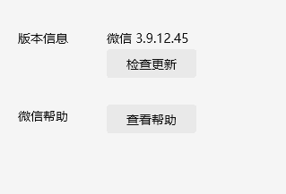

### 定位消息地址

选择微信进程
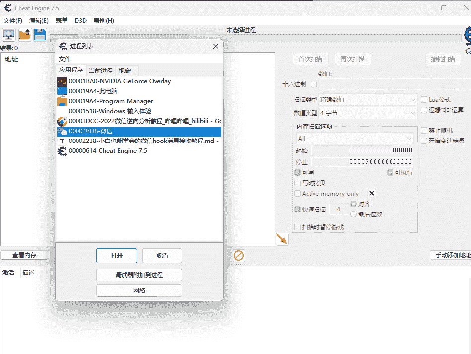
大号给小号发送消息，扫描类型选择字符串，数值填写消息内容
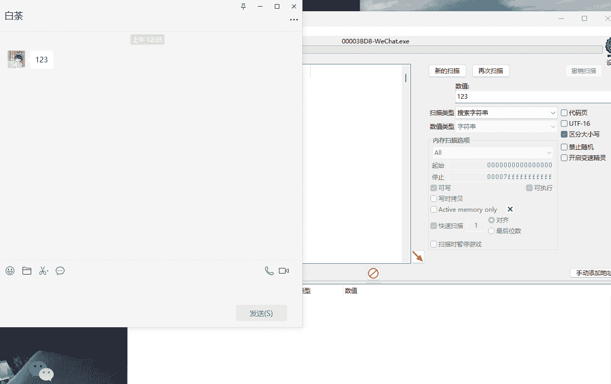
重复之上的步骤，不断重复，直到无法定位的时候（我这里有三个），一个个查看浏览器内存区域
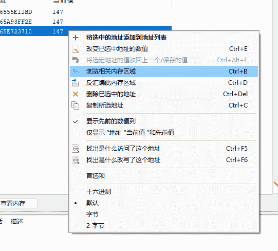
找到带着`wxid`和`xml`格式的就是内存地址
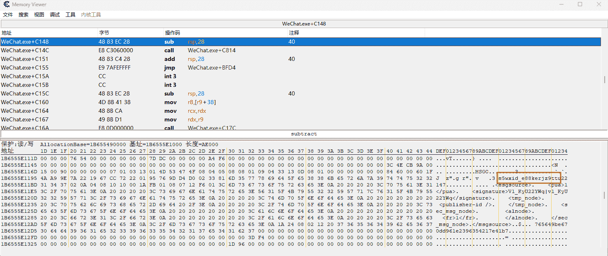
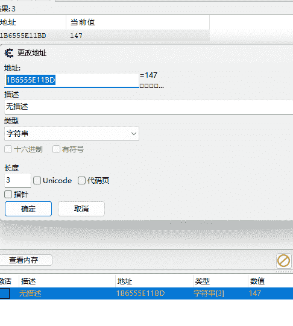

### x64dbg断点

记录一下当前的微信地址`1B6555E11BD`，关闭`CE修改器`，打开`x64dbg`，附加微信，按住`alt+e`选择`wechatwin.dll`
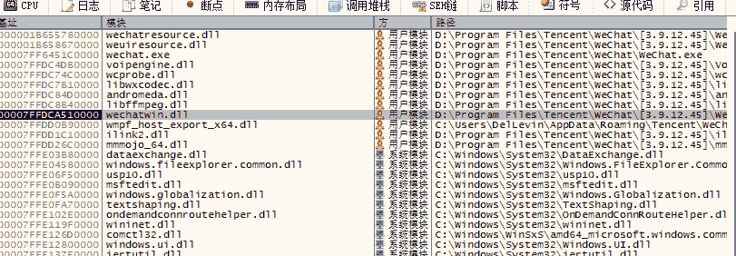
点进去，再内存窗口搜索刚才记录的地址
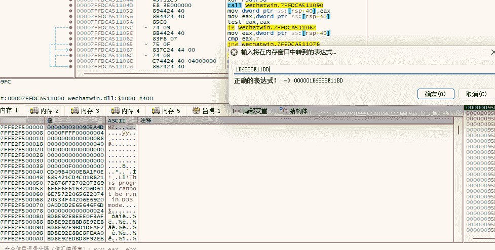
设置写入断点
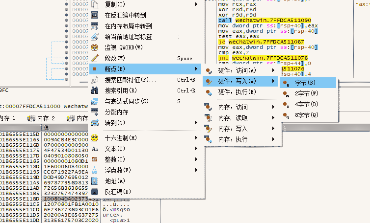
此时微信大号给小号发送消息，查看堆栈信息
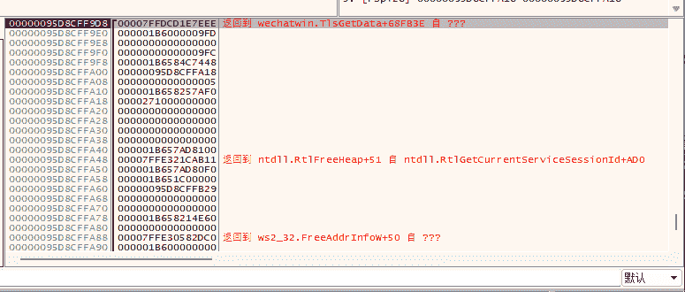
找到有个`db`的那个（这一步骤是再写入微信数据库之前定位`call`）
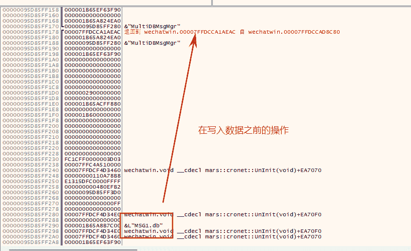
选择，右键“在反汇编中转到指定`QWORD`”
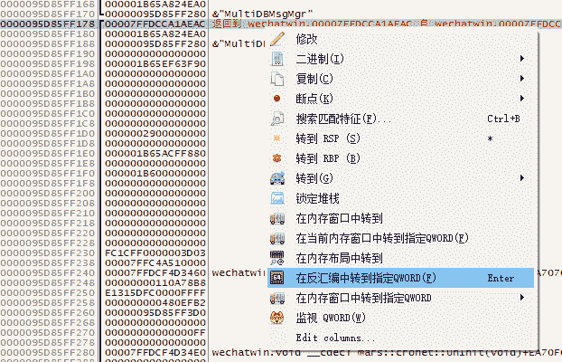
跳转之后，先取消上一个断点
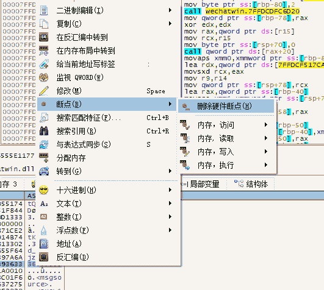
然后针对跳转的位置，找到上一个`call`位置，在`call`处进行断点
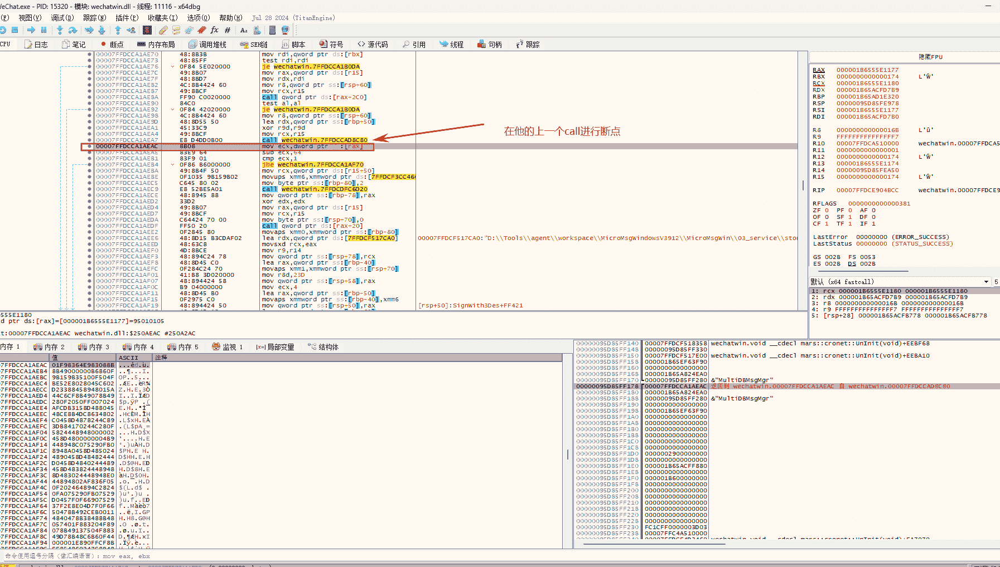
发送消息，断点到了，查看`RDI`
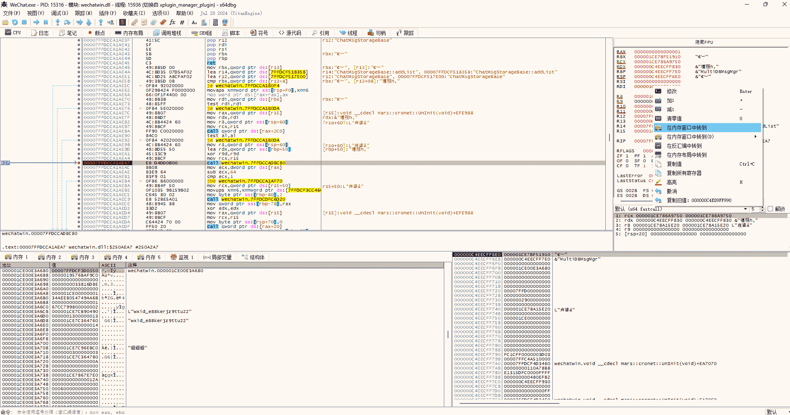
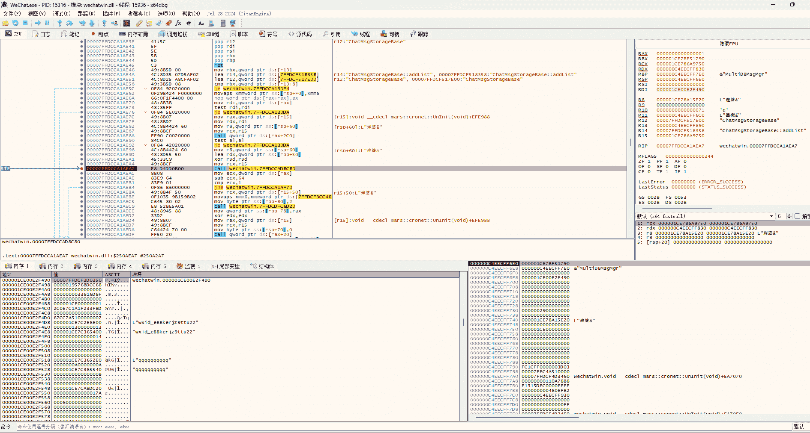
在地址栏的第一个双击一下
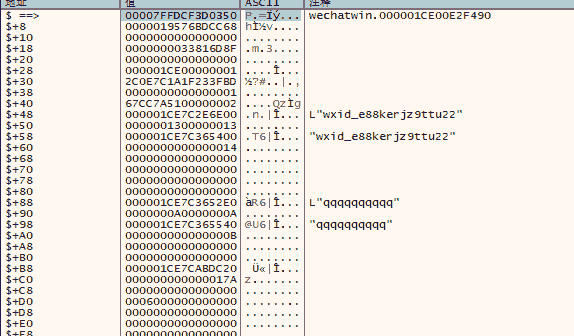
这样我们可以得出
`0x48` 是 微信`id`
`0x88` 是 微信消息的内容

### 计算偏移

找到断点位置，复制文件偏移
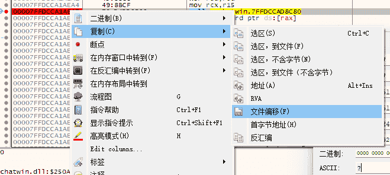
然后打开计算器那个图标，用偏移地址+`C00`
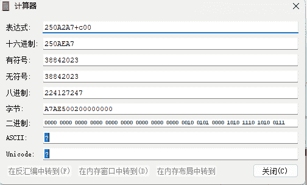
得出结果`250AEA7`

### 验证结果

找到断点位置，复制地址
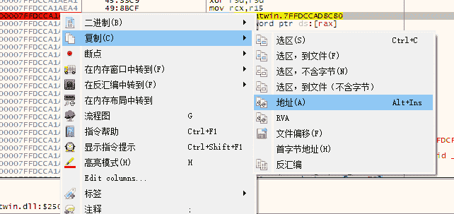
然后按住`ALT+E`，找到复制`wechatwin.dll`的基址
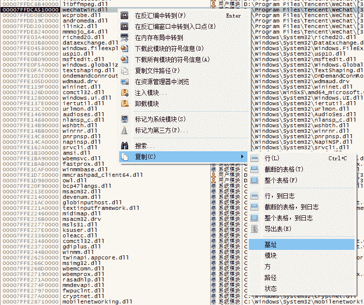
用计算器两者相减得出结果`250AEA7`
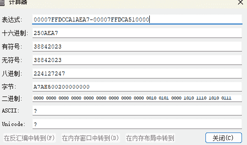
结果是对的，此时编写`frida`脚本
```
var wechatWin = Module.findBaseAddress("WeChatWin.dll");
if (!wechatWin) {
    console.error("WeChatWin.dll模块未找到！");
    throw new Error("模块未找到"); 
}
var hookAddress = wechatWin.add(0x250AEA7);
Interceptor.attach(hookAddress, {
    onEnter: function (args) {
        var timestamp = this.context.rdi.add(0x44).readInt();
        var wxid = this.context.rdi.add(0x48).readPointer().readUtf16String();
        var msg  = this.context.rdi.add(0x88).readPointer().readUtf16String();
        console.log("[++++] "+ timestamp +"    "+ wxid +"  :  "+msg)
    }
});

console.log("Hook已安装，等待接收消息...");
```
运行脚本
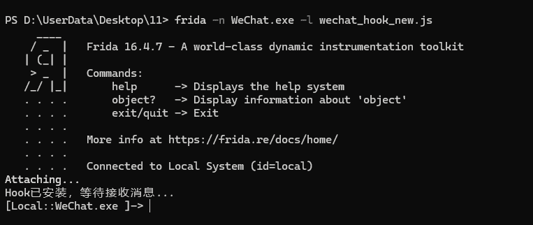
发送消息测试
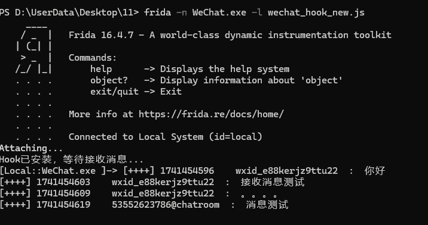
