# [Web逆向] 【入门】青某汇web逆向

- 原帖: https://www.52pojie.cn/forum.php?mod=viewthread&tid=2013037
- 抓取时间: 2026-11-01T22:13:55

网址：aHR0cHM6Ly93d3cudXA2NzguY29tL3NjaG9vbA==

## 1. 分析请求

接口地址: `dataserver/school/list`

`datas`字段加密

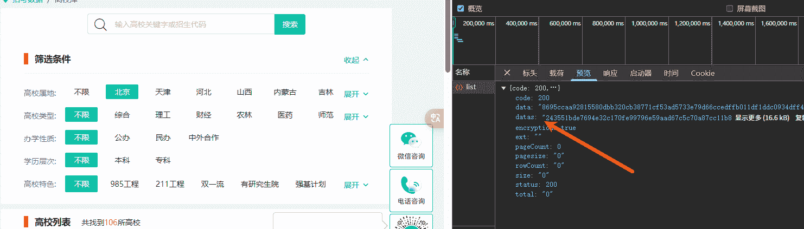

## 2. 代码分析

查看到上面的响应内容是`json`格式的 可以先下一个`json` hook来查找

```
var my_parse = JSON.parse;
JSON.parse = function (params) {
  console.log("json_parse params:",params);
  debugger
  return my_parse(params);
};
```

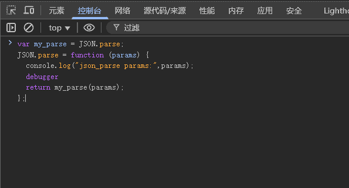

把控制台的抽屉栏打开，请求数据

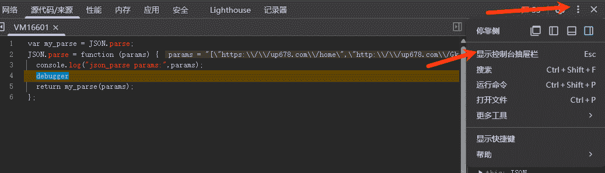

断点停下了 但是这个位置不是我们需要的 继续让他走过这个断点

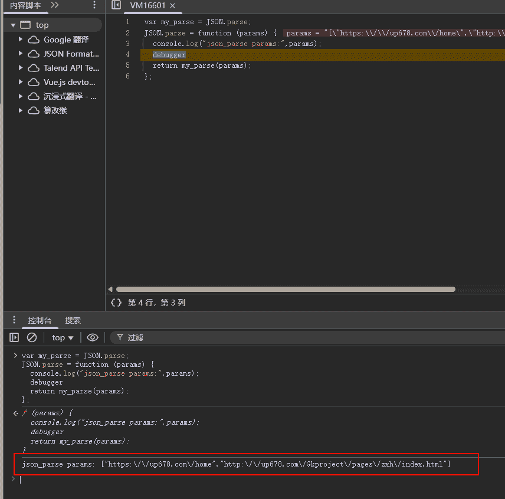

一直过，直到出现解密之后的数据

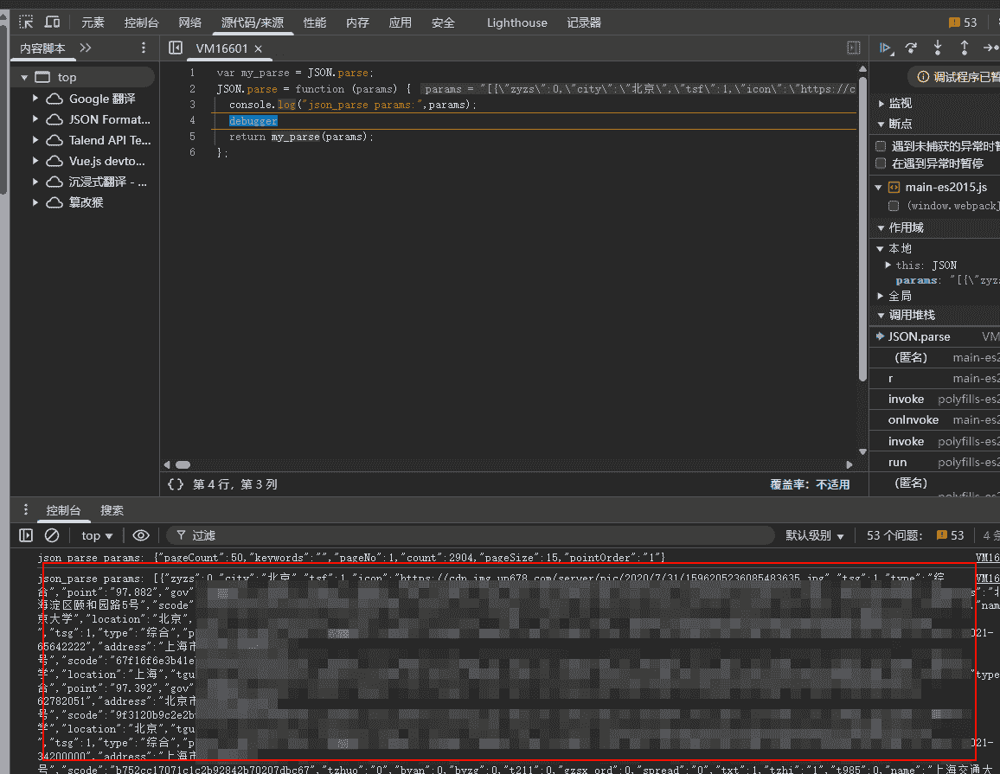

向上跟栈

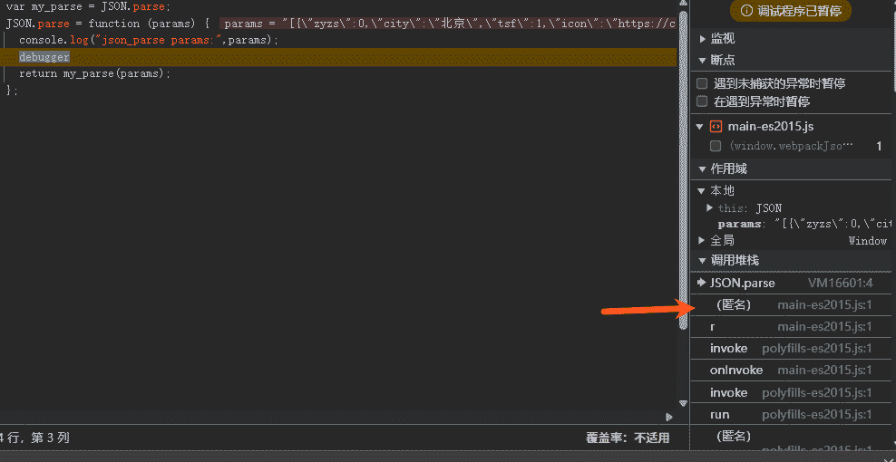

可以在上面看到`decrypt`的关键词，还有一个`cbc`关键词可能是`aes`加密

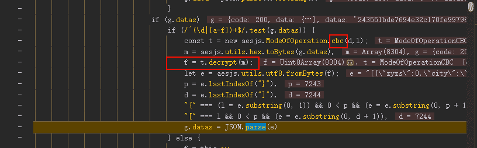

`cbc`模式需要`key`和`iv`

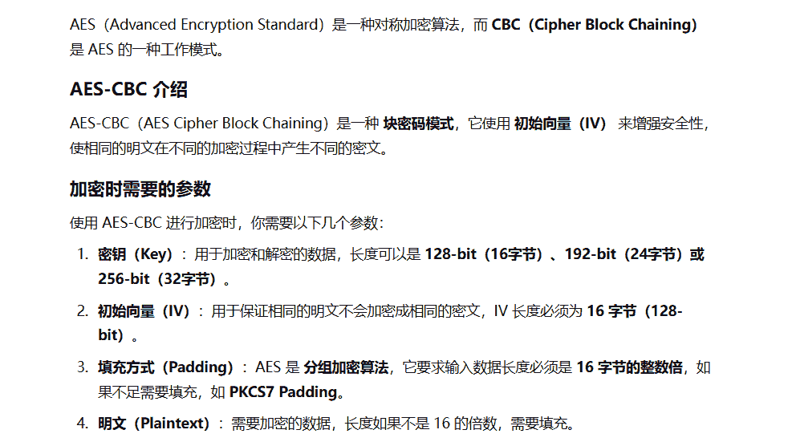

可以看到`const t = new aesjs.ModeOfOperation.cbc(d,l)` 里面传递了一个`d` 和`l`参数

我们向上查看一下这个是从哪里来的

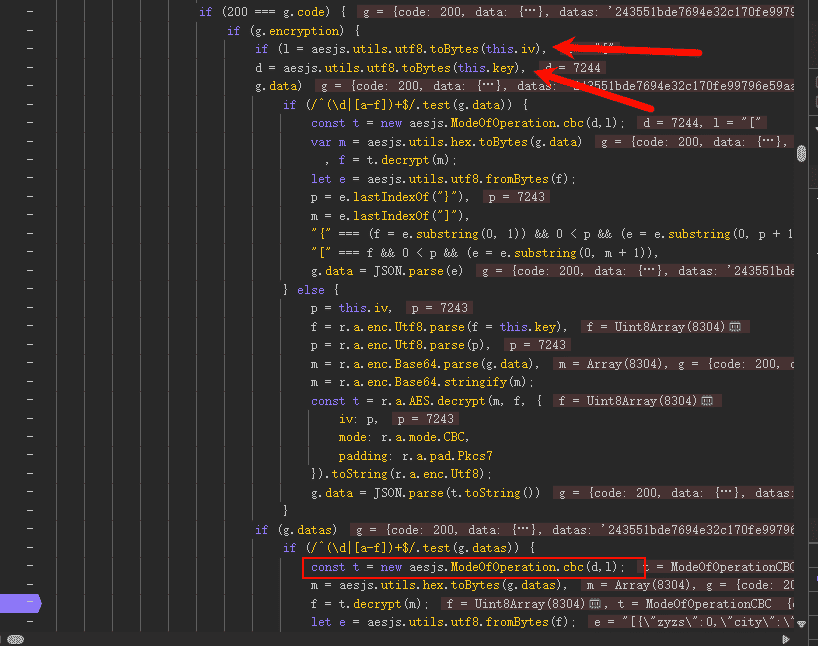

在控制台直接输出一下，可以得到`iv`和`key`的数据

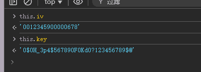

使用[//gchq.github.io/CyberChef/" target="_blank" rel="noopener noreferrer nofollow"](https://gchq.github.io/CyberChef/:rel="nofollow noopener" href="https)来测试一下

把`key`和`iv`的输入格式修改成`utf8` 解密成功

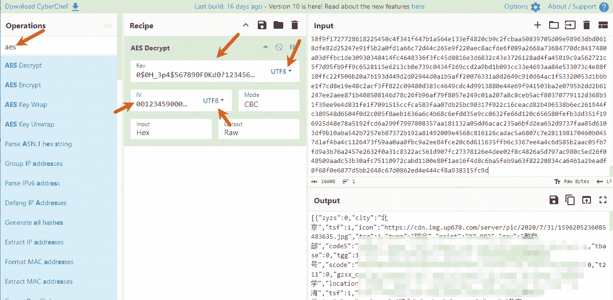
