# [Web逆向] 【JS逆向】某漫画网站图片还原逆向

- 原帖：https://www.52pojie.cn/forum.php?mod=viewthread&tid=2013056
- 抓取时间：2026-11-01T22:13:53

## 逆向目标

- 网址：aHR0cHM6Ly93d3cuc3VraW1hLm1lL2Jvb2svdGl0bGUvQlQwMDAwMTg1NDgwLw==
- 目标：漫画图片还原

## 抓包分析

打开网站，我们随便点击一个章节，可以看到请求回来的图片是打乱的。

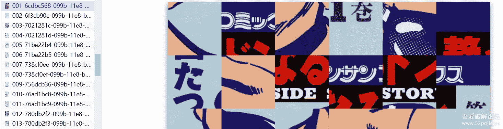

`1.png`（488.06 KB，下载次数：0）  
[附件](https://www.52pojie.cn/forum.php?mod=attachment&aid=Mjc2MDI3MnxjNjEwYzE1N3wxNzkzNTcxMjMwfDE2ODA4NnwyMDEzMDU2&nothumb=yes)  
2025-3-10 11:30 上传

而网页上的图片是正常显示的，那么在前端肯定是通过某种方式对乱序图片进行了还原，我们需要做的就是分析出图片的还原逻辑，从而模拟还原图片。

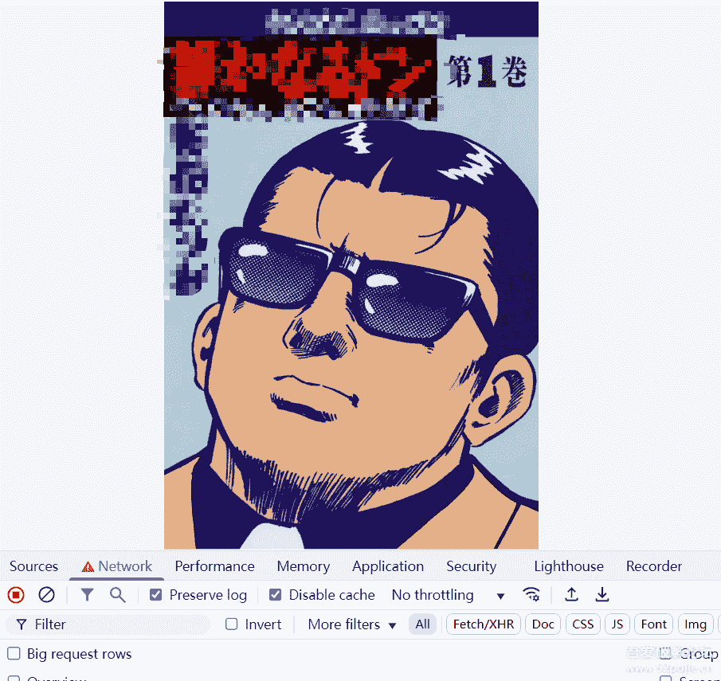

`2.png`（416.06 KB，下载次数：0）  
[附件](https://www.52pojie.cn/forum.php?mod=attachment&aid=Mjc2MDI3M3xkMThhODIxM3wxNzkzNTcxMjMwfDE2ODA4NnwyMDEzMDU2&nothumb=yes)  
2025-3-10 11:30 上传

先简单看一下网页的 html 结构，可以看到承载图片的地方存在 `canvas` 标签，那我们可以认为它是通过 `canvas` 将乱序的图片一块一块绘制上去的。

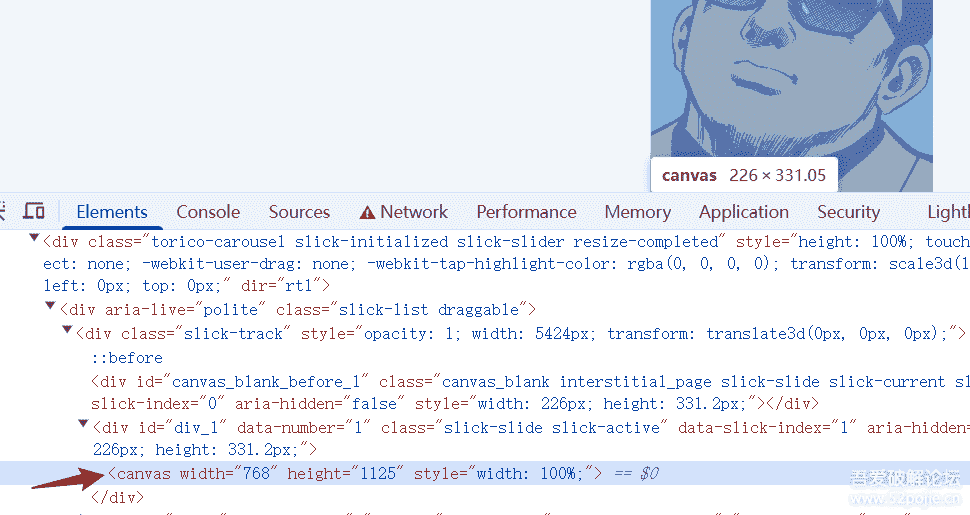

`3.png`（99.95 KB，下载次数：0）  
[附件](https://www.52pojie.cn/forum.php?mod=attachment&aid=Mjc2MDI3NHw1MzVhOWFlNnwxNzkzNTcxMjMwfDE2ODA4NnwyMDEzMDU2&nothumb=yes)  
2025-3-10 11:30 上传

## 逆向分析

我们可以尝试搜索图片链接来开始图片还原逻辑的分析，可以看到在某一个 html 文件中存在相关图片链接。

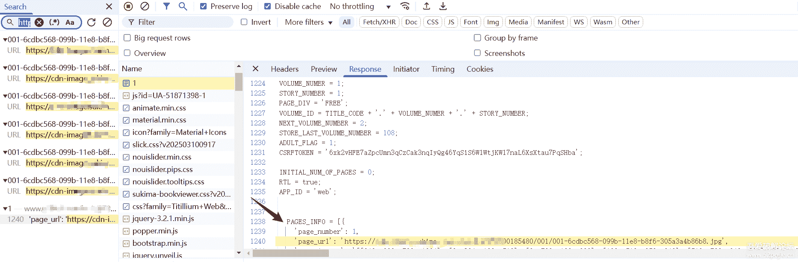

`4.png`（118.42 KB，下载次数：0）  
[附件](https://www.52pojie.cn/forum.php?mod=attachment&aid=Mjc2MDI3NXwwZDgxZTU2ZnwxNzkzNTcxMjMwfDE2ODA4NnwyMDEzMDU2&nothumb=yes)  
2025-3-10 11:30 上传

我们在 `PAGES_INFO` 中下断，刷新网页，成功断住。

可以看到 `PAGES_INFO` 是一个数组，里面的每一个对象应该就是网页上的漫画图片了，其中 `shuffle_map` 很可能和图片还原顺序有关。

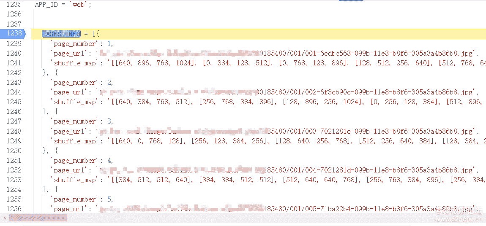

`5.png`（38.73 KB，下载次数：0）  
[附件](https://www.52pojie.cn/forum.php?mod=attachment&aid=Mjc2MDI3NnwzOTNlZGUyNXwxNzkzNTcxMjMwfDE2ODA4NnwyMDEzMDU2&nothumb=yes)  
2025-3-10 11:30 上传

既然离不开 `PAGES_INFO` 这个对象，那我们就直接搜索该关键词，看哪里用到，能够在某一个 js 文件中看到 `PAGES_INFO` 被使用。

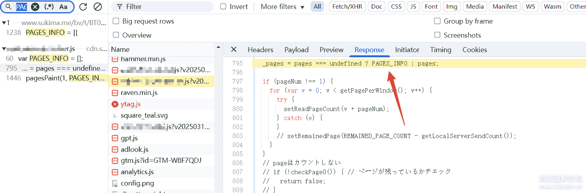

`6.png`（77.51 KB，下载次数：0）  
[附件](https://www.52pojie.cn/forum.php?mod=attachment&aid=Mjc2MDI3N3w0NDIyYWJjN3wxNzkzNTcxMjMwfDE2ODA4NnwyMDEzMDU2&nothumb=yes)  
2025-3-10 11:30 上传

跳转到该 js 文件，直接下断，成功断住。

我们先简单分析一下代码逻辑。

```javascript
// 将图片数组赋值给 _pages
_pages = pages === undefined ? PAGES_INFO : pages;
if (pageNum !== 1) {
    for (var v = 0; v  MAX_PAGE) {
        continue;
    }
    // 对 _page 进行处理，
    page = _pages.filter(function (v) {
        return PAGEMAP[v.page_number] === i;
    })[0];
    try {
        canvas_number = PAGEMAP[page.page_number];
        pagelist[canvas_number] = {
            'page_url': page.page_url,
            'shuffle_map': JSON.parse(page.shuffle_map)
        };
    } catch (e) {
        debug(e);
        continue;
    }
    if (oldPageNumList.indexOf(canvas_number)
```

可以通过动态调试得出，`paintCanvas` 就是绘图的真正逻辑，我们直接跟进去这个函数。

`paintCanvas` 的逻辑并不难，图片还原的逻辑就在 `img` 的 `onload` 回调函数中。

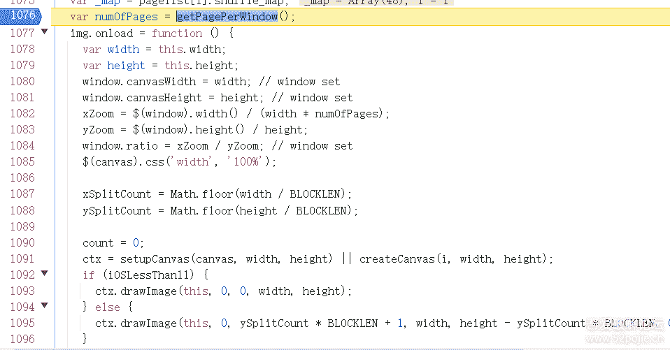

`7.png`（28.11 KB，下载次数：0）  
[附件](https://www.52pojie.cn/forum.php?mod=attachment&aid=Mjc2MDI3OHw1NDI2YjZhNHwxNzkzNTcxMjMwfDE2ODA4NnwyMDEzMDU2&nothumb=yes)  
2025-3-10 11:30 上传

那我们就直接分析这个回调函数即可。

```javascript
// 获取 img 标签的宽度
var width = this.width;
// 获取 img 标签的高度
var height = this.height;
window.canvasWidth = width;
window.canvasHeight = height;
xZoom = $(window).width() / (width * numOfPages);
yZoom = $(window).height() / height;
window.ratio = xZoom / yZoom; // window set
$(canvas).css('width', '100%');
// 横向图片块数
xSplitCount = Math.floor(width / BLOCKLEN);
// 纵向图片块数
ySplitCount = Math.floor(height / BLOCKLEN);
// 索引，用于在图片数组中取对应的图片信息
count = 0;
// 设置 canvas 相关信息
ctx = setupCanvas(canvas, width, height) || createCanvas(i, width, height);
// 遍历图片数组，在 canvas 上还原
// 根据双层 for 循环的逻辑可知，是从上往下，从左往右的顺序进行还原
for (var i = 0; i
```

从上面的代码可以基本分析出还原逻辑了，最后还需要知道 `ctx.drawImage` 这个函数的作用是什么，我就直接问 AI 了。

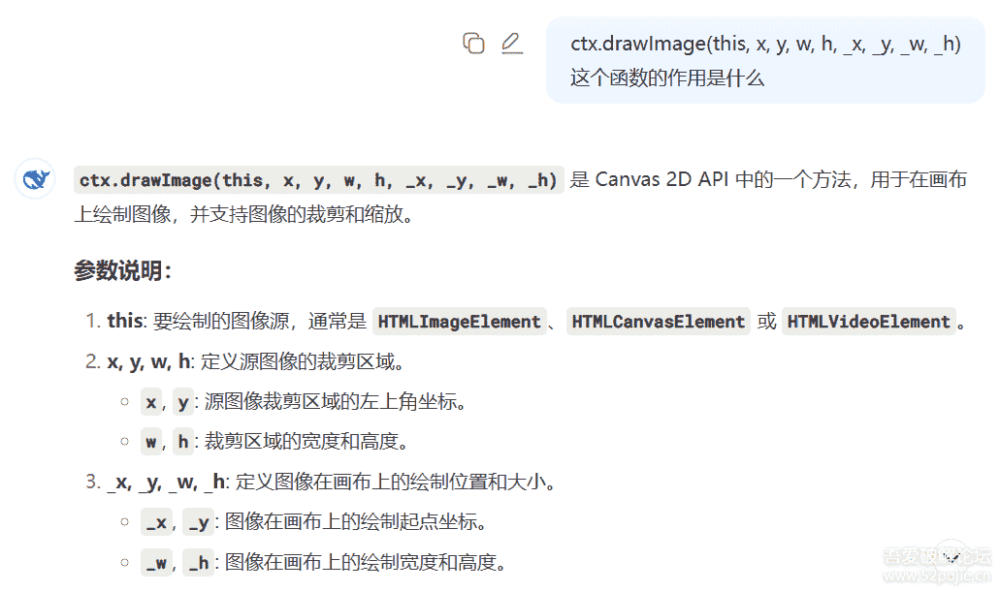

`8.png`（77.81 KB，下载次数：0）  
[附件](https://www.52pojie.cn/forum.php?mod=attachment&aid=Mjc2MDI3OXxlNDI1NjJlMXwxNzkzNTcxMjMwfDE2ODA4NnwyMDEzMDU2&nothumb=yes)  
2025-3-10 11:30 上传

结合双层 `for` 循环的代码，我们就可以知道还原逻辑了：

> 从上往下、从左往右按每块大小 `128*128` 遍历打乱的图片，然后根据 `shuffle_map` 的数组绘制到 `canvas` 中对应的位置

那我们直接用 python 代码进行还原，其中 `restored_img = deepcopy(img)` 的原因有两点：

> 1. 如果 `restored_img = img` 的话，相当于对 `img` 边还原边修改，最后还原结果是错的。
> 2. 如果直接创建空白图像，就会缺少底下的部分原图，因为打乱的图片除了有 48 块拼图外，底下的小部分原图是没有被打乱的。

```python
from PIL import Image
from typing import List
from copy import deepcopy

def restore_image(
        shuffle_map: List,  # 还原数组
        img_path: str,   # 乱序图片路径
        output_img_path: str  # 输出的还原后的图片路径
):
    # 加载被打乱的图像
    img = Image.open(img_path)
    # 宽高
    block_size = 128
    # 深拷贝一份原图，在原图基础上还原
    restored_img = deepcopy(img)
    count = 0
    for i in range(6):
        for j in range(8):
            _x = shuffle_map[count][0]
            _y = shuffle_map[count][1]
            x = i * block_size
            y = j * block_size
            cropped = img.crop((x, y, x + block_size, y + block_size))
            restored_img.paste(cropped, (_x, _y, _x + block_size, _y + block_size))
            count += 1
    restored_img.save(output_img_path)
```

从网页上下载一张乱图，并获得对应的还原数组，可以成功还原。

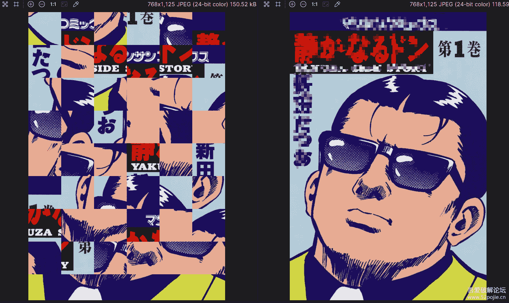

`9.png`（1.22 MB，下载次数：0）  
[附件](https://www.52pojie.cn/forum.php?mod=attachment&aid=Mjc2MDI4MHwxODZjYmRhNHwxNzkzNTcxMjMwfDE2ODA4NnwyMDEzMDU2&nothumb=yes)  
2025-3-10 11:30 上传

我们再尝试请求一个章节的漫画，并进行还原。

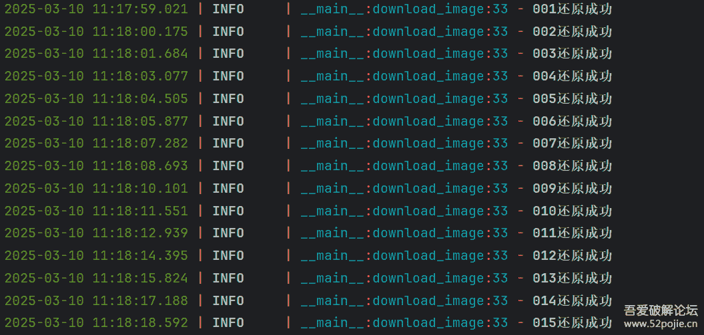

`10.png`（149.82 KB，下载次数：0）  
[附件](https://www.52pojie.cn/forum.php?mod=attachment&aid=Mjc2MDI4MXwxZTJmZGUxMnwxNzkzNTcxMjMwfDE2ODA4NnwyMDEzMDU2&nothumb=yes)  
2025-3-10 11:31 上传

成功！！！

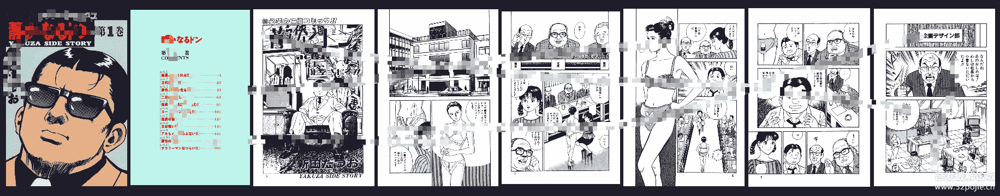

`11.png`（668.27 KB，下载次数：0）  
[附件](https://www.52pojie.cn/forum.php?mod=attachment&aid=Mjc2MDI4MnxkNjA0ZmQ5ZnwxNzkzNTcxMjMwfDE2ODA4NnwyMDEzMDU2&nothumb=yes)  
2025-3-10 11:31 上传
