# [Web逆向] 【小程序】绝味鸭脖 xmSign参数逆向

- 原帖: https://www.52pojie.cn/forum.php?mod=viewthread&tid=2013121
- 抓取时间: 2026-11-01T22:13:48

小程序：绝味鸭脖 xmSign参数逆向

## 1. 环境使用

使用手机连接电脑 `adb` 控制手机

微信中打开 `http://debugxweb.qq.com/?inspector=true` 地址

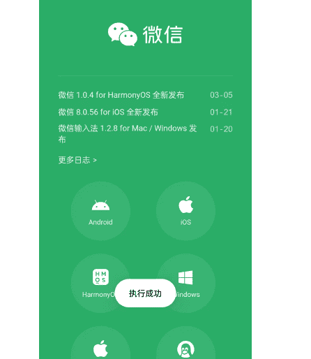

打开 `cmd` 输入 `adb devices` 查看下面是否有设备

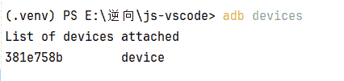

`edge` 浏览器打开 `edge://inspect/#devices`

`chrome` 浏览器打开 `chrome://inspect/#devices`

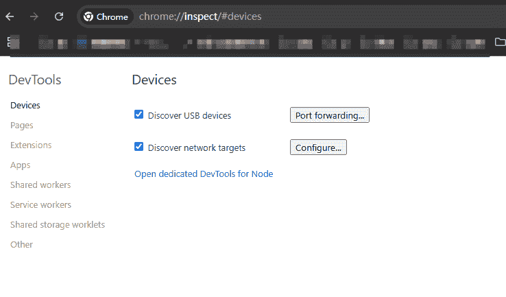

在手机中打开小程序网页等待一会，就会出现页面信息

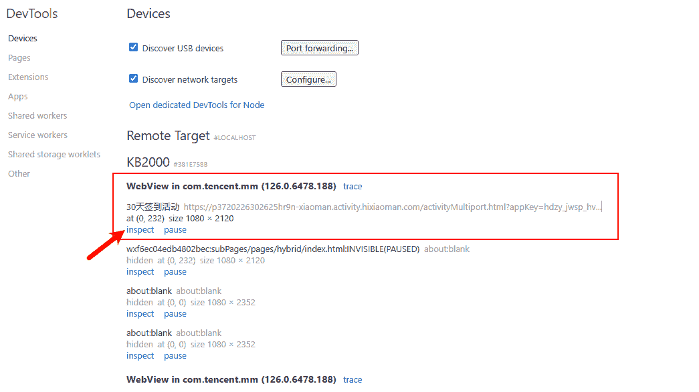

先刷新一下网页 重新获取全部的文件

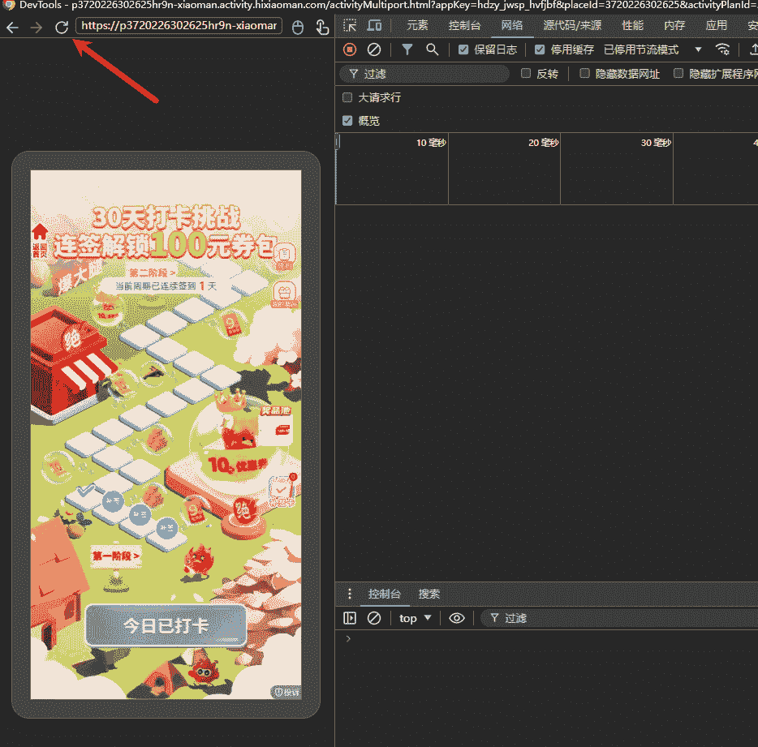

## 2. 请求解析

接口：`activity/function/task/get`

`xmsign` 加密数据
`noncestr` 加密数据
`xmtimestamp` 13位时间戳

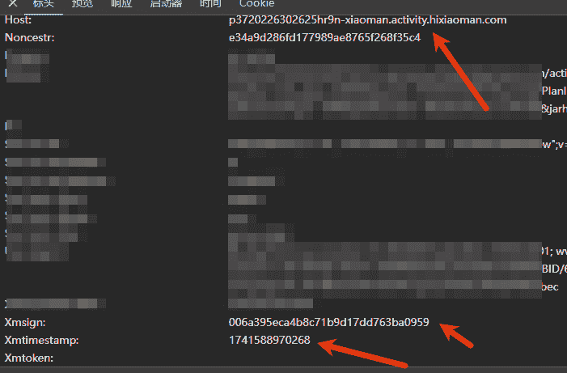

## 3. 代码分析

### xmSign参数

按住 `ctrl`+`shift`+`p` 打开搜索

搜索 `xmsign` 信息发现有5条数据 全部打上断点 刷新页面

在打断点的时候 前面两个打不上 只有最后可以 那我们先测试一下最后的能不能断下来

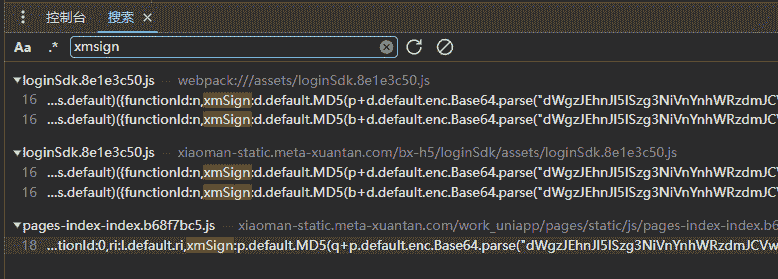

成功断下

看到了一个 `md5` 大概率就是 `md5` 先把这些参数拿出来 去 [CyberChef](https://gchq.github.io/CyberChef/#recipe=MD5()&oenc=65001) 测试一下 是原本的 `md5` 那开始看这些参数哪来的

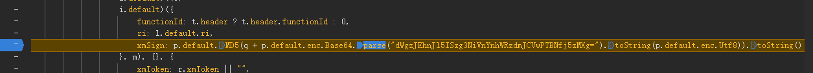

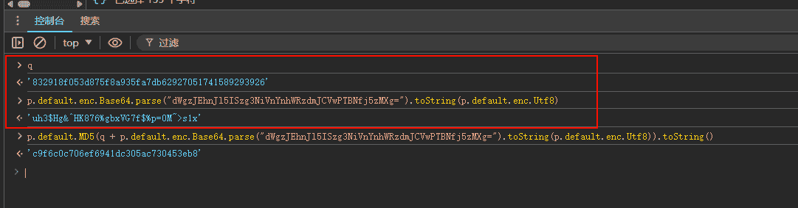

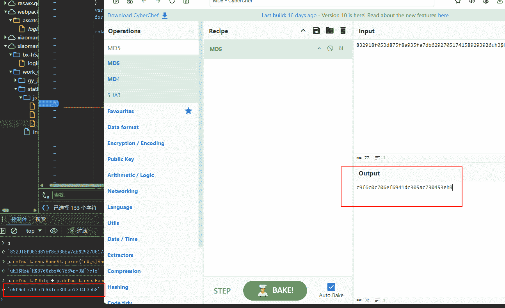

- `p.default.enc.Base64.parse("dWgzJEhnJl5ISzg3NiVnYnhWRzdmJCVwPTBNfj5zMXg=").toString(p.default.enc.Utf8)` 这句代码只是一个编码转换 是写死的值可以不用看
- `q` 参数
- (1)处定义了 `q` 为空字符串
- (2)处 `r[S] instanceof Object`：如果 `r[S]` 是一个对象（包括数组），则条件为真。
- `? q += JSON.stringify(r[S]) + ""`：如果 `r[S]` 是一个对象，则使用 `JSON.stringify(r[S])` 将其转换为 JSON 字符串，然后将其追加到 `q` 中。`+ ""` 确保结果始终是一个字符串。
- `: q += r[S] + ""`：如果 `r[S]` 不是一个对象（例如，字符串、数字、布尔值），则直接将其转换为字符串并追加到 `q` 中。`+ ""` 确保结果始终是一个字符串。

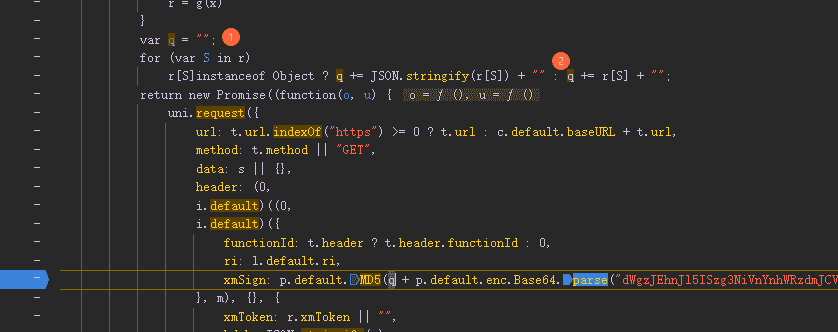

这个只是把 `r` 里面的数组都拼接起来 继续向上找 看看 `nonceStr` 在哪里生成的

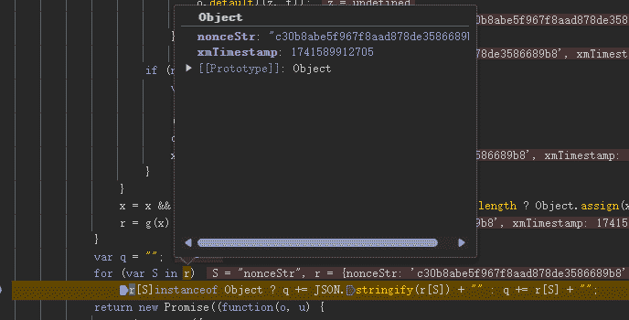

看到这里 发现是从 `m` 获取到的 继续向上找

```
x = x && JSON.stringify(x).length > 2 && Object.keys(x).length ? Object.assign(x, m) : m,
r = g(x)
```

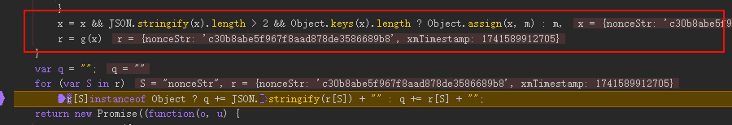

找到生成的了 `nonceStr` 就是 `v` 函数生成的了 打上断点跟进去看看

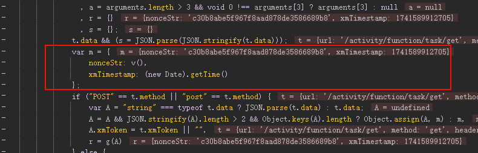

看到 `Math.random()` 通过一些位运算改变了一些什么 大概率就是随机生成的了 32位

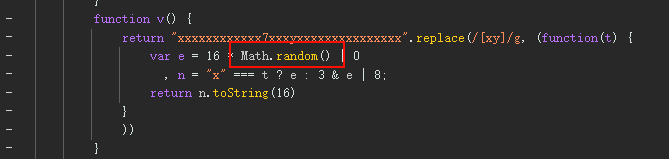

现在捋一下思路

- 通过 `m` 获取到 `nonceStr` 和 `xmTimestamp` 把这两个拼接起来
- 在把上面拼接的内容加上 `p.default.enc.Base64.parse("dWgzJEhnJl5ISzg3NiVnYnhWRzdmJCVwPTBNfj5zMXg=").toString(p.default.enc.Utf8)` 的盐
- 进行 `md5` 生成

`m` 到 `q` 就是拼接的然后加上盐 进行 `md5` 加密

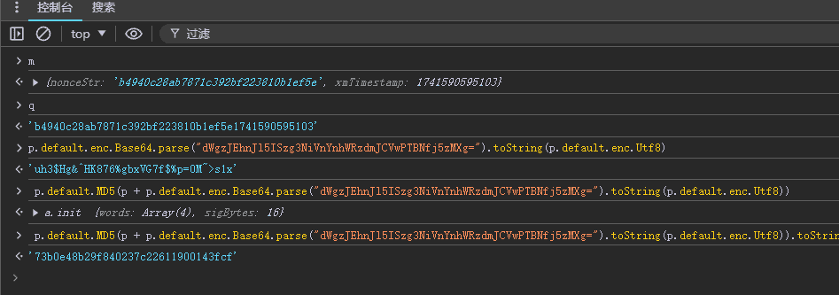

### tokenSign

接口：`xm/token/getUserToken`

比上面多了一个参数 `tokenSign`

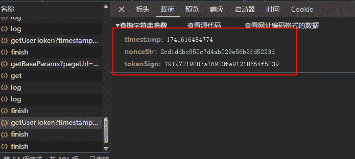

继续先来一个搜索大法 下面这个文件跟上面 `xmSign` 是一起的 直接看这个

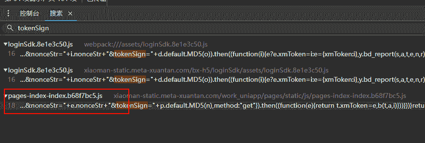

可以直接看到用的是 `md5` 加密 `n` 参数就在上面生成的

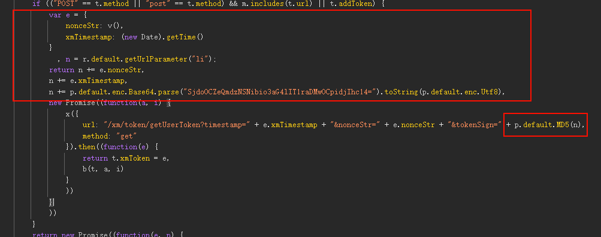

直接把吧断点打上

`r.default.getUrlParameter("li")` 这个看方法名就是用 `url` 中获取一个数据 ，重复请求了一下发现是固定的参数 猜测一下可能是对应的当前活动页面的 `id` 可以从下面的图片2中看到

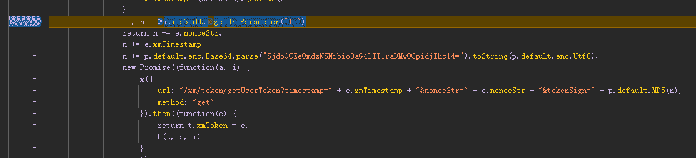

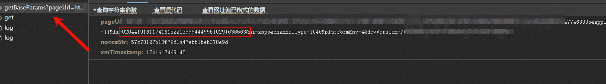

这三步就是跟上面 `xmSign` 的加密方式相同了

`p.default.enc.Base64.parse("SjdoOCZeQmdzNSNibio3aG4lIT1raDMwOCpidjIhc14=").toString(p.default.enc.Utf8)` 变化了

```
J7h8&^Bgs5#bn*7hn%!=kh308*bv2!s^
```

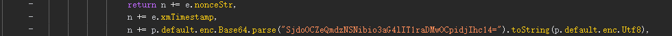

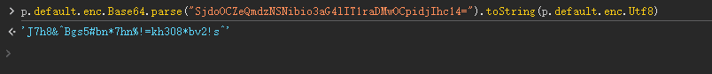

跟上面差不多的加密就可能多了一个活动 `id`

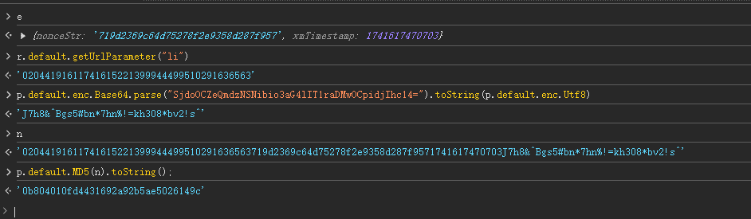

可以看到从接口出去的 `tokenSign` 是跟上面一样的

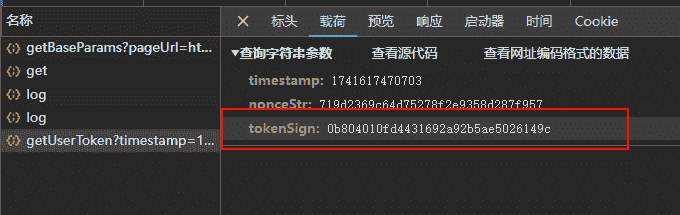

`py` 实现了没有任何问题

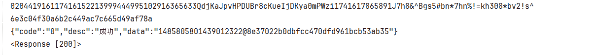
