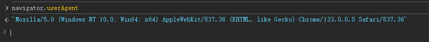
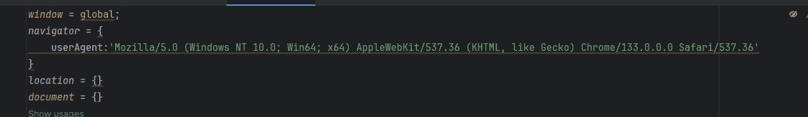
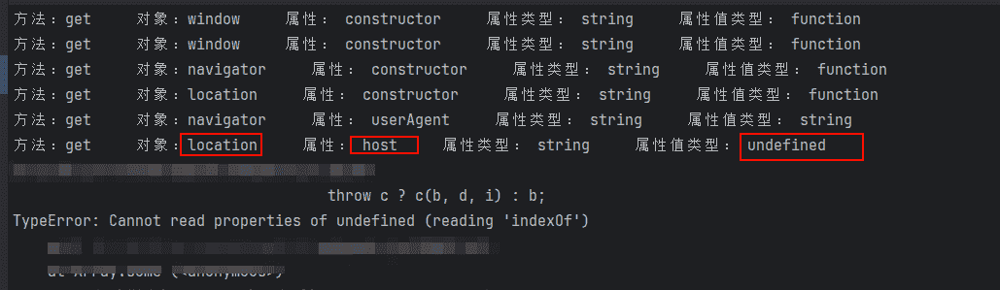
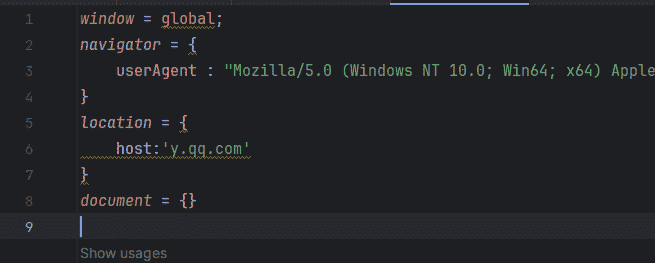
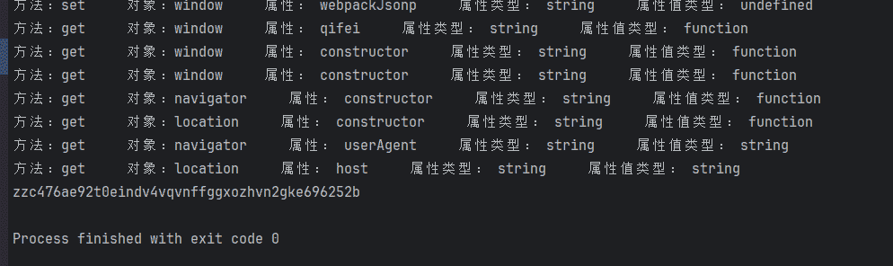
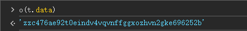

# [Web逆向] 【入门】webpack 补环境

- 原帖: https://www.52pojie.cn/forum.php?mod=viewthread&tid=2014743
- 抓取时间: 2026-11-01T22:13:43
网址：`aHR0cHM6Ly95LnFxLmNvbS9uL3J5cXEvcGxheWVy`

## 1.接口分析

接口：`cgi-bin/musics.fcg`

参数：`sign`是加密的


## 2.代码分析

进入调用栈


先在`send`位置打上断点，页面刷新


往上一个栈找


可以看到上面就有一个关键词`sign`是从`i`变量获取到的，`i`变量就在上面 `get`请求走前面的部分 `post`走后面的部分 我们的接口是`post` 所以我们需要分析后面的`o`函数。

`o`函数在上面 `o = n(350).default` 赋值得到 ，一看这种格式大概率是`webpack` 可以在往上面和下面看看


在`n`位置打上断点，进入`n`函数 找到构造器 ，那个`d`函数就是构造器了 把这个页面的代码全部都复制出来


扣出来代码运行一下，出现下面的错误，在最上面补一个

```
window = global;
```

```
ReferenceError: window is not defined
```


把构造器导出


1. `t.type.toUpperCase()` : 将这个字符串转换为大写。例如，"get" 变为 "GET"。
2. `"GET" === t.type.toUpperCase()` : 这部分比较转换后的 `t.type` 是否严格等于字符串 "GET"。`===` 是严格相等运算符，它不仅比较值，还比较类型。
3. `o(t.data.data)` : 如果 `t.type` 是 "GET"（忽略大小写），则执行这部分。
4. `o(t.data)` : 如果 `t.type` 不是 "GET"（忽略大小写），则执行这部分。


把网站里面的代码复刻进去


在重新运行一下 会发现下面的错误 缺少函数 我们得继续补齐这个代码


回到网站中，在构造器的位置下一个条件断点 `t=350`，在重新刷新网页


就会重新断在这个位置，进入这个函数


可以在这个里面看到很多这样的函数，我们可以把他们拿出来，避免我们后面还要一直添加


可以下载一个 `notepad++` 软件，把代码复制进去调整语音 ，把层级全部都缩起来


打开第一层的时候会发现下面都是函数定义，然后在最上面有一个·【 跟最下面的】是对应的 可以表示那些函数都是一个数组里面 都扣出来


把代码放在之前的函数里面


在重新运行一下，发现出结果了没有报错


我们在重新断到加密的位置然后输出一下`o(t.data)`发现跟我们代码加密的不一样，我们要猜测是不是有环境检测


在 JavaScript 逆向工程中，我们的目标通常是获取目标网站的加密或解密函数，或者特定值的生成算法。在理想情况下，我们可以直接提取这些算法并在本地执行。然而，许多网站会实施浏览器指纹检测，这使得直接执行变得困难。为了解决这个问题，我们需要进行“环境补全”，即模拟目标网站的浏览器环境。

传统的环境补全方法往往依赖于逐步调试，通过观察程序运行时的 `undefined` 错误，逐个补充缺失的环境变量。这种方法繁琐且耗时。

为了提高效率，我们可以利用 `Proxy` 技术。`Proxy` 允许我们拦截对 `window`、`document`、`navigator` 等全局对象的访问和函数调用，这些对象通常是浏览器指纹检测的重点。通过代理这些对象，我们可以实时记录网站尝试访问的环境信息，并将其输出到控制台。这种“环境自吐”的方法使我们能够快速了解网站的环境检测机制，并集中进行环境补全，从而大大简化了逆向工程的流程。

对于JS逆向来说，我们扣完代码的目的就是调用目标网站的加/解密函数或某个值的算法，一般情况下我们把他的算法扣下来能够直接执行，但是如果检测了浏览器指纹，那就比较难了，只能够去深入分析进行补环境。

一般的补环境的是通过运行程序后的`undefined`报错去一点一点分析，一点一点的去补一些环境，是非常掉头发的。

所以我们使用 `Proxy` 对全局遍历`window`、`document`、`navigator`等常见环境检测点进行代理，拦截代理对象的读取、函数调用等操作，并通过控制台输出，这样的话我们就能够实现检测环境自吐的功能，后续我们再针对吐出来的环境统一的进行补环境，这样就会方便的多。

代码如下

```
function getEnv(proxy_array) {
    for(let i=0; i
```

在代码最上面添加，在重新运行一下代码

```
navigator = {}
location= {}
document = {}
```


可以看到在`navigator`对象缺少 `userAgent` 值，我们在浏览器中获取然后填写到代码里面






继续运行`location` 的`host`属性没有 ，继续从浏览器中获取






重新生成好了，在跟网站里面的对比一下，





本文档所涉逆向分析内容仅为个人技术研究及学习交流之用，所有技术细节均基于公开可见信息整理。 技术研究应遵守国家法律法规及行业规范，使用者需对自身行为承担全部法律责任。如权利人认为存在侵权内容，请及时联系处理。
