# [Web逆向] 某音滑块captchaBody分析

- 原帖: https://www.52pojie.cn/forum.php?mod=viewthread&tid=2014831
- 抓取时间: 2026-11-01T22:13:38

## 代码插装

在堆栈中查看，其中有一处很明显的`captcha.js`，应该是`captchabody`生成的关键`js`，我们进入查看，整体预览`js`代码，发现`webpack`+`switch`控制流+`vmp`。接着查桩，先在`switch`处插桩，看看大概都做了什么。

### switch插装点

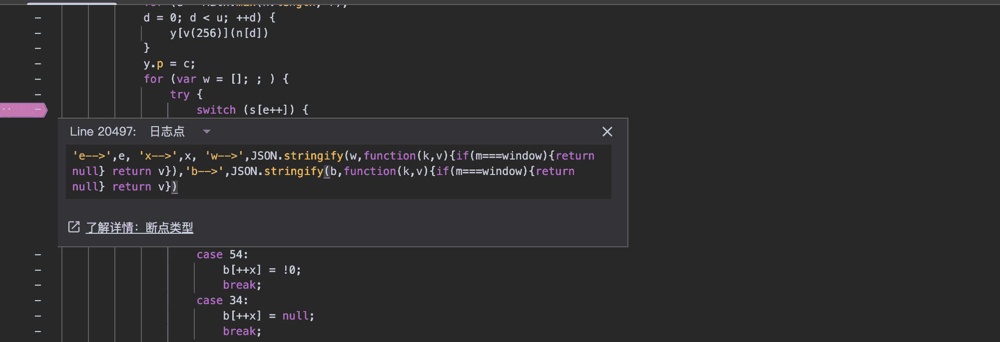

### apply插装点

然后对于`vmp`这种，最好是在`call`和`apply`的地方下断点，这里`v(431)`也是`apply`，同理也插上断点。

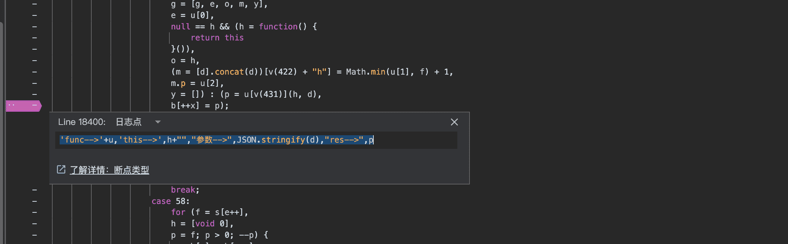

## 日志分析

这里我们进行验证码的提交，同时打下`xhr`断点，以防太多日志造成干扰和卡顿，然后观察日志。

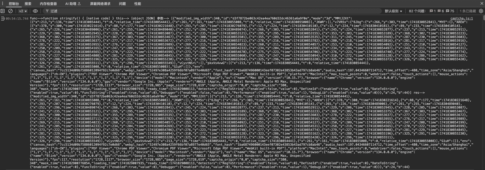

然后这里放入 [//spidertools.cn/#/" target="_blank" rel="noopener noreferrer nofollow"](https://spidertools.cn/#/:rel="nofollow noopener" href="https) 分析格式

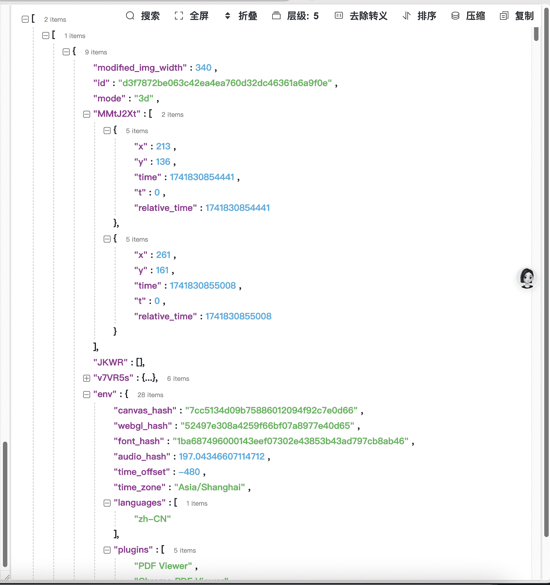

这些参数分析下都是什么，首先有`id`，是获取验证码图片的接口返回的，`MMtJ2Xt`是验证码中点击的位置，`v7VR5s`是鼠标在验证码图片里移动的轨迹和时间戳，`env`包括了一些浏览器的环境。

接着往下查看日志。

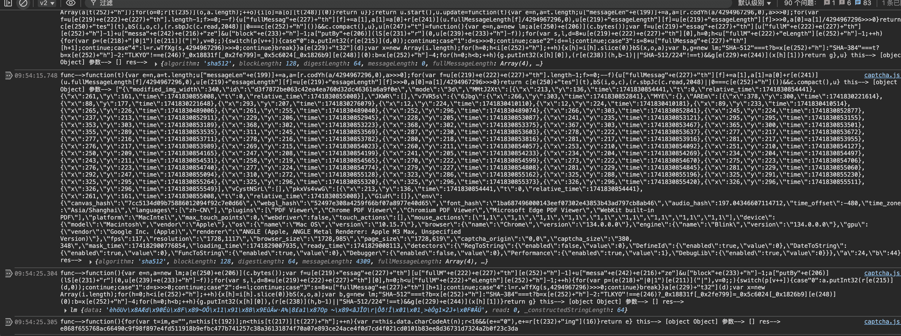

这里看到了`sha-512`的字样，看样子是把`JSON.stringify`提交的参数进行了`sha-512`的加密。我们来验证一下是否为标准的算法。

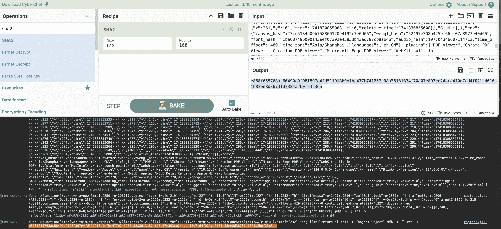

符合我们的猜想且为标准的`sha-512`算法。继续看查看日志。

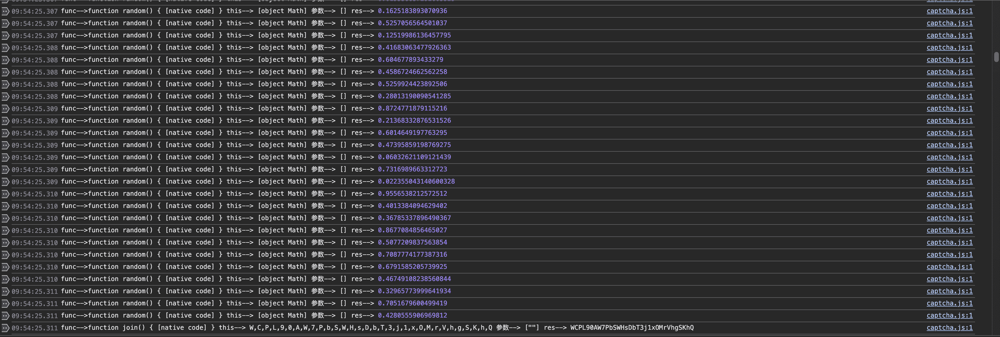

发现生成了个32位的随机数，最后用经过了一些算法在`join`成了一个字符串。然后同时也在进行`sha-512`

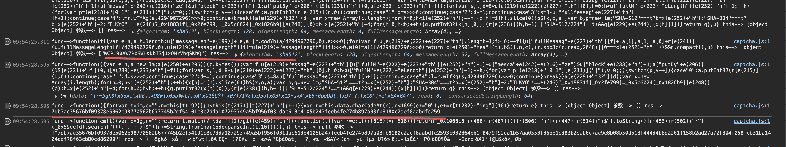

发现他拼接了一个`3c03286xxxxxxxxxxx8f63cb80ed86290`（脱敏）然后又做了`sha-512`算法。这里可以多次断点触发几次，观察是固定的，应该是就是`salt`了。

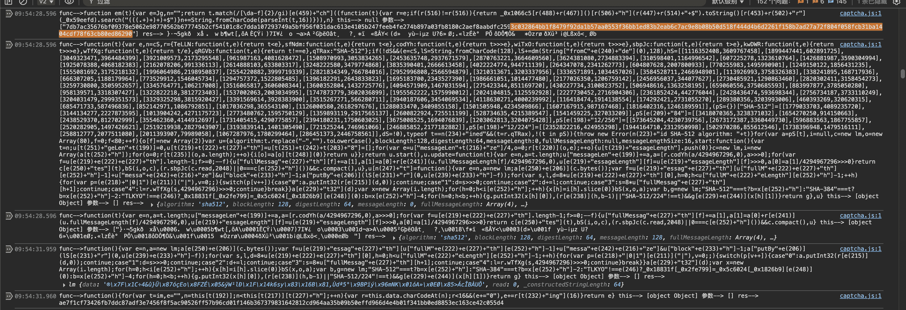

那么就清楚了，流程应该是对随机生成的32位数字做`sha-512`，拼接`salt`，做`from hex`在进行`sha-512`。我们这里验证一下。

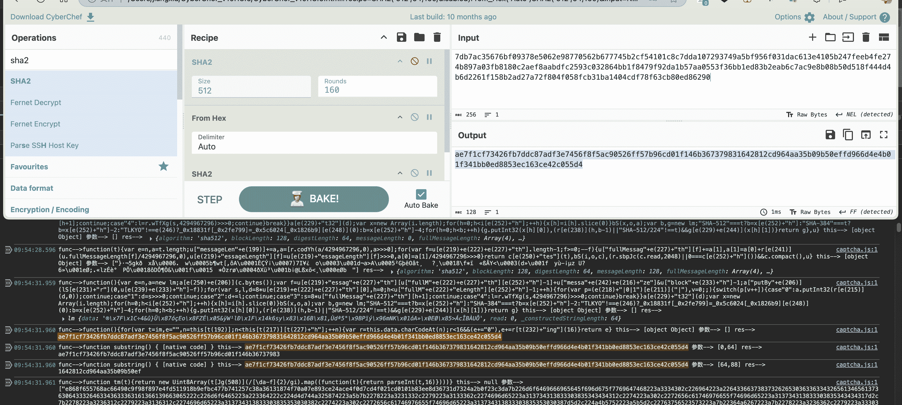

没错，符合我们的猜想。

接着观察发现对这加密后的结果进行了字符串切割取值上图也能看到，

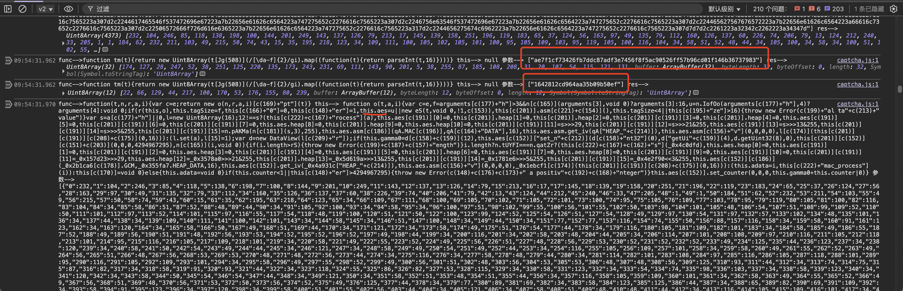

然后打断点分析下这里的代码，看到了`aes`的这样，猜测且上文分割的两个值很有可能是切分后的的`key`和`iv`。

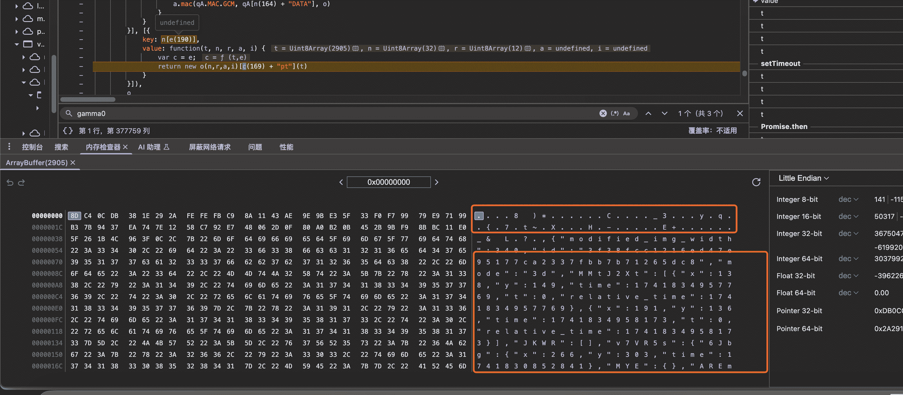

这里他转化成了`Uint8Array`的形式，我们查看内容，发现他是一部分乱码加明文的格式，明文很好理解，是我们最开始观察到的参数，而乱码是什么呢，我们可以去日志一搜，发现是我们明文格式的`sha-512`的结果，那么加密的内容应该就是如下操作

```
data = {"modified_img_width":340,"id":"d3f7872be063c42ea4ea760d32dc46361a6a9f0e","mode":"3d","MMtJ2Xt":[{"x":213,"y":136,"time":1741830854441,"t":0,"relative_time":1741830854441},{"x":261,"y":161,"time":1741830855008,"t":0,"relative_time":1741830855008}],"JKWR":[],"v7VR5s":{"6Jbg":{"x":266,"y":303,"time":1741830852841},"MYE":{},"AREm":[{"x":378,"y":300,"time":1741830221614},{"x":88,"y":177,"time":1741830221648},{"x":293,"y":207,"time":1741830276079},{"x":12,"y":224,"time":1741830410110},{"x":12,"y":224,"time":1741830410181},{"x":89,"y":233,"time":1741830410514},{"x":265,"y":226,"time":1741830489006},{"x":261,"y":255,"time":1741830489040},{"x":252,"y":296,"time":1741830489074},{"x":266,"y":303,"time":1741830852841},{"x":245,"y":224,"time":1741830852877},{"x":237,"y":213,"time":1741830852911},{"x":229,"y":206,"time":1741830852945},{"x":228,"y":205,"time":1741830853087},{"x":241,"y":235,"time":1741830853121},{"x":295,"y":295,"time":1741830853155},{"x":353,"y":303,"time":1741830853189},{"x":368,"y":302,"time":1741830853223},{"x":368,"y":302,"time":1741830853375},{"x":367,"y":303,"time":1741830853467},{"x":365,"y":300,"time":1741830853501},{"x":355,"y":289,"time":1741830853535},{"x":311,"y":245,"time":1741830853569},{"x":287,"y":230,"time":1741830853603},{"x":278,"y":222,"time":1741830853637},{"x":277,"y":217,"time":1741830853672},{"x":277,"y":216,"time":1741830853711},{"x":278,"y":216,"time":1741830853782},{"x":280,"y":218,"time":1741830853816},{"x":281,"y":217,"time":1741830853916},{"x":281,"y":217,"time":1741830853955},{"x":276,"y":217,"time":1741830853989},{"x":269,"y":215,"time":1741830854023},{"x":260,"y":211,"time":1741830854057},{"x":253,"y":210,"time":1741830854092},{"x":251,"y":210,"time":1741830854127},{"x":250,"y":209,"time":1741830854165},{"x":247,"y":208,"time":1741830854199},{"x":241,"y":205,"time":1741830854233},{"x":234,"y":204,"time":1741830854269},{"x":234,"y":204,"time":1741830854497},{"x":243,"y":211,"time":1741830854531},{"x":258,"y":219,"time":1741830854565},{"x":270,"y":222,"time":1741830854599},{"x":273,"y":222,"time":1741830854670},{"x":275,"y":223,"time":1741830854706},{"x":276,"y":223,"time":1741830854740},{"x":277,"y":224,"time":1741830854774},{"x":279,"y":227,"time":1741830854808},{"x":281,"y":229,"time":1741830854845},{"x":281,"y":229,"time":1741830855060},{"x":292,"y":247,"time":1741830855094},{"x":310,"y":272,"time":1741830855128},{"x":323,"y":286,"time":1741830855162},{"x":325,"y":288,"time":1741830855196},{"x":325,"y":291,"time":1741830855230},{"x":325,"y":295,"time":1741830855264},{"x":325,"y":296,"time":1741830855320},{"x":325,"y":296,"time":1741830855373},{"x":326,"y":296,"time":1741830855420},{"x":326,"y":296,"time":1741830855511},{"x":326,"y":296,"time":1741830855549}],"vCystNSrL":[],"pkxVs4vwG":[{"x":213,"y":136,"time":1741830854441,"t":0,"relative_time":1741830854441},{"x":261,"y":161,"time":1741830855008,"t":0,"relative_time":1741830855008}],"G1uH":[]},"env":{浏览器环境脱敏},"a":24,"b":44}

v8 = json.dumps(data, separators=(",", ":")).encode()
v11 = SHA512.new(v8).digest() + v8
```

往下翻到看看这样的字样，然后下断查看。


整合后的代码如下

```
from Crypto.Hash import SHA512

from Crypto.Cipher import AES

import base64

import json

# 提交的参数
```


```text
data = {"modified_img_width":340,"id":"ed9e4c7362511be8651121bb23573f3c254dbc94","mode":"3d","MMtJ2Xt":[{"x":229,"y":138,"time":1741836451318,"t":0,"relative_time":1741836451318},{"x":274,"y":174,"time":1741836452256,"t":0,"relative_time":1741836452256}],"JKWR":[],"v7VR5s":{"6Jbg":{"x":5,"y":308,"time":1741836450172},"MYE":{},"AREm":[{"x":5,"y":308,"time":1741836450172},{"x":145,"y":230,"time":1741836450206},{"x":149,"y":227,"time":1741836450289},{"x":143,"y":229,"time":1741836450325},{"x":143,"y":236,"time":1741836450469},{"x":145,"y":235,"time":1741836450519},{"x":158,"y":228,"time":1741836450553},{"x":160,"y":227,"time":1741836450618},{"x":161,"y":233,"time":1741836450653},{"x":163,"y":235,"time":1741836450691},{"x":167,"y":235,"time":1741836450725},{"x":178,"y":228,"time":1741836450759},{"x":192,"y":222,"time":1741836450794},{"x":195,"y":220,"time":1741836450828},{"x":197,"y":219,"time":1741836450866},{"x":204,"y":217,"time":1741836450900},{"x":218,"y":214,"time":1741836450934},{"x":231,"y":211,"time":1741836450968},{"x":237,"y":209,"time":1741836451002},{"x":238,"y":209,"time":1741836451046},{"x":238,"y":208,"time":1741836451089},{"x":240,"y":207,"time":1741836451125},{"x":244,"y":207,"time":1741836451160},{"x":247,"y":207,"time":1741836451194},{"x":249,"y":206,"time":1741836451337},{"x":249,"y":211,"time":1741836451371},{"x":258,"y":221,"time":1741836451405},{"x":265,"y":232,"time":1741836451439},{"x":271,"y":240,"time":1741836451473},{"x":272,"y":242,"time":1741836451507},{"x":276,"y":250,"time":1741836451541},{"x":287,"y":255,"time":1741836451575},{"x":296,"y":258,"time":1741836451609},{"x":306,"y":261,"time":1741836451643},{"x":311,"y":263,"time":1741836451686},{"x":311,"y":263,"time":1741836451733},{"x":309,"y":264,"time":1741836451770},{"x":306,"y":263,"time":1741836451804},{"x":306,"y":258,"time":1741836451841},{"x":306,"y":254,"time":1741836451876},{"x":306,"y":250,"time":1741836451910},{"x":305,"y":248,"time":1741836451946},{"x":303,"y":248,"time":1741836451980},{"x":301,"y":247,"time":1741836452014},{"x":300,"y":247,"time":1741836452050},{"x":299,"y":245,"time":1741836452084},{"x":297,"y":244,"time":1741836452120},{"x":295,"y":243,"time":1741836452155},{"x":295,"y":242,"time":1741836452297},{"x":299,"y":253,"time":1741836452331},{"x":302,"y":272,"time":1741836452365},{"x":310,"y":292,"time":1741836452399},{"x":322,"y":301,"time":1741836452433},{"x":329,"y":303,"time":1741836452467},{"x":337,"y":304,"time":1741836452503},{"x":346,"y":306,"time":1741836452537},{"x":346,"y":306,"time":1741836452573},{"x":343,"y":304,"time":1741836452608},{"x":343,"y":301,"time":1741836452645},{"x":343,"y":300,"time":1741836452680},{"x":341,"y":300,"time":1741836452717},{"x":340,"y":300,"time":1741836452757},{"x":338,"y":300,"time":1741836452791},{"x":336,"y":299,"time":1741836452828}],"vCystNSrL":[],"pkxVs4vwG":[{"x":229,"y":138,"time":1741836451318,"t":0,"relative_time":1741836451318},{"x":274,"y":174,"time":1741836452256,"t":0,"relative_time":1741836452256}],"G1uH":[]},"env":{浏览器脱敏},"a":24,"b":39}
```

```python
v8 = json.dumps(data, separators=(",", ":")).encode()

v11 = SHA512.new(v8).digest() + v8

slat = 'uWOdyotVVplUj49mdJRLpDxQswzgWfPi' #32位随机值的生成 便于对比

v12 = SHA512.new(

            bytes.fromhex(

                SHA512.new(slat.encode()).hexdigest()

                + "3c03286xxxxxxxxxxx8f63cb80ed86290(脱敏)"

            )

        ).hexdigest()

print(v12)

crypto = AES.new(

    key=bytes.fromhex(v12[:64]),

    mode=AES.MODE_GCM,

    nonce=bytes.fromhex(v12[64:88]),

)

ciphertext, mac = crypto.encrypt_and_digest(v11)

captchabody = base64.b64encode(

    bytes([116, 99, 6, 16, 0, 0]) + slat.encode() + ciphertext + mac

).decode()

print(captchabody)
```

发现是一致的，至此 `captchabody` 的分析就结束了，整体适中，如果有实力可以尝试 `ast` 还原，会让分析变得更流畅。最后请求的时候最好要 `sleep` 几秒钟，不然有概率无法通过。

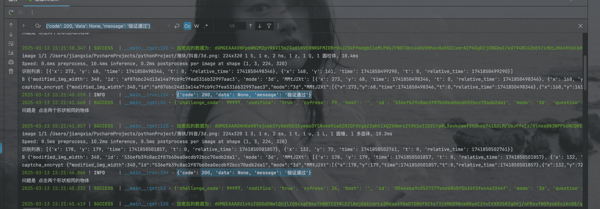

### 参考链接

感谢晨哥指导。
