# [Web逆向] 【JS逆向】某加速乐分析解混淆

- 原帖: https://www.52pojie.cn/forum.php?mod=viewthread&tid=2016235
- 抓取时间: 2026-11-01T22:12:09

网址：`aHR0cHM6Ly95cC4xMjBhc2suY29tL3NlYXJjaC81LTI4My5odG1s`

视频: 视频

## 1. 分析请求

打开F12抓包观察

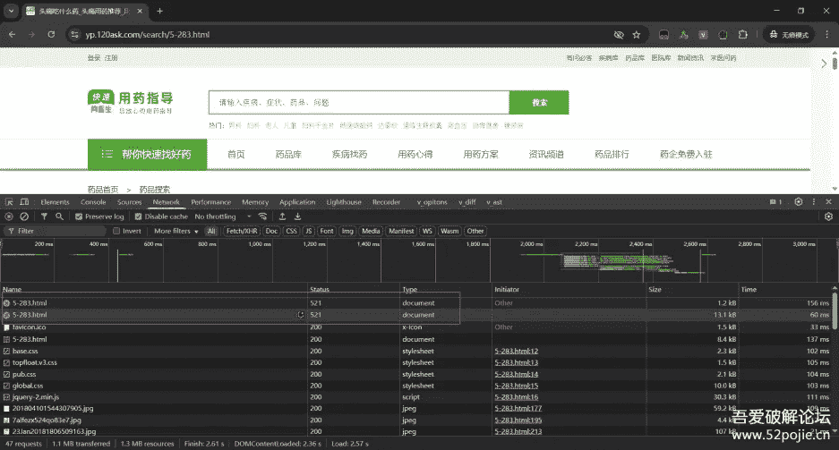

1.png (248.5 KB, 下载次数: 1) [下载附件](https://www.52pojie.cn/forum.php?mod=attachment&aid=Mjc2MzA0N3wzMThkZTU4Y3wxNzkzNTcxMTI3fDE2ODA4NnwyMDE2MjM1&nothumb=yes)

2025-3-18 21:10 上传

加速乐经典两次521，由于页面已经加载成功，两次521的请求响应看不到，清除cookie再下个script断点继续观察。

### 1.1. 清除cookie

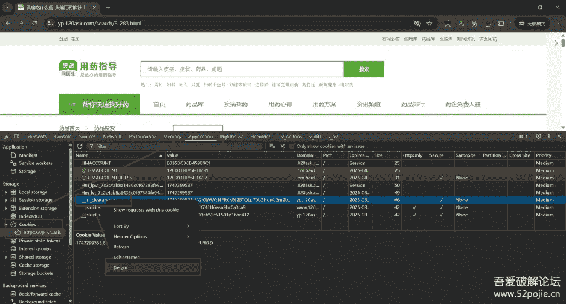

2.png (263.62 KB, 下载次数: 0) [下载附件](https://www.52pojie.cn/forum.php?mod=attachment&aid=Mjc2MzA0OHw5MTU2ZmZhYXwxNzkzNTcxMTI3fDE2ODA4NnwyMDE2MjM1&nothumb=yes)

2025-3-18 21:10 上传

### 1.2. 下断点访问

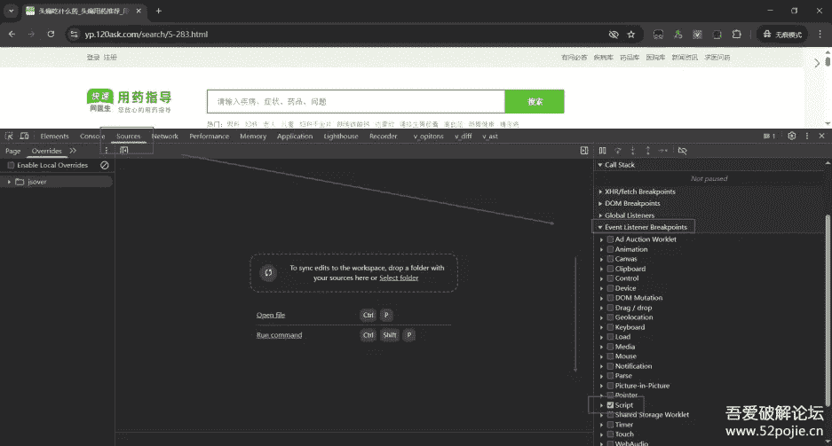

3.png (168.66 KB, 下载次数: 0) [下载附件](https://www.52pojie.cn/forum.php?mod=attachment&aid=Mjc2MzA0OXxhODE2ODQxZnwxNzkzNTcxMTI3fDE2ODA4NnwyMDE2MjM1&nothumb=yes)

2025-3-18 21:10 上传

### 1.3. 第一次521

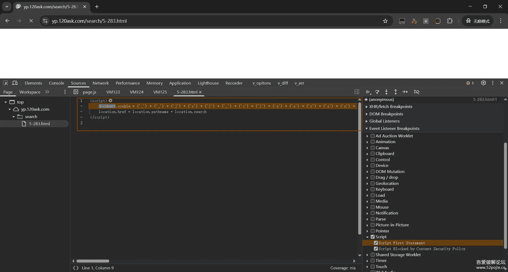

4.png (354.91 KB, 下载次数: 0) [下载附件](https://www.52pojie.cn/forum.php?mod=attachment&aid=Mjc2MzA1MXw1YTBlZDVlMHwxNzkzNTcxMTI3fDE2ODA4NnwyMDE2MjM1&nothumb=yes)

2025-3-18 21:10 上传

拿出来看看。

```javascript
document.cookie = ('_') + ('_') + ('j') + ('s') + ('l') + ('_') + ('c') + ('l') + ('e') + ('a') + ('r') + ('a') + ('n') + ('c') + ('e') + ('_') + ('s') + ('=') + ((+true) + '') + (1 + 6 + '') + (1 + 3 + '') + (-~1 + '') + (0 + 1 + 0 + 1 + '') + (1 + [0] - (1) + '') + ([3] * (3) + '') + (9 - 1 * 2 + '') + ((1 + [2]) / [2] + '') + (([2] + 0 >> 2) + '') + ('.') + (-~[5] + '') + (-~[6] + '') + (7 + '') + ('|') + ('-') + ((+true) + '') + ('|') + ('d') + ('W') + ('S') + ('x') + ('Z') + ('R') + ('l') + ('N') + ('N') + ('K') + ('z') + ('I') + ('V') + ('E') + (~~[] + '') + ((2 > 2) + '') + ('D') + (';') + (' ') + ('M') + ('a') + ('x') + ('-') + ('a') + ('g') + ('e') + ('=') + (1 + 2 + '') + ([2] * (3) + '') + ((+[]) + '') + (~~[] + '') + (';') + (' ') + ('P') + ('a') + ('t') + ('h') + ('=') + ('/') + (';') + (' ') + ('S') + ('a') + ('m') + ('e') + ('S') + ('i') + ('t') + ('e') + ('=') + ('N') + ('o') + ('n') + ('e') + (';') + (' ') + ('S') + ('e') + ('c') + ('u') + ('r') + ('e');
location.href = location.pathname + location.search
```

简单，直接执行即可拿到第一次的cookie。

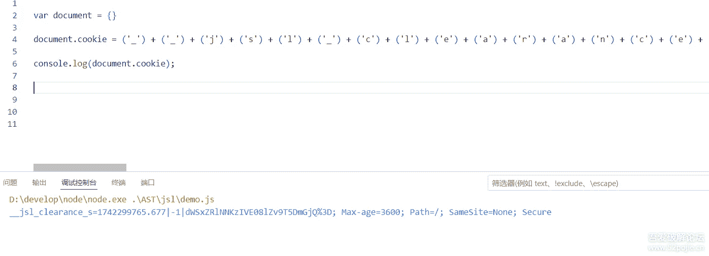

5.png (150.5 KB, 下载次数: 0) [下载附件](https://www.52pojie.cn/forum.php?mod=attachment&aid=Mjc2MzA1MnwwODE3MTE1MXwxNzkzNTcxMTI3fDE2ODA4NnwyMDE2MjM1&nothumb=yes)

2025-3-18 21:10 上传

### 1.4. 第二次521

继续放行，直到断住第二次521

再观察本次请求头特征，携带的cookie正是第一次521生成的cookie

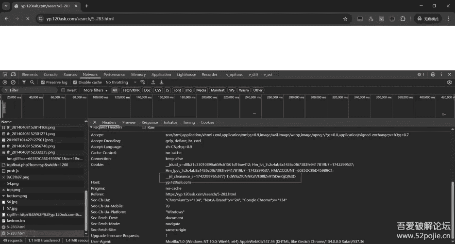

6.png (252.98 KB, 下载次数: 0) [下载附件](https://www.52pojie.cn/forum.php?mod=attachment&aid=Mjc2MzA1M3wzYzVlMWQyMnwxNzkzNTcxMTI3fDE2ODA4NnwyMDE2MjM1&nothumb=yes)

2025-3-18 21:10 上传

### 1.5. 继续放行

继续放行，页面加载成功，发现`__jsl_clearance_s`值已经发生变化

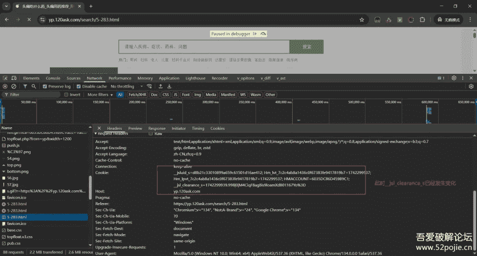

7.png (264.1 KB, 下载次数: 0) [下载附件](https://www.52pojie.cn/forum.php?mod=attachment&aid=Mjc2MzA1NHwxYWZkYzkxNHwxNzkzNTcxMTI3fDE2ODA4NnwyMDE2MjM1&nothumb=yes)

2025-3-18 21:10 上传

## 2. 流程分析

整体流程如下：

- 第一次请求返回521，一段js生成第一次`__jsl_clearance_s`
- 第二次请求携带第一次生成的`jsl_clearance_s`，并通过js加载生成第二次`jsl_clearance_s`
- 最终请求携带第二次`__jsl_clearance_s`，即可加载成功

第一次521的cookie值很容易获取，执行js即可。
第二次521的js需要逆向分析

## 3. 第二次521分析

### 3.1. 解混淆

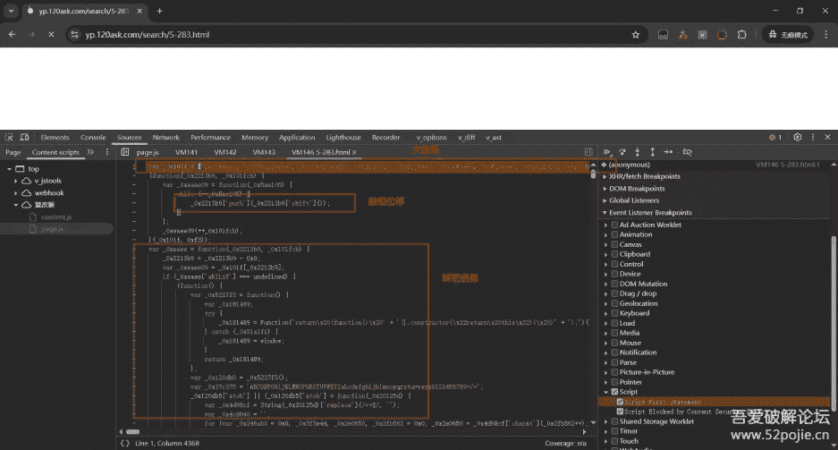

8.png (243.15 KB, 下载次数: 0) [下载附件](https://www.52pojie.cn/forum.php?mod=attachment&aid=Mjc2MzA1NXxiZWZmMjdiZXwxNzkzNTcxMTI3fDE2ODA4NnwyMDE2MjM1&nothumb=yes)

2025-3-18 21:10 上传

观察代码发现OB混淆三个特征（大数组、数组位移、解密函数）。

看到一个OB混淆，正好最近在学习AST，拿来还原练手。下附完整解混淆代码

```javascript
const parse = require('@babel/parser').parse

const generator = require('@babel/generator').default;

const traverse = require('@babel/traverse').default;

const types = require('@babel/types')

const fs = require('fs')

var _0x570c = ['woDCg8Ogwo8=', 'VcOHw5Vs', 'SsK3w6cE', 'OcOAXMKZ', 'HCvCvsOj', 'KsK3eRo=', 'woFeNig=', 'wq3CscO8wpU=', 'OsKyUyk=', 'esKyw4o=', 'CMO+TA==', 'wq7CnhZJ', 'wrsiw6vDoQ==', 'w7nCjMOxOw==', 'wpVCwq3Dqg==', 'w7DDrsORdA==', 'w5nDsMKWEQ==', 'w5NGwrIN', 'E8OhdcKw', 'Qg7Dr8OO', 'Dktjw6s=', 'w53DiMO3dQ==', 'wojDmsOIwrA=', 'wovDni7CiA==', 'Q8Kvbgg=', 'w4jDjsKrw78=', 'wonCssOowpI=', 'wp9AwqPDtA==', 'wrMIw7zDgA==', 'ccK9wpbDhQ==', 'X8Kfb3I=', 'wop/JjI=', 'cmvDrns=', 'QsKmVCs=', 'XhjDs8Op', 'w6PDusO4w68=', 'UVfDp1E=', 'wpvClMOJwpo=', 'QcKrdgY=', 'N1lFAQ==', 'Q8OWw4Z2', 'wpsSQ8ON', 'D8KcUBo=', 'XsK5Qg0=', 'LMOow6s0', 'wpPDjhJw', 'wrlVFcOy', 'wqjDpG/DvQ==', 'KMOqw48C', 'w63DocOpQw==', 'w5BpfXw=', 'w6jDr8O4TA==', 'woDCs8Oqwog=', 'ccKgMi0=', 'GFnCg8KN', 'wrJJwo/DjA==', 'VsK3GhU=', 'w5jCk8OgGA==', 'XcO0wrgw', 'QHlww6E=', 'BEB2w7I=', 'JMKcfSI=', 'wq7DiAtL', 'w4cvw5MX', 'woXDgCl2', 'Qi7Dt8OO', 'csOhw4Ju', 'wrTDtiFj', 'w4PDicOuaw==', 'PcOlw7g3', 'XsK7ehI=', 'w4QJw5c2', 'w7JlW8KO', 'VsK6w5kO', 'YMOvwqQo', 'Hz57LQ==', 'KUnCpcKr', 'wpfDhGvDkw==', 'B0thw60=', 'wrAjw6bDjQ==', '6K+45rO26aue6K2y', 'RcOYwo1q', 'woZcG8O7', 'wo3DjhBx', 'w6XDscOmw60=', 'wpHDigp+', 'RcKpeSI=', 'wqXCj8OcwoE=', 'TFPDiXc=', 'SwXCo8Ku', 'wo3ClxhK', 'JcKnVR0=', 'w4UOw7UX', 'wo3CiXfDvA==', 'NMKUUi0=', 'Lw96KQ==', 'aMKaw5Mp', 'a8KZFhY=', 'wpvDnG3DhQ==', 'OkRtw7Q=', 'UcKMw4gK', 'ScKnWQc=', 'w4jDvsK8w6w=', 'wonDo8OrwpI=', 'HjvCpsOk', 'wqbCrH/DrQ==', 'wpAJacOV', 'wr/DnsO6wo0=', 'ag3DlMOV', 'wo0RecOu', 'wojCmA1+', 'w4xITsOb', 'wogNfcO5', 'DsKxSyw=', 'w4tZwo8z', 'w40lw74D', 'wqQcVMO2', 'EcKPZDo=', 'wrAkVsO/', 'w7TDsMKqw4o=', 'w5vCvsOYOA==', 'wr/CoMOpwrw=', 'QnLCg8Ku', 'Y8KIwpTDpA==', 'w5sJw5gj', 'ShTCiMKT', 'CDtEEg==', 'w4szw7gQ', 'w6czw7U3', 'H8ONT8Ko', 'wrxuCMOj', 'U8K5wofDrQ==', 'wpQAfMOI', 'w7BEwrtC', 'wqNwwobDkQ==', 'P0JmGg==', 'w696Y1w=', 'ScKrwrXDmQ==', 'SMKkHQM=', 'X8KfcA4=', 'A8OnwofDjA==', 'YMOOIcOy', 'w7Aaw74g', 'wqhUPMO4', 'wpDDnkLDvw==', 'w6PDvcO2w7Y=', 'LcO+f8KY', 'w77DlcO7Tw==', 'w741w7M+', 'fTjChsKB', 'w4gCw78r', 'GQxkEg==', 'fFHDrXA=', 'wqJOIsOg', 'IMK8dw8=', 'woTCjwpN', 'UBsnwrE=', 'wrTCm0XDmg==', 'woh5EQY=', 'woEDT8Op', 'bk3DiQ==', 'A2pIJQ==', 'NnvCp8KR', 'Cjhswow=', 'S8KuEg==', 'w6TDtsKPKg==', 'wqggQsOT', 'RjzDt8O5', 'wprCrGbDuQ==', 'woFMJi0=', 'wrvDl8OvwpA=', 'w5jDo8Kvw4w=', 'wpzClcO8wqg=', 'w4lGQUI=', 'MF/CrsK+', 'KXNQw7g=', 'w7xAwonDmw==', 'wrUIfsO7', 'w7jCuMOkJQ==', 'RFzCmMK0', 'wrPDnWvDnA==', 'esOGNw==', 'w6xqeMKq', 'U8K/QF0=', 'Zhd/wr4=', 'w7BoV1c=', 'wrQHecOf', 'V8KHUCY=', 'wrjDnMO4wo8=', 'Y8O2USE=', 'w6TDv8O0w7Q=', 'Q8OfN8Oa', 'ccK1w7jDtg==', 'wo9kFcOl'];

(function (_0x20ecdc, _0x570c71) {

    var _0x3ce331 = function (_0xf09cc9) {

        while (--_0xf09cc9) {

            _0x20ecdc['push'](_0x20ecdc['shift']());

        }

    };

    _0x3ce331(++_0x570c71);

}(_0x570c, 0xee));

var _0x3ce3 = function (_0x20ecdc, _0x570c71) {

    _0x20ecdc = _0x20ecdc - 0x0;

    var _0x3ce331 = _0x570c[_0x20ecdc];

    if (_0x3ce3['uHvhcN'] === undefined) {
```


```javascript
(function () {
    var _0x6afdb7 = function () {
        var _0x35ea72;
        try {
            _0x35ea72 = Function('return\x20(function()\x20' + '{}.constructor(\x22return\x20this\x22)(\x20)' + ');')();
        } catch (_0x3fbb7b) {
            _0x35ea72 = window;
        }
        return _0x35ea72;
    };
    var _0x53b64a = _0x6afdb7();
    var _0x100cf5 = 'ABCDEFGHIJKLMNOPQRSTUVWXYZabcdefghijklmnopqrstuvwxyz0123456789+/=';
    _0x53b64a['atob'] || (_0x53b64a['atob'] = function (_0x59ebb5) {
        var _0x3c892f = String(_0x59ebb5)['replace'](/=+$/, '');
        var _0x3dc83d = '';
        for (var _0x3f7515 = 0x0, _0x494b6e, _0x1eb0e6, _0x48a044 = 0x0; _0x1eb0e6 = _0x3c892f['charAt'](_0x48a044++); ~_0x1eb0e6 && (_0x494b6e = _0x3f7515 % 0x4 ? _0x494b6e * 0x40 + _0x1eb0e6 : _0x1eb0e6, _0x3f7515++ % 0x4) ? _0x3dc83d += String['fromCharCode'](0xff & _0x494b6e >> (-0x2 * _0x3f7515 & 0x6)) : 0x0) {
            _0x1eb0e6 = _0x100cf5['indexOf'](_0x1eb0e6);
        }
        return _0x3dc83d;
    });
})();
var _0x3a5e7e = function (_0x5f34f2, _0x28e2e7) {
    var _0x5c2c82 = [], _0x3520f5 = 0x0, _0x1308fb, _0x31aa5f = '', _0x18a4ce = '';
    _0x5f34f2 = atob(_0x5f34f2);
    for (var _0x1e08c = 0x0, _0x4ec2ba = _0x5f34f2['length']; _0x1e08c  {
                        // 在return处才知道函数是操作符类型还是函数调用类型
                        if (body.isReturnStatement()) {
                            if (body.get('argument').isBinaryExpression()) {
                                // 操作符还原
                                let operator = body.get('argument.operator').node
                                let left = path.get('arguments.0')
                                let right = path.get('arguments.1')
                                // console.log(path.toString(), '-->', left.toString(), operator, right.toString())
                                path.replaceWith(types.binaryExpression(operator, left.node, right.node))
                            } else if (body.get('argument').isCallExpression()) {
                                // 函数调用还原
                                let origin_args = path.get('arguments')
                                origin_args = Array.from(origin_args)
                                let args
                                if (origin_args.length === 1) {
                                    args = []  // 没有参数
                                } else {
                                    args = origin_args.slice(1).map(arg => arg.node)
                                }
                                let old_path_string = path.toString()
                                path.replaceWith(types.callExpression(origin_args[0].node, args))
                                // console.log(old_path_string, '-->', path.toString())
                            } else if (body.get('argument').isLogicalExpression()) {
                                // 操作符还原
                                let operator = body.get('argument.operator').node
                                let left = path.get('arguments.0')
                                let right = path.get('arguments.1')
                                // console.log(path.toString(), '-->', left.toString(), operator, right.toString())
                                path.replaceWith(types.logicalExpression(operator, left.node, right.node))
                            }
                        }
                    }
                }
            }
        }
    }
})
```

```javascript
// 语法数转JS代码
let { code } = generator(ast, { compact: false });
console.log(code);
// 保存
fs.writeFile('./AST/jsl/output.js', code, (err) => {
});
```

### 3.2. js分析

解混淆后代码如下：


# 代码逆向分析

```javascript
function hash(_0x154ab3) {
  var _0x327578 = {
    "LkeiB": function (_0x35cace, _0x2c0302) {
      return _0x35cace ^ _0x2c0302;
    },
    "ohLJM": function (_0x48382b, _0x496067) {
      return _0x48382b + _0x496067;
    },
    "xoMoj": function (_0x3b875d, _0x30bbd1) {
      return _0x3b875d >= _0x30bbd1;
    },
    "wBPam": function (_0x553453, _0x4e20c4) {
      return _0x553453 & _0x4e20c4;
    },
    "AAJpA": function (_0x1d1e16, _0x1b7e12) {
      return _0x1d1e16 * _0x1b7e12;
    },
    "lUytO": function (_0x20157b, _0x74aa3) {
      return _0x20157b * _0x74aa3;
    },
    "Jcpkz": function (_0x112685, _0x399395) {
      return _0x112685 > _0xe793a2;
    },
    "DVBoQ": function (_0x3c7aa3, _0x287476) {
      return _0x3c7aa3 > _0x5737b7;
    },
    "hgaCh": function (_0x25f651, _0x29dcc8) {
      return _0x25f651 ^ _0x29dcc8;
    },
    "TSuqq": function (_0x2be25d, _0x44de73) {
      return _0x2be25d - _0x44de73;
    },
    "xSxVp": function (_0x3b3368, _0x1cac8e) {
      return _0x3b3368 | _0x1cac8e;
    },
    "DcCTs": function (_0x3e0d5b, _0x223c8c) {
      return _0x3e0d5b >>> _0x223c8c;
    },
    "nEasy": function (_0x4acdd7, _0x5b8069) {
      return _0x4acdd7 - _0x5b8069;
    },
    "djcpE": function (_0x3a020d, _0x3788a4) {
      return _0x3a020d = 0; _0x3ee3fd--) {
      _0x2239fe += _0x58948d["charAt"](_0x5bd77f >> _0x3ee3fd * 4 & 15);
    }
    return _0x2239fe;
  }
  function _0x1b2728(_0x54a11b) {
    var _0x38d92a = (_0x54a11b["length"] + 8 >> 6) + 1,
      _0x465ae1 = new Array(_0x38d92a * 16);
    for (var _0x8cfc11 = 0; _0x8cfc11 > 2] |= _0x54a11b["charCodeAt"](_0x8cfc11) > 2] |= 128 >> 32 - _0xe4b521;
    } else {
      _0x422791[_0x3d7535] = _0x4d377a(_0x422791[_0x3d7535 - 3] ^ _0x422791[_0x3d7535 - 8] ^ _0x422791[_0x3d7535 - 14] ^ _0x422791[_0x3d7535 - 16], 1);
    }
  }
  function _0x25ec72(_0x3ae4fd, _0x3b2258, _0x2f7677, _0x2c56f5) {
    if (_0x3ae4fd  _0x583426[1] ? parseInt(_0x2d1873['wt']) - _0x583426[1] : 500;
    } else {
      _0x3bd2ee = 1500;
    }
    setTimeout(function () {
      var _0x4bcd58 = _0x2d1873['tn'] + '=' + _0x583426[0] + ";Max-age=" + _0x2d1873['vt'] + "; path = /";
      if (_0x2d1873['is']) {
        _0x4bcd58 = _0x4bcd58 + "; SameSite=None; Secure";
      }
      document["cookie"] = _0x4bcd58;
      location["href"] = location["pathname"] + location["search"];
    }, _0x3bd2ee);
  } else {
    alert("\u8BF7\u6C42\u9A8C\u8BC1\u5931\u8D25");
  }
}
;
go({
  "bts": ["1742210366.499|0|C5I", "Q%2F9kYuj%2B4tZg3eUTzG0FMI%3D"],
  "chars": "CVOIhfIxdhyiNDpQAYHxbN",
  "ct": "25e3a650286ae514c4499fd072c62baac2a5aa7e",
  "ha": "sha1",
  "is": true,
  "tn": "__jsl_clearance_s",
  "vt": "3600",
  "wt": "1500"
});
```

## 观察代码结构

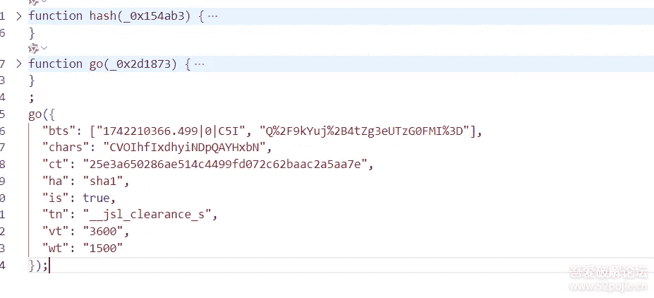

9.png (129.37 KB, 下载次数: 0)

[href="forum.php?mod=attachment&aid=Mjc2MzA1NnwzZWUwZDM1MnwxNzkzNTcxMTI3fDE2ODA4NnwyMDE2MjM1&nothumb=yes" target="_blank"](https://www.52pojie.cn/forum.php?mod=attachment&aid=Mjc2MzA1NnwzZWUwZDM1MnwxNzkzNTcxMTI3fDE2ODA4NnwyMDE2MjM1&nothumb=yes)

2025-3-18 21:10 上传

2个大方法，调用了`go`方法，传入了一个对象，继续分析`go`方法

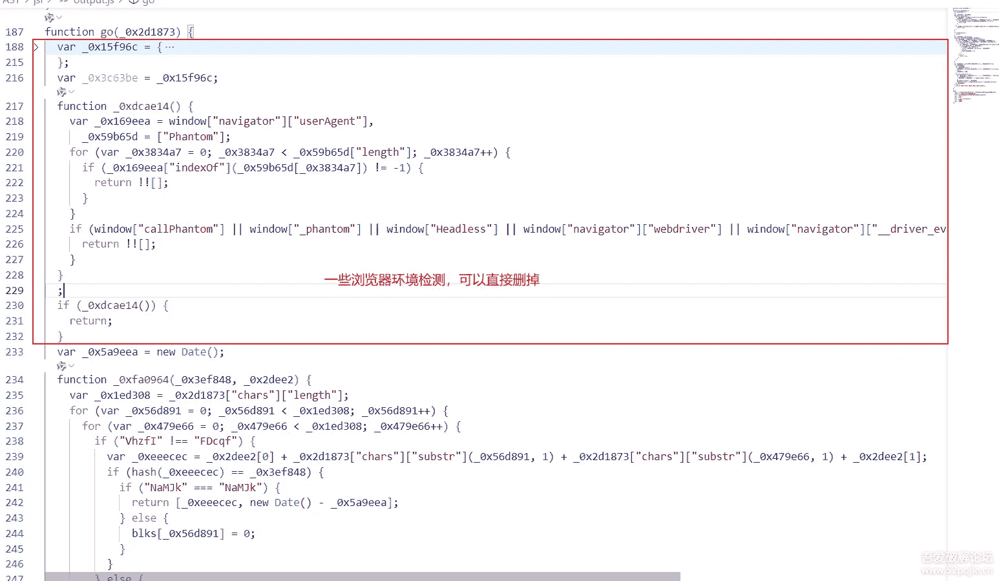

10.png (499.05 KB, 下载次数: 0)

[href="forum.php?mod=attachment&aid=Mjc2MzA1N3xiNmJhZDVmNnwxNzkzNTcxMTI3fDE2ODA4NnwyMDE2MjM1&nothumb=yes" target="_blank"](https://www.52pojie.cn/forum.php?mod=attachment&aid=Mjc2MzA1N3xiNmJhZDVmNnwxNzkzNTcxMTI3fDE2ODA4NnwyMDE2MjM1&nothumb=yes)

2025-3-18 21:10 上传

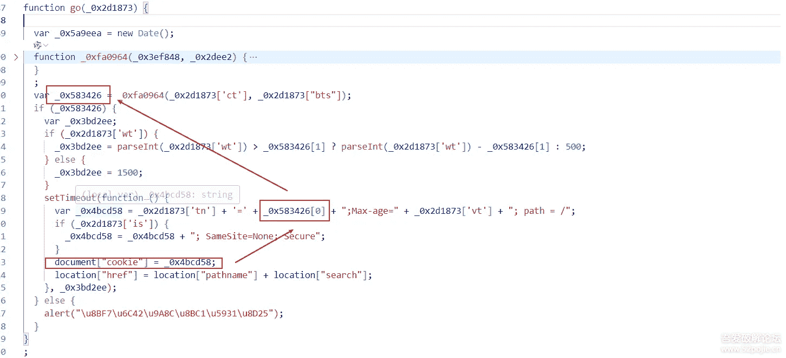

11.png (322.87 KB, 下载次数: 0)

[href="forum.php?mod=attachment&aid=Mjc2MzA1OHwyN2NhZDE1OHwxNzkzNTcxMTI3fDE2ODA4NnwyMDE2MjM1&nothumb=yes" target="_blank"](https://www.52pojie.cn/forum.php?mod=attachment&aid=Mjc2MzA1OHwyN2NhZDE1OHwxNzkzNTcxMTI3fDE2ODA4NnwyMDE2MjM1&nothumb=yes)

2025-3-18 21:11 上传

`cookie`来自于`_0x4bcd58`，`_0x4bcd58`来自于`_0x583426[0]`，`_0x583426[0]`来自于`_0x583426`，所以下面代码可以全部干掉

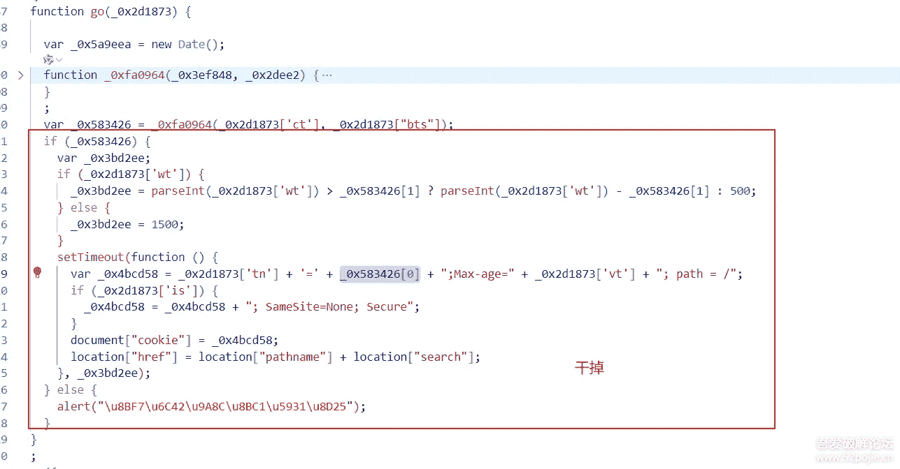

12.png (299.12 KB, 下载次数: 0)

[href="forum.php?mod=attachment&aid=Mjc2MzA1OXxmZTk4N2FjMXwxNzkzNTcxMTI3fDE2ODA4NnwyMDE2MjM1&nothumb=yes" target="_blank"](https://www.52pojie.cn/forum.php?mod=attachment&aid=Mjc2MzA1OXxmZTk4N2FjMXwxNzkzNTcxMTI3fDE2ODA4NnwyMDE2MjM1&nothumb=yes)

2025-3-18 21:11 上传

此时目标就是看`_0x583426`的逻辑了，精简后的`go`方法代码如下。

```javascript
function go(_0x2d1873) {

  var _0x5a9eea = new Date();

  function _0xfa0964(_0x3ef848, _0x2dee2) {

    var _0x1ed308 = _0x2d1873["chars"]["length"];

    for (var _0x56d891 = 0; _0x56d891 
```

debug看看。

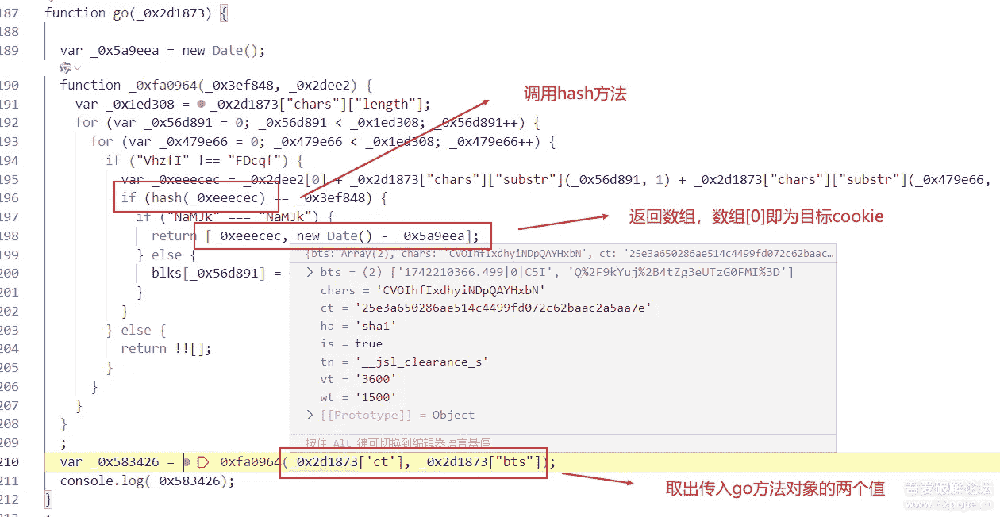

13.png (459.35 KB, 下载次数: 0)

[href="forum.php?mod=attachment&aid=Mjc2MzA2MHxmOTE0ZDg5ZXwxNzkzNTcxMTI3fDE2ODA4NnwyMDE2MjM1&nothumb=yes" target="_blank"](https://www.52pojie.cn/forum.php?mod=attachment&aid=Mjc2MzA2MHxmOTE0ZDg5ZXwxNzkzNTcxMTI3fDE2ODA4NnwyMDE2MjM1&nothumb=yes)

2025-3-18 21:11 上传

大致分析如上，最终代码如下：

```javascript
var CryptoJS = require('crypto-js')

function dynamicHash(algorithm, data) {
    try {
        // 根据算法名称选择对应的哈希函数
        const hashFunctions = {
            'md5': CryptoJS.MD5,
            'sha1': CryptoJS.SHA1,
            'sha224': CryptoJS.SHA224,
            'sha256': CryptoJS.SHA256,
            'sha384': CryptoJS.SHA384,
            'sha512': CryptoJS.SHA512,
            'sha3': CryptoJS.SHA3
        };

        if (!hashFunctions[algorithm]) {
            throw new Error(`Unsupported algorithm: ${algorithm}`);
        }

        // 计算哈希值
        const hash = hashFunctions[algorithm](data);
        return hash.toString(CryptoJS.enc.Hex); // 返回十六进制字符串
    } catch (error) {
        return `Error: ${error.message}`;
    }
}

function getCookie(_0x52e87e) {
    _0x52e87e = JSON.parse(_0x52e87e);
    console.log(_0x52e87e);
    var _0x171118 = new Date();
    function _0x18b9db(_0x3a9f8b, _0x28ec7f) {
        var _0x15f5ed = _0x52e87e["chars"]["length"];
        for (var _0x4184d5 = 0; _0x4184d5 
```

注意这里去掉了`hash`方法，因为每次返回的`js`不一样，其本质算法就是拿出当前这次`js`的参数里面的`ha`值，代表对应的哈希算法，经过运算比对处理后生成新的`__jsl_clearance_s`，至此流程全部结束。

## 4. 测试

```python
import requests

import execjs

import re

session = requests.session()

cookies = {
    'Hm_lvt_7c2c4ab8a1436c0f67383fe9417819b7': '1741571831',
    'Hm_lpvt_7c2c4ab8a1436c0f67383fe9417819b7': '1741571831',
    'HMACCOUNT': '46236174D3CFAEF6',
}

headers = {
    'Accept': 'text/html,application/xhtml+xml,application/xml;q=0.9,image/avif,image/webp,image/apng,*/*;q=0.8,application/signed-exchange;v=b3;q=0.7',
    'Accept-Language': 'zh-CN,zh;q=0.9',
    'Cache-Control': 'no-cache',
    'Connection': 'keep-alive',
    'Pragma': 'no-cache',
    'Sec-Fetch-Dest': 'document',
    'Sec-Fetch-Mode': 'navigate',
    'Sec-Fetch-Site': 'none',
    'Sec-Fetch-User': '?1',
    'Upgrade-Insecure-Requests': '1',
    'User-Agent': 'Mozilla/5.0 (Macintosh; Intel Mac OS X 10_15_7) AppleWebKit/537.36 (KHTML, like Gecko) Chrome/133.0.0.0 Safari/537.36',
    'sec-ch-ua': '"Not(A:Brand";v="99", "Google Chrome";v="133", "Chromium";v="133"',
    'sec-ch-ua-mobile': '?0',
    'sec-ch-ua-platform': '"macOS"',
    # 'Cookie': 'Hm_lvt_7c2c4ab8a1436c0f67383fe9417819b7=1741571831; Hm_lpvt_7c2c4ab8a1436c0f67383fe9417819b7=1741571831; HMACCOUNT=46236174D3CFAEF6',
}

response = session.get('https://xx.xx.com/search/5-283.html', cookies=cookies, headers=headers)

print(response)

# print(response.text)

cookie1 = re.split(r"document.cookie=(.*?);location.href=",response.text)

# print(cookie1[1])

jscode = cookie1[1]

jsl_1 = execjs.eval(jscode)

print(jsl_1)

cookies["__jsl_clearance_s"] = jsl_1.split(";")[0].split("=")[1]

# session.cookies.update(cookies)

# print(session.cookies)

response = session.get('https://xx.xx.com/search/5-283.html',
                        cookies=cookies,
                        headers=headers)

print(response)

# print(response.text)

cookie_param = re.findall('go\\((\\{.*?\\})', response.text)[0]

print(cookie_param)
```


```python
with open(f"getCookie.js",mode="r",encoding="utf-8") as f:
    jscode = f.read()
    cookie2 = execjs.compile(jscode).call("getCookie", cookie_param)
    print(cookie2)

cookies["__jsl_clearance_s"] = cookie2

response = session.get('https://yp.120ask.com/search/5-283.html',
                        cookies=cookies,
                        headers=headers)

# print(response.text)

print(response)
```
没毛病，完成
