# [Web逆向] 纯小白，记一次某日番动漫网视频地址解密全过程

- 原帖：[https://www.52pojie.cn/forum.php?mod=viewthread&tid=2016709](https://www.52pojie.cn/forum.php?mod=viewthread&tid=2016709)
- 抓取时间：2026-11-01T22:12:06

本文章中所有内容仅供学习交流使用，不用于其他任何目的，不提供完整代码，严禁用于商业用途和非法用途，否则由此产生的一切后果均与作者无关。

---

目标网址：`aHR0cHM6Ly9hbmltZS5naXJpZ2lyaWxvdmUuY29tL3BsYXlHVjI2NDY3LTEtMS8=`

---

PS：本人纯小白，对逆向`JS`等编程语言一窍不通，分析过程均借助AI辅助理解。开发者工具的使用、逆向思维的认知，均源于52pj论坛，多看多动手就有一定认知了。

## 分析过程

1. 随意打开动漫剧集一个章节视频，习惯性`F12`开发者工具，发现有反调试机制。

2. 尝试`Ctrl + U`打开页面源代码，`Ctrl + F`查找`.m3u8`或`.mp4`，果然也没有找到视频地址。

3. 遍历`HTML`源代码，发现以下这段`js`很可疑，根据经验应该就是经过混淆加密的视频地址代码段了：

    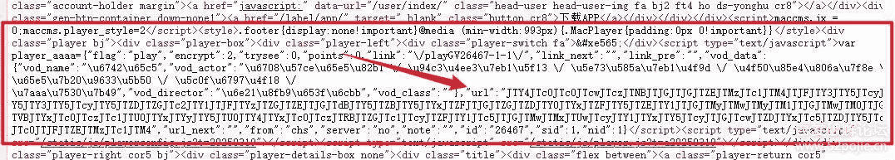

    Snipaste_2025-03-20_00-02-45.jpg（126.78 KB，下载次数：2）

    [附件下载](https://www.52pojie.cn/forum.php?mod=attachment&aid=Mjc2MzYyM3xlNWI5ODdiN3wxNzkzNTcxMTIzfDE2ODA4NnwyMDE2NzA5&nothumb=yes)

    2025-3-20 00:03 上传

4. 在开发者工具控制台输入这段代码中的变量名`player_aaaa`回车查询，将结果展开，果然验证上述`JS`代码段就是真实视频地址经过加密的代码片段：

    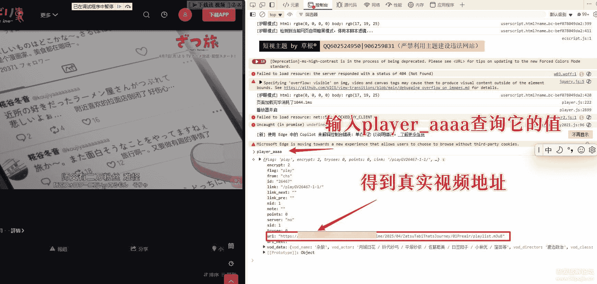

    Snipaste_2025-03-20_00-10-15.jpg（235.57 KB，下载次数：2）

    [附件下载](https://www.52pojie.cn/forum.php?mod=attachment&aid=Mjc2MzYyNHxkYzUxNDk2ZXwxNzkzNTcxMTIzfDE2ODA4NnwyMDE2NzA5&nothumb=yes)

    2025-3-20 00:11 上传

5. 网站设置有反调试机制如何解码？没关系，发现它还是可以加载`JS`出来的（半反调试？），切换到网络选项卡，点`JS`标签，根据`js`文件名推测`player.js`里面有解密的方法函数。

    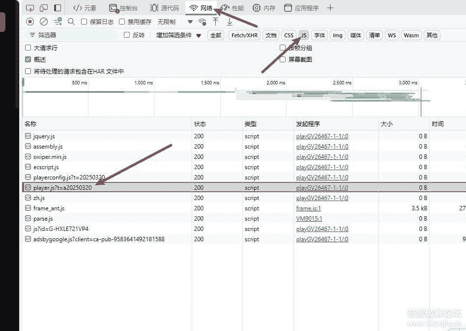

    Snipaste_2025-03-20_00-23-24.jpg（96.53 KB，下载次数：1）

    [附件下载](https://www.52pojie.cn/forum.php?mod=attachment&aid=Mjc2MzYyN3xlNzBkOWZjZXwxNzkzNTcxMTIzfDE2ODA4NnwyMDE2NzA5&nothumb=yes)

    选择`JS`

    2025-3-20 00:24 上传

6. 双击打开`player.js`，发现里面有疑似自定义的64位加密解密混淆的方法（纯小白真的看不懂啊）：

    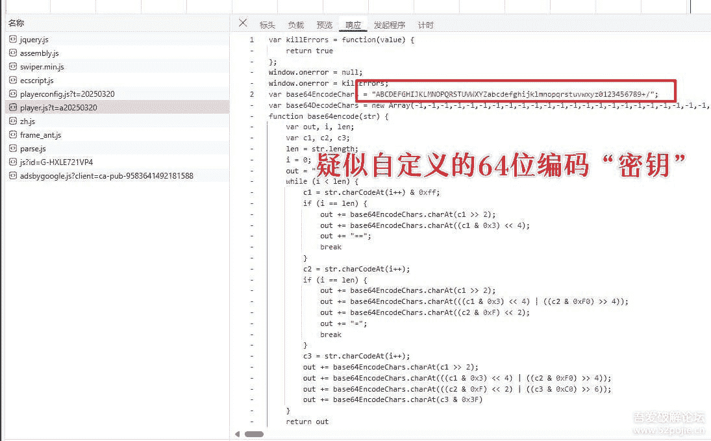

    Snipaste_2025-03-20_00-27-18.jpg（113.85 KB，下载次数：1）

    [附件下载](https://www.52pojie.cn/forum.php?mod=attachment&aid=Mjc2MzYyOXw1ZjBmYWEzNnwxNzkzNTcxMTIzfDE2ODA4NnwyMDE2NzA5&nothumb=yes)

    2025-3-20 00:30 上传

7. 看不懂没关系，发现里面的代码长度并不长，就试着全扔给AI助手，并提问AI：”请解释这段代码的主要功能？“。

    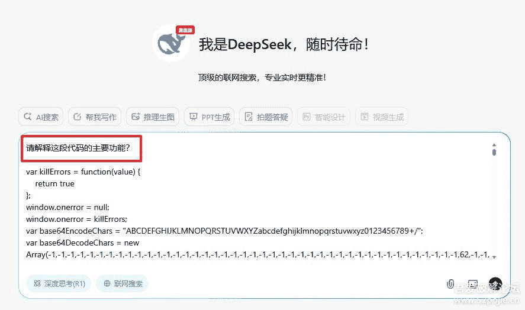

    Snipaste_2025-03-20_00-35-04.jpg（57.85 KB，下载次数：1）

    [附件下载](https://www.52pojie.cn/forum.php?mod=attachment&aid=Mjc2MzYzMXw0NDE2YzMzMXwxNzkzNTcxMTIzfDE2ODA4NnwyMDE2NzA5&nothumb=yes)

    2025-3-20 00:38 上传

    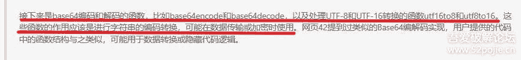

    Snipaste_2025-03-20_00-54-06.jpg（24.01 KB，下载次数：1）

    [附件下载](https://www.52pojie.cn/forum.php?mod=attachment&aid=Mjc2MzYzNXw3NTljZTMzMnwxNzkzNTcxMTIzfDE2ODA4NnwyMDE2NzA5&nothumb=yes)

    2025-3-20 00:54 上传

    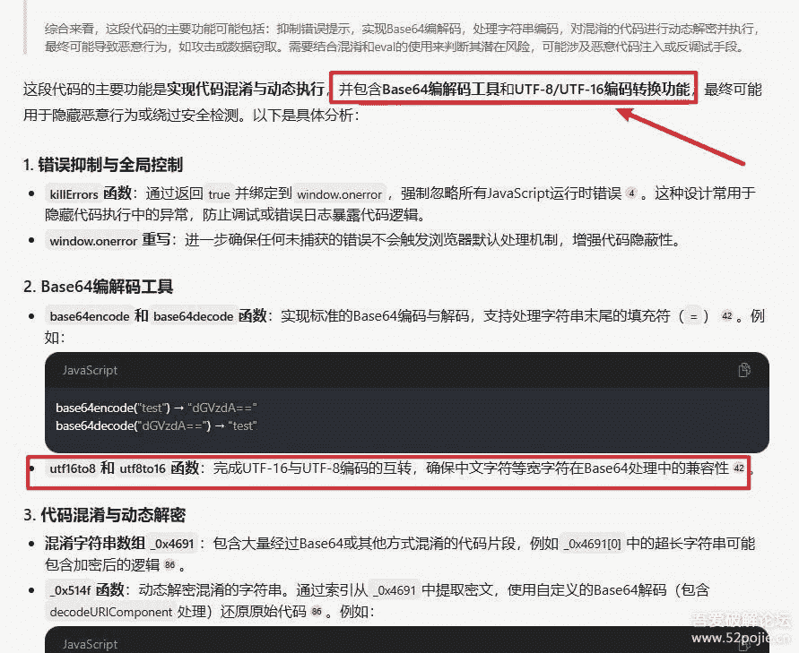

    Snipaste_2025-03-20_00-43-59.jpg（145.15 KB，下载次数：1）

    [附件下载](https://www.52pojie.cn/forum.php?mod=attachment&aid=Mjc2MzYzM3w0ZTA5OWNkY3wxNzkzNTcxMTIzfDE2ODA4NnwyMDE2NzA5&nothumb=yes)

    2025-3-20 00:45 上传

8. 每一个字都看得明白，但结合起来就不太明白了。没关系，至少知道是解密函数，直接让AI助手重写一个方法（本人对Python略懂，就让AI写解密方法了），借助AI：”已知加密字符串`"JTY4JTc0JTc0JTcwJTczJTNBJ……"`，基于上述方法，转写成Python的解密方法并测试打印结果“：

    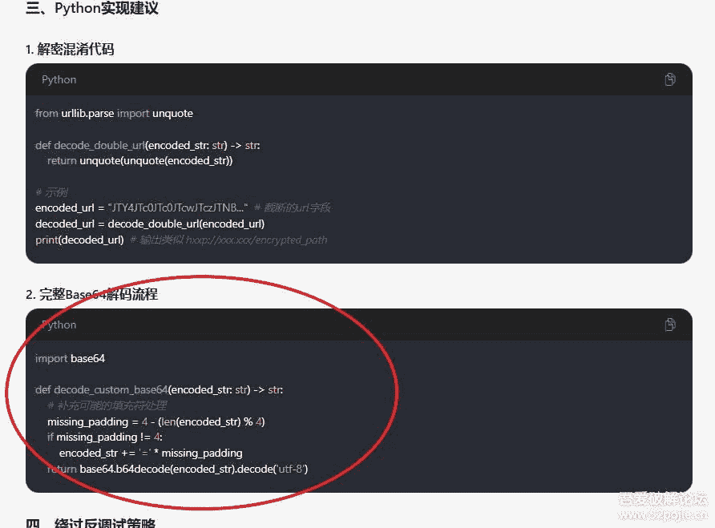

    Snipaste_2025-03-20_00-58-16.jpg（67.08 KB，下载次数：1）

    [附件下载](https://www.52pojie.cn/forum.php?mod=attachment&aid=Mjc2MzYzNnxjNWVkOGI0YnwxNzkzNTcxMTIzfDE2ODA4NnwyMDE2NzA5&nothumb=yes)

    2025-3-20 01:00 上传

9. 测试结果：

    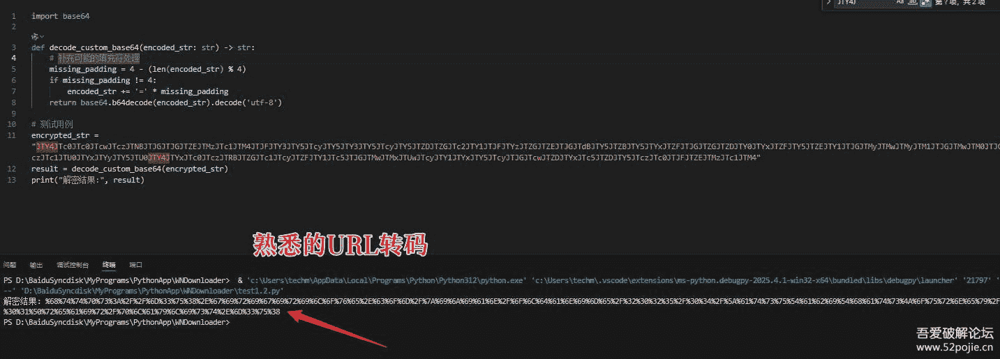

    Snipaste_2025-03-20_01-03-50.jpg（103.29 KB，下载次数：1）

    [附件下载](https://www.52pojie.cn/forum.php?mod=attachment&aid=Mjc2MzYzOHw2OGE3MjFiNnwxNzkzNTcxMTIzfDE2ODA4NnwyMDE2NzA5&nothumb=yes)

    2025-3-20 01:04 上传

10. 引用`from urllib.parse import unquote`来`unquote()`明文结果：

    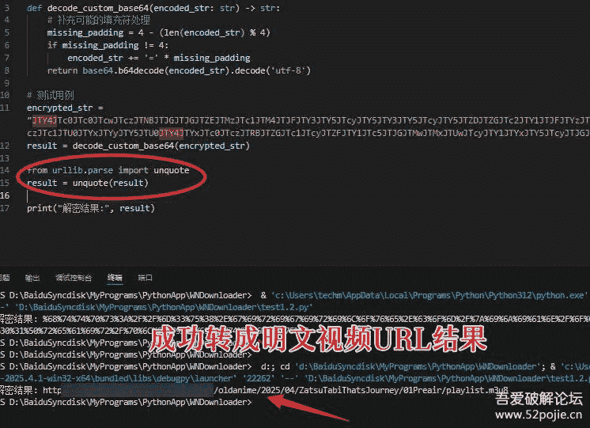

    Snipaste_2025-03-20_01-07-39.jpg（104.83 KB，下载次数：1）

    [附件下载](https://www.52pojie.cn/forum.php?mod=attachment&aid=Mjc2MzYzOXw1YmI0NTQ3ZHwxNzkzNTcxMTIzfDE2ODA4NnwyMDE2NzA5&nothumb=yes)

    2025-3-20 01:08 上传

### 相关解密代码

```python
import base64

def decode_custom_base64(encoded_str: str) -> str:
    # 补充可能的填充符处理
    missing_padding = 4 - (len(encoded_str) % 4)
    if missing_padding != 4:
        encoded_str += '=' * missing_padding
    return base64.b64decode(encoded_str).decode('utf-8')

# 测试用例
encrypted_str = "JTY4JTc0JTc0JTcwJTczJTNBJTJGJTJGJTZEJTMzJTc1JTM4JTJFJTY3JTY5JTcyJTY5JTY3JTY5JTcyJTY5JTZDJTZGJTc2JTY1JTJFJTYzJTZGJTZEJTJGJTdBJTY5JTZBJTY5JTYxJTZFJTJGJTZGJTZDJTY0JTYxJTZFJTY5JTZEJTY1JTJGJTMyJTMwJTMyJTM1JTJGJTMwJTM0JTJGJTVBJTYxJTc0JTczJTc1JTU0JTYxJTYyJTY5JTU0JTY4JTYxJTc0JTczJTRBJTZGJTc1JTcyJTZFJTY1JTc5JTJGJTMwJTMxJTUwJTcyJTY1JTYxJTc5JTJGJTcwJTZDJTYxJTc5JTZDJTY5JTczJTc0JTJFJTZEJTMzJTc1JTM4"
result = decode_custom_base64(encrypted_str)

from urllib.parse import unquote
result = unquote(result)

print("解密结果:", result)
```

最后，复制解密的视频地址，测试，成功播放：

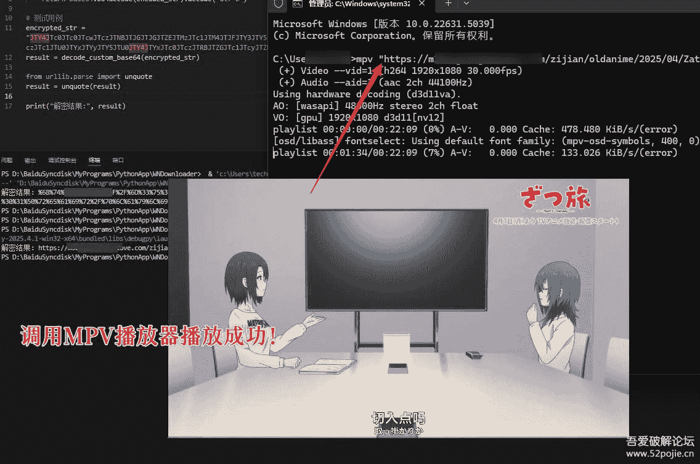

Snipaste_2025-03-20_01-13-15.jpg（144.1 KB，下载次数：1）

[附件下载](https://www.52pojie.cn/forum.php?mod=attachment&aid=Mjc2MzY0MnwyZWMzZThmN3wxNzkzNTcxMTIzfDE2ODA4NnwyMDE2NzA5&nothumb=yes)

2025-3-20 01:14 上传
