# [Web逆向] 某某猫投诉signature逆向-----------小白讲解08

- 原帖: https://www.52pojie.cn/forum.php?mod=viewthread&tid=2017218
- 抓取时间: 2026-11-01T22:11:55

本文章中所有内容仅供学习交流使用，不用于其他任何目的，不提供完整代码，抓包内容、敏感网址、数据接口等均已做脱敏处理，严禁用于商业用途和非法用途，否则由此产生的一切后果均与作者无关。本文章未经许可禁止转载，禁止任何修改后二次传播，擅自使用本文讲解的技术而导致的任何意外，作者均不负责。

感谢各位大佬的观看

---

目标网址:aHR0cHM6Ly90b3VzdS5zaW5hLmNvbS5jbi9jb21wYW55L3ZpZXcvP2NvdWlkPTEwMDM2MDkmc2lkPTI2ODI4

---

## 本文叙述思路

- 抓包
- 跟栈
- 对比数据

注: 本文涉及到补环境 以及 加载器扣取 但在这里都不讲解，因为水平有限，还请各位大佬，自行搜索 这两个知识的相关文档

## 第一步

### 1.1 我们打开开发者工具 进行抓包

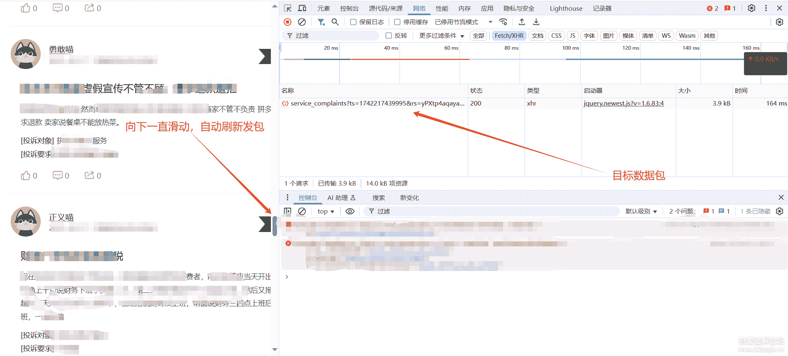

图片 1.png (149.68 KB, 下载次数: 2)

[图片 1.png (149.68 KB, 下载次数: 2)](https://www.52pojie.cn/forum.php?mod=attachment&aid=Mjc2NDQ2M3w3NzVkYmFiYnwxNzkzNTcxMTEzfDE2ODA4NnwyMDE3MjE4&nothumb=yes)

2025-3-21 12:20 上传

### 1.2 我们打开数据包来看所需要扣取的参数 `signature`

#### 1.2.1 其余参数我们可以一步一步跟栈看 是否为固定的，如果是动态的我们也需要一并扣取使用

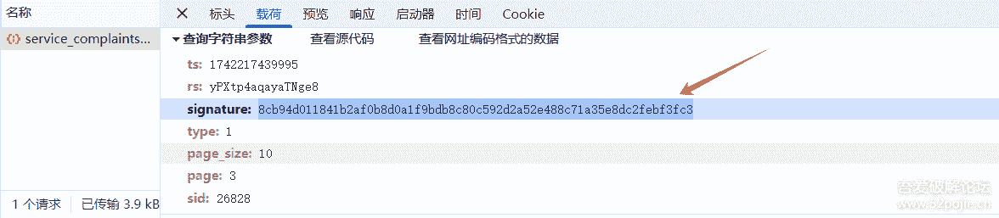

图片 2.png (28.44 KB, 下载次数: 2)

[图片 2.png (28.44 KB, 下载次数: 2)](https://www.52pojie.cn/forum.php?mod=attachment&aid=Mjc2NDQ2NXw5NjU1NDFmNXwxNzkzNTcxMTEzfDE2ODA4NnwyMDE3MjE4&nothumb=yes)

2025-3-21 12:21 上传

### 1.3 接着我们打开启动器 进入跟栈的第一步，根据1.1 发包我们来使断点生效

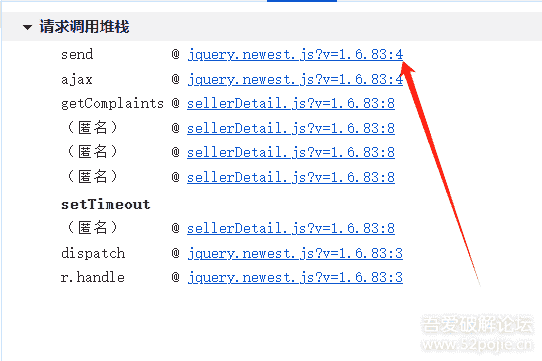

图片 3.png (18.76 KB, 下载次数: 2)

[图片 3.png (18.76 KB, 下载次数: 2)](https://www.52pojie.cn/forum.php?mod=attachment&aid=Mjc2NDQ2NnxlNTEwNTg2ZHwxNzkzNTcxMTEzfDE2ODA4NnwyMDE3MjE4&nothumb=yes)

2025-3-21 12:22 上传

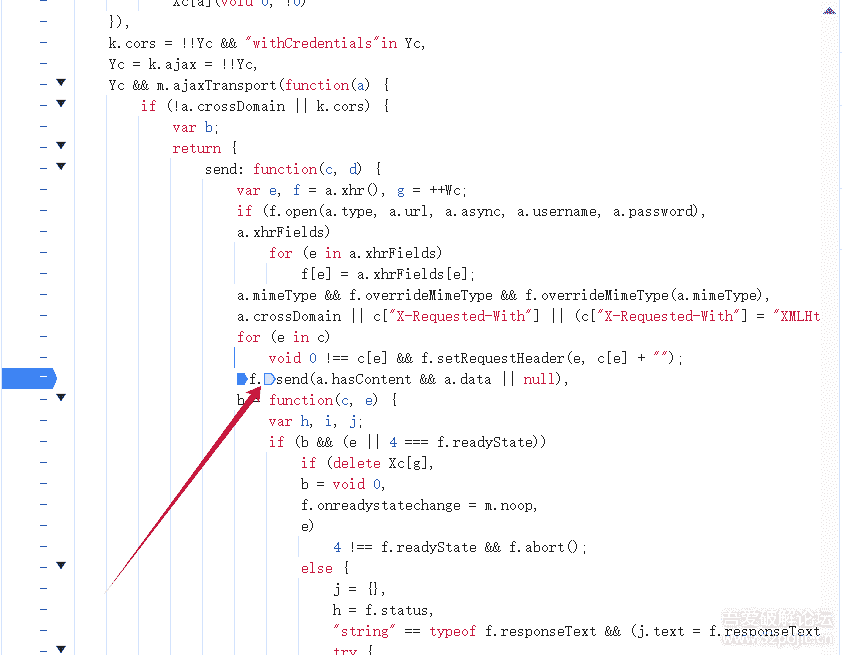

图片 4.png (31.17 KB, 下载次数: 3)

[图片 4.png (31.17 KB, 下载次数: 3)](https://www.52pojie.cn/forum.php?mod=attachment&aid=Mjc2NDQ2OXw3NzRhODk0NHwxNzkzNTcxMTEzfDE2ODA4NnwyMDE3MjE4&nothumb=yes)

2025-3-21 12:23 上传

### 1.4 我们看到 参数找不到，`a.data`以及周围没有，相关参数，那么参数去哪了？

在`a`里面，可以知道的是，有时参数的位置，会写在URL上，所以我们要多去分析和观察，寻找到（URL内容大家可以自行去查看）。

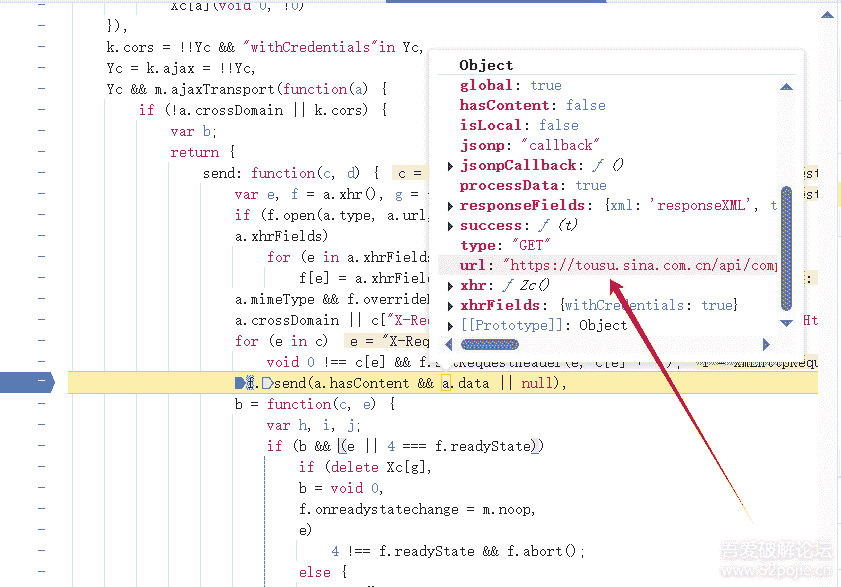

图片 5.png (40.16 KB, 下载次数: 2)

[图片 5.png (40.16 KB, 下载次数: 2)](https://www.52pojie.cn/forum.php?mod=attachment&aid=Mjc2NDQ3MHw0YWEwZWQwN3wxNzkzNTcxMTEzfDE2ODA4NnwyMDE3MjE4&nothumb=yes)

2025-3-21 12:25 上传

### 1.5 那么由此就可以知道 我们接下来要找的就是 `a`里面的URL的生成位置

如果不确定加密的位置是不是在这个周围，我们可以在函数的头部下断，让断点在头部生效来查看是否有加密之后的参数传入，如果有说明，加密位置不在此处需要向上跟栈，如没有我们就可以缩小范围，在周围寻找。

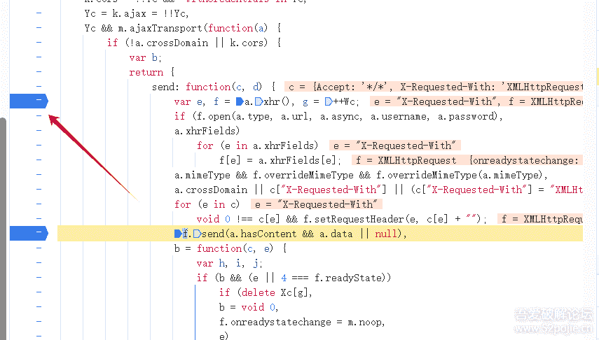

图片 6.png (28.05 KB, 下载次数: 2)

[图片 6.png (28.05 KB, 下载次数: 2)](https://www.52pojie.cn/forum.php?mod=attachment&aid=Mjc2NDQ3MXw1NGUxNmFlZXwxNzkzNTcxMTEzfDE2ODA4NnwyMDE3MjE4&nothumb=yes)

2025-3-21 12:26 上传

#### 1.5.1 我们断住之后 查看到 我们要的参数 直接就在`a`里面，让我们不明所以

（打印完整数据大家可以自行在控制台查看），所以初步推测，密文没有在这里面生成而是在某个地方传入的或赋值的，那么我们就可以向上跟栈来寻找可以的地方。

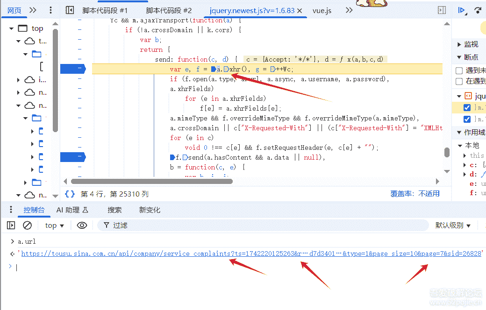

图片 7.png (68.03 KB, 下载次数: 2)

[图片 7.png (68.03 KB, 下载次数: 2)](https://www.52pojie.cn/forum.php?mod=attachment&aid=Mjc2NDQ3MnxjZmI1ZjM0YXwxNzkzNTcxMTEzfDE2ODA4NnwyMDE3MjE4&nothumb=yes)

2025-3-21 12:27 上传

## 第二步

### 2.1 我们向上跟栈，在这个栈中我们发现，有许多的参数，其中最最显眼的就是变量`k`，同样的为了验证加密是否在这里面生成，我们按照1.5.1来在函数开头下断，查看密文是否由其他地方传入

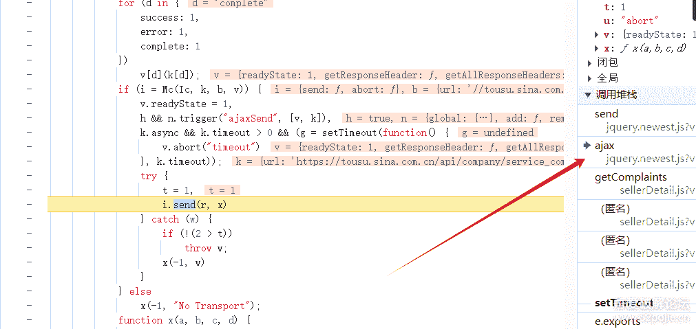

图片 8.png (43.58 KB, 下载次数: 4)

[图片 8.png (43.58 KB, 下载次数: 4)](https://www.52pojie.cn/forum.php?mod=attachment&aid=Mjc2NDQ3M3w4ZWIxZjEyMnwxNzkzNTcxMTEzfDE2ODA4NnwyMDE3MjE4&nothumb=yes)

2025-3-21 12:28 上传

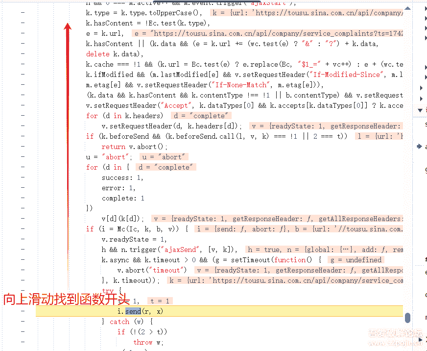

图片 9.png (45.81 KB, 下载次数: 2)

[图片 9.png (45.81 KB, 下载次数: 2)](https://www.52pojie.cn/forum.php?mod=attachment&aid=Mjc2NDQ3NHw0ZjgxMDZmYXwxNzkzNTcxMTEzfDE2ODA4NnwyMDE3MjE4&nothumb=yes)

2025-3-21 12:28 上传

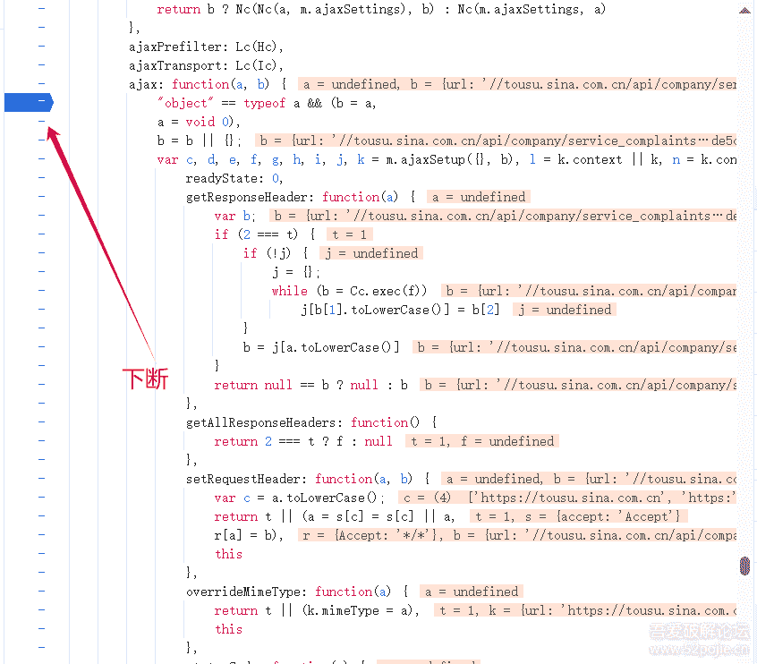

图片 10.png (39.37 KB, 下载次数: 3)

[图片 10.png (39.37 KB, 下载次数: 3)](https://www.52pojie.cn/forum.php?mod=attachment&aid=Mjc2NDQ3NXwwNmE5OTdhY3wxNzkzNTcxMTEzfDE2ODA4NnwyMDE3MjE4&nothumb=yes)

2025-3-21 12:29 上传

### 2.2 我们按照1.1发包测试，我们发现加密的参数是由其他地方传入进来的，所以我们就知道，加密并不是在这里面形成的所以我们就需要再次向上跟栈

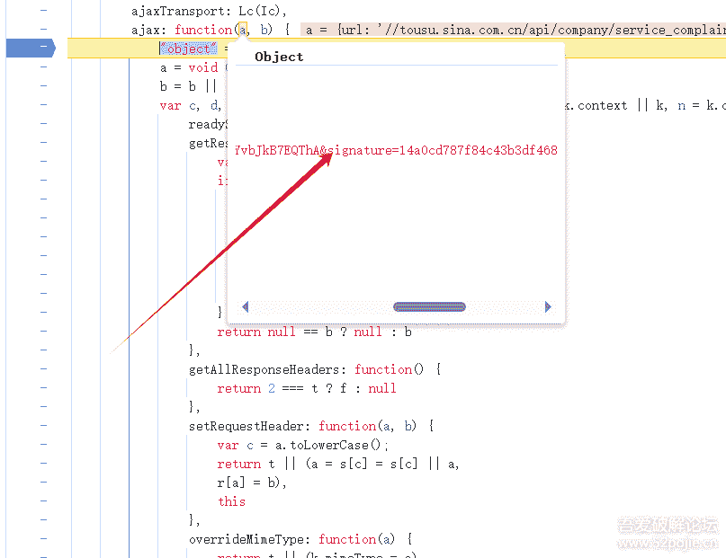

图片 11.png (27.25 KB, 下载次数: 2)

[图片 11.png (27.25 KB, 下载次数: 2)](https://www.52pojie.cn/forum.php?mod=attachment&aid=Mjc2NDQ3NnxkMjg3NWYzNnwxNzkzNTcxMTEzfDE2ODA4NnwyMDE3MjE4&nothumb=yes)

2025-3-21 12:30 上传

### 2.3 我们来到上一个栈，名为`getComplaints`，而显示的页面看到这是一个巨大的函数，里面有很多，包括了`$.ajax`也就是我们现在的位置，而在`$.ajax`我们可以看到有一个`url`，经过前面我们知道加密内容被写在了`url`上面，所以我们来分析`url: "".concat(n, "?ts=").concat(c, "&rs=").concat(h, "&signature=").concat(r)`

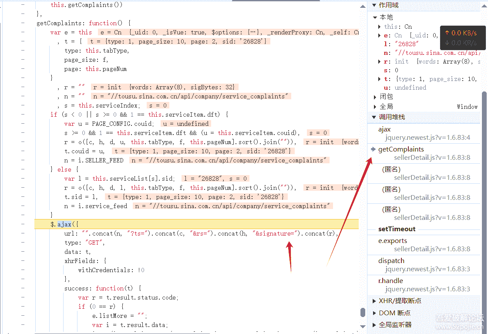

图片 12.png (76.29 KB, 下载次数: 2)

[图片 12.png (76.29 KB, 下载次数: 2)](https://www.52pojie.cn/forum.php?mod=attachment&aid=Mjc2NDQ4MHwxMWYwMTRmN3wxNzkzNTcxMTEzfDE2ODA4NnwyMDE3MjE4&nothumb=yes)

2025-3-21 12:31 上传

### 2.4 这很长的一堆让人看的想吐，但是我们也发现了`"&signature="`这个名字，而我们要的就是`signature`，所以我们选中看看里面是什么，总之很长但我们可以想到的是这是一个字符串拼接，而加密在哪？在最后也就是`r`，至于为什么大家可以分别的去打印查看里面的值

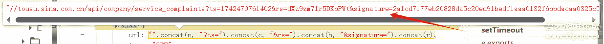

图片 13.png (17.97 KB, 下载次数: 1)

[图片 13.png (17.97 KB, 下载次数: 1)](https://www.52pojie.cn/forum.php?mod=attachment&aid=Mjc2NDQ4MXw0OGM2MTk0NnwxNzkzNTcxMTEzfDE2ODA4NnwyMDE3MjE4&nothumb=yes)

2025-3-21 12:32 上传

### 2.5 但经过多次调试，最终是由`r`出的结果，所以我们目标明确了也就是`r`

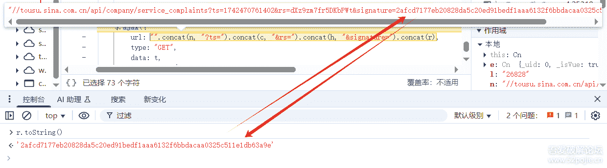

图片 14.png (51.26 KB, 下载次数: 4)

[图片 14.png (51.26 KB, 下载次数: 4)](https://www.52pojie.cn/forum.php?mod=attachment&aid=Mjc2NDQ4MnxjZTFhOTRiMXwxNzkzNTcxMTEzfDE2ODA4NnwyMDE3MjE4&nothumb=yes)

2025-3-21 12:33 上传

## 第三步

### 3.1 在找寻`r`之前，我们还要记得一件事，也就是他的载荷有许多值，最终也被拼接到`url`里面，所以我们先来看其他参数是否为固定值，如果是，那我们就可以只扣取出`r`的代码，其余的就不看了

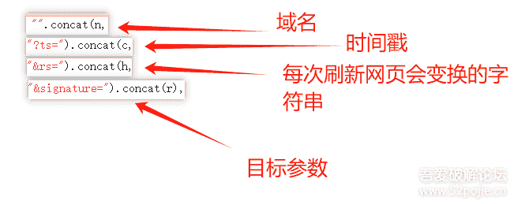

图片 15.png (25.41 KB, 下载次数: 2)

[图片 15.png (25.41 KB, 下载次数: 2)](https://www.52pojie.cn/forum.php?mod=attachment&aid=Mjc2NDQ4M3w1MWVmZjU4MXwxNzkzNTcxMTEzfDE2ODA4NnwyMDE3MjE4&nothumb=yes)

2025-3-21 12:34 上传

### 3.2 为了简易的介绍，我就直接总结出来了，就是上图，我们看到我们需要扣取的有三个：时间戳和会变换的字符串，在这里并不会去演示调试，在找寻`r`的过程就会出现，所以我们现在要做的就是在这个函数断点，因为我们还要验证密文是在这附近出现还是上一个栈传过来的。

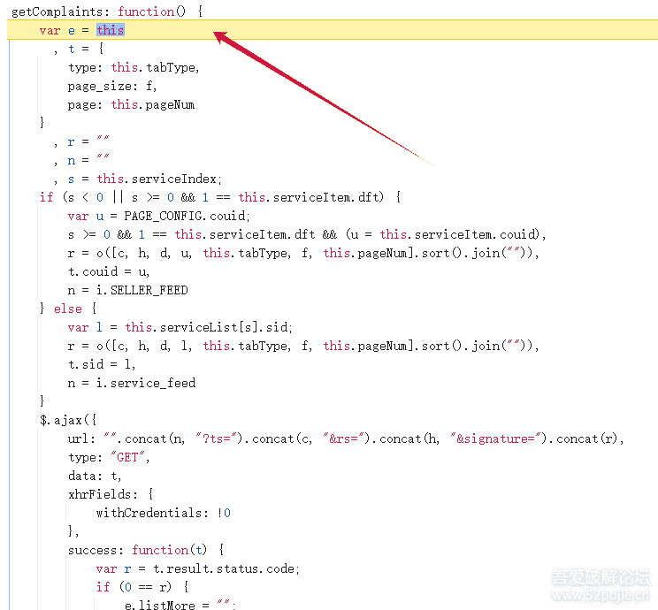

图片 16.png (26.28 KB, 下载次数: 3)

[图片 16.png (26.28 KB, 下载次数: 3)](https://www.52pojie.cn/forum.php?mod=attachment&aid=Mjc2NDQ4NHw0MmM5NWRjNHwxNzkzNTcxMTEzfDE2ODA4NnwyMDE3MjE4&nothumb=yes)

2025-3-21 12:36 上传

### 3.3 我们看到这个函数没有形参，也就是不接受传值

也就是说 密文 和 其余参数 就是在这里面 或者是 调用其余函数

那么接下来就需要我们单步调试 看他会 跳转到其他函数 还是怎样的过程，所以我们往下执行

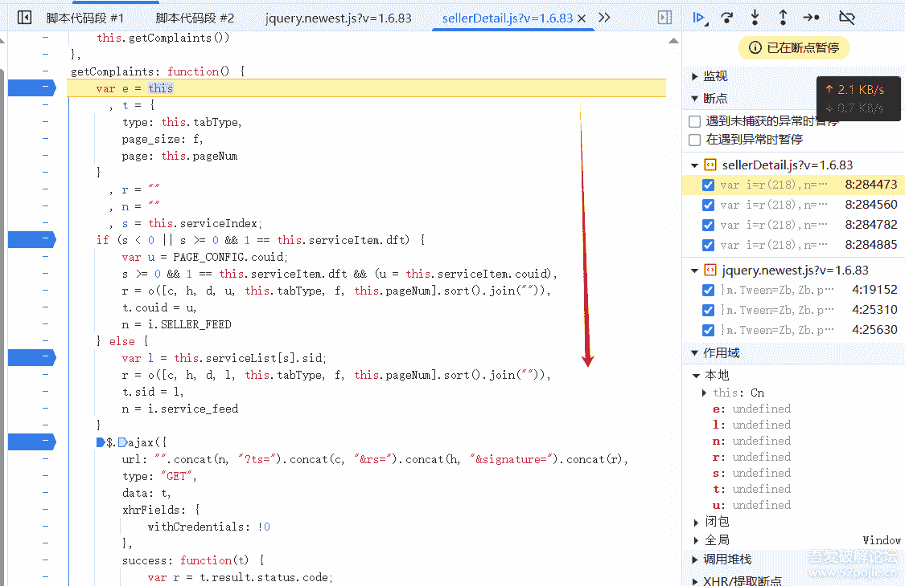
图片 17.png (72.87 KB, 下载次数: 3)
[href="forum.php?mod=attachment&aid=Mjc2NDQ4NXw1NzNjYmMzNXwxNzkzNTcxMTEzfDE2ODA4NnwyMDE3MjE4&nothumb=yes" target="_blank"](https://www.52pojie.cn/forum.php?mod=attachment&aid=Mjc2NDQ4NXw1NzNjYmMzNXwxNzkzNTcxMTEzfDE2ODA4NnwyMDE3MjE4&nothumb=yes)
2025-3-21 12:37 上传

## 3.4
依上图 我们断上断点 这是为了防止进入其他地方，出不来，做的保险，
我们都先到第一个`if` 语句处看 条件 ，是`false` 那么他就会走 `else` ，所以我们单步调试

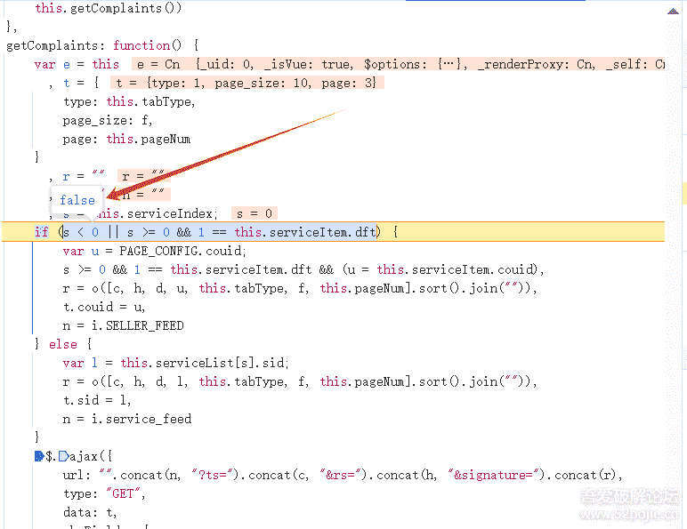
图片 18.png (27.32 KB, 下载次数: 3)
[href="forum.php?mod=attachment&aid=Mjc2NDQ4NnxjNWRhZmZlZnwxNzkzNTcxMTEzfDE2ODA4NnwyMDE3MjE4&nothumb=yes" target="_blank"](https://www.52pojie.cn/forum.php?mod=attachment&aid=Mjc2NDQ4NnxjNWRhZmZlZnwxNzkzNTcxMTEzfDE2ODA4NnwyMDE3MjE4&nothumb=yes)
2025-3-21 12:38 上传

## 3.5
我们单步调试 直到走到`else`语句处，在接着往下走之前我们来分析一下他在干什么，
打眼一看 里面有个 `r` 他是否就是 2.5 分析的加密位置，我的逻辑就是 他们在同一个函数体内
没有其他值出入 也就是只有这一个`r` 那么毫无疑问 他们就是一体的，所以我们执行到`r` 处查看 同时对比 数据包的载荷

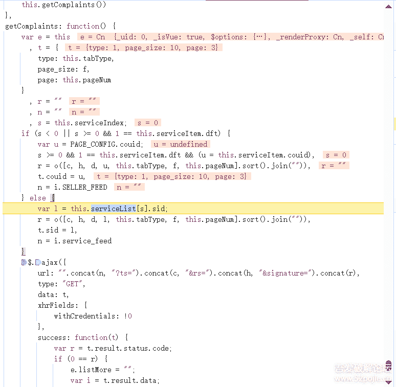
图片 19.png (27.39 KB, 下载次数: 2)
[href="forum.php?mod=attachment&aid=Mjc2NDQ4N3xkMDkzY2EzOHwxNzkzNTcxMTEzfDE2ODA4NnwyMDE3MjE4&nothumb=yes" target="_blank"](https://www.52pojie.cn/forum.php?mod=attachment&aid=Mjc2NDQ4N3xkMDkzY2EzOHwxNzkzNTcxMTEzfDE2ODA4NnwyMDE3MjE4&nothumb=yes)
2025-3-21 12:39 上传

## 第四步
### 4.1
我们对比出 他就是 我们要的数据密文 所以我们只要知道 这一串
`o([c, h, d, l, this.tabType, f, this.pageNum].sort().join(""))`
就能得到我们所需的密文

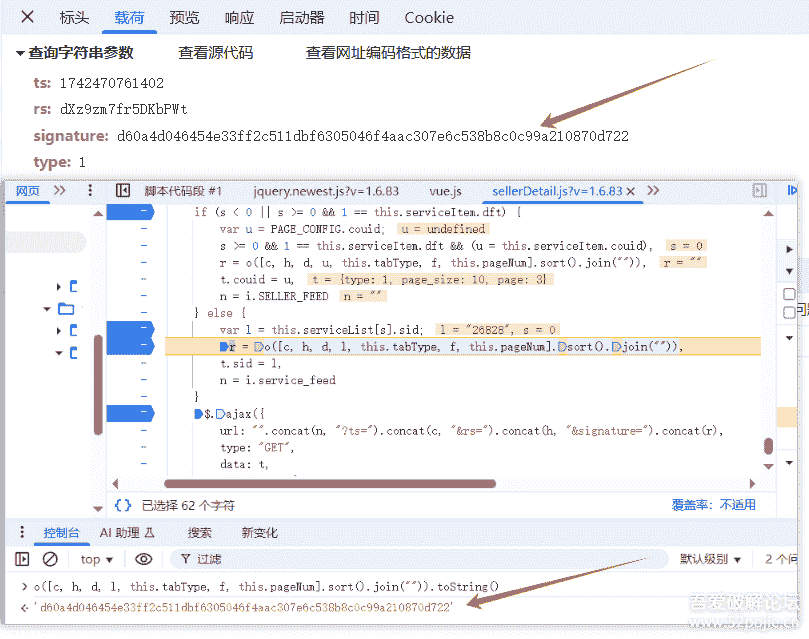
图片 20.png (103.18 KB, 下载次数: 1)
[href="forum.php?mod=attachment&aid=Mjc2NDQ4OXxkMTVmMzYyYXwxNzkzNTcxMTEzfDE2ODA4NnwyMDE3MjE4&nothumb=yes" target="_blank"](https://www.52pojie.cn/forum.php?mod=attachment&aid=Mjc2NDQ4OXxkMTVmMzYyYXwxNzkzNTcxMTEzfDE2ODA4NnwyMDE3MjE4&nothumb=yes)
2025-3-21 12:40 上传

### 4.2
我们来查看这些值都是什么，这些都是经过多次调试的结果 大家可以自行调试看一看

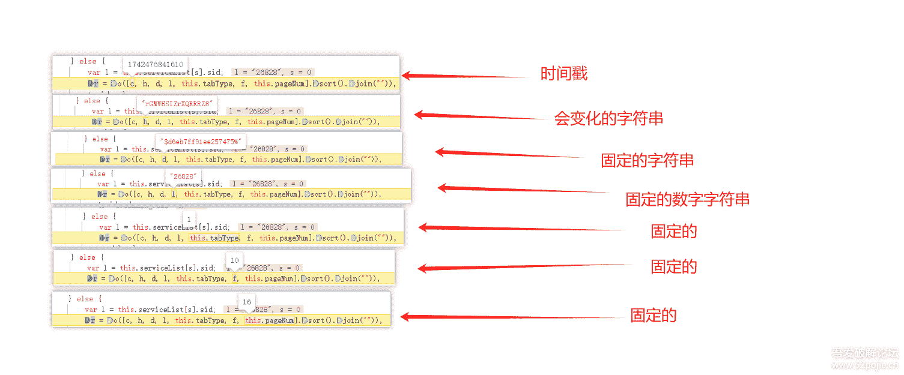
图片 21.png (131.86 KB, 下载次数: 4)
[href="forum.php?mod=attachment&aid=Mjc2NDQ5MHxiZThmYmRhY3wxNzkzNTcxMTEzfDE2ODA4NnwyMDE3MjE4&nothumb=yes" target="_blank"](https://www.52pojie.cn/forum.php?mod=attachment&aid=Mjc2NDQ5MHxiZThmYmRhY3wxNzkzNTcxMTEzfDE2ODA4NnwyMDE3MjE4&nothumb=yes)
2025-3-21 12:41 上传

### 4.3
最后的代码整理，我们整理完毕就会发现我们现在只要扣取出 `o` 就完成了`signature` 加密

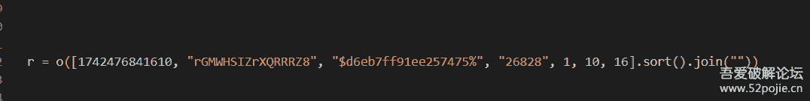
图片 22.png (16.08 KB, 下载次数: 2)
[href="forum.php?mod=attachment&aid=Mjc2NDQ5Mnw4NjkzMzc0YnwxNzkzNTcxMTEzfDE2ODA4NnwyMDE3MjE4&nothumb=yes" target="_blank"](https://www.52pojie.cn/forum.php?mod=attachment&aid=Mjc2NDQ5Mnw4NjkzMzc0YnwxNzkzNTcxMTEzfDE2ODA4NnwyMDE3MjE4&nothumb=yes)
2025-3-21 12:42 上传

## 第五步
### 5.1
我们开始寻找`o`,像上翻，我们来寻找，因为他是先定义后使用，完全不是凭空出来的

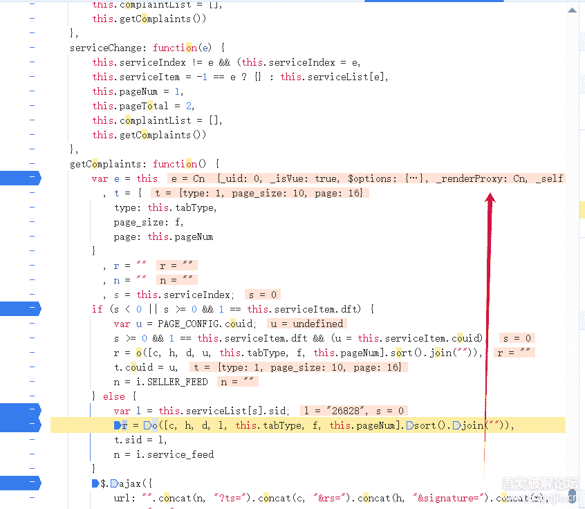
图片 23.png (36.74 KB, 下载次数: 3)
[href="forum.php?mod=attachment&aid=Mjc2NDQ5M3xmNWNjODRlMHwxNzkzNTcxMTEzfDE2ODA4NnwyMDE3MjE4&nothumb=yes" target="_blank"](https://www.52pojie.cn/forum.php?mod=attachment&aid=Mjc2NDQ5M3xmNWNjODRlMHwxNzkzNTcxMTEzfDE2ODA4NnwyMDE3MjE4&nothumb=yes)
2025-3-21 12:42 上传

### 5.2
一直到最上面 找到 `o`的定义处，可以发现在我们的整理的代码内容，在这里开头，
很相似，也可以说这些就是 那些值的定义处

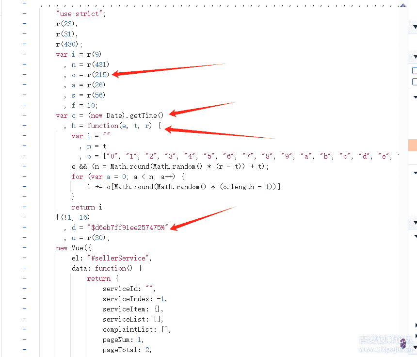
图片 24.png (29 KB, 下载次数: 3)
[href="forum.php?mod=attachment&aid=Mjc2NDQ5NHw1MGZjMmVmMnwxNzkzNTcxMTEzfDE2ODA4NnwyMDE3MjE4&nothumb=yes" target="_blank"](https://www.52pojie.cn/forum.php?mod=attachment&aid=Mjc2NDQ5NHw1MGZjMmVmMnwxNzkzNTcxMTEzfDE2ODA4NnwyMDE3MjE4&nothumb=yes)
2025-3-21 12:43 上传

### 5.3
那么我们就断在`o` 这里 去开始扣取 模块，但是这里不能选中 `r(215)`直接进入去扣取，
因为在这里做了多次调试 发现 `r(215)`,这个模块不完整，具体到哪里不完整，是因为他只有一半，
这一半里面还加载了其他模块，然后拼 凑成一整个大模块，最后通过 `r(215)`全部
加载出来使用

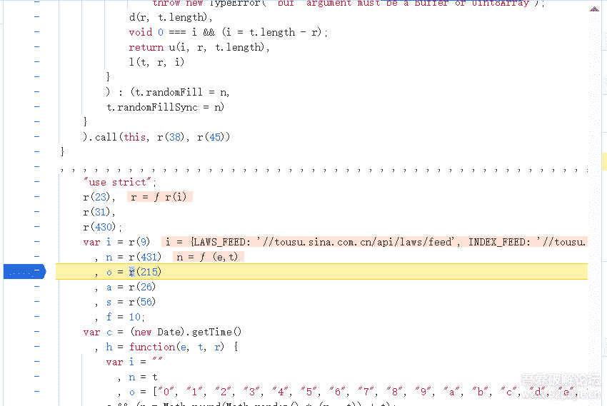
图片 25.png (21.64 KB, 下载次数: 3)
[href="forum.php?mod=attachment&aid=Mjc2NDQ5NXw0ODMyOTdmOHwxNzkzNTcxMTEzfDE2ODA4NnwyMDE3MjE4&nothumb=yes" target="_blank"](https://www.52pojie.cn/forum.php?mod=attachment&aid=Mjc2NDQ5NXw0ODMyOTdmOHwxNzkzNTcxMTEzfDE2ODA4NnwyMDE3MjE4&nothumb=yes)
2025-3-21 12:45 上传

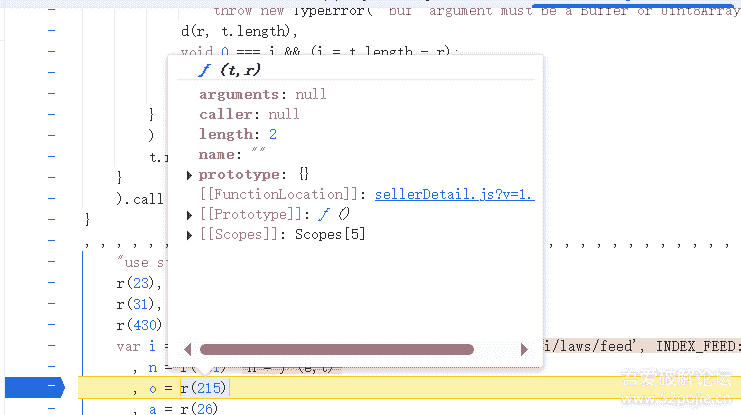
图片 26.png (22.62 KB, 下载次数: 3)
[href="forum.php?mod=attachment&aid=Mjc2NDQ5N3xhMDNiZjRlOHwxNzkzNTcxMTEzfDE2ODA4NnwyMDE3MjE4&nothumb=yes" target="_blank"](https://www.52pojie.cn/forum.php?mod=attachment&aid=Mjc2NDQ5N3xhMDNiZjRlOHwxNzkzNTcxMTEzfDE2ODA4NnwyMDE3MjE4&nothumb=yes)
2025-3-21 12:45 上传

#### 5.3.1
我们还是进来`r(215)` 看一下，大家可以自己上下翻看，这个模块的全部内容虽然是加密 但不完成 内容也少的可怜，
所以不能直接扣取我们需要单步执行，去查看在他加载 215 模块时之前 做了什么，从而最后完成出这一整个加密模块

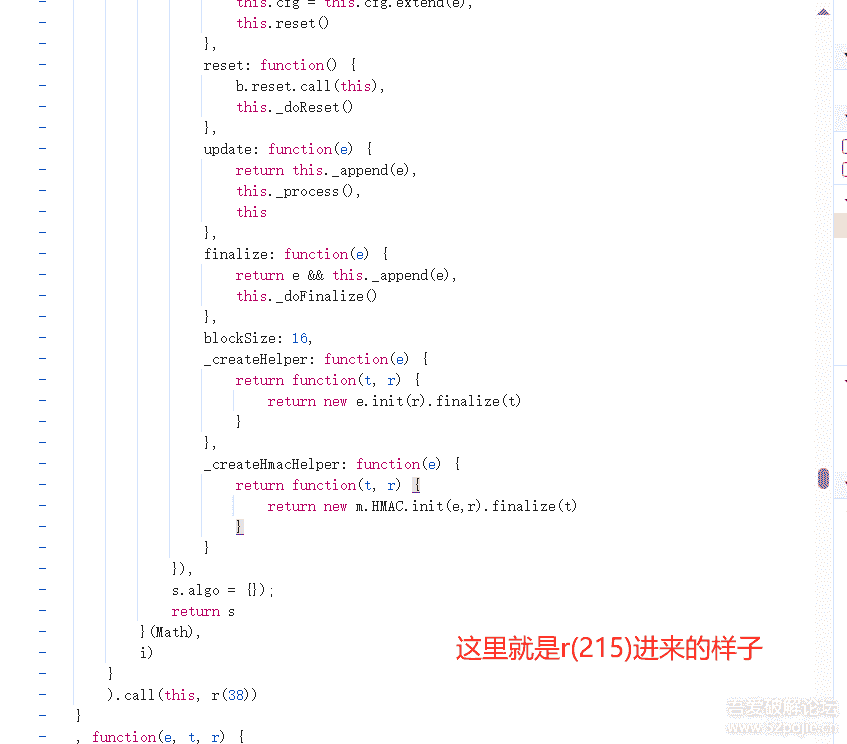
图片 27.png (27.21 KB, 下载次数: 3)
[href="forum.php?mod=attachment&aid=Mjc2NDUwMHxjZDFkNjA4MnwxNzkzNTcxMTEzfDE2ODA4NnwyMDE3MjE4&nothumb=yes" target="_blank"](https://www.52pojie.cn/forum.php?mod=attachment&aid=Mjc2NDUwMHxjZDFkNjA4MnwxNzkzNTcxMTEzfDE2ODA4NnwyMDE3MjE4&nothumb=yes)
2025-3-21 12:46 上传

### 5.4
所以我们在 `o = r(215)` 处 单步调试，在单步执行的时候 可以看到他经过加载器，
最后又跑到了其他地方，那么我们就可以得出，我们在 5.3 讲的内容是对的 直接去扣取 215 会得到一半的加密，
所以我们要根据浏览器的 步骤去扣取

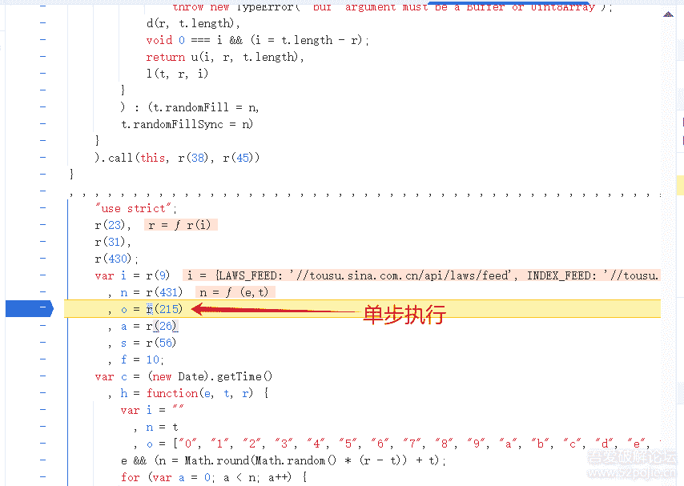
图片 28.png (25.25 KB, 下载次数: 2)
[href="forum.php?mod=attachment&aid=Mjc2NDUwMnw3ZTRmNDAzNHwxNzkzNTcxMTEzfDE2ODA4NnwyMDE3MjE4&nothumb=yes" target="_blank"](https://www.52pojie.cn/forum.php?mod=attachment&aid=Mjc2NDUwMnw3ZTRmNDAzNHwxNzkzNTcxMTEzfDE2ODA4NnwyMDE3MjE4&nothumb=yes)
2025-3-21 12:47 上传

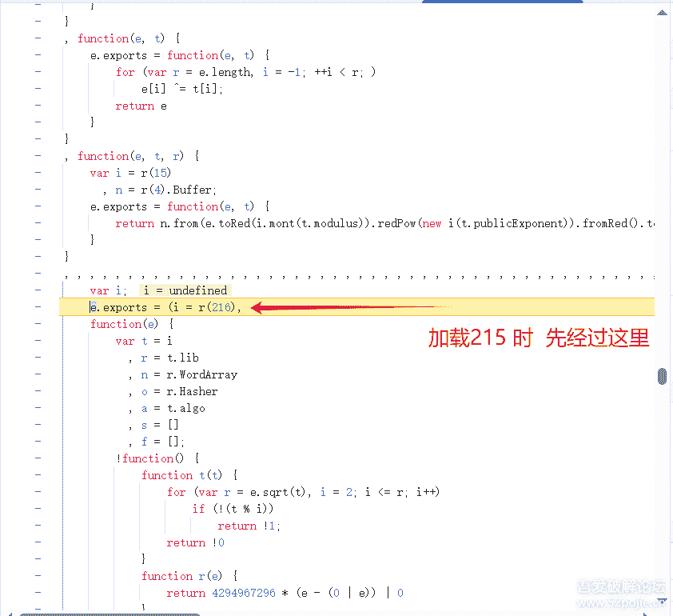
图片 29.png (28.13 KB, 下载次数: 1)
[href="forum.php?mod=attachment&aid=Mjc2NDUwM3w5NGVlN2EwY3wxNzkzNTcxMTEzfDE2ODA4NnwyMDE3MjE4&nothumb=yes" target="_blank"](https://www.52pojie.cn/forum.php?mod=attachment&aid=Mjc2NDUwM3w5NGVlN2EwY3wxNzkzNTcxMTEzfDE2ODA4NnwyMDE3MjE4&nothumb=yes)
2025-3-21 12:48 上传

### 5.5
所以我们需要先扣取上图 也就是 先经过的地方，再去扣取 215模块，但是奇特的就是 这里加载了一次216
里面的内容就是我们在 5.3.1 跳转之后的位置 所以在此时 就有点清楚了 我们此时单步调试走的 就是 215 模块
而5.3.1是 216模块 所以 浏览器加载的模块没错 而是跳转的位置会使我们扣取错误 也就是少扣取

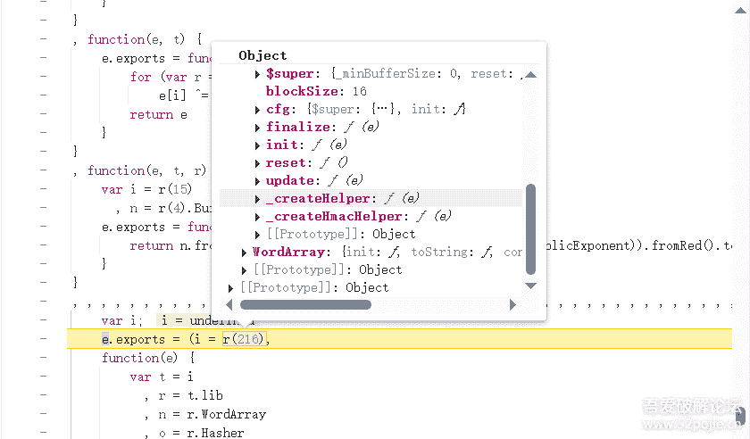
图片 30.png (28.11 KB, 下载次数: 2)
[href="forum.php?mod=attachment&aid=Mjc2NDUwNHxkMjY1MmI5OHwxNzkzNTcxMTEzfDE2ODA4NnwyMDE3MjE4&nothumb=yes" target="_blank"](https://www.52pojie.cn/forum.php?mod=attachment&aid=Mjc2NDUwNHxkMjY1MmI5OHwxNzkzNTcxMTEzfDE2ODA4NnwyMDE3MjE4&nothumb=yes)
2025-3-21 12:49 上传

## 第六步
### 6.1
讲解的差不多，大致意思就是 有时不能直接去选中加载模块直接跳转然后扣取，而是应该多次调试 查看他的完成使用流程，
就如第五步讲的 如果我们直接选中跳转 去扣取那么就会导致我们 虽然补全了模块，但是最主要的模块会遗漏，导致虽说不报错，
但会导致疑惑，或者迷一整天，所以我们回到主题，去扣取出这个模块

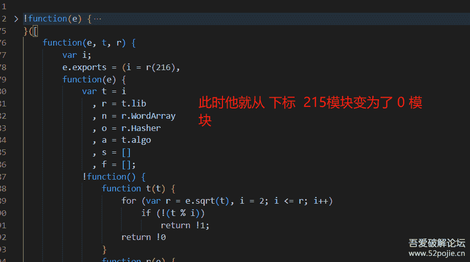
图片 31.png (46.27 KB, 下载次数: 2)
[href="forum.php?mod=attachment&aid=Mjc2NDY3M3xlYzMxNDBkM3wxNzkzNTcxMTEzfDE2ODA4NnwyMDE3MjE4&nothumb=yes" target="_blank"](https://www.52pojie.cn/forum.php?mod=attachment&aid=Mjc2NDY3M3xlYzMxNDBkM3wxNzkzNTcxMTEzfDE2ODA4NnwyMDE3MjE4&nothumb=yes)
2025-3-21 21:36 上传

### 6.2
接着我们根据浏览器 调用 浏览器是 `r(215)`,那我们在本地 就要是`r(0)`,接着去运行代码，
看报错，可以看到 是 `429` ，我这个打印在前几章讲过 ，这里就不做赘述直接，我们在本地搜索 `429` 的位置

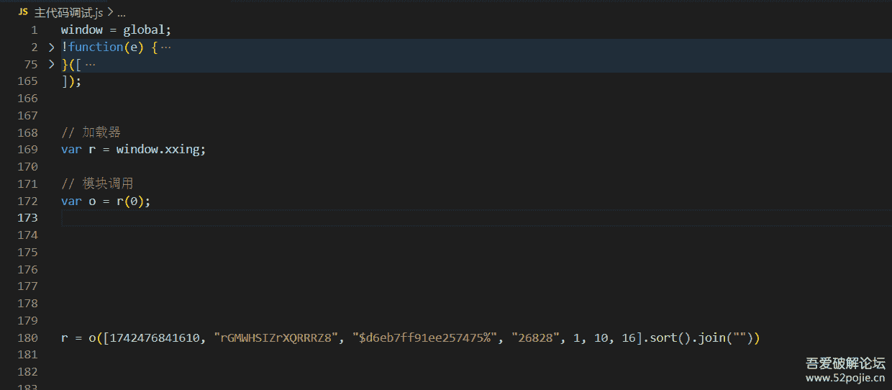
图片 32.png (39.65 KB, 下载次数: 3)
[href="forum.php?mod=attachment&aid=Mjc2NDY3NHxhZTM5NmFjYnwxNzkzNTcxMTEzfDE2ODA4NnwyMDE3MjE4&nothumb=yes" target="_blank"](https://www.52pojie.cn/forum.php?mod=attachment&aid=Mjc2NDY3NHxhZTM5NmFjYnwxNzkzNTcxMTEzfDE2ODA4NnwyMDE3MjE4&nothumb=yes)
2025-3-21 21:37 上传

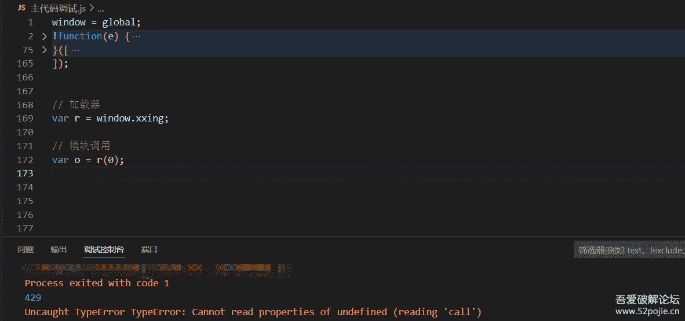
图片 33.png (40.66 KB, 下载次数: 3)
[href="forum.php?mod=attachment&aid=Mjc2NDcxNXxkZTJiYWE1OHwxNzkzNTcxMTEzfDE2ODA4NnwyMDE3MjE4&nothumb=yes" target="_blank"](https://www.52pojie.cn/forum.php?mod=attachment&aid=Mjc2NDcxNXxkZTJiYWE1OHwxNzkzNTcxMTEzfDE2ODA4NnwyMDE3MjE4&nothumb=yes)
2025-3-21 21:40 上传

### 6.3
经过搜索，和查看 最符合的就是在加载器的尾部，为什么是这里，因为我们本地没有，
`429` 模块，浏览器是有的 所以我们去浏览器看这个值是什么 `r(r.s = 429)` 这个等同于 `r(429)`
我们在浏览器找到之后下断 然后查看值 可以看到是一个 空对象 那么此时我们可以知道
浏览器啥也没干 对于加载的这个 `429` 模块 所以我们在本地可以 直接删除

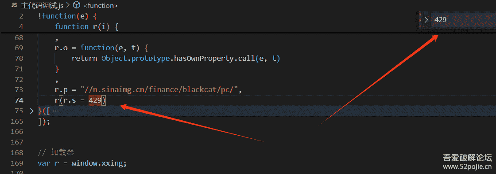  
`图片 34.png` (44.4 KB, 下载次数: 3)  
[href="forum.php?mod=attachment&aid=Mjc2NDc2NnxhZDQ5ZmQxMXwxNzkzNTcxMTEzfDE2ODA4NnwyMDE3MjE4&nothumb=yes" target="_blank"](https://www.52pojie.cn/forum.php?mod=attachment&aid=Mjc2NDc2NnxhZDQ5ZmQxMXwxNzkzNTcxMTEzfDE2ODA4NnwyMDE3MjE4&nothumb=yes)  
2025-3-21 22:19 上传

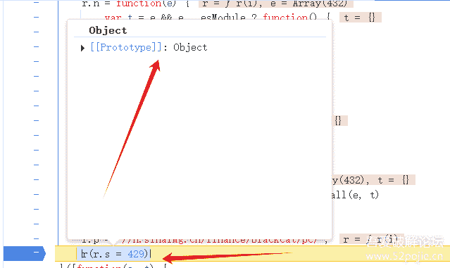  
`图片 35.png` (20.58 KB, 下载次数: 2)  
[href="forum.php?mod=attachment&aid=Mjc2NDczOHw3NjQyNjRlZHwxNzkzNTcxMTEzfDE2ODA4NnwyMDE3MjE4&nothumb=yes" target="_blank"](https://www.52pojie.cn/forum.php?mod=attachment&aid=Mjc2NDczOHw3NjQyNjRlZHwxNzkzNTcxMTEzfDE2ODA4NnwyMDE3MjE4&nothumb=yes)  
2025-3-21 21:50 上传

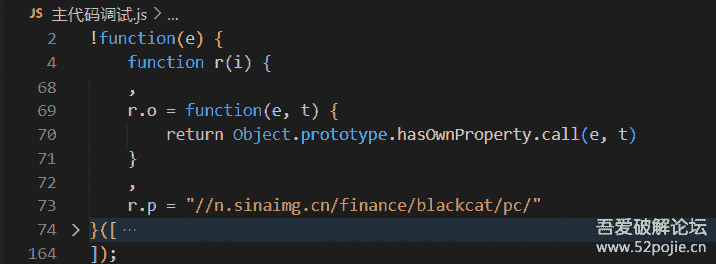  
`图片 36.png` (26.93 KB, 下载次数: 0)  
[href="forum.php?mod=attachment&aid=Mjc2NDczOXxhY2NjZTY1N3wxNzkzNTcxMTEzfDE2ODA4NnwyMDE3MjE4&nothumb=yes" target="_blank"](https://www.52pojie.cn/forum.php?mod=attachment&aid=Mjc2NDczOXxhY2NjZTY1N3wxNzkzNTcxMTEzfDE2ODA4NnwyMDE3MjE4&nothumb=yes)  
2025-3-21 21:50 上传

## 6.4 补全缺失模块

之后我们在打印看报错，位置已经开始出现在我们扣取的模块里面了。所以我们就可以开始补全缺失的模块了。这个 216 模块我们在 5.5 分析了，所以我们直接在`o = r(215)`就可以跳转到。

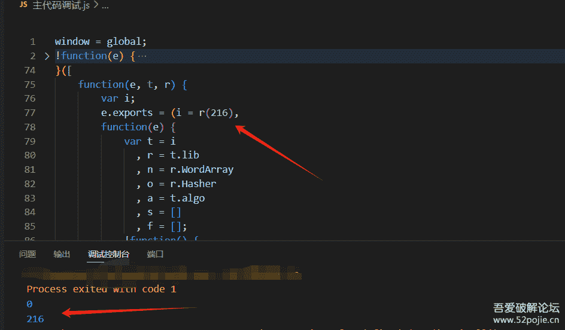  
`图片 37.png` (41.34 KB, 下载次数: 4)  
[href="forum.php?mod=attachment&aid=Mjc2NDc0NXxlOWUyZjM1NnwxNzkzNTcxMTEzfDE2ODA4NnwyMDE3MjE4&nothumb=yes" target="_blank"](https://www.52pojie.cn/forum.php?mod=attachment&aid=Mjc2NDc0NXxlOWUyZjM1NnwxNzkzNTcxMTEzfDE2ODA4NnwyMDE3MjE4&nothumb=yes)  
2025-3-21 21:58 上传

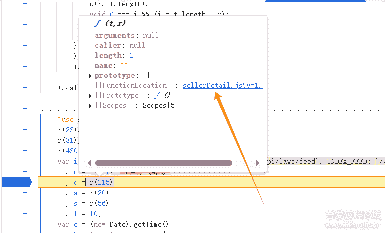  
`图片 38.png` (25.13 KB, 下载次数: 2)  
[href="forum.php?mod=attachment&aid=Mjc2NDc0NnwyMmUzMDRlZXwxNzkzNTcxMTEzfDE2ODA4NnwyMDE3MjE4&nothumb=yes" target="_blank"](https://www.52pojie.cn/forum.php?mod=attachment&aid=Mjc2NDc0NnwyMmUzMDRlZXwxNzkzNTcxMTEzfDE2ODA4NnwyMDE3MjE4&nothumb=yes)  
2025-3-21 21:58 上传

## 6.5 定位并改写模块

所以我们接着打印看报错，可以看到打印了 38，那么我们就在本地搜索查看位置。接着我们返回浏览器，查看这个模块加载出来的值，可以看到在浏览器中这个模块属性是`window`。那么我们在本地就可以改写这个模块，如`r(38)`替换为`window`。

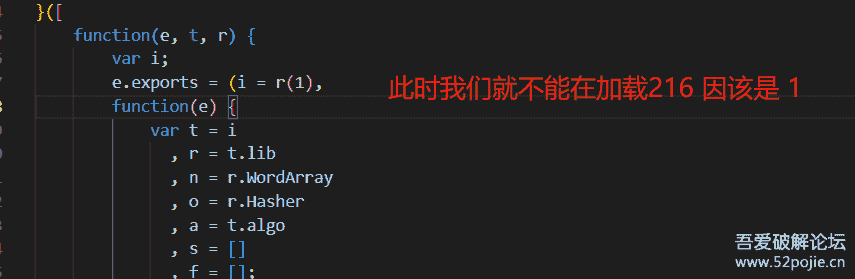  
`图片 39.png` (27.48 KB, 下载次数: 3)  
[href="forum.php?mod=attachment&aid=Mjc2NDc0OXxhNTE1YWY5MnwxNzkzNTcxMTEzfDE2ODA4NnwyMDE3MjE4&nothumb=yes" target="_blank"](https://www.52pojie.cn/forum.php?mod=attachment&aid=Mjc2NDc0OXxhNTE1YWY5MnwxNzkzNTcxMTEzfDE2ODA4NnwyMDE3MjE4&nothumb=yes)  
2025-3-21 22:00 上传

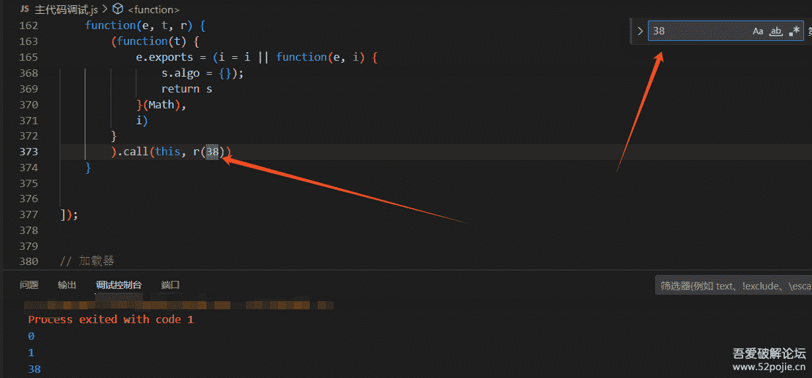  
`图片 40.png` (53.15 KB, 下载次数: 2)  
[href="forum.php?mod=attachment&aid=Mjc2NDc1MHxkNDdhYTIyZHwxNzkzNTcxMTEzfDE2ODA4NnwyMDE3MjE4&nothumb=yes" target="_blank"](https://www.52pojie.cn/forum.php?mod=attachment&aid=Mjc2NDc1MHxkNDdhYTIyZHwxNzkzNTcxMTEzfDE2ODA4NnwyMDE3MjE4&nothumb=yes)  
2025-3-21 22:00 上传

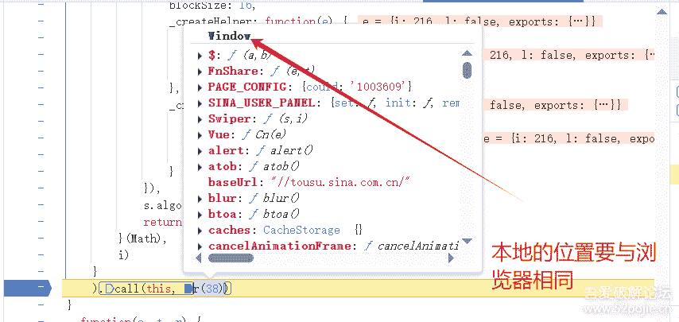  
`图片 41.png` (40.45 KB, 下载次数: 2)  
[href="forum.php?mod=attachment&aid=Mjc2NDc1MXxmYWQyZmRlYXwxNzkzNTcxMTEzfDE2ODA4NnwyMDE3MjE4&nothumb=yes" target="_blank"](https://www.52pojie.cn/forum.php?mod=attachment&aid=Mjc2NDc1MXxmYWQyZmRlYXwxNzkzNTcxMTEzfDE2ODA4NnwyMDE3MjE4&nothumb=yes)  
2025-3-21 22:01 上传

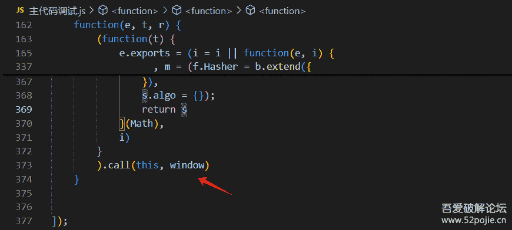  
`图片 42.png` (36.71 KB, 下载次数: 3)  
[href="forum.php?mod=attachment&aid=Mjc2NDc1MnxlZTAzZGE5ZnwxNzkzNTcxMTEzfDE2ODA4NnwyMDE3MjE4&nothumb=yes" target="_blank"](https://www.52pojie.cn/forum.php?mod=attachment&aid=Mjc2NDc1MnxlZTAzZGE5ZnwxNzkzNTcxMTEzfDE2ODA4NnwyMDE3MjE4&nothumb=yes)  
2025-3-21 22:01 上传

## 第七步

### 7.1 获取`signature`

改完之后接着运行看报错，可以看到已经不报错并且打印出了值，那么我们就获取到了`signature`。

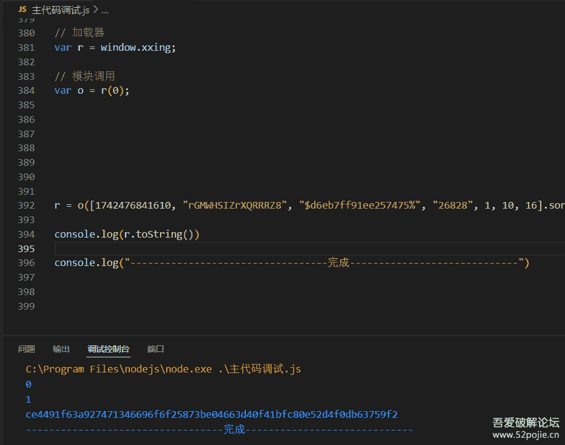  
`图片 43.png` (53.8 KB, 下载次数: 3)  
[href="forum.php?mod=attachment&aid=Mjc2NDc1M3w3YjNjNDU2YXwxNzkzNTcxMTEzfDE2ODA4NnwyMDE3MjE4&nothumb=yes" target="_blank"](https://www.52pojie.cn/forum.php?mod=attachment&aid=Mjc2NDc1M3w3YjNjNDU2YXwxNzkzNTcxMTEzfDE2ODA4NnwyMDE3MjE4&nothumb=yes)  
2025-3-21 22:01 上传

### 7.2 定位加密参数

我们知道我们的加密的参数是写死的，所以其中我们要再找出他们各自的参数的位置。我们在 5.2 提前标注了几个位置，不仅有`o`的位置，还有一些可疑的参数位置：`r = o([c, h, d, l, this.tabType, f, this.pageNum].sort().join(""))`。在 4.2 我们一个一个分析出了他们是什么，对应这里面我们就只需要找到`h`。他每次都会变换，在刷新时，所以我们来抓一次包，看一看是否会验证我们说的在刷新时变换。

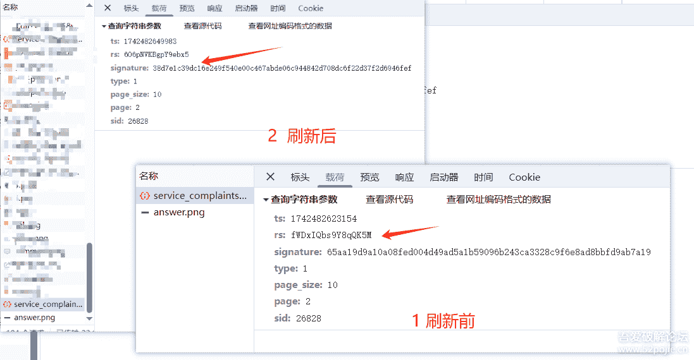  
`图片 44.png` (94.05 KB, 下载次数: 2)  
[href="forum.php?mod=attachment&aid=Mjc2NDc1NXw3ODE3YWYwOXwxNzkzNTcxMTEzfDE2ODA4NnwyMDE3MjE4&nothumb=yes" target="_blank"](https://www.52pojie.cn/forum.php?mod=attachment&aid=Mjc2NDc1NXw3ODE3YWYwOXwxNzkzNTcxMTEzfDE2ODA4NnwyMDE3MjE4&nothumb=yes)  
2025-3-21 22:03 上传

### 7.3 观察`h`的变化

我们根据上图看到了刷新前后刷新后的区别，`rs`也就是`h`是变化的。那么`h`在哪？我们在 5.2 标注了几个，哪里面就有`h`，也就是在多次调试才确定的。我们在`h`函数处下断看一看值（需要刷新才能断住）。

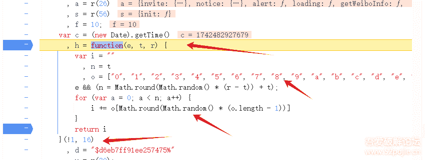  
`图片 45.png` (21.13 KB, 下载次数: 2)  
[href="forum.php?mod=attachment&aid=Mjc2NDc1Nnw1MGJmYzQ0NHwxNzkzNTcxMTEzfDE2ODA4NnwyMDE3MjE4&nothumb=yes" target="_blank"](https://www.52pojie.cn/forum.php?mod=attachment&aid=Mjc2NDc1Nnw1MGJmYzQ0NHwxNzkzNTcxMTEzfDE2ODA4NnwyMDE3MjE4&nothumb=yes)  
2025-3-21 22:04 上传

### 7.4 分析`h`自执行函数

我们根据上图可以分析到`h`是一个自执行，里面内容就是随机数再配上几个字符列表出值。那么我们断到`return`处，查看这一次出现的值，并且对比载荷，看用的是不是这里。

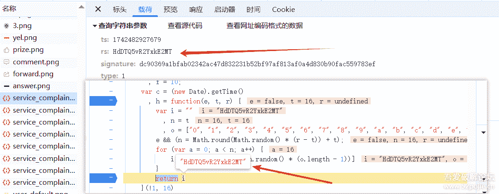  
`图片 46.png` (59.83 KB, 下载次数: 3)  
[href="forum.php?mod=attachment&aid=Mjc2NDc2MHwxM2UwNzBhOXwxNzkzNTcxMTEzfDE2ODA4NnwyMDE3MjE4&nothumb=yes" target="_blank"](https://www.52pojie.cn/forum.php?mod=attachment&aid=Mjc2NDc2MHwxM2UwNzBhOXwxNzkzNTcxMTEzfDE2ODA4NnwyMDE3MjE4&nothumb=yes)  
2025-3-21 22:05 上传

### 7.5 扣取并补全代码

可以根据上图看到确实是这里，那么我们将他扣取下来放入代码，并且根据 4.2 和 5.2 我们可以将代码补充完成。其中有些固定值大家可以根据自己喜好来编写，到此我们就完。

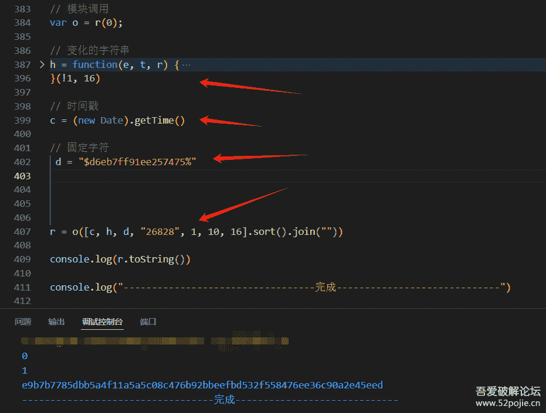  
`图片 47.png` (59.2 KB, 下载次数: 2)  
[href="forum.php?mod=attachment&aid=Mjc2NDc2MXw3ODJiMjBmM3wxNzkzNTcxMTEzfDE2ODA4NnwyMDE3MjE4&nothumb=yes" target="_blank"](https://www.52pojie.cn/forum.php?mod=attachment&aid=Mjc2NDc2MXw3ODJiMjBmM3wxNzkzNTcxMTEzfDE2ODA4NnwyMDE3MjE4&nothumb=yes)  
2025-3-21 22:06 上传

## 第八步 总结

我们依次地分析参数和对比数据包结果，最终得到了`signature`，并且还分析了`rs`会变化的字符串。总的来说，模块的改写逻辑和跟踪逻相对简单，适合新手去看和多调试。

## 最后

感谢大家观看。

文章中还有些不足，还请大家给出建议，请各位大佬可以直接指出我文章的少讲或错误逻辑给予指出和更正，感谢各位大佬。

