# [Web逆向] 【JS逆向】某验三代点选逆向分析

- 原帖：<https://www.52pojie.cn/forum.php?mod=viewthread&tid=2017394>
- 抓取时间：2026-11-01T22:11:56

## 某验3代点选逆向分析

本文中所有内容仅供学习交流使用，不用于其他任何目的，不提供完整代码，抓包内容、敏感网址、数据接口等均已做脱敏处理，严禁用于商业用途和非法用途，否则由此产生的一切后果均与作者无关.本文章未经许可禁止转载，禁止任何修改后二次传播，擅自使用本文讲解的技术而导致的任何意外，作者均不负责

### 逆向目标

站点：`aHR0cHM6Ly93d3cuYmlsaWJpbGkuY29tLw==`

目标：某某验点选

### 抓包分析

提前打开 `F12`，进入网站点击登录，手动点错一次提交后，观察发包：

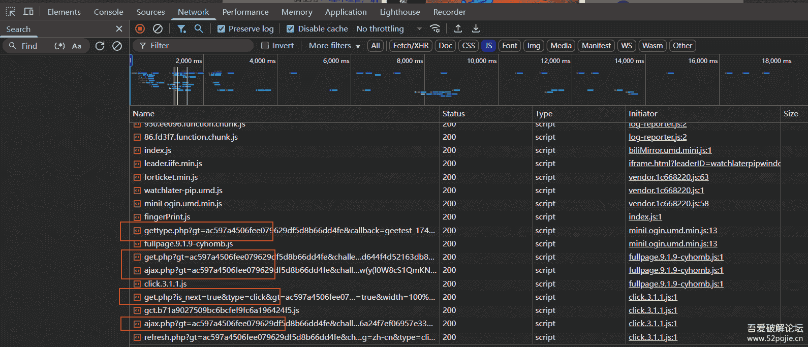

这5次请求为核心请求，依次分析。

#### 1. `gettype.php`

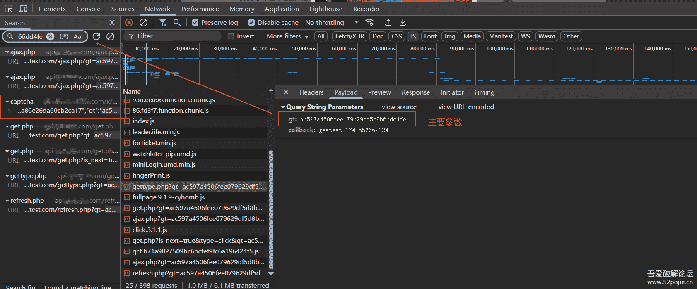

发现其主要参数为 `gt`，且能搜索到是来自于 `capthca` 这个接口，再看看这个接口有什么：

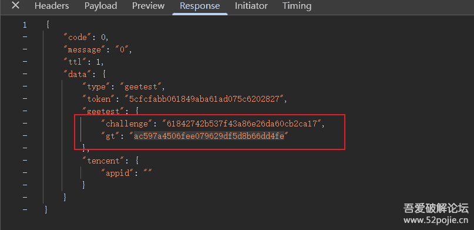

观察主要返回这些内容，在接下来的流程中可能会用到。

#### 2. `get.php`

响应内容：返回了很多字段，可能后续有用

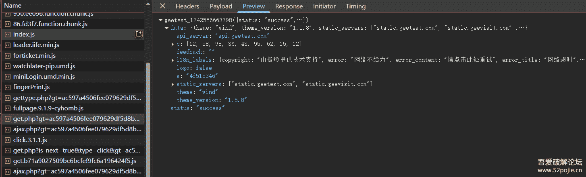

请求参数：`gt`、`challenge` 上一步我们已经拿到。`w` 看起来似乎要处理。

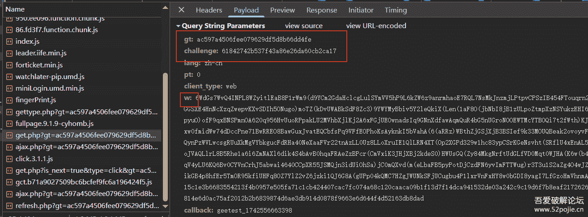

#### 3. `ajax.php`

这里就不贴图了，跟第2步的请求参数一样，可能要处理 `w`。至于响应内容，则返回的是当前验证码类型：

```json
{"status": "success", "data": {"result": "click"}}
```

#### 4. `get.php`

响应内容：`pic` 返回了图片，以及一些字段后续可能用到

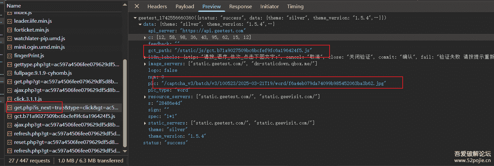

请求参数：没有需要特别处理的，此前全都能取到。

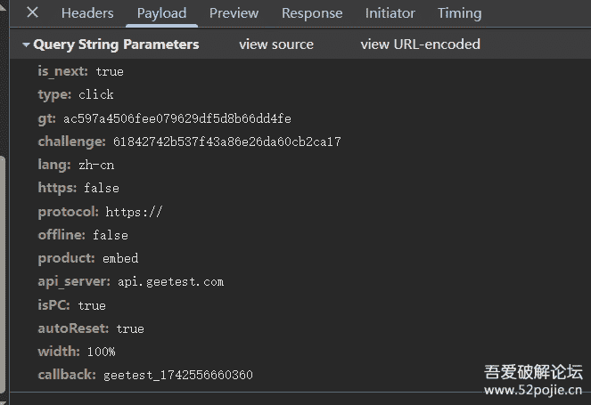

#### 5. `ajax.php`

响应内容：返回 `fail`，正是点击失败的返回，这一步就是去验证验证码了

```json
{
    "status": "success",
    "data": {
        "result": "fail",
        "msg": []
    }
}
```

请求参数：除了 `w`，其他参数并无特别

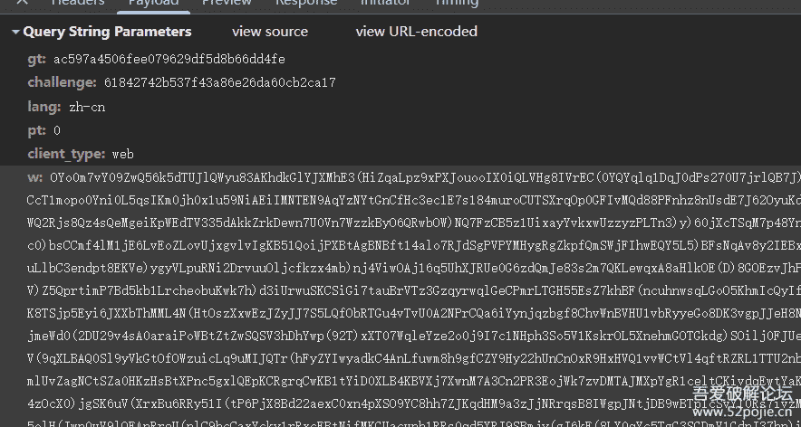

### 流程分析

以上5次请求，发现2，3，5三个步骤中都有 `w` 需要处理，目标则为逆向 `w` 值。先说结论，实测下来其实2，3步骤中的 `w` 并不校验，本次不分析，着重于分析最后一步提交验证码的 `w` 参数分析。

### 逆向分析 `w`

#### 1. 定位 `js`

先大概看看调用栈，发现都来自于 `click.3.1.1.js` 这个文件，那目标明确。

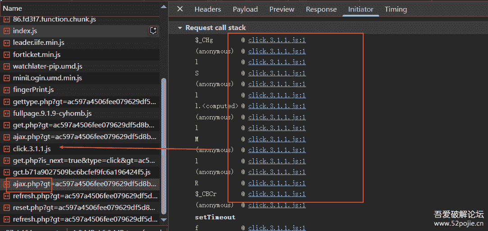

发现有大量这种调用，显然是个混淆。

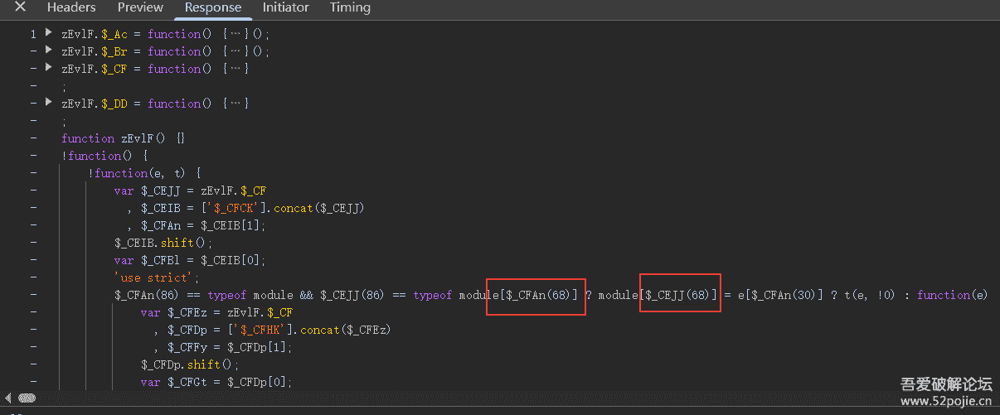

我的习惯是面对这种混淆，优先看看 AST 还原一部分，便于调试。

#### 2. AST 还原

将 `js` 拿出来放到 vscode 收起来观察，4个大方法，一个自执行方法，并不是传统的 OB 混淆

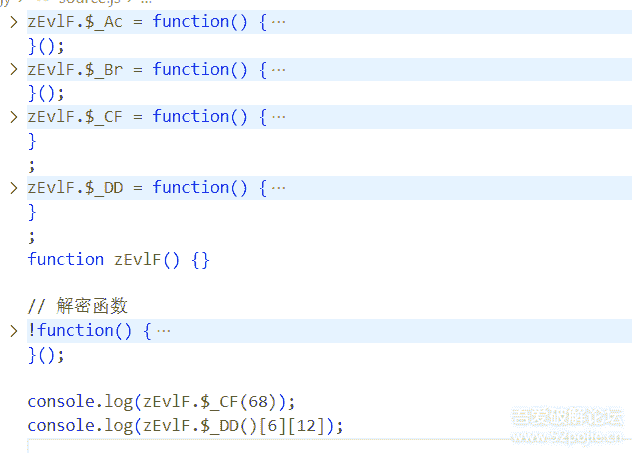

尝试拿自执行方法中的某个调用，来本地执行打印，发现没问题能正常出值。整个自执行的方法中包含大量 `$_CFAn(86)` 这种类型调用，结合我们本地能执行的情况，也就是说其实跟 OB 中的解密函数也差不多一个意思，那就好办了。

- 将 `unicode` 编码还原字符串
- 将解密函数调用还原
- 移除无用代码（基于能正常调试了，这一步我没做）

#### 3. `debug` 调试

将还原后的 `js` 本地替换浏览器 `js` 后，直接搜索参数之一 `client_type` 可以直接定位到目标，接下来开始繁杂的 `debug`

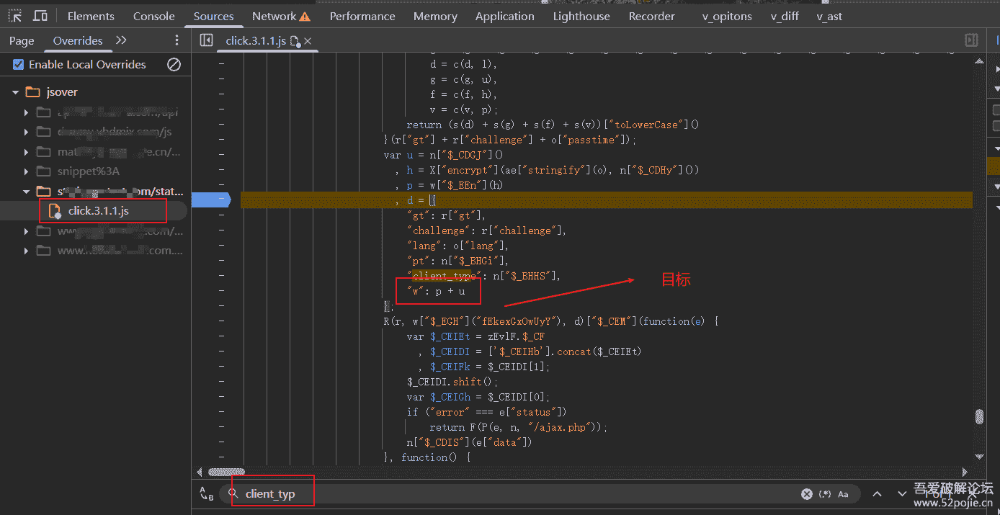

可以看到 `w = p + u`，`u = n["$_CDGJ"]()`，`p = w["$_EEn"](h)`，而 `h = X["encrypt"](ae["stringify"](o), n["$_CDHy"]())`。

#### 4. `u` 逆向

那就先看 `u` 吧。跟进 `n["$_CDGJ"]()` 看看。

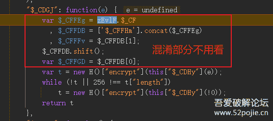

混淆部分在视频中有讲理解，就是赋值新变量 + `concat` + 取值，由于我们已经 AST 处理掉了，这一部分就属于无用代码，后续分析其他方法看到这种直接不用管就是。

得益于解混淆后，直接就能跟到：

```js
var t = new H()["encrypt"](this["$_CDHy"](e));
```

`e` 是 `undefined`，不用管；

需要再看 `new H()["encrypt"]` 和 `this["$_CDHy"](e)`。分别往下看

##### 1. `this["$_CDHy"](e)`

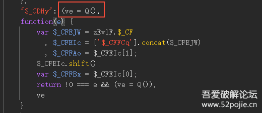

跟进来发现主要逻辑有来自于 `ve = Q()`，继续往下跟：

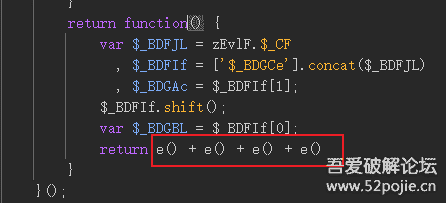

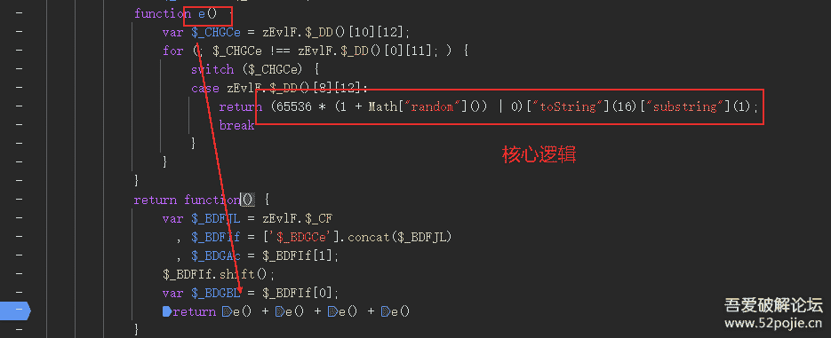

结论：

```js
this["$_CDHy"](e) = e() + e() + e() + e();

function e() {
    return (65536 * (1 + Math["random"]()) | 0)["toString"](16)["substring"](1)
}
```

##### 2. `new H()["encrypt"]`


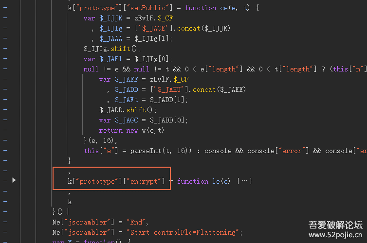

17.png (21.15 KB, 下载次数: 0)

[href="forum.php?mod=attachment&aid=Mjc2NDY5MXxhMDM1MTViZXwxNzkzNTcxMTE0fDE2ODA4NnwyMDE3Mzk0&nothumb=yes" target="_blank"](https://www.52pojie.cn/forum.php?mod=attachment&aid=Mjc2NDY5MXxhMDM1MTViZXwxNzkzNTcxMTE0fDE2ODA4NnwyMDE3Mzk0&nothumb=yes)

2025-3-21 21:38 上传

发现这个方法是加在`k`的原型上的，向上找就能找到`var H = function(){}`

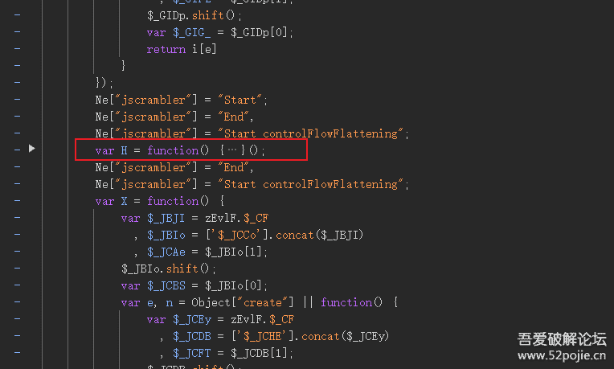

18.png (20.65 KB, 下载次数: 0)

[href="forum.php?mod=attachment&aid=Mjc2NDY5MnwxOTk1YThhOHwxNzkzNTcxMTE0fDE2ODA4NnwyMDE3Mzk0&nothumb=yes" target="_blank"](https://www.52pojie.cn/forum.php?mod=attachment&aid=Mjc2NDY5MnwxOTk1YThhOHwxNzkzNTcxMTE0fDE2ODA4NnwyMDE3Mzk0&nothumb=yes)

2025-3-21 21:38 上传

把整个`H`拿下来，再把4个方法加上，稍微补一补环境，就能搞定。

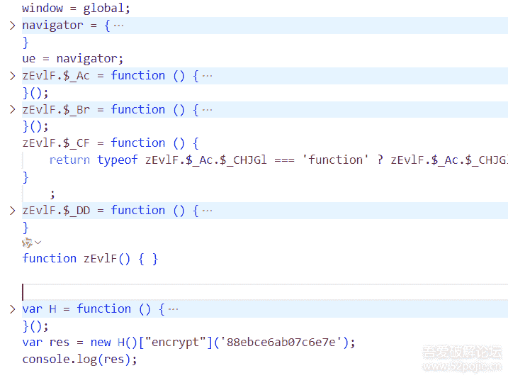

19.png (39.27 KB, 下载次数: 0)

[href="forum.php?mod=attachment&aid=Mjc2NDY5M3xlMTljYzE0M3wxNzkzNTcxMTE0fDE2ODA4NnwyMDE3Mzk0&nothumb=yes" target="_blank"](https://www.52pojie.cn/forum.php?mod=attachment&aid=Mjc2NDY5M3xlMTljYzE0M3wxNzkzNTcxMTE0fDE2ODA4NnwyMDE3Mzk0&nothumb=yes)

2025-3-21 21:38 上传

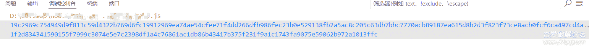

20.png (31 KB, 下载次数: 0)

[href="forum.php?mod=attachment&aid=Mjc2NDY5NHw2NTE4OWQ4MnwxNzkzNTcxMTE0fDE2ODA4NnwyMDE3Mzk0&nothumb=yes" target="_blank"](https://www.52pojie.cn/forum.php?mod=attachment&aid=Mjc2NDY5NHw2NTE4OWQ4MnwxNzkzNTcxMTE0fDE2ODA4NnwyMDE3Mzk0&nothumb=yes)

2025-3-21 21:38 上传

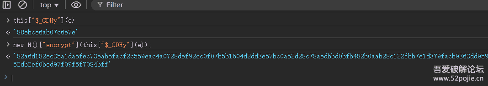

21.png (14.93 KB, 下载次数: 0)

[href="forum.php?mod=attachment&aid=Mjc2NDY5NXwxZDMxOGY5MHwxNzkzNTcxMTE0fDE2ODA4NnwyMDE3Mzk0&nothumb=yes" target="_blank"](https://www.52pojie.cn/forum.php?mod=attachment&aid=Mjc2NDY5NXwxZDMxOGY5MHwxNzkzNTcxMTE0fDE2ODA4NnwyMDE3Mzk0&nothumb=yes)

2025-3-21 21:38 上传

跟网站生成的值一对比，发现不一样，其实也正常，这个算法是rsa，非对称加密，也可以用标准库去解决试试，反正这里我已经扣下来js了就这样不管了。

到这里，`u`已经搞定。

## 5. `p`逆向

重头戏来了，这里`p`的组成比较复杂，需要逆向的值有好几个。

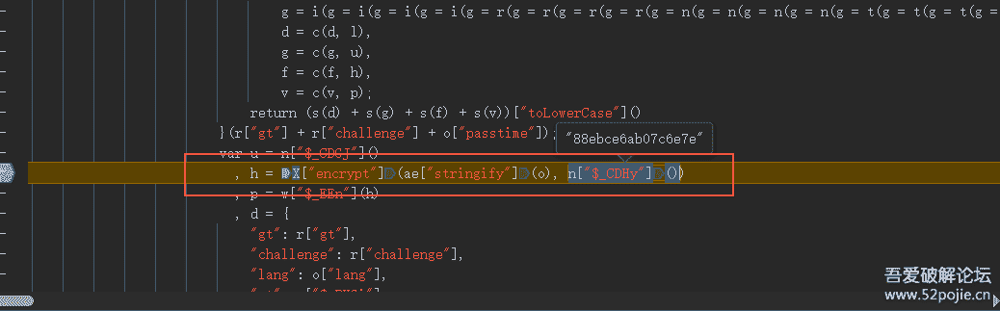

22.png (18.5 KB, 下载次数: 0)

[href="forum.php?mod=attachment&aid=Mjc2NDY5NnwxMTA4ODRjZnwxNzkzNTcxMTE0fDE2ODA4NnwyMDE3Mzk0&nothumb=yes" target="_blank"](https://www.52pojie.cn/forum.php?mod=attachment&aid=Mjc2NDY5NnwxMTA4ODRjZnwxNzkzNTcxMTE0fDE2ODA4NnwyMDE3Mzk0&nothumb=yes)

2025-3-21 21:38 上传

`X["encrypt"](ae["stringify"](o), n["$_CDHy"]())`

`p`来自于`h`，那先解决`h`。观察`n["$_CDHy"]()`的值跟上一步一样，其实也就是一个加密key值，流程如下：

> - 先`e() + e() + e() + e()`生成一个字符串，作为明文来rsa加密
> - 接下来的所有需要用到这个明文值的地方，都保持为第一次生成的

所以`h`的重点在于`X["encrypt"]`和`ae["stringify"](o)`以及`o`是什么，那就一个个来，先看`o`

### 1. `o`

`o`的组成很复杂，有这么多东西

> - `a`：其实是点击的坐标，但经过处理
> - `ep`：看起来像轨迹和环境
> - `h9s9`：可能要逆向
> - `lang`、`pic`：固定或者之前能取到
> - `rp`、`tt`：不知道含义，要逆向

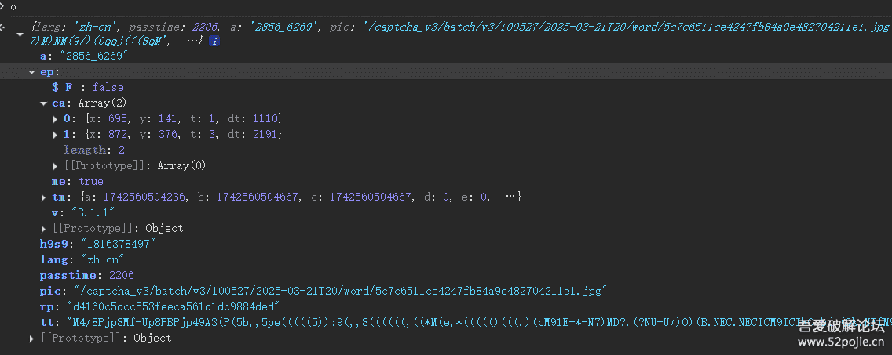

23.png (25.89 KB, 下载次数: 0)

[href="forum.php?mod=attachment&aid=Mjc2NDY5N3w4NDNhYWVjYXwxNzkzNTcxMTE0fDE2ODA4NnwyMDE3Mzk0&nothumb=yes" target="_blank"](https://www.52pojie.cn/forum.php?mod=attachment&aid=Mjc2NDY5N3w4NDNhYWVjYXwxNzkzNTcxMTE0fDE2ODA4NnwyMDE3Mzk0&nothumb=yes)

2025-3-21 21:38 上传

### 2. `ae["stringify"]`

其实就是`JSON.stringify`，直接改写就好

### 3. `X["encrypt"]`

跟进去看看，跟之前`u`的`var H = function(){}`一样，直接把整个`var X = function(){}`拿出来。这里先不贴图，先往下解决再一起看

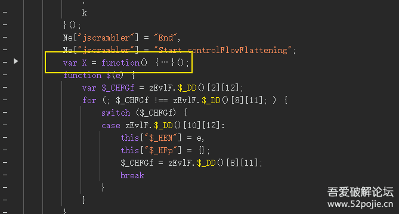

24.png (15.08 KB, 下载次数: 0)

[href="forum.php?mod=attachment&aid=Mjc2NDY5OHw5YzgyYWFmYnwxNzkzNTcxMTE0fDE2ODA4NnwyMDE3Mzk0&nothumb=yes" target="_blank"](https://www.52pojie.cn/forum.php?mod=attachment&aid=Mjc2NDY5OHw5YzgyYWFmYnwxNzkzNTcxMTE0fDE2ODA4NnwyMDE3Mzk0&nothumb=yes)

2025-3-21 21:38 上传

到此，`h`就搞定了，接下来看看`p`的逻辑。

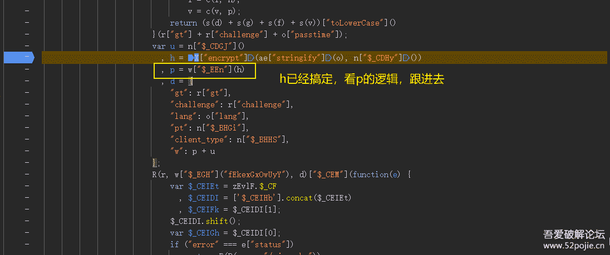

25.png (31.17 KB, 下载次数: 0)

[href="forum.php?mod=attachment&aid=Mjc2NDcxOXxjMWY0MWUyOHwxNzkzNTcxMTE0fDE2ODA4NnwyMDE3Mzk0&nothumb=yes" target="_blank"](https://www.52pojie.cn/forum.php?mod=attachment&aid=Mjc2NDcxOXxjMWY0MWUyOHwxNzkzNTcxMTE0fDE2ODA4NnwyMDE3Mzk0&nothumb=yes)

2025-3-21 21:41 上传

本质上是调用的`this["$_ECS"](e)`

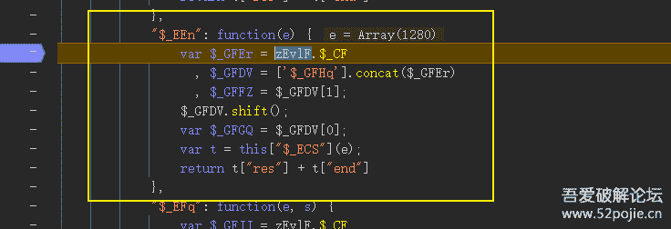

26.png (14.25 KB, 下载次数: 0)

[href="forum.php?mod=attachment&aid=Mjc2NDcyMHxlZGMyN2MzYXwxNzkzNTcxMTE0fDE2ODA4NnwyMDE3Mzk0&nothumb=yes" target="_blank"](https://www.52pojie.cn/forum.php?mod=attachment&aid=Mjc2NDcyMHxlZGMyN2MzYXwxNzkzNTcxMTE0fDE2ODA4NnwyMDE3Mzk0&nothumb=yes)

2025-3-21 21:41 上传

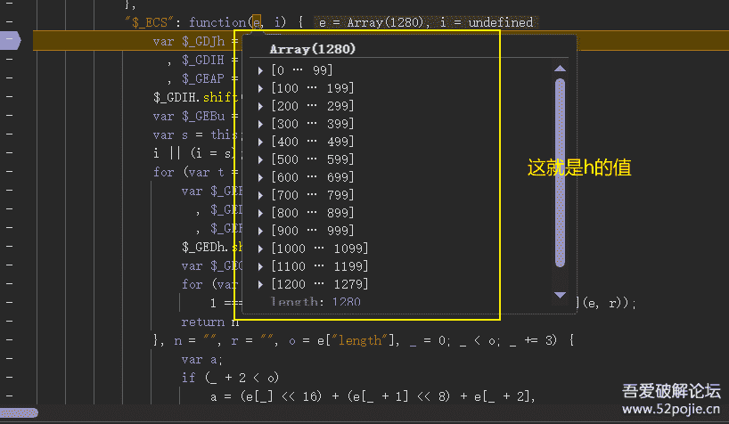

27.png (28.39 KB, 下载次数: 0)

[href="forum.php?mod=attachment&aid=Mjc2NDcyMXw3NjNhODg2NXwxNzkzNTcxMTE0fDE2ODA4NnwyMDE3Mzk0&nothumb=yes" target="_blank"](https://www.52pojie.cn/forum.php?mod=attachment&aid=Mjc2NDcyMXw3NjNhODg2NXwxNzkzNTcxMTE0fDE2ODA4NnwyMDE3Mzk0&nothumb=yes)

2025-3-21 21:41 上传

`$_ECS`是属于`w = {}`，把整个`w`拿下来，再把之前`var X = function(){}`拿下来，最终js如下：

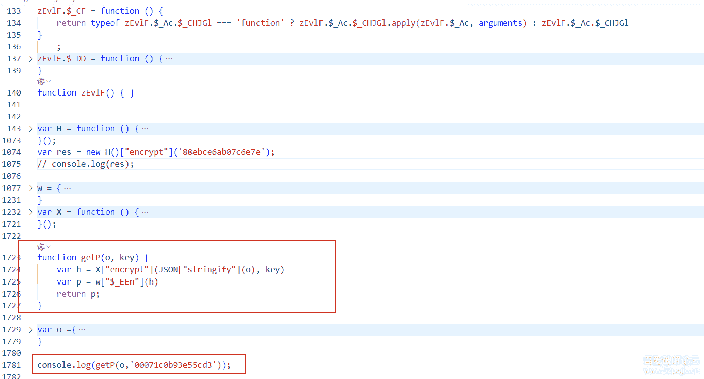

28.png (69.92 KB, 下载次数: 0)

[href="forum.php?mod=attachment&aid=Mjc2NDcyMnxmOWU3OGU4NnwxNzkzNTcxMTE0fDE2ODA4NnwyMDE3Mzk0&nothumb=yes" target="_blank"](https://www.52pojie.cn/forum.php?mod=attachment&aid=Mjc2NDcyMnxmOWU3OGU4NnwxNzkzNTcxMTE0fDE2ODA4NnwyMDE3Mzk0&nothumb=yes)

2025-3-21 21:41 上传

运行后与网站生成的对比，值一致

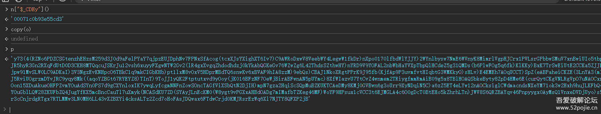

29.png (32.9 KB, 下载次数: 0)

[href="forum.php?mod=attachment&aid=Mjc2NDcyM3xkMGY3YTJjMnwxNzkzNTcxMTE0fDE2ODA4NnwyMDE3Mzk0&nothumb=yes" target="_blank"](https://www.52pojie.cn/forum.php?mod=attachment&aid=Mjc2NDcyM3xkMGY3YTJjMnwxNzkzNTcxMTE0fDE2ODA4NnwyMDE3Mzk0&nothumb=yes)

2025-3-21 21:41 上传

到此，`p`也搞定。但`o`中还有好几个参数没处理，继续逆他，累鼠了{:301_972:} {:301_972:} 

多提一嘴其实这里是aes加密，不过我试过用标准库来解，发现解后的数组跟网站的值对不上，就索性直接扣了，应该是漏了啥，本人对密码学属实不了解

## 6. `o`逆向

`o`有以下字段，实际需要逆向的是`a`，`rp`，`tt`，其他的固定即可，不校验，不过其实也可以跟，大概说下我的理解：

> - `a`：点击坐标，要特殊处理
> - `ep`：鼠标移动的全部轨迹，还有一些浏览器事件的环境
> - `h9s9`：看其他大佬描述为每天变化的值，实际测下来这个值好几天没变了，固定即可
> - `passtime`：点击耗时，随机就行
> - `rp`、`tt`：含义未知，逆他就完事

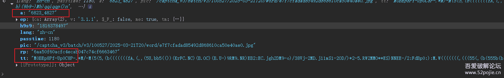

30.png (20.64 KB, 下载次数: 0)

[href="forum.php?mod=attachment&aid=Mjc2NDcyNHw3ZGZlN2E1MHwxNzkzNTcxMTE0fDE2ODA4NnwyMDE3Mzk0&nothumb=yes" target="_blank"](https://www.52pojie.cn/forum.php?mod=attachment&aid=Mjc2NDcyNHw3ZGZlN2E1MHwxNzkzNTcxMTE0fDE2ODA4NnwyMDE3Mzk0&nothumb=yes)

2025-3-21 21:41 上传

### 1. `a`

先看看`a`吧。在`w`的位置向上看，定位到`a`的逻辑，发现是参数过来的，那就下断再往前的栈跟

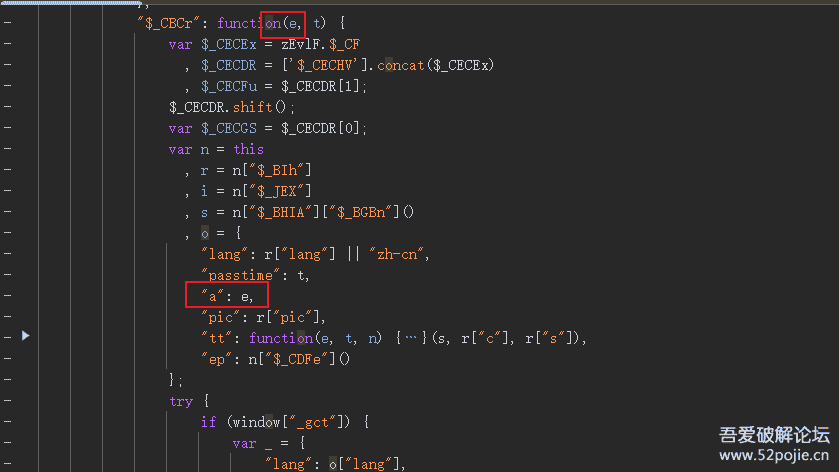

31.png (18.92 KB, 下载次数: 0)

[href="forum.php?mod=attachment&aid=Mjc2NDcyNXw5YjY0Y2YyYXwxNzkzNTcxMTE0fDE2ODA4NnwyMDE3Mzk0&nothumb=yes" target="_blank"](https://www.52pojie.cn/forum.php?mod=attachment&aid=Mjc2NDcyNXw5YjY0Y2YyYXwxNzkzNTcxMTE0fDE2ODA4NnwyMDE3Mzk0&nothumb=yes)

2025-3-21 21:41 上传

向前跟一个栈就能看到`a`其实来自于`n["$_BJGs"]["$_EJC"]()`，继续向前跟。

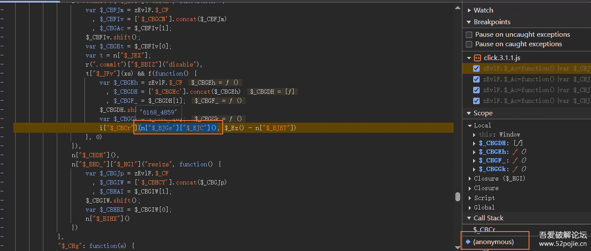

32.png (49.24 KB, 下载次数: 0)

[href="forum.php?mod=attachment&aid=Mjc2NDcyNnwxNzgxODk2NHwxNzkzNTcxMTE0fDE2ODA4NnwyMDE3Mzk0&nothumb=yes" target="_blank"](https://www.52pojie.cn/forum.php?mod=attachment&aid=Mjc2NDcyNnwxNzgxODk2NHwxNzkzNTcxMTE0fDE2ODA4NnwyMDE3Mzk0&nothumb=yes)

2025-3-21 21:41 上传

发现其实来自于`e["$_CEFZ"]`

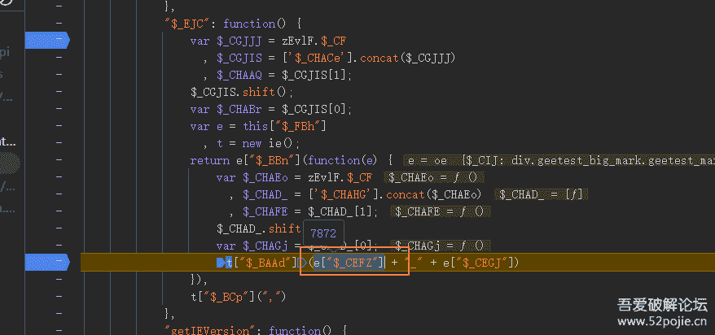

33.png (24.68 KB, 下载次数: 0)

[href="forum.php?mod=attachment&aid=Mjc2NDcyN3xiZDEzZjc2MHwxNzkzNTcxMTE0fDE2ODA4NnwyMDE3Mzk0&nothumb=yes" target="_blank"](https://www.52pojie.cn/forum.php?mod=attachment&aid=Mjc2NDcyN3xiZDEzZjc2MHwxNzkzNTcxMTE0fDE2ODA4NnwyMDE3Mzk0&nothumb=yes)

2025-3-21 21:42 上传

搜一下"`$_CEFZ`"，发现又来自于`t`，`t`在上一个栈，再跟

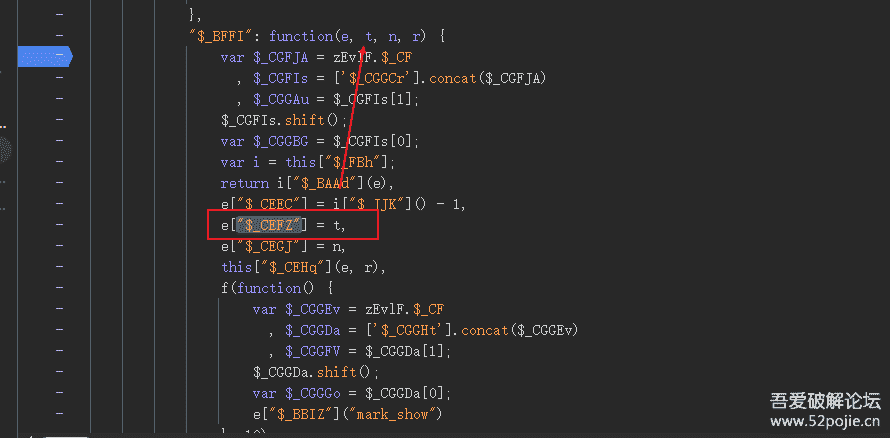

34.png (22.6 KB, 下载次数: 0)

[href="forum.php?mod=attachment&aid=Mjc2NDcyOHw3OThlMTkyNnwxNzkzNTcxMTE0fDE2ODA4NnwyMDE3Mzk0&nothumb=yes" target="_blank"](https://www.52pojie.cn/forum.php?mod=attachment&aid=Mjc2NDcyOHw3OThlMTkyNnwxNzkzNTcxMTE0fDE2ODA4NnwyMDE3Mzk0&nothumb=yes)

2025-3-21 21:42 上传

跟到这里了，下断点刷新在跟


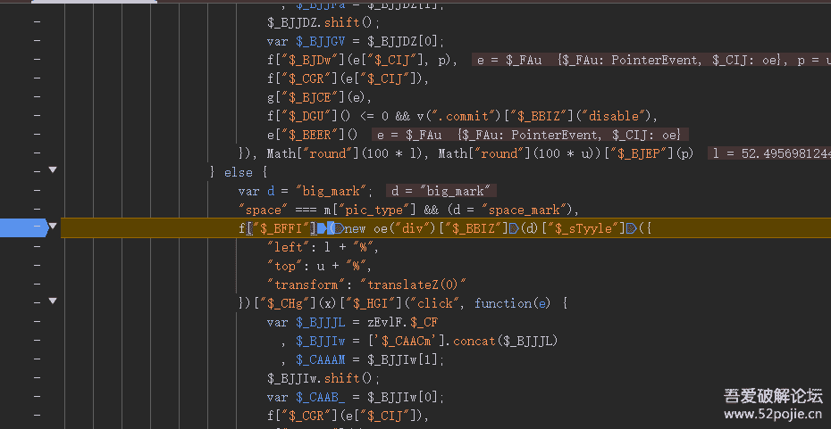

35.png (26.04 KB, 下载次数: 0)

[href="forum.php?mod=attachment&aid=Mjc2NDcyOXwzNDdjNDNkNXwxNzkzNTcxMTE0fDE2ODA4NnwyMDE3Mzk0&nothumb=yes" target="_blank"](https://www.52pojie.cn/forum.php?mod=attachment&aid=Mjc2NDcyOXwzNDdjNDNkNXwxNzkzNTcxMTE0fDE2ODA4NnwyMDE3Mzk0&nothumb=yes)

2025-3-21 21:42 上传

## 如下分析下

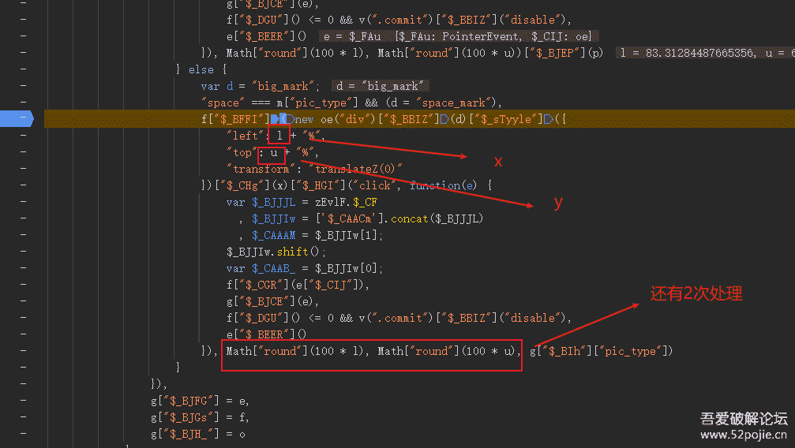

36.png (37.08 KB, 下载次数: 0)

[href="forum.php?mod=attachment&aid=Mjc2NDczMHxiMGVlYzg1NnwxNzkzNTcxMTE0fDE2ODA4NnwyMDE3Mzk0&nothumb=yes" target="_blank"](https://www.52pojie.cn/forum.php?mod=attachment&aid=Mjc2NDczMHxiMGVlYzg1NnwxNzkzNTcxMTE0fDE2ODA4NnwyMDE3Mzk0&nothumb=yes)

2025-3-21 21:42 上传

那就好办了，`a`的逻辑是这样：

```
var x1 = Math["round"](100 * Number(x));
var y1 = Math["round"](100 * Number(y));
var a = x1 + '_' + y1
```

### 2. tt

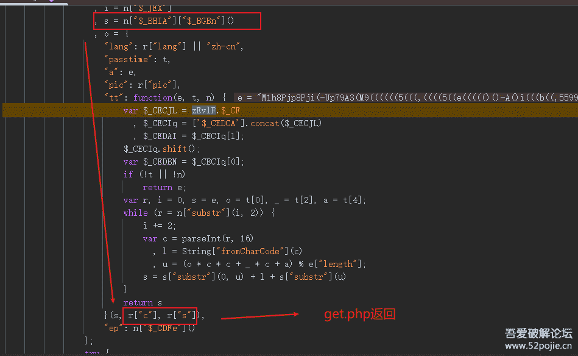

37.png (30.22 KB, 下载次数: 1)

[href="forum.php?mod=attachment&aid=Mjc2NDczMXxmMzk3OThiNnwxNzkzNTcxMTE0fDE2ODA4NnwyMDE3Mzk0&nothumb=yes" target="_blank"](https://www.52pojie.cn/forum.php?mod=attachment&aid=Mjc2NDczMXxmMzk3OThiNnwxNzkzNTcxMTE0fDE2ODA4NnwyMDE3Mzk0&nothumb=yes)

2025-3-21 21:42 上传

`tt`方法传参3个，`s = n["$_BHIA"]["$_BGBn"]()`，`r["c"]`，`r["s"]`来自于接口返回，至于`s`的逻辑就自己跟下好了，跟之前流程一样的

### 3. rp

`rp`就是`r["gt"]` + `r["challenge"]` + `o["passtime"]`做个`md5`，可以扣也可以库还原

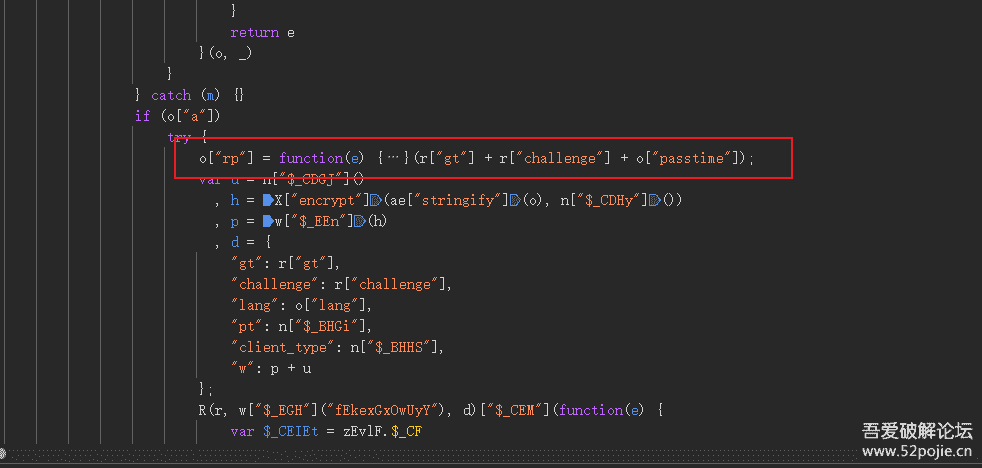

38.png (19.31 KB, 下载次数: 0)

[href="forum.php?mod=attachment&aid=Mjc2NDczMnxiMTZlOGI5YXwxNzkzNTcxMTE0fDE2ODA4NnwyMDE3Mzk0&nothumb=yes" target="_blank"](https://www.52pojie.cn/forum.php?mod=attachment&aid=Mjc2NDczMnxiMTZlOGI5YXwxNzkzNTcxMTE0fDE2ODA4NnwyMDE3Mzk0&nothumb=yes)

2025-3-21 21:42 上传

到这里，所有参数全部搞定，至于`o.ep`等之类的，网站自己抓一个写死即可。

## 4> 验证

没毛病

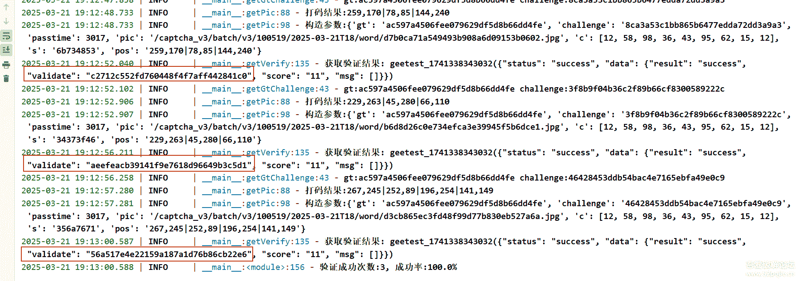

39.png (165.57 KB, 下载次数: 0)

[href="forum.php?mod=attachment&aid=Mjc2NDczM3xmNjUyMmIyMnwxNzkzNTcxMTE0fDE2ODA4NnwyMDE3Mzk0&nothumb=yes" target="_blank"](https://www.52pojie.cn/forum.php?mod=attachment&aid=Mjc2NDczM3xmNjUyMmIyMnwxNzkzNTcxMTE0fDE2ODA4NnwyMDE3Mzk0&nothumb=yes)

2025-3-21 21:42 上传
