# [原创] 去除QQ聊天窗口的平滑滚动动画

- 原帖：<https://www.52pojie.cn/forum.php?mod=viewthread&tid=2017443>
- 抓取时间：2026-11-01T22:11:51

## 背景与思路

- QQ版本：PC经典版 9.7.23 (29394)
- 工具：Cheat Engine（扫内存工具）、IDA（逆向工具）

QQ 在大概四五年前加入了聊天窗口的平滑滚动，即滚动鼠标滚轮时，有一个滚动的过渡动画，而不是一帧直接到位。

但是这个动画有缺点：因为动画帧是跑在主线程的，当 QQ 特别卡的时候，动画就会严重掉帧，非常影响使用。

本文研究如何去除滚动动画，直接一帧到位。

本文图片较多，内容浅显，新手应该也能看懂（我也是逆向新手）。

上半部分是聊天窗口的，消息列表的在下半部分：[消息列表](#去除平滑滚动-消息列表)。

## 使用 Cheat Engine 查找滚动高度

使用 Cheat Engine 打开 QQ 进程，打开一个聊天界面，扫描选项选“未知初始值”，进行扫描。

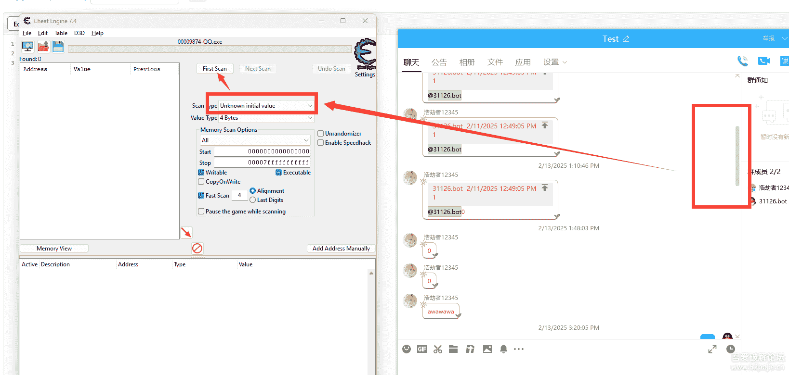

[原图附件](https://www.52pojie.cn/forum.php?mod=attachment&aid=Mjc2NDc5OHxkMWY0NmM2NXwxNzkzNTcxMTA5fDE2ODA4NnwyMDE3NDQz&nothumb=yes)

然后将聊天页面向下滚动，扫描选项选“增大值”，点“下一步”。

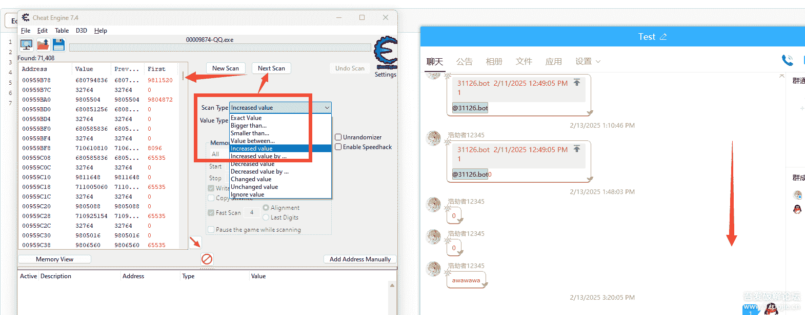

[原图附件](https://www.52pojie.cn/forum.php?mod=attachment&aid=Mjc2NDc5OXwxMDY2YjNkY3wxNzkzNTcxMTA5fDE2ODA4NnwyMDE3NDQz&nothumb=yes)

重复多次，向上滚动就筛选“减小值”，向下滚就筛选“增大值”，直到出现两个看起来很像页面滚动高度的值为止。

然后添加到地址列表。

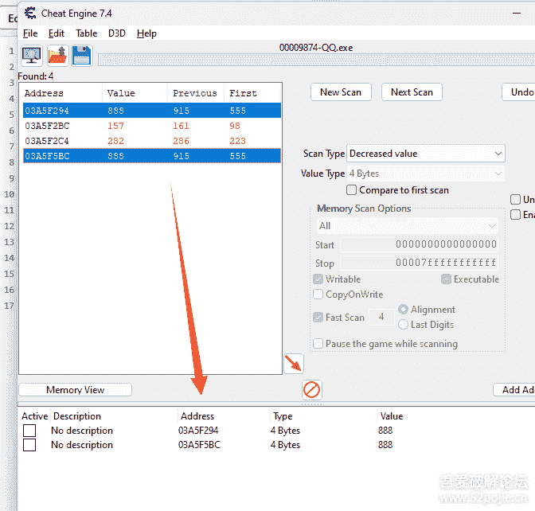

[原图附件](https://www.52pojie.cn/forum.php?mod=attachment&aid=Mjc2NDgwMHw1YmZmNzU0N3wxNzkzNTcxMTA5fDE2ODA4NnwyMDE3NDQz&nothumb=yes)

修改第一个值会发现，这个值是滚动条的。

修改第二个值没有生效，再次滚动会被新值覆盖。

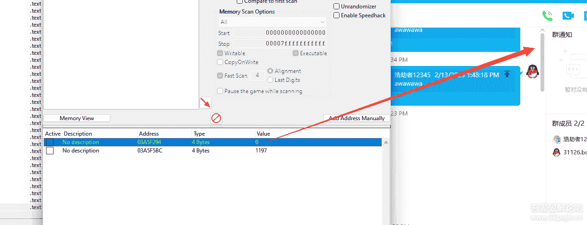

[原图附件](https://www.52pojie.cn/forum.php?mod=attachment&aid=Mjc2NDgwMXxiYzM5ZWVhYXwxNzkzNTcxMTA5fDE2ODA4NnwyMDE3NDQz&nothumb=yes)

我们研究第二个值，对其查找写入操作。

然后滚动聊天框，找到一处代码：

```text
AFCtrl.dll+9F643 mov [edi+0000027C],eax
```

将其添加到代码列表。

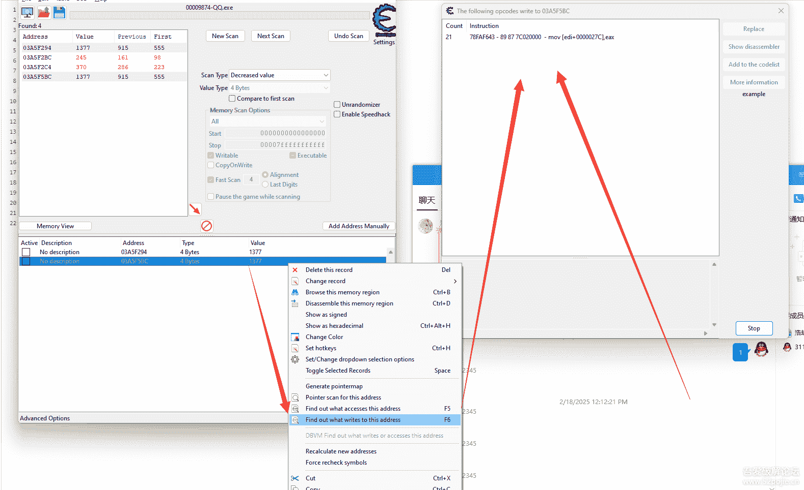

[原图附件](https://www.52pojie.cn/forum.php?mod=attachment&aid=Mjc2NDgwMnw0Mjg1NmViMnwxNzkzNTcxMTA5fDE2ODA4NnwyMDE3NDQz&nothumb=yes)

点击“显示反汇编”，打个断点试试。

可以发现，在打断点的情况下，滚动一次鼠标滚轮：第一个 tick 滚动了 `11`（`0xB`）像素，第二个 tick 滚动到了 `90`（`0x5A`）像素。

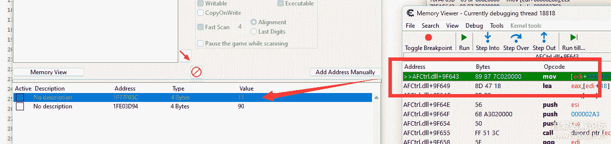

[原图附件](https://www.52pojie.cn/forum.php?mod=attachment&aid=Mjc2NDgwM3xjOWMzOTdkZXwxNzkzNTcxMTA5fDE2ODA4NnwyMDE3NDQz&nothumb=yes)

这附近的汇编不好看懂，我们直接上 IDA。

## 使用 IDA 分析调用关系

IDA 的地址和 CE 有点不一样，我喜欢把二进制复制出来搜索。

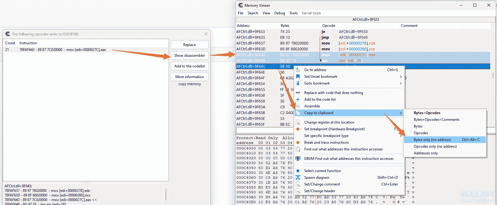

[原图附件](https://www.52pojie.cn/forum.php?mod=attachment&aid=Mjc2NDgwNHxhNzdjZGE5MXwxNzkzNTcxMTA5fDE2ODA4NnwyMDE3NDQz&nothumb=yes)

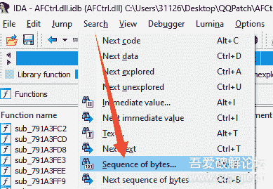

[原图附件](https://www.52pojie.cn/forum.php?mod=attachment&aid=Mjc2NDgwNXxmYjM4NjMzMHwxNzkzNTcxMTA5fDE2ODA4NnwyMDE3NDQz&nothumb=yes)

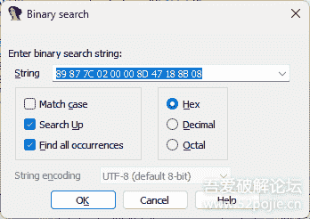

[原图附件](https://www.52pojie.cn/forum.php?mod=attachment&aid=Mjc2NDgwNnwyNTU0MjQ1NHwxNzkzNTcxMTA5fDE2ODA4NnwyMDE3NDQz&nothumb=yes)

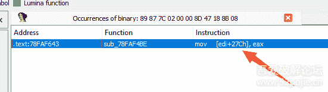

[原图附件](https://www.52pojie.cn/forum.php?mod=attachment&aid=Mjc2NDgwN3wyZTA1ZDdkZnwxNzkzNTcxMTA5fDE2ODA4NnwyMDE3NDQz&nothumb=yes)

反编译出来可以发现，是把 `a2` 赋值给了内存，并且发现 `a2` 是该函数的入参。

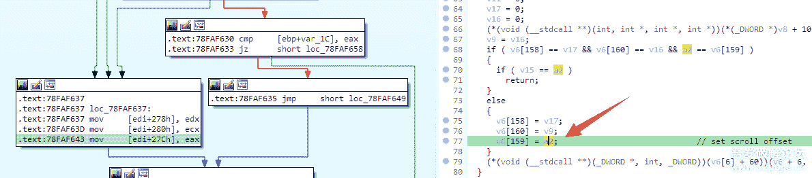

[原图附件](https://www.52pojie.cn/forum.php?mod=attachment&aid=Mjc2NDgwOHxjZjQ3NjEyMHwxNzkzNTcxMTA5fDE2ODA4NnwyMDE3NDQz&nothumb=yes)

> 提示：可以按 `Alt+M` 添加地址书签，方便后续找回这个位置；按 `Ctrl+Shift+M` 查看地址书签。

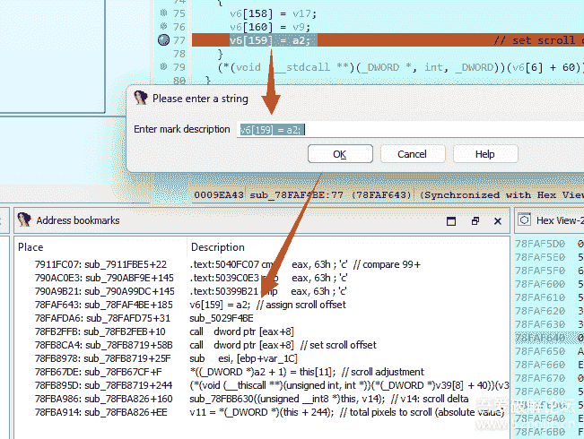

[原图附件](https://www.52pojie.cn/forum.php?mod=attachment&aid=Mjc2NDgwOXwyMDk0ZGZlNnwxNzkzNTcxMTA5fDE2ODA4NnwyMDE3NDQz&nothumb=yes)

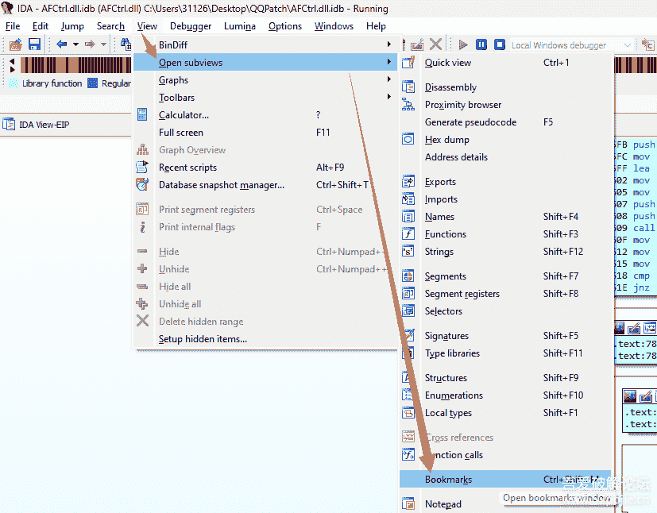

[原图附件](https://www.52pojie.cn/forum.php?mod=attachment&aid=Mjc2NDgxMHxjYWFiZDc2N3wxNzkzNTcxMTA5fDE2ODA4NnwyMDE3NDQz&nothumb=yes)

在函数头选择“查找引用”，直接点进去。

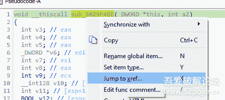

[原图附件](https://www.52pojie.cn/forum.php?mod=attachment&aid=Mjc2NDgxMXw3NjRlMjEyMXwxNzkzNTcxMTA5fDE2ODA4NnwyMDE3NDQz&nothumb=yes)

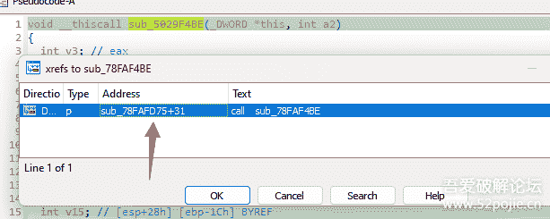

[原图附件](https://www.52pojie.cn/forum.php?mod=attachment&aid=Mjc2NDgxMnw4N2Q1ODgyYnwxNzkzNTcxMTA5fDE2ODA4NnwyMDE3NDQz&nothumb=yes)

发现 `v3 = *a2`，`*a2` 是入参，继续往上找。

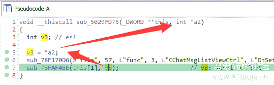

[原图附件](https://www.52pojie.cn/forum.php?mod=attachment&aid=Mjc2NDgxM3wyOTZjNmVmNHwxNzkzNTcxMTA5fDE2ODA4NnwyMDE3NDQz&nothumb=yes)

但是发现找不到直接调用的方法了。

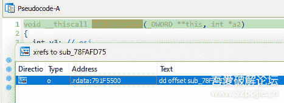


[href="forum.php?mod=attachment&aid=Mjc2NDgxNXxkOWM1OTM3YnwxNzkzNTcxMTA5fDE2ODA4NnwyMDE3NDQz&nothumb=yes" target="_blank"](https://www.52pojie.cn/forum.php?mod=attachment&aid=Mjc2NDgxNXxkOWM1OTM3YnwxNzkzNTcxMTA5fDE2ODA4NnwyMDE3NDQz&nothumb=yes)

2025-3-22 02:15 上传

我们直接开启调试器打断点

选择 `附加到进程`, 选择 `QQ` 进程

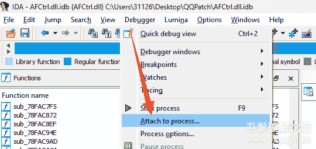

425317400-9188ba79-c7e3-4023-b278-aae44b66b41c.png (36.23 KB, 下载次数: 0)

[href="forum.php?mod=attachment&aid=Mjc2NDgxNnwyNzAwNTQ3ZnwxNzkzNTcxMTA5fDE2ODA4NnwyMDE3NDQz&nothumb=yes" target="_blank"](https://www.52pojie.cn/forum.php?mod=attachment&aid=Mjc2NDgxNnwyNzAwNTQ3ZnwxNzkzNTcxMTA5fDE2ODA4NnwyMDE3NDQz&nothumb=yes)

2025-3-22 02:15 上传

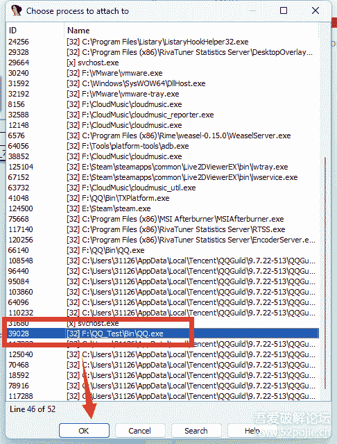

425317478-aec01535-3dcd-4153-9ffe-e64625aa0b67.png (48.79 KB, 下载次数: 0)

[href="forum.php?mod=attachment&aid=Mjc2NDgxN3xmNjVlNmY1N3wxNzkzNTcxMTA5fDE2ODA4NnwyMDE3NDQz&nothumb=yes" target="_blank"](https://www.52pojie.cn/forum.php?mod=attachment&aid=Mjc2NDgxN3xmNjVlNmY1N3wxNzkzNTcxMTA5fDE2ODA4NnwyMDE3NDQz&nothumb=yes)

2025-3-22 02:15 上传

等待一段时间加载完 symbols, 我们用地址簿找回刚刚的代码, 打断点

再次滚动聊天框, 触发断点后, 就能看调用栈了

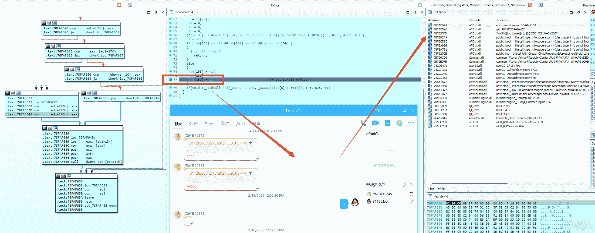

425319407-8062a90d-baf7-4595-a7c4-87d42deaddab.png (288.27 KB, 下载次数: 0)

[href="forum.php?mod=attachment&aid=Mjc2NDgxOHxiMjEwMzNlYnwxNzkzNTcxMTA5fDE2ODA4NnwyMDE3NDQz&nothumb=yes" target="_blank"](https://www.52pojie.cn/forum.php?mod=attachment&aid=Mjc2NDgxOHxiMjEwMzNlYnwxNzkzNTcxMTA5fDE2ODA4NnwyMDE3NDQz&nothumb=yes)

2025-3-22 02:16 上传

往上找, 发现这里是靠指针调用的函数, 所以没法静态找出引用

这里 `a2` 又是入参, 继续往上找

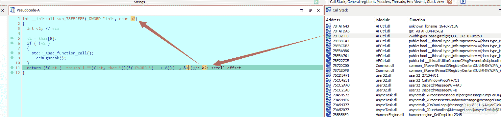

425319937-8bffd82b-3a60-4fa8-b68d-73f3ed75e178.png (86.38 KB, 下载次数: 0)

[href="forum.php?mod=attachment&aid=Mjc2NDgxOXxhN2VhYzc2M3wxNzkzNTcxMTA5fDE2ODA4NnwyMDE3NDQz&nothumb=yes" target="_blank"](https://www.52pojie.cn/forum.php?mod=attachment&aid=Mjc2NDgxOXxhN2VhYzc2M3wxNzkzNTcxMTA5fDE2ODA4NnwyMDE3NDQz&nothumb=yes)

2025-3-22 02:16 上传

终于发现 `v4` 似乎是在这个函数通过一系列计算得到的

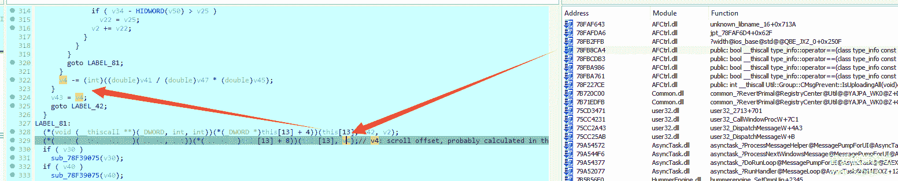

425320277-2ec7d764-3714-4825-8a5b-f63919d2bd8e.png (98.14 KB, 下载次数: 0)

[href="forum.php?mod=attachment&aid=Mjc2NDgyMHxkYTdjMzhkNnwxNzkzNTcxMTA5fDE2ODA4NnwyMDE3NDQz&nothumb=yes" target="_blank"](https://www.52pojie.cn/forum.php?mod=attachment&aid=Mjc2NDgyMHxkYTdjMzhkNnwxNzkzNTcxMTA5fDE2ODA4NnwyMDE3NDQz&nothumb=yes)

2025-3-22 02:16 上传

这里看 `v4` 似乎是一堆复杂计算得到的

我反复打断点研究了好多次, 发现这个似乎是栈里面的 `C++` 类, 里面有各种方法通过指针调用, 实在太烧脑了看不下去

打断点也看不出来这附近的变量跟最终滚动位置有关的

要么就是差几十个像素, 要么就是不知道为什么调用了一个函数就把值改写了

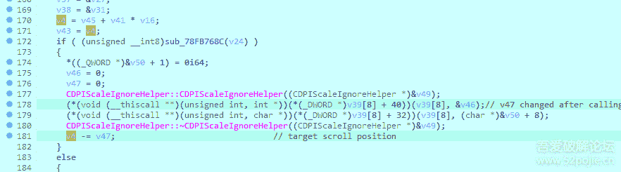

425320946-b54864ff-d623-47ee-a5d2-adf84898395c.png (38.86 KB, 下载次数: 1)

[href="forum.php?mod=attachment&aid=Mjc2NDgyMXxhMTZmMDExMHwxNzkzNTcxMTA5fDE2ODA4NnwyMDE3NDQz&nothumb=yes" target="_blank"](https://www.52pojie.cn/forum.php?mod=attachment&aid=Mjc2NDgyMXxhMTZmMDExMHwxNzkzNTcxMTA5fDE2ODA4NnwyMDE3NDQz&nothumb=yes)

2025-3-22 02:16 上传

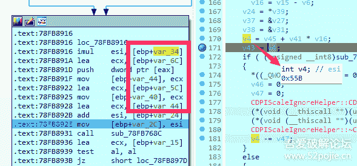

425322645-e524f91c-0b26-4f01-85fa-a7522af3baaf.png (58.95 KB, 下载次数: 0)

[href="forum.php?mod=attachment&aid=Mjc2NDgyMnw1ODIzMjc5YXwxNzkzNTcxMTA5fDE2ODA4NnwyMDE3NDQz&nothumb=yes" target="_blank"](https://www.52pojie.cn/forum.php?mod=attachment&aid=Mjc2NDgyMnw1ODIzMjc5YXwxNzkzNTcxMTA5fDE2ODA4NnwyMDE3NDQz&nothumb=yes)

2025-3-22 02:16 上传

到这里重新思考一下破解思路

我们要做的是去掉平滑滚动, 也就是让它一下子就滚动到最终位置

那么应该有一个变量, 存放了最终滚动位置

但是这个类是在栈里面的, 每次调用都变地址, 搜索起来极为麻烦

就在我对这一堆满天飞的指针头晕的时候, 我点开了调用栈的上一个函数...

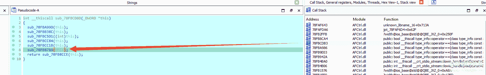

425324972-a3fe5443-4f28-4007-b32c-303e4c0e1d5b.png (64.98 KB, 下载次数: 0)

[href="forum.php?mod=attachment&aid=Mjc2NDgyM3xhMmUzNjQ5NXwxNzkzNTcxMTA5fDE2ODA4NnwyMDE3NDQz&nothumb=yes" target="_blank"](https://www.52pojie.cn/forum.php?mod=attachment&aid=Mjc2NDgyM3xhMmUzNjQ5NXwxNzkzNTcxMTA5fDE2ODA4NnwyMDE3NDQz&nothumb=yes)

2025-3-22 02:17 上传

再往上...

惊人的来了, 这个入参的 `v14` (`0xB`) 不就是当前 tick 滚动的像素数吗!

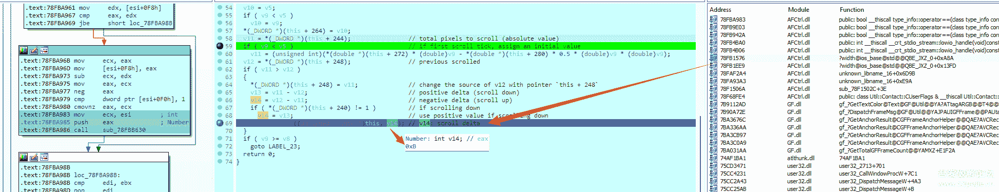

425326034-361905cf-24fb-4011-89c0-7097a64227e6.png (156.33 KB, 下载次数: 1)

[href="forum.php?mod=attachment&aid=Mjc2NDgyNHw3Y2M1NjM5N3wxNzkzNTcxMTA5fDE2ODA4NnwyMDE3NDQz&nothumb=yes" target="_blank"](https://www.52pojie.cn/forum.php?mod=attachment&aid=Mjc2NDgyNHw3Y2M1NjM5N3wxNzkzNTcxMTA5fDE2ODA4NnwyMDE3NDQz&nothumb=yes)

2025-3-22 02:17 上传

经过多次打断点得出, `v11` (`0x5A`) 是滚动的总像素数

下面的判断语句只有在滚动的第一个 tick 会执行, 用来计算第一个 tick 滚动的距离

`v12` 是上一次滚动的值

`v13` `v14` 分别是正负滚动像素数, 下面的判断语句用来判断是向上还是向下滚动

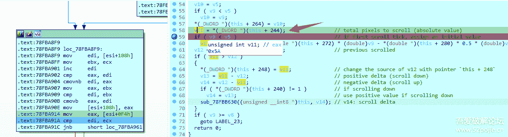

425327261-1578932a-125b-46ff-b98d-ae7fcdfe421b.png (80.15 KB, 下载次数: 0)

[href="forum.php?mod=attachment&aid=Mjc2NDgyNXxhMTFkYWUyM3wxNzkzNTcxMTA5fDE2ODA4NnwyMDE3NDQz&nothumb=yes" target="_blank"](https://www.52pojie.cn/forum.php?mod=attachment&aid=Mjc2NDgyNXxhMTFkYWUyM3wxNzkzNTcxMTA5fDE2ODA4NnwyMDE3NDQz&nothumb=yes)

2025-3-22 02:17 上传

我们把那个第一次才触发的语句强制跳过, 让它第一次就把所有像素滚完

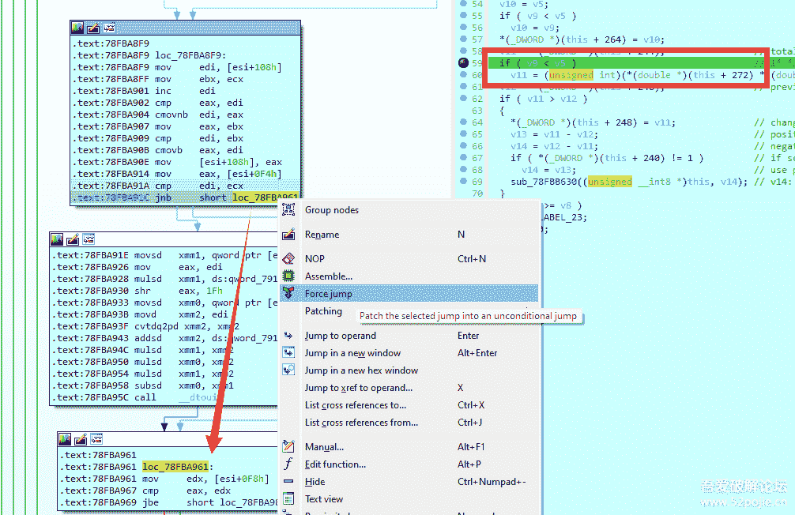

425328447-23b6ea8e-0642-4bac-ae93-ebec93aea1dc.png (124.87 KB, 下载次数: 1)

[href="forum.php?mod=attachment&aid=Mjc2NDgyNnw1NTc1MWYwOXwxNzkzNTcxMTA5fDE2ODA4NnwyMDE3NDQz&nothumb=yes" target="_blank"](https://www.52pojie.cn/forum.php?mod=attachment&aid=Mjc2NDgyNnw1NTc1MWYwOXwxNzkzNTcxMTA5fDE2ODA4NnwyMDE3NDQz&nothumb=yes)

2025-3-22 02:17 上传

测试结果是非常成功的, 但是有个问题:

这个每次滚动的最终位置带有加速, 如果你鼠标滚动滚得很快, 那么聊天记录会飞得越来越快看不清

只要修改一下上面那句获取总滚动像素的语句, 改成常量就可以了

右键 `mov eax, [esi+0F4h]`, 点汇编, 把 `[esi+0F4h]` 改成常量 (比如 `100`)

按回车应用修改

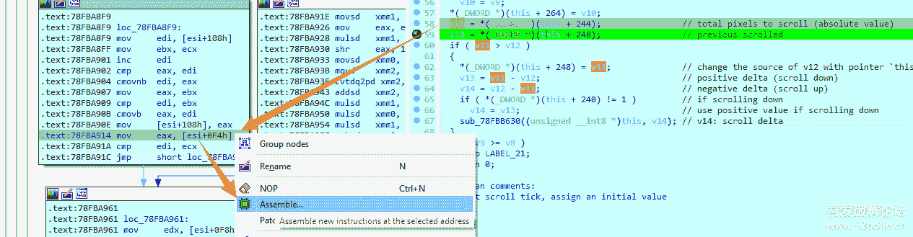

425330891-e4831dac-aaff-481c-8cde-d953726edb07.png (93.31 KB, 下载次数: 1)

[href="forum.php?mod=attachment&aid=Mjc2NDgyN3wwMDljNzVkNHwxNzkzNTcxMTA5fDE2ODA4NnwyMDE3NDQz&nothumb=yes" target="_blank"](https://www.52pojie.cn/forum.php?mod=attachment&aid=Mjc2NDgyN3wwMDljNzVkNHwxNzkzNTcxMTA5fDE2ODA4NnwyMDE3NDQz&nothumb=yes)

2025-3-22 02:17 上传

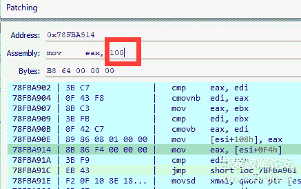

425331686-2866e08a-2f47-475c-b340-eaad60462d91.png (28.17 KB, 下载次数: 0)

[href="forum.php?mod=attachment&aid=Mjc2NDgyOHxhMjcxZTU3ZnwxNzkzNTcxMTA5fDE2ODA4NnwyMDE3NDQz&nothumb=yes" target="_blank"](https://www.52pojie.cn/forum.php?mod=attachment&aid=Mjc2NDgyOHxhMjcxZTU3ZnwxNzkzNTcxMTA5fDE2ODA4NnwyMDE3NDQz&nothumb=yes)

2025-3-22 02:17 上传

现在每次鼠标滚动都是常量了

下面就能点 `编辑 - 修补程序 - 将补丁应用到...`, 输出修改后的文件了

直接放到 `QQ` 文件夹替换掉就能修改成功

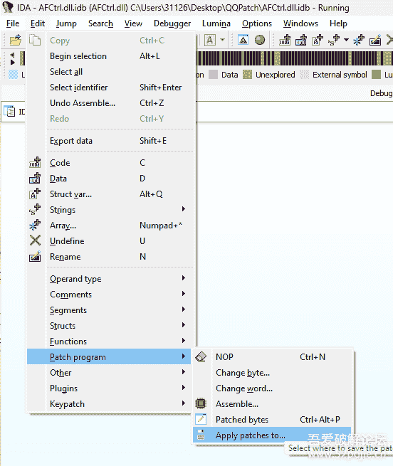

425333147-b5e02b3c-488b-4836-bbf1-a3348201559c.png (54.66 KB, 下载次数: 1)

[href="forum.php?mod=attachment&aid=Mjc2NDgyOXw1MjFhNWExZXwxNzkzNTcxMTA5fDE2ODA4NnwyMDE3NDQz&nothumb=yes" target="_blank"](https://www.52pojie.cn/forum.php?mod=attachment&aid=Mjc2NDgyOXw1MjFhNWExZXwxNzkzNTcxMTA5fDE2ODA4NnwyMDE3NDQz&nothumb=yes)

2025-3-22 02:18 上传

大功告成!

>

另外, 按 `Ctrl+Alt+P` 可以查看已修改的字节

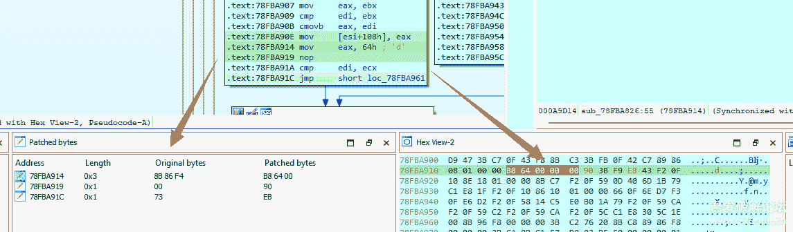

425333942-76d2b202-16f2-4f53-ae38-eaea530fbc46.png (64.82 KB, 下载次数: 0)

[href="forum.php?mod=attachment&aid=Mjc2NDgzMHwzZGI3YzMzZHwxNzkzNTcxMTA5fDE2ODA4NnwyMDE3NDQz&nothumb=yes" target="_blank"](https://www.52pojie.cn/forum.php?mod=attachment&aid=Mjc2NDgzMHwzZGI3YzMzZHwxNzkzNTcxMTA5fDE2ODA4NnwyMDE3NDQz&nothumb=yes)

2025-3-22 02:18 上传

### 去除平滑滚动 (消息列表)

用上面一样的方法找滚动高度值, 找出来之后查找写入, 给 `GF.dll+105DFB` - `sub [esi+00000200],ecx` 打断点

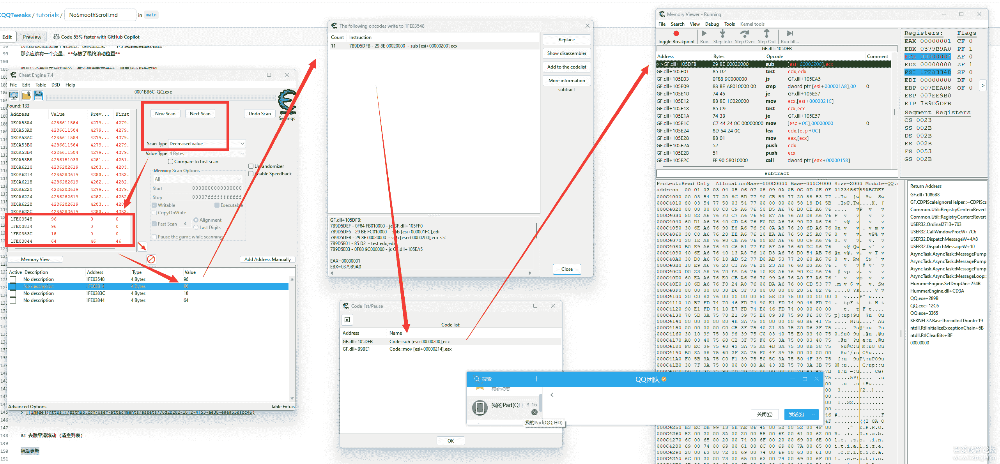

425464251-cc81039d-f1e7-4353-b8f0-daf3a965a74c.png (419.55 KB, 下载次数: 1)

[href="forum.php?mod=attachment&aid=Mjc2NDgzMXw0MDVkMjAzYXwxNzkzNTcxMTA5fDE2ODA4NnwyMDE3NDQz&nothumb=yes" target="_blank"](https://www.52pojie.cn/forum.php?mod=attachment&aid=Mjc2NDgzMXw0MDVkMjAzYXwxNzkzNTcxMTA5fDE2ODA4NnwyMDE3NDQz&nothumb=yes)

2025-3-22 02:18 上传

易发现每个滚动 tick 都会触发一次断点, 而且每个 tick 滚动的像素数在寄存器 `ecx`


(这里因为是对内存中的值进行减法, 所以往下滚动是减去负数, `FFFF FFE5` 转换为 `uint32` 是 -27)

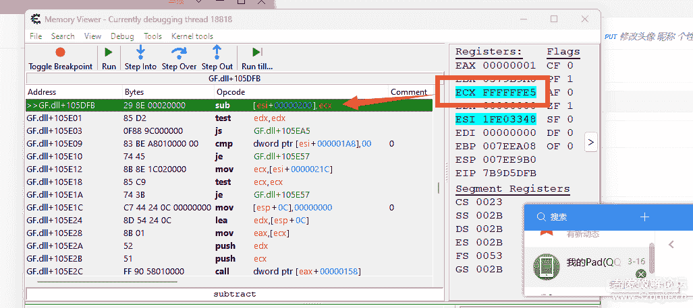

`425467676-6775bd37-6d72-49b9-af81-662c74ca4a5b.png` (82.29 KB, 下载次数: 0)

[href="forum.php?mod=attachment&aid=Mjc2NDgzMnwzMjgwNDFkOHwxNzkzNTcxMTA5fDE2ODA4NnwyMDE3NDQz&nothumb=yes" target="_blank"](https://www.52pojie.cn/forum.php?mod=attachment&aid=Mjc2NDgzMnwzMjgwNDFkOHwxNzkzNTcxMTA5fDE2ODA4NnwyMDE3NDQz&nothumb=yes)

2025-3-22 02:18 上传

这里不做汇编分析了, 直接上 IDA

发现是把 `v16` 赋给内存, `v16` 从 `a3` 来, `a3` 是入参

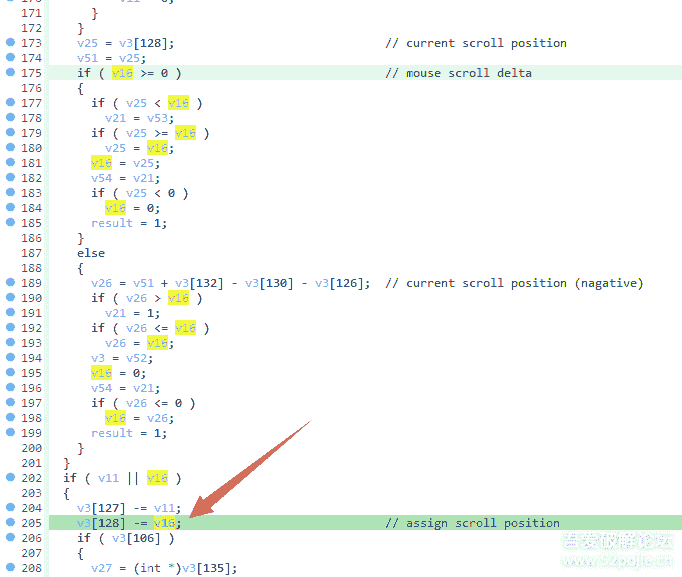

`425475570-91885ece-2df0-4ca5-9a5c-faa904a9297a.png` (52.07 KB, 下载次数: 0)

[href="forum.php?mod=attachment&aid=Mjc2NDgzM3xiZmVhYjAwNHwxNzkzNTcxMTA5fDE2ODA4NnwyMDE3NDQz&nothumb=yes" target="_blank"](https://www.52pojie.cn/forum.php?mod=attachment&aid=Mjc2NDgzM3xiZmVhYjAwNHwxNzkzNTcxMTA5fDE2ODA4NnwyMDE3NDQz&nothumb=yes)

2025-3-22 02:19 上传

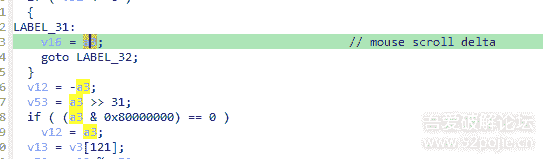

`425475749-ebb09ee5-0ec2-4b74-abaa-2ce11c65ec06.png` (14.36 KB, 下载次数: 0)

[href="forum.php?mod=attachment&aid=Mjc2NDgzNXwzMTQzODM3OXwxNzkzNTcxMTA5fDE2ODA4NnwyMDE3NDQz&nothumb=yes" target="_blank"](https://www.52pojie.cn/forum.php?mod=attachment&aid=Mjc2NDgzNXwzMTQzODM3OXwxNzkzNTcxMTA5fDE2ODA4NnwyMDE3NDQz&nothumb=yes)

2025-3-22 02:19 上传

但是调用这个函数的地方太多了, 我们还是打断点

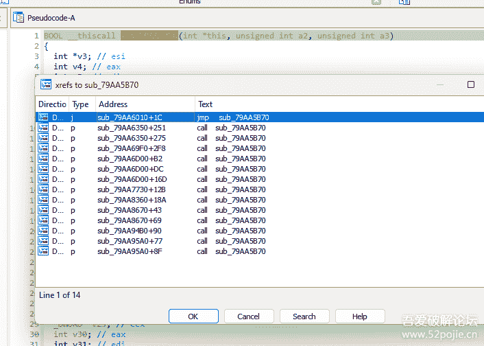

`425476261-3298150c-b2c8-4d6c-92e9-3fb0241eee20.png` (58.14 KB, 下载次数: 1)

[href="forum.php?mod=attachment&aid=Mjc2NDgzNHw4MDE5ZTc2NnwxNzkzNTcxMTA5fDE2ODA4NnwyMDE3NDQz&nothumb=yes" target="_blank"](https://www.52pojie.cn/forum.php?mod=attachment&aid=Mjc2NDgzNHw4MDE5ZTc2NnwxNzkzNTcxMTA5fDE2ODA4NnwyMDE3NDQz&nothumb=yes)

2025-3-22 02:19 上传

往上一翻就很明显了, 我们直接研究这个 `v4`

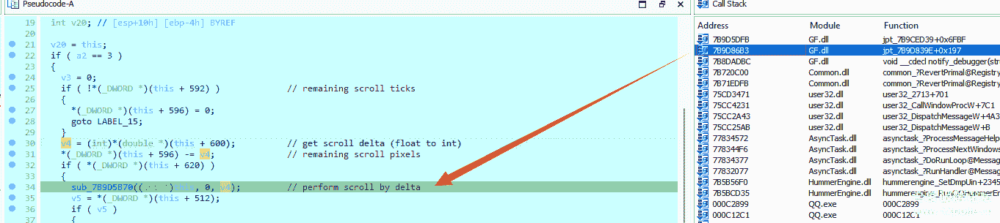

`425480478-7e53db2c-d538-4472-8047-8ca9605df405.png` (83.86 KB, 下载次数: 0)

[href="forum.php?mod=attachment&aid=Mjc2NDgzNnxlOGJlNWZkY3wxNzkzNTcxMTA5fDE2ODA4NnwyMDE3NDQz&nothumb=yes" target="_blank"](https://www.52pojie.cn/forum.php?mod=attachment&aid=Mjc2NDgzNnxlOGJlNWZkY3wxNzkzNTcxMTA5fDE2ODA4NnwyMDE3NDQz&nothumb=yes)

2025-3-22 02:19 上传

容易发现 `v4` 前面对 `*(_DWORD *)(this + 596)` 有一个减法运算

多打几次断点可以看出, `v4` 是当前 tick 滚动的距离, `this + 596` 存放剩余要滚动的像素数

那么我们的思路就是让滚动一步到位, 直接把剩余要滚动的总像素数, 作为传参

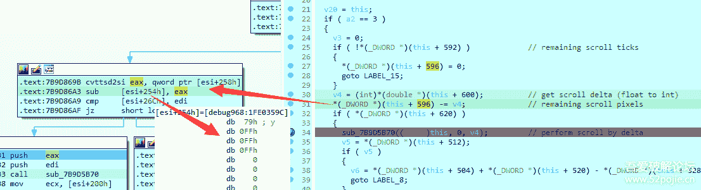

`425483280-2f1e6026-2116-487b-a922-7ff68cb36200.png` (68.18 KB, 下载次数: 1)

[href="forum.php?mod=attachment&aid=Mjc2NDgzN3w3MzQ1MTQ1NXwxNzkzNTcxMTA5fDE2ODA4NnwyMDE3NDQz&nothumb=yes" target="_blank"](https://www.52pojie.cn/forum.php?mod=attachment&aid=Mjc2NDgzN3w3MzQ1MTQ1NXwxNzkzNTcxMTA5fDE2ODA4NnwyMDE3NDQz&nothumb=yes)

2025-3-22 02:19 上传

把 `cvttsd2si eax, qword ptr [esi+258h]` 改为 `mov eax, [esi+254h]`

立即生效了

这里插播一个知识:

`cvttsd2si` 是 `double` 转 `int`, `qword ptr` 是 64 位指针, 跟 `[esi+258h]` 搭配使用

这里不能只修改地址, 否则类型就出错了, 一开始没留意发现修改之后无法滚动

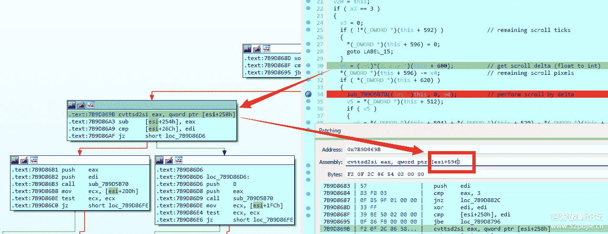

`425487404-d761f868-983c-4cab-998f-1d387d5e7c36.png` (102.54 KB, 下载次数: 1)

[href="forum.php?mod=attachment&aid=Mjc2NDgzOHxiYTljNDZmY3wxNzkzNTcxMTA5fDE2ODA4NnwyMDE3NDQz&nothumb=yes" target="_blank"](https://www.52pojie.cn/forum.php?mod=attachment&aid=Mjc2NDgzOHxiYTljNDZmY3wxNzkzNTcxMTA5fDE2ODA4NnwyMDE3NDQz&nothumb=yes)

2025-3-22 02:19 上传

如果你不追求细节, 那么修改到这里其实就可以了

但是修改完之后你再打断点会发现, 虽然滚动一步到位了但还是重复滚动了好几个 tick, 只不过每次的值都一样

要做完美, 就要把多余的滚动 tick 去掉

如果你从头开始打断点就会发现, 当滚动到最后一 tick 时, 这个 `if ( !*(_DWORD *)(this + 592) )` 会进入

可以判断这是个计数器, 指定要滚动多少个 tick 的

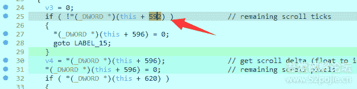

`425584706-15029e50-c5bc-4e43-8915-9e082a813ee0.png` (26.25 KB, 下载次数: 0)

[href="forum.php?mod=attachment&aid=Mjc2NDgzOXw5ZTRhNmM3ZXwxNzkzNTcxMTA5fDE2ODA4NnwyMDE3NDQz&nothumb=yes" target="_blank"](https://www.52pojie.cn/forum.php?mod=attachment&aid=Mjc2NDgzOXw5ZTRhNmM3ZXwxNzkzNTcxMTA5fDE2ODA4NnwyMDE3NDQz&nothumb=yes)

2025-3-22 02:20 上传

往下翻有一个地方是把 `this + 592` 清零的, 我们试试让它强制执行, 即第一个 tick 滚动完就将计数器清零

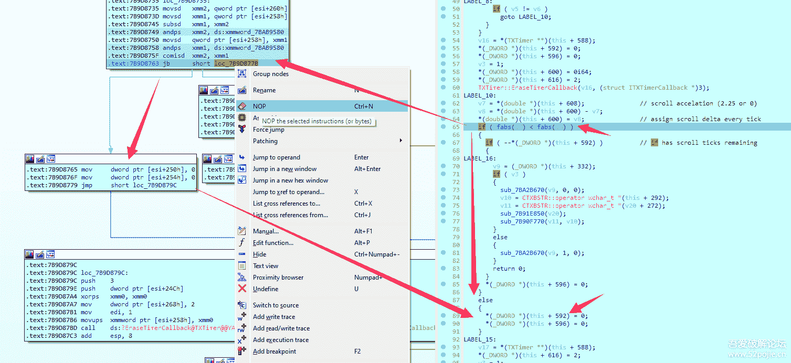

`425586463-c180c0c7-cbda-45a4-90fc-2394f9cca664.png` (182.67 KB, 下载次数: 0)

[href="forum.php?mod=attachment&aid=Mjc2NDg0MHxlYTc4ODJiNnwxNzkzNTcxMTA5fDE2ODA4NnwyMDE3NDQz&nothumb=yes" target="_blank"](https://www.52pojie.cn/forum.php?mod=attachment&aid=Mjc2NDg0MHxlYTc4ODJiNnwxNzkzNTcxMTA5fDE2ODA4NnwyMDE3NDQz&nothumb=yes)

2025-3-22 02:20 上传

调整后打断点实测这个函数只会触发一次了

修补完这两个地方之后, 主面板的平滑滚动也没了

至此完成!
